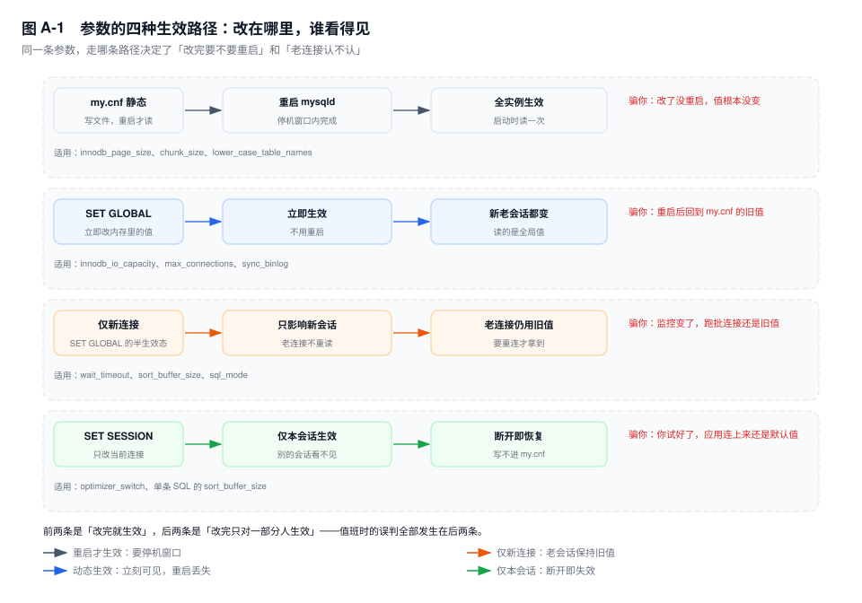
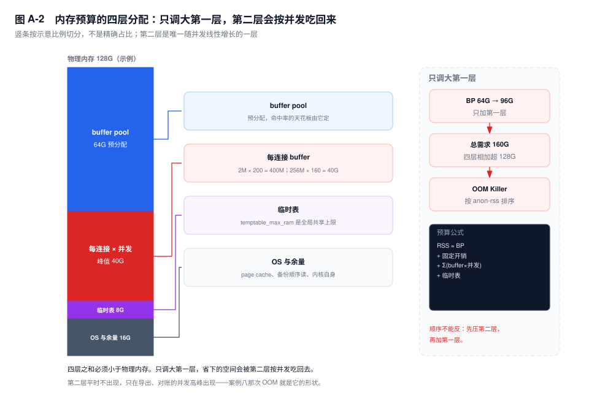

# 附录 A　参数速查表

> **一句话结论**：这张表的价值不在"默认值是多少"，而在"改了之后哪些会话会变、改错了要付什么代价"——最后两列决定你敢不敢在值班时动手。

## A.0 怎么用这张表

八十五行，分六组，只收正文里出现过的参数。MySQL 有几百个系统变量，把 `SHOW VARIABLES` 抄一遍不解决任何问题——真正影响一条订单查询延迟的，永远是其中十来个。

用之前先记住三件事。

**一、参数不是越多越好。** 第 40 章的四套模板里，OLTP 那套只动了九个参数；A.8 挑出的八个，覆盖线上八成以上的收益。剩下的七十多行，改对了是锦上添花，改错了是新的故障源。看到一份"60 项 MySQL 优化清单"就整段照抄，等于把别人的假设搬到自己机器上。

**二、先看"生效方式"，再看"推荐值"。** 静态参数写错，代价是一次停机；"动态·仅新连接"的参数写错，代价是监控上看到它变了、跑批的那个连接却还在用旧值，然后花两小时怀疑人生。改之前先确认它属于哪一档，比背下推荐值重要得多。

**三、表里的区间是起点。** 同样是 128G 内存，独占物理机和 8G 容器算出来的 buffer pool 能差一个数量级。落到自己机器上，按第 51 章那三个乘法重算：工作集装不装得下、每秒物理读几次、每秒返回多少字节。算不出来，说明还不该改。

默认值一列写成 `64M / 16M` 这种形式时，前者是 5.7、后者是 8.0；写 `—` 的表示 5.7 里没有这个参数（多数是 8.0 新增的），不是"我不确定"。

## A.1 参数改动的三条铁律

**一、先量后调。** 没有基线的调参是赌博。第 37 章讲的所有计数器都要两次采样求差：`Innodb_buffer_pool_reads` 在一个跑了 90 天的实例上是几十亿，绝对值毫无意义；`Threads_running` 的瞬时值也说明不了什么，要看它在一个业务周期里的分布。少了这个起点，你分不清"参数生效了"和"高峰过去了"——这两件事在监控图上长得一模一样。

**二、一次只改一个。** 同时改三个参数，出了事你不知道是谁；回滚时也不知道该回滚哪个。更麻烦的是它们会互相抵消：把 `sort_buffer_size` 调小、同时把 `temptable_max_ram` 调大，磁盘临时表下来了，你归功于后者，其实是前者让排序提前落盘、临时表反而变小。一次一个，每个至少观察一个完整的业务周期，账单库要覆盖到月末出账那一天。

**三、记住它是不是静态的。** `innodb_buffer_pool_size` 在 8.0 可以在线调，粒度是 chunk，加内存基本无痛；但 `innodb_page_size` 从初始化那一刻就定了，`innodb_buffer_pool_chunk_size` 是只读变量，`lower_case_table_names` 只能在 `--initialize` 时指定。`innodb_log_file_size` 更典型：8.0.30 之前改它要重启，启动过程还要"删旧文件、建新文件"；8.0.30 起它已废弃，写了也不生效；8.4 直接移除，配置里留着就起不来。

半生效状态还有一类：`SET GLOBAL` 改了 `wait_timeout`、`sort_buffer_size`、`sql_mode`，只有新建立的连接拿到新值，老连接仍是旧值。值班时最常见的误判就是"我改了，监控上也变了，怎么还这样"——因为出问题的那个连接池，是在改之前建的。想让它立刻生效，只能让应用重连，或者 `KILL` 掉那批会话（动手前先按附录 D 的 D6 确认它们没挂着事务）。

图 A-1 把四条路径画在一起，每条配了一句"它会在值班时怎么骗你"。看一遍，比背十个默认值有用。

## A.2 内存

内存参数只有两类，算错的后果完全相反。

一类是**预分配的固定预算**：`innodb_buffer_pool_size` 及它的分片，启动时向系统要这么多，之后基本不动。这类算小了，命中率上不去，物理读变多，P99 抖；算大了，同机上的备份、监控 agent、OS page cache 被挤，表现为"命中率漂亮但提交延迟周期性尖跳"。

另一类是**按连接乘出来的浮动预算**：`sort_buffer_size`、`join_buffer_size`、`read_buffer_size` 这些，只有语句真需要时才分配，用完也不一定马上还给系统。这类平时看不出来，一到导出、对账的并发高峰就成了第 41 章案例八那次 OOM：160 个任务 × 256MB ≈ 40G，跟 buffer pool 一点关系没有，但两者抢的是同一块物理内存。

有一个容易忽略的事实：`[8.0]` 默认 `internal_tmp_mem_storage_engine=TempTable`，内部临时表的内存阈值是 `temptable_max_ram`，`tmp_table_size` 根本不参与。这就是"我明明把它调大了，磁盘临时表还是那么多"的答案；`[5.7]` 只有 MEMORY 引擎，才轮到 `min(tmp_table_size, max_heap_table_size)` 说话。

该动哪一个，由三个计数器决定。`Innodb_buffer_pool_reads` 求差得到每秒物理读，它涨说明池子装不下，或者查询在白扫；`Innodb_buffer_pool_wait_free` 只要在涨，就说明有用户线程为了拿一个空页等过刷脏，那是预算或刷脏能力的问题，不是命中率的问题；`Created_tmp_disk_tables / Created_tmp_tables` 的比值决定临时表阈值该不该动。三个数分别指向预算、刷脏、临时表，别指望一个参数同时解三个问题。

剩下两个参数在新实例上基本不用动：`key_buffer_size` 只服务 MyISAM，8.0 的默认引擎是 InnoDB，调大纯属浪费；`table_open_cache` 的判据也不是"越大越保险"，而是 `Opened_tables` 是否持续增长，不增长就说明够用，再加只会让 flush 时遍历的链表更长。

| 参数名 | 默认值 | 推荐区间 | 改动风险 | 生效方式 |
|---|---|---|---|---|
| `innodb_buffer_pool_size` | 128M / 128M | 独占机物理内存 70~80%；共部署 50~60%；容器 `limit − max_conn×单连接开销 − 1~2G` | 缩容要先把 chunk 里脏页刷出去，等于自造一次 IO 风暴；调大必须同步加 `io_capacity` | 动态（8.0，chunk 粒度，向上取整到 `chunk_size × instances`） |
| `innodb_buffer_pool_instances` | 8 / 8 | `BP ÷ 1GB` 向下取整，上限 8~16；BP < 1GB 时实际只有 1 个 | 切太碎每片 LRU 变薄，热点按 `page_id % instances` 固定映射，会出现一个实例先满 | 静态 |
| `innodb_buffer_pool_chunk_size` | 128M / 128M | 保持 128M；BP 不是它整数倍时才考虑改 | 只读变量，改必须重启；改大让 BP 向上取整浪费更多 | 静态 |
| `innodb_log_buffer_size` | 8M / 16M | 16~64M；大事务多、写入密集取 64M | 只是落盘前的暂存区，调大不减少 `fsync` 次数 | 动态 |
| `sort_buffer_size` | 256K / 256K | OLTP 256K~2M；报表实例 ≤32M 且并发必须限死 | 每连接、每个排序步骤各一份，× `Threads_running` 是 OOM 头号来源 | 动态·仅新连接 |
| `join_buffer_size` | 256K / 256K | 256K~4M；8.0.18+ 的 hash join 也用它 | 每个 BNL / hash join 一份，几十万行的哈希表会落盘 | 动态·仅新连接 |
| `read_buffer_size` | 128K / 128K | 128K~1M | 每张被顺序扫描的表一份，大表全扫时叠加 | 动态·仅新连接 |
| `read_rnd_buffer_size` | 256K / 256K | 256K~1M | 按行号回读时分配，rowid 排序的回表阶段会放大 | 动态·仅新连接 |
| `tmp_table_size` | 16M / 16M | 16~64M，且必须与 `max_heap_table_size` 相等 | `[8.0]` 默认 TempTable 下不控制溢出，改了没反应；不等时只有小值生效 | 动态·仅新连接 |
| `max_heap_table_size` | 16M / 16M | 与 `tmp_table_size` 取同一个值 | MEMORY 引擎取两者 `min()`，调大不调另一个等于白调 | 动态·仅新连接 |
| `temptable_max_ram` | — / 1G | 1~4G，按"并发临时表数 × 单表大小"反推 | 全局共享上限，不是每会话；调太大把磁盘压力换成 OOM 压力 | 动态 |
| `temptable_max_mmap` | — / 1G | 0（关闭 mmap）或 1~4G | 设 0 后溢出直接落 InnoDB 临时表空间，磁盘 IO 上升 | 动态 |
| `key_buffer_size` | 8M / 8M | 8~64M；库里没有 MyISAM 表就保持 8M | 只服务 MyISAM，InnoDB 用不到，调大是纯浪费 | 动态 |
| `table_open_cache` | 2000 / 4000 | 2000~8000；判据是 `Opened_tables` 是否持续增长 | 每个打开的表占一个 handler 与 fd，调大要同步看 `open_files_limit` | 动态 |

### 这一组里最该先动的三个

**`innodb_buffer_pool_size`。** 它是唯一能改变命中率天花板的参数：`池子 ÷ 表大小` 决定上限，40G 的池装 192G 的表，天花板就是 20.8%，调到 80G 才有意义。动它之前先按第 51 章算工作集，动完必须把 `io_capacity` 一起抬——池子大了，脏页积压的绝对量也成倍增长，刷脏预算不跟，P99 会比调之前更差。

**`sort_buffer_size`（往下调）。** 线上绝大多数的 OOM 不是 buffer pool 太大，是它被设成了 128M、256M。它只决定"内存排序装不装得下"，装得下也不会更快；而账单按"并发 × 份数"结账。OLTP 实例回到 256K~2M，报表需求用独立实例或限流解决。

**`temptable_max_ram` + `innodb_buffer_pool_instances`。** 前者决定 8.0 的 `GROUP BY`、`DISTINCT` 在内存还是磁盘，后者决定池子的锁争用。两个都别凭感觉：实例数看"每片是否 ≥1GB"，临时表阈值看 `Created_tmp_disk_tables / Created_tmp_tables` 的比值，而不是绝对值。

## A.3 IO

这一组改两件事：每秒能做多少 IO，以及提交时愿意等几次 `fsync`。两个方向的错都很常见——预算给低了，checkpoint 追不上脏页，用户线程被拉去同步刷页；给高了，page cleaner 吃满设备带宽，binlog 的 `fsync` 和同机其他实例的读一起抖。默认值 200 是机械盘时代的数，一块 5 万 IOPS 的 NVMe 上用 200，等于把设备当成了 2010 年的 SATA 盘。

还有一条顺序上的约束：`innodb_io_capacity` 描述的是"每秒 16KB 页的随机写次数"，不是带宽。它在 page cleaner 那一侧被消费，和 buffer pool 的大小是一对——池子扩大一倍而预算不动，脏页产生的速率翻倍，刷脏速率不变，checkpoint 年龄只会涨得更快。

预算给没给对，只看一个比值：`Log sequence number − Last checkpoint at` 除以 redo 总容量。日峰值长期高于 70%，说明刷脏预算或 redo 容量偏小；长期低于 20%，说明给多了，崩溃恢复的单线程重放被无谓拉长。`[8.0.30+]` 之后这两个数能从 `performance_schema.global_status` 直接取（`Innodb_redo_log_current_lsn` 与 `Innodb_redo_log_checkpoint_lsn`），不必解析 `INNODB STATUS`。

`innodb_flush_method` 的默认值 `fsync` 意味着数据文件读写仍然经过 page cache，这部分内存要算进 A.8 的第四层。改成 `O_DIRECT` 之后，page cache 只服务 binlog 与备份，预算会宽松一些，代价是小 IO 的合并收益没了——云盘上先在从库试一轮，别在主库上直接改。

| 参数名 | 默认值 | 推荐区间 | 改动风险 | 生效方式 |
|---|---|---|---|---|
| `innodb_io_capacity` | 200 / 200 | 设备 16KB 随机写 IOPS 的 50~70% | 低了 checkpoint 年龄上涨、70% 以上前台写入被拦；高了设备层排队、`await` 飙升 | 动态 |
| `innodb_io_capacity_max` | 2000 / 2000 | `io_capacity` 的 1.5~2 倍 | 突发上限，设太高会把 binlog `fsync` 的延迟一起拖下去 | 动态 |
| `innodb_flush_neighbors` | 1 / 0 | SSD/NVMe 设 0；HDD 设 1 | 从 5.7 升上来、配置里显式写 1 的实例，升级不会帮你改回 0 | 动态 |
| `innodb_flush_method` | NULL / `fsync`（Unix） | 有电池保护的阵列或云盘按厂商建议用 `O_DIRECT`；8.0.14+ 可试 `O_DIRECT_NO_FSYNC` | 绕过 page cache 后，备份顺序读的收益下降；改它要重启 | 静态 |
| `innodb_flush_log_at_trx_commit` | 1 / 1 | 1（账单、支付、库存不可交易） | 2 只丢 OS 崩溃/掉电的约 1 秒；0 连 `mysqld` 崩溃也丢；2 还可能丢掉"可恢复性" | 动态 |
| `innodb_doublewrite` | ON / ON | ON；8.0.30+ 灰度期可用 `DETECT_ONLY` 观察 | 关掉省近一半写，代价是 partial write 无法恢复 | 动态（8.0.30+）/ 静态（更早版本） |
| `innodb_redo_log_capacity` | — / 100M | 峰值 redo 速率 × 300~600 秒，常见 4~8G | 太大让崩溃恢复的单线程重放变长；它只买时间，不改斜率 | 动态（8.0.30+） |
| `innodb_log_file_size` | 48M / 48M | 8.0.30 前：1~2G | 8.0.30 起废弃（配了不生效），8.4 移除（留着启动失败）；改它要重启并重建文件 | 静态 |
| `innodb_log_files_in_group` | 2 / 2 | 8.0.30 前保持 2 | 与上一条同时废弃/移除；容量只看 `innodb_redo_log_capacity` | 静态 |
| `innodb_page_cleaners` | 4 / 4 | `min(CPU 核数, 8)~16` | 超过 `buffer_pool_instances` 无意义；线程多了争用反而上升 | 静态 |
| `innodb_max_dirty_pages_pct` | 75 / 90 | 写密集 70~80；读多写少 90 | 调低让刷脏更早启动，写放大上升；调高把风险留给突发 | 动态 |
| `innodb_lru_scan_depth` | 1024 / 1024 | 512~2048，大池取大 | 每轮扫描深度 × cleaner 数就是刷脏开销，调大等于让 cleaner 更贪心 | 动态 |
| `innodb_use_native_aio` | ON / ON | Linux 保持 ON | 容器、网络盘不支持时启动直接失败；关掉后 IO 提交退回同步 | 静态 |

### 这一组里最该先动的三个

**`innodb_io_capacity`（连同 `_max`）。** 它是 checkpoint 推进速度的油门，默认 200 几乎一定偏小。按设备 16KB 随机写 IOPS 的 50~70% 设，然后看 `Log sequence number − Last checkpoint at` 除以容量的日峰值：长期高于 70% 说明还不够，低于 20% 说明给多了。

**`innodb_redo_log_capacity` `[8.0.30+]`。** 默认 100M 只适合玩具库。按"峰值 redo 生成速率 × 你能容忍的刷脏窗口"反推，账单库晚间批量 20MB/s、想撑 5 分钟就是 6G 量级。但记住它买的是时间：容量再大，只要刷脏速率低于脏页产生速率，checkpoint 迟早追平。

**`innodb_flush_log_at_trx_commit`（守住 1）。** 这一行不是调优项，是 RPO 开关。改成 2 省下的是每次提交的一次 `fsync`，抵押的是"操作系统崩溃丢最近约 1 秒"；要吞吐就走组提交，别动它。

## A.4 并发与连接

这一组是入口。绝大多数"连接数不够"不是 `max_connections` 小，是连接池泄漏，或者一个开着事务的 `Sleep` 连接把名额占死了——第 41 章案例一里，`Threads_connected` 贴着上限，`Threads_running` 只有个位数，加连接上限只是把死亡时间往后推。

连接数真正的成本不是连接本身，是它背后的乘法：每个连接有线程栈（`thread_stack` 1MB 量级）加 net buffer（初始 16KB，可长到 `max_allowed_packet`），1000 个空闲连接先占 1GB 出头；真正的风险是它们同时开始排序。所以 `max_connections` 的上限应该由"物理内存 ÷ 单连接最坏开销"倒推，而不是由"业务说有 800 个并发"决定。

`wait_timeout` 是这一组里最容易被误判的一个。它按会话生效，`SET GLOBAL` 只影响新连接；如果应用连接池的 idle 回收是 30 分钟、`wait_timeout` 是 8 小时，池子里的连接会一直挂着，而你在监控上看到的值早就变成新的了。

三个计数必须一起读：`Threads_connected` 是占了多少位子，`Threads_running` 是真正在干活的有几个，`Max_used_connections` 是历史峰值。占到 900、干活只有 8，那是连接池漏了或者长事务占着不放；两个都贴着上限，才是真并发压力。前者的解法在应用侧，后者才轮到参数。把这两种情况混成一个"连接数不够"，加多少上限都会被吃回去。

线程缓存这一项在 8.0 上不用管：`thread_cache_size=-1` 会按 `max_connections` 自动 sizing。5.7 上才需要看 `Threads_created` 的增速，持续增长说明每次建连都在走内核 clone，设成 32~64 通常足够。

| 参数名 | 默认值 | 推荐区间 | 改动风险 | 生效方式 |
|---|---|---|---|---|
| `max_connections` | 151 / 151 | `峰值 Threads_running × 1.5~2`，且 ≤ 物理内存 ÷ 单连接最坏开销 | 设大不解决泄漏，只让 OOM 更近；每连接还有 fd 与线程栈 | 动态 |
| `back_log` | 80 / 151 | 512~1024（短连接、突发建连多） | 超过内核 `somaxconn` 的部分无效，值再大也排不进去；8.0 由 `max_connections` 自动推导 | 静态 |
| `thread_cache_size` | 9 / -1 | 8.0 保持 -1 自动；5.7 按 `Threads_created` 增速设 32~64 | 缓存的是线程栈，设太大白占内存 | 动态 |
| `table_open_cache_instances` | 16 / 16 | 保持 16 | 只在高并发 + 上千张表时有意义；改它要重启 | 静态 |
| `innodb_thread_concurrency` | 0 / 0 | 0（不限制）；只在 `wait/synch/*` 主导时从 2×核数往下试 | 设小了，等锁、等 IO 的线程也占名额，能跑的反而更少 | 动态 |
| `innodb_read_io_threads` | 4 / 4 | 4~8，NVMe 取 8 | 超过设备队列深度只是增加上下文切换 | 静态 |
| `innodb_write_io_threads` | 4 / 4 | 4~8，与 `io_capacity` 一起看 | 同上；写线程多不等于刷得快，预算在 cleaner 那侧 | 静态 |
| `innodb_lock_wait_timeout` | 50 / 50 | OLTP 5~20；批量任务单独会话设大 | 调小让长事务更早报 1205，业务必须有重试；调大让故障扩散更慢被发现 | 动态·仅新连接 |
| `lock_wait_timeout` | 31536000 / 31536000 | 全局保持默认；DDL 用会话级 60~300 | 全局调小会让在线 DDL 频繁超时，留下中间态 | 动态·仅新连接 |
| `innodb_deadlock_detect` | ON / ON | ON；秒杀类热点可关，同时把 `lock_wait_timeout` 降到 5~10 | 关掉后死锁靠超时解，RT 从毫秒变秒级 | 动态 |
| `innodb_print_all_deadlocks` | OFF / OFF | 排障期 ON，定位完关掉 | 每次死锁写一条错误日志，高频死锁时本身成为 IO 源 | 动态 |
| `max_execution_time` | 0 / 0 | OLTP 0；报表 2000~10000 ms（会话级或 hints） | 只对只读 `SELECT` 生效，`UPDATE`/`DELETE` 一律不管 | 动态·仅新连接 |
| `wait_timeout` | 28800 / 28800 | 600~1800，且小于连接池 idle 回收时间 | 改小只对新连接生效；老连接要 `KILL` 才走，挂事务的会进回滚 | 动态·仅新连接 |
| `interactive_timeout` | 28800 / 28800 | 600（仅命令行）；业务连接不要靠它 | 只对交互式客户端生效，拿它当 `wait_timeout` 用是常见误配 | 动态·仅新连接 |

### 这一组里最该先动的三个

**`max_connections`（先往下核，不是往上加）。** 用 `Max_used_connections ÷ max_connections` 看历史峰值水位，超过 80% 再谈扩容；同时按附录 D 的 D29 按来源聚合，确认是池子漏了还是副本数乘多了。公式是 `max_connections × 0.8 ÷ 应用副本数`，反推每个池该配多少。

**`wait_timeout`。** 让它略大于连接池的 idle 回收时间，比如池子 10 分钟回收、它就设 900 秒。这样连接由应用主动关，而不是被服务端收割——被收割的连接在池子里是"死连接"，下一次借出就是一次报错。

**`innodb_lock_wait_timeout`。** 50 秒对一个下单请求是灾难：用户等 50 秒拿到 1205，重试又把压力翻倍。OLTP 设 5~20 秒，让失败快速暴露；批量对账用会话级单独放大，不要全局放宽。

## A.5 复制

复制参数分三摊：写日志的格式与容量、回放并行的线程、以及"从库能不能被写"的围栏。这一组的共同点是**改错的症状出现得很晚**——格式改错，可能两周后对账才发现少了一段库存流水；半同步超时设太大，主库抖动时写入被拖死；`read_only` 以为什么都挡住了，其实 root 账号照样能写。

命名上还有一层坑：`[8.0.26+]` 起 `MASTER_*` / `SLAVE_*` 改成 `SOURCE_*` / `REPLICA_*`，旧名作为别名保留。监控脚本里写旧名不会报错，只会"查不到值"，于是半同步降级几个月没人发现。改参数时顺手把监控项一起对齐。

默认配置下，一条事务在复制链路上有三次关键 `fsync`：主库 binlog（`sync_binlog`）、从库 binlog（`log_replica_updates`）、从库 redo（`innodb_flush_log_at_trx_commit`）；relay log 那一次被 `sync_relay_log=10000` 摊薄，因为它是可丢弃的中间态。改这一组里任何一个，先说清你动的是哪一次——把从库的 `innodb_flush_log_at_trx_commit` 改成 2，省下的是从库的提交延迟，抵押的是"从库崩溃后不再是一个能独立恢复的实例"。

`read_only` 与 `super_read_only` 合成一行，是因为它们必须一起看：前者挡不住有 SUPER 权限的账号，后者挡得住，但不中断已在执行的事务，也不拦复制线程。从库被写脏的现场，十次有九次是"配了 `read_only`，业务连上来用的却是 root"。

| 参数名 | 默认值 | 推荐区间 | 改动风险 | 生效方式 |
|---|---|---|---|---|
| `binlog_format` | ROW / ROW | ROW | 改 STATEMENT 会让 `NOW()`、用户变量、RC 隔离级别在从库上分叉 | 动态 |
| `binlog_row_image` | FULL / FULL | FULL；只有确定下游工具都认才用 MINIMAL | MINIMAL 省日志，但闪回、CDC、部分审计工具拿不到完整前镜像 | 动态 |
| `binlog_expire_logs_seconds` | — / 2592000 | 备份周期 + 2 天，常见 604800~1209600；0 = 永不过期 | 设 0 是磁盘爆满的常见原因；有从库时清理要确认位点已被拉走 | 动态 |
| `expire_logs_days` | 0 / 0（已废弃） | 不要再用，换 `binlog_expire_logs_seconds` | 8.0 废弃、8.4 移除；写进 `my.cnf` 会让 8.4 启动失败 | 动态（已废弃） |
| `sync_binlog` | 1 / 1 | 1 | 设 0 时 OS 崩溃会丢 binlog，主从与备份同时缺同一段，PITR 补不回来 | 动态 |
| `gtid_mode` | OFF / OFF | 新实例 ON | OFF→ON 要按 OFF / OFF_PERMISSIVE / ON_PERMISSIVE / ON 四步走，不能跳 | 动态 |
| `enforce_gtid_consistency` | OFF / OFF | ON，且必须在 `gtid_mode` 之前开 | 开启后 `CREATE TABLE ... SELECT`、事务内临时表要改写 | 动态 |
| `binlog_group_commit_sync_delay` | 0 / 0 | 0；高并发写入试 100~1000 微秒 | 每个事务多等这么久换吞吐，低并发时纯亏 | 动态 |
| `binlog_group_commit_sync_no_delay_count` | 0 / 0 | 与上一条配合，10~100 | 攒够条数就提前放行，两个要一起调 | 动态 |
| `replica_parallel_workers` | 0 / 4（8.0.27+） | 4~16，不超过 CPU 核数 | 主库并发低时，worker 多了只是空转占内存 | 动态 |
| `replica_parallel_type` | DATABASE / LOGICAL_CLOCK | LOGICAL_CLOCK | 改类型要先停 SQL 线程；DATABASE 在同库多表写入时几乎不并行 | 动态 |
| `replica_preserve_commit_order` | OFF / ON | ON | 关掉会让从库出现"后提交的事务先生效"，读到中间态 | 动态 |
| `rpl_semi_sync_source_enabled` | OFF / OFF | RPO=0 的账单、支付业务设 ON | ACK 超时后静默降级为异步，状态从 ON 变 OFF，不报错 | 动态 |
| `rpl_semi_sync_source_timeout` | 10000 / 10000 | 1000~3000（业务能接受的提交延迟上限） | 太大时主库抖动会把写入线程拖死；太小则频繁降级 | 动态 |
| `relay_log_recovery` | OFF / ON | ON | 崩溃后丢弃未执行的 relay log 并重传，延迟放大量等于崩溃时的积压 | 静态 |
| `read_only` / `super_read_only` | OFF / OFF | 从库双 ON，写进配置文件 | `SET GLOBAL read_only=OFF` 会连带关掉 `super_read_only`；已执行的事务不中断 | 动态 |

### 这一组里最该先动的三个

**`sync_binlog` 与 `innodb_flush_log_at_trx_commit` 成对确认。** 这两个构成常说的"双 1"，缺一个，崩溃时 binlog 与 redo 就对不上，恢复出来的库可能比备份还旧。改任何一个之前，先问清楚业务的 RPO 是 0 还是"能丢几秒"。

**`rpl_semi_sync_source_enabled` + `_timeout`。** 半同步的价值全在"超时之后它还开不开着"。默认 10 秒的等待对一个下单接口太长，设 1~3 秒；同时把 `Rpl_semi_sync_source_status` 单列成监控项——它降级的方式是"值变成 OFF"，不是报错。

**`replica_parallel_workers` + `replica_preserve_commit_order`。** 延迟卡在回放段时，先加 worker，再看 commit order 有没有把并行度吃掉。`[8.0]` 默认 4 个 worker 加保序，对同库多表写入已经够用；主库是单表热点写入时，加 worker 没用，得回到第 25 章拆事务。

## A.6 优化器

优化器参数几乎都不是"调优"，是"改估算路径"。它们不会让一条 SQL 逐渐变快，只会在某个阈值两侧让计划整体翻转——199 个值和 201 个值走两条不同的估算路径，索引可能整个换一个。所以这一组的原则是：**默认值不要动，要动就按会话动，并且带着 EXPLAIN 前后对照**。

成本模型这一块有个流传很广的误会。MySQL 没有 `optimizer_cost_model` 这个系统变量，成本常量放在 `mysql.server_cost` 与 `mysql.engine_cost` 两张表里；`optimizer_index_cost_adj` 是 Oracle 的参数，MySQL 里根本不存在。把这两个写进 `my.cnf`，`mysqld` 启动会直接报 unknown variable——一份抄来的"优化模板"能让实例起不来，多半就是这类条目。

两个阈值造成的是计划断层，不是缓慢退化。`IN` 列表 199 个值走 index dive，201 个值退回统计估算，中间没有过渡；`range_optimizer_max_mem_size` 超限后，优化器直接放弃 range 分析退化成全表扫，只在 `SHOW WARNINGS` 里留一句 `Memory capacity ... exceeded`。计划突然变了，先查这两个数与统计信息新旧，再怀疑优化器有 bug。

`information_schema_stats_expiry` 是 8.0 特有的坑：默认 86400 秒，`SHOW TABLE STATUS` 读的是缓存，行数可能是一天前的。诊断时看到行数与 `COUNT(*)` 差一个量级，先看这个值，再怀疑统计信息坏了——把会话级的它置 0 再查一次，是最快的分辨方法。

| 参数名 | 默认值 | 推荐区间 | 改动风险 | 生效方式 |
|---|---|---|---|---|
| `optimizer_switch` | 一串 flag（`index_merge=on,mrr=on,batched_key_access=off`…） | 只 `SET SESSION` 改单条；全局保持默认 | 全局改等于让所有查询一起承担你的假设 | 动态·仅新连接（全局）/ 动态（会话） |
| `eq_range_index_dive_limit` | 200 / 200 | 200；`IN` 列表接近这个数就拆批 | 调大增加每次优化的 B+ 树探测次数；跨过阈值计划会突变 | 动态·仅新连接 |
| `range_optimizer_max_mem_size` | 8M / 8M | 8~64M，前提是 `IN` 列表真的需要 | 超限后直接放弃 range 分析退化成全表扫，只在 `SHOW WARNINGS` 里留一句 | 动态·仅新连接 |
| `optimizer_search_depth` | 62 / 62 | 62；10 表以上 join 可降到 8~16 | 降低可能错过更优连接顺序，只该在会话级试 | 动态·仅新连接 |
| `optimizer_prune_level` | 1 / 1 | 1 | 设 0 变成穷举，优化耗时随表数指数上升 | 动态·仅新连接 |
| `optimizer_cost_model` / `optimizer_index_cost_adj` | — | 用 `mysql.server_cost`、`mysql.engine_cost` 两张表 | 两个都不是 MySQL 变量：前者是概念名，后者是 Oracle 参数；写进配置会让启动失败 | — |
| `innodb_stats_persistent` | ON / ON | ON | 关掉后退回内存统计，重启即丢，计划会周期性抖动 | 动态 |
| `innodb_stats_persistent_sample_pages` | 20 / 20 | 20~128；大表、倾斜列取大 | 采样页数增加 `ANALYZE` 的耗时与 IO，亿级表可能跑到分钟级 | 动态 |
| `innodb_stats_auto_recalc` | ON / ON | ON；批量导入后手工补一次 `ANALYZE` | 触发条件是变更行数超过约 10%，只读归档表可能一年不更新 | 动态 |
| `innodb_stats_on_metadata` | ON / OFF | OFF | 开了之后 `SHOW TABLE STATUS`、查 `information_schema` 都会触发采样 | 动态 |
| `information_schema_stats_expiry` | — / 86400 | 0（要准确值）或 86400（要快） | 设 0 后每次 `SHOW TABLE STATUS` 都读引擎统计，几千张表时明显变慢 | 动态 |
| `histogram_generation_max_mem_size` | — / 20M | 20~256M，大表建直方图时调大 | 超限会降采样，直方图桶边界失真 | 动态 |
| `derived_merge`（`optimizer_switch` 的 flag） | on / on | on | 关掉后派生表强制物化，`EXPLAIN` 多一行 `derived`，临时表变大 | 动态（会话） |
| `max_seeks_for_key` | 2^64−1 / 2^64−1 | 保持默认 | 调小会强制优化器优先用索引，可能选到选择性很差的索引 | 动态·仅新连接 |

### 这一组里最该先动的三个

**`innodb_stats_persistent_sample_pages`。** 计划突变的第一嫌疑不是优化器坏了，是统计信息太旧或采样太少。默认 20 页在亿级表上误差很大，账单表、订单表调到 64~128，再跑一次 `ANALYZE TABLE`，比改任何开关都有效。

**`eq_range_index_dive_limit`（知道边界，不要改）。** 它解释的是"为什么 `IN` 里多加两个值，计划就变了"。遇到这种抖动，正确动作是把 `IN` 拆成批，而不是把阈值调到一万——调大之后每次优化都要多探测几百次 B+ 树，整体变慢。

**`innodb_stats_on_metadata`（确认是 OFF）。** 这一条在 5.7 升 8.0 时经常被配置文件里的显式 `ON` 带过来。它开着的时候，任何一次 `SHOW TABLE STATUS` 都可能触发采样，管理后台一刷新就是一轮 IO。

## A.7 日志与其他

这一组看起来最无害，实际最容易埋雷：慢日志开太大把盘写满、`general_log` 忘了关、`sql_mode` 一改严老代码集体报错。它们的共同点是"改了不会立刻报错"，所以没人给它设回滚点。

日志类参数的取舍只有一个判据：**它记录的东西，你有没有真的去读**。`long_query_time` 设 0.1 秒、慢日志一天几十 GB，没人看得完，等于没开；`log_queries_not_using_indexes` 打开后小表全扫也记，日志量翻十倍，真正的问题被淹掉。先定"谁在什么时间看这份日志"，再定阈值。

`performance_schema` 相关三项要单独说：它是内存换可观测性，`digests_size` 满了之后新出现的 SQL 会被归并到一条兜底行，**这些语句的耗时就不再有归属**。榜单总耗时明显小于 `Com_*` 推算出的量级，原因就在这里。

开一份日志之前先回答两个问题：谁看、看多久。没人看的慢日志只是磁盘消耗；`general_log` 更极端，它记录协议层收到的每一条语句，三千 QPS 下一分钟就是几十万行，开之前先确认盘有余量，并且安排好人盯着关。日志参数一旦"开了忘关"，它自己就会变成下一次故障的原因。

`sql_mode` 的默认串在 5.7 与 8.0 之间只差一个 `NO_AUTO_CREATE_USER`。差异虽小，整体覆盖成 5.6 的串就会同时丢掉严格模式与 `ONLY_FULL_GROUP_BY`——后者一丢，`GROUP BY` 的取值重新变成随机的，报表数字开始飘。

| 参数名 | 默认值 | 推荐区间 | 改动风险 | 生效方式 |
|---|---|---|---|---|
| `slow_query_log` | OFF / OFF | ON | 本身无害；配 `long_query_time` 过小才是风险 | 动态 |
| `long_query_time` | 10 / 10 | OLTP 0.5~1；报表 2~5 | 设 0.1 会让慢日志一天几十 GB，写满盘比慢查询更致命 | 动态·仅新连接 |
| `log_queries_not_using_indexes` | OFF / OFF | 排障期开 30 分钟，事后关 | 小表全扫也记，日志量可翻十倍；必须配 `min_examined_row_limit` | 动态 |
| `slow_query_log_file` | `主机名-slow.log` | 独立目录 + 按天轮转 | 与数据文件同盘会抢 IO；轮转要靠外部工具，MySQL 自己不管 | 动态 |
| `min_examined_row_limit` | 0 / 0 | 100~1000，与上一条配合 | 设太大把真正的小表慢查询也过滤掉 | 动态·仅新连接 |
| `log_error_verbosity` | 3 / 2 | 2；排障临时 3，完事改回 | 3 会记录大量 note，错误日志快速膨胀 | 动态 |
| `general_log` | OFF / OFF | 只在定位"应用到底发了什么 SQL"时开几分钟 | 全量语句落盘，几千 QPS 下几分钟就是几个 GB | 动态 |
| `performance_schema` | ON / ON | ON | 常驻几百 MB 内存；关掉后所有诊断视图失效 | 静态 |
| `performance_schema_digests_size` | 10000 / 10000 | 10000~50000（SQL 种类多、报表平台多） | 满了之后新 digest 归并到兜底行，耗时不再有归属 | 静态 |
| `performance_schema_max_metadata_locks` | -1 / -1 | 保持自动（-1），别手填 | 打满后新的 MDL 请求会阻塞在观测这一步，查 D3 反而加重故障 | 静态 |
| `secure_file_priv` | `/var/lib/mysql-files/` | 保持非空目录 | 设成空字符串 = 允许任意路径导入导出，等于开放文件系统读写 | 静态 |
| `sql_mode` | `STRICT_TRANS_TABLES,ONLY_FULL_GROUP_BY,…` | 保持 8.0 默认，不要整体覆盖 | 改严让老 SQL 报 1055/1406；改松让脏数据静默写入 | 动态·仅新连接 |
| `lower_case_table_names` | 0（Linux） | 初始化时定死，之后不改 | 8.0 只能在 `--initialize` 时指定，事后改会导致启动失败 | 静态 |
| `max_allowed_packet` | 4M / 64M | 16~64M；从库 ≥ 主库 | 调大让单个大事务、大 BLOB 更容易把内存顶上去；不够则复制报 1153 | 动态·仅新连接 |

### 这一组里最该先动的三个

**`slow_query_log` + `long_query_time`。** 默认 10 秒等于没开：线上真正拖垮 P99 的往往是 800ms 那条。OLTP 设 0.5~1 秒，先跑一周，按 `pt-query-digest` 排序看前十条，再决定动代码还是动参数。

**`sql_mode`（确认没被覆盖）。** 很多人从 5.6 升上来时把 `sql_mode` 整串复制进配置，顺手带走了 `NO_ZERO_DATE` 和严格模式。检查方法是 `SELECT @@sql_mode` 与 8.0 默认串逐项比，缺 `STRICT_TRANS_TABLES` 就意味着脏数据能写进来。

**`max_allowed_packet`（从库对齐主库）。** 主库 64M、从库 4M 是复制断在 1153 的经典组合。它还会影响单个大事务的内存峰值——调大不是免费的。

> ⚠️ 已经不在的四个：`query_cache_size`（8.0 移除，查询缓存整块删除）、`innodb_file_format` 与 `innodb_large_prefix`（8.0 移除，行格式只剩 `DYNAMIC`/`COMPRESSED`）、`expire_logs_days`（8.0 废弃、8.4 移除）。配置文件里留着它们，8.0 会有告警，8.4 直接启动失败。升级前先跑 `mysqld --validate-config`。

## A.8 八个参数解决 80% 的问题

八十五行里，真正改变曲线形状的是这八个。每一个都能用一句话说清它动的是哪条路径：

**`innodb_buffer_pool_size`** 动的是"读能不能命中"。它决定工作集装不装得下，也就决定了命中率的天花板，后面所有 IO 优化都建立在这个数之上。

**`innodb_io_capacity` + `innodb_io_capacity_max`** 动的是"脏页刷不刷得出去"。checkpoint 推进速度约等于刷脏速度，这个数配小了，用户线程就得放下 SQL 自己去刷页。

**`innodb_redo_log_capacity` `[8.0.30+]`** 动的是"距离写满还有多久"。它只买时间不改斜率，但在批量任务和突发写入之间，这段缓冲就是生与死的差别。

**`innodb_flush_log_at_trx_commit`** 动的是"提交要不要等 `fsync`"。它标定的是持久性边界，不是性能旋钮；改成 2 省下的每一次 `fsync`，都用"崩溃丢约 1 秒"付账。

**`sync_binlog`** 动的是"binlog 落不落盘"。它与上一条一起构成双 1，缺一个，主从切换和 PITR 都会出现一段无法解释的空白。

**`max_connections`** 动的是"入口有多宽"，同时也决定了单连接开销的乘数上限。它是最容易被当成"扩容按钮"的参数，实际上多数时候该往下核。

**`innodb_buffer_pool_instances`** 动的是"锁争用的分片数"。太少，高并发下抢 buffer pool mutex；太多，每片 LRU 变薄，热点分布不均。

**`tmp_table_size` / `temptable_max_ram`** 动的是"临时表在内存还是磁盘"。`[5.7]` 看前者，`[8.0]` 默认 TempTable 下只看后者；这一条决定账单月报是跑 40 秒还是 4 分钟。

八个参数里有一半直接落在内存预算上，所以必须放在一张预算表里看，而不是一条条调。物理内存被切成四层：

第一层是 **buffer pool**，预分配、独占，128G 的机器上典型 72G。第二层是**每连接 buffer × 峰值并发**，这一层最容易被忽略——它不在启动时的内存占用里，只在导出、对账、批量任务的并发高峰出现。160 个任务 × 256MB 就是 40G，比很多人给 buffer pool 留的余量还大。第三层是**临时表**，`temptable_max_ram` 是全局共享上限，不是每会话，几个大 `GROUP BY` 同时跑就能吃满。第四层是 **OS 与余量**：page cache 要接 binlog 写入和备份的顺序读，内核自己也要留，1~2G 的余量在 128G 的机器上是下限，不是富余。

四层相加必须小于物理内存，这是唯一一条硬约束。只把第一层调大，第二层会按并发吃回来：buffer pool 从 64G 加到 96G，每连接那层还是 40G，四层相加 160G，超过 128G，然后 OOM Killer 按 `anon-rss` 排序，第一个杀的就是 `mysqld`。这就是第 41 章案例八的形状——它不是泄漏，是预算超支。

调整顺序也有讲究：先把第二层压回 MB 级、给导出任务限流，再动第一层加 buffer pool，最后才碰临时表阈值与 OS 余量。反过来做，等于把刚省下的内存重新交给那个乘法——案例八里，BP 从 96G 调到 64G 只是把死亡时间推后了八天，因为 512M × 180 的乘法一动没动。

图 A-2 里第二层被标成红色，因为它是唯一"平时不出现、出现就要命"的一层。评审任何内存参数时，先问一句"乘上峰值并发是多少"，答不出来就不批。

## A.9 五个"看起来无害"的参数

**`sql_mode`。** 看起来只是"严一点更安全"。改严的直接后果是老 SQL 当场报错：`ONLY_FULL_GROUP_BY` 让 `SELECT merchant_id, amount ... GROUP BY merchant_id` 报 1055，`STRICT_TRANS_TABLES` 让超长字符串从截断变成 1406。改松更糟：脏数据静默写入，三个月后对账才发现一批金额是 0。它的另一个特性是**会话级复制**——全局改了只对新连接生效，正在跑的连接池还是旧模式，于是同一个库上两种语义并存，问题只在部分实例上复现。

**`lower_case_table_names`。** 看起来只是个大小写习惯。它在 8.0 里只能在 `--initialize` 时指定，初始化之后改，`mysqld` 直接启动失败；`[5.7]` 某些平台允许改，但改完索引与表名映射会错乱。Linux 默认 0（区分大小写），从 Windows 迁过来的库习惯写 `Order_Main`，到了 Linux 上 `order_main` 就找不到——这类问题在迁移当晚才暴露，且没有参数可以救。

**`max_allowed_packet`。** 看起来"调大总没坏处"。它的真实作用是给单个包设上限，调大之后，一个大事务、一条 `INSERT ... SELECT`、一个 16MB 的 BLOB 行事件，都能把内存峰值推得更高；复制链路上主库和从库两侧都要够大，一侧 64M 一侧 4M，断在 1153 的时候你只会看到"复制停了"。正确做法是按"最大单行 × 2"设，大字段表单独评估，而不是一律 1G。

**`innodb_flush_log_at_trx_commit=2`。** 看起来"只丢 1 秒，可以接受"。它省的是每次提交的一次 `fsync`，换的是操作系统崩溃或掉电时丢最近约 1 秒已提交事务。更隐蔽的代价在第 4 章：如果脏页已经刷进数据文件，而保护它们的 redo 还在 page cache 里没落盘，重启后数据文件里会出现一段 redo 无法解释的修改，恢复可能直接失败，只能靠备份。所以它抵押的不只是 1 秒数据，还有"可恢复性"本身。

**`tmp_table_size`。** 看起来"调大就能少落盘"。[5.7] 确实如此，代价是内存；[8.0] 默认 TempTable 下它根本不参与，调了没反应，这是升级后最常见的一次"参数改了没效果"。真正该看的是 `temptable_max_ram`，但它是全局共享上限：从 1G 调到 8G，磁盘临时表确实少了，内存压力却从磁盘换成了 OOM——第 41 章案例八里那 8G 就是压垮骆驼的最后一根稻草之一。

## A.10 关键结论

- **没有基线不动参数。** 计数器求差是前提，不是形式。
- **一次只改一个，观察一个完整业务周期。** 同时改三个，出事时你连回滚谁都不知道。
- **静态参数写错等于停机。** 改之前先看"生效方式"，`innodb_page_size`、`lower_case_table_names`、`innodb_buffer_pool_chunk_size` 没有后悔药。
- **每连接 buffer 必须乘峰值并发。** 乘出来超过物理内存，就是一次注定发生的 OOM。
- **双 1 不可交易。** `innodb_flush_log_at_trx_commit` 与 `sync_binlog` 是 RPO 开关，不是性能旋钮。

## A.11 延伸

**关联章节**：内存构成与 buffer pool 见第 2 章；刷脏预算与 checkpoint 见第 4、7 章；临时表与排序见第 14 章；计数器口径见第 37 章；`INNODB STATUS` 各段见第 39 章；参数模板与 OOM 复盘见第 40、41 章；复制与半同步见第 22、24、25 章；8.0/8.4 移除项见第 42、43 章；容量算式见第 51 章。

**三条落地建议**：把这八个参数抄成一页 A4 放在值班机旁，其余七十多行留在搜索框里；每次改动记一条"改前值 / 改后值 / 观察窗口 / 指标变化"，半年后这就是你自己的基线库；升级前先跑一次 `mysqld --validate-config`，把废弃项一次性清掉，比事后回滚便宜。

**官方文档路径**：

- `dev.mysql.com/doc/refman/8.0/en/server-system-variables.html`
- `dev.mysql.com/doc/refman/8.0/en/innodb-parameters.html`
- `dev.mysql.com/doc/refman/8.0/en/replication-options.html`
- `dev.mysql.com/doc/refman/8.0/en/optimizer-switch.html`
- `dev.mysql.com/doc/refman/8.4/en/upgrading-from-previous-series.html`
