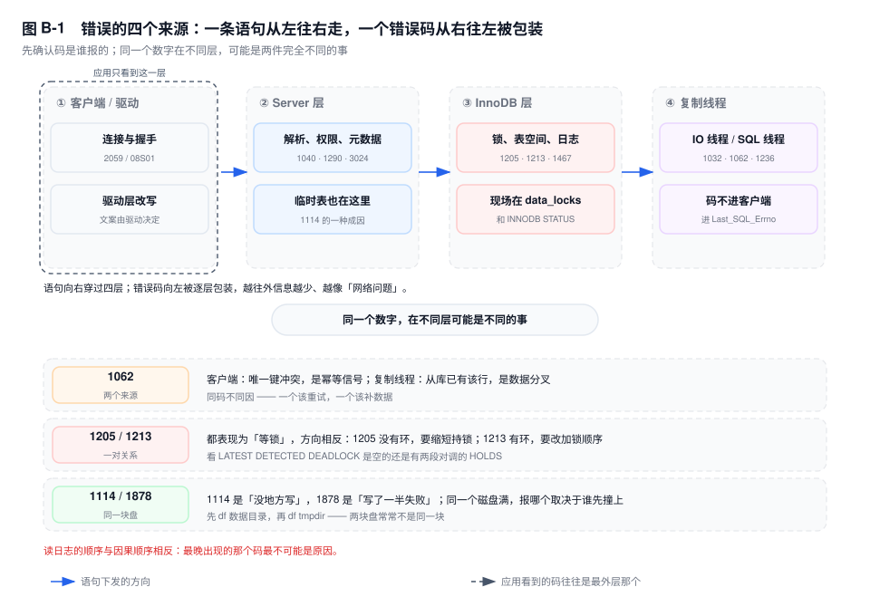

# 附录 B　错误码与异常速查

> **一句话结论**：错误码不解释任何事，它只标记"哪一层先失败"；同一份日志里的两个码，常常一个是投影、一个是根因。

## B.0 怎么用

十二个码，每个都按同一套四段写：**触发条件**、**典型日志**、**处置动作**、**容易误判成什么**。前三段在官方文档里都能查到，第四段查不到——而值班时出错，多数错在第四段。

三条读法先立起来。

**一、码要连着"谁报的"一起看。** 同一个现象，两端给的码不同：连接被 `wait_timeout` 收割，服务端 error log 里只有一行 `Aborted connection`，应用侧看到的是驱动包装过的 `Communications link failure`。后者不带 MySQL 错误号，SQLState 是 `08S01`。只盯应用日志，会把它当成网络抖动。

**二、`1213` 与 `1205` 的处理方向相反。** 前者是环，环是加锁顺序造出来的，要改顺序；后者没有环，只是有人持锁不放，要缩短持锁时间。把两者都当"重试一下"处理，等于把问题留到下一个整点。

**三、凡是"复制中断"，先看 `SHOW REPLICA STATUS` 的 `Last_SQL_Errno`，不是错误日志。** 日志只会说 SQL 线程停了，停在哪一类原因上在状态里。`1032` 与 `1062` 的补数据方式完全不同。

下面所有日志片段都是错误信息的**输出形态（未实跑，字段含义以此为准）**，文案取自官方错误参考，不是某一次实跑的抓取。

## B.1 错误码的四个来源

错误码不是一张平表，它按"谁先失败"分成四个来源。

**Server 层**：SQL 还没进引擎就失败了——解析、权限、元数据、连接数、只读开关。`1040`、`1290`、`3024` 在这一层，临时表撑爆的 `1114` 也在这里。共同点是 `SHOW ENGINE INNODB STATUS` 里什么都没有，因为引擎没被调用。

**InnoDB 层**：语句已经进了引擎，在锁、表空间、日志上失败。`1205`、`1213`、`1467` 属于这一层，`performance_schema.data_locks` 与 `SHOW ENGINE INNODB STATUS` 是它们的现场。

**复制线程**：错误发生在从库的 IO 线程或 SQL 线程上，码不进客户端，进 `SHOW REPLICA STATUS` 的 `Last_IO_Errno` / `Last_SQL_Errno`。`1032`、`1062`、`1236` 都在这里。

**客户端与驱动**：连接没建起来，或者建起来之后断了。`1045`（密码错）、`2003`（端口不通）、`2059`（认证插件加载不了）、`08S01`（通信中断）是这一层的话术，服务端 error log 里通常找不到对应行。

四个来源的边界不是版本划分，是调用栈：从驱动到协议、到 SQL 层、到引擎、再到另一台机器的回放线程。

**同一个数字可能是两件事**。客户端 `1062` 是"这条 INSERT 撞了已存在的业务键"，复制线程 `1062` 是"两台机器的数据已经分叉"；`1205` 与 `1213` 都表现为"等锁"，一个有环、一个没环。SQLSTATE 也能帮上忙：`1213` 的 `40001` 是标准 SQL 里的序列化失败，不少框架直接按它归到"可重试异常"，而 `1205` 是 `HY000` 通用错误，框架不会替你重试。



图 B-1 是这四层的信息流向：一条语句从左往右穿过，一个错误从右往左被逐层包装——应用看到的那句话，往往是最外层改写过的版本。

## B.2 锁与并发

### B1　`ERROR 1205`　锁等待超时

**触发条件**　一个事务等行锁的时间超过 `innodb_lock_wait_timeout`（默认 50 秒）。同一个码也可能来自元数据锁等待，那条路走的是 `lock_wait_timeout`（默认 31536000 秒，等于一年），所以**不能靠码区分是行锁还是 MDL**，要看 `data_lock_waits` 有没有对应的行。

**典型日志**

```text
ERROR 1205 (HY000): Lock wait timeout exceeded; try restarting transaction
```

**处置动作**

1. 找阻塞者，不要先动等待者。`performance_schema.data_lock_waits` 里 `BLOCKING_ENGINE_LOCK_ID` 指向的那个线程才是目标，再看它在 `innodb_trx` 里是 `RUNNING` 还是 `Sleep`。
2. 若阻塞者是挂着事务的空闲连接，先看 `trx_rows_modified` 估回滚代价，再决定 `KILL`——回滚几十万行可能比等它超时更久。
3. 治本是把持锁时间压下来：把 RPC、文件上传、循环调用挪到事务外，批量操作按批提交。调大 `innodb_lock_wait_timeout` 只是把失败推迟，队列该多长还是多长。

**容易误判成什么**　"超时了，事务已经回滚"。默认 `innodb_rollback_on_timeout=OFF`，**只回滚当前语句**，事务还开着，前面几条 `UPDATE` 仍然有效。应用 catch 之后继续往下跑再 `COMMIT`，就会写进一半数据。另一个误判是把它当死锁，去翻 `LATEST DETECTED DEADLOCK`，那里是空的。

### B2　`ERROR 1213`　死锁

**触发条件**　两个及以上事务交叉等待，成环，InnoDB 的死锁检测挑一个回滚代价小的牺牲掉。毫秒级完成，不产生慢查询、不堆连接，所以监控大盘上看不见它。

**典型日志**

```text
ERROR 1213 (40001): Deadlock found when trying to get lock; try restarting transaction

------------------------
LATEST DETECTED DEADLOCK
------------------------
*** (1) HOLDS THE LOCK(S):
RECORD LOCKS ... index PRIMARY ... lock_mode X locks rec but not gap
*** (1) WAITING FOR THIS LOCK TO BE GRANTED:
RECORD LOCKS ... index PRIMARY ... lock_mode X locks rec but not gap waiting
*** WE ROLL BACK TRANSACTION (2)
```

**处置动作**

1. 抓段，对比两边 `HOLDS` 与 `WAITING` 的 `heap no` 是否互相出现在对方那里——对调就是顺序问题，锁模式里带 `gap` 则是间隙锁问题。
2. 应用整事务重试，从 `BEGIN` 重做，且必须幂等；重试要带退避和次数上限，重试路径本身也要走同一套加锁顺序，否则重试还在制造死锁。
3. 顺序问题就把多行更新按主键排序后再执行；间隙锁问题就让等值条件用满唯一键，或先 `UPDATE` 拿 `X` 锁、影响行数为 0 再 `INSERT`。

**容易误判成什么**　"重试最后一条 SQL 就行"——整个事务已被回滚，前面成功的扣减全没了。第二、"降到 RC 就解决了"——RC 只去掉间隙锁那一类，加锁顺序反了照样死（第 41 章案例六）。第三、把 `WE ROLL BACK TRANSACTION (2)` 当成"事务 2 有错"，它只是代价小的那个。

## B.3 复制

### B3　`ERROR 1032`　复制 SQL 线程找不到行

**触发条件**　`binlog_format=ROW` 下，SQL 线程回放 `Update_rows` / `Delete_rows` 事件，按主键或唯一键在从库定位不到那一行。它几乎总是"主从不一致在先、复制报错在后"，不是复制把数据弄丢的。

**典型日志**

```text
Last_SQL_Errno: 1032
Last_SQL_Error: Could not execute Update_rows event on table order_db.order_main;
  Can't find record in 'order_main', Error_code: 1032; handler error HA_ERR_KEY_NOT_FOUND;
  the event's master log mysql-bin.000887, end_log_pos 198342711
```

**处置动作**

1. 读 `Last_SQL_Errno`、`Last_SQL_Error` 里的库表名与 `end_log_pos`（或 `GTID_NEXT`），定位到具体是哪一行、哪个事务。
2. 去主库按主键查出这一行的当前值，人工在从库补齐或修正；同时按时间范围核对周边行，1032 很少只丢一行。
3. 要让线程先跑起来，GTID 模式下用 `SET GTID_NEXT='uuid:n'; BEGIN; COMMIT;` 注入空事务，精确跳一条；`sql_slave_skip_counter` 按事件数跳，会连带跳掉同一位点的其他语句，GTID 模式下直接被禁用。跳过是止血，补数据才是修复。

**容易误判成什么**　"复制坏了，重启从库"。重启不补数据，位点还在原地，再跑还是 1032。第二、"跳过就没事了"——跳过之后这一行永远不同，下一次对账才发现，损失已经扩散。第三、把它当成从库磁盘或网络问题，去查 `Last_IO_Errno`，那个字段是空的。

### B4　`ERROR 1062`（复制线程）　从库上已存在

**触发条件**　SQL 线程回放 `Write_rows`，从库已有同主键或同唯一键的行。常见成因两个：从库被写过（`read_only` 没挡住 `SUPER`，或切换工具写错了方向），以及双写/重放导致同一事务进了两次。**它和客户端 1062 是两件事，必须分开看。**

**典型日志**

```text
Last_SQL_Errno: 1062
Last_SQL_Error: Could not execute Write_rows event on table order_db.order_main;
  Duplicate entry '20261114-0001' for key 'order_main.PRIMARY', Error_code: 1062;
  handler error HA_ERR_FOUND_DUPP_KEY; the event's master log mysql-bin.000902
```

**处置动作**

1. 先堵住继续分叉：`SELECT @@global.read_only, @@global.super_read_only`，把 `super_read_only` 置 `ON`，再查是谁写进来的（`binlog` 里这一段有没有本地事务）。
2. 比对这一行主从两侧的非键列：值完全相同，说明是重复回放，跳过后无事；值不同，说明两边各写过一半，要按业务时间戳判定哪一版为准，不能直接删从库那行。
3. 定版之后补回另一侧，再用 GTID 注入跳这一个事务，最后按主键区间对账行数与金额。

**容易误判成什么**　"1062 是幂等信号，忽略即可"。客户端 1062 确实多半是幂等信号；复制侧 1062 说明两台机器的数据已经分叉，忽略就是把分叉固化。第二、直接 `DELETE` 从库那一行再重启复制——如果主库那行才是错的，这一删把唯一的正确副本也删了。

## B.4 连接与认证

### B5　`ERROR 1040`　连接数满

**触发条件**　连接数到达 `max_connections`。8.0 会为持有 `CONNECTION_ADMIN`（旧版是 `SUPER`）的账号额外保留一个名额，除此之外谁都进不来——包括没带这个权限的 DBA 账号。

**典型日志**

```text
ERROR 1040 (HY000): Too many connections
```

**处置动作**

1. 用带 `CONNECTION_ADMIN` 的应急账号，或走 `admin_port`（`extra_port` 那套）进；进不去就只能本机 socket 加系统账号。这条通道必须提前建好，事发时建不了。
2. 按来源聚合连接，先看 `Command='Sleep'` 且 `Time` 最大的那批，按用户与来源 IP 分批 `KILL` 闲置连接；不要一次杀光，池子会立刻重连出同等数量。
3. 把 `wait_timeout`、`interactive_timeout` 降到业务可接受的值（只对新连接生效，存量要 `KILL` 才会走），再修泄漏点；池上限按 `max_connections × 0.8 ÷ 副本数` 反推。

**容易误判成什么**　"业务量涨了，扩容"（第 41 章案例一里连着两次这样判断）。判据是 `Threads_running`：连接贴顶而它只有个位数，就是池子漏了，跟流量无关。第二、"调大 `max_connections` 就好"——每个连接都要线程栈和会话缓冲，抬上限是把内存和撞墙时间一起往后推。

### B6　`ERROR 3101` / `ERROR 2059`　插件没加载

**触发条件**　服务端侧是插件没 `INSTALL` 或没编进二进制，报 3101；认证插件类更常见的是**客户端**不认识服务端的握手，报 2059。8.0 把默认认证插件换成 `caching_sha2_password`，老驱动第一次连就撞在这里。

**典型日志**

```text
ERROR 3101 (HY000): Plugin 'auth_socket' is not loaded

ERROR 2059 (HY000): Authentication plugin 'caching_sha2_password' cannot be loaded:
  /usr/lib/mysql/plugin/caching_sha2_password.so: cannot open shared object file
```

**处置动作**

1. 先分端：2059 只出现在应用日志里，服务端 error log 没有对应行；3101 一定在服务端，且能对上 `SHOW PLUGINS` 里缺的那一行。
2. 2059 的正路是升驱动（Connector/J 8.x 起自带该插件）；连接串加 `allowPublicKeyRetrieval=true` 也能通，但公钥可能被中间人替换，只在可信内网用；把账号和 `default_authentication_plugin` 一起降回 `mysql_native_password` 是应急路。
3. `[8.4]` 起 `mysql_native_password` 默认禁用，第三条路不成立，只剩升驱动。升级前把所有连接方的驱动版本盘一遍。

**容易误判成什么**　"密码错了"。密码错是 `1045 Access denied`，2059 连密码都还没验。第二、"改密码试试"——改密码不改变握手方式。第三、当成网络问题，因为报错发生在握手阶段，和连接超时挤在同一秒。

### B7　`ERROR 1290`　只读实例拒绝写入

**触发条件**　实例以 `read_only` 或 `super_read_only` 运行，收到写语句。切换后、备份中、维护窗口里最常见。

**典型日志**

```text
ERROR 1290 (HY000): The MySQL server is running with the --read-only option
  so it cannot execute this statement
```

**处置动作**

1. 先确认状态：`SELECT @@global.read_only, @@global.super_read_only`。两个都为 1 时，报错文案仍然只有 `--read-only` 一句，不会告诉你是哪一个。
2. 确认这道围栏是谁开的、为什么开——备份脚本、切换工具、还是上一个人手工设的。直接关掉可能让备份期间写进主库、或让切换工具的判断失准。
3. 确实要恢复写入，先关 `super_read_only` 再关 `read_only`；反过来只关 `read_only` 会连带把 `super_read_only` 一起关掉，这个隐式行为在切换脚本里是常见坑。

**容易误判成什么**　"磁盘满了"。表满或盘满是 `1114`，只读是策略，不是资源。第二、"账号权限不够"——1290 与权限无关，`SUPER` 也写不进去。第三、"设了 `read_only` 就从库安全了"，`read_only` 挡不住 `SUPER`，能连上来的宽权限账号照样写（第 22 章），真正的围栏是 `super_read_only`。

## B.5 空间与临时文件

### B8　`ERROR 1114`　表满

**触发条件**　三种成因，必须分开判：① 表所在表空间或文件系统写不进去，含 `innodb_data_file_path` 没开 `autoextend`、或已到 `autoextend` 上限；② 内部临时表（`MEMORY` 引擎）超过 `tmp_table_size` / `max_heap_table_size`，又转不到磁盘；③ 表空间触到页数与单文件上限。

**典型日志**

```text
ERROR 1114 (HY000): The table 'order_main' is full
```

**处置动作**

1. 看语句类型分叉：带 `GROUP BY`、`ORDER BY`、`DISTINCT` 的 `SELECT` 报 1114，基本是临时表那条路；`INSERT` / `UPDATE` 报，基本是表空间或磁盘。
2. 磁盘那条路：`df -h` 看数据目录，再按第 41 章案例七的顺序查 undo 表空间与 `SHOW BINARY LOGS`，先扩盘争取窗口，别先 `KILL` 大事务。
3. 临时表那条路：按会话调 `tmp_table_size` 与 `max_heap_table_size`，或改写 SQL 降低排序量。这两个参数是 per-connection 的，高峰期抬到 G 级会直接重演内存超支。

**容易误判成什么**　"表数据太多，该分表了"——先看 `df`，多数时候盘已经满了。第二、"临时表报错说明临时表空间配置小了"，`tmpdir` 所在分区满也会报同一个码。第三、和 `1878` 混为一谈：1114 是"没地方写"，1878 是"写了一半失败"。

### B9　`ERROR 1878`　临时文件写失败

**触发条件**　临时文件写入失败：`innodb_temp_data_file_path` 指向的 `ibtmp1` 或 `tmpdir` 下的排序文件写不下去。原因是磁盘满、inode 满、目录权限、或文件被删掉但句柄还被进程持有。

**典型日志**

```text
ERROR 1878 (HY000): Temporary file write failure.
[ERROR] [InnoDB] Operating system error number 28 in a file operation.
```

**处置动作**

1. 两个分区都要看，不要只看一个：`df -h $datadir` 与 `df -h $tmpdir`，再加 `df -i` 看 inode。`ibtmp1` 在数据目录，排序临时文件在 `tmpdir`，两者经常不在同一块盘上。
2. 若是 `ibtmp1` 涨起来的，看 `innodb_temp_data_file_path` 有没有开 `AUTOEXTEND`；这个文件只增不减，重启才收缩。清掉占用它的会话后，空间不会立刻回来。
3. 临时腾空间的动作按代价排序：清 `tmpdir` 残留 → `PURGE BINARY LOGS`（先确认从库已越过）→ 扩盘。这期间不要再发大排序查询，它就是压垮盘的最后那一下。

**容易误判成什么**　"SQL 写错了"——1878 与语法、类型、约束都无关，是 IO 层失败。第二、"磁盘满一定是数据涨了"，案例七里业务一个月涨不到 200G，盘却吃掉 1T。第三、"把 `ibtmp1` 删了空间就回来了"，运行中删文件只是断开目录项，空间要等句柄关闭。

## B.6 元数据与其他

### B10　`ERROR 1062`（客户端）　唯一键冲突

**触发条件**　`INSERT` 或 `UPDATE` 撞上 `PRIMARY` 或某个 `UNIQUE` 索引。它出现的频率与业务并发度成正比，重复提交、消息重投、重试都会造出来。

**典型日志**

```text
ERROR 1062 (23000): Duplicate entry '20261114-0001' for key 'order_main.uk_order_no'
```

**处置动作**

1. 捕获后立刻 `ROLLBACK`。重复键检查在冲突行上留了一把 `S,REC_NOT_GAP` 锁（第 19 章），它持有到事务结束；不回滚就继续下一条语句，这把锁会一直挂着，别人改这一行就等。
2. 回滚之后再查这一行的当前值，按业务规则决定"以谁为准"，不要在异常分支里直接覆盖。
3. 用 `INSERT ... ON DUPLICATE KEY UPDATE` 做幂等时，判据不能是"影响行数等于 1"：1 是插入，2 是更新，0 是值没变、什么都没写，三种都在成功路径上。

**容易误判成什么**　"这是错误，要告警/重试"。多数场景它是幂等信号，把它当故障会制造无意义的告警风暴。第二、"影响行数 1 说明是新插入"——0 与 2 都会出现，用它判断"是否首单"必然算错。第三、"catch 住继续执行"——事务还开着，锁还在，后面的语句都在同一个未提交事务里。

### B11　`ERROR 1467`　自增值读取失败

**触发条件**　两类：自增列的类型上限耗尽（`INT` 到 2147483647），或存储引擎读不出自增计数器。8.0 起自增值持久化在 redo 与 `mysql.ibd` 里，重启不再按 `MAX(id)+1` 重算，所以"读不出来"这一类已经罕见，出现通常意味着 `mysql.ibd` 或 redo 异常。

**典型日志**

```text
ERROR 1467 (HY000): Failed to read auto-increment value from storage engine
```

**处置动作**

1. 先停这一类写入，不要再重试——重试只是在同一个坏计数器上打转。
2. 看 `SHOW CREATE TABLE` 里的 `AUTO_INCREMENT` 与 `MAX(id)+1`：贴着类型上限，就是耗尽，改 `BIGINT`；明显小于 `MAX(id)`，就是计数器丢了。
3. 计数器丢了要走重启 + 校验：重启后看自增值有没有回退，回退过的表按主键区间核对最近写入，必要时把 `AUTO_INCREMENT` 显式改到 `MAX(id)+1` 之上，再放开写入。

**容易误判成什么**　"自增 id 用完了，改成 `BIGINT` 就好"——这只覆盖第一类。第二、把它当插入失败重试，计数器坏了重试一百次也是同一个结果。第三、"重启能修好一切"，重启会让自增值按持久化的值恢复，但如果 `mysql.ibd` 有问题，重启只是把故障提前暴露。

### B12　`ERROR 3024`　语句执行超时

**触发条件**　只读 `SELECT` 的执行时间超过 `max_execution_time`（毫秒），或 SQL 里写了 `/*+ MAX_EXECUTION_TIME(n) */`。**它只对只读 `SELECT` 生效**，`UPDATE`、`DELETE`、`INSERT ... SELECT` 都不受它管。

**典型日志**

```text
ERROR 3024 (HY000): Query execution was interrupted, maximum statement execution time exceeded
```

**处置动作**

1. 先确认阈值是谁设的：`SELECT @@session.max_execution_time, @@global.max_execution_time`，再看 SQL 里有没有 hint。全局设成 1000 而业务报表本来要跑 8 秒，那就不是 SQL 的问题。
2. 到 digest 榜上确认是偶发还是常态：`SUM_ROWS_EXAMINED / SUM_ROWS_SENT` 高、`avg_ms` 贴着阈值，是执行计划问题；只在大商户参数下超，是估算失准。
3. 归档、导出这类长语句不要指望它兜底，只能按批大小切分；它是保护实例的闸门，不是业务 SLA 的执行者。

**容易误判成什么**　"SQL 有性能问题，加索引"。3024 只说明"超过了阈值"，阈值可能是 100 毫秒。第二、"超时说明语句被回滚了"——被中断的是一条只读语句，事务本身还开着，连接也还在。第三、"给 `DELETE` 也配上就安全了"，写语句根本不受这个参数约束（第 35 章），批量删除只能靠批大小和 `WHERE` 边界。

## B.7 一份日志里同时出现多个码时怎么读

真实的故障日志不会一次只给你一个码。下面这段是常见形态：`1213` 之后紧跟 `1205`，再往后是应用侧的通信中断。

```text
# 输出形态（未实跑，字段含义以此为准）
20:03:11.480 app-order ERROR OrderService  Deadlock found when trying to get lock;
                                            try restarting transaction
                                            ### SQL: UPDATE stock SET qty=qty-1 WHERE sku_id=?
20:03:11.503 app-order WARN  OrderService  retry 1/3
20:04:01.515 app-order ERROR OrderService  Lock wait timeout exceeded; try restarting transaction
20:04:01.980 app-order ERROR OrderService  Communications link failure
                                            The last packet successfully received from the
                                            server was 50,012 milliseconds ago.
```

三个码看起来是三件事，其实是同一件事的三层投影。

**最外层**是 `Communications link failure`，它连 MySQL 错误号都没有，SQLState 是 `08S01`——驱动只说"管道断了"。**中间层**是 Server 返回的 `1213` 与 `1205`。**最里层**是 InnoDB 里那张锁表的状态：某个事务持着 `sku_stock` 的一行不放，另一条路径按相反顺序加锁，环成了就回滚一方（1213）；重试的那条排在同一行后面，等满 50 秒（1205）；等待把连接池占满，应用拿到一条已被服务端关闭的空闲连接，就成了最后那行 08S01。

**根因在最里层。** 判断顺序按"从外往里"走，三步：

1. **先看客户端码，但取最早的那条，不是最新那条。** 时间最晚的码一定是结果。`08S01` 只回答"连接断了"，它不回答"为什么断"，看到它就往服务端走，不要停在网络。
2. **再看 Server 码，并确认它们属于几个事务。** 同一个事务不会既是 1213 又是 1205——一个被牺牲、一个等到超时，是两条不同的语句、两个不同的连接。把日志按连接/请求 ID 分组，才知道是"一个事务重试了三次"还是"三百个事务挤在同一行"。
3. **最后进 InnoDB 看状态。** `SHOW ENGINE INNODB STATUS` 的 `TRANSACTIONS` 段找 `trx_state=RUNNING` 且 `trx_rows_locked` 最大的那个；`LATEST DETECTED DEADLOCK` 段看两边 `HOLDS` / `WAITING` 是否对调。这一步才回答"谁、按什么顺序"。

复制场景把第 2 步换成 `SHOW REPLICA STATUS` 的 `Last_SQL_Errno`：错误日志只留一行"SQL 线程停了"，码在状态里，`1032` 与 `1062` 的处置方向相反。

还有一个便宜的判据：**看三个码之间的时间跨度**。跨了五十秒上下，基本是一条链——前面等锁、中间超时、最后连接被回收；跨了几个小时，才可能是三件独立的事，只是恰好写进了同一份日志。时间跨度比错误文案更早告诉你"该找几个根因"。

反过来读——从最里层往外解释——就会得到"网络不稳导致重试、重试导致死锁"这种结论，方向整个反了。

## B.8 关键结论

**一、同一个数字在不同层可能是两件事，先确认码是谁报的。** 客户端 1062 是幂等信号，复制线程 1062 是数据分叉。

**二、`1213` 回滚整个事务，`1205` 默认只回滚当前语句。** 重试粒度搞反，轻则无效重试，重则重复扣款。

**三、复制中断先看 `Last_SQL_Errno`，错误日志只告诉你线程停了。** 跳过是止血，补数据才是修复。

**四、错误码说明"哪一层先失败"，不说明"为什么失败"。** 根因永远在更里面一层，日志里最晚出现的那个码最不可能是原因。

**五、所有"跳过""重试""调大参数"都只改变失败的时间与位置。** 判断处置是否完成，看的是持锁时间、加锁顺序、数据一致性有没有变，不是错误码有没有消失。

## B.9 延伸

**关联章节**：锁与死锁见第 19、20 章；长事务与回滚代价见第 21 章；复制错误与跳过见第 22、23 章；半同步降级见第 24 章；`max_execution_time` 与归档见第 35 章；连接数与连接池见第 37、40 章；磁盘与 undo 见第 3、5、28 章；认证插件与升级见第 42、43 章；只读围栏见第 22、26 章；十个案例的原貌见第 41 章；故障处置卡片见第 52 章。

**官方文档**：`dev.mysql.com/doc/mysql-errors/8.0/en/server-error-reference.html`（服务端码与 SQLState）、同目录下的 `client-error-reference.html`（2000 段与 `08S01` 这类客户端码）。
