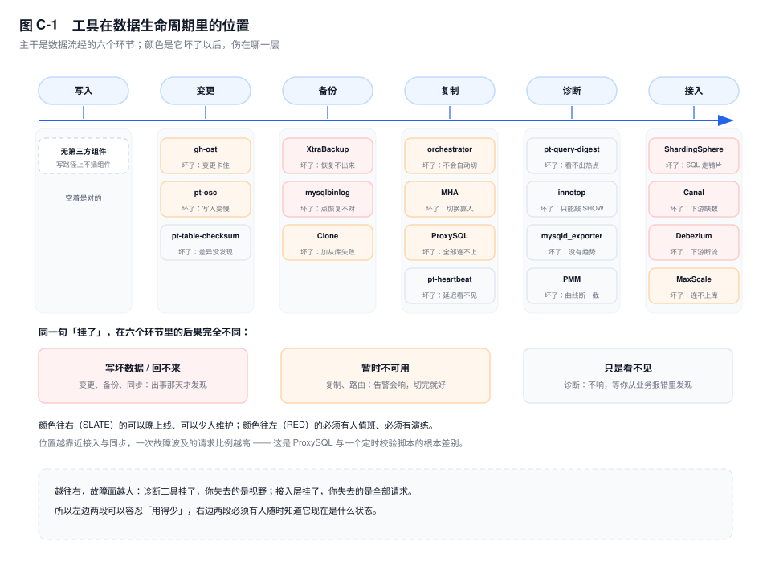

# 附录 C　工具清单

> **一句话结论**：工具解决的是"你已经想清楚要做什么，只是手工做太慢"；它不解决"你还不确定该不该做"。

## C.0 怎么用

二十八个工具，按"它在你出故障时站在哪"分组，不按官网的分类分组。每条三行：**解决什么**、**什么时候不该用**、**最小命令**。第二行是重点——大部分工具文写到这里就转去贴参数表了。

装之前问三个问题。

**一、官方手段能不能替代。** 8.0 的 `INSTANT` 与 `INPLACE` 吃掉了大表加列加索引的需求，Clone 插件吃掉了"再加一台从库"，`p_s` 与 `sys` 吃掉了大半监控脚本，MGR 吃掉了选主。每装一个东西之前，花十分钟确认官方真的没做。

**二、引入后谁维护。** 工具不只有安装那一步，它还有版本、依赖、安全公告，以及跟 MySQL 小版本对不上的兼容问题。名字要落在某个人的值班表上。

**三、它坏了，你的故障面变大还是变小。** 这一条能一票否决。只在变更窗口启动、跑完就退出的工具，坏了最坏是这次变更失败；架在每一条 SQL 必经之路上的组件，坏了是整站不可用。同样是"引入一个工具"，代价不在一个量级。

## C.1 工具在生命周期里的位置

工具的位置比工具的名字重要。图 C-1 按数据流经的六个环节排，颜色是它坏了以后伤在哪一层。

**写入**这一段没有工具，这是健康状态。写路径上每插一个组件，就多一个能把所有事务卡住的地方。

**变更**（gh-ost、pt-osc、pt-toolkit）只在窗口期存在。它坏了最坏是"这次改表没改成"，原表还在，业务照跑——前提是它能原地退出，所以 gh-ost 把进度写进 `_ghc` 表，进程被杀可以接着来。

**备份恢复**（XtraBackup、mysqlbinlog、mydumper）平时不参与任何请求，出事那天是唯一的依靠。危险在于失败不发声：退出码 0、没 prepare、没演练，和没有备份的区别只是多占一块磁盘。

**压测**（sysbench、TPCC、流量回放）不在生产链路上，代价是结论的可信度取决于压测库离生产有多近。

**诊断**（pt-query-digest、innotop、sys、exporter、PMM）只读，看起来最安全。它坏了你失去的是视野不是数据；但它在故障中跑起来要跟业务抢 buffer pool，会把"看不见"变成"更慢"。

**复制与高可用**（orchestrator、MHA、ProxySQL、Router）站在岔路口。它坏了不一定立刻报错，可能只是切错了主，或者把写流量留在老主上。

**接入与同步**（ShardingSphere、Canal、Debezium、MaxScale）在每一条 SQL 的必经之路上，或者在 binlog 的下游。它出故障时受影响的不是一次变更，是全部请求。



一句判断：**工具越靠近数据流，故障面越大。** 在同步链路上插一个组件，等于给自己增加一个必须监控的东西，而这个东西的监控往往比它本身更晚到位。

## C.2 变更与 DDL（5）

### C1　gh-ost

**解决什么**：五亿行的 `order_main` 要改列类型，原生只能走 `COPY`，业务不能停——它伪装成从库读 binlog，在写路径之外把存量拷进影子表。

**什么时候不该用**：表上没有主键，它按主键分块拷贝，没有主键直接报错退出；托管实例不给 `REPLICATION SLAVE` 或强制非 `ROW` 格式，方案直接不成立；从库延迟本来就贴着告警线，先治延迟——影子表的每一行写入都要在每个从库回放一遍。

**最小命令**：

```bash
gh-ost --host=10.0.3.11 --user=ghost --password=*** --database=order_db --table=order_main \
  --alter="MODIFY COLUMN remark VARCHAR(512) NOT NULL DEFAULT ''" \
  --allow-on-master --max-load=Threads_running=25 --chunk-size=1000 --execute
```

不加 `--execute` 只做检查，不会真跑。

### C2　pt-online-schema-change

**解决什么**：表在几千万行以内、手上没有复制权限，但要求增量与原表同事务提交——触发器方案，不丢不重。

**什么时候不该用**：表上已有触发器，它默认拒绝（`[5.7.2]` 起同一事件可挂多个触发器，加 `--preserve-triggers` 才放行）；写入 QPS 已经很高，每条 `INSERT` 变成"写原表 + 触发器 + 写新表"，限流只管拷贝那一侧；有外键而没想清楚 `--alter-foreign-keys-method`，子表会在替换瞬间指向一张即将删除的表。

**最小命令**：

```bash
pt-online-schema-change --alter "ADD COLUMN channel TINYINT NOT NULL DEFAULT 0" \
  D=order_db,t=order_main,h=10.0.3.11,u=pt --ask-pass --max-load Threads_running=25 --execute
```

### C3　pt-query-digest（点名）

**解决什么**：改表前后各抓一份 slow log，比对同一条 SQL 的 `Rows examine` 与 `Exec time`——判断这次变更有没有把计划改坏。完整读法在 C14。

**什么时候不该用**：库上没有落盘的 slow log，或者 `long_query_time` 还是默认的 10 秒。它读文件，日志里没有的东西它变不出来。

**最小命令**：

```bash
pt-query-digest --since '2026-11-12 02:00:00' /var/log/mysql/slow.log > ddl_before.txt
```

### C4　pt-heartbeat

**解决什么**：`Seconds_Behind_Source` 在大事务末尾和主库空闲时给的数都不可信——心跳表每秒写一行时间戳，给一个与业务无关的真实延迟。

**什么时候不该用**：写入审计不允许在主库上多一张表、多一路每秒写入；已经有 GTID 差值加 `replication_applier_status_by_worker` 在定位，它只是再加一个数。

**最小命令**：

```bash
pt-heartbeat --host=10.0.3.11 -D percona --update --interval=1 --daemonize
pt-heartbeat --host=10.0.3.12 -D percona --monitor
```

### C5　pt-table-checksum

**解决什么**：切换或迁移之后，"主从数据到底一不一样"——按主键分块做 CRC 比对，结果落 `percona.checksums`，能定位到哪一段不一样。

**什么时候不该用**：`binlog_format=ROW` 又不肯加 `--no-check-binlog-format`，它默认按 STATEMENT 校验；表上没有主键或唯一索引，无法分块；业务高峰跑，它按块扫全表。

**最小命令**：

```bash
pt-table-checksum --host=10.0.3.11 --databases=order_db \
  --replicate=percona.checksums --no-check-binlog-format --max-load Threads_running=25
```

## C.3 备份与恢复（5）

### C6　XtraBackup

**解决什么**：几百 GB 的库要每天全备加增量，还能恢复到任意时间点——拷页的同时拷 redo，`--prepare` 把参差的页推到同一个 LSN。

**什么时候不该用**：库小到二十分钟能 dump 完、也接受逻辑恢复的时长，多一套工具和一份 prepare 流程是负收益；只是加一台同版本从库，Clone 更省事。

**最小命令**：

```bash
xtrabackup --backup --target-dir=/backup/full/2026-11-12_02 --user=backup --password=***
xtrabackup --prepare --target-dir=/backup/full/2026-11-12_02
```

增量用 `--incremental-basedir` 指向上一次目录，并加 `--incremental`；中间层 prepare 必须带 `--apply-log-only`。

### C7　mysqlbinlog

**解决什么**：误删了一批商户账单，要精确恢复到 20:47 之前——把 binlog 解成行事件，按位点或时间重放。

**什么时候不该用**：binlog 已经清到备份点之前，PITR 的链断了，工具救不了；只想粗看某个库改了什么，`SHOW BINLOG EVENTS` 够用，不必起解析。

**最小命令**：

```bash
mysqlbinlog --base64-output=DECODE-ROWS -v \
  --start-datetime='2026-11-12 20:00:00' --stop-datetime='2026-11-12 20:47:00' \
  /var/log/mysql/mysql-bin.000008 | mysql -h 10.0.3.30 -u root -p bill
```

### C8　mysqldump / mysqlpump

**解决什么**：跨大版本升级、只导几张表、要人眼审一遍数据——逻辑备份是唯一形态。

**什么时候不该用**：库里有一张 MyISAM 表，`--single-transaction` 的快照来自 MVCC，对 MyISAM 无效，备份期间对它的写入会以当前值进 dump，和其他表的时间点错开；库大到恢复窗口以小时计，逻辑恢复要重建一次索引。`mysqlpump` 在 8.0.34 已废弃，新方案不要再选它。

**最小命令**：

```bash
mysqldump --single-transaction --source-data=2 --set-gtid-purged=OFF --hex-blob \
  --databases bill > bill_20261112.sql
```

`--source-data` 在 8.0.26 之前叫 `--master-data`。

### C9　mydumper / myloader

**解决什么**：单线程 dump 跑不进备份窗口——多线程导出、按文件切片、恢复也能并行。

**什么时候不该用**：一致性要求严格且库里有非 InnoDB 表，`--no-locks` / `--less-locking` 是拿一致性换速度；团队里没人愿意维护一个升级节奏与 MySQL 不同步的第三方二进制。

**最小命令**：

```bash
mydumper -h 10.0.3.11 -u backup -p *** -B bill -o /backup/bill -t 8 -F 64
myloader -h 10.0.3.30 -u root -p *** -B bill -d /backup/bill -t 8
```

### C10　Clone 插件 `[8.0.17+]`

**解决什么**：加一台同版本从库，不想装任何额外软件——页级克隆，接收端启动时自己做完崩溃恢复，所以没有 `--prepare`。

**什么时候不该用**：要增量、要异地归档、要跨版本，三条都不支持（每次全量、只能到本地目录或另一个实例、必须同版本同平台）；`clone_valid_donor_list` 没配就去排错——它默认空，空的意思是谁都不许往我这里推数据。

**最小命令**：

```sql
CLONE LOCAL DATA DIRECTORY = '/data/clone-1112';
CLONE INSTANCE FROM 'clone_admin'@'10.0.3.21':3306 IDENTIFIED BY '***';
```

## C.4 压测（3）

### C11　sysbench

**解决什么**：换机型、加索引、调参数前后要一个能对比的数——`oltp_*` 系列给的是相对参考。

**什么时候不该用**：想用它证明"能扛八千 TPS"。压测库两千万行全在 buffer pool 里，线上三亿行命中率 97%，TPS 只差一成，P99 能差三倍；数据量不到生产热数据量级时，它测的是框架上限，不是容量。

**最小命令**：

```bash
sysbench oltp_read_write --tables=8 --table-size=2500000 --threads=64 \
  --rand-type=special --report-interval=10 --time=300 \
  --mysql-host=10.0.3.11 --mysql-user=sbtest --mysql-password=*** --mysql-db=sbtest run
```

### C12　TPCC-like（Percona 的 sysbench-tpcc）

**解决什么**：要一个带事务边界、带热点、读写比例受约束的负载——TPC-C 的模型比 `oltp_*` 更接近交易系统。

**什么时候不该用**：只是想比较两种索引写法，准备数据就要几个小时、schema 也改不动；也不要拿它的 tpmC 跟别家报告比，scale 与硬件不同就不可比。

**最小命令**：

```bash
sysbench tpcc.lua --mysql-host=10.0.3.11 --mysql-db=tpcc --scale=100 --threads=64 prepare
```

把末尾的 `prepare` 换成 `run` 就是压测。

### C13　流量回放（goReplay / tcpcopy 这一类）

**解决什么**：真实 SQL 的分布造不出来——把生产入口的流量复制一份打到影子库。

**什么时候不该用**：影子库没有脱敏，回放等于把真实账单和商户信息在另一台机器上再写一遍；影子库版本、账号、认证插件与生产不一致，TCP 层回放连握手都过不去；写回放必须打到独立实例，指向备库或只读实例只会得到一堆报错。

**最小命令**：

```bash
tcpcopy -x 3306-10.0.9.9:3306 -s 10.0.3.5 -c 10.0.3.100 -d
```

`-x` 是本机端口对目标地址，`-s` 是辅助机，`-c` 用来伪装客户端地址。

## C.5 诊断（7）

### C14　pt-query-digest

**解决什么**：慢日志几千行，要一个排好序的结论——按总耗时排，同时给 95% 与 max 的差距。

**什么时候不该用**：只有 `p_s` 的摘要表、没有落盘日志；日志跨了很多次 `long_query_time` 调整，一份报告会把不同阈值下的样本混在一起。

**最小命令**：

```bash
pt-query-digest --filter '$event->{db} eq "bill"' /var/log/mysql/slow.log > rpt.txt
```

### C15　innotop

**解决什么**：值班时在一个界面里连续看 QPS、锁等待、复制状态，不用反复敲 `SHOW`——它是这些命令的轮询封装。

**什么时候不该用**：8.0 上没在测试库验过就直接上生产。它的维护节奏跟不上 8.0 的视图变化（`p_s` 表名改过、复制状态列名在 `[8.0.22]` 改过），哪些面板还能用要自己确认；不想再装一棵 Perl 依赖树时，`sys.metrics` 一次能看全。

**最小命令**：

```bash
innotop --host 10.0.3.11 --user dba --password *** --delay 2
```

### C16　sys 库

**解决什么**：不想背 `p_s` 的 join 与单位换算——`sys` 把常用诊断拼成视图，列名是人话。

**什么时候不该用**：摘要表满（默认一万条 digest）或实例 CPU 已经满了还去跑，它内部要对 `p_s` 做聚合，代价比看起来大；要的是即时值，而 `sys` 多数是累计值。

**最小命令**：

```sql
SELECT * FROM sys.statement_analysis ORDER BY total_latency DESC LIMIT 10;
SELECT * FROM sys.innodb_lock_waits\G
```

### C17　performance_schema 直接查

**解决什么**：`sys` 没有的维度——某个回放 worker、某类等待事件、某个 consumer 的状态，直接查 `p_s`。

**什么时候不该用**：不知道要查哪张表就先 `SELECT *`。`p_s` 几十张表、时间列单位是皮秒，裸查只会得到一堆看不懂的数（对照见附录 D）；对应 consumer 没开时的空结果是"没采集"，不是"没问题"。

**最小命令**：

```sql
SELECT DIGEST_TEXT, COUNT_STAR, ROUND(SUM_TIMER_WAIT/1e12, 2) AS total_s
FROM performance_schema.events_statements_summary_by_digest
ORDER BY SUM_TIMER_WAIT DESC LIMIT 10;
```

### C18　MySQL Workbench 的 Visual Explain

**解决什么**：给不熟 `EXPLAIN` 列含义的同事讲计划——把 cost、rows、用到的索引画在一棵树上。

**什么时候不该用**：拿它在生产大表上点一条没索引的 SQL，读取统计信息本身有代价，高峰别点；要知道真实耗时与真实行数，它给的是估算，得用 `EXPLAIN ANALYZE`。

**最小命令**：`Query → Explain Current Statement`，结果面板切到 Visual Explain。

### C19　Prometheus + mysqld_exporter

**解决什么**：要趋势和比值告警（命中率、连接水位、复制延迟），而不是一台机器的瞬时快照。

**什么时候不该用**：把 `schema` 或 `sql_digest` 做成 label，时序数 = 实例 × schema × digest，digest 每天新增成百上千，Prometheus 内存随活跃 series 线性涨；默认 collector 够用时别开 `perf_schema` 那一组，每次采集都要扫 `p_s`。

**最小命令**：

```bash
mysqld_exporter --config.my-cnf=/etc/mysqld_exporter.cnf --web.listen-address=:9104
```

关键 collector：`global_status` 必开，`info_schema.processlist` 按需，`perf_schema.eventsstatements` 最重。

### C20　PMM

**解决什么**：不想自己搭 Prometheus、Grafana 与告警规则——一个客户端把指标、慢查询、Query Analytics 一起收走。

**什么时候不该用**：实例多到 PMM Server 自己要先规划一套资源，你维护的东西从"一个 exporter"变成"一个平台"；合规不允许外部服务定期拉取实例元数据。

**最小命令**：

```bash
pmm-admin add mysql --username=pmm --password=*** --query-source=perfschema --service-name=order-db-01
```

## C.6 复制与高可用（4）

### C21　orchestrator

**解决什么**：上百套主从，要自动发现拓扑、在主库挂掉时按 GTID 集合完整度选主。

**什么时候不该用**：只有两三套实例，它自己要 RAFT 多节点、agent、后端库，维护成本大于收益；团队不接受"自动切主"这个动作，就只用它的拓扑发现，别开 `recover`。

**最小命令**：

```bash
orchestrator-client -c topology -i 10.0.3.11:3306
orchestrator-client -c recover -i 10.0.3.11:3306
```

### C22　MHA

**解决什么**：存量主从要一个步骤可读的切换脚本——按 relay log 最靠前选主，切换过程能人工介入。

**什么时候不该用**：新系统。社区已停止更新（最后版本 0.58），新内核、认证插件、复制特性出问题没人修；实例上不给 SSH 免密，它的隔离动作全靠 SSH 脚本，这一步就断了。

**最小命令**：

```bash
masterha_check_repl --conf=/etc/mha/app1.cnf
masterha_manager --conf=/etc/mha/app1.cnf --remove_dead_master_conf
```

### C23　ProxySQL

**解决什么**：几百个应用连一个写组，读流量按权重分到从库，切换后不改连接串。

**什么时候不该用**：指望它替你选主。它只探活和路由，新主是谁仍要 MHA、orchestrator、MGR 或人来定；事务中的连接不能被多路复用，切换后第一批全是新事务，连接风暴照样打在新主上。

**最小命令**：

```bash
mysql -h 127.0.0.1 -P 6032 -u admin -padmin -e "
INSERT INTO mysql_servers(hostgroup_id,hostname,port) VALUES (10,'10.0.3.11',3306);
LOAD MYSQL SERVERS TO RUNTIME; SAVE MYSQL SERVERS TO DISK;"
```

### C24　MySQL Router

**解决什么**：官方组件，与 InnoDB Cluster / MGR 配套，应用只认一个端口。

**什么时候不该用**：背后是传统主从。没有 MGR 时它拿不到"谁是主"的权威答案，读写分离只能靠健康检查猜；也不要为了"统一入口"把它架在一次性的迁移里，bootstrap 出来的配置要跟着拓扑走。

**最小命令**：

```bash
mysqlrouter --bootstrap root@10.0.3.11:3306 --user=mysqlrouter --directory=/etc/mysqlrouter
```

## C.7 接入与数据同步（4）

### C25　ShardingSphere

**解决什么**：单表过十亿、要按 `buyer_id` 分片，而应用不想自己写路由——JDBC 版改数据源，Proxy 版改连接串。

**什么时候不该用**：分片键还没定。路由规则一改，历史数据要重新分布；高频查询要广播时（客服按订单号查单），广播上千次，P99 从几十毫秒走到几秒，这不是中间件能优化的；团队没人跟驱动版本时别选 JDBC 版。

**最小命令**：

```bash
bin/start.sh    # ShardingSphere-Proxy 5.x；规则在 conf/config-sharding.yaml
```

关键项：`actualDataNodes`、`shardingColumn`、`bindingTables`。

### C26　Canal

**解决什么**：要把 `order_main` 的变更同步到搜索索引或缓存——伪装成从库读 binlog，按库表过滤后投递。

**什么时候不该用**：想要"恰好一次"投递。它给的是按位点顺序的流，重复与丢失的补偿要自己做；表上没有主键，ROW 镜像里没有可靠的行标识，下游无法定位更新；多个实例共用一个 `slaveId`，主库会把其中一个踢掉。

**最小命令**：

```bash
sh bin/startup.sh    # canal.deployer；实例配置在 conf/example/instance.properties
```

关键参数：`canal.instance.master.address`、`canal.instance.filter.regex`、`canal.instance.mysql.slaveId`（必须唯一）。

### C27　Debezium

**解决什么**：变更要进 Kafka，下游有一堆消费者（搜索、数仓、风控）——MySQL connector 把 binlog 变成带 schema 的消息。

**什么时候不该用**：只有一个消费者、且能直接读库，不值得为一件事引入 Kafka Connect 集群；团队没有人会运维 Kafka；`database.server.id` 与任何从库重复，主库会断开其中一个。

**最小命令**：

```bash
curl -X POST -H 'Content-Type: application/json' localhost:8083/connectors -d @mysql-order.json
```

关键项：`connector.class=io.debezium.connector.mysql.MySqlConnector`、`database.hostname`、`database.server.id`、`table.include.list`。

### C28　MaxScale

**解决什么**：多语言栈，要一个统一入口做读写分离与查询路由，又不想在每个应用里引 jar。

**什么时候不该用**：只跑 MySQL 8.0 且没验过认证插件。它是 MariaDB 的项目，`caching_sha2_password` 与 8.0 的新协议特性要按版本确认；要它选主，它和 ProxySQL 一样只路由。

**最小命令**：

```bash
maxctrl create server order-01 10.0.3.11 3306
maxctrl create monitor mon01 mysqlmon
```

## C.8 六个"不要引入"的判断

命中任何一条，先别装。

**① 团队里只有一个人会用它。** 他休假那周你不敢做变更，出故障只能等他上线，工具越强这种依赖越深。替代方案：把这件事写成 runbook，用官方语句一步步做，让第二个人照着能跑通——慢一点，但可交接。

**② 它要求改 `binlog_format` 或加触发器，而写入压力已经很高。** pt-osc 把每条 `INSERT` 变成"写原表 + 触发器 + 写新表"，限流只管拷贝那一侧；gh-ost 要 `ROW` 与复制权限。替代方案：先确认能不能 `INSTANT` 或 `INPLACE`，能就不必引入；不能，把变更排到低峰窗口。

**③ 它能做的事，一条 `p_s` 查询就能做到。** 代价是多一个进程、一套账号、一份权限。替代方案：附录 D 里对应的那一条，存成 `.sql` 放在手边。

**④ 它在 GitHub 上最近一次提交停在两年前。** 那时的代码面对的是 8.0 早期的 `p_s` 表名与复制列名，`[8.0.22]` 就把 `Slave_*` 全改成了 `Replica_*`，它读不到时会安静地返回空值。替代方案：找活跃分支，或直接用官方视图自己拼。

**⑤ 引入后没有任何监控指标。** 它坏了只能从业务报错里知道，那时故障已经发生半小时。监控不是加分项，是入场券。替代方案：先确认它导出的指标能被采集，采不到就换一个能被采到的。

**⑥ 你只在一个季度一次的迁移里用它。** 三个月用一次，等于每次都在重新学，包括重新踩坑。替代方案：那一晚停机，用原生 `COPY` 或 Clone，把可预期的停机换掉不可预期的失败。

六条的共同点：**判断的不是工具好不好，是你有没有能力在它坏了的那天接住它。**

## C.9 关键结论

- **工具的价值在窗口期，不在日常。** 一个一年只用两次的工具，值得为它多一次演练，不值得为它建一套监控。
- **离写路径越近，越要先想它坏了怎么办。** gh-ost 挂了是这次 DDL 失败，ShardingSphere-Proxy 挂了是整站不可用。
- **"不该用"的条件比"能做什么"更值得背。** 无主键表上，两个在线改表工具都会直接退出，选哪个都一样。
- **官方手段先吃掉一半需求。** `INSTANT`、`INPLACE`、Clone、`p_s`、`sys`、MGR，先把这六个确认一遍。
- **没有被监控的工具，等于没有被引入。** 它失效的方式是安静地给空值，而不是报错。

## C.10 延伸

**关联章节**：备份与 PITR 见第 28 章；在线 DDL 与两个改表工具的取舍见第 46 章；容量与压测的口径见第 51 章；复制延迟的真实测量见第 25 章；高可用方案全景见第 26 章；分片与中间件见第 33 章；同步链路的下游边界见第 50 章；诊断 SQL 见附录 D。

**官方文档与仓库**：

- `dev.mysql.com/doc/refman/8.0/en/clone-plugin.html`
- `dev.mysql.com/doc/refman/8.0/en/sys-schema.html`
- `dev.mysql.com/doc/refman/8.0/en/performance-schema.html`
- `dev.mysql.com/doc/refman/8.0/en/mysqlbinlog.html`
- `github.com/github/gh-ost`
- `github.com/percona/percona-toolkit`
- `github.com/percona/percona-xtrabackup`
- `github.com/openark/orchestrator`
- `github.com/akopytov/sysbench`
- `github.com/prometheus/mysqld_exporter`
- `github.com/apache/shardingsphere`
- `github.com/alibaba/canal`
- `github.com/sysown/proxysql`
- `debezium.io/documentation/`
