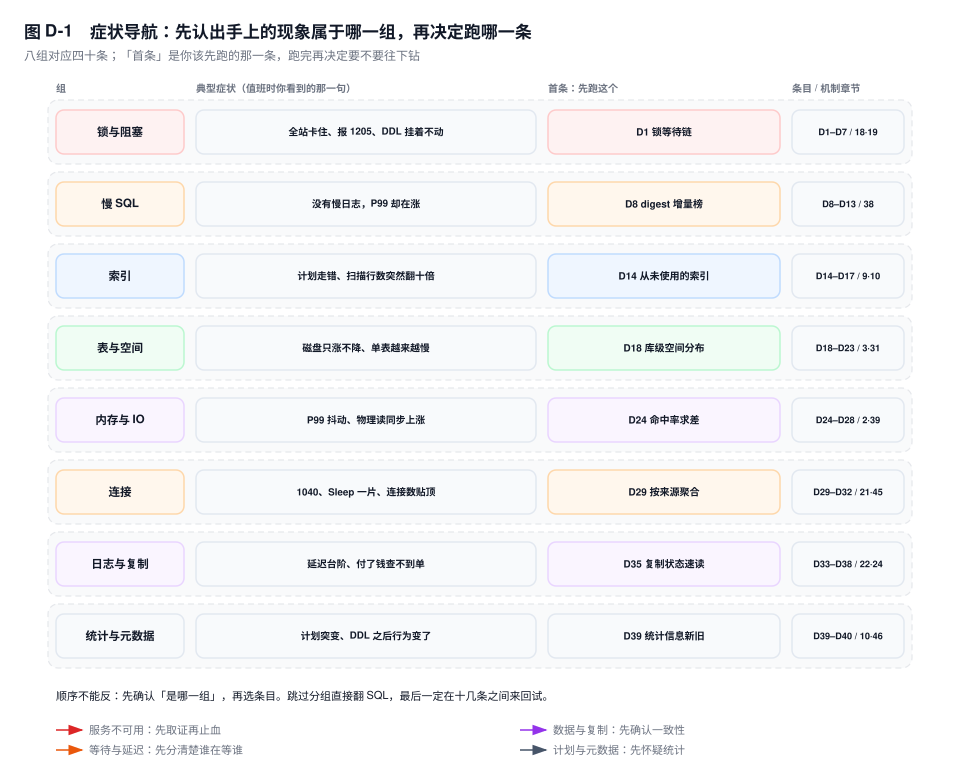
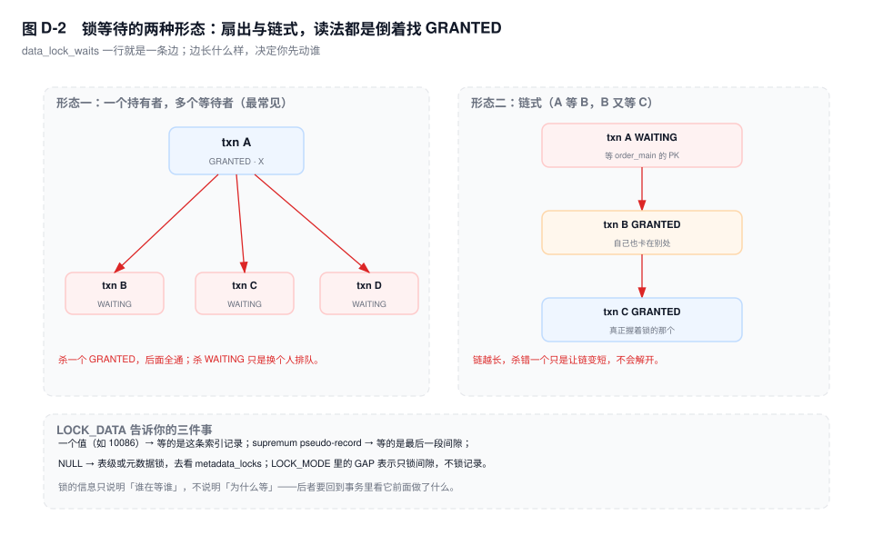

# 附录 D　诊断 SQL 手册

> **一句话结论**：线上排障的差距不在"知不知道这条 SQL"，而在"知不知道该先跑哪一条"——这本册子按症状分组，不按语法分组。

## D.0 怎么用这本手册

四十条语句，按"我现在遇到什么"分成八组。每条的写法固定四段：**用途**（一句话说清它回答什么问题）、**SQL**（可直接复制）、**读法**（结果里哪一列是关键，怎么念）、**坑**（它在什么情况下会骗你）。

三条规矩，比任何一条 SQL 都重要：

**一、先取证，再动手。** `KILL`、重启、切主这些动作一旦执行，`SHOW ENGINE INNODB STATUS` 里的锁等待链、`p_s` 里的执行历史、连接上的 `STATE` 全部消失。事故现场是只读一次的，读之前不要碰它。

**二、所有计数器都要两次采样求差。** `SHOW GLOBAL STATUS` 和 `performance_schema` 里的绝大部分值是从实例启动那一刻开始累加的。一个跑了 90 天的库，`Innodb_buffer_pool_reads` 是几十亿，你从绝对值上什么都看不出来。本手册里凡是标了"求差"的条目，都要按 D.10 的模板做两次采样。

**三、先看单位，再看数字。** `performance_schema` 里的时间单位是**皮秒**（1 秒 = 1e12 皮秒），除以 `1e12` 得秒、除以 `1e9` 得毫秒。这一条每年都要坑一批人：把皮秒当微秒读，结论会差六个数量级。

标了 ⚠️ 的条目在负载高时执行会额外加压（扫 `p_s` 全表、遍历 buffer pool、打开所有表空间文件），**故障中不要跑**，留到事后复盘。四十条里有十三条属于这一类，D.10 末尾把它们列全了。



## D.1 六十秒判断：从症状跳到第一条

值班时最浪费时间的动作，是在十几条 SQL 之间来回试。先用三十秒把症状归到一组，再往下钻。

| 你看到的现象 | 先跑 | 跑完再决定 |
|---|---|---|
| 全站卡住，应用报 `1205` | D1 锁等待链 | 有链 → D5 看是谁开的事务；无链 → D3 看 MDL |
| DDL 一直 `Waiting for table metadata lock` | D3 MDL 持有者 | 找到 Sleep 的那个会话，再 D4 看队列深度 |
| 某些行报 `1213`，一天几十次 | D7 死锁现场 | 看两个事务的加锁顺序是否相反 |
| QPS 骤降，但没有慢查询 | D8 digest 增量榜 | 榜上没异常 → D24 看命中率，D39 看统计信息 |
| P99 周期性尖刺，平均正常 | D27 checkpoint 年龄 | 年龄贴着容量 → 刷脏预算不够 |
| 慢查询日志里全是同一条 | D9 高频小慢榜 | 单条不慢、次数太多 → 改调用方，不是改 SQL |
| 某条 SQL 扫描行数突然翻十倍 | D10 扫描返回比 | 比值高 → D11 全表扫描，再 D13 单条画像 |
| 磁盘只涨不降 | D18 库级空间 | 哪张表在涨；undo 涨 → D22 |
| 单表写入越来越慢 | D20 碎片与预分配 | `DATA_FREE` 高 → 重建；不高 → 看主键是否随机（第 30 章） |
| 连接数贴上限，`Threads_running` 却个位数 | D29 按来源聚合 | 全是 Sleep → D30 长空闲连接 |
| 复制延迟成台阶 | D36 延迟三段分解 | 卡在回放 → D37 看是哪个 worker |
| 从库数据比主库少一段 | D38 半同步与 MGR | 半同步状态 `OFF` → 降级期间丢的事务 |
| 升级或大批量导入之后计划变了 | D39 统计信息新旧 | `last_update` 早于导入时间 → `ANALYZE` |
| 加过很多次字段，之后 DDL 变慢 | D40 instant 变更次数 | 接近 64 次 → 下一次必然重建 |

## D.2 锁与阻塞（D1 ~ D7）

### D1　锁等待链：谁在等谁

**用途**：把"一片卡住"还原成一张等待图，找出真正握着锁不放的那个会话。

```sql
SELECT r.OBJECT_SCHEMA AS db_name, r.OBJECT_NAME AS tbl, r.INDEX_NAME AS idx,
       r.LOCK_TYPE, r.LOCK_MODE, r.LOCK_DATA,
       wt.PROCESSLIST_ID AS wait_conn, wt.PROCESSLIST_TIME AS wait_s,
       LEFT(wt.PROCESSLIST_INFO, 60) AS wait_sql,
       bt.PROCESSLIST_ID AS hold_conn, bt.PROCESSLIST_STATE AS hold_state,
       LEFT(bt.PROCESSLIST_INFO, 60) AS hold_sql
FROM performance_schema.data_lock_waits w
JOIN performance_schema.data_locks r ON r.ENGINE_LOCK_ID = w.REQUESTING_ENGINE_LOCK_ID
JOIN performance_schema.data_locks b ON b.ENGINE_LOCK_ID = w.BLOCKING_ENGINE_LOCK_ID
LEFT JOIN performance_schema.threads wt ON wt.THREAD_ID = r.THREAD_ID
LEFT JOIN performance_schema.threads bt ON bt.THREAD_ID = b.THREAD_ID
ORDER BY wt.PROCESSLIST_TIME DESC;
```

**读法**：一行是一条边，`hold_conn` 才是要动的人。如果 `hold_state` 和 `hold_sql` 都是 `NULL`，说明持有者处于空闲状态——**问题不在它正在跑什么，而在它还开着**。倒着读：从最深的 `wait_conn` 往上找第一个只出现在 `hold_conn` 列、不出现在 `wait_conn` 列的值，那就是链头。图 D-2 是两种常见形态。



**坑**：`data_locks` 只有 InnoDB 行锁，元数据锁不在里面（用 D3、D4）。`[5.7]` 没有这两张表，替代是 `information_schema.innodb_locks` 与 `innodb_lock_waits`，或者直接用 `sys.innodb_lock_waits`——它在两个版本里字段一致，是最省事的写法。

### D2　锁热点：压力集中在哪张表、哪种模式

**用途**：判断这一轮阻塞是"某条 SQL 锁太粗"，还是"事务普遍太长"。

```sql
SELECT OBJECT_SCHEMA, OBJECT_NAME, INDEX_NAME,
       LOCK_TYPE, LOCK_MODE, LOCK_STATUS, COUNT(*) AS locks
FROM performance_schema.data_locks
GROUP BY OBJECT_SCHEMA, OBJECT_NAME, INDEX_NAME, LOCK_TYPE, LOCK_MODE, LOCK_STATUS
ORDER BY locks DESC LIMIT 20;
```

**读法**：`LOCK_MODE` 里带 `GAP` 或缺少 `REC_NOT_GAP`，说明走的是范围锁，通常是条件没落到等值点（第 19 章）；一张表上挂几百个 `X,REC_NOT_GAP` 且都是 `GRANTED`，那不是锁太粗，是事务开得太多没提交。

**坑**：这是瞬时快照，不是累计值。刷新一次结果就可能全变，所以要在"卡住的那一刻"跑，事后补跑只能看到残留。

### D3　MDL 持有者：DDL 被谁堵住了

**用途**：几十秒内定位那个"开着事务什么都不干"的连接——它一个人就能堵死整库。

```sql
SELECT t.PROCESSLIST_ID AS conn, t.PROCESSLIST_USER AS usr,
       t.PROCESSLIST_TIME AS idle_s, t.PROCESSLIST_COMMAND AS cmd,
       m.OBJECT_SCHEMA, m.OBJECT_NAME, m.LOCK_TYPE, m.LOCK_DURATION
FROM performance_schema.metadata_locks m
JOIN performance_schema.threads t ON t.THREAD_ID = m.OWNER_THREAD_ID
WHERE m.LOCK_STATUS = 'GRANTED' AND m.LOCK_DURATION = 'TRANSACTION'
  AND m.OBJECT_SCHEMA NOT IN ('performance_schema','information_schema','mysql','sys')
ORDER BY t.PROCESSLIST_TIME DESC LIMIT 20;
```

**读法**：`LOCK_DURATION = 'TRANSACTION'` 是关键过滤——语句级 MDL 执行完就释放，能长期撑住的一定是事务级。`cmd` 为 `Sleep` 且 `idle_s` 上千秒的那一行，就是第 41 章案例五里的元凶。

**坑**：⚠️ 这张表按需分配内存，`performance_schema_max_metadata_locks` 打满之后新的 MDL 请求会被阻塞在观测这一步，**查它本身会把故障加重**。真到了那一步，只能退回 `SHOW PROCESSLIST` 看 `State`。

### D4　MDL 队列：谁在排队，排了多深

**用途**：区分"一个持有者 + 一堆等待者"和"DDL 与查询交替插队"，后者才需要停业务。

```sql
SELECT (m.LOCK_STATUS = 'GRANTED') AS granted,
       m.LOCK_TYPE, m.LOCK_DURATION, m.LOCK_STATUS,
       m.OWNER_THREAD_ID, t.PROCESSLIST_ID AS conn,
       t.PROCESSLIST_STATE AS state, LEFT(t.PROCESSLIST_INFO, 70) AS sql_text
FROM performance_schema.metadata_locks m
LEFT JOIN performance_schema.threads t ON t.THREAD_ID = m.OWNER_THREAD_ID
WHERE m.OBJECT_SCHEMA = 'order_db' AND m.OBJECT_NAME = 'order_main'
ORDER BY granted DESC, m.OWNER_THREAD_ID;
```

**读法**：`granted = 1` 的行先看，那是现有的持有者；`LOCK_STATUS` 为 `PENDING` 的排在 DDL 前面（同优先级内先来先得），`WAITING` 的是普通查询。队列里 `WAITING` 越多，说明被牵连的普通业务越多。

**坑**：⚠️ 无过滤条件时它会把整实例的 MDL 全捞出来，几十万行不稀奇。生产上一定带 `OBJECT_SCHEMA` 与 `OBJECT_NAME`，别裸查。

### D5　长事务：谁开得最久，回滚要多久

**用途**：找出钉住 purge、撑住 MDL、拖慢复制的那批事务。

```sql
SELECT trx_id, trx_state, trx_started,
       TIMESTAMPDIFF(SECOND, trx_started, NOW()) AS age_s,
       trx_rows_locked, trx_rows_modified, trx_weight,
       trx_isolation_level, trx_mysql_thread_id AS conn,
       LEFT(trx_query, 80) AS query
FROM information_schema.innodb_trx
ORDER BY trx_started LIMIT 20;
```

**读法**：`age_s` 是账龄；`trx_rows_modified` 决定 `KILL` 之后要回滚多久——几百万行的修改，回滚可能比故障本身还长（第 21 章）。`trx_state` 出现 `ROLLING BACK` 时，锁要等回滚完才放，这期间 `KILL` 是无效动作。

**坑**：`innodb_trx` 里只有"已经碰过 InnoDB 表"的事务。`START TRANSACTION` 之后只读了内存表、或者只做了一次 `SELECT 1` 的会话，这里看不到，但它照样握着 MDL——那种情况只能用 D3 抓。

### D6　挂着事务的 Sleep 连接

**用途**：连接池 + 长事务的组合，是 MDL 阻塞与 purge 停滞的最常见来源。

```sql
SELECT t.PROCESSLIST_ID AS conn, t.PROCESSLIST_USER AS usr,
       t.PROCESSLIST_HOST AS host, t.PROCESSLIST_TIME AS idle_s,
       x.trx_started, x.trx_rows_modified
FROM performance_schema.threads t
JOIN information_schema.innodb_trx x ON x.trx_mysql_thread_id = t.PROCESSLIST_ID
WHERE t.PROCESSLIST_COMMAND = 'Sleep' AND t.PROCESSLIST_TIME > 300
ORDER BY t.PROCESSLIST_TIME DESC;
```

**读法**：`idle_s` 是"这个连接多久没发语句了"，`trx_started` 是"这个事务什么时候开的"。两个数字放在一起才有意义：空闲 20 分钟、事务开了 20 分钟，说明是应用拿了连接忘了提交；空闲 20 分钟、事务刚开 2 秒，那只是池子里的正常闲置。

**坑**：`PROCESSLIST_TIME` 在 `Sleep` 状态下数的是"空闲时长"，一旦有语句在跑就变成"当前语句已执行时长"。同一个列两种含义，别跨状态比较。

### D7　死锁现场

**用途**：确认死锁是"同一批行、交叉加锁"，而不是把锁等待超时误报成死锁。

```sql
SELECT COUNT AS deadlocks FROM information_schema.innodb_metrics WHERE NAME = 'lock_deadlocks';
SHOW ENGINE INNODB STATUS\G
```

**读法**：`lock_deadlocks` 是累计值，两次采样求差才是"这段时间发生了几次"。`LATEST DETECTED DEADLOCK` 段里看两个事务的 `HOLDS THE LOCK(S)` 与 `WAITING FOR THIS LOCK TO BE GRANTED`——顺序反过来就是标准的交叉等待。

**坑**：⚠️ 这一段只保留**最近一次**，重启即清空。要看全部必须 `SET GLOBAL innodb_print_all_deadlocks = ON`，让每次死锁落进错误日志；这个开关有 IO 开销，排完就关。另外段里的 `WE ROLL BACK TRANSACTION` 是 InnoDB 挑的牺牲者（通常回滚代价小的那个），**不是"犯错的那个"**，按它追责一定追错人。

## D.3 慢 SQL 与执行（D8 ~ D13）

这一组的前提是 `performance_schema` 的语句统计处于开启状态（8.0 默认开启，`performance_schema_consumer_statements_digest` 为 `ON`）。所有时间列单位是皮秒。

### D8　本周期最耗时的 digest

**用途**：不依赖慢查询日志的阈值，找出这段时间真正吃掉数据库的那批 SQL。

```sql
DROP TABLE IF EXISTS tmp_digest_snap;
CREATE TABLE tmp_digest_snap AS
SELECT DIGEST, SCHEMA_NAME, DIGEST_TEXT, COUNT_STAR, SUM_TIMER_WAIT,
       SUM_ROWS_EXAMINED, SUM_ROWS_SENT
FROM performance_schema.events_statements_summary_by_digest;
-- 等 10 分钟（或一个业务周期）后执行下面这条
SELECT n.SCHEMA_NAME, LEFT(n.DIGEST_TEXT, 70) AS sql_text,
       n.COUNT_STAR - IFNULL(o.COUNT_STAR, 0) AS exec_delta,
       ROUND((n.SUM_TIMER_WAIT - IFNULL(o.SUM_TIMER_WAIT, 0)) / 1e12, 2) AS total_s,
       ROUND((n.SUM_TIMER_WAIT - IFNULL(o.SUM_TIMER_WAIT, 0))
             / GREATEST(n.COUNT_STAR - IFNULL(o.COUNT_STAR, 0), 1) / 1e9, 2) AS avg_ms
FROM performance_schema.events_statements_summary_by_digest n
LEFT JOIN tmp_digest_snap o ON o.DIGEST = n.DIGEST
WHERE n.COUNT_STAR > IFNULL(o.COUNT_STAR, 0)
ORDER BY total_s DESC LIMIT 20;
```

**读法**：`total_s` 是这段时间的总耗时，`avg_ms` 是单次耗时。两个数字要一起看：总耗时高但单次只有 2ms，那是调用次数的问题，不是 SQL 的问题（换 D9）；总耗时高且单次 800ms，才轮到改写。

**坑**：⚠️ 快照表建在业务库里，跑完记得 `DROP`，它不会自己消失。`p_s` 的统计**不持久化，实例重启即清零**，所以跨重启的两次快照相减会得到负数——看到负数就说明中间重启过，这一轮数据作废。另外 `performance_schema_digests_size` 默认 10000，摘要表满了之后新出现的 digest 会被归并到一条兜底行里，**这些语句的耗时就不再有归属**；榜单总耗时明显小于 `Com_*` 推算出的量级，就是这个原因。

### D9　高频小慢：次数榜而不是耗时榜

**用途**：抓 N+1、循环调用、缓存击穿这类"单条不慢、次数离谱"的问题。

```sql
SELECT n.SCHEMA_NAME, LEFT(n.DIGEST_TEXT, 70) AS sql_text,
       n.COUNT_STAR - IFNULL(o.COUNT_STAR, 0) AS exec_delta,
       ROUND((n.SUM_TIMER_WAIT - IFNULL(o.SUM_TIMER_WAIT, 0))
             / GREATEST(n.COUNT_STAR - IFNULL(o.COUNT_STAR, 0), 1) / 1e9, 3) AS avg_ms
FROM performance_schema.events_statements_summary_by_digest n
LEFT JOIN tmp_digest_snap o ON o.DIGEST = n.DIGEST
WHERE n.COUNT_STAR > IFNULL(o.COUNT_STAR, 0)
ORDER BY exec_delta DESC LIMIT 20;
```

**读法**：用 D8 建的同一张快照表，只换排序。`exec_delta` 上万而 `avg_ms` 低于 1 的，基本可以断定是应用层在循环里发 SQL；`avg_ms` 只有 0.2ms 的点查乘上 10 万次，也是 20 秒。

**坑**：`COUNT_STAR` 包含 `Com_commit`、`Com_begin` 这类协议语句，榜单前几名经常是一堆空操作，扫一眼再往下看。`DIGEST_TEXT` 超过列的宽度会被截断，判断语句身份要用 `DIGEST` 而不是文本。

### D10　扫描与返回的比例：谁在白扫

**用途**：找出"读了很多行、返回很少行"的语句——索引选择性不够或条件没走到索引上。

```sql
SELECT SCHEMA_NAME, LEFT(DIGEST_TEXT, 70) AS sql_text, COUNT_STAR,
       SUM_ROWS_EXAMINED, SUM_ROWS_SENT,
       ROUND(SUM_ROWS_EXAMINED / GREATEST(SUM_ROWS_SENT, 1)) AS exam_per_row
FROM performance_schema.events_statements_summary_by_digest
WHERE SCHEMA_NAME IS NOT NULL AND SUM_ROWS_SENT > 0
ORDER BY exam_per_row DESC LIMIT 20;
```

**读法**：`exam_per_row` 是"为了返回一行读了多少行"。点查应该接近 1，范围查询几到几十都正常；上千说明索引只起到了排序作用，过滤全靠回表后逐行判断。

**坑**：这里用的是累计值而不是增量，比值所以稳定——但也因此**看不见最近的恶化**。一条 SQL 上周开始变坏，历史的好数据会把它稀释掉。要抓变化，得按 D8 的方式做两次快照再算比值。

### D11　全表扫描的语句

**用途**：直接列出"没有可用索引"的语句，比翻 `EXPLAIN` 快。

```sql
SELECT db, LEFT(query, 70) AS sql_text, exec_count,
       no_index_used_count, no_index_used_pct,
       rows_examined, rows_sent, total_latency
FROM sys.statements_with_full_table_scans
WHERE db IS NOT NULL
ORDER BY total_latency DESC LIMIT 20;
```

**读法**：`no_index_used_pct` 是"这组语句里有多大比例没走索引"。100% 且 `exec_count` 很大的，是确定性缺口，加索引就能解决；比例很低但 `total_latency` 很高的，可能是那条 SQL 在某些参数下才走全扫（第 10 章的估算失准）。

**坑**：⚠️ 这个视图内部要对摘要表做聚合与字符串处理，摘要表满（10000 条）时它会把整张表扫一遍。实例 CPU 已经打满时不要跑，或者改成带 `LIMIT` 的 `DIGEST_TEXT LIKE '%order_main%'` 定向查。

### D12　临时表落盘

**用途**：找出那些把结果集写进磁盘的语句——排序、分组、`DISTINCT` 溢出内存的典型现场。

```sql
SELECT db, LEFT(query, 70) AS sql_text, exec_count,
       memory_tmp_tables, disk_tmp_tables, tmp_tables_to_disk_pct, total_latency
FROM sys.statements_with_temp_tables
WHERE disk_tmp_tables > 0
ORDER BY disk_tmp_tables DESC LIMIT 20;
```

**读法**：`tmp_tables_to_disk_pct` 高说明每次执行都在落盘，瓶颈是 `tmp_table_size` 与 `max_heap_table_size`（第 14 章）；如果落盘比例低但 `exec_count` 巨大，那是次数问题。注意 `disk_tmp_tables` 是"创建过的磁盘临时表个数"，不是字节数。

**坑**：⚠️ 同 D11，`sys` 视图的开销随摘要表规模上升。另外 `Created_tmp_disk_tables` 这个全局计数器把内部临时表（优化器自己用的）也算进去了，和这里的口径不完全一致，别拿两个数字互相印证。

### D13　单条 SQL 的执行画像

**用途**：前面几条都是"哪条 SQL 有问题"，这一条回答"它到底把时间花在哪"。

```sql
SHOW SESSION STATUS LIKE 'Handler_read%';
EXPLAIN ANALYZE
SELECT id, order_no, pay_amount FROM order_main
WHERE merchant_id = 10086 AND created_at >= '2026-11-01' ORDER BY created_at DESC LIMIT 20;
SHOW SESSION STATUS LIKE 'Handler_read%';
```

**读法**：两次 `Handler_read%` 求差。`Handler_read_next` 是沿索引顺序读的下一行数，`Handler_read_rnd_next` 是全表顺序扫的行数——后者涨几百万，说明这次真的在扫表，不管 `EXPLAIN` 怎么写（第 11 章）。`EXPLAIN ANALYZE` `[8.0.18+]` 给的是实际耗时与估算行数的对比，`actual rows` 与 `estimated rows` 差一个数量级就是统计信息的问题（D39）。

**坑**：`Handler_read_*` 数的是 **Server 层向引擎要行的次数**，不是引擎扫过的行数，两者在索引条件下推（ICP）与覆盖索引时并不相等。`FLUSH STATUS` 会把本会话计数器清零、并影响全局计数器的一部分，别在别人的会话或监控基线上随手执行；用两次 `SHOW SESSION STATUS` 求差更稳。

## D.4 索引（D14 ~ D17）

### D14　从未被使用过的索引

**用途**：下线候选清单。写放大是实打实的成本，没人读的索引只是在拖慢每一次写入。

```sql
SELECT * FROM sys.schema_unused_indexes
WHERE object_schema NOT IN ('mysql','sys','performance_schema');
```

**读法**：`index_name` 为 `PRIMARY` 的不会出现在这里（聚簇索引必用）。剩下的每一行都是一个候选，但要按"业务周期"判断：只在月初跑一次的报表索引，在月中看就是"未使用"。

**坑**：⚠️ 这个视图背后是 `table_io_waits_summary_by_index_usage`，统计自实例启动（或 `p_s` 重置）以来累计，**重启即清零**，且建立索引之前的读不算。要下线先做 `ALTER TABLE ... ALTER INDEX ... INVISIBLE` 观察一个完整周期，没人报错再 `DROP`（第 42 章）——直接删是拿生产做实验。

### D15　冗余索引

**用途**：找出"前缀完全相同"的索引对，这类是纯浪费，删掉几乎没有风险。

```sql
SELECT table_schema, table_name, redundant_index_name, redundant_index_columns,
       dominant_index_name, sql_drop_index
FROM sys.schema_redundant_indexes
WHERE table_schema NOT IN ('mysql','sys');
```

**读法**：`sql_drop_index` 是现成的删除语句，`dominant_index_name` 是那个"覆盖了它"的索引。经典例子：已有 `(merchant_id, created_at)`，再建一个 `(merchant_id)` 就是冗余——前者能完全替代后者。

**坑**：⚠️ 这里只判"列前缀包含"，判不了选择性差异。两个索引列相同但一个是 `UNIQUE`、一个不是，不能按冗余处理。删之前先看 D16 里两个索引各自的读次数——读次数都很高的"冗余"往往说明优化器在用其中一个做覆盖扫描。

### D16　索引的真实读次数与耗时

**用途**：把"这个索引重要不重要"从感觉变成数字。

```sql
SELECT OBJECT_SCHEMA, OBJECT_NAME, INDEX_NAME,
       COUNT_STAR, COUNT_READ, COUNT_WRITE,
       ROUND(SUM_TIMER_WAIT / 1e12, 2) AS total_s
FROM performance_schema.table_io_waits_summary_by_index_usage
WHERE OBJECT_SCHEMA = 'order_db' AND INDEX_NAME IS NOT NULL
ORDER BY COUNT_STAR DESC LIMIT 30;
```

**读法**：`COUNT_READ` 与 `COUNT_WRITE` 分开看。写多读少（`COUNT_WRITE` 远大于 `COUNT_READ`）的索引，是典型的"只在付维护成本"；`total_s` 高的索引说明它是热点路径，动它之前必须先有替代方案。

**坑**：⚠️ 这张表按"库 + 表 + 索引"的组合分行，几千张表的实例能到几十万行，不带 `OBJECT_SCHEMA` 的查询会扫很久。另外 `INDEX_NAME` 为 `NULL` 的行是"表级等待"，不是"没有索引"，别把它当成缺索引的证据。

### D17　没有主键的表

**用途**：无主键表会隐式生成 6 字节的 `GEN_CLUST_ROW_ID`，它不能用于复制并行判定、不能用于分页游标、也没法做行级定位。这是一份必须清零的清单。

```sql
SELECT t.TABLE_SCHEMA, t.TABLE_NAME, t.TABLE_ROWS,
       ROUND((t.DATA_LENGTH + t.INDEX_LENGTH) / 1024 / 1024) AS mb
FROM information_schema.tables t
LEFT JOIN information_schema.statistics s
       ON s.TABLE_SCHEMA = t.TABLE_SCHEMA AND s.TABLE_NAME = t.TABLE_NAME
      AND s.INDEX_NAME = 'PRIMARY'
WHERE t.TABLE_SCHEMA NOT IN ('mysql','sys','performance_schema','information_schema')
  AND t.TABLE_TYPE = 'BASE TABLE' AND s.INDEX_NAME IS NULL
ORDER BY t.TABLE_ROWS DESC;
```

**读法**：按 `TABLE_ROWS` 降序，先处理大表。`stock_flow` 这类流水表最容易漏——建表时只想着"反正是流水，不需要主键"，结果第 41 章案例四的复制延迟就出在它身上。

**坑**：`information_schema.statistics` 在大实例上是个昂贵的视图（8.0 已改为读数据字典，比 5.7 快很多，但表多时仍是秒级）。另外"有唯一非空索引"在 InnoDB 里可以当聚簇索引用，那种表不算无主键，但复制并行判定的行为与真主键不同，要单独确认。

## D.5 表与空间（D18 ~ D23）

### D18　库级空间分布

**用途**：磁盘告警时第一眼要看的东西——是哪个库、哪类数据在涨。

```sql
SELECT TABLE_SCHEMA,
       COUNT(*) AS tables_cnt,
       ROUND(SUM(DATA_LENGTH) / 1024 / 1024 / 1024, 2) AS data_gb,
       ROUND(SUM(INDEX_LENGTH) / 1024 / 1024 / 1024, 2) AS index_gb,
       ROUND(SUM(DATA_FREE) / 1024 / 1024 / 1024, 2) AS free_gb
FROM information_schema.tables
WHERE TABLE_SCHEMA NOT IN ('mysql','sys','performance_schema','information_schema')
GROUP BY TABLE_SCHEMA ORDER BY data_gb DESC;
```

**读法**：`index_gb` 与 `data_gb` 的比例是有信息量的。索引比数据还大，通常是索引建多了或者主键太长（第 30 章）；`free_gb` 占比高说明空间被预分配但没用上，不一定能靠删数据还回来。

**坑**：这三个长度列都是**页数 × 页大小的估算**，不是文件系统的真实占用。开了压缩或表空间里有 undo 残留时，两者能差出百分之几十。真要精确值，去数据目录 `du -sh`。

### D19　大表排行与行数估算的偏差

**用途**：找"最大的那几张表"，同时给自己一个提醒：`TABLE_ROWS` 是估算。

```sql
SELECT TABLE_SCHEMA, TABLE_NAME, TABLE_ROWS,
       ROUND(DATA_LENGTH / 1024 / 1024 / 1024, 2) AS data_gb,
       ROUND(AVG_ROW_LENGTH) AS avg_row_b,
       TABLE_COLLATION, ENGINE
FROM information_schema.tables
WHERE TABLE_SCHEMA = 'order_db' AND TABLE_TYPE = 'BASE TABLE'
ORDER BY DATA_LENGTH DESC LIMIT 20;
```

**读法**：`AVG_ROW_LENGTH` 是行宽的直接来源，做容量模型时用它（第 51 章）。`TABLE_COLLATION` 顺手能看出 8.0 升级后有没有留下 `utf8mb3` 的老表（第 43 章）。

**坑**：InnoDB 的 `TABLE_ROWS` 来自采样估算，误差可以到 ±50%，小表甚至会显示 0。**不要用它做精确统计**，也不要拿它和 `COUNT(*)` 的差异去判断"数据丢了"——那是最常见的误判之一。

### D20　碎片与预分配空间

**用途**：判断"删了很多数据但磁盘没降"是该重建表，还是本来就该这么大。

```sql
SELECT TABLE_SCHEMA, TABLE_NAME, TABLE_ROWS,
       ROUND(DATA_LENGTH / 1024 / 1024) AS data_mb,
       ROUND(DATA_FREE / 1024 / 1024) AS free_mb,
       ROUND(DATA_FREE / NULLIF(DATA_LENGTH + INDEX_LENGTH, 0) * 100, 1) AS free_pct
FROM information_schema.tables
WHERE TABLE_SCHEMA NOT IN ('mysql','sys','performance_schema','information_schema')
  AND DATA_FREE > 100 * 1024 * 1024
ORDER BY DATA_FREE DESC LIMIT 20;
```

**读法**：`free_pct` 比绝对值的 `free_mb` 更有意义。刚做过大批量删除、`free_pct` 超过 30% 的表，重建能还回空间；`free_pct` 只有几个百分点的大表，那是表空间自动扩展留下的余量，重建也省不下多少。

**坑**：`DATA_FREE` 在 file-per-table 模式下**包含预分配但未使用的区**，每张表都会有一点，所以它从来不等于"碎片"。另一个常被忽略的点：重建需要额外一份表大小的空间，磁盘已经 90% 时执行 `ALTER TABLE ... FORCE` 会直接把盘撑爆。

### D21　表空间文件在哪、是什么类型

**用途**：磁盘满时确认"占空间的到底是不是这几张表"，共享表空间与独立表空间的处理方式完全不同。

```sql
SELECT NAME, SPACE, SPACE_TYPE, ROW_FORMAT
FROM information_schema.innodb_tablespaces
WHERE NAME NOT LIKE 'undo%'
ORDER BY SPACE DESC LIMIT 30;

SELECT SPACE, NAME, PATH FROM information_schema.innodb_tablespaces_brief
WHERE NAME LIKE 'order_db/%' LIMIT 30;
```

**读法**：`SPACE_TYPE` 是 `Single`（独立表空间，每表一个 `.ibd`）或 `General`（共享表空间）。`innodb_tablespaces_brief.PATH` 给出物理路径，可以直接拿去 `du -sh` 对账。8.0 的 `mysql.ibd` 承载数据字典，它的大小和 `information_schema` 里任何一张表都对不上，属正常。

**坑**：⚠️ 这两张表要打开每个表空间的文件头，几千个表空间的实例上会明显变慢。另外 `innodb_tablespaces` 需要 `PROCESS` 权限，普通账号查出来是空的——空结果不代表没有表空间。

### D22　undo 表空间：个数与体量

**用途**：磁盘被 undo 吃掉是长事务最典型的后果（第 5 章、第 41 章案例七）。

```sql
SELECT NAME, SPACE_TYPE FROM information_schema.innodb_tablespaces WHERE NAME LIKE 'undo%';

SELECT FILE_NAME, FILE_TYPE, STATUS,
       ROUND(TOTAL_EXTENTS * EXTENT_SIZE / 1024 / 1024 / 1024, 2) AS size_gb
FROM information_schema.files WHERE FILE_TYPE = 'UNDO LOG';
```

**读法**：8.0 初始化时至少建两个 undo 表空间，`NAME` 是 `undo_001`、`undo_002`；个数少于两个说明初始化参数被改过，升级时会自动补齐。`size_gb` 长期只增不减、`History list length` 又是千万级，说明 purge 被一个长事务钉住了，扩容只是买时间。

**坑**：⚠️ `information_schema.files` 会打开所有表空间文件，实例上有大量表时开销不小。`TOTAL_EXTENTS × EXTENT_SIZE` 是逻辑大小，开了 `AUTOEXTEND` 之后与 `ls -lh` 看到的值可能不一致，对账以文件系统为准。

### D23　临时表与磁盘临时表空间

**用途**：确认"临时表是不是在吃磁盘"，以及是哪个会话在造。

```sql
SELECT SESSION_ID, SPACE, PATH, ROUND(SIZE / 1024 / 1024) AS mb, STATE
FROM information_schema.innodb_session_temp_tablespaces
ORDER BY SIZE DESC LIMIT 20;

SHOW GLOBAL STATUS LIKE 'Created_tmp%';
```

**读法**：`[8.0]` 的会话临时表空间是共享池里按需分配的，会话断开就回收；`SIZE` 排在前面的会话就是元凶。`Created_tmp_disk_tables` 与 `Created_tmp_tables` 一起求差，比值高说明内存临时表配置太小。

**坑**：`Created_tmp_disk_tables` 把优化器内部临时表也算进去了，与 D12 的口径不一致。`innodb_temp_data_file_path` 设了 `AUTOEXTEND` 的话，这个文件只增不减，重启才会收缩——清理临时表不会让磁盘降下来。

## D.6 内存与 IO（D24 ~ D28）

### D24　buffer pool 命中率（必须求差）

**用途**：判断"物理读是不是变多了"，这是 P99 抖动的第一嫌疑。

```sql
SELECT VARIABLE_NAME, VARIABLE_VALUE FROM performance_schema.global_status
WHERE VARIABLE_NAME IN ('Innodb_buffer_pool_read_requests', 'Innodb_buffer_pool_reads');
-- 间隔 60 秒再跑一次，用两次结果计算
-- 命中率 = 1 - Δreads / Δread_requests
```

**读法**：`Innodb_buffer_pool_reads` 是"不得不去磁盘取的页数"，`read_requests` 是"逻辑读请求数"。用增量算出来的命中率才是当下这一刻的；累计命中率几乎没有诊断价值——一个跑了三个月的库，累计 99.99%，最近一小时掉到 80% 也看不出来。

**坑**：命中率不等于"没有 IO"。100% 命中率下照样可能有大量脏页要刷（D26）。反过来，命中率 97% 的库如果 QPS 是三万，每秒物理读也上千（第 51 章的算法）。

### D25　池里占页最多的是哪张表

**用途**：验证"热数据到底是谁"，做容量规划时用来校准假设。

```sql
SELECT * FROM sys.innodb_buffer_stats_by_table ORDER BY pages DESC LIMIT 20;
```

**读法**：`pages` 是驻留页数，`data` 是这些页的数据量，`rows_cached` 是估算的行数。三者相乘除能反推出"池子里装的是哪几张表的热数据"，与第 51 章"热 30 天 2400 万行"的假设对一下，就知道容量模型该不该改。

**坑**：⚠️ **这条会遍历整个 buffer pool 的所有页**，40G 的池在高峰跑要几百毫秒到几秒，期间持有内部闩锁，会让所有需要分配页的线程排队。故障中绝对不要跑，只在复盘或规划时用。

### D26　脏页与 wait_free：刷脏跟不跟得上

**用途**：区分"IO 慢"与"刷脏预算不够"，这两者的处置方向完全相反。

```sql
SELECT VARIABLE_NAME, VARIABLE_VALUE FROM performance_schema.global_status
WHERE VARIABLE_NAME IN ('Innodb_buffer_pool_pages_dirty', 'Innodb_buffer_pool_pages_free',
                        'Innodb_buffer_pool_wait_free', 'Innodb_buffer_pool_pages_flushed');
```

**读法**：`pages_dirty` 是当前脏页数，`pages_free` 是空闲页数。`wait_free` 是**计数器**，只要它在涨，就说明有用户线程为了拿到一个空页而等待过——这是"刷脏跟不上"的直接证据（第 4 章、第 39 章）。`pages_flushed` 求差得每秒刷页数，与 `innodb_io_capacity` 对比。

**坑**：`pages_free` 很小并不一定是问题：预读与自适应哈希都会占用空闲页，而且 buffer pool 本来就该被填满。真正的判据是 `wait_free` 在涨，不是 `pages_free` 接近 0。

### D27　checkpoint 年龄与 redo 生成速率

**用途**：判断"redo 是不是快写满了"，这是周期性尖刺最常见的原因。

```sql
SHOW ENGINE INNODB STATUS\G
-- 取 LOG 段的 Log sequence number 与 Last checkpoint at，两者相减即年龄（字节）
SHOW GLOBAL STATUS LIKE 'Innodb_os_log_written';
```

**读法**：年龄除以 redo 容量就是"离写满还有多远"。`[8.0.30+]` 之后容量由 `innodb_redo_log_capacity` 直接决定，不再乘文件个数。`Innodb_os_log_written` 求差得每秒生成字节数，用它除以年龄余量，就是"还有多少秒"。

**坑**：年龄小不代表安全——`innodb_io_capacity` 太低时，checkpoint 会被迫更频繁地推进，年龄一直很小但 IO 一直很忙。反过来年龄长期贴着容量，说明每次 checkpoint 都发生在"快满"的时刻，一次写入突发就能触发强制刷脏。

### D28　文件级 IO 排行

**用途**：确认 IO 压在数据文件、redo、还是 binlog 上；也用来验证"是不是别的程序在抢盘"。

```sql
SELECT * FROM sys.io_global_by_file_by_bytes ORDER BY total DESC LIMIT 20;
```

**读法**：`file` 列会给出完整路径。redo（`#innodb_redo`）占比高说明写入密集，数据文件（`.ibd`）占比高说明读或刷脏密集，binlog 占比高说明大事务多。`write_pct` 接近 100 的，是纯写负载。

**坑**：⚠️ 它统计的是 `p_s` 的 IO 事件，只能看到 MySQL 自己的 IO。用 `iostat -x 1` 与它对照，差值就是别的进程（备份、日志采集、监控 agent）在吃盘——这一点在云盘上尤其重要，因为 IOPS 是实例级的配额。

## D.7 连接（D29 ~ D32）

### D29　连接按来源聚合

**用途**：连接数告警时第一眼要看"是谁连进来的"，而不是"连了多少"。

```sql
SELECT USER, SUBSTRING_INDEX(HOST, ':', 1) AS host_ip,
       COMMAND, COUNT(*) AS conns, MAX(TIME) AS max_idle_s
FROM information_schema.processlist
GROUP BY USER, host_ip, COMMAND
ORDER BY conns DESC LIMIT 20;
```

**读法**：一个 `USER` 配上几百个连接、`COMMAND` 全是 `Sleep`、`max_idle_s` 上千秒，就是连接池漏了（第 41 章案例一）。多个不同的 `host_ip` 各来几十个连接，那是应用副本数乘上池大小——用 `max_connections × 0.8 ÷ 副本数` 反推每个池该配多少。

**坑**：`HOST` 已经包含端口，直接 `GROUP BY HOST` 会得到几百个分组。云上开了连接代理之后，这一列全是代理地址（第 45 章），按它算出来的"来源数"没有意义。

### D30　长空闲连接

**用途**：连接池配置与 `wait_timeout` 不匹配时，泄漏的连接会挂满整个超时周期。

```sql
SELECT ID, USER, HOST, TIME, STATE
FROM information_schema.processlist
WHERE COMMAND = 'Sleep' AND TIME > 60
ORDER BY TIME DESC LIMIT 30;
```

**读法**：`TIME` 是空闲秒数。如果一批连接的 `TIME` 集中在某个值附近（比如都是 28800 上下），那基本可以断定它们是被 `wait_timeout` 收割的，而不是被应用主动关的。改小 `wait_timeout` 只对新连接生效，老连接要 `KILL` 才会走。

**坑**：`KILL` 一个 `Sleep` 连接是安全的（没有事务在跑），但如果它挂着未提交的事务（用 D6 确认），`KILL` 之后会进入回滚，锁要等回滚完才放——看起来"杀了没用"就是这个原因。

### D31　连接水位与拒绝计数

**用途**：区分"连接快满了"和"已经在拒绝连接"，后者才是真的故障。

```sql
SHOW GLOBAL STATUS WHERE Variable_name IN (
  'Threads_connected','Threads_running','Max_used_connections',
  'Aborted_clients','Aborted_connects','Connection_errors_max_connections');
```

**读法**：`Threads_connected` 是当前连接数，`Threads_running` 是正在执行的线程数，`Max_used_connections` 是历史峰值。三者要一起看：连接数贴顶但 `running` 个位数，是闲置泄漏；两个都高，是真的并发压力。`Connection_errors_max_connections` 只要不为 0，就说明已经有请求被拒了。

**坑**：`Aborted_clients` 高说明客户端异常断开（超时、进程被杀），`Aborted_connects` 高说明握手阶段就失败（认证、网络、`max_connect_errors`）。这两个数字常被当成"连接数问题"，其实指向完全不同的两类原因。

### D32　每个连接在干什么、等了多久

**用途**：`SHOW PROCESSLIST` 只有 `STATE` 一个字符串，这个视图把它补成"耗时、锁等待、扫描行数"。

```sql
SELECT thd_id, conn_id, user, db, command, state, time,
       LEFT(current_statement, 60) AS cur_sql,
       ROUND(statement_latency / 1e9, 1) AS stmt_ms,
       ROUND(lock_latency / 1e9, 1) AS lock_ms,
       rows_examined, rows_sent, full_scan
FROM sys.processlist
WHERE command <> 'Sleep'
ORDER BY statement_latency DESC LIMIT 20;
```

**读法**：`lock_ms` 占总耗时的比例高，说明它在等锁而不是在算；`full_scan` 为 1 且 `rows_examined` 很大，说明它在扫表；`stmt_ms` 很大而 `rows_sent` 很小，说明它在排序或聚合。

**坑**：`sys.processlist` 是个视图，每次查询都要现场拼装，连接数上万时它自己就要跑几秒。`current_statement` 只保留正在执行的那条，长事务里"上一条做了什么"看不到——那部分要靠 `events_statements_history`。

## D.8 日志与复制（D33 ~ D38）

### D33　binlog 列表与过期策略

**用途**：磁盘被 binlog 吃掉时，先确认它是不是在无限增长。

```sql
SHOW BINARY LOGS;
SHOW VARIABLES LIKE 'binlog_expire_logs_seconds';
SHOW VARIABLES LIKE 'max_binlog_size';
```

**读法**：`SHOW BINARY LOGS` 的 `File_size` 一列求和就是 binlog 总量（几百个文件时用 `SUM` 不方便，看最后一个文件的序号与单个文件大小也能估）。`binlog_expire_logs_seconds` 默认 2592000（30 天），设成 0 表示永不过期——这是磁盘爆满的常见原因之一。

**坑**：有从库时 `PURGE BINARY LOGS` 会删掉从库还没拉走的日志，复制直接断（第 22 章）。清理前先 `SHOW REPLICAS` 看各从库进度，或者干脆等过期策略自动清。

### D34　当前位点与 GTID（备份一致性）

**用途**：做全备、搭新从库、定位误操作区间，都要一个"位点 + GTID"的原子快照。

```sql
SELECT * FROM performance_schema.log_status\G

SHOW BINARY LOG STATUS;   -- [8.2+]；8.0 及以前是 SHOW MASTER STATUS
SELECT @@GLOBAL.gtid_executed;
```

**读法**：`log_status` `[8.0.14+]` 一次读出 `binary_log_file`、`binary_log_position`、`gtid_executed` 与各存储引擎的 LSN，且是**同一时刻的一致性快照**——这正是 `xtrabackup` 这类工具要的东西。手工记录位点时，两条 `SHOW` 之间有时间差，高写入下会错位。

**坑**：`SHOW MASTER STATUS` 在 `[8.2]` 起被 `SHOW BINARY LOG STATUS` 取代，老脚本升级后会报语法错。另外 `gtid_executed` 在 8.0 是压缩格式（连续区间合并），肉眼比对时别看花眼——要比对差异就用 `gtid_subtract()`。

### D35　复制状态速读：只取关键列

**用途**：`SHOW REPLICA STATUS` 有五十多列，值班时只需要其中六列。

```bash
mysql -e "SHOW REPLICA STATUS\G" | egrep \
 'Replica_IO_Running|Replica_SQL_Running|Seconds_Behind_Source|Last_.*Error|Exec_Source_Log_Pos|Retrieved_Gtid_Set'
```

**读法**：两个 `Running` 必须是 `Yes`；`Seconds_Behind_Source` 为 `NULL` 表示复制线程没在跑（不是"没有延迟"，这是最容易看错的一处）；`Last_IO_Error` 与 `Last_SQL_Error` 是断点原因。`[8.0.22]` 之前这些列名是 `Slave_*`、`Master_*`，升级后监控脚本里的列名要一起改。

**坑**：`Seconds_Behind_Source` 为 0 **不代表数据一致**——半同步降级、误删、跳过事务都能在"延迟 0"的情况下造成数据缺失（第 41 章案例九）。

### D36　复制延迟的三段分解

**用途**：延迟不是一件事。日志在路上、在 relay log 里排队、在回放，三段的处置方法完全不同。

```sql
SELECT CHANNEL_NAME,
       TIMESTAMPDIFF(MICROSECOND,
         LAST_QUEUED_TRANSACTION_IMMEDIATE_COMMIT_TIMESTAMP,
         LAST_QUEUED_TRANSACTION_END_QUEUE_TIMESTAMP) / 1000 AS net_ms,
       TIMESTAMPDIFF(MICROSECOND,
         LAST_QUEUED_TRANSACTION_END_QUEUE_TIMESTAMP, NOW(6)) / 1000 AS queue_and_apply_ms,
       LAST_QUEUED_TRANSACTION
FROM performance_schema.replication_connection_status;
```

**读法**：`net_ms` 是"主库提交到从库落进 relay log"的时间，这一段大说明网络或主库 binlog 发送慢；`queue_and_apply_ms` 是"落盘之后到此刻"，这一段大说明回放跟不上。两段相加才是用户感知到的延迟，只盯 `Seconds_Behind_Source` 看不出是哪一段。

**坑**：`IMMEDIATE_COMMIT_TIMESTAMP` 是主库上事务提交的时刻，依赖主从时钟大致同步；时钟漂移几秒，`net_ms` 就会出现负数。看到负值先查 NTP，别怀疑复制。

### D37　回放线程卡在哪一条事务上

**用途**：延迟上不去也下不来，通常是某个 worker 卡在一条大事务上。

```sql
SELECT CHANNEL_NAME, WORKER_ID, SERVICE_STATE,
       APPLYING_TRANSACTION,
       TIMESTAMPDIFF(MICROSECOND, APPLYING_TRANSACTION_START_APPLY_TIMESTAMP, NOW(6)) / 1000 AS applying_ms,
       LAST_APPLIED_TRANSACTION, LAST_ERROR_NUMBER, LAST_ERROR_MESSAGE
FROM performance_schema.replication_applier_status_by_worker
ORDER BY applying_ms DESC;
```

**读法**：`applying_ms` 是"这条事务已经开始回放多久了"。几千毫秒以上且持续增长，就是这个 worker 卡住了。`SERVICE_STATE` 为 `ON` 但 `applying_ms` 不动，说明它在等锁（从库上的并发查询会挡住回放）。

**坑**：多线程复制（`replica_parallel_workers > 1`）时，只有一个 worker 卡住，其余 worker 会等它（`replica_preserve_commit_order` 打开时），表现为"整体延迟涨但所有 worker 看起来都闲着"。`LAST_ERROR_MESSAGE` 只在出错时才有值，正常情况下为空是正常的。

### D38　半同步是否还活着 / MGR 队列深度

**用途**：半同步静默降级是"延迟 0 但数据丢了"的头号原因；MGR 的队列深度是判断集群是否在拖。

```sql
SHOW GLOBAL STATUS LIKE 'Rpl_semi_sync%';

SELECT MEMBER_ID, MEMBER_STATE, MEMBER_ROLE FROM performance_schema.replication_group_members;
SELECT MEMBER_ID, COUNT_TRANSACTIONS_IN_QUEUE, COUNT_CONFLICTS_DETECTED,
       COUNT_TRANSACTIONS_CHECKED
FROM performance_schema.replication_group_member_stats;
```

**读法**：`Rpl_semi_sync_source_status` 为 `ON` 才是真的在等 ACK；变 `OFF` 说明已经降级成异步，此时 RPO 不再是 0。`Rpl_semi_sync_source_no_tx` 持续增长是降级的旁证。MGR 里 `COUNT_TRANSACTIONS_IN_QUEUE` 是认证队列积压，持续大于 0 说明有成员跟不上。

**坑**：这一族状态名在 `[8.0.26]` 从 `Rpl_semi_sync_master_*` 改成了 `Rpl_semi_sync_source_*`，老监控项会直接失效——它失效的方式是"查不到值"，而不是报错，所以很容易几个月没人发现。半同步状态**不在** `SHOW REPLICA STATUS` 里，必须单列监控项。

## D.9 统计信息与元数据（D39 ~ D40）

### D39　统计信息有多旧

**用途**：执行计划突然变差的头号原因，是统计信息还停留在"数据量只有现在十分之一"的时候。

```sql
SELECT table_name, last_update, n_rows, clustered_index_size, sum_of_other_index_sizes
FROM mysql.innodb_table_stats WHERE database_name = 'order_db'
ORDER BY last_update LIMIT 20;

SELECT table_name, index_name, stat_name, stat_value, sample_size, last_update
FROM mysql.innodb_index_stats
WHERE database_name = 'order_db' AND table_name = 'order_main'
ORDER BY index_name, stat_name;
```

**读法**：`last_update` 早于最近一次大批量导入的时间，就说明统计信息是陈旧的；`n_rows` 与实际行数差一个数量级，直接解释"为什么优化器估错了"。`sample_size` 是采样页数，20 个页的采样在亿级表上误差很大。

**坑**：`last_update` 是"统计信息上次被重算的时间"，不是"表最后被修改的时间"——两者的差距正是诊断线索。另外 `n_rows` 是估算值，别拿它当 `COUNT(*)` 用（D19 同样的坑）。

### D40　instant 变更次数与行版本

**用途**：加字段越来越慢时，先看这张表已经用掉多少次 `INSTANT`——上限是 64 次。

```sql
SELECT NAME, TOTAL_ROW_VERSIONS, INSTANT_COLS
FROM information_schema.innodb_tables
WHERE TOTAL_ROW_VERSIONS > 0
ORDER BY TOTAL_ROW_VERSIONS DESC;
```

**读法**：`TOTAL_ROW_VERSIONS` 是已累积的行版本数（每做一次 `INSTANT` 加一），接近 64 时下一次 `ALTER` 会被拒绝并要求重建（第 46 章）。`INSTANT_COLS` 非 0 说明表里存在"加列之前写入的老行"，读取时要按版本补列。

**坑**：`information_schema.innodb_tables` 需要 `PROCESS` 权限；`TOTAL_ROW_VERSIONS` 在重建表（`COPY`/`INPLACE`）之后会归零，所以"清过一次"不等于"以后都不会撞上限"。

## D.10 三条通用纪律（比四十条 SQL 更常用）

**纪律一：一切计数器求差。** 通用模板如下，把两条语句之间的任何 `SHOW GLOBAL STATUS` 或 `p_s` 计数列套进去都成立。

```sql
-- 第一次
SELECT VARIABLE_VALUE INTO @t0 FROM performance_schema.global_status
WHERE VARIABLE_NAME = 'Innodb_buffer_pool_reads';
-- 等 60 秒
SELECT VARIABLE_VALUE INTO @t1 FROM performance_schema.global_status
WHERE VARIABLE_NAME = 'Innodb_buffer_pool_reads';
SELECT @t1 - @t0 AS delta_60s, ROUND((@t1 - @t0) / 60, 1) AS per_sec;
```

**纪律二：单位先对齐。** `p_s` 的时间列是皮秒：`/1e12` 得秒，`/1e9` 得毫秒，`/1e6` 得微秒。`SHOW STATUS` 里的计数是纯数字，但 `Innodb_os_log_written` 是字节、`Innodb_buffer_pool_reads` 是次数，别混着算。`sys` 库的视图已经把单位换算成皮秒或秒（列名带 `_latency` 的是格式化字符串，带 `_ms` 之类后缀的要看定义），拿不准就 `SHOW CREATE VIEW` 看公式。

**纪律三：权限与代价都要先想。** `information_schema.innodb_*`、`innodb_metrics`、`files` 需要 `PROCESS` 权限；`p_s` 的表需要 `SELECT` 授权；云上托管实例常把系统视图裁剪掉一部分，查出来是空的不代表没有问题（第 45 章）。标 ⚠️ 的十三条是 D3、D4、D7、D8、D11、D12、D14、D15、D16、D21、D22、D25、D28，它们在故障中会给实例额外加压，宁可事后补，不要在用户已经排队的时候再添一把。

## D.11 延伸

**关联章节**：锁与 MDL 见第 18、19、21 章；慢查询与 digest 见第 38 章；`INNODB STATUS` 各段含义见第 39 章；监控指标口径见第 37 章；复制与延迟见第 22、25 章；空间与 undo 见第 3、5 章；统计信息见第 10 章。

**三条使用建议**：把最常用的五条（D1、D5、D8、D29、D35）存成 `.sql` 文件放在手边，值班时不用现拼；把标 ⚠️ 的十三条单独标注，避免在故障中误跑；每季度拿这套语句跑一次全库体检，比等告警更早发现问题。

**官方文档路径**：

- `dev.mysql.com/doc/refman/8.0/en/performance-schema.html`
- `dev.mysql.com/doc/refman/8.0/en/performance-schema-lock-tables.html`
- `dev.mysql.com/doc/refman/8.0/en/sys-schema.html`
- `dev.mysql.com/doc/refman/8.0/en/innodb-information-schema.html`
- `dev.mysql.com/doc/refman/8.0/en/innodb-monitors.html`
- `dev.mysql.com/doc/refman/8.0/en/replication-tables.html`
