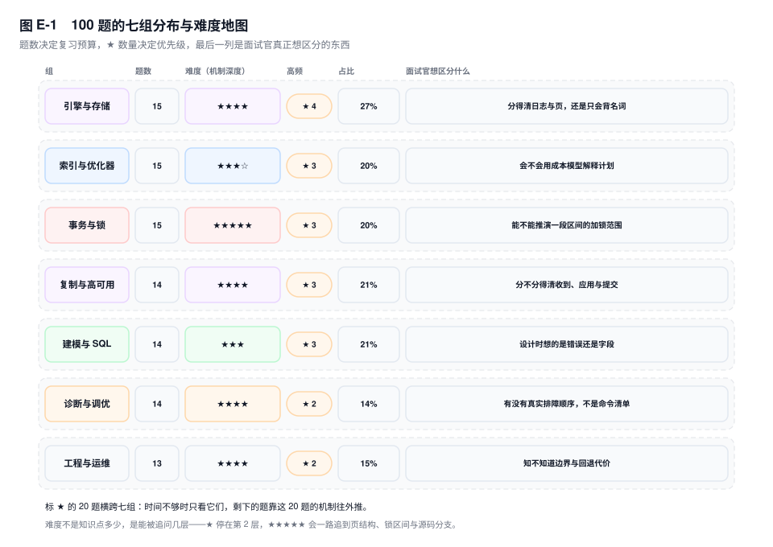
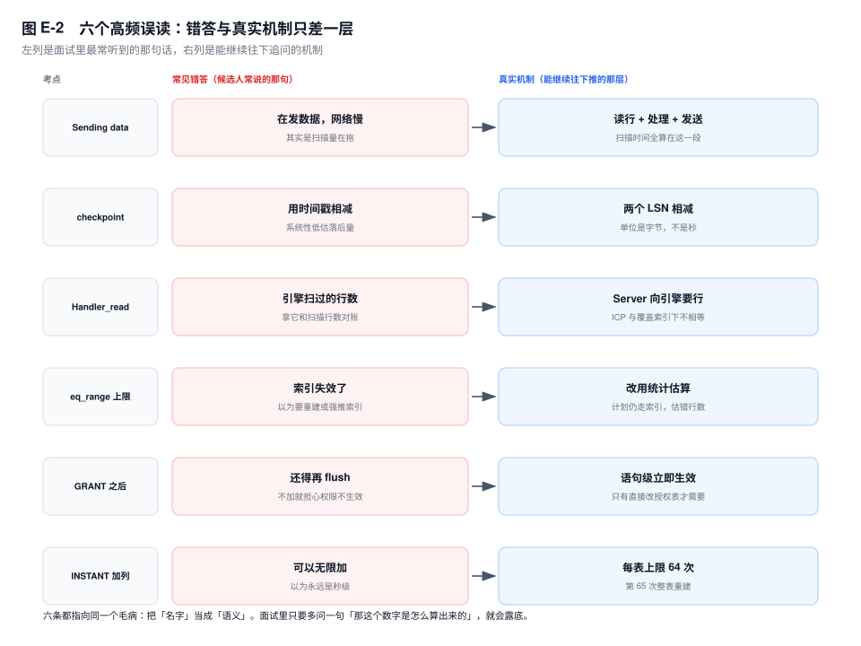

# 附录 E　面试高频 100 问

> **一句话结论**：面试不是考你知道多少名词，是考你能不能把一个现象推回机制，再说出它的边界。

## E.0 怎么用这份附录

这份附录是工具书，不是教程。每一题的写法固定三段：一句话结论、三条机制要点、一段常见错答。它不按章节顺序排，按面试官提问的顺序排：先问一个东西是什么，再问它为什么这样设计，最后问它在生产里什么时候会骗你。

**一、背的是"结论 + 机制"，不是话术。** 结论给你开口的第一句，机制给你撑住三个追问的底气。只背结论，第二问就会回到"大概是缓存吧"。不要把 100 条结论从头背到尾，那只会压成一团；按组背，每组先记住那三五个能互相引用的机制。

**二、`常见错答` 是给自己做排除法用的。** 看到那句话，先想"我是不是也这么答过"；能说出它错在哪，才算真会。这一段比结论更值钱，因为面试官正是靠它分层的：答对结论只是及格，能指出错答的机制漏洞才是他要的人。

**三、标 ⭐ 的 20 题是最高频的，横跨七组。** 时间不够只看这些，剩下的题用它们的机制往外推。每题末尾的"→ 第 N 章"是回去补课的路标；如果只剩一晚，先看 E.9 的六个误读，那是最容易一句话暴露底细的地方。

## E.1 题目分布与难度地图

七组题按面试出现概率加权，不按章节均分：引擎、索引、事务三组共 45 题，因为所有追问最后都落在这三处；复制 14 题，因为高可用的问题一定会绕回"数据此刻在哪"；建模与诊断各 14 题，考工程判断；运维 13 题，考边界感。

难度不是知识点多少，是能被追问几层。同样是"索引为什么用不上"，★ 只要求说出隐式转换，★★★★ 会追到成本常数与采样页数。图里的星级是这组题的平均追问深度，不是难度排名。

标 ⭐ 的 20 题按"被问到的概率 × 答错代价"挑出来：答错会直接暴露没读过机制，或者让面试官怀疑你没上过生产。先把它们背到脱口而出，再补本组其余题目。

读图从上往下：先看哪一组是你的短板，再决定补机制还是补场景。占比低不代表不重要，只代表它更可能以追问而不是主问题的形式出现。

## E.2 引擎与存储（第 1~15 题）

这组考的是"你有没有把数据库当成一个会掉电、会并发、会写满磁盘的系统"。面试官不满足于背出 buffer pool 的组成，他要听你说清一次提交经过哪几层内存、哪一步落盘、崩溃后凭什么能补回来。答"内存越大越好"的人，会在这里被追到脏页与 checkpoint。

### 1. 为什么 InnoDB 用 B+ 树，而不是 B 树？ ⭐

**结论**：B+ 树把数据都收到叶子，非叶子只做路由，扇出更大、树更矮，范围扫还能顺着叶链走。

**要点**：
- 非叶子只存键和页号，一页装上千条，三层覆盖千万行
- 叶子用双向链表串起来，范围扫描不用回到父节点
- 代价是点查必须走到叶子，写入要维护页分裂与叶链

**常见错答**：说"B+ 树查询更快"——点查两者都是 O(log n)，B+ 快在扇出和范围，不在比较次数。

→ 第 8 章

### 2. 三层 B+ 树能装多少行，由什么决定？

**结论**：由非叶子一页能放多少个键决定，也就是主键长度与页大小共同决定树高。

**要点**：
- 页默认 16KB，主键 8 字节时一个非叶子页可路由上千条
- 主键 36 字节，扇出掉到几分之一，同样行数多一层
- 叶子容量由行宽决定，宽表先撞上"叶子装不下"

**常见错答**：背"三层 2000 万行"——那是 BIGINT 主键、行宽 200 字节的特例，换个行宽就错。

→ 第 8 章

### 3. 聚簇索引叶子存整行，二级索引叶子为什么只存主键？

**结论**：为了行搬家时不用改所有索引，代价是非覆盖查询多一次回表。

**要点**：
- 聚簇索引的叶子就是数据页，整行都在里面
- 二级索引叶子存"索引列 + 主键"，回表就是再走一次聚簇索引
- 若存物理地址，行一移动所有二级索引都要改

**常见错答**：说"二级索引存的是行地址"——那是 MyISAM 的做法，InnoDB 存的是主键值。

→ 第 8 章

### 4. 为什么推荐自增 BIGINT 主键，而不是 UUID？

**结论**：主键是行的物理地址，越长越随机，写入就越靠页分裂和随机 IO 付费。

**要点**：
- 顺序插入永远追加在最右叶，页填充率高、分裂少
- UUID 随机落入全树，页命中率下降、脏页分散、索引膨胀
- 主键长度还会被每个二级索引重复存一份

**常见错答**：说"UUID 不能做主键"——能做，代价是写入放大和空间翻倍，不是正确性问题。

→ 第 8、30 章

### 5. redo log 让写变快的机制到底是什么？ ⭐

**结论**：把 N 次随机 16KB 页写换成 1 次顺序小写加 1 次 fsync，快在字节数和寻道次数。

**要点**：
- 修改先在内存页上做，redo 只记"哪个页改了什么"
- 提交只需保证 redo 落盘，页可以晚点再刷
- 代价是磁盘上的页可能是旧的，要靠崩溃恢复补齐

**常见错答**：说"redo 是缓存，数据先写 redo 再写磁盘"——页最终仍要写，redo 只是欠条。

→ 第 4 章

### 6. redo 是逻辑日志还是物理日志？

**结论**：redo 是 physiological 日志：页级物理定位，页内逻辑描述。

**要点**：
- 记录里带 space_id、page_no，定位到唯一一个页
- 页内记的是"在哪个偏移写什么"，不是整页镜像
- 每页有 FIL_PAGE_LSN，保证重放幂等

**常见错答**：说"redo 是逻辑日志，记 SQL"——那是 binlog；纯逻辑重放不确定，纯物理日志又太大。

→ 第 4 章

### 7. checkpoint 推进慢，是 redo 写太快还是脏页刷不下去？ ⭐

**结论**：根因是脏页刷不下去，不是 redo 写得太快。

**要点**：
- checkpoint 只能推进到"此前脏页都已落盘"的位置
- 刷脏受 innodb_io_capacity 与磁盘实际能力限制
- redo 快满时用户线程被拉去同步刷脏，表现为周期性尖刺

**常见错答**：说"redo 太小，调大就好"——容量只买时间，刷脏速率不提高，迟早再追平。

→ 第 4、39 章

### 8. undo log 是备份吗？它什么时候能被回收？

**结论**：undo 不是备份，是给还活着的 ReadView 看旧版本；回收时机由最老的视图决定。

**要点**：
- insert undo 提交即弃，update/delete 的 undo 进 history list
- purge 只能删"没有视图再需要"的那部分
- 只读长事务不产生 undo，却能钉住全库的回收水位

**常见错答**：说"事务提交了 undo 就能删"——只要还有更老的视图在，undo 必须留着。

→ 第 5 章

### 9. DELETE 之后表为什么没变小？

**结论**：DELETE 只打删除标记，物理删除在 purge，空间留在表空间里等复用。

**要点**：
- purge 要先删每个二级索引条目，再删聚簇索引记录
- 删掉的页回到 free list，但文件不会自动收缩
- 要还空间只能重建表，代价是一份额外磁盘

**常见错答**：说"删一半数据磁盘就该降一半"——InnoDB 只回收页内空间，不还文件系统。

→ 第 5、31 章

### 10. doublewrite 和 redo 是不是重复了？

**结论**：不重复。doublewrite 保证页完整，redo 保证修改不丢，前者是后者的前置条件。

**要点**：
- 16KB 页掉电可能只写了 4KB，torn page 上 redo 无法解析
- 顺序是副本 → fsync → 原位，反了等于没做
- 恢复时先用副本修页，再重放 redo

**常见错答**：说"有 redo 就不用 doublewrite"——redo 是页内逻辑，页结构坏了根本没法重放。

→ 第 7 章

### 11. 崩溃恢复要多久，能靠加 CPU 缩短吗？

**结论**：恢复时间约等于重做量加回滚量，这两段都是单线程，加 CPU 无效。

**要点**：
- 重做量就是 checkpoint 年龄，攒得越多恢复越久
- 回滚量是崩溃时未提交事务改过的行数
- 能改的只有少攒脏页、别造大事务

**常见错答**：说"机器配置高恢复就快"——关键路径是单线程重放，多核帮不上。

→ 第 7 章

### 12. buffer pool 命中率 99.9%，就说明内存够吗？ ⭐

**结论**：命中率只统计读路径，写路径的健康要看 free buffers、脏页数与 checkpoint 年龄。

**要点**：
- 高命中率加 free list 见底，可以同时成立
- 脏页积压到阈值，用户线程会被拉去同步刷脏
- 判断信号是 Innodb_buffer_pool_wait_free 在涨

**常见错答**：说"命中率 99.9% 说明内存够"——它只说明读没怎么落盘，不说明写路径不堵。

→ 第 2、37 章

### 13. 唯一索引能不能用 change buffer？

**结论**：不能。唯一性检查不能被延迟，必须先读页确认没有重复。

**要点**：
- 普通二级索引的插入可以先记账，等页读进来再合并
- 唯一索引必须先读页，读都读了就没必要延迟
- 这是正确性约束，不是实现偷懒

**常见错答**：说"change buffer 对所有二级索引生效"——唯一索引与外键检查列都被排除。

→ 第 2 章

### 14. innodb_flush_log_at_trx_commit 的 0/1/2 差在哪？

**结论**：差别是提交时 redo 停在哪一层：进程内存、page cache、磁盘。

**要点**：
- =1 每次提交 fsync，最安全，也是唯一不能交易的档
- =2 写进 page cache，进程死不丢，机器断电丢
- =0 每秒刷一次，进程崩溃就丢最近一秒

**常见错答**：说"=2 和 =1 差不多，性能还更好"——掉电时丢的正是客户端已收到成功的那些事务。

→ 第 4 章

### 15. 把 innodb_redo_log_capacity 调大，能解决周期性抖动吗？

**结论**：只能拉长抖动周期，不能消除尖刺；刷脏速率不提高，多大容量都会被追平。

**要点**：
- `[8.0.30+]` 容量由 innodb_redo_log_capacity 决定，默认 100MB
- 年龄贴着容量，说明每次 checkpoint 都在"快满"时发生
- 真正的解法是提高 IO 预算或降低写入放大

**常见错答**：说"容量调到 8G 就不会抖了"——它把周期拉长，尖刺幅度不变。

→ 第 4、39 章

## E.3 索引与优化器（第 16~30 题）

索引题的陷阱是"语法都会，机制不通"。面试官想区分的是：你能不能从一条 SQL 推到"优化器为什么选这条路"，而不是背最左前缀的口诀。凡是答"加索引就好了"的，下一问就会露出成本模型的空白。从"为什么没走索引"到"为什么走错索引"，是两个不同的问题。

### 16. 最左前缀原则到底在讲什么？ ⭐

**结论**：它描述的是"这棵树的有序性在哪一列断掉"，不是"必须从第一列写起"。

**要点**：
- 等值条件把列固定成常量，顺序可以继续往右延续
- 范围或多值条件把有序性放开，断点落在这一列之后
- 断点之后的列只能做过滤，不能再定扫描起点

**常见错答**：说"跳过第一列就一定用不上索引"——覆盖索引下可以走索引全扫，只是不能定位。

→ 第 9 章

### 17. 加了索引就一定快吗？

**结论**：不一定。索引只在"选择性足够 + 回表可控"时划算，否则是纯写入成本。

**要点**：
- 命中行数超过表行数 1% 左右，全表扫的按页成本更低
- 回表是随机 IO 按行计价，全表扫是顺序 IO 按页计价
- 每个索引都让每次写入多维护一棵树

**常见错答**：说"有索引总比没有强"——低选择性索引优化器不选，却照样收写入的费。

→ 第 9、10 章

### 18. `WHERE phone = 13800000000` 为什么用不上字符串索引？

**结论**：字符串列遇到数字值会被隐式 CAST，索引有序性作废，只能全表扫。

**要点**：
- 把列转成数字再比，等于对列做了一次函数
- 方向反过来（数字列传字符串）转的是值，索引照用
- 参数类型由应用层保证，比在 SQL 里补引号可靠

**常见错答**：说"隐式转换都会让索引失效"——只有列被转换时才失效，值被转换不影响。

→ 第 9 章

### 19. `Using index` 和 `Using index condition` 差在哪？

**结论**：前者是覆盖索引不回表，后者是回表前先用索引列筛一遍（ICP）。

**要点**：
- `Using index` 说明查询要的列全在索引里
- `Using index condition` 说明过滤在引擎层做，但仍要回表
- 看到 ICP 该问：这一列为什么没进联合索引

**常见错答**：把两者都当成"用上了索引"——ICP 省的是回表次数，不是回表本身。

→ 第 9、11 章

### 20. `type=index` 和 `type=ALL` 哪个快？

**结论**：不覆盖的 `type=index` 比 `ALL` 更贵，它扫整棵二级索引还要逐行回表。

**要点**：
- `ALL` 是顺序扫聚簇索引，一页拿几十行
- `index` 是扫二级索引，每行还要按主键回表
- 只有带 `Using index` 的 `index` 才是好计划

**常见错答**：说"type=index 比 ALL 高一级，所以更快"——type 只描述访问方式，不描述代价。

→ 第 11 章

### 21. `rows` 和 `filtered` 能信吗？

**结论**：`rows × filtered` 是估算的估算，四层误差在 join 里连乘。

**要点**：
- 采样只取 20 个叶子页，倾斜数据被平均值抹平
- 多列条件按独立假设相乘，相关性完全没建模
- 没有统计的列走硬编码默认值

**常见错答**：说"rows 就是实际扫描行数"——要实际值只能看 `EXPLAIN ANALYZE`。

→ 第 10、11 章

### 22. 为什么有索引，优化器还是选了全表扫？ ⭐

**结论**：不是索引坏了，是优化器算出"走索引更贵"，判据在成本模型不在语法。

**要点**：
- 命中比例过高时，回表的随机 IO 超过顺序扫全表
- 统计信息过期，估出来的行数与实际差一个数量级
- 需要 filesort 时，走索引反而拿不到顺序

**常见错答**：说"加 FORCE INDEX 就行"——它把优化器估错换成人估错，分布一变就更糟。

→ 第 10 章

### 23. `Cardinality` 到底表示什么？

**结论**：它表示"这列有多少种不同的值"，不表示"每种值各有多少行"。

**要点**：
- 等值查询靠 index dive 直接数行，基数不参与
- 长 IN、范围、无索引列才退回"总行数 ÷ 基数"
- 倾斜数据下这个平均值可以差上千倍

**常见错答**：说"Cardinality 越高索引越好"——它只说种类多，不说分布匀。

→ 第 10 章

### 24. `eq_range_index_dive_limit` 越过之后发生了什么？

**结论**：不是索引失效，是估算方式从 index dive 换成基数均摊。

**要点**：
- 默认 200，IN 列表超过它就放弃逐个值下探
- 估计值变成 n_rows ÷ n_diff，倾斜时严重失真
- 计划仍走索引，只是可能选错索引或 join 顺序

**常见错答**：说"IN 超过 200 个索引就失效"——索引照样能用，错的是行数估计。

→ 第 10、40 章

### 25. 统计信息刚更新，为什么还是选错索引？

**结论**：错的不一定是统计，成本模型对回表、排序、LIMIT 的定价就可能与你的数据不符。

**要点**：
- 回表按行计价，随机 IO 的惩罚是固定常数
- 排序成本估得偏低，`ORDER BY ... LIMIT` 容易选错
- 直方图只补分布，不改变成本常数

**常见错答**：说"再 ANALYZE 一次就好了"——统计对了还错，说明错在模型，重复采样没用。

→ 第 10 章

### 26. `ORDER BY` 什么时候能走索引？

**结论**：要同时满足最左前缀、方向一致、不被范围或多值条件打断，缺一个就 filesort。

**要点**：
- 索引本身有序，但只在被固定的前缀之后才有意义
- 升降序混排要 8.0 的降序索引才支持
- 范围条件之后的列，顺序已经放开

**常见错答**：说"有索引就不用排序"——索引给不了这次查询要的顺序，照样要排。

→ 第 8、14 章

### 27. "小表驱动大表"这句话对吗？ ⭐

**结论**：只在 BNL 下成立；INLJ 看过滤后行数，Hash Join 下基本失效。

**要点**：
- 驱动表行数是成本公式里的乘数，优化器按代价选
- INLJ 的代价 ≈ 驱动行数 × 被驱动表单次查找成本
- Hash Join 把成本变成"扫两遍"，与小表大表无关

**常见错答**：把口诀硬写成 STRAIGHT_JOIN——过滤后只剩几十行的大表，才是好驱动表。

→ 第 12 章

### 28. Hash Join 一定比 NLJ 快吗？

**结论**：不一定。它省的是内层重复扫描，代价是建哈希表的内存与溢写。

**要点**：
- 没有可用索引时，NLJ 要扫 N 轮内层，Hash Join 只扫两遍
- build 侧受 join buffer 限制，大表常态溢写到磁盘
- 有高选择性索引时，INLJ 的 N 次点查仍然更快

**常见错答**：说"8.0 有 Hash Join 了，join 都变快了"——它只替换了 BNL 那一种形态。

→ 第 12 章

### 29. `Using filesort` 就一定落盘吗？

**结论**：不是。filesort 只说明"索引给不了顺序"，落不落盘看数据量与 sort_buffer。

**要点**：
- 数据量小于 sort_buffer 时是纯内存排序
- 超了才分块、归并，`Sort_merge_passes` 才增长
- `[8.0.20+]` 起按实际行长度打包，不再二选一

**常见错答**：说"看到 filesort 就要加索引"——先看行数与 `Sort_merge_passes`，内存排序不贵。

→ 第 14 章

### 30. `COUNT(*)` 和 `COUNT(1)` 谁快？

**结论**：8.0 里两者是同一个计划，优化器都按"数行"处理，性能没有差别。

**要点**：
- `COUNT(*)` 不取列值，只数行，语义最直接
- `COUNT(列)` 要判 NULL，`COUNT(DISTINCT)` 还要去重
- `COUNT(*)` 会选最小的二级索引扫，页数最少

**常见错答**：说"COUNT(1) 比 COUNT(*) 快"——它在 8.0 被改写成 COUNT(*)，不会逐行求值常量。

→ 第 15 章

## E.4 事务与锁（第 31~45 题）

锁题是分层最快的一组。背得出隔离级别名字的人很多，能推演"这条 UPDATE 锁了哪段区间"的人很少。面试官会用一个具体语句把你逼到索引记录上，再看你会不会区分快照读与当前读。把锁当名词背的人越背越乱，把锁当区间推的人一问就通。

### 31. RC 和 RR 的本质差别是什么？

**结论**：RR 在 RC 之上只多做一件事：整个事务共用一个 ReadView。

**要点**：
- RC 每条语句新建视图，能看到别人已提交的新数据
- RR 在第一条快照读建视图，之后一直用它
- 锁的差异是这条规则的副产品，不是并列的第二条

**常见错答**：说"RR 多了间隙锁所以更安全"——间隙锁防的是当前读幻读，与视图无关。

→ 第 17 章

### 32. RR 隔离级别下幻读被解决了吗？ ⭐

**结论**：没有完全解决。当前读的幻读由 Next-Key Lock 挡，快照读靠视图，两者之间没有承诺。

**要点**：
- 先快照读再当前读，UPDATE 会把看不见的行改成自己的行
- 先当前读再快照读，视图可能建得比第一次读还晚
- 只读事务里两次快照读，结果确实一样

**常见错答**：说"RR 解决了幻读"——准确说法是"两种读各有保护，接缝处没有"。

→ 第 17、19 章

### 33. MVCC 的 ReadView 里那几个 id 在判断什么？

**结论**：用 min_trx_id、max_trx_id 与活跃事务列表，判断一个版本对当前事务可不可见。

**要点**：
- 小于 min_trx_id 的版本已提交，可见
- 大于等于 max_trx_id 的版本还没出生，不可见
- 落在中间就看是否在活跃列表里

**常见错答**：说"ReadView 存的是数据快照"——它只存事务 id 的边界，行版本在 undo 里。

→ 第 17 章

### 34. RR 的视图是从 `BEGIN` 开始建的吗？

**结论**：不是。RR 的视图从第一条快照读开始建，不是从 BEGIN。

**要点**：
- BEGIN 之后只做当前读，视图还没建
- 想立刻建视图要用 `START TRANSACTION WITH CONSISTENT SNAPSHOT`
- 这解释了"先 FOR UPDATE 再校验"为何读到两个世界

**常见错答**：说"事务一开始视图就固定了"——第一条 SELECT 之前，事务还没有视图。

→ 第 17 章

### 35. `UPDATE` 没走索引会锁多少行？ ⭐

**结论**：锁扫过的每一条记录；没有索引就是全表逐条临键锁加 supremum，效果等于表锁。

**要点**：
- 锁范围等于扫描范围，不由 WHERE 命中几行决定
- 没有索引时引擎只能扫聚簇索引的每一条记录
- RC 去掉间隙锁，但执行期间不匹配的行仍被逐条锁过

**常见错答**：说"只锁被更新的那几行"——InnoDB 锁的是索引记录，没索引就没有"那几行"。

→ 第 19 章

### 36. 两个间隙锁会互相阻塞吗？

**结论**：不会。间隙锁之间兼容，它唯一挡住的是插入意向锁。

**要点**：
- 两个事务可以同时持有同一段 gap
- 插入要拿插入意向锁，与 gap 冲突，所以插入会等
- RR 下的等待常发生在毫无数据交集的事务之间

**常见错答**：说"两个 gap 锁会互相等"——gap 与 gap 兼容，等的是想往里插的人。

→ 第 18 章

### 37. 唯一索引等值查询，还会加间隙锁吗？

**结论**：命中时退化成记录锁，不命中时退化成间隙锁，两种都不带 gap 部分。

**要点**：
- 唯一索引能保证"最多一条"，不需要防重复插入
- 命中：只锁那一条记录
- 未命中：锁住值应该在的那段间隙

**常见错答**：说"等值查询都不加 gap"——不命中时加的正是 gap，只是不含记录。

→ 第 19 章

### 38. 意向锁有什么用，会不会降低并发？

**结论**：它是表锁与行锁之间的 O(1) 翻译器，只记账不保护，不降低行级并发。

**要点**：
- 加行锁前先在表上加 IS 或 IX
- 表级 X 锁看 IX 就知道有人持行锁，不必逐行检查
- IS 与 IX 互相兼容，这是行级并发的前提

**常见错答**：说"意向锁会阻塞其他事务"——它只与表级 X/S 冲突，行与行照常并发。

→ 第 18 章

### 39. 死锁和锁等待超时是一回事吗？

**结论**：不是。死锁是循环等待被检测到，立即回滚；超时是等不到锁，熬到超时参数。

**要点**：
- 死锁报 1213，回滚整个事务
- 超时报 1205，默认只回滚当前语句
- 重试粒度搞反，轻则无效重试，重则重复扣款

**常见错答**：说"两个都是锁冲突，重试就行"——1213 要重跑整个事务，1205 可从语句重试。

→ 第 20 章

### 40. 死锁后 InnoDB 回滚哪个事务？

**结论**：挑回滚代价小的那个，按 undo 记录数估，不是"先动手"或"后动手"。

**要点**：
- 日志里的 `(1)` 是编号，不是执行顺序
- 牺牲者可能正是先开始的事务
- 代码不能依赖它选谁，只能靠统一加锁顺序

**常见错答**：说"回滚后执行的那个"——选择是启发式的，与时间无关。

→ 第 20 章

### 41. 死锁应该怎么治理？

**结论**：四个必要条件里只有循环等待能靠应用打破，所以治理就是统一加锁顺序加缩短事务。

**要点**：
- 同一批行按固定顺序更新，比如先账户后流水
- 事务越短，持有并等待的窗口越小
- 二级索引的更新顺序也要一致，否则仍会交叉

**常见错答**：说"降到 RC 就没有死锁"——RC 去掉间隙锁，记录锁的交叉照样死。

→ 第 20 章

### 42. redo log 和 binlog 为什么需要两阶段提交？ ⭐

**结论**：为了让两份日志的存亡边界对齐，否则崩溃后主从会永久分叉。

**要点**：
- 写 redo 置 prepare，写 binlog 并 fsync，再提交 redo
- 崩溃恢复看 binlog 是否完整，决定前滚还是回滚
- binlog 丢了而主库有，是不可逆的信息丢失

**常见错答**：说"两个日志各写各的，失败重试"——没有裁决点，重试只会造出两份不一致的历史。

→ 第 6 章

### 43. 组提交省的是什么？

**结论**：省的是 fsync 次数：N 个事务共享一次刷盘，代价是最后一个事务多等一小段。

**要点**：
- binlog 按组 fsync，组越大摊得越薄
- 等待期间行锁不放，这是延迟换吞吐
- redo 侧也有组提交，两层各自成组

**常见错答**：说"组提交让事务变快"——单条提交延迟没降，降的是单位时间的刷盘成本。

→ 第 6 章

### 44. 长事务的危害只看执行时长吗？

**结论**：不看它跑了多久，看它还握着哪个没放手的资源。

**要点**：
- 空闲持锁的事务，比跑得久的普通查询更危险
- 0 行修改的只读事务照样钉住 undo 回收
- 它还会挡住 DDL、拖慢从库回放

**常见错答**：说"超过 60 秒就是长事务"——时间只是表象，看它钉住了哪个水位。

→ 第 21 章

### 45. `KILL` 一个长事务，锁会立刻释放吗？

**结论**：不会。KILL 只是开始回滚，ROLLING BACK 期间锁还在，回滚可能比执行更久。

**要点**：
- 回滚是单线程反向执行 undo
- 改了几百万行的事务，回滚要几十分钟
- 这期间连接占用与锁等待都不消失

**常见错答**：说"KILL 了就没事了"——先看 trx_rows_modified，再决定要不要杀。

→ 第 21 章

## E.5 复制与高可用（第 46~59 题）

复制题考的是"一致性边界感"。面试官想确认你知道客户端收到成功的那一刻，数据到底在几台机器上、在哪一层内存里；以及延迟为 0、半同步为 ON 这些漂亮数字，分别在什么情况下会骗人。复制不是"把数据拷过去"，是把一条事件流搬过去再放一遍。

### 46. 线上 binlog 为什么必须用 ROW？ ⭐

**结论**：STATEMENT 重演"意图"，ROW 重演"结果"；意图在没有确定性保证时会分叉。

**要点**：
- 无 ORDER BY 的 LIMIT、UUID()、自增列在 SBR 下必然分叉
- NOW() 反而安全，时间戳跟着事件走
- ROW 体积随行数涨，单事件超 max_allowed_packet 默认 64MB 会断复制

**常见错答**：说"MIXED 能自动选最好的"——它按语句判断，判断不了数据分布导致的歧义。

→ 第 6、22 章

### 47. `binlog_row_image=MINIMAL` 能省空间，为什么不能用？

**结论**：能省，但前镜像不全，闪回与 CDC 拿到的行是残缺的。

**要点**：
- MINIMAL 只记主键和被改的列
- 闪回需要完整前镜像才能构造反向 SQL
- 下游 CDC 拿不到未变的列，宽表尤其致命

**常见错答**：说"MINIMAL 复制更省 IO 所以更好"——省的是带宽，赔的是可恢复性。

→ 第 6 章

### 48. 位点和 GTID 有什么本质区别？

**结论**：位点是字节偏移，GTID 是事务身份；前者不幂等，后者幂等。

**要点**：
- 位点在切主和 PURGE 之后失效，而且不报错
- GTID 靠集合差集自动找位点，全程没有字节参与
- 切换校验要看 executed 与 purged 两个集合

**常见错答**：说"GTID 就是更好用的位点"——它是另一套坐标系，混用会算出错误的差集。

→ 第 22、23 章

### 49. `gtid_executed`、`gtid_purged`、`gtid_owned` 各回答什么？

**结论**：分别回答"我有什么""我丢了什么""我正在做什么"。

**要点**：
- executed 只增不减，purged 是它的子集
- 从库能不能接上，取决于 purged 而不是延迟
- owned 是瞬时值，用来看正在执行的 GTID

**常见错答**：说"看 gtid_executed 就知道数据全不全"——它不告诉你 binlog 已经清到哪。

→ 第 23 章

### 50. 主从延迟的下限为什么不是 0？

**结论**：链路上有三次关键路径 fsync 加一次网络往返，所以延迟不可能为零。

**要点**：
- 主库 binlog、从库 binlog、从库 redo 各刷一次
- relay log 那次被 sync_relay_log 摊薄，它是可丢弃的中间态
- 同城机房是毫秒级，跨机房是几十毫秒

**常见错答**：说"调大 sync_binlog 就能做到零延迟"——那是拿持久性换数字，下限还在。

→ 第 22 章

### 51. `Seconds_Behind_Source` 为 0 就代表数据一致吗？ ⭐

**结论**：不代表。它只表示回放线程追到了它已经收到的那条日志。

**要点**：
- 半同步降级期间提交的事务，可能根本没到从库
- 误删、跳过事务都能在延迟 0 时造成缺口
- 复制线程没在跑时它是 NULL，不是 0

**常见错答**：说"延迟为 0 就说明主从一致"——它连"收到了多少"都不保证。

→ 第 22、24 章

### 52. 主库宕机时，半同步能保证不丢数据吗？

**结论**：不能无条件保证。它保证"至少一台从库收到"，降级与唯一副本故障都会把 RPO 拉走。

**要点**：
- 超时降级成异步，且不报错、不断连接
- AFTER_SYNC 下收到 ACK 但未应用，切主后数据还在
- 只有一份副本时，那份副本没了就是没了

**常见错答**：说"开了半同步 RPO 就是 0"——降级窗口里提交的事务，主库一挂就消失。

→ 第 24、26 章

### 53. `AFTER_COMMIT` 和 `AFTER_SYNC` 差在哪？

**结论**：差别只在 ACK 等待插在引擎提交之前还是之后：在前最多重复，在后可能丢。

**要点**：
- AFTER_SYNC 先等 ACK 再提交引擎，客户端成功即两副本有
- AFTER_COMMIT 先提交再等 ACK，崩溃时会丢已提交未 ACK 的
- AFTER_SYNC 崩溃不是回滚，binlog 已落盘，恢复一定前滚

**常见错答**：说"两者只是性能差别"——差别在崩溃后是"多一笔"还是"少一笔"。

→ 第 24 章

### 54. 半同步降级会有告警吗？

**结论**：默认没有。降级不报错、不断连接，唯一信号是一个状态变量和两个计数器。

**要点**：
- 状态从 ON 变 OFF，说明已经在等不到 ACK 后转异步
- no_tx 的增量等于风险窗口里的事务数
- 这一族状态名在 8.0.26 改过，老监控项会静默失效

**常见错答**：说"降级了应用会收到错误"——应用完全无感，这才是它危险的地方。

→ 第 24 章

### 55. 并行复制多开几个 worker，就能追上延迟吗？ ⭐

**结论**：不一定。并行度上限由主库写入的冲突度决定，加 worker 只对有并行空间的积压有效。

**要点**：
- 库级并行在单库下恒为 1，等于没开
- last_committed 的上限是组提交批大小
- WRITESET 的上限是行级冲突度，热点行仍串行

**常见错答**：说"延迟高就把 workers 调到 32"——冲突度高时，多出来的 worker 全在等同一行。

→ 第 25 章

### 56. `Waiting for dependent transaction to commit` 说明什么？

**结论**：说明并行回放已经生效，瓶颈在提交顺序，不在并行度。

**要点**：
- 开了 preserve_commit_order 后是"并行回放、串行提交"
- 前面一个大事务没提交，后面的都要等
- 此时加 worker 毫无效果

**常见错答**：说"这说明并行复制没开"——恰恰相反，没开时看不到这个状态。

→ 第 25 章

### 57. 切换主库时，先提升新主还是先隔离旧主？

**结论**：先隔离、后提升。反过来就是脑裂，两个主库都能写。

**要点**：
- 隔离完成标志不是 super_read_only=ON，是 innodb_trx 清空
- 只读不 kill，已建立的事务照样能提交
- 提升前用 GTID 包含关系校验，不看延迟

**常见错答**：说"先提升新主，业务恢复快"——旧主还活着的那几秒，两边写入已经分叉。

→ 第 26 章

### 58. MGR 和异步复制最本质的区别是什么？

**结论**：MGR 改的是提交规则：多数派认证通过才算提交，少数派根本写不进去。

**要点**：
- 认证是乐观的，冲突只能整笔回滚，报 3101
- 认证通过不等于已应用，从节点默认可能读到旧值
- 选主不需要外部工具，因为少数派写不进去

**常见错答**：说"MGR 就是带自动选主的半同步"——它多了认证与多数派，代价是流控。

→ 第 27 章

### 59. MGR 为什么会被最慢的节点拖住？

**结论**：流控让全组按最慢成员的速度写，这是 MGR 相对异步复制最大的性能代价。

**要点**：
- 队列积压到阈值就全体降速
- DISABLED 只是把问题藏起来，积压迟早爆
- 节点数看多数派，3 与 5 是标准，4 没有收益

**常见错答**：说"把流控关了就快了"——短期吞吐上去，慢节点会被越甩越远直到被驱逐。

→ 第 27 章

## E.6 建模与 SQL 设计（第 60~73 题）

建模题没有标准答案，只有代价。面试官看的不是你会不会背三范式，而是你能不能说出"这份冗余由谁维护、这个状态由谁挡住、这条幂等由哪条唯一索引兜底"。字段是结果，先想清楚要挡住哪种错误，字段才有形状。

### 60. 范式到底要不要遵守？ ⭐

**结论**：范式回答"一份事实存几遍"，是对错问题；反范式回答"用多少存储换多少次 JOIN"，是成本问题。

**要点**：
- 单行可判定的约束（NOT NULL、UNIQUE、CHECK）交给数据库
- 要读多行或跨实例的约束只能放应用层
- 冗余成本随变更传播涨，JOIN 成本随查询次数涨

**常见错答**：说"互联网公司都不遵守范式"——他们放弃的是跨表冗余，不是主键与唯一约束。

→ 第 31 章

### 61. 冗余字段什么时候划算？

**结论**：读 QPS 高、日变更少时稳赚；每秒都在变的当前值，冗余的传播成本无穷大。

**要点**：
- 先分清快照与当前值：下单价格是快照，店铺名是当前值
- 当前值冗余必须配回填，回填成本随历史行数放大
- 库存、余额这类字段不做跨表冗余

**常见错答**：说"冗余能减少 JOIN 所以越多越好"——每次变更都要改 N 张表，写放大迟早反噬。

→ 第 31 章

### 62. 为什么金额不能用 `DOUBLE`？

**结论**：浮点是二进制近似，十进制小数在边界上会舍入到错误的方向。

**要点**：
- `DECIMAL(18,2)` 占 9 字节，定点存储，精确到分
- 2.675 转 DOUBLE 再四舍五入得 2.67，DECIMAL 得 2.68
- 1 亿条流水里 3% 命中边界就是 3 万元

**常见错答**：说"应用层用 BigDecimal 算就行"——存进去时精度已经丢了，算得再准也补不回来。

→ 第 29 章

### 63. `DATETIME` 和 `TIMESTAMP` 怎么选？

**结论**：DATETIME 存字面量，TIMESTAMP 存 UTC 再按会话时区渲染；看语义是墙上时间还是绝对时刻。

**要点**：
- DATETIME 占 5 字节，范围到 9999 年
- TIMESTAMP 占 4 字节，2038 年到顶
- 跨时区事件流用 TIMESTAMP，但要规划 2038 迁移

**常见错答**：说"TIMESTAMP 自动更新所以更好"——自动更新是属性，不是选型理由。

→ 第 29 章

### 64. `INT(11)` 里的 11 是什么意思？

**结论**：只是显示宽度，不限制范围、不影响存储、不改变索引。

**要点**：
- INT 固定 4 字节，范围由 signed/unsigned 决定
- 8.0.19 起显示宽度已从 SHOW CREATE TABLE 消失
- 只有 TINYINT(1) 因连接器的布尔约定被保留

**常见错答**：说"INT(11) 比 INT(10) 存得大"——括号里的数字从来不是容量。

→ 第 29 章

### 65. 为什么主键一定要短？ ⭐

**结论**：主键长度会被每个二级索引重复存一份，还决定非叶子扇出与树高。

**要点**：
- 二级索引叶子存"索引列 + 主键"，主键越长索引越大
- 非叶子一页装的键越少，扇出越小，树越高
- 更新主键等于删一行再插一行，并重建所有二级索引条目

**常见错答**：说"用业务单号做主键更直观"——直观的代价是 20 字节乘上每个索引和每次改单。

→ 第 8、30 章

### 66. 自增主键能保证单号连续吗？

**结论**：不能。号在插入之前就发出去了，且不在事务里。

**要点**：
- 回滚、唯一键冲突、批量预分配、重启都会留空洞
- `[5.7]` 重启按 MAX(id)+1 重算，会重发已删除的号
- `[8.0]` 计数器写进 redo，只前进不回退

**常见错答**：说"自增就是流水号，能直接给用户看"——它只保证单调，不保证连续。

→ 第 30 章

### 67. 分区表能让查询变快吗？

**结论**：不能。分区唯一不可替代的能力是秒级删掉一段历史，不是查询加速。

**要点**：
- 它是 N 棵互不相通的 B+ 树，没有全局索引
- 不带分区键时线性变差，带了基本打平
- 裁剪只认对分区列的常量区间

**常见错答**：说"表大了就分区，查询会快"——分区管生命周期，不管容量与并发。

→ 第 32 章

### 68. 分区表的唯一键有什么限制？

**结论**：唯一键必须包含分区列，因为唯一性只能在单个分区的一棵树里校验。

**要点**：
- 主键因此变成复合键，id 失去数据库级唯一
- 二级索引叶子里也带着含分区列的主键，长度跟着涨
- 这是分区方案的硬约束，不是配置项

**常见错答**：说"建个全局唯一索引就行"——分区表没有全局索引。

→ 第 32 章

### 69. 单表多大就该分库分表？

**结论**：行数不是理由。要过容量、写入、热点、运维四道闸，任一没过都不该拆。

**要点**：
- 容量：倒数第二层装不进 buffer pool 才算过闸
- 写入：到单机峰值六七成且加从库无效
- 热点：单行争用拆了也没用，热点跟着分片走

**常见错答**：说"过一千万行就得分表"——一千万行的窄表，可能连内存都没出。

→ 第 33 章

### 70. 分库分表后怎么做分页？

**结论**：只有游标分页是 O(1) 的；二次查询法只是把系数从 N 降到 1。

**要点**：
- 各分片取 offset+limit 再归并，深页码时每片都在扫
- 游标分页用上一页最后一个排序键做起点
- 跨片聚合先下推再合并，AVG 要拆成 SUM/COUNT

**常见错答**：说"每个分片查 page*size 再合并就行"——第 1000 页时每片都要扫两万行。

→ 第 33 章

### 71. 库存扣减为什么不能"先查再改"？ ⭐

**结论**：判断与修改必须在同一条语句里，靠行锁保证原子。

**要点**：
- `UPDATE ... SET qty = qty - 1 WHERE sku_id = ? AND qty >= 1` 在锁内既判又改
- 应用层 SELECT 之后的 if，在并发下等于没写
- 单行热点上限几百到两千 TPS，再往上要拆桶

**常见错答**：说"用乐观锁版本号就不会超卖"——冲突率高时重试风暴，吞吐反而更低。

→ 第 49 章

### 72. 幂等靠什么保证？

**结论**：只有唯一索引不可绕过；放 Redis 的幂等键只减少请求，不保证正确。

**要点**：
- 幂等键落成真实唯一索引，重复插入报 1062
- 先插入幂等记录，再执行业务，同事务或可查状态
- 消费端还要能识别"处理中"与"已完成"

**常见错答**：说"用 Redis setnx 做幂等就够了"——Redis 丢数据或过期，重复请求照样进来。

→ 第 49 章

### 73. 本地消息表解决了什么？

**结论**：支点是"业务写与消息写在同一事务"，跨库原子性才降级成投递可靠性。

**要点**：
- 业务行与消息行同库同事务，要么都成要么都不成
- 投递器扫表发送，失败重试，消费端幂等
- 没有对账，"最终一致"就没有终点

**常见错答**：说"本地消息表能保证消息不丢"——它保证不丢在源头，投递仍可能重复。

→ 第 34 章

## E.7 诊断与调优（第 74~87 题）

诊断题最能看出有没有真值过班。面试官会给一个"CPU 不高、慢日志没有、P99 却在涨"的场景，看你先要哪个指标。答"看下慢查询"就结束了，答"先分清在算、在等锁、还是在等 IO"才刚开始。指标的名字都认识，难的是知道哪个数字此刻能证伪你的假设。

### 74. 慢查询日志抓不到哪些问题？ ⭐

**结论**：抓不到"链路总耗时"和"高频中等耗时"，它的判据是单条语句对阈值。

**要点**：
- 单条 20ms、每秒两千次，永远进不了慢日志
- 锁等待、网络、连接池排队都不在 SQL 执行时间里
- 从库 applier 默认不记，不开就是盲区

**常见错答**：说"没有慢查询就说明数据库没问题"——它只证明没有超过阈值的单条语句。

→ 第 38 章

### 75. `Sending data` 是在发送数据吗？

**结论**：不是。它涵盖读行、处理、发送全过程，扫描时间全算在这一段。

**要点**：
- 名字来自很早的版本，语义一直是"正在读并发送结果"
- 一条卡 60 秒的 SELECT，问题在扫描量或排序
- 判断要看 Rows_examined，不是看网卡

**常见错答**：说"Sending data 久说明网络慢"——九成是扫描量，剩下才是大结果集传输。

→ 第 36 章

### 76. `Handler_read_*` 数的是引擎扫过的行数吗？

**结论**：不是。它数的是 Server 层向引擎要行的次数。

**要点**：
- ICP 与覆盖索引下，两组数字并不相等
- Handler_read_next 是沿索引顺序取下一条
- rnd_next 是全表顺序扫，涨几百万就是真扫表

**常见错答**：说"Handler_read_next 就是引擎扫描行数"——它只记 Server 要了几次。

→ 第 1、37 章

### 77. `SHOW ENGINE INNODB STATUS` 哪几段必看？

**结论**：四段：TRANSACTIONS、SEMAPHORES、ROW OPERATIONS、LOG，其余按需。

**要点**：
- TRANSACTIONS 看谁在改、改了多少、卡在哪
- SEMAPHORES 看内部 latch 争用，与行锁无关
- LOG 看 checkpoint 落后多远

**常见错答**：从头往下读——它是快照，先定方向再挑段，读全篇只会淹死在数字里。

→ 第 39 章

### 78. `History list length` 很高，加 purge 线程有用吗？

**结论**：没用。水位被一个最老的事务钉死了。

**要点**：
- purge 按回滚段串行，同一段加线程也并行不了
- 要找的是持最老 ReadView 的那个事务
- 只读长事务同样能钉住，且它不产生 undo

**常见错答**：说"history list 涨了就调大 purge 线程"——先杀那个最老的事务，水位才动。

→ 第 5、39 章

### 79. `Innodb_buffer_pool_wait_free` 非零说明什么？

**结论**：说明有用户线程为了拿到一个空页而等过，是"刷脏跟不上"的直接证据。

**要点**：
- 它是计数器，只要在涨就说明发生过等待
- pages_free 接近 0 本身不是问题，池子本来就该填满
- 处置方向是提高 IO 预算或降低脏页产生

**常见错答**：说"free buffers 少了就加内存"——加内存会让脏页积压的绝对量更大。

→ 第 2、37 章

### 80. 命中率该怎么告警？

**结论**：按物理读的绝对次数告警，不要按命中率百分比。

**要点**：
- 99.9% 在十亿级请求下是百万次物理读
- 预热期命中率低是正常的，会自己恢复
- 命中率只覆盖读路径，写路径另看脏页

**常见错答**：说"命中率低于 95% 就告警"——低 QPS 时抖动一下就到 90%，全是误报。

→ 第 37 章

### 81. `Threads_connected` 高就代表压力大吗？

**结论**：不代表。它看资源，`Threads_running` 看压力，两者要一起读。

**要点**：
- 前者单涨是连接泄漏，后者单涨是锁积压
- 两者同涨才是真的并发压力
- 连接数贴顶但 running 个位数，先查池子

**常见错答**：说"连接数高就是并发高"——几百个 Sleep 连接不消耗 CPU，只消耗内存。

→ 第 37 章

### 82. performance_schema 里的时间单位是什么？

**结论**：皮秒。1 秒 = 1e12 皮秒，除以 1e9 才是毫秒。

**要点**：
- 把皮秒当微秒读，结论差六个数量级
- sys 库视图已换算，带 _latency 的是格式化字符串
- 拿不准就 SHOW CREATE VIEW 看公式

**常见错答**：说"TIMER_WAIT 单位是微秒"——每年都有人在这里把 2ms 读成 2 秒。

→ 第 38 章

### 83. `EXPLAIN` 和 `EXPLAIN ANALYZE` 差在哪？

**结论**：前者给估算，后者真执行并给实际行数与耗时。

**要点**：
- EXPLAIN 不执行语句，ANALYZE 会执行，DML 要包事务回滚
- 估算与实际差十倍以上，先修统计再谈索引
- `[8.0.18+]` 才有 EXPLAIN ANALYZE

**常见错答**：说"EXPLAIN 的 rows 就是实际扫描行数"——它是采样推算出来的估计值。

→ 第 11、38 章

### 84. `innodb_io_capacity` 默认 200 能直接用吗？

**结论**：不能。200 是 HDD 时代的默认值，在 SSD 上必须和 buffer pool 一起调。

**要点**：
- 它决定后台刷脏的预算，不是磁盘上限
- 池子调大而预算不变，脏页积压成倍增长
- 设置参考设备 16KB 随机写 IOPS 的 50%~70%

**常见错答**：说"这是磁盘 IOPS 上限，设小了会浪费"——它是后台刷脏的目标速率。

→ 第 40 章

### 85. buffer pool 该设多大？

**结论**：按工作集设，不是按物理内存的固定比例。

**要点**：
- 池子要覆盖热数据加索引，不是覆盖全表
- 连接级 buffer 随并发线性增长，要留出余量
- 容器里必须手工算，MySQL 不会可靠感知 cgroup 限制

**常见错答**：说"物理内存的 70% 给 buffer pool"——没扣连接 buffer，高并发时直接 OOM。

→ 第 40、51 章

### 86. 压测通过就能上线吗？ ⭐

**结论**：不能。压测只能证伪，通过只说明在这组数据量、分布、并发下没崩。

**要点**：
- 数据量与分布变了，计划与命中率都会变
- 压测的并发模型与真实流量往往不同
- 拐点的第一信号是 P99 非线性，不是 TPS 不涨

**常见错答**：说"压到目标 QPS 就放心了"——它证明的是当时那台机器，不是上线后的那套数据。

→ 第 51 章

### 87. 容量规划为什么要看工作集，而不是总数据量？

**结论**：容量是"多大数据量、多高命中率下还能保住 P99"，不是单个 QPS 数字。

**要点**：
- 热数据装不进池子，命中率天花板由比例决定
- 拆分时间点由热数据加最重查询倒推
- 内存、IO、带宽三项要用同一组输入算

**常见错答**：说"磁盘还有 40% 就不用管"——决定性能的是内存装不装得下热数据。

→ 第 51 章

## E.8 工程与运维（第 88~100 题）

工程题考边界，不考命令。DDL、备份、权限、升级各有一条"看起来安全、实际不可逆"的线；面试官想听你说出那条线在哪，以及越线之后还能不能退回来。背命令谁都会，难的是知道这条命令失败之后，现场还在不在。

### 88. Online DDL 是不是就不阻塞了？ ⭐

**结论**：不是。它保证"不长时间独占锁"，首尾两次 EXCLUSIVE 谁也躲不掉。

**要点**：
- 开始要拿 MDL 写锁，等表上长事务结束
- 结束前要升级锁，期间新请求排队
- 等待时间由事务决定，不由行数决定

**常见错答**：说"写了 LOCK=NONE 就完全不锁表"——它只约束中间阶段。

→ 第 46 章

### 89. `ALGORITHM=INSTANT` 能一直用吗？

**结论**：不能。每表上限 64 次，第 65 次被拒绝并要求重建。

**要点**：
- 行版本号在记录头里只占 7 位
- 版本越多，读老行时补列的判断链越长
- TOTAL_ROW_VERSIONS 可查，重建后归零

**常见错答**：说"instant 加列是免费的"——代价从 DDL 挪到了每一次读老行。

→ 第 46 章

### 90. gh-ost 和 pt-osc 怎么选？

**结论**：gh-ost 伪装成从库读 binlog，写路径零开销；pt-osc 靠触发器，同事务但每次写多一次。

**要点**：
- gh-ost 要 ROW 格式、复制权限和一份表大小的磁盘
- pt-osc 在表上已有触发器时默认不干
- 两者 cut-over 那一下都要写锁

**常见错答**：说"gh-ost 完全不影响主库"——读 binlog 不假，但拷数据与 cut-over 仍占资源。

→ 第 46 章

### 91. 备份成功就等于能恢复吗？

**结论**：不等于。能不能用取决于备份与 binlog 的衔接点是否对齐到同一事务边界。

**要点**：
- 热备只说明能写，一致性来自 redo 补齐或 MVCC 快照
- 不做 --prepare，备份集是一个页损坏的库
- 恢复瓶颈在找 stop position，不在拷文件

**常见错答**：说"备份文件大小对、校验通过就没问题"——没演练过的备份只是心理安慰。

→ 第 28 章

### 92. `--prepare` 在做什么？

**结论**：就是一次崩溃恢复，只是对象换成了备份集：前滚到一致 LSN，再回滚未提交事务。

**要点**：
- 前滚把拷贝窗口里参差的页拉到同一 LSN
- 回滚撤掉备份期间未提交的修改
- 增量链必须用 `--apply-log-only` 逐层合并

**常见错答**：说"prepare 是做压缩或校验"——它是恢复，跳过它备份集不可用。

→ 第 28 章

### 93. PITR 的卡点在哪？

**结论**：卡在备份位点与 binlog 的衔接，不在恢复速度；时间只能缩小范围，不能当刀口。

**要点**：
- 要从备份位点开始重放，不能早也不能晚
- 误操作要定位到 BEGIN 的起始位置
- 延迟从库给的是时间窗，窗口受 binlog 保留时长约束

**常见错答**：说"恢复到 14:05 就行"——同一秒里可能有几十个事务，位置错了就是错的库。

→ 第 28 章

### 94. `GRANT` 之后需要 `FLUSH PRIVILEGES` 吗？ ⭐

**结论**：不需要。GRANT 同时改内存 ACL 与授权表，立刻生效。

**要点**：
- 权限检查在每条语句执行前，不是连接时缓存
- 老连接的下一条语句就能看到新权限
- FLUSH PRIVILEGES 只在直接改授权表后需要

**常见错答**：说"GRANT 之后必须 flush 才生效"——看到这条命令，该查的是谁在绕开 GRANT。

→ 第 48 章

### 95. 同名不同 host 是同一个账号吗？

**结论**：不是。`'app'@'10.0.0.%'` 与 `'app'@'localhost'` 在 mysql.user 里各占一行。

**要点**：
- 口令、权限、锁定状态全独立
- socket 连上的是 localhost，TCP 连 127.0.0.1 不匹配 localhost
- 排障第一现场是 SHOW GRANTS 加查 user/host

**常见错答**：说"同一个用户名权限就该一样"——MySQL 的账号是 user + host 的组合。

→ 第 48 章

### 96. 跨大版本升级能回退吗？

**结论**：不能。8.0 回 5.7 只有"恢复升级前的备份"这一条路。

**要点**：
- 数据字典与系统表结构不可逆
- mysql_upgrade 从来不管回退
- 滚动升级是唯一可回滚的迁移方式

**常见错答**：说"先升上去，有问题再降回来"——降级路径不存在，只有还原。

→ 第 43 章

### 97. 升级的验收标准是什么？

**结论**：同一批查询在新旧实例上返回同一批行，这是唯一标准。

**要点**：
- 启动成功只证明"能起来"
- 升级不改已有表的字符集，只改新表默认值
- 同库两代 collation 并存，判等与 JOIN 会一起变

**常见错答**：说"checkForServerUpgrade 全绿就能上"——它查兼容性，不查结果一致性。

→ 第 43 章

### 98. 云数据库改了什么，没改什么？

**结论**：改的是指标语义与故障归属，没改的是判断。

**要点**：
- 连接数、复制延迟、备份恢复，名字没变，数的东西变了
- 存算分离把网络传输从页换成 redo 记录
- 托管不等于替你选型，MTTR 仍由最懂它的人决定

**常见错答**：说"上云了就不用懂这些"——指标语义变了，旧经验会给出错误结论。

→ 第 45 章

### 99. 主库被打满，第一步做什么？

**结论**：先分清是哪一类饱和，再选一个能保留现场的止血动作。

**要点**：
- 重启会销毁锁等待链和 p_s 历史，那是根因唯一证据
- 止血与根因是两条并行线，不要等根因
- 先看 Threads_running 与等待事件，分清在算、等锁、等 IO

**常见错答**：说"先重启，最快恢复"——重启是放弃现场，同样的问题明天还会来。

→ 第 52 章

### 100. 重启算一种止血吗？

**结论**：不算。重启是放弃现场，它销毁的证据往往比故障本身更贵。

**要点**：
- 锁等待链、p_s 历史、连接状态全部消失
- 缓冲池要重新预热，恢复后一段时间更慢
- 真止血是限流、降级、切主这类可回退动作

**常见错答**：说"重启能解决八成问题"——它解决症状，且顺手把证据删了。

→ 第 52 章

## E.9 六个高频误读：答错会直接暴露没读过源码

这六条在本书里反复出现，面试里也各能一问分层。它们的共同结构是：名字很像字面意思，语义却早被实现改过。背结论不够，要能说出"为什么不是"。

它们真正的杀伤力不在"不知道"，而在"知道一个错的"：面试官不用难为你，只要顺着你的错答案再问一层，你就会自己撞墙。所以下面每条都按"错在哪、实际怎么算"来写。这六条也都能在一条 SQL 或一个计数器上当场验证，不需要真去读源码；区别只在于，没验证过的人答出来是另一回事。

**一、`Sending data` 不是"发送数据"。** 它是 `SHOW PROCESSLIST` 的一个 State，覆盖"读行、处理、发送结果"整段，扫描时间全算在里面。State 是给运维看的一句话摘要，不是性能剖析；一条卡住 60 秒的 SELECT，先看 `Rows_examined`，不要看网卡。

**二、checkpoint 年龄不是时间。** 算法是 `Log sequence number` 减 `Last checkpoint at`，单位是字节；除以 redo 容量才是"离写满还有多远"。用 `Log flushed up to` 相减会系统性低估，这是这一段最常见的算错点。

**三、`Handler_read_*` 不是引擎扫过的行数。** 它数的是 Server 层向引擎要行的次数。ICP 把过滤下推到引擎后，引擎扫 1000 行可能只向上返回 10 行；覆盖索引下连回表都不发生。所以它和慢日志的 `Rows_examined` 对不上是正常的。

**四、`eq_range_index_dive_limit` 越过之后不是"索引失效"。** 默认 200，IN 列表超过它，优化器从"逐个值下探"改成"总行数 ÷ 基数"的估算。计划仍然走索引，错的是行数估计，可能因此选错索引或选错 join 顺序。

**五、`GRANT` 立即生效，不需要 `FLUSH PRIVILEGES`。** 一条 GRANT 同时改内存 ACL 与授权表，老连接的下一条语句就能看到新权限。权限检查发生在解析之后、执行之前，与连接建立时间无关。`FLUSH PRIVILEGES` 只在有人绕过 GRANT 直接改授权表后才有意义；看到它，该查的是谁在直接改表。

**六、`ALGORITHM=INSTANT` 每表上限 64 次。** 行版本号在记录头里只占 7 位。第 65 次会被拒绝并要求重建，前面 64 次省下的时间会在这一次连本带利还回去；到那一步，表里哪怕只有一行，也要整表拷。`TOTAL_ROW_VERSIONS` 可查，重建后归零。

## E.10 答题的三条策略

**一、先给结论，再给机制。** 面试官的时间只够听三十秒。倒过来讲"先讲页结构、再讲结论"，会被打断在第二句。比如问"为什么用 B+ 树"，第一句就是"为了让一次点查的随机 IO 次数等于树高"，然后再说扇出与叶链；顺序一换，对方会以为你在背课本。

**二、主动说出边界。** 每条结论都有"什么时候不成立"。说"RR 用视图保证可重复读，但当前读不走视图"，比只说前半句高一个层次。再比如答完半同步，补一句"它只保证从库收到，不保证应用"，这一句就把 RPO 与读写一致性的边界同时划清了。这是区分背书与理解的唯一信号；但边界只说确定的那一条，说多了会显得犹豫。

**三、不会的题，按机制推。** 编造会被下一个追问击穿。说"我没做过这个场景，但按 redo 与 binlog 的顺序推，应该是……"，至少证明你会推，而且把假设摆在了桌面上，对方能当场纠正。比如被问 MGR 的认证冲突，可以说"我没在生产跑过 MGR，但按乐观认证的机制推，冲突只能在提交时整笔回滚"，然后停住等纠正。面试官对"没做过"的容忍度，远高于对"胡说"的容忍度。

三条合起来是一句话：**面试考的是可追问性，不是覆盖率。** 答对十道浅题，不如把一道答到第三层。它们都是可练的，不是天赋。

## E.11 延伸

**关联章节**：引擎与页见第 3、8 章；redo 与 checkpoint 见第 4、39 章；undo 与 purge 见第 5 章；崩溃恢复与 doublewrite 见第 7 章；索引与优化器见第 9~12 章；事务与锁见第 17~21 章；复制与高可用见第 22~27 章；建模与分表见第 29~34 章；诊断见第 36~40 章；DDL、备份、权限、升级见第 28、43、46、48 章；应急见第 52 章。

**官方文档路径**：

- `dev.mysql.com/doc/refman/8.0/en/innodb-storage-engine.html`
- `dev.mysql.com/doc/refman/8.0/en/optimization.html`
- `dev.mysql.com/doc/refman/8.0/en/innodb-locking.html`
- `dev.mysql.com/doc/refman/8.0/en/replication.html`
- `dev.mysql.com/doc/refman/8.0/en/group-replication.html`
- `dev.mysql.com/doc/refman/8.0/en/partitioning.html`
- `dev.mysql.com/doc/refman/8.0/en/security.html`

**这 100 题覆盖不了什么**：覆盖不了参数的具体取值（看附录 A）、故障现场的手感（看第 52 章与附录 D）、以及你没做过的业务场景。前两类可以背，第三类只能靠项目——面试官问"你遇到过什么"，答案不在任何一本书里。
