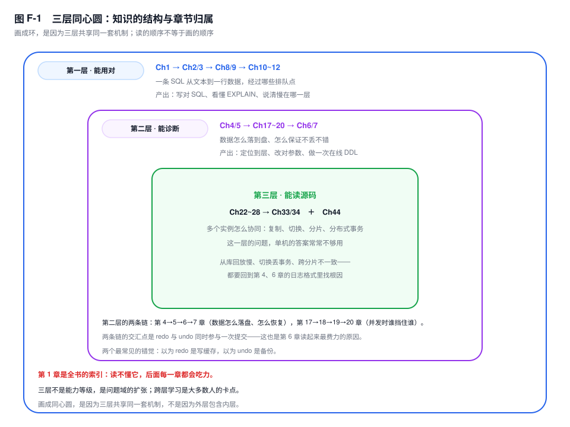
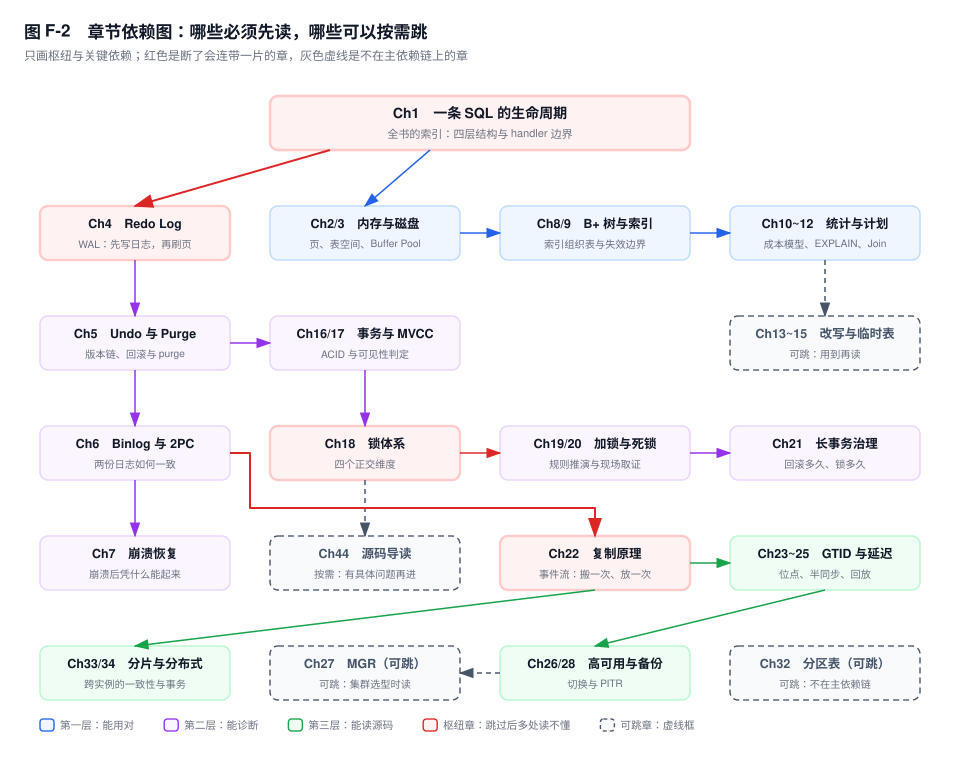

# 附录 F　学习路径与参考

> **一句话结论**：MySQL 的知识不是一棵树，是三层同心圆；卡住大多数人的不是某一章太难，而是读它的时机早了一层。

## F.0 怎么用

三条规矩，按重要性排。

**一、不按章节顺序读，按依赖读。** 第 12 章可以放到第 20 章之后，第 44 章可以一直不读。反过来，第 4 章不能放到第 22 章之后：从库回放为什么慢，答案在第 4 章的 redo 格式与第 25 章的写集判定里，先读复制只能背下"把并行复制开大"这句结论。

**二、每读完一层，做一次"讲给同事听"的检验。** 标准很具体：合上书，用五分钟讲清"一次写经过几次落盘、哪一步可能丢"。讲不顺的地方就是没读透的那一章，回去补，别往前赶。看懂和讲懂之间隔着一整个数量级的差距。

**三、三阶段不是能力等级，是问题域的扩张。** 能诊断的人未必读得懂源码，读得懂源码的人也可能写不对一条深分页 SQL。三个阶段各有独立的及格线，不存在"进阶学完、入门自动及格"。

## F.1 三层同心圆：知识的结构

**第一层，一条 SQL 怎么走。** 第 1 章的四层结构与 `handler` 边界是起点，第 2、3 章给出页、行、表空间这些物理单位，第 8、9 章把"为什么快"落到 B+ 树，第 10~12 章把"为什么选这个计划"落到成本模型、`EXPLAIN` 与连接算法。这一层读完，你能回答的是一句很朴素的话：这条 SQL 的时间花在哪几个排队点上。

**第二层，数据怎么落到盘、怎么保证不丢不错。** 第 4、5 章是 redo 与 undo 这两份日志，第 17~20 章是并发下的可见性与锁，第 6、7 章是两份日志如何达成一致、崩溃之后如何恢复。这一层不再问"快不快"，问的是"丢不丢、错不错"。

**第三层，多个实例怎么协同。** 第 22~28 章把单机的日志变成网络上的一条事件流，第 33、34 章再把它推到跨实例：分片路由、分布式事务、最终一致性。

三层共享同一套机制，所以画成同心圆而不是树。**第 1 章是全书的索引，读不懂第 1 章的人后面每一章都会吃力**——后面所有的"为什么慢""为什么等""为什么丢"，指的都是第 1 章那条路径上的某一个点。

跨层是大多数人的卡点，而且卡得很隐蔽。直接翻第 25 章的人会看到"写集判定"这类词，把 `replica_parallel_workers` 开大就以为解决了；回放慢的根因却常常在主库——一个事务改了太多行，写集再并行也只能整体等它。这个结论要同时握住第 4 章的 redo 格式、第 6 章的 binlog 事件粒度、第 25 章的调度规则，缺一章就只剩"调参数"。另一个例子是第 19 章的加锁规则：没读第 17 章的人会把"锁住了"和"看不到"混成一件事，于是拿 `FOR UPDATE` 去解决一个 MVCC 快照问题。

## F.2 入门：能用对（6~10 周）

目标三条：能独立建一张几年不用大改的表；能写出不给自己挖坑的 SQL；能看懂执行计划，并知道它什么时候会骗你。

必读十章：**1、2、3、8、9、10、11、12、17、28**。顺序按依赖走。第 1 章立骨架；第 2、3 章补物理单位，后面所有"估算"都从页和行宽出发；第 8、9 章给索引的边界；第 10 章解释 `EXPLAIN` 里那个 `rows` 是怎么来的；第 11、12 章读计划与连接；第 17 章讲清 RC 与 RR 差在哪；第 28 章是唯一能在事故里救命的能力。第 4~7 章可以先放着，它们解释"为什么"，不影响你"先用对"——只有第 17 章会借版本链，翻一下第 5 章开头即可。

第 2、3 章容易被读成名词课，读到第 8 章时要回头再看一次：页目录、行格式、溢出页，直接决定一条记录能不能被索引覆盖、一个 `VARCHAR(255)` 到底占多少字节。这两章的价值不在记住名词，在于以后看到 `EXPLAIN` 里的 `Using index` 时，脑子里有一张页的图。

读完能做到什么，五条可验证的：

1. 给一张五千万行的订单表定主键与两个二级索引，说清列顺序的理由，也能说出每多一个索引、插入要多写多少字节、页分裂概率上升多少。
2. 拿到一条慢 SQL，能指出 `type`、用到的索引、`rows` 与 `filtered`，并说明这个 `rows` 是采样估算还是索引统计推出来的（第 10 章）。
3. 解释一条 `UPDATE` 只改一行却写了 redo、undo、binlog 三个地方，以及哪个必须先落盘、哪个可以后落盘（第 1、4、6 章）。
4. 在 RC 与 RR 下各构造一个"读到旧值"的例子，并说清 Read View 是在哪一刻建立的（第 17 章）。
5. 用 `mysqldump` 或 `xtrabackup` 做一次全备，再用 binlog 恢复到指定时间点，恢复后核对行数与校验和（第 28 章）。

五条都能做，"能用对"这一关就算过了；有一条做不出来，回对应那一章，不要急着进第 4 章。练习方式朴实一点：把每章的实验在附录 G 里跑一遍，跑不通比看懂更有信息量——第 10 章的采样误差、第 17 章的可见性，都是跑出来的，不是看出来的。

周数是投入量级，不是承诺：按每周 6~8 小时算，6~10 周。有人两周过完，然后在第 10 章卡三个月——那说明第 8 章没过关，回去重读，别硬推。

## F.3 进阶：能诊断（2~4 个月）

目标从"写对"转成"定位"：线上出问题能判断在哪一层，能改对参数，能设计表，能做一次不停机的 DDL。

必读：**4、5、6、7、13、14、18、19、20、21、22、25、29、31、36、37、38、39、40、46**。这一串不要求按序读，按症状读——锁等待去 18~21，延迟涨去 22、25，磁盘涨去 5、31，DDL 卡住去 46，参数不敢动去 40。

**能力检验只有一条：十分钟内判断一条慢 SQL 是"扫得多"还是"等得久"。**

做法是把两类证据分开看（语句见附录 D 的 D13、D32）：

- **扫得多**：`Handler_read_rnd_next` 的差值在涨，`rows_examined` 远大于 `rows_sent`，`type` 是 `ALL` 或 `index`；或者 `EXPLAIN ANALYZE` 里 `actual rows` 与 `estimated rows` 差一个数量级（第 10、11 章）。
- **等得久**：语句耗时高但扫描行数很小，`lock_latency` 占了 `statement_latency` 的大头；或者根本没在等锁，而在等 IO——`Innodb_buffer_pool_wait_free` 在涨说明刷脏跟不上，`Log sequence number` 减去 `Last checkpoint at` 贴着 redo 容量说明快写满（第 4、39 章）。

这两类的处置方向相反。扫得多要动索引或改写 SQL；等得久要动事务边界、锁顺序、刷脏预算。判断错了，会把锁问题当索引问题，加完索引发现更慢。

三个假诊断，几乎都出在没做这一步的时候：

- 看到 `type=ALL` 就加索引——有时这张表只有几千行，全扫比走索引加回表便宜，成本模型算的就是这笔账（第 10 章）。
- 看到 `Using filesort` 就建排序索引——有时排序集只有几十行，内存里排完就完了，索引反而是每次都付的维护成本（第 14 章）。
- 看到 `Waiting for table metadata lock` 就去杀 DDL——真正撑住 MDL 的通常是一个空闲事务，杀错对象只会让队列更长（第 18、46 章，抓法见附录 D 的 D3）。

再加三项硬能力：

- **改参数**：说清 `innodb_io_capacity`、`innodb_redo_log_capacity`（`[8.0.30+]`）、`binlog_group_commit_sync_delay` 各自影响哪一段排队，改完哪个指标应该动（第 4、40 章）。
- **设计表**：字符集与排序规则、行宽与大字段、主键选择与自增耗尽，每个决定都能说出三年后的代价（第 29、30、31 章）。
- **在线 DDL**：分清哪些操作是 `INSTANT`、哪些是 `INPLACE`、哪些必须 `COPY`，以及 MDL 队列怎么把一次 DDL 变成全库阻塞（第 18、46 章）。一次完整的在线变更至少有四步：确认可行性、在从库跑一遍计时、变更窗口内盯 MDL 队列、准备好失败后的回退路径。先在从库演练，再上主库。

投入量级：2~4 个月，每周 8~10 小时，中间至少完整跟一次真实故障——从告警到复盘，全程在场。

## F.4 内核：能读源码（6 个月以上）

目标两条：能读懂一个调用栈，能改一行代码验证一个猜测。

必读正文只有一处：**第 44 章**。它给的是地图——`sql/`、`storage/innobase/`、`include/` 各自装什么，`handler` 是唯一那道门。再拿第 4、8、18 章的机制描述做对照：书上说"先写 redo 再改页"，代码里就是 `mtr` 提交时那一次 `log_write`。

InnoDB 的子树里，四个目录够用很久：`btr/`（B+ 树，从 `btr_cur_search_to_nth_level` 进）、`trx/`（事务与提交，从 `trx_commit` 进）、`lock/`（锁，从 `lock_rec_lock` 进）、`mtr/`（一次原子访问的单位）。**读 `btr/` 之前先读 `mtr/`**，否则你会以为页的修改是散着写下去的。

**读源码的门槛不是 C++，是"你已经有一个必须靠代码才能回答的问题"。** 没有这个问题，读三周就会停在断言宏和模板参数里。

别从 `main()` 或 `srv_start()` 开始读，那是把源码当小说看。从监控里见过的一个线程名、抓到过的一个等待事件、解释不了的一个 `Handler_read_*` 计数切进去，路径短得多。

工具三件套：能编译（`cmake -DWITH_DEBUG=1`）、能断点（`lldb` 或 `gdb` attach 到 mysqld）、能看火焰图（`perf` 与 `p_s` 的线程名靠 `THREAD_OS_ID` 对齐）。只读代码不编译，等于看地图不走一遍。

什么问题值得进去：`EXPLAIN` 说走了索引，`Handler_read_next` 却几乎不动——是不是索引条件下推在引擎层就把行滤掉了（第 11、44 章）；明明加了 `FOR UPDATE`，某段记录却没锁住——`lock_rec_lock` 的判定顺序到底是什么（第 19 章）；redo 明明写了，崩溃后事务却回滚了——`trx_commit` 的几个阶段各做了什么（第 4、7 章）。

改一行代码验证一个猜测，是最快的闭环：在 `btr_cur_search_to_nth_level` 里加一个计数器，重跑第 8 章那个范围查询，看它被调用几次——比讨论"应该走几次索引"有用。

投入量级：6 个月以上，且不以"读完"为目标。合理的终点是：从 `performance_schema.threads` 抄一个线程名，`grep` 到具体文件，读懂它周围两百行。

## F.5 章节依赖图：哪些章可以跳，哪些不能

**枢纽章四个：第 1、4、18、22 章。** 判断标准不是"重要"，是"跳过之后，别处的句子会失去主语"。

- **第 1 章**：后面每一章说"排队点""这条路径"，指的都是它画的那条路。跳过它，第 38、39 章的等待事件你只能背名字。
- **第 4 章**：第 6 章的两阶段提交、第 7 章的恢复、第 22 章的复制落盘、第 25 章的回放、第 39 章的 checkpoint 年龄，全以它为前提。跳过它，这些章会各自退化成结论集。
- **第 18 章**：锁的四个正交维度。第 19 章的加锁规则、第 20 章的死锁、第 21 章的长事务、第 46 章的 MDL，都在它的坐标系里说话。跳过它，第 19 章会读成一堆特例。
- **第 22 章**：第 23~28 章的上游，也是第 33、34 章的前置——不懂单机复制的位点与事件流，分片之后的一致性方案只能照抄。

**可跳章，按需：第 27 章（MGR）、第 32 章（分区表）、第 44 章（源码导读）。** 判断标准是"不在别人的依赖链上"，不读它们不会让任何一章变难读。不用 MGR 的团队读第 27 章只是长见识；单表没过亿，第 32 章的分区裁剪用不上；没有具体问题就读第 44 章，多半停在第三章。可跳不等于不重要，等于"晚点读没有代价"——这一点与第 4 章正好相反。

**必须按序读的一组：第 4→5→6→7 章。** 这是一条完整的"数据怎么落盘、怎么恢复"链：redo 是欠条，undo 是退路，binlog 是给别人看的账本，崩溃恢复是把三本账对平。拆开读的症状很明显——只读第 4 章的人以为 redo 是写缓存；只读第 7 章的人能背出"doublewrite 防页断裂"，却说不清它和 redo 谁先谁后；只读第 6 章的人会以为两阶段提交是为了性能。

还有一条小链：第 10→11→12 章。成本模型给 `rows`，`EXPLAIN` 显示 `rows`，连接算法消费 `rows`。顺序反了，`EXPLAIN` 就成了一门要背的语法。

## F.6 官方文档的重点页索引

官方文档不必通读，需要的是"知道去哪一页找定义"。下面十二页值得反复读。路径前缀统一是 `dev.mysql.com/doc/refman/8.0/en/`（错误码那页在 `dev.mysql.com/doc/mysql-errors/8.0/en/`）。

读某一章之前先扫一眼对应的页，比读完再查有效：定义先立住，机制才有地方挂。

| 页面 | 回答什么 | 为什么值得读 |
|---|---|---|
| `innodb-locking.html` | 锁的模式、锁什么、何时不锁 | 第 18、19 章推演的原始定义，`LOCK_MODE` 里每个词都能对上 |
| `innodb-transaction-model.html` | 隔离级别与一致性读的官方措辞 | 争论"RR 解不解决幻读"时，用它校准自己说的是哪个定义 |
| `optimization.html`（含 `explain.html`、`index-condition-pushdown-optimization.html`） | 优化器怎么估、`EXPLAIN` 每列什么意思 | `filtered` 与 ICP 的语义这里最准，第 10、11 章的对照物 |
| `replication.html` | 复制线程、GTID、并行复制规则 | 第 22、23、25 章的骨架，写集判定的边界条件要回这里查 |
| `events_statements_summary_by_digest`、`events_waits_summary_global_by_event_name` | 谁在跑、谁在等 | 一张回答"哪条 SQL"，一张回答"等在哪"，附录 D 一半条目建在它们上面 |
| `information-schema-innodb-metrics-table.html` | 比 `SHOW STATUS` 细一层的计数器 | 第 37、39 章要的分类型计数在这里，如 `lock_deadlocks`、`os_log_fsyncs` |
| `server-status-variables.html` | 每个状态变量的口径与单位 | 两次采样求差之前，先确认它是累计值还是当前值、单位是什么 |
| `server-error-reference.html` | 错误码的完整含义 | 1213、1205、1040 的确切解释，比搜索结果可靠 |
| `innodb-online-ddl-operations.html` | 哪种 DDL 支持 `INPLACE`、并发度如何 | 第 46 章那张表的出处，变更前必须对一遍 |
| `innodb-recovery.html` | 崩溃后能做什么、各级 `innodb_force_recovery` 的代价 | 第 7 章的实操面；调到 4 以上意味着放弃写入，别在故障中现查 |
| `clone-plugin.html` | 物理克隆搭从库 | 第 26、28 章里最快的一种搭从库方式，`[8.0.17+]` |
| `upgrading.html` | 升级路径与不兼容项 | 第 43 章的清单来源，跨大版本先读它再排期 |

读法一句话：官方文档给定义，本书给"这些定义为什么长这样"。两者冲突时以文档为准；文档没写的取舍，回本书找。

十二页里有三页属于"变更前必查"：`innodb-online-ddl-operations.html`、`upgrading.html`、`innodb-recovery.html`。它们的共同点是——读了不一定用上，不读一定出事。

## F.7 书与社区

三本书解决三类问题，按当下的问题选，不按名气选。

**《High Performance MySQL》** 解决"怎么调、怎么运维、怎么规划容量"。第四版以 8.0 为基线，参数与工具的描述与现在对得上，适合在 F.3 阶段当参考手册翻。

**《MySQL 技术内幕：InnoDB 存储引擎》** 解决"一个操作在数据结构上到底改了什么"。它把页、行、索引、事务拆到结构层讲，读第 4、5、8 章时对照着看；成书较早，版本细节以 8.0 文档为准。

**《Understanding MySQL Internals》** 解决"源码的模块怎么分、一条查询从哪进"。它基于 5.1 时代，看结构不看细节——目录划分与调用层次仍然有效，具体函数名早就换了。

社区五个入口：

- **Percona Blog**：故障复盘与工具细节写得最实，`pt-*` 系列踩过的问题常在这里找到同类现场。
- **MySQL Server Blog**：官方发布与行为变更，升级前必看，尤其 deprecated / removed 那几段。
- **Planet MySQL**：聚合站，用来扫近期热点，质量参差，当索引不当结论。
- **Percona Live、FOSDEM 的 MySQL Dev Room**：议题偏实现与内核，看录像比自己啃代码快，FOSDEM 的场次免费、材料公开。
- **`#mysql`（Libera）与 MySQL Community Slack**：提问先给版本、表结构、SQL、`EXPLAIN`、错误码五件套，缺一件的回答基本是猜。

读博客有个习惯值得养成：先看版本号和复现步骤。没有版本号的结论，在 8.0 上可能已经反了；没有复现步骤的数字，多半是别人的机器上跑出来的。书给一条完整的线，社区给线上的最新补丁——只有前者会过时，只有后者会碎片化。

## F.8 关键结论

- **MySQL 的知识是三层同心圆，不是一棵树；卡点几乎都落在跨层那一步。**
- **第 1 章是索引：它的路径图画错，后面每一章都在背结论。**
- **第 4→5→6→7 章是一条链，拆开读会各自似懂非懂。**
- **"扫得多"和"等得久"是两个问题；先分开，再谈优化。**
- **读源码的门槛不是 C++，是一个必须靠代码才能回答的问题。**

## F.9 延伸

- **当工具书查**：症状到 SQL 用附录 D，错误码用附录 B，参数默认值用附录 A。
- **当教材读**：按 F.1 的三层推进，每层读完做一次"讲给同事听"的检验；给团队排学习计划时按 F.5 的依赖排先后，不要按章号排。
- **当复盘参考读**：第 41 章的案例集与第 52 章的应急 SOP，配合附录 D 的语句，把一次故障拆成"现象—层—机制—动作"四段。
- **动手环境**：用附录 G 起一套 1 主 2 从，第 4、5、22、25 章的实验都在上面跑，比看十遍图有用。
