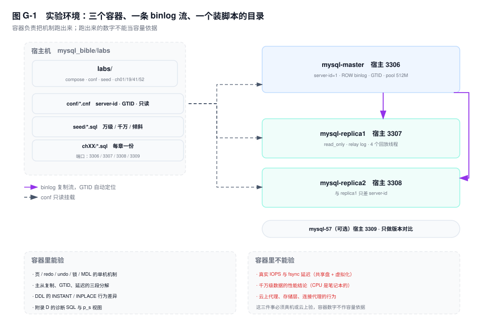

# 附录 G　实验环境

> **一句话结论**：容器能把机制跑出来，跑不出容量结论——分不清这两件事，实验做得越多，误判越快。

## G.0 这套环境能做什么、不能做什么

一套 `docker-compose.yml` 起一主两从（8.0），另有一份 5.7 单实例做版本对比；`labs/` 里放着配置、造数脚本和每章实验 SQL。它能覆盖四类实验：

**单机机制**。页、redo、undo、锁、MDL、purge，这些行为只取决于代码路径，不取决于硬件。容器里看到的 `data_locks` 内容和真机一模一样，第 19 章的三种锁模式可以逐条对照。

**复制链路**。GTID、relay log、并行回放、延迟的三段分解，两个从库足够摆出"一个跟得上、一个卡住"的对照。

**DDL 与元数据**。`INSTANT` 的行版本、`INPLACE` 的 MDL 队列、加字段越来越慢，这些是版本特性，与机器无关。

**诊断 SQL**。附录 D 的四十条里，除了少数依赖云上视图的，其余都能直接跑出结果。

不能做的有三件，每一件都值得单独说清：

**真实 IOPS 与 fsync 延迟。** 三个 mysqld 共用笔记本的一块盘，还隔着一层虚拟化。`innodb_io_capacity` 从 200 调到 2000，你能看到刷脏行为变了，但那个"变快了多少"的数字没有意义。

**千万级数据的性能结论。** 每个容器几个 GB 内存，buffer pool 只有 512M。数据一过千万，命中率跌到个位数，你测到的是"内存不够时的磁盘读"，不是生产的形态。

**云上代理与存储层。** 连接代理、只读实例的延迟、审计日志、binlog 服务，容器里都没有。

分界线只有一句：容器验"机制有没有按书上说的发生"，真机验"发生得有多快"。



## G.1 三分钟起环境

镜像用 `mysql:8.0` 这个浮动标签，不写死小版本。`command` 里不要加 `--default-authentication-plugin=mysql_native_password`：8.4 已经把这个参数移除，加了这份 compose 过两年就起不来。认证走 8.0 默认的 `caching_sha2_password`，从库用 `GET_SOURCE_PUBLIC_KEY=1` 取公钥。

复制关系不放进 compose。从库要按 GTID 自动定位，前提是主库已经写过事务；容器 healthy 只说明实例起来了，不说明 GTID 集合非空。这件事交给一条 `CHANGE REPLICATION SOURCE TO`。

healthcheck 里用 `-h 127.0.0.1` 是有意的：初始化阶段的临时实例带 `--skip-networking`，只开 socket，端口上没人应答。所以 healthy 真的意味着"初始化跑完了"，而不只是"进程活着"。

```bash
git clone <本书仓库地址> mysql_bible && cd mysql_bible
docker compose -f labs/docker-compose.yml up -d
docker compose -f labs/docker-compose.yml ps        # 三个都 healthy 再往下

# 主库建复制账号
docker exec -e MYSQL_PWD=labpass mysql-master mysql -uroot -e "
  CREATE USER 'repl'@'%' IDENTIFIED BY 'replpass';
  GRANT REPLICATION SLAVE ON *.* TO 'repl'@'%';"

# 两个从库各配一次
for h in mysql-replica1 mysql-replica2; do
  docker exec -e MYSQL_PWD=labpass "$h" mysql -uroot -e "
    CHANGE REPLICATION SOURCE TO
      SOURCE_HOST='mysql-master', SOURCE_PORT=3306,
      SOURCE_USER='repl', SOURCE_PASSWORD='replpass',
      SOURCE_AUTO_POSITION=1, GET_SOURCE_PUBLIC_KEY=1;
    START REPLICA;
    SET PERSIST read_only=ON, super_read_only=ON;"
done

# 两个 Running 都是 Yes 才算通
docker exec -e MYSQL_PWD=labpass mysql-replica1 mysql -uroot -e "SHOW REPLICA STATUS\G" \
  | egrep 'Replica_IO_Running|Replica_SQL_Running|Seconds_Behind_Source'

# 建表 + 小数据
docker exec -i -e MYSQL_PWD=labpass mysql-master mysql -uroot < labs/seed/01-schema.sql
docker exec -i -e MYSQL_PWD=labpass mysql-master mysql -uroot < labs/seed/02-seed-small.sql
```

`SOURCE_AUTO_POSITION=1` 让从库自己报"我有哪些 GTID"，主库补差集；`GET_SOURCE_PUBLIC_KEY=1` 解决 `caching_sha2_password` 在无 TLS 链路上的首次认证。这两个参数各管一件事：少了 `SOURCE_AUTO_POSITION`，从库会从位点 4 开始要日志，主库的 binlog 早被清了就报 `1236`；少了 `GET_SOURCE_PUBLIC_KEY`，认证会卡在 `caching_sha2_password` 拿不到公钥，错误信息里写的是 requires secure connection。

`SOURCE_PORT` 写 3306，是**容器内**的端口。宿主机的 3307/3308 只是映射，从库连主库走的是 compose 网络里的服务名，写成 3307 会一直报 `2003 Can't connect`。

两条 `SET PERSIST` 放在 `START REPLICA` 之后：先让复制跑起来，再上只读锁。顺序反了不影响复制，但你在从库上做任何修复都会被 `1290` 挡住，排查时反而碍事。`SET PERSIST` 的值落在 `mysqld-auto.cnf`，重启后仍然生效，效果与写进 cnf 相同。

`ps` 里如果有容器一直停在 `starting`，先看 `docker logs mysql-replica1 --tail 30`。八成是 cnf 里的参数名拼错（把 `log_replica_updates` 写成 `log_replica_update` 这种），mysqld 启动即退出，healthcheck 永远等不到 healthy。

## G.2 目录与环境变量

`labs/` 只放脚本和配置，数据全在命名卷里。这样 `down` 不丢数据、`down -v` 一定丢数据，两种动作的后果分得开。

| 路径 | 作用 | 什么时候改它 |
|---|---|---|
| `docker-compose.yml` | 8.0 一主两从，端口 3306/3307/3308 | 改内存、加第三个从库 |
| `docker-compose-57.yml` | 5.7 单实例，端口 3309 | 做版本对比 |
| `conf/master.cnf` | `server-id=1`、ROW binlog、GTID、慢日志 0.5s | 调 binlog 或 buffer pool |
| `conf/replica1.cnf`、`replica2.cnf` | `server-id=2/3`、`log_replica_updates`、4 个回放线程 | 调并行度 |
| `conf/57.cnf` | 5.7 对比用，字符集显式 utf8mb4 | 对比字符集行为 |
| `seed/01-schema.sql` | 订单、明细、库存、库存流水、账户、账户流水 | 改表结构 |
| `seed/02-seed-small.sql` | 2 万单 / 4 万明细 / 2000 SKU，秒级 | 每次重建数据 |
| `seed/03-seed-large.py` | 千万行生成器，标准库，输出 INSERT 流 | 做大表实验 |
| `seed/04-seed-skew.sql` | 10% 订单压到 SKU 8842 与商户 1000 | 做锁冲突与计划偏差 |
| `ch01/` `ch19/` `ch41/` `ch52/` | 对应章节的可执行脚本 | 跟着正文跑 |

连接参数只有一套：`root` / `labpass`，库 `shop`。环境变量里 `MYSQL_ROOT_HOST: '%'` 必须留——不留的话 root 只能从容器内登录，宿主机连 3306 会报 `1045`。

从库的 `super_read_only` 写在注释里而不是配置里，原因是初始化顺序：docker-entrypoint 首次启动要用 root 执行 `ALTER USER`，`super_read_only` 会让它报 `ERROR 1290` 然后容器直接退出。等复制配好，用 `SET PERSIST` 打开，值落在 `mysqld-auto.cnf`，重启仍在。这是这套环境里唯一一处"配置不在 cnf 里"的地方。

## G.3 造数：三档数据量与倾斜

**小（万级）**：`02-seed-small.sql`，2 万订单、4 万明细、2000 个 SKU、500 个商户，实测导入 1.4 秒。锁、MDL、复制、`EXPLAIN` 这几类实验都用它，因为结果集小，肉眼能核对。

**中（百万级）**：`03-seed-large.py --rows 2000000`。两百万单的 SQL 文件在数百 MB 量级，导入以分钟计。这一档用来做索引选择性与 buffer pool：512M 的池装不下两百万单的热数据，命中率会掉下来，正好演示"池子不够时索引回表有多贵"。

**大（千万级）**：`--rows 10000000`。文件按 GB 计，写入磁盘之前先看 `df -h`。这一档只适合做分页、DDL、备份这类"与数据量强相关"的实验，不要拿它测 QPS——原因见 G.0。

生成器有三条约定，写脚本时守着它们，后面所有实验才对得上：

- `id` 显式给出（1..rows），`order_item.order_id` 直接引用，不依赖自增值。代价是导入前必须 `TRUNCATE order_main, order_item`。
- 每 1000 行一条 `INSERT`，一条语句失败只回滚一批，定位错误比百万行单条语句容易。
- `pay_amount` 严格等于明细金额之和。对账类实验的第一行断言就是它，造数阶段错了，后面全是噪音。

**倾斜数据是另一件事。** `04-seed-skew.sql` 把 10% 的订单压到同一个 SKU（8842）和同一个商户（1000），再给这个 SKU 只留 50 件库存、给这个账户灌 2 万条流水。均匀分布下，行锁永远不冲突、优化器的基数估计永远接近真实值、执行计划永远不变——第 41 章案例二的"计划突变"和案例六的"死锁风暴"在均匀数据上一辈子复现不出来。倾斜不是让数据"更真实"，是让**冲突和偏差以可观测的密度出现**。

跑倾斜脚本前先跑 `02`；它是增量脚本，重复执行靠 `INSERT IGNORE` 与唯一键兜住。

## G.4 章节 → 实验映射表

| 章节 | 实验目的 | 脚本 / SQL 来源 | 预期现象 |
|---|---|---|---|
| Ch1 | 回表次数、提交不等于落盘 | `ch01/seed.sql` + 正文 1.6 | 覆盖索引时 `Handler_read_key` 不随行数涨 |
| Ch2 | 命中率、池里装的是谁 | 附录 D24、D25 | 求差后的命中率才有诊断价值 |
| Ch3 | 表空间与物理文件 | 附录 D18、D21 | 独立表空间每表一个 `.ibd` |
| Ch4 | redo 生成速率与 checkpoint | 附录 D27 | 年龄贴着容量 → 周期性尖刺 |
| Ch5 | undo 膨胀与长事务 | 附录 D22、D5 | undo 只增不减，先抓长事务 |
| Ch6 | 两阶段提交留下的 XID | 容器内 `mysqlbinlog -vv` | 每个事务以 `Xid = N` 收尾 |
| Ch9 | 索引选择性与回表 | 附录 D16 + `EXPLAIN` | 同一条件换一列，`rows` 差一个量级 |
| Ch10 | 统计信息陈旧导致计划变差 | 附录 D39 | 导入后 `last_update` 还停在旧时间 |
| Ch11 | 估算行数与实际行数 | 附录 D13 | `actual` 与 `estimated` 差一个量级 |
| Ch17 | 快照读与当前读 | 正文 1.4 的两会话脚本 | 同一事务两次读到不同结果 |
| Ch19 | 非唯一索引锁三段 | `ch19/lock-demo.sql` | 2 行 `idx_c` + 1 行 `PRIMARY` |
| Ch20 | 死锁现场与牺牲者 | 附录 D7，两条 UPDATE 换顺序 | `LATEST DETECTED DEADLOCK` 两段 |
| Ch21 | 长事务与回滚成本 | 附录 D5、D6 | `trx_rows_modified` 决定回滚时长 |
| Ch22 | 复制延迟三段分解 | 附录 D35、D36 | `net_ms` 与 `apply_ms` 分开看 |
| Ch25 | 无主键表的并行回放 | `ch41/case-03-no-pk-lag.sql` | `Waiting for dependent transaction to commit` |
| Ch28 | 一致性备份的位点快照 | 附录 D34 | `log_status` 一次读出位点 + GTID |
| Ch30 | 主键与随机写入 | 附录 D17、D19 | 无主键表清单按行数降序 |
| Ch38 | 慢查询与 digest 增量 | 附录 D8、D9 | 总耗时高与单次高是两类问题 |
| Ch41 | 三个经典误判 | `ch41/case-01/02/03`，索引 `case-md.md` | 各文件开头写了预期输出 |
| Ch49 | 超卖与条件更新 | `seed/01-schema.sql` + 正文 SQL | `affected_rows = 0` 就是没货 |
| Ch51 | 千万行容量与造数 | `seed/03-seed-large.py` | 生成 GB 级 SQL，导入前先看磁盘 |
| Ch52 | KILL 之后锁不释放 | `ch52/kill-long-trx.sql` | `ROLLBACK` 期间 B 仍在等锁 |

其余章节没有专属脚本，用附录 D 的 SQL 直接跑。表结构统一在 `seed/01-schema.sql`，第 49 章的多仓模型要自己在 `stock` 上加 `warehouse_id`。

## G.5 五个常见故障

**① 从库报 `1045 Access denied`。** 先看 `repl` 账号的 host 是不是 `%`。主库在容器网段里看到的从库地址是 `172.x.x.x`，只建 `'repl'@'localhost'` 一定连不上。`SELECT user, host FROM mysql.user WHERE user='repl';` 一眼能确认。想在容器里直接试：`docker exec -e MYSQL_PWD=replpass mysql-replica1 mysql -h mysql-master -urepl -e "SELECT 1"`，这条能通，问题就只剩 `CHANGE` 里写的密码。密码改过之后必须重新 `CHANGE REPLICATION SOURCE TO`，只 `START REPLICA` 不会用新密码。

**② `START REPLICA` 报 `1236`（GTID 不一致）。** 典型原因是清过主库的 binlog 或从库残留了上一轮的 GTID。对比两边 `SELECT @@GLOBAL.gtid_executed;`，从库多出来一段就是脏的；`Last_IO_Error` 里会写清是 `purged` 还是 `missing`。实验环境最省事的修法是 `docker compose down -v` 重建从库数据卷，再走一遍 `CHANGE REPLICATION SOURCE TO`；卷删了 `super_read_only` 的持久化也一起没了，配完复制记得补一次 `SET PERSIST`。生产上绝对不要照抄，那边要走 `gtid_purged` 的评估流程再动手。

**③ 重启后数据"没了"。** 先确认卷还在：`docker volume ls | grep mysql-bible-lab`。数据卷是命名卷，`down` 保留、`down -v` 删除。另一种"看起来没了"是连错了端口——3306 是主库，3307/3308 是从库，从库只读，写进去会报 `1290`。用 `docker inspect -f '{{json .Mounts}}' mysql-master` 能直接看到卷有没有挂上，空数组就是没挂。

**④ 老客户端连不上，报 `1524 Plugin 'mysql_native_password' is not loaded`。** 8.4 起 `mysql_native_password` 默认不加载。这份环境用 8.0 镜像不受影响，但如果你把镜像改成 `mysql:8.4` 又拿旧版 Navicat 连，就会撞上。先用 `SELECT @@version;` 确认自己在哪个版本上。两条路：升级客户端，或在 8.4 的配置里显式 `mysql_native_password=ON`（不推荐，等于把已知的弱哈希留在线上）。

**⑤ Apple Silicon 上 5.7 起不来。** `mysql:5.7` 没有 arm64 镜像，会报 `no matching manifest for linux/arm64/v8`。`docker-compose-57.yml` 里写了 `platform: linux/amd64`，走 Rosetta 模拟，能跑但慢几倍；镜像本身是 amd64 的，第一次拉取也要多等几分钟。5.7 也不认 8.0 的参数名：`log_replica_updates` 叫 `log_slave_updates`，`replica_parallel_workers` 叫 `slave_parallel_workers`，把 8.0 的 cnf 直接抄过去，mysqld 启动就退出。5.7 在 2023 年 10 月已停止社区维护，这个容器只用来验证"这条结论从哪一版开始变"，不要拿它做性能对比。

## G.6 关键结论

1. **容器验机制，真机验数值。** 锁模式、MDL 队列、GTID 传播这些结论跨机器成立；IOPS、fsync 延迟、QPS 上限不成立。
2. **复制关系必须等主库有 GTID 之后再建。** compose 保证的是"进程起来了"，不是"可以按 GTID 对齐了"，所以 `CHANGE REPLICATION SOURCE TO` 只能放在启动之后。
3. **均匀数据只能验证"能跑"，倾斜数据才能验证"会卡"。** 锁冲突、计划突变、热点行，都需要把压力集中到 1% 的键上才会显形。
4. **造数脚本要自己守住业务不变量。** `pay_amount` 必须等于明细之和，否则对账、超卖、退款那些实验从第一行数据起就是错的。
5. **配置写进 cnf 之前，先想它会不会挡住首次初始化。** `super_read_only` 与 docker-entrypoint 的 `ALTER USER` 冲突，就是这套环境里唯一一处必须绕开的地方。

## G.7 延伸

**配套脚本**：`labs/README.md` 有完整的三分钟流程与目录表；`labs/ch41/case-md.md` 是三个案例的复现索引。

**回指正文**：锁与 MDL 见第 18、19、21 章；复制与延迟见第 22、25 章；诊断语句全部收在附录 D，最常用的五条是 D1、D5、D8、D29、D35；备份与位点见第 28 章；处置流程见第 52 章。

**官方文档**：

- `dev.mysql.com/doc/refman/8.0/en/replication-howto.html`
- `dev.mysql.com/doc/refman/8.0/en/replication-options-source.html`
- `dev.mysql.com/doc/refman/8.0/en/performance-schema.html`
- `docs.docker.com/compose/how-tos/startup-order/`
