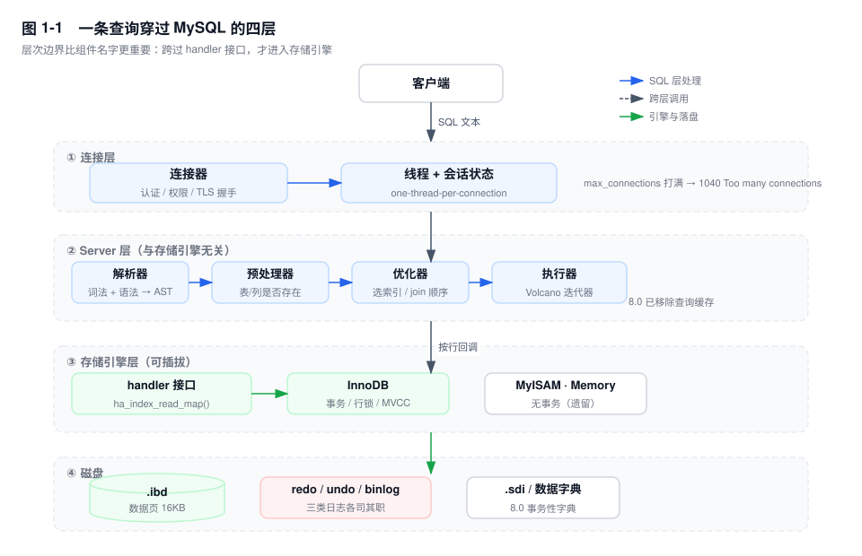
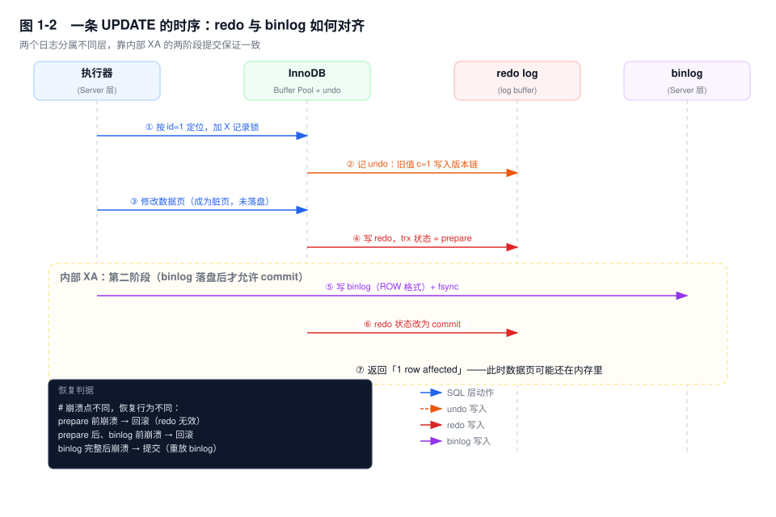
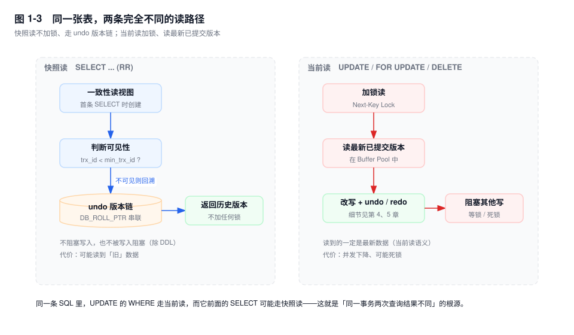

# 第 1 章　一条 SQL 的完整生命周期

> **一句话结论**：MySQL 真正的层次边界不是"连接层/服务层/引擎层"这三个词，而是 `handler` 接口。跨过它，才从"处理 SQL"进入"存取数据"；而后者才是事务、锁、索引、崩溃恢复的发生地。

## 1.0 场景：为什么"这条 UPDATE 慢"是个没法回答的问题

凌晨两点，告警群贴出一条信息：下单接口 P99 从 40ms 涨到 2.3s。

值班的 DBA 抓到了那条 SQL，很干净：

```sql
UPDATE order_stock SET available = available - 1, version = version + 1
WHERE sku_id = 8842 AND warehouse_id = 3;
```

有人说了三句话，每一句听起来都对，合起来却推不出结论：

- 开发说："主键/唯一索引更新，就一行，不可能慢。"
- DBA 说："执行计划走了 `eq_ref`，没有全表扫。"
- 运维说："CPU 20%，磁盘 util 30%，机器很闲。"

真相是：这条 SQL 慢在**它自己之外**——同一秒有 300 个事务在等同一把行锁（`available` 是热点行），而持有锁的那个事务卡在了 binlog 组提交上；组提交慢，是因为 `binlog_group_commit_sync_delay` 被人改成了 10000 微秒。

这就是本书第一章要解决的事：**一条 SQL 的耗时，等于它经过的每一层的排队时间之和**。你如果不认识这条路径上的每一个排队点，就只能靠猜。



## 1.1 四层结构，以及边界到底在哪里

图 1-1 画的是层次，但真正有价值的是**边界**。

### 连接层：不在 SQL 的语义范围内，但在故障范围内

连接层做三件事：认证、加载权限、分配线程。

- 线程模型是 **one-thread-per-connection**，一个连接一个线程，直到连接断开。线程池（`thread_pool`）在社区版不是默认能力，所以"连接数"和"线程数"基本是同一个指标。
- 认证是有成本的。`caching_sha2_password`（8.0 默认）在首次认证、且没有 TLS 时，需要走 RSA 公钥交换，比老版 `mysql_native_password` 多一次往返。**这解释了为什么"升级到 8.0 后建连慢了"**，而不是网络问题。
- 权限分两级加载：连接时加载全局权限，执行语句、`open_tables` 时才检查表级/列级权限。所以"给了权限但没生效"通常是没重新加载，而不是权限没给。

这一层最典型的故障是 `ERROR 1040 (HY000): Too many connections`。它的可怕之处在于：**应用连不上，所以连"执行一条 `KILL`"都做不到**。应急通道是 `extra_port`（Percona/MariaDB 有，官方版没有，需要预留一个 `SIGTERM` 或者用 `mysqladmin` 的 `--shutdown` 之外的路径）。

### Server 层：与引擎无关的那一半

Server 层包含解析器、预处理器、优化器、执行器。这四步的分工，可以用**两种错误码**直接验证：

```sql
SELEC 1;                        -- ERROR 1064 (42000): You have an error in your SQL syntax
SELECT 1 FROM no_such_table;    -- ERROR 1146 (42S02): Table 'db.no_such_table' doesn't exist
```

1064 由解析器抛出（此时它还完全不知道你有没有这张表），1146 由预处理器抛出。**一个错误码就能定位故障在链路的前段还是后段**，这是排查时最省时间的技巧之一。

- **解析器**：词法分析 + 语法分析，产出语法树。注意它是纯语法的，`SELECT * FROM t WHERE` 这种不完整的语句在这里就死了。
- **预处理器**：检查表和列是否存在、展开视图、检查权限、把 `SELECT *` 展开成具体列。8.0 之后还要查事务性数据字典（这是 8.0 相比 5.7 在"元数据操作"上快一个数量级的原因）。
- **优化器**：基于统计信息和成本模型，决定用哪个索引、多表 join 的顺序、子查询是否物化。产出执行计划。**这是全书第二卷的主题**，也是"同一条 SQL 昨天快今天慢"的唯一合理解释。
- **执行器**：按执行计划向引擎要行。8.0 用的是 Volcano 迭代器模型（`RowIterator::Read()`），每次 `Read()` 最终落到 `handler::ha_index_read_map()` 或 `ha_rnd_next()` 这类接口上。

### 引擎层：所有"诡异现象"的发生地

`handler` 是一个抽象基类，InnoDB、MyISAM、MEMORY 都实现它。它定义了 `ha_open`、`ha_index_read_map`、`ha_write_row`、`ha_update_row`、`ha_delete_row`、`ha_rnd_next` 等方法。

这个设计的直接后果是：**事务、行锁、MVCC、崩溃恢复，全部在引擎里，Server 层一概不知**。所以：

- 你换 MyISAM，同样的 `BEGIN ... COMMIT` 依然能执行——只是它根本不生效，而且不报错。
- `SELECT ... FOR UPDATE` 在 MyISAM 上加的是表锁，因为 `handler` 接口里根本没有"行锁"这个概念。
- 从库上执行 `SELECT` 拿到旧数据，不是"复制坏了"，而是引擎按 ReadView 返回了它认为可见的版本（见第 17 章）。

### 磁盘：三类日志，三种职责

`redo log`（引擎层，物理逻辑日志，保证崩溃后能前滚）、`undo log`（引擎层，保证能回滚并提供旧版本）、`binlog`（Server 层，保证主从与归档）。

**把它们混为一谈，是初学者的第一个坎**：redo 是循环写的、会被覆盖的；binlog 是追加写的、按策略保留的。所以"redo 满了"和"binlog 满了"是两种完全不同的故障。

## 1.2 查询：从一段文本到一行数据

一条 `SELECT` 的真实路径是：

```
SQL 文本
  → 解析器：词法/语法 → 语法树
  → 预处理器：语义检查、权限、视图展开 → 规范化语法树
  → 优化器：access path + join order → 执行计划
  → 执行器：按计划调 handler，逐行取、逐行判断 WHERE
  → 引擎：B+ 树定位、加锁（如果是当前读）、返回行
```

有两个细节，很多人做了几年也没意识到：

**第一，"逐行判断"是真的逐行。** 如果 `WHERE` 里有引擎无法下推的条件（比如 `WHERE DATE(create_time) = '2026-11-11'` 这种函数包裹），执行器会把索引扫出来的每一行都拿到 Server 层算一遍。索引下推（ICP，见第 9 章）就是把这件事挪到引擎里做，`Extra` 列显示 `Using index condition`。

**第二，回表的代价不是"多一次 IO"，而是"多 N 次 B+ 树下降"。** 通过二级索引查 10 万行，如果每一行都要回表，就是 10 万次主键 B+ 树查找——每次都要从根节点往下走三层。这就是覆盖索引能把查询从 800ms 降到 80ms 的原因：省的不是磁盘 IO，而是 10 万次树查找的 CPU。

可以用 `Handler_read_*` 系列状态变量直接看到这些行为：

```sql
FLUSH STATUS;
SELECT order_no, amount FROM orders WHERE user_id = 10086;
SHOW SESSION STATUS WHERE Variable_name LIKE 'Handler_read%';
```

- `Handler_read_key` 增长 ≈ 主键/唯一索引定位次数（含回表）
- `Handler_read_next` 增长 = 沿索引顺序扫描的行数
- `Handler_read_rnd_next` 增长 = 全表扫描扫过的行数

这三行数字比 `EXPLAIN` 的 `rows` 更接近真相，因为它是**实际发生**的，不是估算的。

## 1.3 更新：为什么一条 UPDATE 要写三个地方

这是本章的核心。同样是 `WHERE id = 1`，`SELECT` 和 `UPDATE` 走的是两条路（图 1-3），而 `UPDATE` 还要额外写三个日志。



按时间顺序，一条 `UPDATE t SET c = c + 1 WHERE id = 1` 做了这些事：

1. **定位并加锁。** 通过主键 B+ 树找到 id=1 的记录，加 X 记录锁。这一步是**当前读**——读的是最新已提交版本，不是快照。
2. **写 undo。** 把旧值 `c=1` 写进 undo 页，并在当前行上留下 `DB_ROLL_PTR` 指向它，形成版本链。事务回滚时顺着这条链倒推（见第 5 章）。
3. **修改数据页。** 在 Buffer Pool 里把 `c` 改成 2。此时这个页变成**脏页**——内存里是新的，磁盘上还是旧的。
4. **写 redo，状态记为 prepare。** redo 记录的是"对哪个页做了什么修改"，带着事务的 XID。这一步之后，即使此刻断电，只要 redo 落盘了，修改就不会丢。
5. **写 binlog。** 这一步在 Server 层，由执行器在引擎提交前完成。`binlog_format=ROW` 时写的是行的前后镜像。
6. **redo 状态改为 commit。** 事务真正提交。
7. **返回客户端。** 注意：此时数据页**可能还在内存里**，磁盘上的 `.ibd` 文件还是旧值。

第 4~6 步就是所谓的**内部 XA / 两阶段提交**。它的存在只为了解决一个问题：redo 和 binlog 是两个独立的日志系统，必须保证"要么都成功，要么都失败"。

如果不用两阶段提交，会发生两种灾难：

- 先写 redo 并提交，再写 binlog 时崩溃 → 主库有这条数据，从库没有。**主从永久不一致。**
- 先写 binlog，再写 redo 时崩溃 → 从库有这条数据，主库回滚了。**主从永久不一致。**

有了两阶段提交，崩溃恢复的判据就变成了"看 binlog 全不全"：

| 崩溃时机 | redo 状态 | binlog | 恢复动作 |
|---|---|---|---|
| 第 4 步之前 | 无记录 | 无 | 无事发生 |
| 第 4 步后、第 5 步前 | prepare | 无 | 回滚 |
| 第 5 步后、第 6 步前 | prepare | 完整 | 提交（重放 binlog） |
| 第 6 步后 | commit | 完整 | 无需处理 |

注意第三行：**binlog 完整，就提交**。这就是 `innodb_flush_log_at_trx_commit=1` + `sync_binlog=1` 被称为"双 1 配置"的原因——只有两个日志都真正 `fsync` 到磁盘，"binlog 完整"这个判据才成立。

还有一个容易被忽略的点：**redo 是在 `commit` 时刷盘，而不是在数据页修改时刷盘**。所以"事务提交成功"只意味着"redo 落盘了"，不意味着"数据落盘了"。判断数据页是否落盘，要看 `SHOW ENGINE INNODB STATUS` 里的 `Pages flushed up to` 和 `Last checkpoint at`。

## 1.4 同一条 SQL，两条读路径



这是理解 InnoDB 的**分水岭**，值得在第一章就建立直觉：

| | 快照读 | 当前读 |
|---|---|---|
| 触发语句 | 普通 `SELECT` | `UPDATE` / `DELETE` / `INSERT` / `SELECT ... FOR UPDATE` / `SELECT ... LOCK IN SHARE MODE` |
| 读哪个版本 | ReadView 判定可见的版本 | 最新已提交版本 |
| 加锁 | 不加 | 加（Next-Key Lock 等） |
| 是否走 undo | 需要时回溯版本链 | 不回溯 |

于是就有了那个经典困惑：

```sql
-- 会话 A（RR）
BEGIN;
SELECT c FROM t WHERE id = 1;   -- 看到 c = 1（快照读，建立 ReadView）
-- 会话 B 把 c 改成 2 并提交
UPDATE t SET c = 3 WHERE id = 1; -- 这条 UPDATE 的 WHERE 走当前读，看到的是 c = 2
COMMIT;
SELECT c FROM t WHERE id = 1;    -- 还是 1（ReadView 没变）
```

"同一个事务里，`SELECT` 看到 1，`UPDATE` 却按 2 判断"——这不矛盾，因为它们走的是两条路。第 17 章会把这条规则推到"幻读到底解不解决"的层面。

## 1.5 关键结论

1. **层次边界是 `handler` 接口，不是"服务层/引擎层"这两个词。** 事务、锁、MVCC、崩溃恢复都在引擎侧；Server 层只负责把 SQL 翻译成"按行存取"的调用序列。
2. **一条 `UPDATE` 的耗时由四个互不相同的排队点决定**：等行锁、等 redo 写入（组提交）、等 binlog `fsync`、等脏页刷盘。它们的外部表现都是"慢"，但排查手段完全不同——把这点分清楚，排障效率会翻倍。
3. **执行计划变化不是"MySQL 抽风"**，是统计信息或成本估算变了（第 10 章）。优化器不知道你的业务，只知道采样出来的基数。
4. **redo 与 binlog 的一致性靠内部 XA，不靠"都写成功"。** 崩溃恢复的判据是"binlog 是否完整"，不是"redo 是否完整"。
5. **提交成功 ≠ 数据落盘。** 只保证 redo 落盘。要衡量真实落盘进度，看 checkpoint 年龄。
6. **快照读与当前读的分离，是理解 InnoDB 一切"反常现象"的起点**：同一事务两次查不同、加锁范围超出预期、从库读到旧数据，都源于此。

## 1.6 实验验证

### 实验一：用错误码定位链路断点

```sql
SELEC 1;                       -- 1064：解析器
SELECT 1 FROM no_such_table;   -- 1146：预处理器
SELECT no_col FROM mysql.user; -- 1054：预处理器（列不存在）
```

同一条链路，三个错误码，分别落在不同阶段。**线上报错时先看错误码，能省掉一半排查时间。**

### 实验二：看清"回表"到底发生了几次

```sql
-- 建一张有二级索引的表
CREATE TABLE t_handler (
  id BIGINT PRIMARY KEY AUTO_INCREMENT,
  user_id BIGINT NOT NULL,
  amount DECIMAL(10,2) NOT NULL,
  memo VARCHAR(64) NOT NULL,
  KEY idx_user (user_id)
) ENGINE=InnoDB;

-- 插入 10 万行，user_id 分布在 1..1000
-- （造数脚本见 labs/ch01/seed.sql）

FLUSH STATUS;
SELECT id, user_id FROM t_handler WHERE user_id = 500;
SHOW SESSION STATUS WHERE Variable_name IN
  ('Handler_read_key','Handler_read_next','Handler_read_rnd_next');
```

预期形态（`Handler_read_next` 应约等于该 user_id 的行数；因为 `id`、`user_id` 都在 `idx_user` 里，**不需要回表**，`Handler_read_key` 不会随行数增长）：

```
Handler_read_key        1
Handler_read_next      98     <- 索引上扫过的行数
Handler_read_rnd_next   0
```

把 `SELECT id, user_id` 换成 `SELECT id, user_id, amount`（`amount` 不在索引里），再跑一次。`Handler_read_next` 不变，但 `Handler_read_key` 会涨到接近 98——**多出来的每一次 `Handler_read_key` 就是一次回表**。这是"覆盖索引为什么快"最直接的证据，比任何理论解释都硬。

### 实验三：看见两阶段提交留下的 XID

```bash
mysqlbinlog -vv --base64-output=DECODE-ROWS mysql-bin.000001 | grep -A2 "Xid = "
```

每个事务的 binlog 以 `Xid = N` 事件收尾，这个 N 就是 InnoDB 事务 id。**它存在的唯一目的，就是让崩溃恢复能把 binlog 里的事务和 redo 里的 prepare 记录对上号。**

### 实验四：提交后数据页并没有落盘

```sql
-- 会话 A
BEGIN;
UPDATE t_handler SET amount = 1 WHERE id = 1;
COMMIT;

-- 立刻观察（另一个会话）
SHOW ENGINE INNODB STATUS\G
```

看 `LOG` 段：

```
Log sequence number          123456789     <- 已写入 redo 的 LSN
Log flushed up to            123456789     <- 已 fsync 的 LSN
Pages flushed up to          123400000     <- 已落盘的数据页对应 LSN
Last checkpoint at           123400000
```

`Log flushed up to` 已经追平 `Log sequence number`（redo 落盘了），但 `Pages flushed up to` 落后一大截（数据页还没刷）。**这就是"提交成功不等于落盘"的物理证据。**

## 1.7 常见误区

⚠️ **"执行器负责执行，存储引擎只负责存数据"**
错在把"执行"理解成了"干活"。执行器不定位任何一行数据，它只按计划反复调 `handler`。行的定位、加锁、版本可见性判断，全部在引擎里。所以"这条 SQL 加锁了吗"这种问题，答案永远在引擎的实现里，不在执行计划里。

⚠️ **"MySQL 有查询缓存，所以相同的 SQL 会更快"**
`query_cache` 在 5.7.20 已废弃，8.0.3 起彻底移除。现在还提"查询缓存"的面试题，考的是你有没有读过 8.0 的 release notes。真正的缓存是 Buffer Pool（缓存数据页）和应用的 Redis，两者层次完全不同。

⚠️ **"就更新一行，能有多慢"**
一行的更新可以慢在四个地方：等锁（`innodb_lock_wait_timeout` 默认 50 秒，等满就报 1205）、等 redo（组提交）、等 binlog `fsync`（磁盘抖动）、等刷脏（checkpoint 追上来时用户线程被迫做 Single Page Flush）。**行数少只影响扫描成本，不影响等待成本。**

⚠️ **"binlog 是 InnoDB 的日志"**
binlog 在 Server 层，MyISAM 表也会有 binlog。这也是为什么 `binlog_format=ROW` 时，非事务表的更新也会写 binlog。把 binlog 当成"引擎日志"，会导致对两阶段提交的理解完全跑偏。

⚠️ **"事务提交了，重启一定不会丢数据"**
只保证 redo 落盘。如果 `innodb_flush_log_at_trx_commit=2`，redo 只写在 OS page cache，机器掉电照样丢。如果是 `=1` 但磁盘阵列的 write cache 没开写保护，掉电也可能丢。**"不丢"是三层保证叠加的结果：MySQL 参数 + OS 配置 + 硬件写缓存策略。**

## 1.8 生产 Checklist

判断"是 SQL 慢还是库慢"时，按顺序过一遍：

- [ ] `SHOW PROCESSLIST` 里的 `State` 是什么？`Sending data`（在取行）和 `Waiting for table metadata lock`（在等 MDL）是两个完全不同的问题
- [ ] 慢日志里的 `Rows_examined` 和 `Rows_sent` 差多少？差 1000 倍说明索引或条件下推有问题
- [ ] 同一个 `State` 是否在多个连接上同时出现？是的话先怀疑全局资源（锁、redo、刷脏），不是单条 SQL
- [ ] `SHOW ENGINE INNODB STATUS` 的 `LOG` 段，checkpoint 年龄是否超过 redo 容量的 75%？
- [ ] `history list length` 是否在持续增长？在的话找长事务（第 21 章）
- [ ] 表引擎确认过了吗？（`SHOW TABLE STATUS`）MyISAM 表上讨论行锁毫无意义
- [ ] 隔离级别确认过了吗？（`SELECT @@transaction_isolation`）RC 和 RR 的加锁行为差别很大

## 1.9 延伸

- **下一章**：Buffer Pool——数据页在内存里怎么被管理，为什么"命中率 99%"也可能是假的。
- **关联章节**：第 4 章（redo 与 checkpoint）、第 5 章（undo 与版本链）、第 6 章（binlog 与组提交）、第 17 章（快照读与可见性）。
- **面试追问**：
  - "一条 `UPDATE` 提交成功，数据一定在磁盘上了吗？" → 不一定，只保证 redo 落盘。
  - "为什么需要两阶段提交，只写 binlog 行不行？" → 行，但崩溃恢复就无法判断"这个事务是否应该提交"，因为 redo 和 binlog 会不一致。
  - "`handler` 接口是什么？为什么 MyISAM 不支持事务却不报错？" → 因为事务语义在引擎侧，Server 层只调接口，接口没有"事务"这个概念。
- **官方文档**：`MySQL Internals Manual`（源码结构）、`InnoDB Locking and Transaction Model`、`Binary Logging Options and Variables`。
