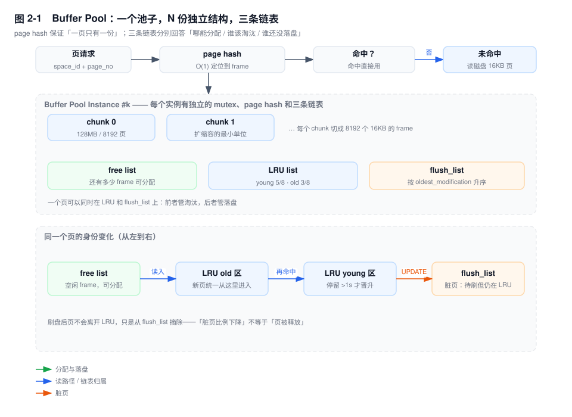
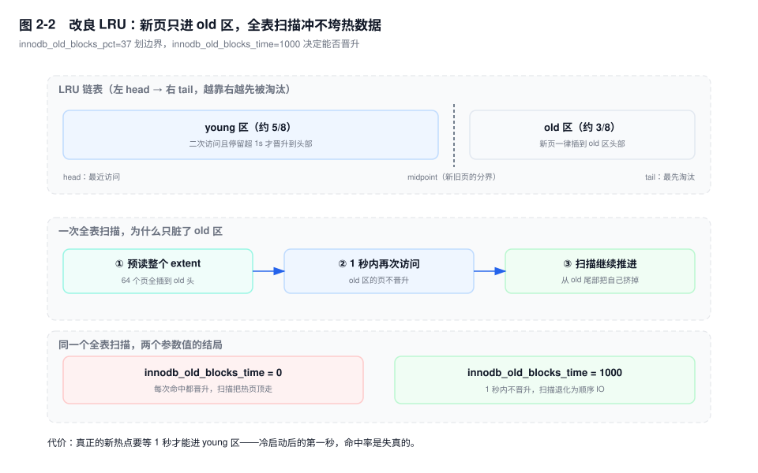
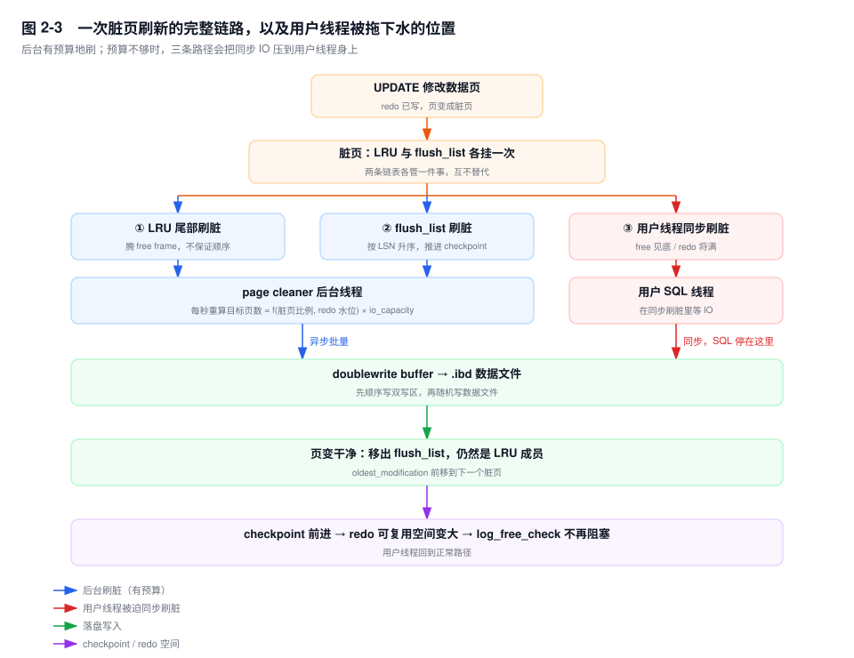

# 第 2 章　InnoDB 内存体系

> **一句话结论**：Buffer Pool 不是"一块缓存"，而是 N 个互不共享锁的小池子，加三张账本（free / LRU / flush_list）；所有"加内存反而更慢"的故事，都是这三张账本没对上。

## 2.0 场景：命中率 99.9%，P99 每 40 秒抖一次

支付回调服务接的订单库，监控面板上四个数字都很漂亮：`Innodb_buffer_pool_reads / read_requests` 算出来的命中率 99.93%，CPU 25%，磁盘 util 4%，活跃连接 30。但 `order_charge` 的写入接口 P99 每 30~60 秒从 18ms 跳到 400ms，持续两三秒又自己恢复。

值班同学的第一反应是"内存不够"，把 `innodb_buffer_pool_size` 从 32G 加到 96G，重启，观察。尖刺没有消失，反而更密了。

真正该看的三行，在 `SHOW ENGINE INNODB STATUS` 里：

```
BUFFER POOL AND MEMORY
----------------------
Free buffers            0
Modified db pages     338412

LOG
---
Log sequence number   5210987654
Last checkpoint at    2964512203
```

`Free buffers` 是 0，说明池子里一个空闲 frame 都没有了；`Modified db pages` 三十多万页，约 5G 脏页；`Log sequence number` 与 `Last checkpoint at` 差了两 G 多，checkpoint 已经贴到这块 redo 的容量底了。

把这三行和开场的两个参数对照一下就明白了。`innodb_max_dirty_pages_pct` 默认 90，是个**比例**：32G 的池子允许攒约 28G 脏页，96G 的池子允许攒约 86G。而 `innodb_io_capacity` 默认 200，是个**绝对的页数预算**——后台每秒只打算刷 200 页，折合 3.2MB。池子变大，脏页上限按比例放大，可刷脏的产能一点没变。于是脏页从"均匀涓流"变成"长期积压、集中爆发"，一旦 redo 见底，刷脏就必须在一瞬间干完积压的工作，和前台写抢同一块盘。

**调大 buffer pool 买到的是容量，不是吞吐。** 容量变大而产能不变，结果只能是排队变长、尖刺变尖。

## 2.1 一个池子，其实是 N 个池子加三张账本

`innodb_buffer_pool_size` 是总量，实际结构是三层切分：

- 先切成 `innodb_buffer_pool_instances` 个实例，默认 8（池子 ≥ 1GB 时；小于 1GB 默认 1）。
- 每个实例再按 `innodb_buffer_pool_chunk_size`（默认 128MB，**只能在启动时设置，不可动态改**）切成 chunk，chunk 是在线扩缩容的最小单位。
- 每个 chunk 切成 8192 个 16KB 的 frame，一个 frame 装一个数据页，外加一个 `buf_block_t` 控制块。

因为总量必须是 `instances × chunk_size` 的整数倍，你设的值会被自动向上取整。你写 `innodb_buffer_pool_size=10G`、instances 默认 8、chunk 128M，正好整除；写 10.5G，实际会按 11G 分配。

分实例的唯一目的是**分锁**：每个实例有独立的 `buf_pool->mutex`、独立的 page hash、独立的 free / LRU / flush_list。32 核机器上不分片，32 个线程抢同一把 mutex，读页这种极短的操作会被锁排队拖成灾难。代价是页的归属由 `page_id % instances` 硬算出来，没法自由调度，热点页仍然会压在同一个实例上——分片缓解的是"平均争用"，不是"热点争用"。



**page hash** 是 `{space_id, page_no} → frame` 的哈希表，它保证两件事：

1. **同一个页在内存里只有一份。** 没有它，两个线程可以同时把同一页读进两个 frame，各自修改各自的副本，后写的覆盖先写的，已提交的修改凭空消失。这不是性能问题，是正确性问题。
2. **查找是 O(1)。** 没有它，判断"这页在不在内存"就得遍历 LRU——96G 的池子有 600 万个 frame，每次读页扫 600 万次，物理上不可行。

**三条链表**回答三个互相独立的问题：

| 链表 | 回答的问题 | 排序依据 | 谁在维护 |
|---|---|---|---|
| free list | 还有哪些 frame 没装数据，能直接分配 | 无序 | 读页时消耗，刷脏后补充 |
| LRU list | 装了的页里，谁该被淘汰 | 访问时间（young / old 两段） | 每次访问 |
| flush_list | 哪些页是脏的，按什么顺序落盘 | `oldest_modification`（LSN）升序 | 页被修改时加入，刷盘后移除 |

一个页可以**同时**是 LRU 成员和 flush_list 成员。这是最容易搞混的一点：LRU 管"淘汰"，flush_list 管"落盘"，两件事互不替代。

**如果 InnoDB 没有 flush_list 会怎样？** checkpoint 的本质是"flush_list 上最老的那个 LSN"——它回答"崩溃后 redo 从哪个位置开始重放"。没有这张有序表，checkpoint 就只能扫描整个 LRU 找脏页，找到的 LSN 还是乱序的，算不出最老的未落盘位置。redo 空间就无法安全复用：你不知道哪些 redo 记录对应的修改已经在磁盘上了，只能全部保留，redo 会无限增长。

## 2.2 改良 LRU：新页只能从后门进

标准 LRU 有个致命问题。一次全表扫描把两千万行的页依次读进内存，每一页都是"新页"，都插到链表头，真正的热数据被一路挤到尾部淘汰。扫描结束，缓存空了，业务查询全部打到磁盘，命中率断崖式下跌。这叫**缓冲池污染**。

InnoDB 的改法是把 LRU 分成两段：

- 靠近 head 的 **young 区**，约占 5/8，是真正会被复用的热数据。
- 靠近 tail 的 **old 区**，约占 3/8，由 `innodb_old_blocks_pct` 控制（默认 37，即 37%）。
- 新读进来的页**一律插到 old 区的头部（midpoint）**，不是链表头。
- 页要在 old 区待满 `innodb_old_blocks_time`（默认 1000 毫秒），之后再次被访问，才允许晋升到 young 区头部。1 秒内的重复访问不晋升。



三条规则合起来，全表扫描的结局是这样的：预读把整个 extent 的页全塞进 old 区头部；扫描过程中同一页可能被访问两次（一次顺序读、一次回表），但只要间隔在 1 秒内，就不晋升；扫描继续往前推进，old 区尾部就是它自己刚读进来的页，于是**扫描把自己挤出去**，young 区的热数据一页没动。

把 `innodb_old_blocks_time` 改成 0，这套保护立刻失效：新页在 old 区第一次命中就晋升到 young 区头部，改良 LRU 退化成普通 LRU，一次全表扫描照样能把池子洗一遍——夜间报表扫一遍，早高峰第一分钟全部打到磁盘。有些"性能优化模板"为了"让缓存更快生效"把它设成 0，这是拿抗扫描能力换冷启动时的一点命中率，绝大多数业务不划算。

两个代价要认：

1. **真正的新热点要等 1 秒才能进 young 区。** 冷启动后的第一秒，命中率是失真的，别拿这一秒的数据做容量判断。
2. **`innodb_old_blocks_pct` 调小不等于更安全。** old 区太窄，随机读很容易把它整个冲走，反而更容易误伤；old 区太宽，等于热数据的活动空间被压缩。37 是长期压出来的平衡点。

## 2.3 预读：把"可能会用"的页提前搬进来

顺序扫描一个 1MB 的 extent（64 个页），InnoDB 不等你读完，就会异步把下一个 extent 读进来——这是**线性预读**。触发条件是同一个 extent 里已有 `innodb_read_ahead_threshold`（默认 56）个页被顺序访问。

**随机预读**是另一套判断：同一个 extent 里已经有 13 个页在池子里，就把整个 extent 拉进来。它由 `innodb_random_read_ahead` 控制，**默认 OFF**，因为它在 SSD 上几乎总是帮倒忙。

预读的价值在于把 64 次随机 IO 变成 1 次顺序 IO，机械盘上是数量级的差别。代价是它读的是"可能会用"的页：

- 读错了，这些页白占 free list，既浪费 IO 带宽，也把本来还有用的页挤出去。
- 预读的 IO 和用户请求的 IO 抢同一个队列。磁盘打满时，预读会排在用户请求前面，把单次查询的延迟进一步推高。

判断该不该关，看访问模式而不是看磁盘类型：主键是 UUID 这类完全随机、且只做单行点查的表，`innodb_read_ahead_threshold` 调到 64（要求更严格的连续访问才触发）是合理的；而按时间范围查订单、查流水这类天然顺序的访问，预读就是纯赚。

## 2.4 刷脏：两种刷法，一个预算

脏页 = 内存里的页比磁盘上的新。它一定在 flush_list 上（按 `oldest_modification` 排序），同时也一定在 LRU 上。后台刷脏有两个入口，目的完全不同：

- **LRU 刷脏**：从 LRU 尾部往前扫，遇到脏页就刷。目的是腾出 free frame，"腾得出来"就行，不保证顺序。
- **flush_list 刷脏**：从最老的 LSN 往后刷。目的是让 checkpoint 前进、释放 redo 空间，**必须有序**。

page cleaner 线程（`innodb_page_cleaners`，默认 4）每秒醒一次，算这一秒该刷多少页，用的是两个信号：

- **脏页比例**：超过 `innodb_max_dirty_pages_pct_lwm`（默认 10）开始加码，逼近 `innodb_max_dirty_pages_pct`（8.0 默认 90；`[5.7]` 默认 75）时加到最猛。
- **redo 空间占用**：超过 `innodb_adaptive_flushing_lwm`（默认 10）开始加码，越接近写满越急。

两个信号取更急的那个，换算成"每秒页数"，以 `innodb_io_capacity`（默认 200）为基准放大，上限受 `innodb_io_capacity_max`（默认 2000）约束。

这里要纠正一个普遍误解：**`innodb_io_capacity` 是后台线程每秒打算做多少次 IO，是一个预算，不是磁盘的能力上限，也不限制前台。** 设小了，脏页刷不出去，free list 见底，checkpoint 追不上 redo；设大了，page cleaner 疯狂刷脏，和前台查询抢带宽。默认 200 是给机械盘留的保守值——换到 NVMe 上还留着 200，等于让一台能跑几十万 IOPS 的机器按 200 IOPS 的节奏刷脏。

回到开场那个故障：32G 池子配 200 的预算，脏页在逼近上限之前就被 LRU 驱逐顺手刷掉了，刷脏天然均匀；96G 池子配同样的预算，脏页可以一路攒到几十 G 才开始着急，此时任何一次批量写入都会把它推过临界点。**池子越大，对 `innodb_io_capacity` 的准确性要求越高**，这两个参数是一对，不能只调一个。

## 2.5 刷脏跟不上时，用户线程被拉去当壮丁

后台刷脏有预算、有节奏，用户线程没有。当预算不够时，有三条路径会把同步 IO 直接压到 SQL 的执行路径上。



**路径一：free list 见底 → single page flush。** 用户线程要读一个新页，发现没有空闲 frame，只能自己去 LRU 尾部找可淘汰的页。如果尾部那页是脏的，它必须**同步**把这一页写盘，才能拿到 frame。这一页的 IO 延迟——云盘上正常一两毫秒，抖动时几十毫秒——原封不动加在这条 SQL 的耗时上。`innodb_lru_scan_depth`（默认 1024）是 page cleaner 每次在 LRU 尾部预留多深的可淘汰页，值太小会让 free list 长期饥饿。

**路径二：redo 空间不足 → `log_free_check()` 阻塞。** InnoDB 写 redo 之前会检查剩余空间。剩余空间低于安全水位时，用户线程不能继续写，只能等 checkpoint 前进；而 checkpoint 前进靠刷脏，于是用户线程被迫加入刷脏（源码里走 `buf_flush_sync` 这条路径）。表现是整条 SQL 在"写 redo"这一步停住，`SHOW PROCESSLIST` 看不出异常，因为阻塞发生在引擎内部。`innodb_flush_sync`（默认 ON）在这一阶段会放开 `innodb_io_capacity` 的限速——它既是救命机制，也是 IO 尖刺的直接来源。

`[8.0.30+]` redo 改成 `#innodb_redo` 目录加 `innodb_redo_log_capacity` 统一控制容量，这条路径的实现变成了等待 log writer 与 flush 事件，但"redo 空间不足会阻塞前台写"这个结论不变。

**路径三：change buffer merge。** 见 2.6。

三条路径的共同点：用户线程的时间从"等锁"变成"等自己发起的同步 IO"。等锁可以被并发掩盖——别人干完就轮到你；同步 IO 不行，IO 延迟是多少，这条 SQL 就多花多少。这就是这类问题的曲线特征：**均值不变，尾部尖刺。** 99% 的请求不需要刷脏，正常返回；1% 的请求撞上了，多花几百毫秒。

判断是不是撞上了，看一个计数器就够：

```sql
SHOW GLOBAL STATUS LIKE 'Innodb_buffer_pool_wait_free';
```

它非 0 且在持续增长，就说明有用户线程在等 free page，路径一已经在发生。

## 2.6 Change Buffer：把随机写攒成批量写

`INSERT INTO order_item` 插一行，聚簇索引按主键顺序插入，是顺序 IO；但二级索引 `idx_order_no` 的插入位置是随机的，每个受影响的索引页都要先读进来。如果这个页不在池子里，就是一次随机读加一次随机写——一行数据可能带出好几次随机 IO。

Change Buffer（老名字叫 insert buffer）的做法是：如果二级索引页不在 buffer pool 里，**先不改页**，把"要给索引 X 的页 P 插入一条记录"记进 change buffer 这棵 B+ 树，等这个页将来因为别的原因被读进内存时，再一次性合并进去。N 次随机读加 N 次随机写，变成 1 次随机读加 1 次批量写。

关键限制：**只对非唯一二级索引生效。** 原因有两层，第二层才是决定性的：

1. 唯一索引的插入必须先做唯一性检查，检查必须读真实的索引页——页已经在内存里了，直接改就是，缓存没有意义。
2. 更严重的是，如果允许缓存，两个并发事务可以同时"通过"唯一性检查，然后各自把插入记进 change buffer，主键冲突就漏过去了。**唯一性是不能被延迟的约束**，所以这条路径在实现上被直接封死。

主键（聚簇索引）同样不走 change buffer，理由一样：唯一性检查，而且聚簇索引插入通常有序，本来就不贵。

merge 发生在三个时机：① 索引页被读入 buffer pool，被动触发，最常见；② 后台线程按 `innodb_change_buffer_max_size`（默认 25，占 buffer pool 的百分比，上限 50）判断积压压力，主动 merge；③ `innodb_fast_shutdown=0` 的干净关机，全量 merge。

代价有三个：

- change buffer 本身是一棵 B+ 树，存在系统表空间里，自己也要占内存和 IO。
- **merge 是随机 IO，而且往往在你最不希望的时候发生**：一次大范围扫描把大量二级索引页读进内存，触发批量 merge，IO 瞬间打满。这是"白天跑报表把库跑挂"的典型机制之一。
- 崩溃恢复要重放 change buffer 的记录，恢复时间变长。

观察位置是 `SHOW ENGINE INNODB STATUS` 的 `INSERT BUFFER AND ADAPTIVE HASH INDEX` 段：

```
Ibuf: size 1, free list len 0, seg size 2, 0 merges
```

`merges` 是累计合并次数，`size` 反映当前积压量。这个数字涨得快，说明 change buffer 在膨胀，接下来要么 merge 风暴，要么恢复变慢。

## 2.7 Log Buffer：redo 在内存里的那一站

redo 不是直接写文件的，先写进 log buffer（`innodb_log_buffer_size`，默认 16MB），再由 `innodb_flush_log_at_trx_commit` 决定什么时候进文件、什么时候 fsync。

三档的真实语义是面试最爱考、也最容易背错的地方：

| 值 | commit 时做什么 | 后台每秒做什么 | mysqld 崩溃 | 机器掉电 |
|---|---|---|---|---|
| `1` | write + fsync | — | 不丢 | 不丢（前提是磁盘写缓存有掉电保护） |
| `2` | write | fsync | 不丢 | 丢最近 1 秒 |
| `0` | 什么都不做 | write + fsync | 丢最近 1 秒 | 丢最近 1 秒 |

**write 和 fsync 是两件事。** write 只是把数据从 MySQL 的 log buffer 交给操作系统的 page cache，fsync 才让数据真正落到持久介质。`=2` 之所以"进程崩溃不丢"，是因为数据已经在 OS 手里，mysqld 死了 OS 还活着。

性能差别全在 fsync 上。`=1` 的每次 commit 都要一次磁盘往返，延迟下限就是磁盘的 fsync 延迟：NVMe 上几十到几百微秒，云盘上可能 1~5 毫秒。这段延迟无法被并发掩盖（同一时刻只有一个有效 fsync），只能靠**组提交**摊薄——多个事务的 fsync 合并成一次。所以 `=1` 的吞吐不等于 `1 / fsync 延迟`，高并发下会好得多。`binlog_group_commit_sync_delay` 就是拿延迟换吞吐的旋钮，它和 redo 的组提交是同一套思路。

log buffer 写满时会强制 write（不 fsync），所以大事务、大批量导入会频繁触发 log buffer 溢出写。注意这只是"腾地方"，不是持久化；真正的持久化点仍然只有 commit 那一次 fsync。`[8.0.22+]` 的 `innodb_log_writer_threads`（默认 ON）把写 log buffer 的活交给专门的 log writer 线程，用户线程只负责把 LSN 交给它、等 `flushed_to_disk_lsn` 追上来，高并发下省掉了大量自旋。

和 2.5 的联动在这里：`[8.0.30]` 之前 redo 总容量由 `innodb_log_file_size × innodb_log_files_in_group` 决定，容量越小，checkpoint 越被逼着前进，脏页压力越大。**redo 太小和 buffer pool 太大，是同一个故障的两张脸。**

## 2.8 Adaptive Hash Index：一笔需要算清楚的交易

AHI 的触发条件是同一个索引页被以相同的搜索模式反复访问（等值查找为主）。满足条件后，InnoDB 在这个页上建一个 hash 索引，把"从 B+ 树根走到叶子"（3~4 次页内二分）压缩成一次 hash 查找。它是**页级**的，挂在具体索引上，不是表级缓存。

`innodb_adaptive_hash_index` 默认 ON，`innodb_adaptive_hash_index_parts` 默认 8，把 `btr_search_latch` 拆成 8 把以降低争用。

争议从 8.0 之后变大，原因不是它变差了，而是硬件变了：

1. **锁的代价超过了省下的计算。** 查询命中 AHI 要拿读锁，建/删 hash 条目要拿写锁。高并发等值查询下，这把锁本身成为瓶颈——你为了省几次页内二分，付出的是一把全局锁的争用。CPU 越快，页内二分越便宜，这笔交易越不划算。
2. **命中条件太窄。** 只有完全相同的搜索模式才算命中，范围查询、`LIKE '%x'`、`ORDER BY` 全都用不上。OLTP 里等值查询多的时候看起来很美，一旦有混合负载，收益立刻打折。
3. **维护成本真实存在。** 页分裂、页合并、purge 都要同步维护 hash 条目。

实践判断：sysbench point-select 这类纯等值压测，关掉 AHI 常常吞吐更高——锁争用省下来的比页内二分省下来的多。混合负载下开着也无妨。**它不是"开了就快"的开关，是一笔交易**，要用数据决定，不要用直觉决定。

命中率看 `INSERT BUFFER AND ADAPTIVE HASH INDEX` 段的 `Hash searches/s` 与 `Non-hash searches/s`，后者占比越高，说明 AHI 越没派上用场。

## 2.9 实例数、在线 resize，以及重启后的第一分钟

`innodb_buffer_pool_instances` 决定分片数，不决定总大小。调大有代价：每个实例独立统计 LRU，实例越多，单个实例越薄，热点页固定映射到某个实例（`page_id % instances`），很容易出现"一个实例满了、七个实例闲着"。除非压测过，别动默认的 8。

在线 resize 是动态的（`SET GLOBAL innodb_buffer_pool_size`），按 chunk 增删：

- **扩容**基本无痛：分配新 chunk、加进 free list。唯一的风险是内存分配本身的抖动，以及跨 NUMA node 分配带来的远端访存延迟。
- **缩容是一次 IO 风暴**：要先把 chunk 里的页驱逐出去，脏页必须先刷盘。高峰期做缩容，等于自己制造一次 2.5 里描述的所有尖刺。
- 进度看 `innodb_buffer_pool_resize_status`（`[5.7]`~`[8.0.30]`）；`[8.0.31+]` 拆成 `innodb_buffer_pool_resize_status_code` 和 `innodb_buffer_pool_resize_status_progress`。

重启后的第一分钟，池子是半冷的，这有明确的机制：`innodb_buffer_pool_dump_at_shutdown`（8.0 默认 ON）在关机时把内存里的页号 dump 到 `ib_buffer_pool` 文件，`innodb_buffer_pool_load_at_startup`（默认 ON）在启动后异步加载回来。但 `innodb_buffer_pool_dump_pct` 在 `[8.0]` 的默认值是 25——**只 dump 最近使用的四分之一**，另外四分之三靠自然访问慢慢填。

这就是"重启后前几分钟慢"的完整解释，不是玄学。加载进度看 `innodb_buffer_pool_load_status`；加载是异步的、会抢 IO，滚动重启时要错峰，别让新实例的预热 IO 打在和旧实例的流量同一个时间窗里。

## 2.10 关键结论

1. **三条链表回答三个不同问题**：free list 管"哪里能分配"，LRU 管"谁该淘汰"，flush_list 管"谁还没落盘、按什么顺序落"。把三者混为一谈，就会得出"脏页多说明内存不够"这种方向相反的结论。
2. **命中率高不代表健康。** 命中率只统计读路径；写路径的健康度要看 `Free buffers`、`Modified db pages`、checkpoint age 三个数。99.9% 命中率加 free list 见底，是完全可能同时出现的组合。
3. **`innodb_max_dirty_pages_pct` 是比例，`innodb_io_capacity` 是绝对页数。** 池子调大而 IO 预算不变，允许积压的脏页绝对量成倍增长，刷脏从涓流变成爆发。这两个参数必须一起调。
4. **全表扫描不会冲垮热数据，前提是 `innodb_old_blocks_time` 没被改成 0。** 改成 0，midpoint 插入的保护立刻失效，改良 LRU 退化成普通 LRU。
5. **用户线程被迫同步刷脏只有三个入口**：free list 见底、redo 空间不足、change buffer merge。共同特征是"均值不变、尾部尖刺"，看到这种曲线先查 `Innodb_buffer_pool_wait_free`。
6. **唯一索引不能用 change buffer，因为唯一性检查不能被延迟。** 这是正确性约束，不是实现偷懒。

## 2.11 实验验证

### 实验一：把命中率算出来，而不是猜

```sql
SELECT ROUND((1 - r.v / q.v) * 100, 2) AS hit_rate_pct
FROM (SELECT CAST(VARIABLE_VALUE AS DECIMAL(20,0)) AS v
      FROM performance_schema.global_status
      WHERE VARIABLE_NAME = 'Innodb_buffer_pool_reads') r,
     (SELECT CAST(VARIABLE_VALUE AS DECIMAL(20,0)) AS v
      FROM performance_schema.global_status
      WHERE VARIABLE_NAME = 'Innodb_buffer_pool_read_requests') q;
```

预期形态（`# 输出形态（未实跑，字段含义以此为准）`）：

```
+---------------+
| hit_rate_pct  |
+---------------+
| 99.93         |
+---------------+
```

`innodb_buffer_pool_reads` 是物理读（真的落到磁盘），`read_requests` 是逻辑读（向池子要页的次数）。这个比值只覆盖读，对写路径一无所知——这正是它最容易被误用的地方。

### 实验二：看三条链表的水位

```sql
SELECT POOL_ID, POOL_SIZE, FREE_BUFFERS, DATABASE_PAGES,
       OLD_DATABASE_PAGES, MODIFIED_DATABASE_PAGES, HIT_RATE
FROM information_schema.INNODB_BUFFER_POOL_STATS;
```

预期形态（`# 输出形态（未实跑，字段含义以此为准）`）：

```
POOL_ID  POOL_SIZE  FREE_BUFFERS  DATABASE_PAGES  OLD_DATABASE_PAGES  MODIFIED_DATABASE_PAGES  HIT_RATE
      0       7680             0            7680                2841                     2410       998
      1       7680             3            7677                2790                     2207       999
```

读法：

- `FREE_BUFFERS` 长期接近 0，且 `MODIFIED_DATABASE_PAGES` 很高 → 池子满了且脏页多，刷脏压力压在 LRU 上。
- `OLD_DATABASE_PAGES / DATABASE_PAGES` 应接近 `innodb_old_blocks_pct` 的 37%。远高于这个比例，说明 old 区长期堆着冷数据没被淘汰，通常是池子远大于真实工作集。
- `HIT_RATE` 是按千分比给的（1000 = 100%），且是 per-instance 的，不要直接拿去和全局命中率对比。

`information_schema.INNODB_BUFFER_PAGE` 能精确到页，但它要遍历整个 buffer pool 并持有 mutex，几十 G 的池子上执行会把业务卡住，线上慎用。

### 实验三：制造脏页，看 checkpoint 落后多少

```sql
-- 会话 A：写 20 万行，制造脏页
INSERT INTO order_charge (order_no, amount, status, created_at)
SELECT CONCAT('T', n), RAND() * 1000, 0, NOW()
FROM (SELECT @row := @row + 1 AS n FROM information_schema.columns a,
      information_schema.columns b, (SELECT @row := 0) t LIMIT 200000) x;

-- 另一个会话：不刷脏，只看账本
SHOW ENGINE INNODB STATUS\G
```

只看 `LOG` 段四行：

```
Log sequence number          3210987654
Log flushed up to            3210987654
Pages flushed up to          2964512203
Last checkpoint at           2964512203
```

`Log sequence number - Last checkpoint at` 就是 checkpoint age。`[8.0.30]` 之前它逼近 redo 总容量时，前台写会被 `log_free_check()` 拦住；8.0.30 之后由 `innodb_redo_log_capacity` 决定水位，现象一样，实现不同。

### 实验四：让 change buffer 现形

```sql
SHOW VARIABLES LIKE 'innodb_change_buffering';   -- 默认 all
SHOW ENGINE INNODB STATUS\G
-- 找 INSERT BUFFER AND ADAPTIVE HASH INDEX 段
```

预期形态（`# 输出形态（未实跑，字段含义以此为准）`）：

```
INSERT BUFFER AND ADAPTIVE HASH INDEX
-------------------------------------
Ibuf: size 4182, free list len 37, seg size 4220, 1204 merges
Hash table size 34679, node heap has 12 buffer(s)
0.00 hash searches/s, 0.00 non-hash searches/s
```

`size` 涨得快说明积压在增加；把 `innodb_change_buffering` 改成 `none` 再跑同样的写入，`Ibuf` 归零，但每次二级索引插入都要真读页——写放大上升，随机读次数直接反映在 `Innodb_buffer_pool_reads` 的增长上。

## 2.12 常见误区

⚠️ **"命中率 99.9%，说明 buffer pool 够大"**
命中率是分子分母同时缩小的比值。热工作集只有 2G 时，给 4G 和给 96G 都能到 99.9%，这个数字对容量规划几乎没有指导意义。该看的是 `FREE_BUFFERS`（还有没有余量）和 `innodb_buffer_pool_reads` 的**绝对次数**（每秒还在打多少次盘）。

⚠️ **"buffer pool 调大一定更快"**
调大改变的是"能装多少"，不改变"刷得出去多少"。`innodb_io_capacity`、`innodb_max_dirty_pages_pct`、redo 容量三个不跟着动，池子变大只会让脏页积压的绝对量变大，刷脏从均匀涓流变成周期性爆发，P99 反而恶化。

⚠️ **"脏页多说明内存不够，该加内存"**
脏页多是"产生速度 > 刷脏速度"，是 IO 预算问题。加内存会把 `innodb_max_dirty_pages_pct × 池子` 这个阈值绝对值推高，短期看起来"不告警了"，实际是把爆点往后推，推得越远炸得越响。

⚠️ **"`innodb_flush_log_at_trx_commit=2` 和 `=1` 差不多"**
差在 fsync。`=2` 在进程崩溃时不丢（数据在 OS page cache），机器掉电丢最近 1 秒；`=1` 每次 commit 一个磁盘往返。云盘上这个往返 1~5ms，直接决定单事务 TPS 的上限。

⚠️ **"change buffer 会加速所有索引的写入"**
只对非唯一二级索引有效。唯一索引的插入必须做唯一性检查，必须读真实页；主键也不用。表上全是唯一索引，`innodb_change_buffer_max_size` 调多大都是白调。

⚠️ **"redo 是日志，跟内存没关系"**
redo 写在 log buffer 里，log buffer 的大小和刷盘时机决定了组提交的效率；redo 的**容量**决定了 checkpoint 被逼着前进的频率，进而决定脏页压力。redo 容量、buffer pool 大小、`innodb_io_capacity` 是同一道题的三个变量。

## 2.13 生产 Checklist

- [ ] `innodb_io_capacity` / `innodb_io_capacity_max` 是否还停在 200 / 2000？底层是 SSD/NVMe 的话，这两个值大概率低了一个数量级
- [ ] `Innodb_buffer_pool_wait_free` 是否长期为 0？非 0 且增长，就是用户线程在同步刷脏
- [ ] `FREE_BUFFERS` 是否长期接近 0？是的话先看脏页比例，再判断池子是不是真的不够
- [ ] `Modified db pages / 总页数` 是否长期高于 `innodb_max_dirty_pages_pct` 的一半？是的话刷脏预算不足
- [ ] checkpoint age 是否长期超过 redo 容量的 3/4？超了该加 redo 容量，不是加 buffer pool
- [ ] `innodb_old_blocks_time` 是否被改成 0？改成 0 等于放弃抗扫描保护
- [ ] 核心表的索引是否全是唯一索引？是的话 change buffer 完全用不上，写入放大没有缓冲
- [ ] `innodb_buffer_pool_dump_pct` 是多少？默认 25 意味着重启后四分之三的池子要重新预热
- [ ] 有没有计划中的 buffer pool 缩容？缩容是 IO 风暴，不能和业务高峰重叠
- [ ] `innodb_buffer_pool_size` 是否是 `instances × chunk_size` 的整数倍？不是的话实际值和你以为的不一样

## 2.14 延伸

- **上一章**：第 1 章（一条 UPDATE 在引擎里到底经过了谁）
- **下一章**：第 3 章（数据页在磁盘上长什么样——16KB 这个单位决定了刷脏和预读的粒度）
- **关联章节**：第 4 章（redo 与 checkpoint，2.5 的另一半）、第 7 章（崩溃恢复与 doublewrite）、第 9 章（索引设计：唯一索引与 change buffer 的取舍）、第 21 章（长事务如何拖住 purge 与脏页回收）、第 39 章（`SHOW ENGINE INNODB STATUS` 逐段精读）、第 40 章（参数与操作系统层调优）
- **面试追问**：
  - "buffer pool 里一个页最多同时在几张链表上？" → 两张：LRU 加 flush_list。free list 上的 frame 没有页。
  - "为什么 change buffer 不支持唯一索引？" → 唯一性检查必须读真实页；允许延迟检查会让两个事务同时通过。
  - "`innodb_flush_log_at_trx_commit=2` 会丢数据吗？" → 进程崩溃不丢，机器掉电丢最近 1 秒。
  - "命中率 99.9%，P99 为什么还抖？" → 命中率只统计读，抖动来自写路径的同步刷脏。
- **官方文档**：`InnoDB Buffer Pool`、`Configuring InnoDB Buffer Pool Size`、`InnoDB Change Buffer`、`InnoDB Adaptive Hash Index`、`innodb_flush_log_at_trx_commit`
