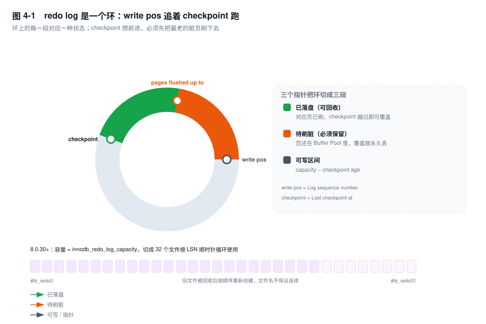
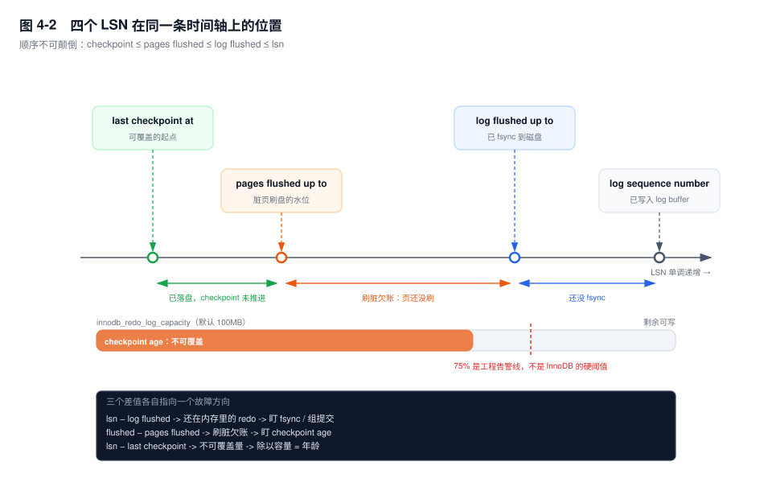
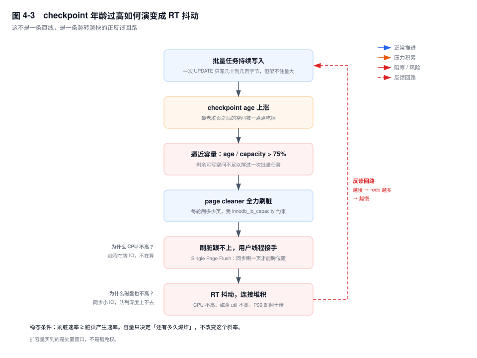

# 第 4 章　Redo Log：WAL 与持久化

> **一句话结论**：redo log 不是"让写变快"的缓存，而是一张欠条——把"随机刷 16KB 页"换成"顺序追加几十字节"；checkpoint 是这张欠条的还款进度，欠条到期还不上，用户线程就得放下 SQL 自己去还。

## 4.0 场景：凌晨两点，CPU 和磁盘都不忙，全站却抖了

凌晨两点零五分，结算批量任务跑到一半，告警响了：核心下单接口 P99 从 35ms 涨到 900ms，持续 11 分钟后自己恢复。

值班的人拉了三张图，每一张看起来都"没事"：

- CPU 使用率 18%，比白天还低；
- 磁盘 util 41%，await 不到 2ms，IOPS 只有峰值的三分之一；
- QPS 掉了三成，连接数涨了一倍，`Threads_running` 从 8 跳到 60。

没有慢 SQL，没有锁等待，没有主从延迟。直到有人把 `SHOW ENGINE INNODB STATUS` 的 LOG 段贴出来：

```text
Log sequence number          1845493760
Log flushed up to            1845493760
Pages flushed up to          1753219072
Last checkpoint at           1753219072
# 输出形态（未实跑，字段含义以此为准）
```

第一行减第四行，九千多万字节。按 100MB 的 `innodb_redo_log_capacity` 算，**checkpoint 年龄已经到了 88%**。

redo 快没地方写了。于是 InnoDB 让 page cleaner 全力刷脏页，刷不过来的时候，正在执行 SQL 的用户线程被拉去同步刷页——它不是在算，是在等一个 16KB 的随机写。CPU 当然不高，磁盘队列也很浅，但每一条 SQL 的响应时间都被这段等待吃掉了。

这就是本章要讲透的因果链：**redo 容量 → checkpoint 推进速度 → 刷脏压力 → 用户线程同步刷脏 → RT 抖动**。它在生产上出现的频率极高，又极容易被误判成"数据库没问题，是网络抖动"。

## 4.1 WAL 的本质：把随机写换成顺序写，把代价推给恢复

先算一笔账。

Buffer Pool 里一个页是 16KB。一次 `UPDATE` 改一行，可能只动了 3 个字节，但要让这个修改持久化，最直接的做法是把整个 16KB 页写回磁盘。这条路有三个躲不开的问题：

- 页在磁盘上的位置由主键决定，相邻两次更新大概率落在两个不相邻的页上，这是**随机写**；
- 同一个页在一个事务里可能被改十几次，每次提交刷一遍，就是十几次 16KB，这是**写放大**；
- 16KB 的写在掉电时不是原子的，会留下半新半旧的页（partial write），还得靠 doublewrite 再兜一层（第 7 章）。

redo 把这件事整个换掉了：提交时不碰数据页，只往一个只追加的文件尾部写一条"我对哪个页做了什么修改"的记录，通常几十到几百字节，然后 `fsync`。追加写是**顺序写**，磁头不用来回跑；更关键的是，多个并发事务的 redo 可以攒在一起，一次 `fsync` 全部落盘，这就是组提交。

所以"redo 让 MySQL 快 100 倍"这句话，机制上应该改写成：**把 N 次随机的 16KB 写 + N 次 fsync，换成 1 次顺序小写 + 1 次 fsync**。快的不是磁盘，是要写的字节数和寻道次数都少了一到两个数量级。

代价是：**磁盘上的数据页随时可能是旧的**。这个"旧"必须有人收拾，收拾的人就是崩溃恢复——重启后从 checkpoint 开始，把 redo 里的修改重新应用到数据页（第 7 章）。WAL 不是免费的把戏，它只是把"现在必须做完的随机写"推迟成"将来可能要做的一批顺序读加随机写"。**推迟的前提是日志还在**，所以 redo 的容量和回收速度，直接决定了这个推迟能推多久。这就是 4.6 节那条雪崩链的源头。

### 它不是逻辑日志，是 physiological

面试里最常见的错误回答是"redo 是逻辑日志，记录的是'把 id=5 的 c 改成 6'"。不是。

InnoDB 的 redo 是 **physiological（物理逻辑）** 日志，两层含义各占一半：

- **页级物理**：每条记录都用 `space id + page no` 精确定位到某一个页，恢复时不需要"再执行一遍 SQL"，也不需要重新走优化器；
- **页内逻辑**：记录的是"在这个页的第几个记录槽插入一条什么样的记录""把这条记录的某个字段从 A 改成 B"，而不是"把页内偏移 128 处的 4 个字节写成 06"。

为什么必须是这个折中？纯逻辑（记录 SQL 或行变更的语义）重放时不确定：`NOW()`、自增、执行计划变化都会让重放结果和主库不同。纯物理（页镜像）日志量又太大，而且页内记录一旦移动，绝对偏移就失效了。physiological 的做法是：**用物理地址找到页，用逻辑描述改页**，重放时在页内重新定位插入点，所以既能保证确定性，记录又足够小。

这个设计带来一个必须知道的推论：**redo 的重放依赖页的当前状态**。同一个页上，先插入、再删除，两条 redo 记录都必须按顺序重放，不能跳。所以 redo 是严格串行的一条流，这也是"LSN 单调递增"的物理来源。

为了让重放可以中断后继续，每个数据页的页头都有一个 `FIL_PAGE_LSN`，记录"最后一次修改这个页的 redo 的 LSN"。恢复时只重放 `page_lsn < redo_lsn` 的记录——这保证了重放是**幂等**的：同一段 redo 应用两次，结果一样。

## 4.2 物理结构：512 字节的块，和一个环

redo 在磁盘上不是一个"大文件"，而是一串 512 字节的**日志块（log block）**。选 512 不是随便定的：它对齐传统磁盘扇区，保证单块的写入在硬件层面尽量原子，一块要么完整、要么不完整，不会出现"半块"这种无法判断的状态。

每个块的结构是固定的：

| 区域 | 大小 | 内容 |
|---|---|---|
| header | 12B | 块号、本块数据长度、第一个记录组在本块内的偏移、checkpoint 号 |
| data | 最多 496B | 一条或多条 redo 记录，可以跨块 |
| trailer | 4B | checksum |

一条 redo 记录可以跨块，但一个块里不会混入"上一个文件"的数据。checksum 的作用是在恢复时识别坏块——如果某一块校验失败，恢复只能停在这块之前，因为再往后的记录可能依赖它。

每个 redo 文件的**前 2048 字节（4 个块）是头部区**：存格式版本、文件号，以及**两份 checkpoint**。checkpoint 写两份的原因很朴素：写 checkpoint 这个动作本身也可能崩溃，两份交替写、带各自的 checksum，恢复时挑校验通过且更靠后的那份。这是 InnoDB 里反复出现的套路——**任何"恢复入口"都必须自己能容错**。

然后是环形复用。所有 redo 文件在逻辑上是一个环，LSN 是一个只增不减的字节偏移，物理位置等于 `LSN mod 总容量`。写满一圈就回到起点覆盖最老的记录——前提是那段记录对应的脏页已经刷盘，不再需要它。



图 4-1 里有两个指针，是整个章节的骨架：

- **write pos**：当前写到哪了，等于 `Log sequence number`；
- **checkpoint**：最老的、还不能被覆盖的 redo 位置，等于 `Last checkpoint at`。

从 checkpoint 顺时针到 write pos，是"已经被写过、但还不能覆盖"的区域；从 write pos 顺时针回到 checkpoint，是"空着的、可以写"的区域。**可写空间 = 容量 − (write pos − checkpoint)**，后者就是 checkpoint age。

这个区域里还要再切一刀，切点在 `Pages flushed up to`：它之前的 redo，对应的数据页已经落盘，理论上可以回收；它之后的 redo，对应页还在 Buffer Pool 里脏着，一旦覆盖就永久丢失。所以 checkpoint 想往前走，必须先让 page cleaner 把最老的那批脏页刷下去。**checkpoint 推进的速度，本质上等于刷脏的速度**，这句话是理解 4.6 节的全部前提。

### [8.0.30+] 从"两个大文件"到"32 个文件"

8.0.30 之前，redo 的容量由两个参数共同决定：`innodb_log_file_size`（每个文件多大）× `innodb_log_files_in_group`（几个文件），默认 48MB × 2 = 96MB。改容量必须停机改配置、重启，中间还要经历一次"删旧文件、建新文件"的过程。

8.0.30 起换成单个参数 `innodb_redo_log_capacity`，默认 100MB，可以在线调整。容量被切成 **32 个文件**（`#ib_redo0` ~ `#ib_redo31`），按 LSN 顺序循环使用。

为什么要拆成 32 份而不是一个大文件？因为**扩容和回收的粒度变小了**。旧模型下加容量意味着重建整个日志空间；新模型下可以按文件粒度创建、删除、resize，在线调整时只需要处理边界上的那几个文件。另一个副作用是文件系统层面的：单个几百 GB 的文件在备份、拷贝、稀疏文件管理上都更难伺候。

⚠️ 版本红线：8.0.30 起 `innodb_log_file_size` 和 `innodb_log_files_in_group` 已被标记为废弃，**配置了也不再生效**，容量只看 `innodb_redo_log_capacity`。升级后如果监控脚本还在采集前两个参数，会读到一个"看起来正常但完全无关"的值——这是升级后容量评估出错的常见原因。

## 4.3 四个 LSN：把"卡在哪"变成一道减法

`SHOW ENGINE INNODB STATUS` 的 LOG 段有四个值，任何人第一次看都会觉得它们长得一样。其实它们是一条流水线上的四个工位：

| 字段 | 含义 | 通俗说法 |
|---|---|---|
| `Log sequence number` | 已经写进 log buffer 的最大 LSN | 活干到哪了 |
| `Log flushed up to` | 已经 `write` + `fsync` 到磁盘的 LSN | 账记到哪了 |
| `Pages flushed up to` | 脏页刷盘的水位：小于它的修改都已落盘 | 页刷到哪了 |
| `Last checkpoint at` | 可以安全覆盖的起点 | 旧账销到哪了 |

它们之间有一条铁律，任何时刻都成立：

```text
Last checkpoint at  ≤  Pages flushed up to  ≤  Log flushed up to  ≤  Log sequence number
```

顺序不能乱：checkpoint 不可能越过已刷的页，已刷的页不可能越过已持久化的 redo（否则重放时找不到依据），已持久化的 redo 不可能超过已生成的 redo。



图 4-2 把这条轴上的三段分别标了出来，每一段对应一个独立的故障方向：

**第一段：`Log sequence number − Log flushed up to`。** 还在内存里的 redo——包括 log buffer 里没交出去的，和已经 `write` 进 OS page cache 但还没 `fsync` 的。这段持续变大，说明**落盘跟不上生成**：磁盘 `fsync` 慢、组提交没生效、或者 `innodb_log_writer_threads` 的 flusher 线程被卡住。这时候业务的表现是提交变慢，而不是查询变慢。

**第二段：`Log flushed up to − Pages flushed up to`。** 已经安全落盘、但对应的数据页还没刷的 redo，我把它叫**刷脏欠账**。这段是 checkpoint age 的主体，也是本章的主角。它变大意味着：日志已经安全了，但磁盘上的数据文件越来越旧，一旦崩溃，恢复要重放的东西越来越多。

**第三段：`Pages flushed up to − Last checkpoint at`。** 页已经刷了，checkpoint 还没来得及推进。这段通常很小，因为 checkpoint 的推进只是改一个数字，几乎不花代价。如果这段异常大，说明 checkpoint 的推进被别的东西挡住了（比如正在等一个更老的页）。

所以诊断顺序是固定的，从右往左看：

1. 先看 `lsn − flushed`，大 → 问题在**写日志**，去查磁盘和组提交；
2. 再看 `flushed − pages`，大 → 问题在**刷脏**，去查 `innodb_io_capacity` 和脏页比例；
3. 最后看 `lsn − checkpoint` 除以容量，这就是 checkpoint 年龄，决定"还有多久爆炸"。

[8.0.30+] 之后 LOG 段还多了三个更细的值：`Log buffer assigned up to`（已预留空间）、`Log buffer completed up to`（已拷贝完成）、`Log written up to`（已 `write`）。`assigned − completed` 是"有线程正在往里拷"，`completed − written` 是"等着 writer 线程取走"。高并发下这两个差值能直接告诉你瓶颈在拷贝还是在下盘。

## 4.4 写入链路：log buffer → write() → fsync()

一条 redo 从产生到落盘，经过三次交接，每一次失败的原因都不一样。

**第一段：内存里的 log buffer。** 事务修改页时，mini-transaction 提交会把 redo 记录拷进 `innodb_log_buffer_size`（默认 16MB）的 log buffer。它不是"攒够一批再写"的批处理队列，而是**落盘前的暂存区**——事务提交时必须把它交出去。

8.0.30 之前，往 log buffer 里拷数据要拿一把全局的 `log_sys` mutex。高并发写入时这把锁是实打实的热点，`SHOW ENGINE INNODB STATUS` 的 SEMAPHORES 段能看到大量 `os_waits`。8.0.30 起改成**无锁写入**：每个线程用原子操作在 buffer 里预留一段空间，用一组 link buffer 记录"哪些区间已经连续完成"，只有推进 tail 指针时才需要协调。结果是写入者之间不再互相排队，只有"谁先完成"的顺序需要维护。

**第二段：`write()` 到 OS page cache。** 这一步把用户态的 buffer 拷进内核页缓存。它很快，但**不等于落盘**——数据只是从"mysqld 的内存"搬到了"操作系统的内存"。机器一掉电，这一段全丢。

**第三段：`fsync()` 到磁盘。** 这一步才真正把数据交给存储设备。它慢，慢在等待设备确认；而它的成本可以被**组提交**摊薄：10 个事务同时提交，不需要 10 次 `fsync`，只需要 1 次——把 10 个事务的 redo 都写进去，一次刷完，10 个事务一起返回。

`innodb_log_writer_threads`（8.0.22+，默认 ON）把这三段拆给专职线程：用户线程只负责把 redo 放进 buffer 然后等通知，`log_writer` 负责 `write`，`log_flusher` 负责 `fsync`，两个 notifier 负责唤醒等待者。好处是 `fsync` 可以攒批、可以跨事务合并；代价是多了一次线程唤醒。

这里有一个真实的取舍：**低并发单线程写入时，关掉 `innodb_log_writer_threads` 可能更快**。因为只有一个事务在跑，攒批没有收益，专职线程反而多了一次上下文切换。这个参数不是"开了就快"，它的收益正比于并发度。判断依据是 `Threads_running` 和实际 TPS：并发上不去、TPS 又卡在 fsync 上，才值得关掉试。

binlog 的组提交是另一套（flush / sync / commit 三阶段），它和 redo 的组提交通过内部 XA 对齐，细节见第 6 章；两阶段提交的时序见第 1 章 1.3，这里不重复。

## 4.5 三档参数：丢什么，取决于谁先死

`innodb_flush_log_at_trx_commit` 只有三个取值，但它描述的其实是"提交这个动作，愿意付出多少 IO 代价"。

| 取值 | 提交时做什么 | 实例崩溃（`kill -9` / OOM） | OS 崩溃（panic / 硬重启） | 整机掉电 |
|---|---|---|---|---|
| `1`（默认） | `write` + `fsync` | 不丢 | 不丢 | 不丢（写缓存有掉电保护时） |
| `2` | 只 `write`，不 `fsync` | 不丢 | 丢最近约 1 秒 | 丢最近约 1 秒 |
| `0` | 提交时什么都不做 | 丢最近约 1 秒 | 丢最近约 1 秒 | 丢最近约 1 秒 |

三档的差别，本质是"数据停在哪一层内存"：

- `=1`：数据已经过了 `fsync`，在磁盘（或阵列的持久缓存）上。进程死、系统死都不影响。
- `=2`：数据在 OS page cache 里。**进程死不掉**——`mysqld` 没了，内核还在，页缓存还在，重启后文件里就是新数据。**系统死就丢**——内核页缓存随内存一起消失。后台每秒做一次 `fsync`，所以最多丢约 1 秒。
- `=0`：数据还在 `mysqld` 自己的 log buffer 里。进程一死就没了，连 OS 都救不了。同样是每秒刷一次，丢的窗口也是约 1 秒。

OS 崩溃和整机掉电，在 redo 这三档上丢的东西是一样的——两者都会丢内存。它们的差别在**硬件那一层**：OS 崩溃时磁盘供电还在，盘上的写缓存还有机会自行落盘；整机掉电时，写缓存里的东西也一起没了。所以 `=1` 的"不丢"在整机掉电场景下还要再问一句：磁盘 / RAID 卡的写缓存有没有掉电保护。这就是为什么同一个 `=1`，在有 BBU 的物理机上成立，在某些云盘上要打问号。

"约 1 秒"是个**上限估计，不是一个保证**。它成立的前提是后台刷盘线程正常调度。如果磁盘 hang 住、或者实例被 cgroup 限流导致刷盘线程饿死，这个窗口会被拉长到几十秒——`=2` 的"最多丢 1 秒"在故障现场经常变成"丢了 40 秒"。所以容量规划时不要把 1 秒当成 SLA，要当成"最好情况"。

还有一个更隐蔽的坑：`fsync` 返回成功，不代表数据一定在持久介质上。如果 RAID 卡 / 云盘的写缓存没有掉电保护，这次 `fsync` 只是把数据推进了缓存。**"不丢"是三层叠加的结果：MySQL 参数 + OS 配置 + 硬件写缓存策略**，缺一层都不成立。这也是为什么金融场景除了双 1 配置，还要做掉电演练。

`=2` 还有一个常被忽略的副作用：掉电丢的可能不只是"最近 1 秒的事务"。如果脏页已经刷到了数据文件，而保护它们的 redo 还在 page cache 里没落盘，重启后数据文件里会出现一段 redo 无法解释的修改。这种时候恢复可能直接失败，只能靠备份。所以 `=2` 换来的性能，抵押的不只是 1 秒的数据，还有"可恢复性"本身。

## 4.6 redo 写满：一条从容量到 RT 的因果链

现在回到 4.0 的场景，把这条链一环一环拆开。



**第一环：redo 的生成速度超过了刷脏速度。** 批量任务每秒更新几万行，每行产生几十到几百字节 redo，按量级估算就是每秒几 MB 的 redo。这些修改同时把大量页变成脏页，脏页的产生速率和 redo 的生成速率是同一个数量级。

**第二环：checkpoint 被推着往前走，但走不动。** checkpoint 只能推进到"最老脏页"的位置。page cleaner 每轮刷多少页，由脏页比例和 `innodb_io_capacity`（默认 200）共同决定，而这个值描述的是"磁盘每秒能做多少次 IO"，不是"磁盘有多大带宽"。如果它配得比云盘的真实 IOPS 低，刷脏速度就被硬性限死了；如果配得比真实能力高，刷脏请求会在设备层排队，`await` 飙升。两头都不对。

**第三环：剩余空间见底。** `容量 − checkpoint age` 越来越小，小到不足以撑过一次批量任务。这时候 InnoDB 只有两个选择：让写 redo 的线程等，或者让刷脏更快。

**第四环：用户线程被征用。** 这是最关键的一步，也是"CPU 和磁盘都不高"的原因。用户线程在两个地方会被拉去做 IO：

- 需要读入一个新页、但 free list 空了，它必须**同步刷一个脏页**腾位置（Single Page Flush）；
- 需要为 redo 分配空间、但剩余不足，它必须等 page cleaner 把 checkpoint 推过去。

这两种等待都不消耗 CPU，也不产生高队列深度——线程就是卡在那儿等一次 IO，或者等 page cleaner 把水位推过去。所以监控上看到的是：CPU 空闲、磁盘 util 不高、**但每条 SQL 的 RT 里多了一段几十毫秒的等待**。

**第五环：反馈放大。** RT 变长 → 事务持有锁的时间变长 → 后续请求排队 → 连接池打满 → 业务重试 → 更多写入。批量任务本身也变慢，单个事务跑得更久，脏页积得更多。这就是图 4-3 里那条红色的回路：**越慢，redo 越多；redo 越多，越慢**。

这里必须说清一个稳态条件，它是本章最硬的一句话：

> **容量只能买时间，不能解决问题。长期稳态要求"刷脏速率 ≥ 脏页产生速率"。容量再大，只要这个不等式不成立，checkpoint 迟早会追上来。**

扩容 `innodb_redo_log_capacity` 之所以有效，是因为它把"距离爆炸的时间"从几分钟拉长到几十分钟，让你有机会在窗口内处理批量任务。它不改变斜率。真正改变斜率的是：把批量任务拆小、限速、错峰，或者把 `innodb_io_capacity` 调到磁盘真实能力。

## 4.7 关键结论

1. **WAL 的本质是"用顺序写换随机写"，代价是"磁盘上的页可能是旧的"。** 快的原因是字节数和寻道次数少了一到两个数量级，不是磁盘变快了；代价由崩溃恢复承担。
2. **redo 是 physiological 日志：页级物理定位 + 页内逻辑描述。** 纯逻辑重放不确定，纯物理日志量太大；`FIL_PAGE_LSN` 保证重放幂等。
3. **四个 LSN 是一条流水线的四个工位，顺序不可颠倒。** `lsn − flushed` 查写日志，`flushed − pages` 查刷脏，`lsn − checkpoint` 除以容量就是 checkpoint 年龄。
4. **checkpoint 推进的速度等于刷脏的速度。** 它推不动，不是因为 redo 写得太快，而是因为脏页刷不下去。
5. **三档参数的差别是"数据停在哪一层内存"。** `=1` 到磁盘，`=2` 到 page cache（进程死不丢、系统死丢），`=0` 到进程内存（进程死就丢）；"1 秒"是上限不是保证。
6. **容量只买时间，不改变斜率。** 稳态条件是刷脏速率 ≥ 脏页产生速率，否则任何容量都会被追平。

## 4.8 实验验证

### 实验一：读出四个 LSN，并算出 checkpoint 年龄

```sql
SHOW ENGINE INNODB STATUS\G
-- 看 LOG 段的四行：Log sequence number / Log flushed up to /
-- Pages flushed up to / Last checkpoint at
```

[8.0.30+] 可以直接查状态变量，做成一列数字：

```sql
SELECT
  ROUND((cur.v - cp.v) / 1024 / 1024, 1)              AS age_mb,
  ROUND(100 * (cur.v - cp.v) / cap.v, 1)              AS age_pct,
  ROUND((cap.v - (cur.v - cp.v)) / 1024 / 1024, 1)    AS free_mb
FROM (SELECT variable_value v FROM performance_schema.global_status
      WHERE LOWER(variable_name) = 'innodb_redo_log_current_lsn')    cur,
     (SELECT variable_value v FROM performance_schema.global_status
      WHERE LOWER(variable_name) = 'innodb_redo_log_checkpoint_lsn') cp,
     (SELECT variable_value v FROM performance_schema.global_status
      WHERE LOWER(variable_name) = 'innodb_redo_log_capacity_resized') cap;
```

```text
+---------+---------+---------+
| age_mb  | age_pct | free_mb |
+---------+---------+---------+
|    88.0 |    88.0 |    12.0 |
+---------+---------+---------+
# 输出形态（未实跑，字段含义以此为准）
```

解读：`age_pct` 超过 60 就该看一眼批量任务的时间窗，超过 75 基本可以确认"下一次大写入会抖"，超过 90 说明已经在靠用户线程兜底了。

### 实验二：测 redo 的生成速率

`Innodb_os_log_written` 是累计写入 redo 的字节数，两次采样相减再除以间隔，就是当前的 redo 生成速率：

```sql
SELECT VARIABLE_VALUE INTO @a FROM performance_schema.global_status
WHERE LOWER(VARIABLE_NAME) = 'innodb_os_log_written';
SELECT SLEEP(10);
SELECT VARIABLE_VALUE INTO @b FROM performance_schema.global_status
WHERE LOWER(VARIABLE_NAME) = 'innodb_os_log_written';
SELECT ROUND((@b - @a) / 10 / 1024 / 1024, 2) AS redo_mb_per_sec;
```

拿这个速率去乘"你希望 checkpoint 能撑住的最长时间"，就是容量的下限。比如峰值 20MB/s、希望撑 5 分钟，容量至少 6GB——注意这是**没有刷脏**的极端假设，实际要按刷脏能力打折。

### 实验三：验证 `=2` 在实例崩溃时不丢

```sql
SET GLOBAL innodb_flush_log_at_trx_commit = 2;
CREATE TABLE t_redo_demo (id BIGINT PRIMARY KEY AUTO_INCREMENT, v INT);
INSERT INTO t_redo_demo (v) SELECT 1 FROM information_schema.columns LIMIT 1000;
```

然后在 shell 里 `kill -9 $(pidof mysqld)`，重启后 `SELECT COUNT(*) FROM t_redo_demo;`。

```text
1000
# 输出形态（未实跑）：进程死了，但数据在 OS page cache 里，文件内容是完整的
```

把机器直接断电（虚拟机可以用 `virsh destroy` 模拟），同样的步骤会丢最后一批——这就是 `=2` 的真实边界：**扛得住进程崩溃，扛不住操作系统崩溃**。

### 实验四：用 sysbench 把 checkpoint 顶上去

```bash
sysbench oltp_write_only --tables=8 --table-size=1000000 \
  --threads=64 --time=300 --report-interval=5 run
```

同时每 5 秒采一次 `age_pct`（实验一的 SQL）。预期形态是：前几分钟年龄平稳上升到 40%~50%，随后进入平台期——因为 page cleaner 的刷脏速度追上了；如果把 `innodb_io_capacity` 调低到 50 再跑一次，平台期会消失，年龄一路顶到 90% 以上，此时 `Threads_running` 会出现与年龄同步的尖峰。**这个对照组是理解整章最有效的一次实验**。

## 4.9 常见误区

⚠️ **"redo 是逻辑日志"**
错在把它和 binlog 混为一谈。binlog 才是逻辑的（记录行的前后镜像或 SQL），redo 是 physiological：用页号定位、用逻辑描述页内修改。判断依据很简单——redo 不能脱离页结构独立重放，binlog 可以（`mysqlbinlog` 能直接解析成 SQL）。

⚠️ **"`innodb_flush_log_at_trx_commit=2` 不会丢数据"**
它只保证"进程崩溃不丢"，因为数据已经交给内核。操作系统崩溃或整机掉电，page cache 里的内容全部消失，丢最近约 1 秒；后台线程被饿死时丢得更多。真正的区别不是"丢不丢"，而是"谁能杀死它"。

⚠️ **"checkpoint 年龄高，肯定是磁盘慢"**
4.0 的场景里磁盘 util 只有 41%。年龄高的另一半原因永远是"redo 产生得太快"：批量任务、大事务、无索引更新导致的行数放大。只看磁盘会得出"磁盘没问题"的错误结论，然后继续加大批量。

⚠️ **"redo 容量调大就万事大吉"**
容量只改变"距离爆炸的时间"，不改变"刷脏速率 − 产生速率"这个斜率。容量调大之后如果批量任务也同比变长，下次照样撞墙，而且撞得更突然——因为基数大了，年龄从 60% 到 90% 的绝对时间看起来更长，容易麻痹。

⚠️ **"事务提交成功 = 数据落盘"**
只保证 redo 落盘，数据页可能还在 Buffer Pool 里（第 1 章 1.3 已经给过证据）。要判断数据页的落盘进度，看 `Pages flushed up to`，不要看 `Log flushed up to`。

## 4.10 生产 Checklist

- [ ] `innodb_redo_log_capacity` 是否按"峰值 redo 生成速率 × 可容忍的刷脏窗口"反推过？默认 100MB 只适合小库
- [ ] 是否采集了 `Innodb_redo_log_current_lsn − Innodb_redo_log_checkpoint_lsn` 并除以容量？告警线建议 60% / 75% / 85% 三档
- [ ] `innodb_io_capacity` 是否对齐了云盘的真实 IOPS？配低了刷脏被限速，配高了设备层排队
- [ ] 批量任务是否有速率上限和事务大小上限？单事务改 10 万行是 checkpoint 年龄的头号推手
- [ ] `innodb_flush_log_at_trx_commit` 的取值是否和业务的 RPO 对得上？`=2` 只接受 OS 崩溃丢 1 秒
- [ ] 磁盘/阵列的写缓存策略确认过吗？`fsync` 返回成功不等于数据在持久介质上
- [ ] 是否做过一次真实掉电演练？备份能恢复，不代表 redo 的边界符合预期
- [ ] 8.0.30 升级后，监控里是否还残留 `innodb_log_file_size` 的采集项？它已经不生效了
- [ ] `SHOW ENGINE INNODB STATUS` 的 LOG 段是否纳入了例行巡检？四个值比任何单一指标都有信息量

## 4.11 延伸

- **上一章**：第 3 章讲清了页的物理结构，本章的 `FIL_PAGE_LSN` 就在页头里。
- **下一章**：第 5 章 undo——redo 保证"能前滚"，undo 保证"能回滚"，两者一起才构成崩溃恢复的完整闭环。
- **关联章节**：第 1 章 1.3（两阶段提交时序）、第 6 章（binlog 组提交）、第 7 章（恢复三阶段与 doublewrite）、第 21 章（大事务治理）、第 39 章（INNODB STATUS 逐段精读）、第 41 章案例 41.3（RT 抖动复盘）。
- **面试追问**：
  - "redo log 为什么是顺序写？" → 追加 + 循环复用，不需要寻道；一次提交只写增量，不写整页。
  - "checkpoint 是什么？" → 一条"这之前的 redo 都可以丢"的水位线，受最老脏页约束，推进速度等于刷脏速度。
  - "`innodb_flush_log_at_trx_commit=2` 掉电丢多少？" → 约 1 秒，前提是后台刷盘线程正常；丢的是 page cache 里未 `fsync` 的部分。
  - "redo 和 binlog 的区别？" → physiological vs 逻辑；循环覆盖 vs 追加保留；引擎层 vs Server 层。
- **官方文档**：MySQL 8.0 Reference Manual → InnoDB → InnoDB On-Disk Structures → *Redo Log*；Server Administration → *InnoDB Startup Options and System Variables*（`innodb_flush_log_at_trx_commit`、`innodb_redo_log_capacity`、`innodb_log_writer_threads`）。
