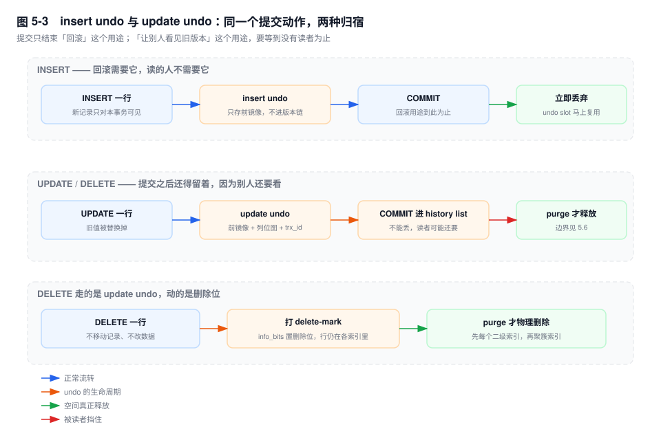
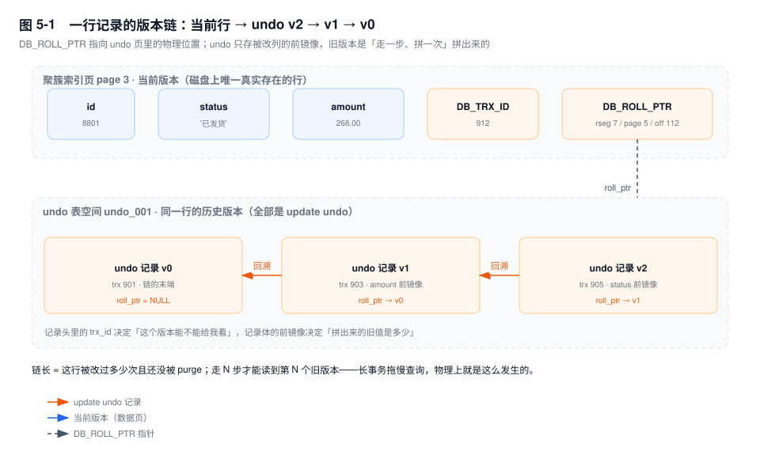
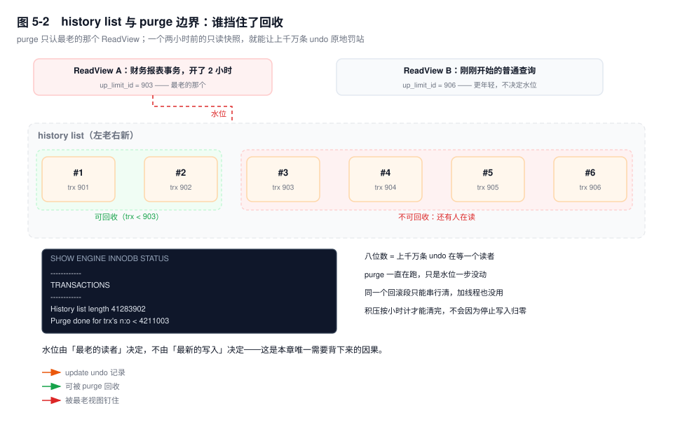

# 第 5 章　Undo Log、版本链与 Purge

> **一句话结论**：undo 不是"把旧数据备份起来"，而是"让还没走的事务还能看见旧数据"；所以它什么时候能被回收，不取决于写它的事务，而取决于读它的那个最老的事务。

## 5.0 场景：一个只读报表，把磁盘写满了

财务月结那晚 22:10，报表任务启动，一条 `SELECT` 扫三个月的 `order_charge`，游标导出。没人管它——只读不写，能有什么影响。

00:40 磁盘告警：数据盘两个半小时涨了 51G。值班同学先找写入方，看到的是同一套库上的营销状态回刷任务，每秒几千行 `UPDATE`，本来就在跑，量没变。

再查最老的事务：

```sql
SELECT trx_id, trx_started, trx_rows_modified, trx_is_read_only, trx_mysql_thread_id
FROM information_schema.INNODB_TRX ORDER BY trx_started LIMIT 5;
```

最老的那条，`trx_started` 是 22:10，`trx_rows_modified = 0`，`trx_is_read_only = 1`。它一行都没改过。

结论藏在 `SHOW ENGINE INNODB STATUS` 的 TRANSACTIONS 段：

```text
------------
TRANSACTIONS
------------
History list length 41283902
Purge done for trx's n:o < 4211003 undo n:o < 0 state: running but idle
---TRANSACTION 4218770, ACTIVE 7321 sec
0 lock struct(s), heap size 1128, 0 row lock(s)
MySQL thread id 88421, query id 9912003 report_r
# 输出形态（未实跑，字段含义以此为准）
```

`History list length` 八位数，`Purge done for trx's n:o` 停在 4211003 不动——purge 线程活着，水位一步没走。

涨的 51G 几乎全是 undo——**已经提交、逻辑上早该消失、物理上一条都删不掉的 undo**。回刷任务每条 undo 记录带上整段 `remark` 前镜像，按每秒 5000 行、每条约 1.2KB 算就是 5.7MB/s，一小时二十 G 出头，两个半小时正好五十来个 G。平时这些记录提交后几分钟内被 purge 清干净；今晚 purge 卡住了，因为那个只读事务还攥着两个半小时前的快照。

**只读事务自己不写一条 undo，却能让别人的 undo 全部烂在磁盘上。** 这就是本章要讲透的因果。

## 5.1 undo 的两种归宿：insert 提交即弃，update 进 history list

undo 有两个用途，寿命完全不同：

1. **回滚**：事务失败或 `ROLLBACK` 时把修改撤掉。这是 ACID 里的 A。
2. **给读者看旧版本**：别的快照读需要一个"修改之前"的行，就得从版本链摸到 undo 里的前镜像。

第 2 条才是 undo 长期占着磁盘的原因，而它对所有 undo 并不一视同仁。

**insert undo**：一行新记录只会有两种读者——插入它的事务自己，和提交之后才建视图的后来者。前者读到的就是当前行，后者读到的也是当前行：没有任何人是**靠 undo 才看到这行**的。所以这段 undo 唯一的价值是回滚，而回滚只有插入者自己需要；一提交就再没人要，**可以直接丢弃**，占用的 undo slot 立刻还给回滚段。

**update undo** 是另一回事。`UPDATE` 把 `amount` 从 268 改成 300 的那一刻，旧值 268 被写进 undo。此时此刻可能有一个更老的 ReadView，它的世界里这行还是 268。只要这个读者还在，这段 undo 就不能删。提交只意味着"不会再用它回滚了"，不意味着"没人需要它"。于是它挂到 **history list** 上，排队等 purge。

`DELETE` 走 update undo，但动作更轻：不改数据、不移动记录，只在记录头 `info_bits` 上打一个 **delete-mark**。行还在页里、还在每一个索引里，扫描照样能摸到它（读到之后再判删除位决定要不要返回）。真正的物理删除发生在 purge——从聚簇索引删记录，还要从**每一个**二级索引删掉对应条目。这也解释了一个常见现象：`DELETE` 掉一半数据，表文件一点没小。

只打标记而不当场删，是为了两件事：物理删除要在页内移动记录、维护目录槽，代价远高于改一位；而且刚删掉的行，可能还有更老的快照正在读它，当场抹掉就等于让别人的查询凭空少一行。

**如果不这么分，会怎样？** 假设 undo 在提交时一律丢弃：快照读就没有旧版本可看，RC/RR 立刻退化成"读写互斥"，一个长查询能把整张表的写入堵死。反过来，假设 undo 永不回收：磁盘单向往上涨，重启时的回滚扫描也越来越长。两种极端都不可用，InnoDB 选的是中间态——按"还有没有人要读"逐个判定，判定的成本就落在了 purge 和那个水位上。

由此得到本章第一个推论：**undo 的寿命不等于事务的寿命。** 事务几毫秒就结束，它留下的 undo 可能活几小时。



## 5.2 undo 表空间、回滚段与 undo slot

undo 有自己的表空间。`[8.0]` 是数据目录下的 `undo_001`、`undo_002` 两个文件；`[5.7]` 默认 `innodb_undo_tablespaces=0`，undo 混在 `ibdata1` 里，和系统表空间挤在一起——这也是 5.7 时代 `ibdata1` 只涨不缩的常见原因之一。

三层组织，各回答一个问题：

| 层 | 数量 | 回答什么 |
|---|---|---|
| undo 表空间 | 8.0 默认 2 个 | 文件在哪、多大、能不能 truncate |
| 回滚段 rollback segment | 128 个槽位 | 这个事务的 undo 写进哪一段 |
| undo slot | 每段 1024 个 | 一个正在写的事务占一个 |

128 个槽位不是平分的：0 号留给系统表空间（兼容老结构），1~32 号留给临时表（临时表的 undo 不参与 history list 回收），33~127 号分给 undo 表空间。回滚段的头页里排着 1024 个 undo slot（16 字节一个，16KB 页刚好切完），事务**第一次写数据**时轮转领一个空闲 slot。只读事务不领，因为它压根不产生 undo。

为什么要切这么碎？两个理由都是工程性的。分回滚段是为了**分锁**：每个回滚段有自己的 latch，128 个事务并发写 undo 时不会全挤在一个段上。分 undo 表空间是为了**能在线下线一个**：truncate 时被选中的表空间要停止接新事务，只有一个大文件就做不到在线缩容。

一个容易漏掉的细节：**undo 页自己也要写 redo。** undo 是逻辑日志（记的是"这行 amount 原来是 268"），但它落在 16KB 的页上，页的修改同样产生 redo 记录。否则崩溃后 undo 半新半旧，回滚就无从谈起。所以一次 `UPDATE` 的持久化成本是两份日志，不是一份。

8.0 的 undo 表空间**自动扩展**：初始 16MB，写满往后长，长到 `innodb_max_undo_log_size`（默认 1GB）才进入可回收的候选。`innodb_undo_log_truncate` 在 `[8.0]` 默认 ON（`[5.7]` 默认 OFF），但"默认开着"和"真的会缩"是两件事，条件见 5.7。

表空间个数在初始化时定死。`[8.0.14+]` 起 `innodb_undo_tablespaces` 被标记为 deprecated，运行期增删改走 DDL：

```sql
CREATE UNDO TABLESPACE undo_003 ADD DATAFILE 'undo_003.ibu';
ALTER UNDO TABLESPACE undo_003 SET INACTIVE;
DROP UNDO TABLESPACE undo_003;
```

## 5.3 版本链：DB_ROLL_PTR 串起来的不是备份，是差异

每张 InnoDB 表都有两个看不见的列：

- `DB_TRX_ID`，6 字节，最后修改这行的事务 id；
- `DB_ROLL_PTR`，7 字节，指向 undo 里这一版的前一版。

7 个字节装得下这些信息，是因为压缩得很紧：

```text
bit 0      1 bit    是不是 insert undo
bit 1~7    7 bit    回滚段 id（0~127）
byte 1~4   4 字节   undo 页号
byte 5~6   2 字节   页内偏移
```

它**没有** trx_id，也没有 undo 序号。事务 id 存在 undo 记录头部，所以要判断"上一个版本是不是我能看的"，必须先把那段 undo 页读出来。undo 序号也在记录头里，它的用途是回滚：一个事务的多条修改按 undo_no 从大到小倒着撤，才能把顺序还原成"最后做的先撤销"。

一次 `UPDATE` 在链上做三件事：

1. 把被更新列的前镜像、一张"哪些列被改了"的位图、当前事务 id、**上一段的 roll_ptr**，写进一条 undo 记录；
2. 把当前行的 `DB_ROLL_PTR` 改成指向这条新记录；
3. 把当前行的 `DB_TRX_ID` 改成自己。

于是同一个逻辑上的"行"，物理上变成：数据页里一份当前值，加 undo 页里一串差异。



**为什么是链式回溯，而不是"直接跳到第 N 个旧版本"？** 因为没有索引可用。undo 记录在页内从页尾向前分配，位置不连续，也不存在"版本号 → 偏移"的映射表，唯一入口就是当前行上那个指针。要第 3 个旧版本，只能走三步，每步读一次 undo 页（可能不在 buffer pool 里，那就是一次随机 IO），每步还要把这一段的旧列合并进结果。undo 只存被改的列，不存整行，所以第 N 个版本是**拼**出来的，不是**读**出来的。

两个直接后果：

- **链长 = 这行被改过多少次且还没被 purge。** 一个热点行被改十万次，读它的最老版本就走十万步。长事务让查询变慢不是比喻，是字面意义上的指针追逐。
- **读旧版本比读当前版本贵一个数量级。** 当前版本一次页访问，旧版本是 N 次页访问加 N 次字段合并。这解释了为什么同一张表在跑批时段快照读突然变慢，而执行计划一点没变。

链的末端是 `roll_ptr = NULL`。`INSERT` 本身不在链上——它是 insert undo，提交即弃，从来没进过这条链。

顺带一个容易误解的点：`DB_TRX_ID` 和 `DB_ROLL_PTR` 只长在聚簇索引记录上，二级索引记录只有索引列加主键值。所以按二级索引读到的每一行，可见性判断和版本回溯都要回到聚簇索引上做——**二级索引负责"找到"，不负责"判断"**，覆盖索引省掉的是回表取列，省不掉这一趟。

## 5.4 Purge：边界由"最老的读者"划

purge 是一组后台线程：一个 coordinator 加 `innodb_purge_threads`（默认 4）个 worker。它干两件事：

1. 沿 history list 从老到新，把不再需要的 update undo 释放，undo 页空间还给 undo 表空间；
2. 对 delete-mark 的记录做物理删除：先从每个二级索引删条目，再从聚簇索引删记录。

顺序不能反。先删聚簇索引的话，二级索引里会留下一批指向不存在记录的条目，后续所有走二级索引的查询都得多做一次"回表失败"判断。

**它清到哪儿为止，不是自己说了算。** 判据是：这段 undo 对应的旧版本，还有没有活着的 ReadView 可能要用。所有活跃 ReadView 里最老的那个决定水位，水位之前的可以清，水位之后的一条都不能动。



`History list length` 数的是**记录条数**，不是事务数。一次批量 `UPDATE` 改十万行就是十万条——这就是它能在一夜之间从五位数跳到八位数的原因。严格说，它是所有回滚段 `hist_size` 的加总：每个回滚段各有一条自己的 history list，`SHOW ENGINE INNODB STATUS` 只是把 128 条加起来给你看。

purge 本身也是重的：它要读 undo 页（读不到就从磁盘读，典型的随机 IO）、解析记录、再去删二级索引。它和业务读抢同一个 buffer pool，抢同一块盘的 IOPS——积压越久，清的时候越像一次"内部批量任务"。

判读分三档，每档对应不同机制：

| 量级 | 含义 | 该做什么 |
|---|---|---|
| 数千到数万，随写入速率波动 | 健康。稳态长度 ≈ 生产速率 ÷ 清理速率 × 清理延迟 | 不动 |
| 持续十万级且单调上升 | 清理速率跟不上，或水位被轻微卡住 | 找最老的事务/查询 |
| 八位数且不动 | 水位被钉死，purge 空转 | 立刻查 `INNODB_TRX` |

**加 `innodb_purge_threads` 解决不了最后一档**，因为同一个回滚段的 history list 只能由一个 worker 串行处理。一个长事务的 undo 全在它领到的那一个回滚段里，线程加得再多，也只有一条线程能碰它。

`innodb_max_purge_lag`（默认 0，关闭）是另一条路：history list 超过阈值后主动延迟 DML，给 purge 让路，延迟上限由 `innodb_max_purge_lag_delay`（微秒）封顶。它拿写入 RT 换回收速度，只适合积压已经开始影响读的场合，不能当常规配置。

## 5.5 长事务的三重伤害，外加一层放大

一个挂着不走的事务（写事务，或者只读的报表事务），会造成四件事。前三条是本章的直接后果，第四条是它在复制链路上的投影。

**① undo 膨胀，磁盘单向增长。** 事务活着的每一秒，别人的 update undo 都进不了回收站。undo 表空间只扩不缩，而 truncate 又要求它选中的那个表空间上没有活跃的 undo——长事务所在的表空间永远不会被选中，`innodb_undo_log_truncate` 只能在另一个上轮转。两个都被占，就一个都动不了。

**② purge 阻塞，history list 疯长，表跟着虚胖。** 除了 undo 本身，delete-mark 的记录也删不掉。业务在归档 `DELETE`，记录还在页里，二级索引条目也在。扫描要读它们，回表要判删除位，`EXPLAIN` 的 `rows` 越来越离谱。

**③ MDL 阻塞 DDL，而且会雪崩。** 事务第一次访问某张表就加了 MDL 读锁，直到事务结束才放。此时来一个 `ALTER TABLE`，它申请 MDL 写锁排队；而 **MDL 队列是公平的**——写锁一排队，后面所有申请读锁的查询全排在它后面。一个长事务加一条 DDL，等于整张表所有查询一起卡住。第 18 章讲的是同一件事，只是根因常常埋在本章。

**④ 主从延迟被放大，而且会骗人。** 长事务提交之前，binlog 里一条记录都没有，从库这两小时一点都不落后，`Seconds_Behind_Master` 漂亮得很。它一提交，两小时的变更瞬间压过来：ROW 格式下是海量 row event，并行复制以事务为单位切分，一个大事务切不开，只能串行回放。延迟不是慢慢涨的，是断崖式出现的。

四件事的源头只有一个：**这段 undo 还有人要读**。不是"事务没提交"，也不是"回滚没做完"。

账可以算得很具体。回刷任务每秒 5000 行，水位被钉住两小时，history list 里就多出三千多万条；purge 恢复后按每秒几千条的速度追，追平要一两个小时，而这期间表上的删除记录、索引条目一直是虚的。

## 5.6 up_limit_id：purge 边界的那根针

把 5.4 那句话落到字段上。

ReadView 是快照读的判据（完整推演在第 17 章），创建时记下四样东西：活跃事务 id 集合 `m_ids`、集合里的最小值、下一个待分配的事务 id、创建者自己的 id。源码里这个最小值叫 `up_limit_id`，也常被写作 `min_trx_id`——名字有两个，指的是同一个数：**比它小的事务，在视图创建那一刻一定已经结束了。**

这个数字就是 purge 的水位。所有活跃 ReadView 里最老的那个，它的 `up_limit_id` 决定"哪些事务的 undo 可以清"。一个视图就够——只要还有一个视图的 `up_limit_id` 停在 903，903 之后的 undo 就全得留着。

三个由此推出的结论，比背定义有用：

- **只读事务不写 undo，但它一样钉住水位。** `trx_rows_modified = 0` 不代表无害，它持有视图就是持有水位。
- **`BEGIN` 本身不建视图。** RR 下要到第一条快照读才建（第 16 章）。"只 `BEGIN` 不查询"的连接不可怕，一条 `SELECT` 才可怕。
- **RC 下每条语句建新视图、语句结束就放。** 于是"多条短语句拼成的长事务"在 RC 下伤害骤减；但一条跑两小时的 `SELECT`，RC 下视图照样活两小时。换隔离级别解决不了慢查询，只解决长事务里"事务"那部分。

还有一点要让直觉落地：**水位是一个事务 id，不是时间。** 你不能用"事务活了多久"去估它能挡住多少 undo——挡住多少，取决于它创建视图那一刻之后又有多少事务提了交。低峰期开一个两小时的长事务可能只挡住几万条，高峰期同样的两小时就是几千万条。

## 5.7 undo 表空间涨上去了，怎么收回来

顺序错了会白忙。

**第一步永远是解因，不是清空间。** 找到并结束那个最老的事务或查询。`KILL` 之前先确认它是不是在等锁——`KILL` 一个已经等了八小时的锁等待，回滚耗时可能比它等的时间还长。水位一松动，purge 自己往前推，history list 开始下降。**这个下降是缓慢的**：一次批量默认处理 300 个 undo 页（`innodb_purge_batch_size`），每条还要做二级索引删除的随机 IO，上千万条积压按小时清。

**第二步才轮到 truncate。** `innodb_undo_log_truncate=ON` 只是开关，真正触发要同时满足：

- 该 undo 表空间的大小超过 `innodb_max_undo_log_size`（默认 1GB）；
- 实例里至少有 2 个 undo 表空间（要有一个能被"下线"）；
- 这个表空间上没有活跃事务，且其中的 undo 已全部 purge 干净。

InnoDB 轮转挑一个表空间标记为 inactive，等它清空，再把文件截回 16MB。长事务没解决时，这一步会一直等。

观察进度的两个口子：

```sql
SELECT NAME, ROUND(FILE_SIZE/1024/1024) AS file_mb,
       ROUND(ALLOCATED_SIZE/1024/1024) AS alloc_mb
FROM information_schema.INNODB_TABLESPACES
WHERE SPACE_TYPE = 'Undo';

SHOW GLOBAL STATUS LIKE 'Innodb_history_list_length';
```

`FILE_SIZE` 是逻辑大小，`ALLOCATED_SIZE` 是实际占盘（稀疏文件两者可能差很多）。truncate 生效时，某个 undo 文件的 `file_mb` 会从几百直接掉回 16。

`[5.7]` 且 `innodb_undo_tablespaces=0` 的实例没有独立 undo 表空间，truncate 无从谈起，唯一的收敛路径是清完积压后重建实例或做逻辑迁移——这类库在升级评估时要把"undo 无法单独回收"算进收益。

## 5.8 关键结论

1. **undo 不是备份，是"给读者看的旧数据"。** 回收时机由最老的 ReadView 决定，不由事务结束时间决定。
2. **insert undo 提交即弃，update/delete 的 undo 进 history list。** 差别不在事务，在有没有读者。
3. **`DELETE` 只是 delete-mark，物理删除在 purge，且要先删每个二级索引再删聚簇索引。** 索引越多的表 purge 越贵，`DELETE` 之后表也未必变小。
4. **版本链是"差异 + 指针"，不是完整副本。** 读第 N 个旧版本要 N 次 undo 页访问和 N 次字段合并，链越长越贵。
5. **`History list length` 八位数只有一个原因：水位被钉死。** 加 purge 线程没用，同一个回滚段是串行的；要找的是那个最老的事务。
6. **只读长事务的危害和写长事务一样大。** 它不产生 undo，但持有 ReadView，等于替全库保管 undo。

## 5.9 实验验证

### 实验一：让只读事务钉住 purge

```sql
-- 会话 A：只读，不提交
SET SESSION TRANSACTION ISOLATION LEVEL REPEATABLE READ;
BEGIN;
SELECT amount FROM order_charge WHERE id = 1;

-- 会话 B：持续写（autocommit），重复执行若干轮
UPDATE order_charge SET amount = amount + 1 WHERE id BETWEEN 2 AND 200;

-- 会话 C：观察
SHOW GLOBAL STATUS LIKE 'Innodb_history_list_length';
```

预期形态（`# 输出形态（未实跑，字段含义以此为准）`）：A 不提交时 `Innodb_history_list_length` 只涨不落；A 执行 `COMMIT` 后几秒内开始回落。

关键点：会话 A 的 `trx_rows_modified` 全程是 0，按"修改行数"排序的巡检永远抓不到它。

### 实验二：看 undo 文件怎么长

```sql
SELECT NAME, ROUND(FILE_SIZE/1024/1024) AS file_mb
FROM information_schema.INNODB_TABLESPACES WHERE SPACE_TYPE='Undo';
```

在实验一持续期间反复执行，`undo_001` / `undo_002` 的 `file_mb` 会阶梯式上涨；A 提交后它不会自己掉回去，要等 truncate 条件满足。

### 实验三：把水位和事务对上号

```sql
SELECT trx_id, trx_state,
       TIMESTAMPDIFF(SECOND, trx_started, NOW()) AS alive_sec,
       trx_rows_modified, trx_is_read_only, trx_mysql_thread_id,
       LEFT(trx_query, 60) AS q
FROM information_schema.INNODB_TRX
ORDER BY trx_started
LIMIT 10;
```

预期形态：第一行 `alive_sec` 最大，`trx_rows_modified` 可能是 0（只读），`q` 是一条 `SELECT`。这一行就是 purge 水位的来源。

### 实验四：让 truncate 真的发生

```sql
-- 测试环境：把阈值调到比现有文件小，且保持 purge 畅通
SET GLOBAL innodb_max_undo_log_size = 67108864;   -- 64MB
SET GLOBAL innodb_undo_log_truncate = ON;
-- 等 purge 把空出来的表空间标记 inactive 后，再观察
SELECT NAME, ROUND(FILE_SIZE/1024/1024) AS file_mb
FROM information_schema.INNODB_TABLESPACES WHERE SPACE_TYPE='Undo';
```

预期形态：满足条件后，某个 undo 文件的 `file_mb` 掉回 16，随后又被写入重新撑大——**truncate 是"截断复用"，不是"停止增长"**。线程数、写入量不变的前提下，它只会周期性地上上下下。

## 5.10 常见误区

⚠️ **"`ROLLBACK` 之后空间立刻回收"**
回滚只是把 undo 标记成"不再用于回滚"，读的人照样可能要。即使 purge 清完，undo 文件的物理大小也不变——文件只会被 truncate，不会被"归还一部分"。

⚠️ **"只读事务不写 undo，所以对别人没影响"**
它持有 ReadView 就是持有水位，危害与写长事务同级，且更隐蔽：`trx_rows_modified` 是 0，所有按修改量排序的巡检都会漏掉它。

⚠️ **"`history list length` 高就加 purge 线程"**
单个回滚段的 history list 串行处理，一个大事务的 undo 加线程清不快。先确认水位有没有动，再谈线程数。

⚠️ **"`DELETE` 完表就小了"**
delete-mark 而已。purge 清完，页内空间也只是变成可复用，文件不缩。要缩文件得 `OPTIMIZE TABLE` 或重建（第 3 章），代价是一次全表拷贝。

⚠️ **"undo 可以拿来闪回"**
undo 是给活跃读者用的运行期结构，purge 之后不可恢复。真闪回要靠 binlog（第 28 章）。

## 5.11 生产 Checklist

- [ ] `Innodb_history_list_length` 有没有做成趋势图？只看瞬时值，看不出"只涨不落"
- [ ] 巡检 SQL 是否把 `trx_rows_modified = 0` 的长事务也列出来？只读事务是最常见的元凶
- [ ] 报表/导出任务是否设了 `MAX_EXECUTION_TIME`？一条 `SELECT` 就能钉住两小时
- [ ] 事务里有没有 RPC、HTTP、文件导出？有的话事务边界一定写错了
- [ ] `innodb_undo_log_truncate` 是否 ON，undo 表空间是否 ≥ 2 个
- [ ] undo 表空间所在磁盘有没有独立监控？它和 binlog 是两拨独立增长
- [ ] `innodb_max_purge_lag` 是否为 0？为 0 时积压不会触发任何自我保护
- [ ] 主从延迟告警是否只在"事务提交后"才响？长事务的延迟是断崖式的，别等它出现

## 5.12 延伸

- **上一章**：第 4 章（redo 与 checkpoint——undo 页的修改也靠它持久化）
- **下一章**：第 6 章（binlog 与两阶段提交——长事务在复制链路上的另一半代价）
- **关联章节**：第 3 章（表空间与 delete-mark 的物理位置）、第 7 章（崩溃恢复的回滚阶段读的就是 undo）、第 16 章（事务生命周期与 trx_id 分配）、第 17 章（ReadView 四字段完整推演）、第 18 章（MDL）、第 21 章（长事务治理）、第 39 章（`SHOW ENGINE INNODB STATUS` 逐段精读）
- **面试追问**：
  - "undo 什么时候能被删？" → 没有活跃 ReadView 需要那个版本时，由最老视图的 `up_limit_id` 决定。
  - "为什么 insert undo 可以立刻丢？" → 没有任何读者是靠它才看到这行的，提交后连回滚也不需要它了。
  - "`DELETE` 之后表为什么没变小？" → delete-mark 加 purge 才物理删；purge 后空间也只是页内可复用。
  - "长事务为什么会让查询变慢？" → 三层：版本链变长（读放大）、purge 停摆（表虚胖）、MDL 阻塞（DDL 雪崩）。
- **官方文档**：`InnoDB Undo Logs`、`Undo Tablespaces`、`InnoDB Purge Configuration`、`innodb_undo_log_truncate`、`innodb_max_purge_lag`
