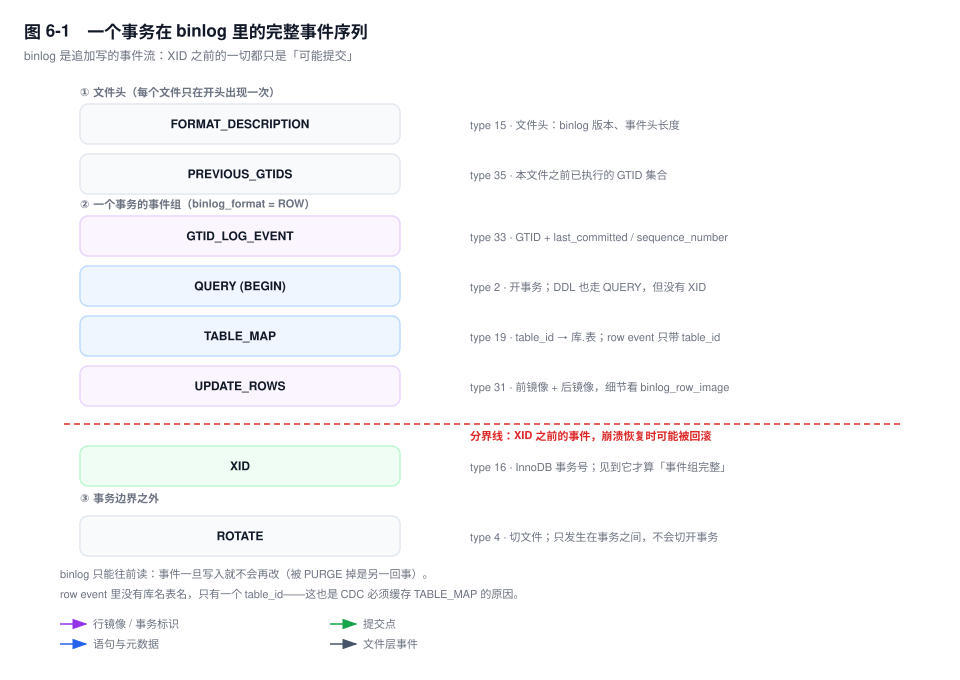
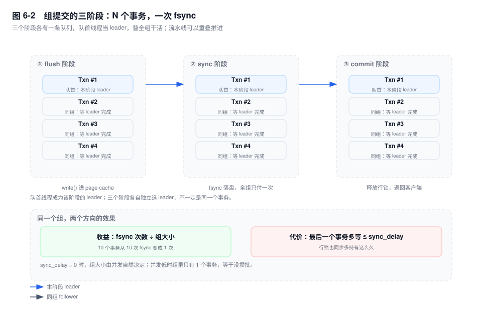
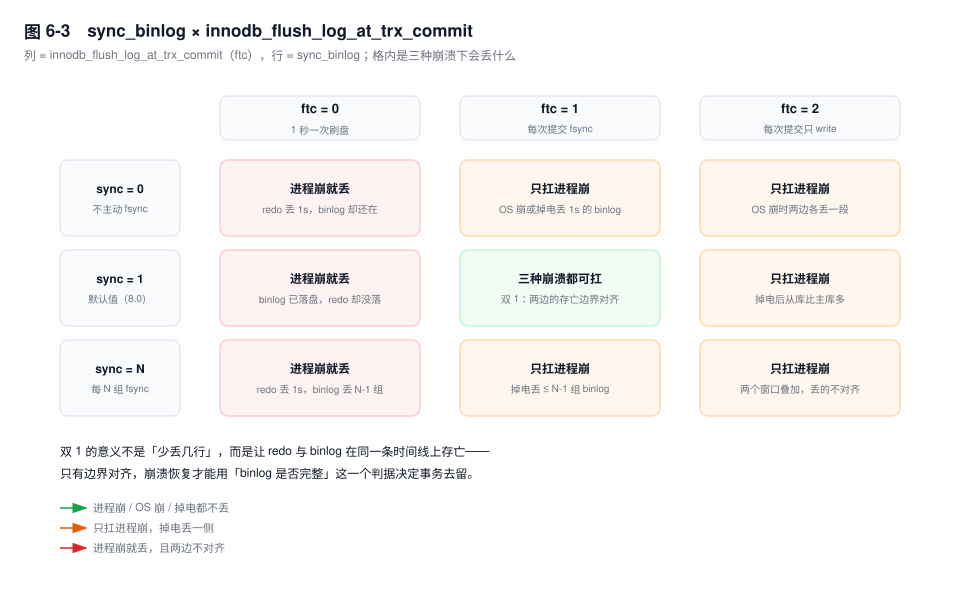

# 第 6 章　Binlog 与两阶段提交

> **一句话结论**：binlog 不是"操作记录"，而是一份可以被别人拿去重演的**状态变更流**；它能重演到什么程度，取决于格式（STATEMENT/ROW）和行镜像（FULL/MINIMAL），而不是取决于"有没有记下来"。

## 6.0 场景：TPS 掉了一半，慢日志里一条慢 SQL 都没有

对账系统每晚 1:30 跑批量结算，逻辑写在一个事务方法里：

```java
// 伪代码：8 万条记录，循环单行更新，方法返回时才提交
for (SettleRecord r : page) {
    jdbc.update("UPDATE settle_detail SET state = 3, checked_at = ? WHERE id = ?", now, r.id);
}
```

单条 UPDATE 走主键、零点几毫秒。`long_query_time` 是 1 秒，慢日志里一条都抓不到——它们确实不慢。

但这个窗口里主库 TPS 掉了一半，所有**无关**业务的写请求 P99 从个位数毫秒涨到几百毫秒。三个观察能拼出真相：

- `SHOW GLOBAL STATUS LIKE 'Binlog_cache_disk_use'`：从 0 变成 1。注意这个计数器只记**次数**不记字节数，一次几十 MB 的溢出和一次 40KB 的溢出，在监控上长得一模一样。
- `SHOW PROCESSLIST`：一堆连接停在 `query end`，都在等同一个提交。
- `SHOW ENGINE INNODB STATUS` 的 `TRANSACTIONS` 段：那个批量事务持有上万行锁，`trx_rows_modified` 是六位数。

慢的不是那 8 万条 UPDATE，是它们攒出来的那一次 `COMMIT`。而一次提交能拖垮全库，是因为三件事叠在了一起：**binlog cache 溢出**（提交时多了一次磁盘往返）、**组提交被一个大事务绑票**（同组的小事务陪着它等 fsync）、**行锁整个过程中不放**（等锁的队伍越排越长）。

这三件事都长在 binlog 上。所以先回答一个更根本的问题：binlog 到底是什么。

## 6.1 定位：为什么必须有它，而且必须在 Server 层

先把三个日志的分工摆清楚（时序在第 1 章，这里只讲"为什么是这个设计"）：

| | redo log | undo log | binlog |
|---|---|---|---|
| 归属 | InnoDB | InnoDB | Server 层 |
| 写入方式 | 循环写，会被覆盖 | 随事务生命周期回收 | 追加写，按策略保留 |
| 记录粒度 | 页级物理变更 | 行的旧版本 | 逻辑变更（语句或行镜像） |
| 用途 | 崩溃恢复前滚 | 回滚 + MVCC | 复制、归档、CDC |

任何一条都足以说明它不可替代，但真正决定它必须存在的，是**反证**：

**如果只有 redo**：redo 是循环写的，写到头就覆盖，两周前的误删它救不了；redo 记的是"哪个表空间的哪个页偏移改成了什么"，这种格式只在同一份物理布局上有效，主从的页可能完全不同，跨版本更是不保证兼容；redo 只有 InnoDB 有，更新一张 MyISAM 表根本不产生 redo；`CREATE TABLE` 这类元数据变更也只存在于 Server 层的视角里，redo 里没有"建表"这个概念。

**如果让引擎写 binlog**：一个事务里同时改了 InnoDB 表和 MyISAM 表，谁负责写出一份顺序正确的日志？两个引擎各写一份，复制端就得按引擎拆开重放，"事务"这个边界直接消失。多引擎是 MySQL 的历史包袱，而 binlog 是唯一能把这个包袱系住的东西。

**如果让 Server 层管 redo**：Server 层不认识页，也不该认识——它连"行存在哪个页上"都不知道。

三条路都堵死，剩下的唯一位置就是：**Server 层，所有引擎共享的一条逻辑变更流**。它的角色不是"备份 redo"，而是**跨引擎、跨版本、跨实例的唯一裁决者**：两阶段提交里，一个事务是提交还是回滚，最终看的是 binlog 完整不完整。

这一点有个直接的实证：`binlog_format=ROW` 下更新 MyISAM 表，binlog 里照样有 `TABLE_MAP` 和 `UPDATE_ROWS`，但**没有 `XID` 事件**——XID 来自 InnoDB 的事务提交，非事务引擎没有。同一个 binlog 文件里两种事务边界并存，这本身就说明 binlog 不属于任何一个引擎。

代价也在这里：引擎改完数据、binlog 还没写的那个窗口，是物理上不可消除的。引擎不能等 binlog（它不该知道 binlog 的存在），Server 层也不能替引擎提交。两个独立的持久化系统 + 一个跨系统的原子性需求，只能靠"先 prepare、再写日志、最后 commit"这套协议来缝合。第 1 章讲的是这套协议的时序，本章讲的是这条日志本身。

## 6.2 三种格式：重演"意图"还是重演"结果"

| | STATEMENT | ROW | MIXED |
|---|---|---|---|
| 记什么 | 原始 SQL 文本 + 会话上下文 | 行的前后镜像 | 逐语句判定，二者混用 |
| 从库怎么用 | 重新执行一遍 | 直接改行 | 看事件类型 |
| 体积 | 一条语句 | 与影响行数成正比 | 介于两者之间 |
| 依赖 | 从库环境必须与主库一致 | 只依赖表结构一致 | 依赖判定规则 |

这是本章最重要的一次分野：**STATEMENT 重演的是"我下了什么命令"，ROW 重演的是"数据变成了什么样"**。前者要求两台机器的执行环境、数据分布、甚至优化器选择完全一致；后者只要求表结构一致。

### STATEMENT 在哪些语句上必然分叉

- **`UPDATE ... LIMIT n` 且没有 `ORDER BY`**：主库按它当时的扫描顺序取前 n 行，从库可能因为统计信息不同走了另一条索引，取到的就是另外 n 行。执行时 MySQL 会丢一条 `Statement is unsafe because it uses a LIMIT clause` 的 warning——这条 warning 在 `binlog_format=STATEMENT` 下是必现的，很多人当成噪音忽略了。分叉的不是"改成了什么"，而是"改了哪几行"。
- **`INSERT INTO ... VALUES (UUID())`**：从库重新算一次，两边的值不一样。`RAND()`、`LOAD_FILE()` 同理。
- **`@@hostname` / `CONNECTION_ID()` / `USER()`**：从库返回的是从库自己的值。注意只有它**参与写入**才有害（`UPDATE t SET src = @@hostname`），单独 `SELECT @@hostname` 根本不写 binlog。
- **自增列**：`INSERT INTO t (name) VALUES ('x')` 在 STATEMENT 下不带自增值，从库自己分配。主库有并发插入或回滚时，从库分到的 id 必然错位，之后所有 `WHERE id = ?` 的更新就改在错误的行上。这是 SBR 时代最经典的"主从数据慢慢就歪了"。
- **`SYSDATE()`**：读的是执行那一刻的操作系统时钟，从库回放时读到的是回放时刻。

`NOW()` 常被拿来当反例，但它其实是**安全**的：binlog 事件的 header 里带 `timestamp`，从库执行前会把会话时间设成这个值，所以 `NOW()` 在从库上返回的是主库执行时的时间。真正会分叉的是 `SYSDATE()`——它绕过了会话时间，直接读时钟。这一条经常被说反，因为两者的字面语义看起来一样。

### MIXED 的问题不是不安全，是不可预测

`MIXED` 的规则是"语句被判定为 unsafe 就降级成 ROW"。于是同一个 binlog 文件里两种格式混排：`INSERT ... VALUES (UUID())` 是 ROW，普通 `UPDATE` 是 STATEMENT。从正确性看它没问题，从运维看它是灾难——CDC 工具要同时实现两套解析路径，闪回工具要能处理两种事件，出问题时你得先猜这条语句当初被记成了什么格式。

### 为什么线上只能是 ROW

除了正确性，还有一条硬约束：**RC 隔离级别下 STATEMENT 根本不允许写 binlog**。在 `READ-COMMITTED` + `binlog_format=STATEMENT` 下执行写语句会直接失败，报 `Binary logging not possible ... Transaction level 'READ-COMMITTED' in InnoDB is not safe for binlog mode 'STATEMENT'`。原因是语句级日志里没有行锁语义，从库重放时读到的已提交集合和主库不同，"重新执行一遍"这个动作本身就不成立。

ROW 的代价只有一个，但很大：**体积与影响行数成正比**。`UPDATE settle_detail SET state = 0 WHERE create_time < '2026-01-01'` 改 100 万行，STATEMENT 记一行文本，ROW 要记 100 万组前后镜像。这条代价直接推导出本章后面所有关于"大事务"的问题。

选择很干脆：STATEMENT 省空间但会错，ROW 费空间但对。正确性不可谈判，所以 `binlog_format=ROW` 是唯一可运维的答案；要省空间，去压缩、去改行镜像，而不是退回 STATEMENT。

## 6.3 一个事务在 binlog 里长什么样



binlog 是**事件流**，不是文本日志。每个事件以 19 字节的公共 header 开头：

| 字段 | 字节 | 作用 |
|---|---|---|
| `timestamp` | 4 | 事件产生时间，SBR 下从库的 `NOW()` 靠它 |
| `type_code` | 1 | 事件类型，31 就是 `UPDATE_ROWS` |
| `server_id` | 4 | 产生事件的实例，环形复制时用来丢弃自己发的事件 |
| `event_size` | 4 | 含 header 的总长度 |
| `log_pos` | 4 | 下一个事件的起始位置，位点（pos）就是它 |
| `flags` | 2 | `LOG_EVENT_BINLOG_IN_USE_F` 等标记 |

一个 InnoDB 事务的完整序列是：

```text
FORMAT_DESCRIPTION     文件头，每个文件只有一次
PREVIOUS_GTIDS         本文件之前已执行过的 GTID 集合
GTID_LOG_EVENT         事务归属 + last_committed / sequence_number
QUERY (BEGIN)          开启事务
TABLE_MAP              table_id → 库名.表名 + 列类型
UPDATE_ROWS            前镜像 + 后镜像（可能有多组）
XID                    InnoDB 事务号，提交标记
```

几个必须记住的细节：

**row event 里没有表名。** 它只有一个 6 字节的 `table_id`，靠前面的 `TABLE_MAP` 才能翻译成"哪张表、哪些列、什么类型"。所以 CDC 工具必须缓存 `TABLE_MAP`；丢了一个，后面所有 row event 都解不出来，只能报错退出。这也是为什么 `TABLE_MAP` 会在"表结构变了"或"事务里第一次碰这张表"时重新出现，而不是每个事务固定一份。

**`XID` 是 InnoDB 事务的边界。** 它携带的是 InnoDB 的 trx_id，两阶段提交的崩溃恢复就靠它把 binlog 里的提交记录和 redo 里的 prepare 记录对上号。非事务表（MyISAM）没有 XID，事务边界退化成语句边界。

**DDL 只有 `QUERY`，没有 `BEGIN` 和 `XID`。** 它是自动提交的，一个事件就是一个事务。消费方必须把它当成"立即生效"的独立单元处理。

**`ROTATE` 只发生在事务之间。** MySQL 写 binlog 时以事务为单位整块写入，不会把一个事务切成两半——所以大事务会让单个文件超过 `max_binlog_size`（它是软限制），而不是被拆到两个文件里。

常用的类型码：2 `QUERY`、4 `ROTATE`、15 `FORMAT_DESCRIPTION`、16 `XID`、19 `TABLE_MAP`、30/31/32 三种 ROWS 事件、33 `GTID_LOG_EVENT`、34 `ANONYMOUS_GTID_LOG_EVENT`（`gtid_mode=OFF` 时的占位）、35 `PREVIOUS_GTIDS`。

`binlog_row_metadata` [8.0.1+] 决定 `TABLE_MAP` 里带多少东西：默认 `MINIMAL` 只有列类型和长度，改成 `FULL` 会把列名、字符集、甚至 `ENUM` 的每个字符串取值都写进去。好处是 CDC 不用再连主库查 `information_schema`（在大表上这个查询可能锁元数据），代价是 binlog 体积上涨。给下游用的实例值得开。

## 6.4 组提交：N 次 fsync 压成 1 次，代价是延迟

`fsync` 是整条写入路径上唯一无法并行的动作——同一个文件，一次只能刷一个。单机 1000 TPS 就是 1000 次 fsync/秒，机械盘两三百 IOPS 直接撞墙；SSD 只是把这个门槛抬到几千，而业务量是会长的。组提交的思路很朴素：**把同一时刻要提交的事务攒成一批，一批只刷一次盘**。

三阶段（[5.7] 起拆成三条独立队列，5.6 的组提交还串行在同一把锁下）：

1. **flush**：把每个事务私有的 binlog cache 写进 binlog 文件（`write()`，落到 OS page cache 就返回）。
2. **sync**：队列的 leader 对文件做一次 `fsync`，覆盖队列里的所有事务。
3. **commit**：通知 InnoDB 把 redo 从 prepare 改成 commit，释放行锁，返回客户端。



每个阶段都有自己的队列，队列的第一个线程成为该阶段 leader，替全组干活，其余 follower 睡在条件变量上。三条队列让三个阶段可以重叠：第 1 组在 sync 的时候，第 2 组已经在 flush。所以它不是"一批做完再做下一批"，而是一条流水线。

由此得到一个最容易搞错的推论：**`sync_binlog=1` 不是"每个事务一次 fsync"，而是"每个提交组一次 fsync"**。组提交把 fsync 的成本摊给了整组，这才是 `sync_binlog=1` 在生产上还能跑的原因。

### 攒批是可以用参数强制的，但要有代价意识

- `binlog_group_commit_sync_delay`（微秒，默认 0）：leader 在 sync 之前主动睡一会儿，等更多事务进组。
- `binlog_group_commit_sync_no_delay_count`（默认 0）：组内事务数达到 N 就不再等，给延迟封顶。

收益是吞吐：fsync 次数下降，磁盘压力下降。代价有两层，第二层常被忽略：

1. **每个事务的提交延迟至少增加 0~`sync_delay`**。设成 1000（1ms），P99 就加 1ms；设成 10000，低延迟链路的 P99 直接从个位数毫秒变成十几毫秒。
2. **行锁在这段时间里不释放**。commit 阶段才放锁，而 delay 发生在 sync 之前，所以热点行的持锁时间被同步拉长，锁等待和死锁概率一起上升。这也是 6.0 那个场景里"无关业务的 P99 也涨"的第二条通路。

所以"减少 fsync 次数所以更快"是个半截结论。准确的说法是：**组提交降低的是"fsync 排队"这个瓶颈造成的延迟，增加的是"主动等待"这个固定成本**。系统已经饱和时前者占主导，净收益为正；系统不饱和时组里只有一两个事务，攒批等于没发生，白付延迟。

`binlog_order_commits`（默认 ON）控制 commit 阶段是否保序。关掉能再提高一点并发，但"binlog 顺序 = 提交顺序"这个前提就没了，崩溃恢复和依赖顺序的消费方都要重新评估——除非在做极端压测，不要动它。

## 6.5 binlog cache：大事务真正的成本在提交

每个会话有一份私有的 binlog cache，`binlog_cache_size` 默认 32KB。事务执行过程中，row event 先往这块内存里堆；堆不下就**溢出到临时文件**，`Binlog_cache_disk_use` 加一。

溢出之后，一次提交的成本从"一次内存拷贝"变成三步：临时文件**读出来** → 写进 binlog 文件 → `fsync`。数据被搬运了三遍，全部发生在 commit 阶段，而行锁要等到这一切结束才释放。

这就解释了 6.0 里那句"慢日志里没有慢 SQL"：慢日志按语句记录，8 万条 UPDATE 每条都不慢；真正耗时的 `COMMIT` 即使被记下来，也只是一条 `Rows_examined = 0` 的空记录，不会告诉你是哪张表、哪批数据。这段时间只在 `performance_schema.events_statements_history` 里以一条 `COMMIT` 的形态存在。

更糟的是它会污染组提交：这个事务成了某一组的 leader，它那一次大文件的 `fsync` 时长，就是同组所有事务的等待时长。**一个大事务可以让整组的 P99 等于它自己的刷盘时间。**

```sql
SHOW GLOBAL STATUS LIKE 'Binlog_cache%';
-- Binlog_cache_use        本周期内使用 cache 的事务数
-- Binlog_cache_disk_use   其中溢出到临时文件的事务数
```

经验阈值：`Binlog_cache_disk_use / Binlog_cache_use` 超过 1% 就说明有事务明显偏大，值得去 `information_schema.innodb_trx` 里按 `trx_rows_modified` 排序找人。调大 `binlog_cache_size` 能缓解，但它是 per-session 的，连接池 500 个连接 × 每份 1MB，就是 500MB 内存——比拆事务贵得多。真正的解法永远是拆事务：按主键区间切成每批几千行。

`max_binlog_cache_size` 是硬上限（默认值极大，等于不限制），超了报 `ER_TRANS_CACHE_FULL`（1197），整条语句失败。它不是保护机制，是兜底。

## 6.6 sync_binlog 与"双 1"：保的到底是什么



`sync_binlog` 的语义只有一个问题：**多久 `fsync` 一次 binlog 文件**。

- `= 0`：交给操作系统，MySQL 不主动刷。进程崩溃不丢（数据已经在 OS page cache 里），OS 崩溃或掉电丢最近若干秒。
- `= 1`：每个提交组 `fsync` 一次。默认值（[5.7] 默认 0，[8.0] 改为 1）。
- `= N`：每 N 个提交组 `fsync` 一次，崩溃丢最近 N-1 组。它是"延迟换安全"的旋钮，但在有组提交的前提下收益很小。

把它和 `innodb_flush_log_at_trx_commit`（下文简称 ftc）放在一起看，才是完整的图景。九种组合里只有一种能在进程崩溃、OS 崩溃、掉电三种情况下都不丢；剩下的八种按"丢的是哪一侧"归成三类：

| 组合 | 掉电后会发生什么 | 能不能修 |
|---|---|---|
| 双 1 | 什么都不丢 | — |
| `ftc=1, sync_binlog=0` | 主库有数据，binlog 没有这段 | **修不了**，binlog 里根本没有这个事务 |
| `ftc=0/2, sync_binlog=1` | 主库少了，binlog 多了 | 能用 binlog 反向补，前提是你发现了 |
| 都不保 | 两边各丢一段，随机错位 | 只能全量校验 |

这张表要读出两层意思。

**第一层：双 1 保护的从来不是"不丢行"，而是"两边同时丢或者都不丢"。** 只看"会不会丢"的话，`ftc=2` 已经能扛进程崩溃，看起来够用；但它扛不住掉电，而掉电时 binlog 已经落了盘——于是从库比主库多。数据没丢，可一致没了。

**第二层：两种不一致的修复难度完全不同。** binlog 丢、主库有，是**不可逆的信息丢失**：这段变更只存在于主库的数据页里，没有任何日志能把它重放出来，从库永远缺。反过来主库丢、binlog 有，至少还能重放。这也是为什么 `sync_binlog=1` 比 `ftc=1` 更不可妥协——它保护的是那份"唯一能重演过去的流"。

顺带纠正一个高频误解：双 1 只能保证**主库内部** redo 与 binlog 一致。异步复制下，主库提交成功、dump 线程还没把事件发出去就宕机，从库照样缺这一段——两阶段提交管不到网络对面。要解决那个问题得靠半同步或 MGR（见第 24 章）。

## 6.7 binlog_row_image：这份流能被谁消费

| 取值 | before image | after image | 典型用途 |
|---|---|---|---|
| `FULL`（默认） | 所有列 | 所有列 | 复制 + 闪回 + CDC 都能用 |
| `MINIMAL` | 仅主键等定位列 | 仅被修改的列 | 只省带宽的复制 |
| `NOBLOB` | 所有列，但省略未变的 BLOB/TEXT | 同上 | 有大字段、且不做 CDC |

看起来 `MINIMAL` 是纯优化，实际上它改变了这份流的**信息含量**，三个消费方的命运完全不同：

**复制**：能跑，但前提是每张表都有主键。`MINIMAL` 只保证"够定位"，一旦表没有主键或唯一键，MySQL 只能退回把整行都记下来，而从库定位那一行也只能全表扫描——延迟立刻爆炸。这就是"无主键表放大复制延迟"的来源之一（见第 25 章），所以"每张表都要有主键"在 `MINIMAL` 下从建议变成了硬要求。

**闪回**（binlog2sql / my2sql 这类工具）：**会给出错误结果**。闪回的原理是把 UPDATE 反写成"把 after 改回 before"，`MINIMAL` 下 before 只有主键，其他列的旧值拿不到，反向 SQL 要么漏列、要么写成 NULL。这是 `MINIMAL` 最危险的地方：它不影响复制，只影响"出事之后能不能救"。

**CDC**（Canal / Maxwell / Debezium）：下游做宽表、做审计、做对账，都需要完整的前后镜像。`MINIMAL` 下只能拿到变更列，下游要么回查主库（延迟 + 压力），要么接受一份残缺的变更。

`binlog_row_value_options = 'PARTIAL_JSON'` [8.0.3+] 是同一逻辑的延伸：JSON 列的部分更新（`JSON_SET` 改一个大文档里的一个字段）只记 diff，产生 `PARTIAL_UPDATE_ROWS` 事件（类型 39），体积能降一个量级。代价是消费方必须能解析 JSON diff——老版本的解析器遇到这个事件会直接失败。

`binlog_transaction_compression = ON` [8.0.20+] 同理：事务级 zstd 压缩，省磁盘省带宽，但所有从库和下游都得是 8.0.20 以上，否则解不开。

这三个参数共同说明一件事：**binlog 的格式不是内部实现细节，它是你和所有消费方之间的契约**。改格式等于改接口，要有版本兼容计划。

## 6.8 消费方：为什么必须等到 XID

Canal、Maxwell、Debezium 的本质都一样：伪装成一个从库，用 `COM_BINLOG_DUMP` 协议向主库要事件流。它们看到的是**文件里的字节**，不是"已提交事务列表"。

而事件是在 flush 阶段就写进文件的，此时事务在引擎里还是 prepare 状态。如果这一刻掉电，恢复时这个事务可能被回滚——但消费方已经把 `UPDATE_ROWS` 读走了。所以见到 row event 就往下游发消息，等于在发一条"可能从未存在"的变更。

`XID` 是唯一可靠的边界：**见到 XID，说明这个事务的事件组已经完整，崩溃恢复一定会让它提交**（前提是 binlog 已经 fsync，见 6.6）。

三个工程后果：

1. **必须按事务攒批**，不能按事件逐条发。半个事务发到下游，比不发更糟——下游无法回滚。
2. **文件层面不会切开事务，但流层面会**。写文件时以事务为单位整块写（所以大事务能撑爆 `max_binlog_size`），但 dump 线程是边写边发的，连接一断，从库就收到了半个事务。relay log 里这半个事务会在重启时被丢弃，消费方也一样，必须自己处理"收到一半就没了"的情况。
3. **DDL 没有 XID**，它是立即生效的独立单元。消费方要能处理"表结构已经变了，但 TABLE_MAP 还没到"的时序，否则解析会错位。

## 6.9 关键结论

1. **binlog 放在 Server 层、与引擎无关，不是实现选择而是复制的必要条件。** redo 是页级的、循环的、引擎私有的；只有 binlog 能跨引擎、跨版本、跨实例重演，也只有它能裁决两阶段提交里事务的去留。
2. **STATEMENT 重演"意图"，ROW 重演"结果"。** 无 `ORDER BY` 的 `LIMIT`、`UUID()`、自增列、`SYSDATE()` 在 SBR 下必然分叉；`NOW()` 反而安全，因为时间戳跟着事件走。正确性不可谈判，所以线上只能是 ROW，代价是体积随影响行数线性增长。
3. **组提交把 N 次 fsync 压成 1 次，但它不是免费加速。** 它用"最后一个事务多等 ≤ `sync_delay`"换"全组共享一次刷盘"，而且这段时间行锁不放——延迟换吞吐，账要算清楚。
4. **双 1 保的不是"不丢行"，是"redo 与 binlog 的存亡边界对齐"。** 边界不对齐时，主从会永久分叉；其中"binlog 丢了、主库有"是不可逆的信息丢失，连修的机会都没有。
5. **大事务的成本不在执行，在提交。** binlog cache 溢出后，提交要读回临时文件、再写、再 fsync，全程持锁，还会当上组提交的 leader 拖慢整组；而慢日志里看不到这一切。
6. **`binlog_row_image` 决定了这份流能被谁消费。** MINIMAL 能复制，但闪回会给出错误结果、CDC 拿不到完整行；格式类参数（`PARTIAL_JSON`、事务压缩）每次变更都是一次接口变更。

## 6.10 实验验证

### 实验一：逐字段读一个事务

```bash
mysqlbinlog -vv --base64-output=DECODE-ROWS \
  --start-datetime='2026-11-11 01:30:00' mysql-bin.000007 | head -80
```

输出形态（未实跑，字段含义以此为准）：

```text
# at 1234
#261111  1:30:02 server id 1  end_log_pos 1305  GTID  last_committed=41 sequence_number=42
# at 1305
#261111  1:30:02 server id 1  end_log_pos 1376  Query  thread_id=88  exec_time=0  error_code=0
SET TIMESTAMP=1762795802/*!*/;
BEGIN
/*!*/;
# at 1376
#261111  1:30:02 server id 1  end_log_pos 1462  Table_map: `settle`.`settle_detail` mapped to number 108
# at 1462
#261111  1:30:02 server id 1  end_log_pos 1560  Update_rows: table id 108 flags: STMT_END_F
### UPDATE `settle`.`settle_detail`
### WHERE
###   @1=1001            <- before image
###   @2=1
### SET
###   @1=1001            <- after image
###   @2=3
# at 1560
#261111  1:30:02 server id 1  end_log_pos 1591  Xid = 4021
```

读法：`end_log_pos` 就是下一个事件的位点；`mapped to number 108` 是 `table_id`，下一行 `table id 108` 靠它关联；`Xid = 4021` 是这个事务的终点。把 `@1`、`@2` 对照表结构，就知道 `MINIMAL` 和 `FULL` 的差别在哪——`MINIMAL` 下 `WHERE` 段只会剩主键，`SET` 段只会剩被改的列。

### 实验二：把 binlog cache 逼到溢出

```sql
SET SESSION binlog_cache_size = 4096;      -- 只影响当前会话
SHOW GLOBAL STATUS LIKE 'Binlog_cache_disk_use';   -- 记下初值
BEGIN;
UPDATE settle_detail SET state = 3 WHERE id BETWEEN 1 AND 5000;
COMMIT;
SHOW GLOBAL STATUS LIKE 'Binlog_cache%';
```

预期形态（未实跑）：`Binlog_cache_use` 与 `Binlog_cache_disk_use` 各 +1；把 UPDATE 的范围缩到 5 行再跑一次，前者仍 +1、后者不变。这组对照说明计数器只区分"溢出没溢出"，不区分"溢出多大"——一次 40KB 和一次 40MB 在监控上长得一模一样。要量化严重程度，得去看这个事务的 `trx_rows_modified`。

### 实验三：组提交的延迟代价

```bash
sysbench oltp_write_only --threads=64 --time=60 run    # 基线，sync_delay = 0
mysql -e "SET GLOBAL binlog_group_commit_sync_delay = 1000"
sysbench oltp_write_only --threads=64 --time=60 run    # 对比组
```

预期形态（未实跑）：TPS 可能小幅上升或不升，但 P99 一定上升，幅度大致与 `sync_delay` 同量级。若 TPS 没涨而 P99 涨了，说明这个负载的瓶颈不在 fsync，攒批纯亏。**这个实验的价值就在于让你亲眼看到"账面收益可能为零"**。

## 6.11 常见误区

⚠️ **"binlog 是 InnoDB 的日志"**
证据在 6.1：更新 MyISAM 表也写 binlog，只是没有 `XID`。把 binlog 当引擎日志，会推出"关掉 InnoDB 就没 binlog"这种荒唐结论，也会让你在排查"binlog 为什么没写"时找错地方。

⚠️ **"两阶段提交保证了主从强一致"**
它只保证主库内部 redo 与 binlog 一致。主从之间的一致性由复制模式决定：异步复制下，主库提交后、事件发出前宕机，从库就缺这一段，两阶段提交无能为力。

⚠️ **"`sync_binlog=1` 就是每个事务刷一次盘"**
是每个**提交组**刷一次。组提交让这句话的代价比字面小得多，也是很多人误以为"双 1 一定扛不住高并发"的原因。

⚠️ **"`binlog_row_image=MINIMAL` 只是省空间"**
它省的是空间，丢的是信息。复制本身还能跑（前提是有主键），但闪回会生成错误的逆向 SQL，CDC 拿不到完整行。省带宽的方案要按"下游是谁"来选，不是按"能省多少"来选。

⚠️ **"开 `sync_delay` 能提升吞吐，所以可以开"**
吞吐和延迟是同一个队列的两端。开了之后每个事务多等 0~`sync_delay`，热点行的锁也多持有这么久。只有在 fsync 确实是瓶颈时才划算，而在 SSD 上这个前提经常不成立。

## 6.12 生产 Checklist

- [ ] `binlog_format=ROW`，`binlog_row_image=FULL`（有闪回或 CDC 需求时；只有纯复制需求才考虑 MINIMAL，且必须全表有主键）
- [ ] `sync_binlog=1` 与 `innodb_flush_log_at_trx_commit=1`，并确认磁盘/阵列写缓存有掉电保护（否则双 1 也是纸面的）
- [ ] 监控 `Binlog_cache_disk_use / Binlog_cache_use`，超过 1% 报警
- [ ] 事务规范里写明单事务行数上限（按业务，量级在几千行），批量任务必须分批提交
- [ ] `binlog_expire_logs_seconds` 与备份周期对齐，保证"全备 + binlog"能覆盖到上一次全备
- [ ] `max_binlog_size` 是软限制，容量规划要按"最大单事务"预留，不是按它
- [ ] CDC 消费方按 XID 攒批，能处理半截事务、跨文件 ROTATE、DDL 与 TABLE_MAP 的时序
- [ ] 开 `binlog_transaction_compression` 或 `PARTIAL_JSON` 前，确认所有从库与下游版本 ≥ 8.0.20 / ≥ 8.0.3
- [ ] 大事务监控：`information_schema.innodb_trx` 按 `trx_rows_modified` 排序，配阈值告警

## 6.13 延伸

- **关联章节**：第 1 章（两阶段提交的时序与崩溃恢复判据）、第 4 章（redo 与 ftc 三档）、第 21 章（大事务治理）、第 22 章（复制线程模型）、第 25 章（`last_committed` 与并行复制）、第 28 章（PITR 如何消费 binlog）、第 34 章（binlog 订阅与事务消息的取舍）。
- **面试追问**：
  - "为什么 binlog 不能由存储引擎来写？" → 多引擎事务没有统一顺序，跨引擎重放无法保证。
  - "组提交为什么能提升吞吐？代价是什么？" → 一次 fsync 摊给一组；代价是尾部事务的固定等待 + 锁持有时间变长。
  - "`sync_binlog=1` 和 `ftc=1` 各保什么？" → 前者保"变更流不丢"，后者保"页变更可重放"，两者合起来才保证边界对齐。
  - "binlog 里的一个事务什么时候算可见？" → 对消费方是 XID；对引擎是 commit 阶段的 redo 状态翻转。
- **官方文档**：`MySQL Server Administration → The Binary Log`、`Replication → Binary Log Formats`、`Replication → Implementation of Binary Logging`、`mysqlbinlog` 客户端手册。
