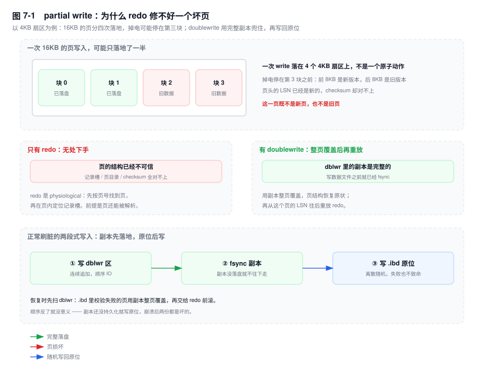

# 第 7 章　崩溃恢复与 Doublewrite

> **一句话结论**：doublewrite 保证"页是完整的"，redo 保证"修改不丢"，undo 保证"没提交的不算"——三件事由三套结构分工，缺任何一个，另外两个都白做。

## 7.0 场景：20 秒的启动，变成了 27 分钟

机房 UPS 年度检修，切换市电时整排机柜断了三分钟。电回来，机器全部自动启动，监控一片红——不是硬件坏，是实例没起来。

平时从 `systemctl start mysqld` 到能连上，20 秒。这一次，error log 里刷了 27 分钟同一种行：

```text
[InnoDB] Database was not shutdown normally!
[InnoDB] Starting crash recovery.
[InnoDB] Applying a batch of 10240 redo log records ...
[InnoDB] Apply batch completed!
[InnoDB] Applying a batch of 10240 redo log records ...
...
# 输出形态（未实跑）：批次行数取决于崩溃瞬间的 checkpoint age
```

两件事叠在一起：

- 掉电前，前一晚的订单归档任务把刷脏压垮了，checkpoint 落后了两个多小时（第 4 章 4.6）——恢复要把这两小时的 redo 全重放一遍；
- 归档任务是"一个事务删 60 万行"，跑到一半掉电，事务没提交——恢复还要把这 60 万行按 undo 一条条撤回去。

20 秒和 27 分钟之间，差的不是磁盘型号，是"崩溃那一刻，日志和页各自落后了多远"。

## 7.1 机制：三种"不完整"，三种补法

### 页写入不是原子的

磁盘的最小写入单位是扇区，512B 或 4KB。InnoDB 的页是 16KB，一次 `write` 要落 4 到 32 个扇区，中间没有任何原子性保证。

以 4KB 扇区为例，掉电停在第 3 个扇区之前，磁盘上这一页就是"前 8KB 新版本 + 后 8KB 旧版本"。更麻烦的是页头（第一个扇区）里存着 `FIL_PAGE_LSN` 和 checksum：

- 页头写成功了，它的 LSN 指向新版本，页内容却还是旧的；
- 页头没写成功，整个页的结构（记录槽、页目录）还停在旧版本。

两种都叫 **torn page**，也叫 partial write。

redo 为什么修不了它？因为 redo 是 physiological 的：先用页号定位到页，再在页内按记录槽定位修改（第 4 章 4.1）。重放一条"在第 7 个记录槽插入"之前，得先能读出这个页的记录槽分布；torn page 上这些结构是两份不同版本的混合体，checksum 又对不上，重放器根本不知道该往哪儿写。

所以 redo 的前提是：**页本身是一个完整的旧版本**。它能补"旧 → 新"的增量，补不了"半新半旧 → 完整"。

边界窄，但位置要命：页还没刷时 redo 够用，偏偏在"页刷到一半掉电"这一瞬它无能为力。



### doublewrite：先写副本，再写原位

页要落盘时走四步：整页写进 dblwr 区（连续、顺序）→ `fsync` 确认副本落地 → 写回 `.ibd` 原位（离散、随机）→ 原位成功后才允许回收副本。

恢复时反着用：先扫 dblwr，逐页校验 `.ibd` 里对应页的 checksum，坏的就用副本整页覆盖。**这一步必须排在 redo 之前**，因为它的产出是"一个完整的旧页"，而这正是 redo 需要的前提。

代价是刷脏的写放大变成 2 倍，但两次写性质不同：副本是顺序写、能攒批；随机写仍然只有一次。机械盘上成本可以忽略，SSD 上是实打实的双倍写带宽——这就是"要不要关 doublewrite"的全部内容。只有确认设备对 16KB 是原子的（部分企业级 NVMe 配合掉电保护）才有资格关；云盘上关掉，等于把"能不能起来"交给运气。

版本上有一处重要变化：

- `[5.7]` dblwr 区在系统表空间（ibdata1）里，只有 `innodb_doublewrite` 一个布尔开关，改完要重启。
- `[8.0.20+]` 拆成独立文件：`#ib_16384_0.dblwr`、`#ib_16384_1.dblwr`（文件名里的数字是页大小），位置由 `innodb_doublewrite_dir` 指定，默认跟数据目录。好处是 dblwr 的 IO 不再和 ibdata1 抢系统表空间，可以单独放一块盘上。同时多了两个批量参数：`innodb_doublewrite_pages`（每批写多少页）、`innodb_doublewrite_batch_size`（一批的页数上限）。调大则 `fsync` 变少、顺序写更长，代价是刷脏尾延迟变高。
- `[8.0.30+]` `innodb_doublewrite` 从布尔变成四个取值：`ON` / `OFF` / `DETECT_ONLY` / `DETECT_AND_RECOVER`。后两个是给"我想验证这块盘到底会不会 torn page"用的：`DETECT_ONLY` 照常写副本，但恢复时不用它修页，只做统计；`DETECT_AND_RECOVER` 才真的修。

再问一句：redo 为什么不需要 doublewrite？它的写入单位是 512B 日志块，自带 checksum，写坏了整块丢弃、恢复到这块之前（第 4 章 4.2）。原子粒度比数据页小一个数量级，靠校验就能识别，不需要第二份副本。

### 三者分工

把三套结构的职责压成一句话：

- **doublewrite 保证"页是完整的"**：它不关心页里是什么，只保证这一页要么是旧版本、要么是新版本，不会是混合体。
- **redo 保证"修改不丢"**：它不管事务提没提交，只把"页应该被改成什么样"按 LSN 顺序重放一遍。
- **undo 保证"没提交的不算"**：重做之后，未提交事务的修改已经落在页上了，必须按 undo 逆序撤销。

少任何一个都不成立：

- 没有 dblwr：页坏了，redo 无处可落，只能回备份；
- 没有 redo：页是完整的，但最后一次刷盘之后的修改没了，持久性直接不成立；
- 没有 undo：崩溃时未提交的删除被永久保留，原子性不成立，而且这些行还会被后续事务当成正常数据读到。


### 恢复三阶段

**分析**：从日志头里的 checkpoint 开始扫 redo（日志头存两份 checkpoint，取校验通过且最新的那份，第 4 章 4.2），重建两张表——脏页表（每个页的 `rec_lsn`）和活跃事务表。

**重做**：把脏页表里那些页的修改前滚到日志尾。真正开始 apply 的水位是脏页表里最小的 `rec_lsn`，它不会早于 checkpoint——checkpoint 的定义就是"这之前的修改都已落盘"，所以这之前不存在脏页。每页页头有 `FIL_PAGE_LSN`，重放时跳过"记录 LSN ≤ 页 LSN"的修改，这就是幂等的来源：同一段 redo 应用两次，结果一样。

重做只有一个线程在 apply，8.0 没有并行 redo apply。**恢复速度不随 CPU 核数提升**，"给数据库加机器"对缩短重启时间毫无用处。

**回滚**：活跃事务表里没有 commit 记录的事务，按 undo 逆序撤销。回滚本身也写 redo——否则回滚到一半再崩，就永远回滚不完了。

三个阶段串行跑完，实例才对外服务。所以"启动 27 分钟"就是这三段之和。

### 恢复时间为什么失控

只有两个乘数，其余都是它们的组合。

**第一个乘数：重做量 ≈ 日志尾 − checkpoint。** 也就是崩溃前的 checkpoint age，由"掉电时刷脏落后多少"决定。它和第 4 章那条雪崩链是同一个量：刷脏跟不上，在线时表现为 RT 抖动，崩溃后表现为重启变慢。

**第二个乘数：回滚量 ≈ 未提交事务改过的行数。** 一次删 60 万行，undo 里就有 60 万条反向记录，每条都要重新定位聚簇索引和所有二级索引。大事务在恢复时是整条启动路径上的独占段，比在线时更贵。

`innodb_fast_shutdown` 是唯一能提前干预的旋钮：

| 取值 | 关机时做什么 | 下次启动 |
|---|---|---|
| `0` | 刷完脏页、做完 full purge、合并 change buffer | 几乎不需要 recovery |
| `1`（默认） | 刷脏页，跳过 full purge 和 change buffer merge | 少量 recovery，purge 在启动后继续 |
| `2` | 只 flush redo，不刷脏页 | 等价于崩溃，完整三阶段 |

`=2` 不是"关机更快"，是"把成本挪到下次启动"，而且下次要花多久，你事先并不知道。真实事故：滚动升级时为了压缩窗口把 `=2` 写进了 my.cnf，下一次重启正好赶上一个没提交的批量任务，停机窗口从 1 分钟变成半小时。

反过来，升级到 8.0 之前必须先 `SET GLOBAL innodb_fast_shutdown = 0` 再关实例。8.0 的 undo 表空间和数据字典结构都变了，带着未 purge 的记录和未合并的 change buffer 起来会出问题。这是官方升级步骤里少数几个"不做就可能起不来"的动作。

### innodb_force_recovery：六级，每一级都在放弃什么

它是"起不来时愿意牺牲多少正确性"的刻度盘。

| 级别 | InnoDB 枚举 | 放弃什么 | 后果 |
|---|---|---|---|
| `1` | `SRV_FORCE_IGNORE_CORRUPT` | 遇到损坏页、损坏索引记录时不再中断，跳过它继续跑 | 查询可能返回不完整结果，坏页不会被修 |
| `2` | `SRV_FORCE_NO_BACKGROUND` | 不跑 master thread 和 purge 线程 | 恢复不会因 purge 中断，但 undo 只增不减，实例不能长期运行 |
| `3` | `SRV_FORCE_NO_TRX_UNDO` | 恢复后不做事务回滚 | 未提交事务的修改留在表里 |
| `4` | `SRV_FORCE_NO_IBUF_MERGE` | 不做 change buffer merge | 二级索引可能缺记录，未合并的插入还躺在 change buffer 里 |
| `5` | `SRV_FORCE_NO_UNDO_LOG_SCAN` | 不扫 undo，把未提交事务当已提交 | 脏读被永久化，回滚信息彻底丢失 |
| `6` | `SRV_FORCE_NO_LOG_REDO` | 完全不做 redo 前滚 | 页停在掉电那一刻的旧版本，数据可能倒退几个小时 |

（第 5 级在部分中文资料里被写成 `NO_UNDO_TRUNCATE`，那是 undo 表空间截断，不是"跳过 undo 扫描"。）

用法边界必须说清：

- **能做的**：让实例起来，把数据 `mysqldump` 出来，用 `CHECK TABLE` 定位是哪张表坏了。`innodb_force_recovery > 0` 时 InnoDB 会拒绝 `INSERT` / `UPDATE` / `DELETE`，实例事实上是只读的。
- **不能做的**：跑业务、当长期方案、在原地"修好继续用"。

正确姿势是阶梯式：`=1` 起不来就 `=2`，一次只加一级；起来立刻 dump，dump 完重建实例再导回去。你无法知道它跳过了哪些页，也就无法知道导出的数据缺了什么——行数核对、主键连续性、二级索引与聚簇索引的一致性校验，一个都不能省。

`=6` 尤其危险：它跳过的正是"让日志追上数据"这一步，救回来的是一个**内部自洽但时间倒退**的库，不是"最新的库"。

## 7.2 关键结论

1. **redo 只能修补"完整的旧页"，修不了"半新半旧的页"。** redo 是页内逻辑记录，重放前必须能解析页结构；torn page 上记录槽和 checksum 都是废的，所以 doublewrite 不是 redo 的冗余，而是 redo 的前置条件。
2. **doublewrite 的顺序是"副本 → fsync → 原位"，不能反。** 副本没持久化就写原位，崩溃后两份都是坏的，等于没做双写。
3. **三套结构各管一件事：页完整、修改不丢、没提交的不算。** 缺 dblwr 无处重放，缺 redo 丢修改，缺 undo 则未提交的修改被永久化。
4. **恢复时间 ≈ 重做量（checkpoint age）+ 回滚量（未提交行数），且都是单线程。** 加 CPU 无效，能改的只有"少攒脏页"和"别造大事务"。
5. **`innodb_force_recovery` 是取数工具，不是修复工具。** 它的每一级都在丢一致性，`=6` 拿到的是一个内部自洽、但时间倒退的库。
6. **`innodb_fast_shutdown=2` 只是把恢复成本记在下一次重启的账上。** 关机快的那几十秒，要用一个不可预测的启动时长来还。

## 7.3 实验验证

### 实验一：看一次真实的 crash recovery

```bash
kill -9 $(pidof mysqld)          # Buffer Pool 全丢，走的就是恢复路径
# 重新启动，然后盯 error log
tail -f /var/log/mysql/error.log
```

```text
[InnoDB] Database was not shutdown normally!
[InnoDB] Starting crash recovery.
[InnoDB] Applying a batch of 3041 redo log records ...
[InnoDB] Apply batch completed!
[InnoDB] Rollback of non-prepared transactions completed
# 输出形态（未实跑）：批次数 = checkpoint age / 每批记录数
```

解读：`Applying a batch` 出现几次，直接反映崩溃前 checkpoint 落后多少。想放大它，先跑一段 `sysbench oltp_write_only` 顶高 checkpoint age，再 `kill -9`。

### 实验二：确认 doublewrite 到底在哪、开没开

```sql
SHOW VARIABLES LIKE 'innodb_doublewrite%';
```

```bash
ls -lh /var/lib/mysql/*.dblwr
# -rw-r----- 1 mysql mysql ... #ib_16384_0.dblwr
# -rw-r----- 1 mysql mysql ... #ib_16384_1.dblwr
# 输出形态（未实跑）：8.0.20+ 才有这两个文件，大小随实例规模变化
```

解读：8.0.20+ 能看到 `innodb_doublewrite_pages` 和 `innodb_doublewrite_dir`；只有一行 `innodb_doublewrite` 就是 5.7。`dir` 为空表示跟数据目录。

### 实验三：把"恢复很慢"造出来

```sql
SET SESSION autocommit = 0;
BEGIN;
DELETE FROM orders WHERE created_at < '2024-01-01';   -- 60 万行，不提交
-- 直接 kill -9
```

对照组用同样的事务，但先 `COMMIT` 再 `kill -9`。两次都记录重启到能连上的耗时。

```text
# 输出形态（未实跑）：
# 对照组  启动 ≈ 20s，只有 redo 重放
# 实验组  启动 ≈ 20s + 回滚耗时，回滚耗时 ∝ 未提交事务改过的行数
```

解读：两次启动的差值就是第二个乘数。回滚是"读 undo + 反向定位索引 + 写页"，随机小 IO，磁盘 util 上不去，`top` 里也看不到高 CPU。想缩短它，唯一的办法是别让未提交事务长到 60 万行。

## 7.4 常见误区

⚠️ **"有 redo 就不需要 doublewrite"**

错在把两种"不完整"混成一种。redo 保证的是"日志里有的修改不丢"，它的重放依赖页能被解析；torn page 连页头里的 LSN 都可能是错的，重放器没有落点。判断依据：关掉它跑一次掉电演练，看能不能起来。

⚠️ **"doublewrite 让写入慢一倍"**

慢的只有刷脏路径，不是事务提交路径：提交走 redo，压根不碰数据页。刷脏时多出来的那次是顺序写，且能攒批；真正翻倍的是 SSD 上的写带宽，不是 RT。把 dblwr 放到独立盘（`innodb_doublewrite_dir`）就是为隔离这部分带宽。

⚠️ **"恢复慢一定是磁盘慢"**

重做是顺序读日志、随机写页，但瓶颈常常是**单线程 apply**：日志再多，也只有一个线程在推进。另一种情况是回滚：磁盘很闲，CPU 也很闲，却在按行撤销一个 60 万行的事务。

⚠️ **"`innodb_force_recovery=6` 是最后的救命稻草"**

它是"承认 redo 不可信"的声明。`=6` 之后页停在掉电瞬间的旧版本，看起来能查、能 dump，但数据可能倒退几个小时，而且没有标记告诉你退了多久。真正的最后手段是备份 + binlog 补数，`force_recovery` 只是中间那一步"把还能读的东西读出来"。

⚠️ **"恢复到一半又崩了，前面的白做"**

重做是幂等的：每页按 `FIL_PAGE_LSN` 跳过已应用过的记录。恢复本身也刷页、写 redo、推进 checkpoint，第二次崩溃只是从更靠后的 checkpoint 重来，不会把修好的页弄坏。

## 7.5 生产 Checklist

- [ ] `innodb_doublewrite` 是否为 `ON`？如果关了，有没有"设备保证 16KB 原子写"的书面依据，而不是"SSD 应该没事"
- [ ] 8.0.20+ 是否把 `innodb_doublewrite_dir` 指到了独立盘？dblwr 和数据文件抢同一块盘的带宽，等于双写白做
- [ ] 是否有 checkpoint age 的告警？它同时是在线 RT 抖动和重启时长的先行指标，建议 60% / 75% / 85% 三档
- [ ] 大事务是否有行数上限？单事务改 10 万行以上，恢复时间的第二个乘数就被你亲手调大了
- [ ] 关闭实例的标准动作是不是 `innodb_fast_shutdown=0`？尤其在做版本升级、机房搬迁之前
- [ ] my.cnf 里是否残留 `innodb_fast_shutdown=2`？它让每次重启都变成一次赌博
- [ ] 是否演练过 `innodb_force_recovery` 的阶梯流程，包括"dump 出来之后怎么校验数据完整性"
- [ ] 备份策略能否覆盖"torn page 只能回备份"这个最坏情况？dblwr 不是备份，它只保护正在写的页

## 7.6 延伸

- **上一章**：第 6 章讲两阶段提交，redo 与 binlog 在提交点对齐；本章讲对齐之后、崩溃之后怎么把状态找回来。
- **前置**：第 3 章的页结构（`FIL_PAGE_LSN` 在页头）、第 4 章的 checkpoint 与 LSN 四个水位、第 5 章的 undo 链。
- **下一章**：第 8 章从 B+ 树讲索引，回滚时"逐条反向定位索引"的成本在那里会变成具体的树高问题。
- **关联章节**：第 21 章（大事务治理）、第 39 章（`SHOW ENGINE INNODB STATUS` 逐段精读）、第 41 章（故障复盘案例）。
- **面试追问**：
  - "有了 redo 为什么还要 doublewrite？" → redo 是页内逻辑记录，重放要求页可解析；torn page 上页结构已废，只能靠整页副本先修好页，再重放。
  - "崩溃恢复的三个阶段各干什么？" → 分析建脏页表与活跃事务表，重做把脏页前滚到日志尾，回滚用 undo 撤销未提交事务。
  - "`innodb_force_recovery=6` 之后数据是什么状态？" → 页停在掉电瞬间的旧版本，内部自洽但时间倒退，只能 dump 不能当生产库。
  - "为什么恢复不能并行？" → 8.0 的 redo apply 是单线程串行推进的，LSN 顺序就是依赖顺序；加核不加速。
- **官方文档**：MySQL 8.0 Reference Manual → InnoDB → *InnoDB Disk I/O and File Space Management*（doublewrite buffer）、*InnoDB Startup Options and System Variables*（`innodb_doublewrite`、`innodb_doublewrite_dir`、`innodb_force_recovery`、`innodb_fast_shutdown`）、Server Administration → *Troubleshooting* → *Forcing InnoDB Recovery*。
