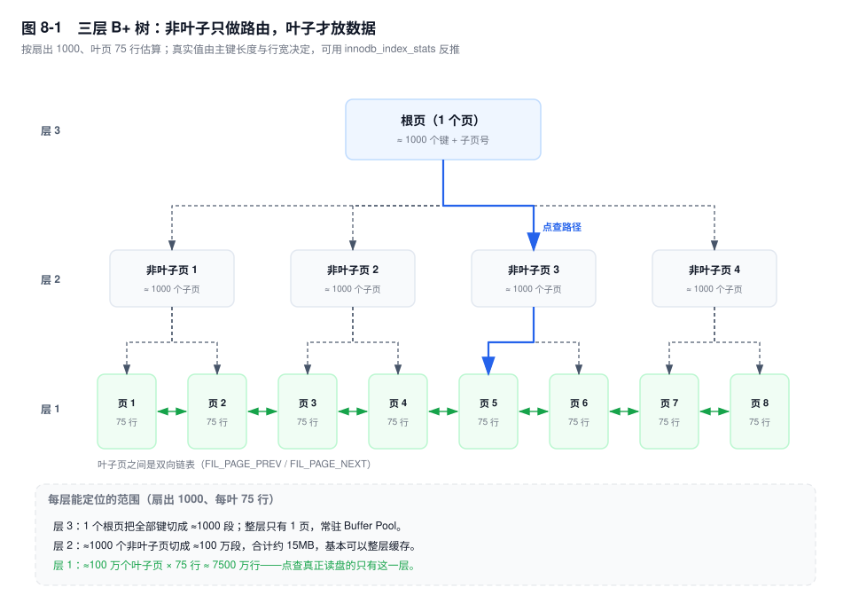
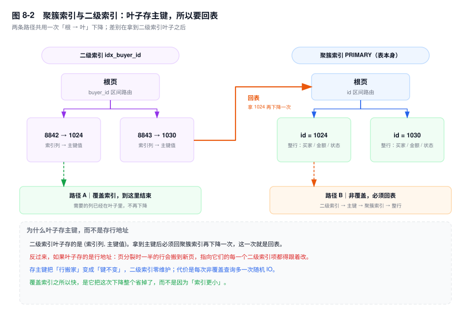
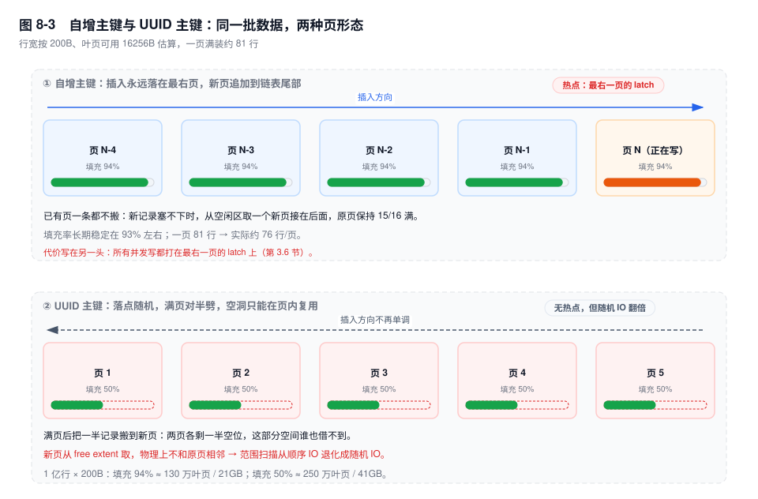

# 第 8 章　B+ 树与索引组织表

> **一句话结论**：InnoDB 的表就是一棵按主键排序的 B+ 树，主键不是"一列"，是每一行的物理地址——它有多长决定树有多高，它有多随机决定页有多满，它一变，所有二级索引都得跟着重建。

## 8.0 场景：主键换成 UUID 的那一周

订单主表 `order_main`，2.1 亿行，主键 `id BIGINT AUTO_INCREMENT`。三件事推着团队改主键：要分库分表，不想再维护号段服务；订单号要能直接给客服和前端看；跨系统导入不能撞号。方案很自然——`id CHAR(36)`，应用侧 `UUID()` 生成。

灰度 30% 流量的第一个晚上，四条监控线同时拐弯：

- 写入 TPS 从 8000 掉到 2600，`iostat` 的写 IOPS 翻倍，`await` 从 1ms 涨到 8ms。
- 第二天 `du -sh` 数据目录：1.1TB → 2.2TB。
- 从库延迟 200ms → 40s，`Slave_SQL_Running_State` 卡在 `Waiting for dependent transaction to commit`。
- `Innodb_buffer_pool_wait_free` 开始非零，脏页刷不过来了。

没有改 SQL，没有加索引，没有加字段。只改了一个列的类型和它的生成方式。

要说清楚的是：这不是 UUID 的错。UUID 在干它该干的事——去中心、不撞号。错在把它放进了"主键"这个位置。在 InnoDB 里，主键不是一个普通列，**它是行的物理地址**。地址变长、变随机，代价会沿着"页 → 树 → 索引 → 复制"逐级放大，而且每一级都收一次费。



## 8.1 机制

### 一、六种结构，六种"把代价放在哪"的选择

索引要做的事只有一件：把"找一行"的比较次数从 O(n) 压到 O(log n)。所有结构的分歧不在这里，而在**多出来的那份有序结构放在哪、写入时怎么维护它、读取时怎么把它拼回去**。三个问题就能把这六种结构分开：写入是随机还是顺序？读取是点查还是范围？放大加在读、写还是空间上？

| 结构 | 解决的瓶颈 | 付出的代价 | 典型实现 |
|---|---|---|---|
| B 树 | 减少比较次数，点查可能在非叶子就命中 | 非叶子也存整行 → 扇出小 → 树更高；范围扫描要在父子节点间来回回溯 | 早期数据库、部分文件系统 |
| B+ 树 | 磁盘随机 IO 的次数（树高）、范围扫描的顺序性 | 点查必须走到叶子；写入要维护叶链与页分裂 | InnoDB、MyISAM |
| LSM | 把随机写变成顺序追加 | 读要合并内存表与多层 SSTable；compaction 抢 IO；空间放大 | RocksDB、MyRocks、HBase |
| 哈希 | 等值查询 O(1) | 不支持范围与排序；扩容要 rehash；冲突多了退化 | Redis、Memcached、InnoDB AHI |
| 跳表 | 内存里的有序结构，实现简单、并发友好 | 指针跳跃在磁盘上就是一次随机 IO | Redis zset、LevelDB memtable |
| 倒排 | 从"包含某个词"反查文档 | 写入要分词、维护 posting list；更新一行要改多个词 | Lucene/ES、InnoDB FULLTEXT |

这张表的读法是看"代价"那一列：没有一种结构是免费的，选型就是选把放大放在哪。

- **B+ 树把放大放在写**：每次 INSERT 都要在树上找到位置、可能分裂页、写 redo。换来的是读的时候一次下降到底，范围扫描顺着叶链走。
- **LSM 把放大放在读和 compaction**：写入只追加，但读一个 key 可能要查 memtable + 多层 SSTable。所以"什么时候该换 MyRocks"的判断标准不是数据量，是读写比——写占七成以上、且能接受范围扫描变慢，才划算。
- **哈希把放大放在"能力缺失"**：它根本不支持范围。InnoDB 的 Adaptive Hash Index 只加速等值查询，一旦 SQL 里有 `>` 或 `ORDER BY`，它一点忙都帮不上。
- **倒排解决的不是"找行"，是"找包含"**：`LIKE '%关键词%'` 这种需求 B+ 树永远做不好，因为前缀无序。倒排的代价是写入要分词、更新要改多个 posting list，所以它通常被搬到 ES，MySQL 只留主数据。

InnoDB 选 B+ 树，是因为它的主场景是单机、读多写少、点查与范围各占一半、数据量在千万到十亿。这个选择把成本压在了"每次写入多维护一棵树"，而不是"每次读都要合并多层"。

### 二、两条硬性设计：非叶子只存键，叶子串成双向链表

B+ 树相对 B 树只改了两件事，但这两件事决定了它能装多少行。

**第一条：非叶子节点只存键和子页号，不存行。**

这不是为了省空间，是为了扇出。算一下就知道差多少。假设行宽 200 字节，非叶子记录按 InnoDB 的真实格式算是 `5（记录头）+ 8（BIGINT 键）+ 4（子页号）= 17 字节`，一页 16KB 能放约 950 条；如果非叶子也存整行，一条记录就是 217 字节，一页只能放 74 条。

三层树，扇出 950 时能装 `950 × 950 × 78 ≈ 7000 万`行；扇出 74 时只能装 `74 × 74 × 74 ≈ 40 万`行。**同样三层，差 170 倍。**

差 170 倍意味着什么？意味着后者要把这 7000 万行装下，需要五层树；而每一层都是一次随机 IO。所以"B 树也能做索引，为什么不用"的答案不是"B+ 树更先进"，是**B 树的非叶子存了不该存的东西，把扇出吃掉了**。

**第二条：所有叶子页用双向链表串起来。**

如果没有这条链，`WHERE id BETWEEN 10000 AND 20000` 会变成一场灾难：找到起点之后，每取下一行都要重新从根下降一次，因为 B+ 树只有父到子的指针，没有"下一个叶子"的指针。10 万行的范围查询 = 10 万次从根到叶的下降。有了链表，就是一次下降 + 顺着 `FIL_PAGE_NEXT` 读 1300 个页（按每页 78 行算）。

用双向而不是单向，是为了让优化器可以从尾部倒着扫。`ORDER BY id DESC LIMIT 10` 在 8.0 里会走 `Backward index scan`——从最右叶子往回读 10 条就停，而不是把整个结果集读出来再倒排。

### 三、扇出推导：三层到底能装多少行

这个数字被引用得太多，推导得太少。一步一步来，假设 `innodb_page_size=16K`。

**第一步，算一页有多少可用字节。**

```
16384（页大小）
- 38（File Header）- 56（Page Header）
- 26（Infimum + Supremum）- 8（File Trailer）
= 16256
- Page Directory（约 2%，非叶子页记录少，槽也少）
≈ 16100 字节可用
```

**第二步，算一条非叶子记录多大。**

InnoDB 的非叶子记录是"键 + 4 字节子页号"，没有别的：

```
5（记录头）+ 8（BIGINT 主键）+ 4（子页号）= 17 字节
16100 ÷ 17 ≈ 947
```

有些资料按"键 8 字节 + 6 字节页指针 = 14 字节"估，得出一页 1150 项。这个口径忽略记录头、且把页号按 48 位算，是理论上的**上限**；InnoDB 实际用的是 4 字节页号，所以要带上 5 字节记录头。两个口径差 20%，都算"约 1000"，够用了。

**第三步，算一个叶子页能放多少行。**

200 字节的行宽（订单号 + 买家 + 金额 + 状态 + 时间 + 几个整型）：

```
16100 ÷ 200 ≈ 80 行
扣掉页目录与碎片，实际 75 ~ 80 行
```

**第四步，乘起来。**

```
947 × 947 × 78 ≈ 7000 万行
```

三层树装 7000 万行，点查需要 3 次页访问。但根页几乎永远在 Buffer Pool 里，第二层（约 950 个页、15MB）通常也能整层缓存，**所以真实落盘的是 1 次随机 IO**。

这里有个必须记住的推论：**层数是行宽的函数，不是常数。**

- 行宽 200B、每页 78 行 → 三层 7000 万。
- 行宽 700B、每页 23 行 → 三层 2000 万（这就是常说的"两千万"）。
- 行宽 1KB、每页 16 行 → 三层 1400 万。
- 再加一层，直接到百亿级。

所以"三层能装多少行"这个问题，正确的回答是反问："你的行有多宽？"一张 60 列的宽表，还没等到数据量变大，就先被自己的行宽送到了四层。

### 四、聚簇索引与索引组织表：表就是索引

InnoDB 没有"堆表 + 行地址"这一层。一张表就是一棵以主键为键的 B+ 树，**叶子页里放的是完整行**。这种"数据即索引"的结构叫索引组织表（Index-Organized Table，IOT）。

由此推出三个日常现象：

1. **主键查询只下降一次。** `WHERE id = 1024` 从根走到叶，叶子里就是整行，没有第二次跳转。
2. **二级索引查询要下降两次。** 二级索引的叶子存的是 `(索引列, 主键值)`，不是行。拿到主键之后，还得回聚簇索引再走一遍。这就是"回表"的物理含义。
3. **覆盖索引省的就是这一次。** 如果 `SELECT` 需要的列都在二级索引的叶子里（索引列本身 + 主键），第二次下降整个不需要发生。



**反证：如果二级索引叶子存的是行地址，会怎样？**

行地址指的是行在页里的物理位置。问题在于，这个位置**不稳定**：页分裂时一半的行会搬到新页，行地址全变；`OPTIMIZE TABLE` 重建表时全部行地址都变。

于是一次分裂就不再是"改两个页"，而是"改两个页 + 把这半页几十行的地址，在每一棵树里都改一遍"——一张有 5 个二级索引的表，就是 6 棵树。而分裂不是异常，是常态：按每页 78 行算，每插入 78 行就有一次。

InnoDB 的解法是把"物理地址"换成"逻辑地址"：二级索引存主键值。行搬家，主键不变，二级索引一个字节都不用改。**代价被转移到了读路径上——多一次下降。**

这个取舍还有一条隐藏条款：**主键一旦被更新，就等于删一行 + 插一行 + 重建该行在所有二级索引里的条目**。所以"主键不可更新"不是规范洁癖，是物理约束。业务上"手机号做主键、换绑就 UPDATE 主键"的写法，代价是每一次换绑都要动全表所有索引。

### 五、主键过长的连锁代价：一份长度，六份账单

回到 8.0 的场景。把 `BIGINT`（8 字节）换成 `CHAR(36)`，多数人只算了第一笔账：每行多 28 字节。实际有六笔。

**第一笔，聚簇索引本身。** 2.1 亿行 × 28B ≈ 5.9GB，白给。

**第二笔，每个二级索引的叶子。** 每个索引项多 28 字节。订单表上 5 个二级索引，就是 5 × 5.9GB ≈ 29GB。

**第三笔，二级索引的页数。** 这笔最容易被漏掉。一个 `(buyer_id)` 索引项，BIGINT 主键时是 `5 + 8 + 8 = 21` 字节，一页装约 766 条；换成 CHAR(36) 后是 `5 + 8 + 36 = 49` 字节，一页只装约 328 条。**同样的数据，页数变成 2.3 倍。** 一次走二级索引的查询，要多读一倍多的页。

**第四笔，扇出与树高。** 非叶子记录从 `5+8+4=17` 字节变成 `5+36+4=45` 字节，扇出从 947 掉到 357。在 5000 万行、行宽 200B 的口径下：BIGINT 主键 `947² × 78 ≈ 7000 万`，三层够用；UUID 主键 `357² × 70 ≈ 890 万`，三层装不下，被推到**四层**。多一层意味着每一次点查多一次随机 IO，而且是所有查询、所有并发一起多。

**第五笔，比较成本。** 整数比较是一条指令；36 字节字符串比较要逐字节走，还要过 collation。页内二分做 5 次、组内线性走 8 次，每次比较都从 1 个指令变成十几个。

**第六笔，连带的所有"顺带存主键"的地方。** 排序的 sort buffer、临时表、`GROUP BY` 的哈希键、binlog 里的行镜像、二级索引的唯一性检查——全都按 36 字节走。

这六笔加起来，才能解释 8.0 里那个"TPS 掉到三分之一、磁盘翻倍"。第一笔只占其中很小一部分。

### 六、物理顺序、逻辑顺序，以及 ORDER BY 的三个前提

索引有两套顺序，别混：

- **逻辑顺序**：B+ 树按键排好的顺序，由比较规则决定。
- **物理顺序**：页在文件里的位置、记录在页内的偏移。它由分配和分裂决定，和逻辑顺序无关——第 3 章讲过，后插入的小主键可能落在物理上更靠前的位置。

索引范围扫描读的是逻辑顺序：从起点叶页开始，沿 `FIL_PAGE_NEXT` 往右。但相邻的逻辑页不一定物理相邻（分裂出来的新页从空闲区取），所以一次范围扫描的 IO 形态是"**extent 内顺序、extent 间随机**"。这也是为什么范围扫描比全表扫快得多、却仍然不如纯顺序读。

`ORDER BY` 能省掉排序，靠的就是"读出来的顺序已经是对的"。三个前提，缺一即 `Using filesort`：

**前提一：最左前缀。** `ORDER BY` 的列必须是索引的最左连续前缀。`idx(a, b)` 支持 `ORDER BY a, b` 和 `ORDER BY a`，不支持 `ORDER BY b`。注意 `WHERE` 里的等值条件可以"跳过"：`WHERE a = 1 ORDER BY b` 是能用的，因为 `a` 被固定成一个值之后，剩下的部分按 `b` 有序。

**前提二：方向一致。** 所有排序列的升降方向，必须和索引的定义一致。`ORDER BY a ASC, b DESC` 需要 `(a ASC, b DESC)` 的索引。`[5.7]` 里 `DESC` 只是语法，建出来的仍是升序索引，混合方向一定 filesort；`[8.0]` 才真正支持降序索引。全部同向时，优化器还可以整体反向扫描，不必为 `DESC` 单独建索引。

**前提三：不被范围打断。** 一旦某一列用了范围条件，它后面的列就不再全局有序。`WHERE a > 1 ORDER BY b` 用不上 `idx(a, b)` 的排序能力，因为 `a > 1` 跨越了多个 `a` 值，每个 `a` 内部 `b` 有序、整体无序。`IN` 同理：`WHERE a IN (1, 2) ORDER BY b` 是两段拼接，整体也不保序。

还有一条不算前提、但经常盖过前提的：**即使能走索引排序，优化器也可能不选它。** 如果过滤后行数很少，filesort 在内存里排几十行比顺着索引读几千个页更便宜。所以判断依据不是"有没有索引"，是 `EXPLAIN` 的 `Extra` 里有没有 `Using filesort`。

### 七、主键选择：四个维度，没有全能选手

| 方案 | 页分裂 | 写热点 | 索引体积 | 可读性与运维 |
|---|---|---|---|---|
| 自增 BIGINT | 只右分裂，填充率约 93% | 集中在最右一页，高并发时页 latch 争用 | 8B，最小 | 不可读；分片靠步长或号段 |
| UUIDv4 `CHAR(36)` | 50/50 分裂，填充率约 50% | 无热点 | 36B，最差 | 可读；不可排序，不能做范围 |
| 雪花 / UUIDv7 | 近似右分裂（时间前缀有序） | 落在"当前时间窗"的一小段，比单页宽、比全表窄 | 8B / 16B | 含时间，可粗略排序 |
| 业务主键 | 取决于业务值是否单调 | 取决于业务值分布 | 不可控 | 可读性最好；但可能被修改 |



判断顺序是这样的：

- **单机、写入几千 TPS、三年内不打算分片**：自增 `BIGINT`。别为了"以后可能分片"提前付 UUID 的账，那笔账是每天都在付的。
- **要分片、要客户端生成、不能依赖中心服务**：雪花（8B）或 UUIDv7。关键不是"是不是 UUID"，是**有没有时间前缀**。有前缀就等于把随机写变回了近似顺序写。
- **已经上了 UUIDv4**：至少转成 `BINARY(16)` 存，别用 `CHAR(36)`，长度与比较成本立刻降一半。但别指望它能变有序——v4 是纯随机数，`UUID_TO_BIN(uuid, 1)` 只对 v1 有效（把时间高位前置）。想要有序，只能换生成策略。
- **业务主键（订单号、手机号、身份证）**：只做唯一索引，不做聚簇主键。它可能被修改，长度不可控，还可能泄露信息。

一个常被忽略的点：**自增的代价不在读，在写的最右一页。** 所有并发插入都打在同一个页的 latch 上，`innodb_autoinc_lock_mode=2` 解决的是自增值分配，解决不了页内争用。分库分表的步长法、号段模式，本质都是把这一页摊成多页。

## 8.2 关键结论

1. **B+ 树的层数就是点查的随机 IO 次数。** 扇出由"非叶子记录多大"决定，所以主键长度直接决定树高——36 字节主键在 5000 万行时会把三层推到四层。
2. **叶子存主键而不是行地址，是用一次回表换写入路径的稳定。** 行搬家时主键不变，所有二级索引零维护；代价是非覆盖查询多一次下降。
3. **索引组织表里，主键是行的物理地址。** 更新主键 = 删一行 + 插一行 + 重建该行在所有二级索引里的条目。
4. **主键长度会被所有二级索引重复计费。** 5 个二级索引的表，36 字节主键相当于每行多存 6 份 28 字节，页数还要再乘 2.3。
5. **`ORDER BY` 走索引需要三个前提同时成立**：最左前缀、方向一致、不被范围或多值条件打断。缺一个就是 `Using filesort`。
6. **"三层能装多少行"没有标准答案。** 行宽 200B 约 7000 万，行宽 1KB 只剩 1400 万——宽表先用层数惩罚你。

## 8.3 实验验证

### 实验一：用 `innodb_index_stats` 反推扇出与每叶行数

扇出推导里的 947 和 78 都可以被实测反推。`mysql.innodb_index_stats` 里，`size` 是索引总页数，`n_leaf_pages` 是叶子页数，两者之差就是非叶子页数。

```sql
SELECT index_name, stat_name, stat_value
FROM mysql.innodb_index_stats
WHERE database_name = 'shop'
  AND table_name = 'order_main'
  AND stat_name IN ('size', 'n_leaf_pages')
ORDER BY index_name, stat_name;
```

```text
-- 输出形态（未实跑，字段含义以此为准）
index_name        stat_name       stat_value
PRIMARY           n_leaf_pages       2694000
PRIMARY           size               2696843
idx_buyer_id      n_leaf_pages        812000
idx_buyer_id      size                812900
```

怎么读：

- `n_leaf_pages × 16384 / 行数` ≈ 每页行数，和推导的 75~80 对一下。对不上就说明行宽估错了。
- `size - n_leaf_pages` 是非叶子页数。用"叶页数 ÷ 非叶子页数"反推扇出，和 947 对一下。
- 三个数一起看，能判断统计信息是否过期：`information_schema.INNODB_TABLESTATS.NUM_ROWS` 和实际行数差一个数量级，就先 `ANALYZE TABLE`。

### 实验二：同数据、两种主键，比页数与分裂次数

```sql
CREATE TABLE t_auto (
  id BIGINT UNSIGNED NOT NULL AUTO_INCREMENT PRIMARY KEY,
  buyer_id BIGINT NOT NULL,
  amount DECIMAL(12,2) NOT NULL,
  created_at DATETIME NOT NULL,
  KEY idx_buyer (buyer_id)
) ENGINE=InnoDB;

CREATE TABLE t_uuid (
  id CHAR(36) NOT NULL PRIMARY KEY,
  buyer_id BIGINT NOT NULL,
  amount DECIMAL(12,2) NOT NULL,
  created_at DATETIME NOT NULL,
  KEY idx_buyer (buyer_id)
) ENGINE=InnoDB;

SET GLOBAL innodb_monitor_enable = 'index_page_splits';

-- ① 先清计数，再顺序灌 t_auto 200 万行
SET GLOBAL innodb_monitor_reset = 'index_page_splits';
-- （灌数据：id 用 AUTO_INCREMENT，buyer_id 随机）
SELECT COUNT AS splits_auto FROM information_schema.INNODB_METRICS
WHERE NAME = 'index_page_splits';

-- ② 清计数，再随机灌 t_uuid 200 万行
SET GLOBAL innodb_monitor_reset = 'index_page_splits';
-- （灌数据：id = UUID()，buyer_id 随机）
SELECT COUNT AS splits_uuid FROM information_schema.INNODB_METRICS
WHERE NAME = 'index_page_splits';

-- ③ 比体积
SELECT TABLE_NAME, DATA_LENGTH, INDEX_LENGTH
FROM information_schema.TABLES
WHERE TABLE_SCHEMA = 'shop' AND TABLE_NAME IN ('t_auto', 't_uuid');
```

```text
-- 输出形态（未实跑，字段含义以此为准）
splits_uuid ≈ splits_auto × 2        ← 50/50 分裂 vs 右分裂
t_uuid.DATA_LENGTH ≈ t_auto × 1.8~2.0
t_uuid.INDEX_LENGTH > t_auto         ← 主键被复制进二级索引
```

计数必须分开清、分开读：`index_page_splits` 是实例级累计值，两张表灌完再读一次，拿到的是两者之和。

第二行验证填充率，第三行验证"主键长度被二级索引重复计费"。这两个数字放在一起，就是 8.0 场景的完整解释。

### 实验三：三个前提各破一个，看 `Using filesort`

```sql
-- 索引：KEY idx_buyer_ct (buyer_id, created_at, id)
EXPLAIN SELECT id FROM order_main
WHERE buyer_id = 8842 ORDER BY created_at, id;
-- Extra: Using index                      ← 等值前缀 + 同向，流天然有序

EXPLAIN SELECT id FROM order_main
WHERE buyer_id = 8842 AND created_at > '2026-01-01' ORDER BY id;
-- Extra: Using where; Using index; Using filesort   ← 前提三被范围打断

EXPLAIN SELECT id FROM order_main
WHERE buyer_id = 8842 ORDER BY created_at DESC, id ASC;
-- Extra: Using where; Using index; Using filesort   ← 前提二方向不一致
```

第二、三条和被第一条的差别只在 `WHERE` 与 `ORDER BY` 的方向，但命运完全不同。这比背"最左前缀"四个字有用：**规则不是"必须从第一列开始"，是"读完的流是否天然有序"。**

顺便说一句为什么这里不演示"最左前缀"的反例：如果拿 `ORDER BY id` 去试 `idx(created_at, id)`，优化器会直接改走主键索引——主键本来就按 `id` 有序，结果是"没排序"，容易让人误以为最左前缀不重要。要验证它，得换成 `ORDER BY amount` 这种索引里根本没有的列。

## 8.4 常见误区

⚠️ **"索引越多，查询越快"**
每个二级索引都是一棵独立的 B+ 树。加一个索引，写入就要多维护一棵树：多一次随机页写、多一份 redo、多一份页分裂的概率。写入 1 万 TPS 的表上，每个多余索引都在按万次/秒计费。正确的判断是"这个索引支撑哪条查询、它的选择性是多少、写入代价能不能接受"，而不是"先加上再说"。

⚠️ **"联合索引和多个单列索引等价"**
`idx(a, b)` 一棵树同时覆盖 `a`、`(a, b)` 两种前缀，`WHERE a=1 AND b=2` 一次下降到位。两个单列索引要靠 index merge 合并两个 rowid 集合，再回表，代价是两次下降 + 一次集合运算，而且优化器经常干脆不用。它们在物理上就不是一回事。

⚠️ **"UUID 主键只是每行多占 28 字节"**
28 字节只是第一笔账。真正的代价是：50/50 分裂让页数接近翻倍、随机落点让 Buffer Pool 里的热页集合变成整棵树、36 字节主键被每个二级索引复制一遍、扇出从 947 掉到 357 把三层推到四层。磁盘翻倍的谜底在第二笔和第三笔上，不在第一笔。

⚠️ **"`ORDER BY` 的列上有索引就不会排序"**
三个前提缺一不可。`WHERE a > 1 ORDER BY b` 即使有 `idx(a, b)` 也一定 filesort，因为范围条件之后的部分不再全局有序。判断方法只有一个：看 `EXPLAIN` 的 `Extra` 里有没有 `Using filesort`。

⚠️ **"三层 B+ 树能装 2000 万行，我的表 1800 万，不用分表"**
2000 万对应的是 700B 左右的行宽。行宽 200B 能装 7000 万，行宽 1KB 只能装 1400 万。而且容量从来不是分表的唯一维度——写入 QPS、DDL 窗口、备份恢复时间、单机连接数，任何一项先到顶，都得拆。

⚠️ **"主键就是个标识，改了不影响别的"**
在索引组织表里改主键，等于把这一行从树的一个位置搬到另一个位置，同时在**每一个**二级索引里删掉旧条目、插入新条目。一次 `UPDATE id = ...` 的代价，和"删一行 + 插一行 × (1 + 索引数)"是同一个量级。

## 8.5 生产 Checklist

建表与评审时逐条过：

- [ ] 主键类型是定长、短、单调的吗？`BIGINT`（8B）是默认答案，`CHAR(36)` 需要给出理由。
- [ ] 如果必须用 UUID，存的是 `BINARY(16)` 还是 `CHAR(36)`？是不是时间有序的版本（v7，或 v1 + `UUID_TO_BIN(...,1)`）？
- [ ] 行宽估算过吗？按 200B / 700B / 1KB 三档，分别算一下三层树能装多少行，和当前数据量对一对。
- [ ] 表上有几个二级索引？每个都能说清楚"支撑哪条查询"吗？选择性低于 10% 的索引有没有存在必要？
- [ ] 主键有没有被业务更新的可能？如果有，`UPDATE` 语句里改的是主键还是普通唯一键？
- [ ] 高频 `ORDER BY` 的列顺序、方向，和索引定义一致吗？`EXPLAIN` 里还有 `Using filesort` 吗？
- [ ] 业务主键（订单号、手机号）是不是只做了唯一索引，没有拿来做聚簇主键？
- [ ] 用 `innodb_index_stats` 核对过 `n_leaf_pages` 与行数的比值吗？它和行宽估算对得上吗？

## 8.6 延伸

- **上一章**：第 3 章讲了页的内部布局、`FIL_PAGE_PREV/NEXT` 与页分裂——本章的树是建在那些页上的。
- **下一章**：第 9 章讲索引设计与失效，本质是把本章的"有序性"落到具体 SQL 上：哪些写法能读到有序流，哪些读不到。
- **关联章节**：第 2 章（Buffer Pool 与根页常驻）、第 10 章（统计信息里的 `n_leaf_pages`）、第 11 章（`type=index` 与 `Using filesort`）、第 14 章（filesort 的两种算法）、第 29 章（字符集如何让索引变长）、第 30 章（自增、雪花与写热点）、第 33 章（分片后的全局唯一）。
- **面试追问**：
  - "为什么 InnoDB 用 B+ 树不用 B 树？" → 非叶子存行会把扇出从 947 压到 74，三层容量从 7000 万掉到 40 万，差 170 倍。
  - "三层 B+ 树能存多少行？" → 反问行宽。200B 约 7000 万，700B 约 2000 万，1KB 约 1400 万。
  - "二级索引为什么不存行地址？" → 页分裂会搬行，行地址全变，所有二级索引都要改；存主键则主键不变，代价转移到读路径的一次回表。
  - "UUID 主键为什么慢？" → 三条：50/50 分裂使页数翻倍、随机落点让热页集合变成整棵树、36 字节主键被每个二级索引复制一遍并压低扇出。
- **官方文档**：`InnoDB Index Types`、`Clustered and Secondary Indexes`、`Physical Structure of an InnoDB Index`、`ORDER BY Optimization`、`mysql.innodb_index_stats Table`。
