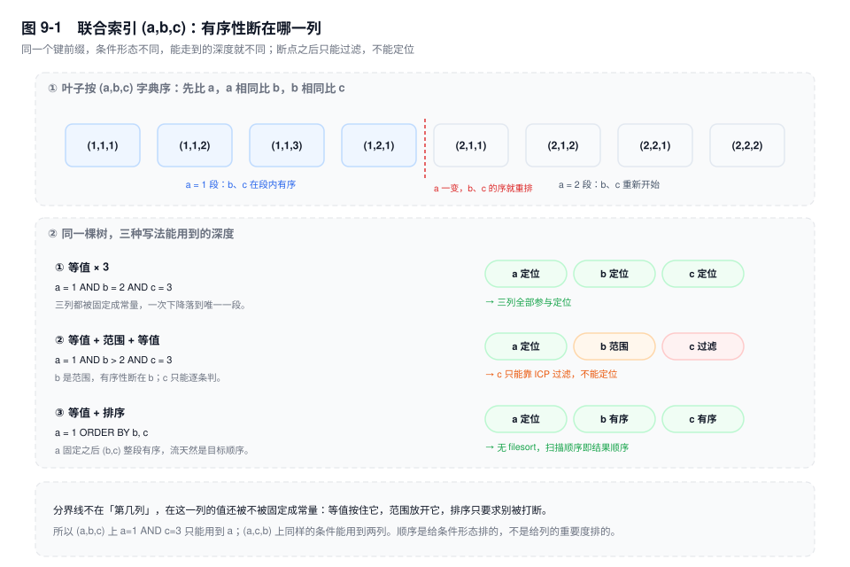
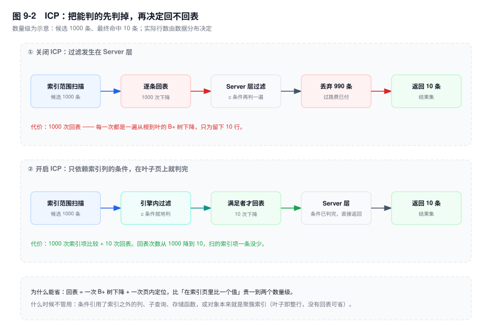
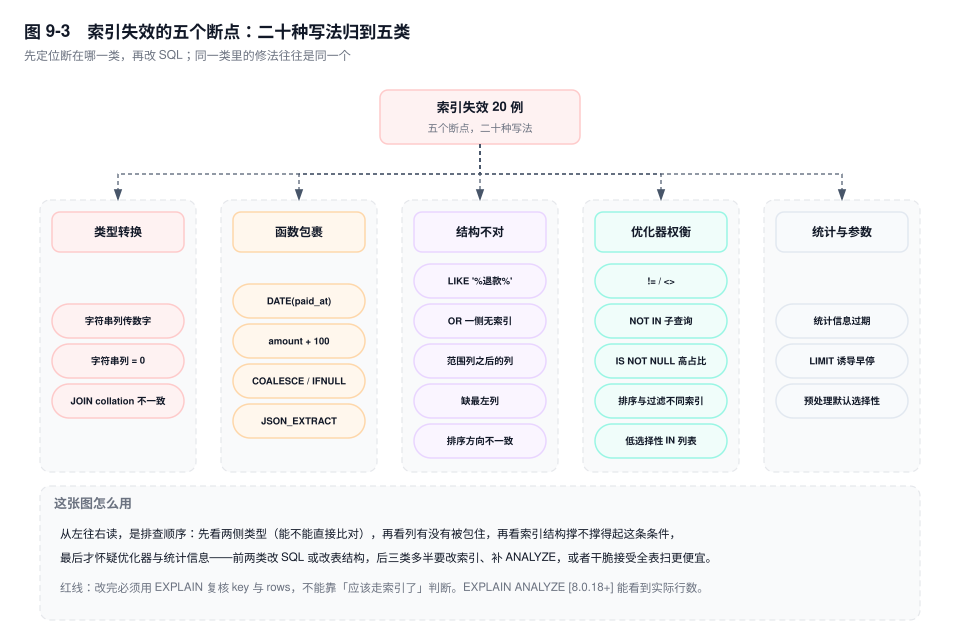

# 第 9 章　索引设计与失效全景

> **一句话结论**：索引失效不是"没用上索引"，是"这条 SQL 要的那个顺序，这棵树给不了"——断点只可能出现在三处：值被换了一种类型、列被包进了一个函数、有序性被范围或多值条件放开。

## 9.0 场景：测试库走 range，生产库走 ALL

客服后台有个按手机号查单的接口：

```sql
SELECT order_no, status, paid_at FROM order_main WHERE phone = ?;
```

压测在测试库跑：`type=range`，`key=idx_phone`，`rows` 个位数，P99 12ms。上线第一小时，同一份代码、同一条 SQL、同样存在的 `idx_phone`，变成 `type=ALL`，`rows` 2100 万，接口超时。

两个库的差别只有一处：测试库 `phone BIGINT`（去年按规范新建的），生产库 `phone VARCHAR(20)`（十年前的老订单系统存成了字符串，迁移时为"不动历史数据"保留了下来）。

团队的第一反应是"生产库索引没建"。查了，索引在。第二个反应是"隐式类型转换"。方向对了，但只对了半句——隐式转换天天在发生，多数时候索引照样能用。

决定生死的是**转换方向**。字符串和数字比较时，MySQL 把**字符串那一侧**转成 `double` 再比：

- 列是 `BIGINT`、值是字符串 `'13800138000'` → 转的是值，列本身不动，索引上的顺序还是那个顺序，照用。
- 列是 `VARCHAR`、值是数字 `13800138000` → 转的是**列**。每一行都要先 `CAST(phone AS DOUBLE)` 才能参与比较，而索引里存的是字符串的字节序，转完的数值顺序和它毫无关系。

`EXPLAIN` 之后紧跟一句 `SHOW WARNINGS`，优化器会把改写后的 SQL 原样吐出来，转换就藏在里面：

```text
-- 输出形态（未实跑，字段含义以此为准）
/* select#1 */ select `order_main`.`order_no` ... from `order_main`
where (cast(`order_main`.`phone` as double) = 13800138000)
```

`cast` 包在列上而不是值上，这一眼就能定性。整章要讲的二十种写法，绝大多数都能用同样的办法看到"优化器到底改写了什么"。

## 9.1 机制

### 一、联合索引：断点不在"第几列"，在"值还被不被固定"

`KEY idx_abc (a, b, c)` 的叶子按 `(a, b, c)` 字典序排列：先比 a，a 相同比 b，b 相同比 c。这个序是全局的。

"最左前缀"这四个字之所以害人，是它描述的是**写法**，不是**能力**。真正的判据只有一句：读完 `WHERE` 之后，索引流里剩下的那一段是否还有序。三种条件对有序性的作用完全不同：

- **等值**（`a = 1`）：把 a 固定成一个常量，a=1 这一段里 `(b, c)` 仍全局有序，可以继续往下用。
- **范围**（`a > 1`）：a 不再固定，流被切成多段，段内 `(b,c)` 有序，跨段无序。**有序性断在这一列之后。**
- **多值**（`a IN (1,2)`）：本质是多段等值的拼接。段内有序、跨段无序，所以 `a IN (1,2) AND b = 3` 仍能定位（两段各取 b=3），但 `a IN (1,2) ORDER BY b` 一定 filesort。

同样一棵树，条件换一换，能走到的深度就不一样：

| 条件 | 能定位到 | 后面的列怎么办 |
|---|---|---|
| `a=1 AND b=2 AND c=3` | c | — |
| `a=1 AND b>2 AND c=3` | b | c 只能过滤（ICP） |
| `a>1 AND b=2 AND c=3` | a | b、c 都只能过滤 |
| `a=1 ORDER BY b, c` | a | 流天然有序，无 filesort |
| `a=1 AND b>2 ORDER BY c` | b | 序断在 b，必须 filesort |

最后两行要单独看一眼：`ORDER BY` 要的不是"索引里有这几列"，是"读出来的流已经按这个顺序"。`a=1` 之后 `(b,c)` 有序，排序省了；`b>2` 之后 c 只在每个 b 值内部有序，整体不是，省不了。

**能不能用索引过滤，和能不能用索引排序，是两件独立的事。** 一条 SQL 可以"用索引过滤但排不了序"，也可以"用索引排序但过滤全靠回表后判断"。`key` 列有值不代表排序省了，得看 `Extra` 有没有 `Using filesort`。

有一条 8.0 的补充要先说清楚，否则上面这套推导会被"我明明没写最左列也走了索引"打脸：`[8.0.13+]` 有 **skip scan**，当第一列的不同值很少（比如 `a` 只有 3 个取值）、第二列选择性很高时，优化器可以枚举 a 的每个取值，各做一次 `b = 2` 的定位，把"一棵树"拆成"三次小范围扫描"，`Extra` 显示 `Using index for skip scan`。它成立的前提是第一列基数极低。第一列有 100 个取值时，100 次枚举的代价已经超过一次全索引扫，优化器通常不会选它。所以 skip scan 是优化器的补偿机制，不是"最左前缀不用管了"。



### 二、ICP：能在索引上判的，别带回 Server 层再判

回到 `a=1 AND b>2 AND c=3`。没有 ICP 时，路径是这样的：

1. 引擎沿 `idx_abc` 找到 `a=1 AND b>2` 那一段，逐条吐出索引项。
2. 每条索引项带着主键，**回表**取整行。
3. Server 层拿到整行，判断 `c=3`，不满足就丢掉。

问题在第二步：`c` 本来就躺在索引里，引擎却要为了判断它把整行捞回来。`b>2` 命中 1000 行、其中 `c=3` 只有 10 行，就白回表 990 次。

ICP（Index Condition Pushdown，开关是 `optimizer_switch` 里的 `index_condition_pushdown`，8.0 默认开）只做一件事：**把仅依赖索引列的 `WHERE` 条件下发给引擎，在索引项上先判，不满足就不回表。**

`Extra` 里的 `Using index condition` 就是这个意思，它和 `Using index` 不是一回事：

- `Using index` = 覆盖，**根本不回表**。
- `Using index condition` = 要回表，但**回表前先筛过一轮**。

能下推的条件：只引用索引里已有的列，且引擎能对索引项求值（`=`、`>`、`IN`、`LIKE 'x%'`、`IS NULL`）。不能下推的：引用了索引外的列、子查询、存储函数，以及任何必须拿到完整行才能算的表达式。

`Extra` 里还有第三种组合：`Using index condition; Using where`。前半句表示"部分条件下推了"，后半句表示"还有条件留在 Server 层"。一条 `WHERE a=1 AND b>2 AND amount>100` 就是这个形态——`b>2` 下推，`amount>100` 只能等回表之后再判。看到 `Using where` 单独出现（没有 `index condition`），说明一个条件都没下推。

还有一条常被忽略：**ICP 对聚簇索引没有意义**。聚簇索引的叶子就是整行，没有"回表"这一步可省。



### 三、覆盖索引：省的是 N 次下降，不是 N 次磁盘读

`Extra` 出现 `Using index`，说明这条查询需要的列全都能从索引叶子直接拿到，一次回表都没有。

判定很机械：`SELECT` 的列、`WHERE`、`ORDER BY`、`GROUP BY` 用到的列，是否全部落在索引里。二级索引叶子是 `(索引列..., 主键)`，所以主键天然算"在索引里"——`SELECT id FROM order_main WHERE buyer_id = 8842` 用 `idx_buyer_id` 就是覆盖的。

`SELECT *` 毁掉覆盖，不是因为 `*` 有什么魔力，是因为它把表里所有列都写进了投影，而索引里只可能有其中几列。

这里要拆一个流传很广的说法："覆盖索引省了磁盘 IO"。**热数据上，它省的主要不是 IO。**

回表的真实成本是：对每一行，拿主键去聚簇索引再做一次从根到叶的下降。10 万行就是 10 万次下降，每次都要过 Buffer Pool 的页查找（哈希 + latch）、页内二分、记录定位。这些页大概率已在内存里，所以 `iostat` 上看不到读，CPU 却全花在下降上。覆盖索引把这 10 万次下降整个删掉，耗时往往差一个数量级，而磁盘读次数可能一次都没变。

反过来说也成立：**覆盖索引在 Buffer Pool 命中率高时收益最大**。数据本来不在内存里时，回表的每次都是随机 IO，那时省下的 IO 当然也值钱——但那是 IO 的功劳，不是"覆盖"这个词的功劳。

顺带一个同源的优化：`GROUP BY` 如果分组列正好是某个索引的前缀且顺序一致，`Extra` 会给出 `Using index for group-by`，走的是松散索引扫描（loose index scan）——每个分组只读第一条，跳过组内其余记录，代价从"扫全部行"变成"扫分组数个跳点"。它的前提和 `ORDER BY` 一样：分组列必须是索引的最左连续前缀，中间不许断。

### 四、前缀索引：省下索引体积，付掉三条能力

`order_no` 是 32 位 ASCII 串，全列索引项约 `5（记录头）+ 32 + 8（主键）= 45` 字节。若前 12 位已足够区分，`KEY idx_no (order_no(12))` 把它压到 25 字节左右，同样一页能多放近一倍的项。

选多长，用选择性算，别拍脑袋：

```sql
SELECT
  COUNT(DISTINCT LEFT(order_no, 8))  / COUNT(*) AS sel_8,
  COUNT(DISTINCT LEFT(order_no, 12)) / COUNT(*) AS sel_12,
  COUNT(DISTINCT LEFT(order_no, 16)) / COUNT(*) AS sel_16,
  COUNT(DISTINCT order_no)           / COUNT(*) AS sel_full
FROM order_main;
```

加到某个长度后 `sel_n` 逼近 `sel_full`，再长就是白付存储。

代价是三条能力直接消失：

1. **不能覆盖。** 索引里只有前缀，`SELECT order_no` 仍要回表取完整值。
2. **不能用于 `ORDER BY` / `GROUP BY`。** 同前缀的多行在索引里按主键排，不按完整值排，读出来的顺序不是你要的。
3. **`=` 与 `IN` 会多一次确认。** 索引只能定位到"前缀相同的一组"，完整值相等要在回表后判。

`LIKE 'ABC%'` 仍然可用，因为前缀索引本身就是按前缀有序的。

### 五、三种给索引"加能力"的 DDL

**函数索引 `[8.0.13+]`**。业务要查"发货超过 48 小时还没签收"的单，写法是 `WHERE DATEDIFF(shipped_at, paid_at) > 2`。列被函数包住，普通索引作废。8.0.13 起可以直接建在表达式上：

```sql
ALTER TABLE order_main
  ADD KEY idx_ship_days ((DATEDIFF(shipped_at, paid_at)));
```

两层括号，少一层是语法错误。查询里的表达式必须与索引定义**逐字一致**：`DATEDIFF(shipped_at, paid_at) > 2` 可以，`DATEDIFF(paid_at, shipped_at) < -2` 不行。它在物理上是一个隐藏虚拟生成列加一棵普通 B+ 树，写入要多算一次表达式。`[5.7]` 没这个能力，只能显式加 `STORED` 生成列再建索引，多一列、多一份存储。

**降序索引 `[8.0]`**。`ORDER BY a ASC, b DESC` 在 `(a ASC, b ASC)` 上一定 filesort。8.0 真正支持 `KEY idx (a ASC, b DESC)`，两列方向都对得上，排序消失。`[5.7]` 里 `DESC` 只是解析后被丢掉，建出来仍是全升序。

**不可见索引 `[8.0]`**。`ALTER TABLE order_main ALTER INDEX idx_phone INVISIBLE` 之后优化器看不见它，但**索引仍被维护**，写入代价一分没少。它的价值在灰度：把疑似冗余的索引先设成不可见，观察一个完整业务周期（含月末结账、大促），确认没有查询依赖它，再 `DROP`——比删了再回滚安全得多。反过来，`optimizer_switch='use_invisible_indexes=on'` 能让优化器重新看见它，同一个查询在开关两态下 `rows` 差多少，就是它的真实价值。

### 六、失效 20 例



| # | 写法 | 为什么失效 | 怎么改 |
|---|---|---|---|
| 1 | `WHERE phone = 13800138000`（`phone VARCHAR`） | 列被 `CAST(... AS DOUBLE)`，索引按字节序排，转换后无序 | 字面量加引号；或把列统一成 `BIGINT` |
| 2 | `WHERE order_no = 0`（`order_no VARCHAR`） | 同上；且所有非数字开头的串都等于 0，语义也是错的 | 同上，顺手修语义 |
| 3 | `ON o.buyer_no = b.buyer_no`（`utf8mb4` vs `utf8mb3`） | collation 不同，比较前要转换被驱动列的字符集 | 全库统一 `utf8mb4` 与同一 collation |
| 4 | `WHERE DATE(paid_at) = '2026-11-11'` | 列被函数包住，索引里存的是原始值 | 改成区间 `>= '2026-11-11' AND < '2026-11-12'`；或函数索引 |
| 5 | `WHERE amount + 100 > 500` | 列参与运算 | 移项成 `amount > 400` |
| 6 | `WHERE COALESCE(warehouse_id, 0) = 3` | 列被函数包住 | 拆成 `warehouse_id = 3 OR warehouse_id IS NULL`，两段都能走 |
| 7 | `WHERE JSON_EXTRACT(ext, '$.channel') = 'app'` | 表达式上没有索引 | `[8.0.13+]` 建函数索引；5.7 加生成列 |
| 8 | `WHERE remark LIKE '%退款%'` | 前缀不定，找不到起点 | 改成 `LIKE '退款%'`；或走全文/倒排 |
| 9 | `WHERE buyer_id = 7 OR remark LIKE '%催%'` | OR 一侧无索引，整体退化为全扫 | 拆 `UNION ALL` 两支，无索引那支单独处理 |
| 10 | `WHERE a > 1 AND b = 2`（`idx_ab`） | 序断在 a，b 只能 ICP 过滤 | 索引改成 `(b, a)` |
| 11 | `WHERE b = 2`（`idx_ab`，a 基数高） | 缺最左列，整棵树用不上；`[8.0.13+]` 的 skip scan 只在 a 基数极低时救场 | 建 `(b)` 或 `(b, ...)` |
| 12 | `ORDER BY a ASC, b DESC`（`idx_ab` 全升序） | 方向不一致，流不是目标顺序 | `[8.0]` 建 `(a ASC, b DESC)`；5.7 只能 filesort |
| 13 | `WHERE status != 3` | 两段区间选择率接近 1，回表次数等于全表 | 改成枚举 `IN (1,2,4,5)`；或配上高选择性列 |
| 14 | `WHERE sku_id NOT IN (SELECT ...)` | 子查询 + 否定，转不出索引区间；子查询含 NULL 还会返回空集 | 改 `LEFT JOIN ... IS NULL` 或 `NOT EXISTS` |
| 15 | `WHERE refund_at IS NOT NULL`（`refund_at` 极少为 NULL） | 非 NULL 占 99.9%，等于要读全表；走索引再回表比顺序扫贵 | 反向建模：退款单单独建表，或加一个低基数的 `is_refunded` 位并配联合索引 |
| 16 | `WHERE buyer_id = 1 ORDER BY created_at`（两个单列索引） | 过滤与排序落在两棵树上，选哪个都要多付一次排序或大量过滤 | 建 `(buyer_id, created_at)` |
| 17 | `WHERE status IN (1,2,3,4,5)`（枚举只剩这 5 个值） | 选择率等于 1，回表成本超过顺序扫全表 | 不给低基数列单独建索引；它只配做联合索引前缀 |
| 18 | 大批量导入后未 `ANALYZE TABLE` | `rows` 估算偏差几个数量级，选错索引 | 导入后 `ANALYZE TABLE`；确认 `innodb_stats_auto_recalc` 是开的 |
| 19 | `WHERE city = 'SH' ORDER BY created_at DESC LIMIT 20` | `LIMIT` 让优化器高估"早停"概率，选 `idx_created_at` 边扫边过滤 | 建 `(city, created_at)` |
| 20 | 预处理 `WHERE created_at > ?` | `?` 在准备阶段不是常量，选择性只能按经验默认值估 | `EXPLAIN FOR CONNECTION` 看真实计划；必要时用 hint |

读这张表的方式：三列对应三步。第一列是你会写出来的那条 SQL；第二列要能说出"优化器把它改写成了什么"或者"这棵树为什么给不了这个序"；第三列是动作。如果第二列说不出来，第三列就只能是猜。

第 13 到 17 例有个共同点：**索引在，能用，但不划算。** 优化器不是"看不到索引"，是算完代价觉得全表扫更便宜。这跟开头那个 `CAST` 是两种病：前者是能力被剥夺，后者是能力还在但没人愿意用。分不清这两者，就会在错误的层面上加索引——给一条 `!=` 加索引，加多少个都没用。

### 七、Index Merge：三个 `Using` 前缀，多数是坏信号

`WHERE` 里两个独立条件各有一个索引时，优化器可能不选一个再过滤，而是**分别走两个索引，再按主键做集合运算**：

- `Using intersect(idx_a, idx_b)`：两个结果取交集。
- `Using union(idx_a, idx_b)`：取并集。
- `Using sort_union(...)`：取并集，但两边主键不有序，先排序去重。

出现条件很窄：每个条件都能独立走索引、合并后的估算行数明显少于任一单索引、且集合运算比"走一个索引再逐行过滤"便宜。

当坏信号看，理由有三条：

1. 每个索引都要完整扫一遍自己的范围，IO 次数是两个索引之和。
2. `intersect` 要求两边输出按主键有序才能归并，`sort_union` 还要额外排序。
3. 合并完基本仍要回表，回表次数等于合并后的行数。

`Using intersect` 尤其脆：它依赖两个范围估算都准，统计信息一偏、行数估错，计划立刻翻脸。看到 index merge 先问一句"是不是缺一个联合索引"——`(a, b)` 一棵树就能同时满足两个条件，一次下降，比扫两遍再归并便宜得多。

真能用上的场景也有：两个条件选择性都很高（各返回几十行），合并后更少，而联合索引会让写入代价高到不可接受（比如两个条件来自完全不同的业务维度，且各自还有别的组合查询）。这时 index merge 是合理的退路。

### 八、冗余索引与未使用索引：删之前先证明

**冗余**的定义是"一个索引的列是另一个索引的前缀"。`KEY idx_a (a)` 与 `KEY idx_ab (a, b)` 并存，前者完全冗余——`(a,b)` 覆盖了 a 的所有查询。`sys.schema_redundant_indexes` 就是干这个的：

```sql
SELECT table_name, redundant_index_name, redundant_index_columns,
       dominant_index_name, dominant_index_columns, sql_drop_index
FROM sys.schema_redundant_indexes
WHERE table_schema = 'shop';
```

`sql_drop_index` 那一列直接给好了 `ALTER TABLE ... DROP INDEX ...`，但**别照抄执行**。两个例外：唯一索引即使被前缀覆盖也不能删（它背着约束）；前缀索引（`order_no(12)`）与全列索引不是前缀关系，视图可能误判。

**未使用**看 `sys.schema_unused_indexes`，底层是 `performance_schema.table_io_waits_summary_by_index_usage` 里 `count_star = 0` 的条目。三个坑：

- 统计从实例启动开始累计，重启清零。观察窗口必须覆盖完整业务周期——只覆盖工作日，会把月末结账才用的索引判成无用。
- 主键不在这个视图里。
- 唯一索引哪怕 `count_star = 0` 也不能删，它承担的是约束。

### 九、设计方法论：从查询反推，不从表反推

顺序应该是这样：

1. **先收 SQL，不先看表。** `performance_schema.events_statements_summary_by_digest` 按 `SUM_ROWS_EXAMINED` 排序，前 20 条就是设计对象。
2. **按"等值 → 范围 → 排序"排三联。** 等值列在前（等值列之间的先后只影响页内比较次数，不影响定位能力）；范围列最多一个，且必须放最后；排序需求与范围冲突时二选一。
3. **三星索引**（Tapio Lahdenmäki）：一星，`WHERE` 里的等值列在索引中相邻、范围列排最后；二星，`ORDER BY` 的列顺序与索引一致，排序消失；三星，`SELECT` 的列被覆盖，回表消失。三颗星全占的索引通常只有一个，其余查询靠第二个索引补。
4. **算写入账。** 每个二级索引 = 每次 INSERT 多一次 B+ 树插入、多一份 redo、多一份页分裂概率。写 5000 TPS 的表，一个多余索引一天就是四亿次插入。经验线：单表不超过 5 个二级索引，写多于读的表不超过 3 个。
5. **不在低选择性单列上建索引。** `status` 只有 5 个值，`idx_status` 扫出来是全表的 20%，优化器不会用，写入却要天天维护它。它唯一合理的形态是作为联合索引的前缀，配合一个高选择性的第二列。

## 9.2 关键结论

1. **"最左前缀"描述写法，"有序性断在哪"描述能力。** 等值把列固定成常量，序可以延续；范围和多值把它放开，断点就落在那一列之后。
2. **隐式转换是否致命，取决于转换方向。** 字符串列遇到数字值，列被 `CAST`，索引作废；数字列遇到字符串值，转的是值，索引照用。
3. **`Using index` 与 `Using index condition` 是两件事**：前者不回表，后者回表前先筛。看到 `Using index condition` 就该问"这一列为什么没进联合索引"。
4. **覆盖索引省的是 N 次 B+ 树下降，不是 N 次磁盘读。** 热数据下 IO 本来就没有，省掉的是 CPU 和 latch。
5. **每个索引都在写入路径上收一次费。** 索引数量不是"越多越保险"，是"每一条都要说得出支撑哪条 digest"。
6. **Index Merge 出现时，先怀疑缺联合索引**，而不是庆祝"优化器用上了两个索引"。

## 9.3 实验验证

### 实验一：同一列，两种类型，看 `CAST` 落在哪一侧

```sql
CREATE TABLE t_phone_str (
  id BIGINT PRIMARY KEY AUTO_INCREMENT,
  phone VARCHAR(20) NOT NULL,
  KEY idx_phone (phone)
) ENGINE=InnoDB;

CREATE TABLE t_phone_num (
  id BIGINT PRIMARY KEY AUTO_INCREMENT,
  phone BIGINT NOT NULL,
  KEY idx_phone (phone)
) ENGINE=InnoDB;

-- 各灌 10 万行，phone 取值相同
EXPLAIN SELECT id FROM t_phone_str WHERE phone = 13800138000;
EXPLAIN SELECT id FROM t_phone_num WHERE phone = '13800138000';
SHOW WARNINGS;
```

```text
-- 输出形态（未实跑，字段含义以此为准）
t_phone_str: type=ALL  key=NULL       rows≈100000  Extra=Using where
  Warning: ... where (cast(`t_phone_str`.`phone` as double) = 13800138000)
t_phone_num: type=ref  key=idx_phone  rows=1       Extra=Using index
```

第二条是 `Using index`，因为 `SELECT id` 只要主键，`idx_phone` 的叶子就带着主键。把 `SELECT id` 换成 `SELECT *`，`Using index` 会消失、`type` 仍是 `ref`——**类型对了、覆盖没了，索引还在用**。这两件事必须分开看，是本章最容易被混为一谈的一对概念。

### 实验二：关掉 ICP，看回表次数怎么变

```sql
-- 索引 KEY idx_abc (a, b, c)；order_no 故意不在索引里，逼它回表
FLUSH STATUS;
SELECT order_no FROM t_abc WHERE a = 7 AND b > 50 AND c = 900;
SHOW SESSION STATUS WHERE Variable_name IN
  ('Handler_read_key','Handler_read_next');

SET optimizer_switch = 'index_condition_pushdown=off';
FLUSH STATUS;
SELECT order_no FROM t_abc WHERE a = 7 AND b > 50 AND c = 900;
SHOW SESSION STATUS WHERE Variable_name IN
  ('Handler_read_key','Handler_read_next');
```

```text
-- 输出形态（未实跑，字段含义以此为准）
ICP on : Extra=Using index condition
         Handler_read_next = 满足 a=7 AND b>50 的索引项数
         Handler_read_key  = 满足 c=900 的行数（= 回表次数）
ICP off: Extra=Using where
         Handler_read_next = 同上
         Handler_read_key  = 满足 a=7 AND b>50 的索引项数（回表次数 = 全部候选）
```

`Handler_read_key` 的差值就是 ICP 省下的回表次数。这个实验里 `a=7 AND b>50` 已经把范围钉死，c 下推只影响"回不回表"、不影响"扫多少索引项"，所以 `Handler_read_next` 两次应该一样，变的只有 `Handler_read_key`。两个都变了，说明优化器连访问路径都换了，回去看 `EXPLAIN`。

### 实验三：覆盖与非覆盖，只差一个列

```sql
-- 索引 KEY idx_buyer_ct (buyer_id, created_at)
FLUSH STATUS;
SELECT buyer_id, created_at FROM order_main WHERE buyer_id = 8842;
SHOW SESSION STATUS WHERE Variable_name LIKE 'Handler_read%';

FLUSH STATUS;
SELECT buyer_id, created_at, amount FROM order_main WHERE buyer_id = 8842;
SHOW SESSION STATUS WHERE Variable_name LIKE 'Handler_read%';
```

```text
-- 输出形态（未实跑，字段含义以此为准）
覆盖  : Extra=Using index   Handler_read_next=N     Handler_read_key=1
非覆盖: Extra=NULL          Handler_read_next=N     Handler_read_key=N+1
```

`Handler_read_key` 从 `N+1` 掉到 `1`，就是覆盖索引省掉的那 N 次下降。这个数字比"快了十倍"这种说法可靠，因为它不依赖机器、不依赖缓存状态。

## 9.4 常见误区

⚠️ **"索引列上不能有任何运算，否则一定失效"**
运算分两种。`amount + 100 > 500` 是列被包住，失效；但 `amount > 400` 是同一条 SQL 移项的结果，列是裸的，照样走索引。判断标准不是"有没有运算符"，是"运算符有没有把列圈进去"。`WHERE paid_at > NOW() - INTERVAL 7 DAY` 也没问题，右边是常量表达式。

⚠️ **"`LIKE 'abc%'` 一定走索引"**
它只是"可能"走。三个前提：左侧是裸列、collation 与索引一致、优化器认为范围扫描比全扫便宜。若 `abc` 前缀命中表里 80% 的行，全扫反而更快，`EXPLAIN` 会诚实地给出 `type=ALL`。这不叫失效，叫正确决策。

⚠️ **"`IS NULL` 用不上索引"**
InnoDB 的二级索引会存 NULL，`IS NULL` 能走 `ref` 或 `range`。真正容易全扫的是 `IS NOT NULL`——NULL 只占 0.1% 时它要返回 99.9% 的行，走索引再回表比全扫贵，优化器自然选 `ALL`。

⚠️ **"联合索引的列按区分度从高到低排"**
这条只在"全是等值条件"时勉强成立，而且等值列之间的先后对**定位能力**毫无影响（都是精确落到一段），只影响页内比较次数。真正决定顺序的是谁要范围、谁要排序：范围列必须最后，排序列要连续且同向。把区分度最高的列放第一位、再让范围列卡在中间，是最常见的自废武功。

⚠️ **"加个索引总没坏处"**
每个二级索引都是一棵独立的 B+ 树：写入要维护、页分裂概率要乘、DDL 时间要加、备份体积要涨。2 亿行的表加一个索引，`ALTER` 要跑几十分钟，期间磁盘和 IO 都在为它买单。索引是负债，不是资产。

⚠️ **"用了 `EXPLAIN` 看到 `key` 有值，就说明这条 SQL 优化好了"**
`key` 只说"选了哪棵树"，不说"这棵树帮了多少忙"。`rows` 估 100 万、`filtered` 只有 0.01% 时，索引只是把全表扫换成了全索引扫，回表照样 100 万次。真正要看的是 `rows × filtered` 与实际返回行数的比值。

## 9.5 生产 Checklist

- [ ] 所有"字符串列比数字"的地方，字面量与绑定参数的类型和列一致吗？`phone = 13800138000` 是最常见的一种。
- [ ] `WHERE` 里的列有没有被函数、运算、`COALESCE`、`JSON_EXTRACT` 包住？包住了有没有对应的函数索引 `[8.0.13+]`？
- [ ] 联合索引的列序是"等值 → 范围 → 排序"吗？范围列后面还有列在承担过滤吗？
- [ ] `ORDER BY` 的列序与方向，与某个索引完全一致吗？`Extra` 里还有 `Using filesort` 吗？
- [ ] 高频查询是覆盖的吗？`SELECT *` 有没有把本该覆盖的查询拖成回表？
- [ ] JOIN 两侧的列，字符集、collation、数值符号（SIGNED/UNSIGNED）都一致吗？
- [ ] 前缀索引的长度是按选择性算的，还是拍脑袋定的？依赖它的查询有没有 `ORDER BY` / `GROUP BY` / 覆盖需求？
- [ ] 表上有几个二级索引？每个都说得出"支撑哪条 digest"吗？跑过 `sys.schema_redundant_indexes` 与 `schema_unused_indexes` 吗？
- [ ] 上次 `ANALYZE TABLE` 是什么时候？大批量导入或删除后补跑了吗？
- [ ] 准备删的索引，先设成 `INVISIBLE` 观察过一个完整业务周期吗？

## 9.6 延伸

- **上一章**：第 8 章讲了叶子为什么有序、二级索引为什么存主键。本章所有"失效"，本质都是那份有序性用不上。
- **下一章**：第 10 章讲统计信息与成本模型——本章里"优化器明明有索引却不选"的例子，答案都在 `rows` 是怎么估出来的。
- **关联章节**：第 11 章（`EXPLAIN` 各列怎么读）、第 14 章（filesort 的两种算法与 `sort_buffer_size`）、第 29 章（字符集与 collation 如何改变比较规则）、第 30 章（写入放大与索引数量的账）、第 32 章（DDL 期间加索引）。
- **面试追问**：
  - "`WHERE a=1 AND b>2 AND c=3`，索引 `(a,b,c)` 用到几列？" → 定位到 b，c 只能靠 ICP 过滤；序断在 b。
  - "`phone` 是 VARCHAR 时 `phone = 13800138000` 为什么全表扫，反过来就没事？" → 字符串与数字比较转的是字符串那一侧，列被 `CAST` 后索引序失效。
  - "覆盖索引为什么快？" → 省掉 N 次从根到叶的下降，不是省磁盘 IO。
  - "`Using index condition` 和 `Using index` 有什么区别？" → 前者回表前先筛，后者根本不回表。
  - "看到 `Using intersect` 该做什么？" → 先怀疑缺联合索引。
- **官方文档**：`Index Condition Pushdown Optimization`、`Covering Indexes`、`ORDER BY Optimization`、`Index Merge Optimization`、`Functional Key Parts`、`Invisible Indexes`、`The sys Schema`。
