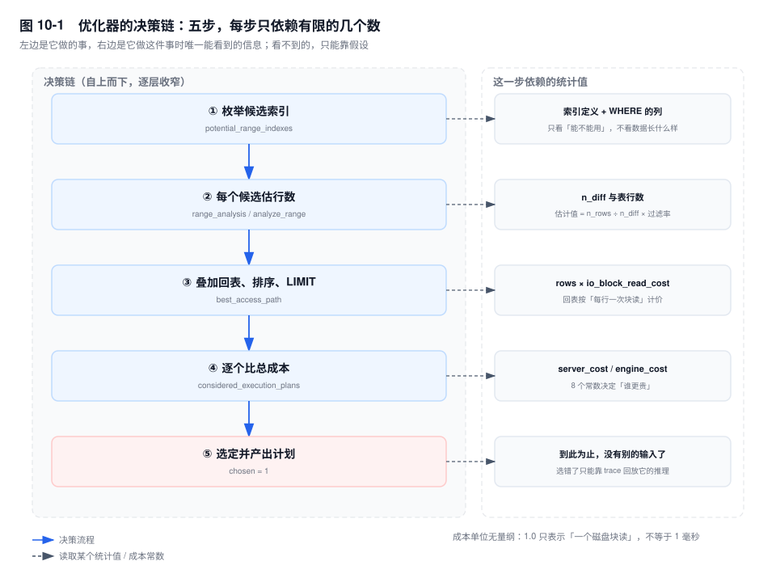
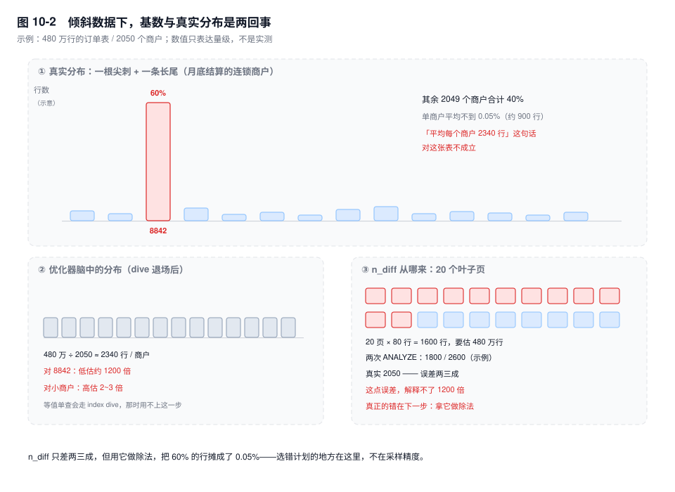

# 第 10 章　统计信息与成本模型

> **一句话结论**：优化器看不到你的数据，它只看两份二手信息——采样出来的、经常差一个数量级的统计，和一套为机械硬盘定的成本常数。计划"昨天还对、今天就错"，几乎都是这两份信息里有一份变了。

## 10.0 场景：月初 5 毫秒，月底 4 秒

`order_main` 是本地生活平台的订单主表，2050 个商户，月初 120 万行，月底 480 万行。商户后台首页那句 SQL：

```sql
SELECT id, order_no, amount, created_at
FROM order_main
WHERE merchant_id = 8842
  AND status IN ('PAID', 'SHIPPED')
ORDER BY created_at DESC
LIMIT 20;
```

索引 `idx_merchant_status_ct (merchant_id, status, created_at)`，联合索引的列序、方向、覆盖范围都对着这条 SQL 设计过——按第 9 章的标准，这是一张"索引建对了"的表。

月初：8842 名下 3 万单，占全表 2.5%。`EXPLAIN` 是 `ref`，扫 3 万行、排一次序、取 20 条，5 毫秒。

月底结算：这家连锁商户涨到 290 万单，占 60%。同一条 SQL，`type` 变成 `ALL`，`rows` 480 万，`Extra` 多了 `Using filesort`，P99 4.2 秒。

值班的人先 `ANALYZE TABLE`，计划没变。再 `FORCE INDEX` 掰回 `ref`——还是四秒出头，290 万次回表把 Buffer Pool 冲了一遍，隔壁几个小商户跟着抖。

两个计划都救不了，因为这不是统计的锅。`merchant_id = 8842` 是单个等值条件，优化器会下探索引（index dive），把 8842 名下的行数直接数出来——288 万是真的。`ref` 的账是 288 万次回表 ≈ 3.1e6，`ALL` 的账是 6 万个页 + 480 万次行求值 ≈ 5.4e5，`ALL` 赢五倍——但墙上时钟只差零点几秒，**成本是相对权重，不是秒**。

它算对了行数，算错了题：`LIMIT 20` 在 filesort 面前失效；而 2050 个商户里，2049 个的访问模式和这一个大户刚好相反——它们只有几百行，`ref` 才是对的。**一个计划服务不了两种分布**，这才是病根。

## 10.1 机制

### 一、两种统计：表有多大，和值有多散

优化器要回答两个问题，对应两处统计：

| 问题 | 存在哪 | 关键字段 |
|---|---|---|
| 这张表有多少行、多少页 | `mysql.innodb_table_stats` | `n_rows`、`clustered_index_size`、`sum_of_other_index_sizes` |
| 这个列有多少种值 | `mysql.innodb_index_stats` | `n_diff_pfx01…N`、`n_leaf_pages`、`size` |

dive 退场的场景里，`EXPLAIN` 的 `rows` 从 `n_rows` 出发，乘选择率，再乘 `filtered`。

`SHOW INDEX` 里的 `Cardinality` 就是 `n_diff`，三个坑：

1. 联合索引的每一列显示同一个数——那是整条索引的去重值数，不是这一列的前缀基数。`idx_merchant_status_ct` 的 `Cardinality` 可能是 480 万，而 `n_diff_pfx01`（只有 `merchant_id` 时）是 2050。**"错一个数量级"最常来自这里，不是统计坏了，是你看错了列。**
2. 它是上一次统计时刻的快照，不是实时值。
3. 显示 `NULL` 表示这张表还没被统计过：新建表，或者 `innodb_stats_persistent=0` 且重启后尚未被访问。

关键的一句：**基数回答"有多少种值"，不回答"每种值有多少行"。** 2050 个商户、480 万行，一旦优化器只能靠基数，它对 `merchant_id = 8842` 的估计就是 480 万 ÷ 2050 ≈ 2340 行；8842 实际有 290 万行，误差 1200 倍。

但这句话有个前提：**只有 index dive 退场时，基数才决定估计值。** 单个等值条件（`IN` 里的值不超过 `eq_range_index_dive_limit`，默认 200 个）会下探索引直接数行，`n_diff` 根本不参与；一旦换成 300 个值的 `IN`、开放范围、或过滤列上没有索引，dive 退场，优化器手里只剩 `n_rows ÷ n_diff` 这一个数。所以看到 `rows` 离谱，先问一句：这条 SQL 里，dive 还在吗？

8.0 还叠了一层缓存：`information_schema_stats_expiry`（默认 86400 秒），`SHOW TABLE STATUS` 和 `information_schema.TABLES` 读的是缓存。所以"行数一天没变"有时不是统计没更新，是缓存没过期；`SET SESSION information_schema_stats_expiry=0` 才是直连引擎的值。

### 二、20 个页怎么代表 6 万个页

`innodb_stats_persistent` 从 5.6.6 起默认 ON。统计落在 `mysql.innodb_table_stats` 与 `mysql.innodb_index_stats` 两张真实表里：重启不丢、可以直接 SELECT、也可以按表用 `STATS_PERSISTENT=0` 关掉。

每条索引随机取 `innodb_stats_persistent_sample_pages` 个叶子页（默认 20），数这些页上的不同值，再按"采样页 : 总页数"外推到全表。20 页 × 80 行 = 1600 行，要代表 480 万行，采样率 0.03%。

两类误差性质不同：

- **抽样误差**：20 个随机页落点不同，结果就不同。同一张表连续两次 `ANALYZE`，`Cardinality` 差两三成是常态，表越大差得越多。
- **模型误差**：外推假设"值在页与页之间均匀铺开"。倾斜数据恰好违反这条——60% 的行压在同一个值上，20 个页代表不了另外 2049 个值的长尾。

非持久化统计（`STATS_PERSISTENT=0`）走 `innodb_stats_transient_sample_pages`，默认 8。更飘，但不写系统表、`ANALYZE` 更轻，只在"表小、变化快、能接受计划抖动"时值得。

统计什么时候更新：`ANALYZE TABLE` 手动触发；`innodb_stats_auto_recalc=ON`（默认）时，变更行数超过约 10% 会在后台重算一次，重算完成前读到的仍是旧值；非持久化统计则在重启后、首次访问时重算。

`innodb_stats_on_metadata` 默认 OFF。ON 的时候，每次 `SHOW TABLE STATUS`、`SHOW INDEX`、查 `information_schema.TABLES` 都可能触发统计重算——监控每分钟轮询一遍，等于每分钟给每张表做一次随机采样。**关掉它的意义，是让这些元数据查询从"打开表 + 采样"变成"读一行数"。**

### 三、成本模型：八个常数决定谁更贵

`mysql.server_cost` 记 CPU，`mysql.engine_cost` 记 IO。8.0 的默认值：

| 表 | 常数 | 默认 | 含义 |
|---|---|---|---|
| `server_cost` | `row_evaluate_cost` | 0.1 | 判断一行是否符合条件 |
| `server_cost` | `key_compare_cost` | 0.05 | 比较一次索引键 |
| `server_cost` | `disk_temptable_create_cost` | 20 | 建一张磁盘临时表 |
| `engine_cost` | `io_block_read_cost` | 1.0 | 从磁盘读一个块 |
| `engine_cost` | `memory_block_read_cost` | 0.25 | 从 Buffer Pool 读一个块 |

`[5.7]` 是另一套：`row_evaluate_cost` 0.2，`memory_block_read_cost` 1.0——因为那时判断不了页在不在内存里，只好都按磁盘算。改完要 `FLUSH OPTIMIZER_COSTS`，而且只对**新建连接**生效，老连接还在用旧常数，这点最常被漏。

三个比值读出来的世界观：一次磁盘读 = 10 次行求值；一次内存读 = 0.25 次磁盘读，也就是**内存只比磁盘便宜 4 倍**；一次键比较 = 半次行求值。

这套数是给机械硬盘定的。NVMe 上 16KB 随机读几十到一百微秒，一次行求值几十纳秒，比值是上千倍；而命中 Buffer Pool 与真正落盘差两三个数量级，模型只差 4 倍。方向性后果比具体倍数重要：

- **回表被低估**。每一次回表都按"一块磁盘读"记，真实情况可能是内存命中（该便宜三个数量级），也可能是随机打盘（该更贵）。
- **CPU 密集操作被系统性低估**。`ORDER BY` 的 `n log n` 次比较乘 0.05，几十万行也才几万，和一次全表扫的几十万同量级。排序贵在哪，模型里没有。

所以别想着改这几个值"修好"优化器：你只会得到一套对某条 SQL 有效的常数。这套数的价值，是让你判断它这次的判断可不可信。



### 四、四个根因：它为什么会选错

按踩到的频率排：

1. **统计不准。** `rows` 差 10 倍，成本就差 10 倍。先确认 index dive 有没有退场（长 `IN`、范围、无索引列）——没退场就不是统计的锅。判断方法：`EXPLAIN` 的 `rows × filtered` 对上 `EXPLAIN ANALYZE`（8.0.18+）的实际行数。
2. **回表成本按"每行一次块读"线性增长，全表扫按页增长。** 行宽 200B、一页 80 行时，两条线的交点大致在"命中行数 ≈ 全表页数"，也就是表行数的 1% 出头。**过了这条线，优化器翻向全表扫，而且翻得对。** 10.0 里 290 万行对 6 万页，`ALL` 赢五倍。
3. **`ORDER BY` 的排序成本被低估。** `EXPLAIN FORMAT=JSON` 的 `sort_cost` 只算比较次数，不算把行读进 sort buffer，更不算溢出到磁盘。
4. **`LIMIT` 诱导。** 当 `ORDER BY` 正好是索引的有序后缀，优化器按 `LIMIT` 截断成本："只要 20 行，扫 20 个索引项"。这个估算假设沿索引很快能凑够 20 行；若前 10 万个索引项都不匹配，就得扫 10 万行、回表 10 万次。`LIMIT` 把"扫得远"的代价藏起来了。

四个根因里，只有第一个能靠 `ANALYZE` 缓解，后三个是模型的结构性偏差——这就是"索引建对了还是选错"的全部答案。

### 五、`optimizer_trace`：把推理过程录下来

```sql
SET SESSION optimizer_trace = 'enabled=on';
SET SESSION optimizer_trace_max_mem_size = 1048576;
SELECT ...;                                  -- 原样执行目标 SQL
SELECT TRACE FROM information_schema.OPTIMIZER_TRACE\G
SET SESSION optimizer_trace = 'enabled=off';
```

按嵌套顺序读四段：

- `potential_range_indexes`：哪些索引可用、为什么不可用（`usable:false` 配 `cause`）。只看列，不看数据。
- `analyze_range`：选中的索引切出了哪些 range。`IN` 会被拆成多个等值 range。
- `best_access_path`：在这条 range 上，`ref` / `range` / `scan` 各自的 `rows` 与 `cost`，`chosen` 只有一个 `true`。
- `considered_execution_plans`：按 join 前缀逐个比，决定"最终用哪个"。`best_access_path` 是嵌在它的 `plan` 里的，不是它的上一级。

```json
{ "steps": [ { "join_optimization": { "steps": [
  { "rows_estimation": [ {
      "table": "`order_main`",
      "range_analysis": {
        "table_scan": { "rows": 4796400, "cost": 5.4e5 },
        "potential_range_indexes": [
          { "index": "PRIMARY", "usable": false, "cause": "not_applicable" },
          { "index": "idx_merchant_status_ct", "usable": true,
            "key_parts": ["merchant_id","status","created_at","id"] } ],
        "analyze_range": {
          "index": "idx_merchant_status_ct",
          "ranges": ["8842 <= merchant_id <= 8842 AND status = 'PAID'",
                     "8842 <= merchant_id <= 8842 AND status = 'SHIPPED'"] } } } ] },
  { "considered_execution_plans": [ {
      "table": "`order_main`",
      "best_access_path": { "considered_access_paths": [
          { "access_type": "ref", "index": "idx_merchant_status_ct",
            "rows": 2880000, "cost": 3.1e6, "chosen": false },
          { "access_type": "scan", "rows": 4796400,
            "cost": 5.4e5, "chosen": true } ] },
      "chosen": true } ] }
] } } ] }
```

```text
# 结构示意（非实测输出）：字段名与嵌套关系真实，数值为示例
```

读法三步。先看 `rows` 和业务直觉差多少：288 万对得上 60%，这次统计是准的——因为 `merchant_id` 是等值条件，这个数是 dive 数出来的。再看 `cost` 的量级：`ref` 的 3.1e6 约等于 288 万 × 1.0 的回表，`scan` 的 5.4e5 约等于 6 万页 + 480 万 × 0.1，选 `scan` 是算出来的。最后看 `chosen`。把同一个条件换成 300 个商户的 `IN` 列表，dive 退场，`rows` 会掉到七十万上下，`cost` 跟着掉，`chosen` 就翻成 `ref`——**同一份数据，两个相反的计划，都"有理有据"，区别只在于这一次它有没有真的去数。**

### 六、干预的优先级

四档，越靠前越接近"补信息"，越靠后越接近"压症状"。

1. **改写 SQL。** 10.0 的解法：`IN` 拆成两个子查询，各自 `ORDER BY created_at DESC LIMIT 20`，再 `UNION ALL` 外层取 20。每条都能顺着 `(merchant_id, status, created_at)` 读到有序流，读 20 行就停，大商户小商户都不怕。代价：改代码、发版、回归，且只治这一条。
2. **建更合适的索引。** 代价是写入放大、DDL 窗口，还可能让别的 SQL 换计划。8.0 多一条路：`ANALYZE TABLE ... UPDATE HISTOGRAM ON merchant_id WITH 1024 BUCKETS`，不改 SQL 不加索引，只补"分布"这一课；但直方图同样是一次采样，后续写入不自动维护。
3. **`FORCE INDEX`。** 一行改动立即生效，但它把"优化器估错"换成了"人估错"：分布变了不自适应，主从数据量不同时同一个 hint 可能更糟，索引一改名 SQL 直接报错。只当止血。
4. **关优化器特性（`optimizer_switch`）。** `prefer_ordering_index=off`（8.0.21+）治得了"为了排序选了烂索引"，也会让别的查询丢掉好的排序索引；`eq_range_index_dive_limit` 默认 200，`IN` 里的值超过它就改用基数估算，调大能救长列表、代价是每次优化多几百次 index dive。这些都是 `SET GLOBAL`，影响全实例。



## 10.2 关键结论

1. **`Cardinality` 说的是"有多少种值"，不是"每种值多少行"。** 等值查询靠 index dive 绕过了它；dive 一退场（长 `IN`、范围、无索引列），均匀分布假设就成了选错索引的第一来源。
2. **20 个叶子页代表几万个页，采样率万分之三。** 这个误差通常只有两三成；真正致命的是下一步——拿这个除数去摊总行数。
3. **成本是无量纲的相对权重，不是耗时。** 8.0 认为一次内存读只比磁盘读便宜 4 倍，这个比例决定了它敢不敢选回表。
4. **回表成本按行线性涨，全表扫按页涨，交点约在表行数的 1%。** 过了这条线，全表扫是对的，别急着 `FORCE INDEX`。
5. **一旦需要 filesort，`LIMIT` 就不能提前停。** 排序让"取 20 条"退化成"读完再排"。
6. **`trace` 的读法：`rows` 错看统计，`rows` 对而 `cost` 反看模型，两者都对还慢，说明慢在模型没建模的地方**（落盘、随机 IO、Buffer Pool 竞争）。

## 10.3 实验验证

### 实验一：统计与真实值差多少

```sql
SELECT index_name, stat_name, stat_value
FROM mysql.innodb_index_stats
WHERE database_name = 'shop' AND table_name = 'order_main'
  AND stat_name IN ('n_diff_pfx01', 'n_diff_pfx03', 'n_leaf_pages', 'size');

SELECT COUNT(DISTINCT merchant_id) AS real_ndv FROM order_main;

-- 同一条业务语义，两种谓词：dive 在，和 dive 不在
EXPLAIN SELECT id FROM order_main
WHERE merchant_id = 8842 AND status IN ('PAID','SHIPPED')
ORDER BY created_at DESC LIMIT 20;

EXPLAIN SELECT id FROM order_main
WHERE merchant_id IN (/* 300 个商户 id */) AND status IN ('PAID','SHIPPED');
```

```text
-- 输出形态（未实跑，字段含义以此为准）
n_diff_pfx01  ≈ 1800         real_ndv = 2050      ← 差三成，不影响大局
n_diff_pfx03  ≈ 4800000      ← 整条索引的去重值数，SHOW INDEX 显示的就是它
单值查询       rows ≈ 2880000   ← dive 数出来的，准
300 值 IN      rows ≈ 700000    ← 基数估出来的，真实约 320 万
```

统计只差三成，`rows` 却差 4 倍——误差不在采样，在"把 480 万行平均分给 2050 个商户"这一步。这也是为什么 `ANALYZE` 修不好它：再采一次样，除法还是那个除法。

### 实验二：连续两次 `ANALYZE`，看基数抖动

```sql
ANALYZE TABLE order_main;
SHOW INDEX FROM order_main WHERE Key_name = 'idx_merchant_status_ct';
ANALYZE TABLE order_main;
SHOW INDEX FROM order_main WHERE Key_name = 'idx_merchant_status_ct';
```

两次 `Cardinality` 不同是预期行为，差两三成很常见；差一个数量级通常出现在十亿行级别的大表上，那时 20 个页只是万分之零点几。如果两次差别大到计划都翻了，说明这张表**不该靠统计自救**，该走改写或直方图。

### 实验三：直方图前后

```sql
ANALYZE TABLE order_main UPDATE HISTOGRAM ON merchant_id WITH 1024 BUCKETS;

SELECT COLUMN_NAME, HISTOGRAM->>'$."number-of-buckets-specified"' AS buckets,
       JSON_LENGTH(HISTOGRAM->>'$."buckets"') AS actual_buckets
FROM information_schema.COLUMN_STATISTICS
WHERE TABLE_NAME = 'order_main';
```

直方图不动 `n_diff`，它补的是"值在区间里怎么分布"。所以 `SHOW INDEX` 的 `Cardinality` 不会变，变的只有 `filtered`；等值单查仍由 dive 说了算，直方图未必轮得上。它治的是"分布"，不是"基数"——这两个词在这章里始终是两件事。

## 10.4 常见误区

⚠️ **"`ANALYZE TABLE` 能解决所有选错索引"**
它只修"统计过期"和"采样偏差"。均匀分布假设、回表按行计价、排序成本偏低，这三条都在成本模型里，`ANALYZE` 碰不到。更糟的是它可能让计划更差：基数抖动之后，优化器从"错得轻"翻到"错得重"。

⚠️ **"`Cardinality` 越大索引越好"**
基数高只说明区分度好，不说明这条 SQL 命中的行少。`(merchant_id, status)` 的整索引基数可能是几万，但 `merchant_id = 8842` 这一个前缀就占了 60%。判断选择性要看前缀，不看整条索引。

⚠️ **"全表扫一定比走索引差"**
命中率超过 1% 量级时，全表扫的顺序 IO 加预读，确实可能赢过几十万次随机回表。真正的判断依据是 `EXPLAIN ANALYZE` 的实际行数和耗时，不是 `type` 这一列的"等级"。

⚠️ **"`FORCE INDEX` 是长期方案"**
它把"优化器估错"换成"人估错"，而人看不到分布的变化。上线三个月后数据涨了十倍，hint 还在，报错的是索引名，不是计划。

⚠️ **"`optimizer_trace` 里的 `cost` 是毫秒"**
它是无量纲单位，1.0 只代表"一个磁盘块读"。3.1e6 和 5.4e5 只能横向比，不能当 3.1 秒读。

⚠️ **"8.0 把 `information_schema.INNODB_TABLESTATS` 删了"**
传得挺广，但是错的。它是随数据字典重构改了名（`INNODB_SYS_TABLESTATS` → `INNODB_TABLESTATS`），8.0 里照样能查；真正被移除的是 `INNODB_LOCKS`、`INNODB_LOCK_WAITS` 那批锁视图（见第 18 章）。

## 10.5 生产 Checklist

- [ ] 关键 SQL 的 `EXPLAIN` 的 `rows`，和 `EXPLAIN ANALYZE` 的实际行数差几倍？偏十倍以上，先看 dive 在不在、统计是不是过期，别急着改 SQL。
- [ ] 表上最大的那个商户/租户占多少行？超过 5% 就该有预案，超过 20% 就不该指望单一计划服务所有人。
- [ ] 联合索引的选择性，看的是 `n_diff_pfx01` 还是 `SHOW INDEX` 的 `Cardinality`？
- [ ] 有没有 `WHERE` 列基数很高、分布很斜、却没有直方图的？（8.0 用 `COLUMN_STATISTICS` 查）
- [ ] `ANALYZE TABLE` 是定时任务还是有人手动跑？定时任务在大表上会不会和业务高峰撞车？
- [ ] 线上有 `FORCE INDEX` 吗？每一条都记了"为什么加、什么时候撤"吗？
- [ ] 慢 SQL 的 `ORDER BY ... LIMIT` 里，排序是索引给的还是 filesort？后者意味着 `LIMIT` 不再能提前停。
- [ ] `optimizer_switch` 的全局改动是谁改的、为什么、有没有回归日期？

## 10.6 延伸

- **上一章**：第 9 章讲"索引为什么用不上"，本章讲"索引能用、优化器为什么不选"——前者是语法与语义，后者是统计与成本。
- **下一章**：第 11 章把 `EXPLAIN` 的每一列拆开读，`rows` 与 `filtered` 的可信度就是本章的直接延续。
- **关联章节**：第 2 章（Buffer Pool 命中率如何改变 IO 成本）、第 8 章（`n_leaf_pages` 与扇出）、第 14 章（filesort 何时落盘）、第 15 章（`LIMIT` 与深分页改写）、第 40 章（`optimizer_switch` 与 `eq_range_index_dive_limit`）。
- **面试追问**：
  - "`SHOW INDEX` 的 `Cardinality` 为什么不准？" → 先分清两件事：联合索引上它显示的是整条索引的基数（480 万），不是前缀基数（2050）；再看采样，20 个页代表几万个页，还要乘上均匀分布假设。
  - "统计信息更新了，为什么还选错索引？" → 因为错的不一定是统计。回表按行计价、排序成本偏低、`LIMIT` 截断成本，都在模型里。
  - "为什么明明有索引，命中 60% 的行时全表扫更快？" → 回表是随机 IO 且按行计，全表扫是顺序 IO 且按页计，一页 80 行，两条成本线在 1% 附近交叉。
- **官方文档**：`Optimizer Statistics`、`Configuring Persistent Optimizer Statistics Parameters`、`The Optimizer Cost Model`、`Optimizer Trace`、`Optimizer Statistics and Histograms`。
