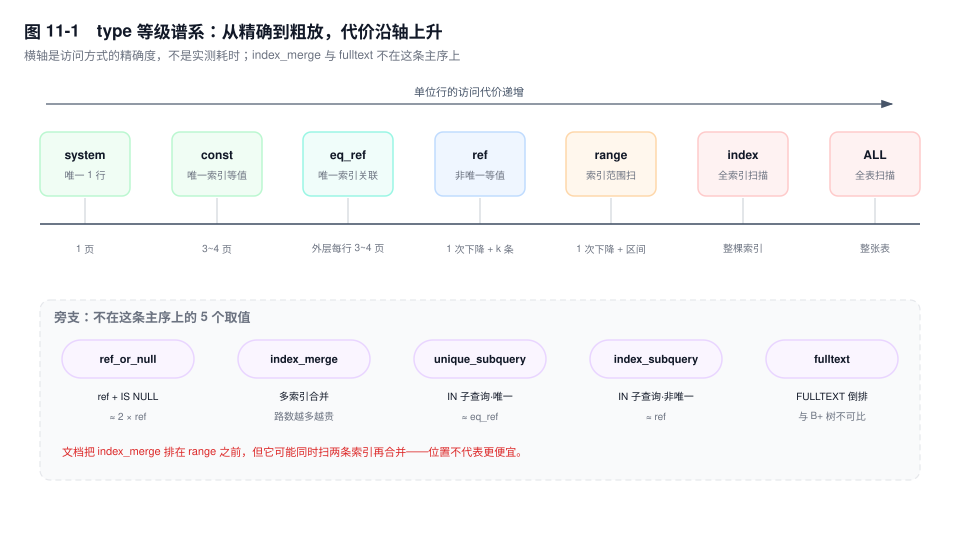
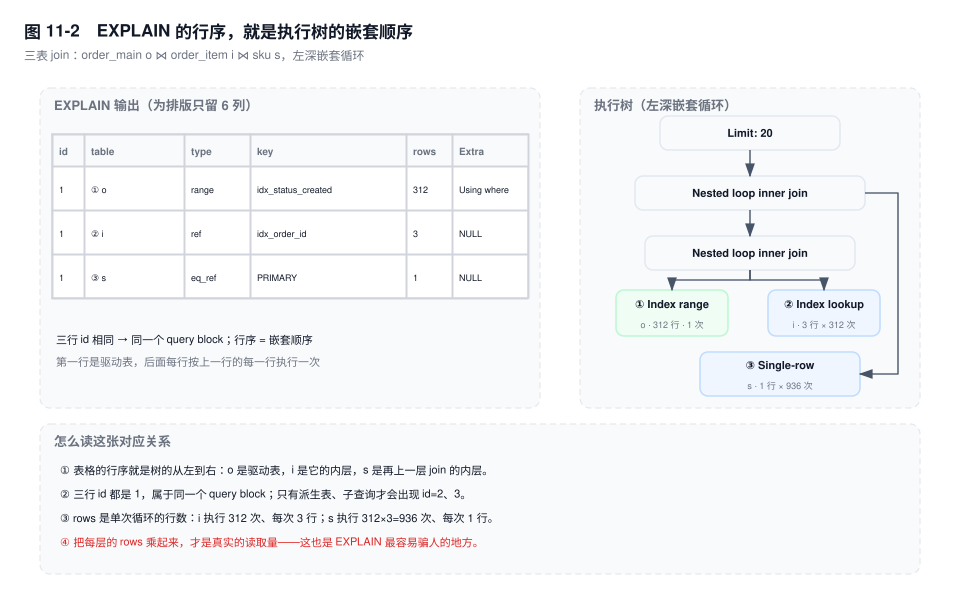
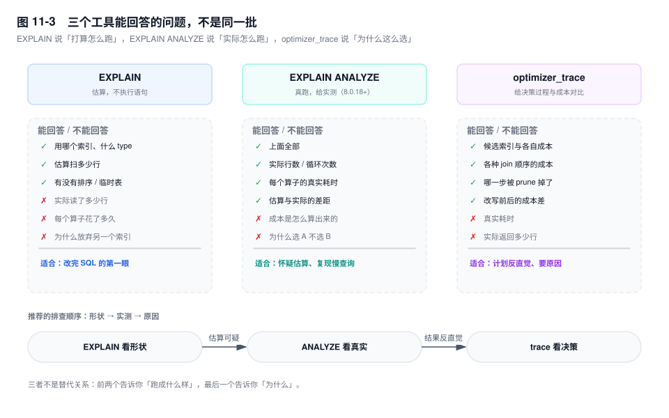

# 第 11 章　执行计划精读

> **一句话结论**：`EXPLAIN` 不是"有没有走索引"的开关，而是一份"优化器打算读多少行、按什么顺序读"的估算报告；`type=index` 往往是全索引扫描，`Using index` 才代表不回表。

## 11.0 场景：`type=index`，800 万行，开发说"走了索引"

对账任务在凌晨 02:10 跑这条 SQL：

```sql
SELECT id, buyer_id, payable
FROM order_main
WHERE DATE(created_at) = '2026-11-10' AND status = 3;
```

`order_main` 800 万行，只有 `PRIMARY` 和 `idx_created(created_at)`。执行计划如下（输出形态，未实跑；列名与字段顺序按 8.0 真实输出，为排版略去 `partitions`、`ref` 两列）：

```text
+----+-------------+------------+-------+---------------+-------------+---------+---------+----------+-------------+
| id | select_type | table      | type  | possible_keys | key         | key_len | rows    | filtered | Extra       |
+----+-------------+------------+-------+---------------+-------------+---------+---------+----------+-------------+
|  1 | SIMPLE      | order_main | index | idx_created   | idx_created | 5       | 7943120 |    10.00 | Using where |
+----+-------------+------------+-------+---------------+-------------+---------+---------+----------+-------------+
```

开发看完只说了一句："`key` 有值，`type=index`，走了索引，没问题。"

每个字都对，结论全错。`type=index` 的准确含义是**把整棵索引从头扫到尾**，和"用索引定位"是两件事。这条 SQL 实际做了三步：扫完 794 万条索引项 → 每条回表取 `status`、`payable` → 在 Server 层套 `DATE()` 过滤。

索引只有 13 字节宽（`created_at` 5 + 主键 8），约 6000 个页，全扫一遍只要几十毫秒。真正贵的是后面那 794 万次回表：每次都是从聚簇索引根节点往下走 3 层。它们的随机 IO 把 Buffer Pool 里其他业务的热页全挤了出去。代价不是这一条 SQL 的 2.8 秒，而是同一时段下单接口 P99 从 45ms 涨到 700ms。

两周后这条 SQL 被改成三段式：谓词换成半开区间（`created_at >= '2026-11-10' AND created_at < '2026-11-11'`）、索引换成 `(status, created_at, buyer_id, payable)`、`SELECT` 只留索引里有的列（`id` 是主键，隐式包含在二级索引里）。重跑 `ANALYZE TABLE` 之后，新计划是 `type=range`、`key_len=6`、`rows` 7 万级、`Extra=Using index`：只扫当天那一段索引，连回表都省了。同一个任务从 2.8 秒降到 40 毫秒——差别不在"有没有索引"，而在"索引被用来做什么"。



## 11.1 `id` 与 `select_type`：先数清有几个执行块

`EXPLAIN` 的第一列经常被当成"第几个 SELECT"，这只对了一半。

**同 id = 同一个 query block。** 同一个 id 下的每一行是该 block 里的一张表，**行序就是 join 顺序**，第一行是驱动表。MySQL 不做算子并行，同 id 的行是"外层取一行、内层跑一轮"的嵌套循环。

**id 越大越先执行。** 原因不是编号约定，而是**物化**：id 大的块必须先算出结果，外层才能把它当一张表用。派生表、被物化的子查询都属于这一类。

两个例外必须记住：

- `UNION` 的两个分支 id 是 1、2，但执行顺序按书写顺序，不是"2 先跑"；
- `UNION RESULT` 的 id 是 `NULL`，它负责去重、位置在最后，"越大越先"对它无从谈起。

`table` 列同理：`<derived2>` 表示物化后的派生表（数字是产生它的 id），`<subquery2>` 是物化的子查询，`<union1,2>` 是 UNION 的临时结果。

`select_type` 有十来种取值，真正影响性能判断的只有七种：

| select_type | 出现条件 | 决定代价的那句话 |
|---|---|---|
| `SIMPLE` | 没有子查询、没有 UNION | 一个 block 收工 |
| `PRIMARY` | 有子查询/UNION 时最外层那块 | 它驱动内层，每取一行都可能触发一次内层 |
| `SUBQUERY` | WHERE 或选择列表里的**不相关**子查询 | 只算一次，结果缓存复用 |
| `DEPENDENT SUBQUERY` | 子查询引用了外层的列 | 外层每行重算一次（相同外层值可命中子查询缓存） |
| `UNCACHEABLE SUBQUERY` | 子查询含 `RAND()`、`UUID()` 或用户变量 | 每行都重算，连"相同外层值"也不缓存 |
| `DERIVED` | `FROM` 里的子查询被物化 | 先物化成临时表，外层再扫它 |
| `MATERIALIZED` | `IN` 子查询走了半连接物化策略 | 只算一次，代价是建临时表 + 自动索引 |

最该警惕的是 `DEPENDENT SUBQUERY`。它意味着外层每返回一行，子查询就重算一次。下面这条 SQL 在 `order_item` 缺少 `(order_id, sku_id)` 索引时，就是标准的 O(N×M)：

```sql
SELECT id FROM order_main o
WHERE o.status = 3
  AND EXISTS (SELECT 1 FROM order_item i
              WHERE i.order_id = o.id AND i.sku_id = 8842);
```

`order_main` 里 `status=3` 有 720 万行（占九成），计划里会出现一行 `DEPENDENT SUBQUERY`，内层 `type=ALL`。720 万次全表扫，这不是"慢一点"，是必然拖垮实例。

`MATERIALIZED` 相对 `DEPENDENT` 是进步，但不是免费的：子查询只算一次，代价是要把结果写进临时表并建自动索引。子查询返回 5 行，物化近乎零成本；返回 500 万行，物化本身就是一次大写入，还会吃掉 `temptable_max_ram`。

`DERIVED` 与 `MATERIALIZED` 的差别只在来源：前者来自 `FROM` 子查询，后者多由 `IN`/`EXISTS` 的半连接策略产生。共同点是"先算完、再被外层当表用"，所以 id 比外层大。



图 11-2 是本节最该记住的一张图：左边三行 id 都是 1，说明是同一个 block；右边执行树的分支顺序和表格行序一一对应。`rows=312` 是"这个算子执行一次读多少行"，不是总数——`i` 的真实读取次数是 312 × 3 = 936 次索引查找。

## 11.2 `type`：一条从精确到粗放的访问谱系

`type` 不是布尔值，是一个枚举。官方给了一条排序，但它是**按"定位的精确度"排的，不是按耗时排的**：

```text
system > const > eq_ref > ref > fulltext > ref_or_null > index_merge
       > unique_subquery > index_subquery > range > index > ALL
```

这条链有两个陷阱：`index_merge` 排在 `range` 前面，可它可能同时扫两条索引再合并、去重，比单条 `range` 慢一个数量级；`fulltext` 走的是倒排表，和 B+ 树没有可比性，位置只是文档排版。

| type | 什么条件下出现 | 单次访问的代价 |
|---|---|---|
| `system` | 表被证明只有 1 行（`const` 的特例） | 读 1 次，可忽略 |
| `const` | 主键或唯一非空索引与常量等值比较 | 树上 1 次下降，3~4 个页 |
| `eq_ref` | 唯一索引**全部列**做主键式等值 join | 外层每行 1 次下降 |
| `ref` | 非唯一索引等值，或唯一索引只用最左前缀 | 1 次下降 + 扫 k 条 |
| `fulltext` | `MATCH ... AGAINST` 命中全文索引 | 倒排表，与 B+ 树不可比 |
| `ref_or_null` | `ref` 的列可为 NULL 且条件含 `IS NULL` | 约 2× `ref`（两次探测） |
| `index_merge` | 单表 WHERE 命中多个索引，优化器认为合并更便宜 | 每路一次 range + 合并去重 |
| `unique_subquery` | `IN (SELECT 唯一列 ...)` | 等价 `eq_ref` |
| `index_subquery` | `IN (SELECT 有非唯一索引的列 ...)` | 等价 `ref` |
| `range` | 索引上的 `>` `<` `BETWEEN` `IN` `LIKE 'x%'` | 1 次下降 + 扫 k 条（k 是范围大小） |
| `index` | 扫完整棵索引 | 索引页数 |
| `ALL` | 扫完整张表 | 叶子页数 |

两个常被读错的等级值得单独说。`eq_ref` 的门槛比想象中高：必须是唯一索引、**所有列**都参与等值比较、且列定义为 `NOT NULL`。唯一但可空的索引会掉到 `ref`——`NULL` 可以出现多次，唯一性不成立。`index_merge` 的机制是分别扫两条索引、按主键做交集或并集、再回表，随机 IO 至少翻倍；它通常出现在"两个单列索引各自都能过滤掉九成数据"的场景，正解是一条联合索引，而不是依赖合并。

还有一个反直觉的机制：`range` 不是越用越好。范围命中的行数占表比例太高时，优化器会算成"扫索引 + 逐行回表"比"顺序扫全表"更贵，直接退回 `ALL`。临界点不是固定百分比，由 `engine_cost` 里的 `io_block_read_cost`、`memory_block_read_cost` 和行宽共同决定；经验上落在 20%~30%，但表越宽、回表越随机，临界点越低。看到本该走索引的等值查询变成 `ALL`，先怀疑范围太宽，而不是"索引失效"。

把量级算出来，`index` 和 `ALL` 的关系才清楚。`order_main` 一行约 200 字节，800 万行 ≈ 1.6GB ≈ 10 万个 16KB 页；`idx_created` 一项 13 字节，一页装 1200 多项，整棵树 ≈ 6000 页。

**所以 `type=index` 在覆盖索引下很便宜**：6000 页全在 Buffer Pool 里，扫完也就几十毫秒 CPU。**不覆盖时它比 `ALL` 更贵**：`ALL` 是 10 万页顺序读，`index` 是 6000 页顺序读 + 794 万次主键下降。开头那场事故的全部机制，就在这一句话里。

反过来，`const`/`eq_ref` 的"快"也有边界：它们只保证**定位**是 O(1)，不保证不排队。等 MDL、等行锁的时候，`type=const` 的语句照样能卡满 `innodb_lock_wait_timeout`。

## 11.3 `possible_keys`、`key`、`key_len`：反推用了几列索引

三列的分工：`possible_keys` 是"这次查询可以考虑哪些索引"，`key` 是"最终选了哪个"，`key_len` 是"这次访问实际用了索引键的多长前缀"。

紧挨着 `key_len` 的 `ref` 列回答"拿什么值去索引里找"：`const` 是常量，`func` 是函数结果，`db.table.col` 是外层表的列。`type` 是 `ref` 时这一列必有值；反过来，如果里面出现 `func`，说明条件里有表达式参与，值得回头核对 `key_len` 是否符合预期。

最常见的误判是看到 `possible_keys` 有值、`key` 为 `NULL`，就说"索引失效了"。**不是失效，是优化器算完成本后主动放弃。** 常见原因是回表行数太多、索引区分度太差、或者 `ORDER BY` 让它觉得走索引反而要多一次排序。

`key_len` 的计算规则只有三条：

```text
key_len = Σ(每个用到的索引列的最大字节数)
        + VARCHAR 的 2 字节长度前缀
        + 可空列的 1 字节 NULL 标志
```

以 `KEY idx_abc (a INT, b VARCHAR(20), c INT)`、表字符集 `utf8mb4`、三列均 `NOT NULL` 为例：

| WHERE 条件 | 用到的列 | key_len | 算式 |
|---|---|---|---|
| `a = 1` | a | 4 | 4 |
| `a = 1 AND b = 'x'` | a, b | 86 | 4 + 20×4 + 2 |
| `a = 1 AND b = 'x' AND c = 2` | a, b, c | 90 | 86 + 4 |
| `a = 1 AND b LIKE 'x%'` | a, b | 86 | 范围条件也占满该列 |
| `a > 1` | a | 4 | 范围之后的列无法再定位 |
| `b = 'x'` | 用不上 | — | 违反最左前缀 |

若三列都允许 NULL，每个可空列各加 1 字节：`5 / 88 / 93`。`utf8mb4` 每字符按 4 字节算（不是 3），`VARCHAR` 的 2 字节是长度前缀；`CHAR(10)` 没有长度前缀，utf8mb4 下算 40，可空则 41。常用类型：`BIGINT` 8、`DATETIME` 5、`TIMESTAMP` 4、`DECIMAL(10,2)` 5。

`key_len` 有三个坑：

1. **`type=index` 时它等于整条索引长度**，不代表所有列都参与了定位。开头那张计划里 `key_len=5` 只是说明"扫的是 `created_at` 这一整列"，不是"用 `created_at` 定位到了行"。
2. **ICP 下推的条件不计入 `key_len`。** `Using index condition` 表示条件在引擎里对索引项求值，但它不改变访问路径的键长。
3. **字符集不一致会让索引直接失效。** 表是 `utf8mb4`、关联列是 `utf8mb3`，比较时要做隐式转换，`key` 变 `NULL`、`type` 掉到 `ALL`——这不是长度问题，是类型问题。

## 11.4 `rows` 与 `filtered`：两个估算值乘出来的第三个估算值

`rows` 是"这个访问方式预计要读多少行"。注意它在 join 里的语义：**内层的 `rows` 是每次循环读多少行，不是总行数。** 总读取量 = 外层 `rows` × 内层 `rows` × 循环次数。

`filtered` 是"读完这些行之后，还能留下百分之几"。`rows × filtered%` 才是传给下一步的行数。

这两个数经常离谱，机制上有五个来源：

1. **基数来自采样。** `innodb_stats_persistent_sample_pages` 默认只采 20 个页。800 万行的表，采样量不到万分之三，基数差几倍很正常。
2. **范围估算靠平均值 + 线性插值。** 数据倾斜时最惨：90% 的订单都是 `status=3`，优化器仍按 `rec_per_key` 的平均值算，能差 10 倍以上。
3. **多列条件按独立处理。** `city='杭州' AND district='西湖'` 在真实数据里高度相关，优化器却把两个选择性相乘，直接放大误差。
4. **没有统计信息的条件用硬编码默认值。** 函数包裹的列、表达式、JSON 字段：等值默认 10%，范围默认 33.33%，`!=` 默认 90%。开头那条 SQL 的 `filtered=10.00` 就是这么来的，而真实值是 0.4%。
5. **误差在 join 里连乘。** 五张表每层差 3 倍，最后差 243 倍，join 顺序就翻盘了。

所以"`rows` 只有 1，很快"经常是错觉：`rows=1` 配上 `loops=30万`，就是 30 万次查找。**看 `rows` 必须同时看它在第几层、上面一层有多少行。**

举个具体的读法：某行 `rows=3120, filtered=10.00`，估算传给下一步 312 行；实际这一步返回了 72410 行。两个数一对比就知道 `filtered` 估错了 232 倍——它用的是"等值条件默认 10%"的硬编码值，而这列 90% 的行都是 `status=3`。join 顺序就是在这种误差上定下来的。

慢日志里的两个字段能校正估算：`Rows_examined`（引擎读出的行数）和 `Rows_sent`（返回给客户端的行数）。比值大于 100 说明扫描被放大了；大于 1000 基本可以断定索引或条件下推有问题。但要留一个心眼：带 `LIMIT 20` 的查询天然比值大，得看 `Rows_examined` 的绝对值，而不是只看比值。

## 11.5 `Extra`：真正的现场记录

`Extra` 是信息量最大的一列，也是最容易被整段忽略的一列。

| Extra | 含义 | 该关注什么 |
|---|---|---|
| `Using index` | 覆盖索引，需要的列都在索引里 | 它才是"不回表"的标志；配合 `type=index` 表示全索引扫描但不回表 |
| `Using where` | 有条件下推到 Server 层逐行判断 | 和 `type=ALL` 同时出现 = 全表扫 + 过滤 |
| `Using index condition` | ICP：索引列上的条件在引擎里先过滤 | 减少的是回表次数，不是扫描行数 |
| `Using filesort` | 索引给不了顺序，需要额外排序 | 看行数 × 行宽与 `sort_buffer_size` 的关系，不是一定落盘 |
| `Using temporary` | 需要内部临时表 | GROUP BY / DISTINCT / UNION / 派生表物化，看是否溢出磁盘 |
| `Using join buffer (Block Nested Loop)` | 被驱动表连接列没索引，块嵌套循环 | 基本等于"缺索引"；8.0.18 起等值连接优先走 hash join |
| `Using join buffer (hash join)` | [8.0.18+] 无索引等值连接建哈希表 | 看 build 侧行数 × 行宽与 `join_buffer_size` |
| `Backward index scan` | 反向扫索引，省掉排序 | 8.0 才在 `Extra` 里显式标注 |
| `Using index for group-by` | 松散/紧凑索引扫描完成 GROUP BY | 省掉临时表；前提是 GROUP BY 列是索引前缀 |
| `Using index for skip scan` | [8.0.13+] 跳过联合索引前导列做范围探测 | 前导列基数低才有意义 |
| `Select tables optimized away` | 用索引元数据直接得出结果 | `MIN`/`MAX` 最常见，`rows=1` |
| `Impossible WHERE` | 条件恒假，不读表 | 应用拼出来的 `1=0` |
| `No tables used` | 语句里没有表 | `SELECT 1` 这类，不用管 |

几条容易读反的：

**`Using filesort` 不等于慢。** 1 万行、排序键短、`sort_buffer_size` 装得下，就是一次内存快排，毫秒级。真正贵的是"行数 × 行宽超过 `sort_buffer_size`"触发的归并，去看 `Sort_merge_passes` 有没有涨。判断阈值是数据量，不是这个标签本身。

**`Using temporary` 要看它为什么出现。** GROUP BY、DISTINCT、UNION、派生表物化都会建临时表。8.0 用 TempTable 引擎，`temptable_max_ram` 默认 1GB，超了才转磁盘。小结果集的临时表几乎无感，百万行的 `GROUP BY` 才是灾难。

**`Backward index scan` 是 8.0 的"新增标注"，不是"新增能力"。** 5.7 也能反向扫索引，只是 `Extra` 不写。差别在代价：页间靠 `FIL_PAGE_PREV` 走，页内记录是单向链表，找前一条要靠页目录，比正向扫描略贵。8.0 还支持真正的降序索引，那种情况下连反向扫描都不需要。

**`Using index for skip scan` 有严格前提**：单表、无 GROUP BY/DISTINCT、联合索引至少两列、前导列基数很低、查询条件不含前导列。它是"用 N 次小范围探测代替一次全索引扫描"，前导列有 1000 个不同值时会退化成 1000 次探测，比全扫还慢。

标签是会叠加的，读法是"先看有没有临时表和排序，再看索引参与的方式"。`Using where; Using index` 是覆盖索引扫描 + Server 层过滤；`Using index condition; Using where` 是 ICP 在引擎里先滤掉一批，剩下的条件下推到 Server。前者说明索引还不够贴合查询，后者说明条件被分成了两段执行——两种情况的优化手段完全不同。

## 11.6 `FORMAT=JSON`、`FORMAT=TREE` 与 `EXPLAIN ANALYZE`

传统表格版 `EXPLAIN` 只给结论，不给成本。三种增强格式各自补一块：



**`FORMAT=JSON`** 补的是成本和条件归属。默认是 v1 结构（`query_block` → `table`）；[8.3+] 起可以设 `explain_json_format_version=2` 切到新结构（`query_plan` → `inputs`，字段名完全不同），读之前先确认版本。下面是 v1 的输出形态（未实跑；字段名与嵌套关系按 8.0 真实输出）：

```text
{
  "query_block": {
    "select_id": 1,
    "cost_info": { "query_cost": "1843.20" },
    "table": {
      "table_name": "order_main",
      "access_type": "range",
      "possible_keys": ["idx_status_created"],
      "key": "idx_status_created",
      "used_key_parts": ["status", "created_at"],
      "key_length": "6",
      "rows_examined_per_scan": 3120,
      "rows_produced_per_join": 312,
      "filtered": "10.00",
      "cost_info": {
        "read_cost": "1520.40",
        "eval_cost": "31.20",
        "prefix_cost": "1551.60",
        "data_read_per_join": "48K"
      },
      "attached_condition": "((order_main.status = 3) and ...)"
    }
  }
}
```

增量有三块：`cost_info` 把成本拆成读页（`read_cost`）和求值（`eval_cost`），`prefix_cost` 是"到这一步为止的累计成本"，这是判断 join 顺序为什么这么排的唯一直接证据；`used_key_parts` 直接告诉你用了联合索引的哪几列，比反推 `key_len` 可靠；`attached_condition` 与 `index_condition` 分开，能看出条件是在 Server 层还是引擎里执行。子查询还会多出 `materialized_from_subquery` 节点。

**`FORMAT=TREE`** [8.0.16+] 补的是层次。它把计划画成算子树，join 顺序、物化位置、排序位置一眼可见，不再需要靠 id 脑补：

```text
-> Limit: 20 row(s)  (cost=2104.55 rows=20)
    -> Nested loop inner join  (cost=2104.55 rows=20)
        -> Nested loop inner join  (cost=1890.10 rows=20)
            -> Index range scan on o using idx_status_created  (cost=1520.40 rows=312)
            -> Index lookup on i using idx_order_id (order_id=o.id)  (cost=0.35 rows=3)
        -> Single-row index lookup on s using PRIMARY (id=i.sku_id)  (cost=0.30 rows=1)
```

TREE 里的 `cost` 是节点所属子树的估算，绝对值不用记，看相对大小。它的缺点是丢了 `select_type` 和 `filtered`，所以排查时通常两份一起看。

物化的子查询在 JSON 里是嵌套的 `materialized_from_subquery`，里面自带一层 `query_block` 和 `cost_info`；表格版只给一行 `table=<subquery2>`，看不出它花了多少成本。这也是"子查询物化后反而更慢"必须看 JSON 才能定位的原因：物化的成本记在子节点里，外层只承担"扫物化表"的那部分。`FORMAT=TREE` 会把它画成 `-> Materialize` 子树，位置一目了然。

**`EXPLAIN ANALYZE`** [8.0.18+] 补的是真实值。它**真的执行语句**，并在每个算子后面附上 `actual time` / `rows` / `loops`：

```text
-> Nested loop inner join  (cost=1890.10 rows=936) (actual time=0.131..2841.337 rows=30184 loops=1)
    -> Index range scan on o using idx_status_created  (cost=1520.40 rows=312)
       (actual time=0.087..112.400 rows=312 loops=1)
    -> Index lookup on i using idx_order_id (order_id=o.id)  (cost=0.35 rows=3)
       (actual time=0.240..8.700 rows=96 loops=312)
```

四个数字的读法：`0.240..8.700` 是单次循环里"首行到末行"的耗时（毫秒），`rows=96` 是**每次循环平均**返回 96 行，`loops=312` 是循环次数。总行数 = 96 × 312 ≈ 3 万；总耗时 ≈ 8.7 × 312 ≈ 2.7 秒，和顶层 2.84 秒对得上。估算每轮 3 行、实际每轮 96 行，32 倍；乘 312 轮，估算的 936 行变成实际的 3 万行。**单轮误差不可怕，乘以 `loops` 才可怕**——所谓"估算 1 行、实际 10 万行"，多数时候是单轮差几十倍，再被几千次循环放大出来的。

两个使用纪律：它会执行语句，`SELECT ... FOR UPDATE` 会真的加锁，别在生产高峰跑；它带 instrumentation 开销，0.05ms 级别的差异不可信，只用来比数量级。另外，`EXPLAIN ANALYZE` 默认输出 TREE；[8.3+] 起支持 `EXPLAIN ANALYZE FORMAT=JSON`（需要 `explain_json_format_version=2`），真实值以 `actual_rows`、`actual_loops`、`actual_first_row_ms`、`actual_last_row_ms` 这些 `actual_*` 字段出现，和 `estimated_rows` 并排。网上有些文章提到的 `analyzed` 块并不存在于 MySQL 8.0 的输出里，对表时别拿错版本。

## 11.7 关键结论

1. **`type` 描述访问方式，不描述"有没有用索引"。** `index` 是全索引扫描；只有 `Using index` 才说明不回表。不覆盖的 `type=index` 比 `ALL` 更贵。
2. **同 id 是一个 join block，行序就是嵌套顺序；id 越大越先执行只对物化成立**，`UNION` 的分支按书写顺序执行，`UNION RESULT` 的 id 是 `NULL`。
3. **`key_len` 是"这次访问用了多长的键"，不是"用了几列"。** 它只在等值/范围访问下能反推列数；`type=index` 时它等于整条索引长度。
4. **`rows × filtered` 是估算的估算。** 采样偏差、倾斜数据的平均值、多列独立假设、无统计列的硬编码默认值，四层误差在 join 里连乘。
5. **只有 `EXPLAIN ANALYZE` 给真实行数与耗时。** 估算与实际差 10 倍以上时，先修统计信息，再谈索引——顺序反了就是白改。

## 11.8 实验验证

### 实验一：用 `key_len` 反推联合索引用到第几列

```sql
CREATE TABLE t_keylen (
  a INT NOT NULL,
  b VARCHAR(20) NOT NULL,
  c INT NOT NULL,
  KEY idx_abc (a, b, c)
) ENGINE=InnoDB DEFAULT CHARSET=utf8mb4;

EXPLAIN SELECT * FROM t_keylen WHERE a = 1;
EXPLAIN SELECT * FROM t_keylen WHERE a = 1 AND b = 'x';
EXPLAIN SELECT * FROM t_keylen WHERE a = 1 AND b = 'x' AND c = 2;
EXPLAIN SELECT * FROM t_keylen WHERE b = 'x';
```

预期形态（未实跑，按 11.3 的算式）：

```text
a = 1                      -> key_len = 4    type = ref
a = 1 AND b = 'x'          -> key_len = 86   type = ref
a = 1 AND b = 'x' AND c=2  -> key_len = 90   type = ref
b = 'x'                    -> key = NULL     type = ALL
```

第三条 `key_len=90` 说明三列全部用于定位；第四条 `key=NULL` 说明最左前缀断了。把三列都改成允许 NULL，再跑一次，前三条的 `key_len` 会变成 `5 / 88 / 93`——每个可空列多一个 NULL 标志位。

### 实验二：抓住"估算 1 行、实际 10 万行"

```sql
-- order_main：status 90% 是 3，索引建在灌数之前，之后没跑过 ANALYZE TABLE
EXPLAIN ANALYZE
SELECT o.id, i.sku_id
FROM order_main o
JOIN order_item i ON i.order_id = o.id
WHERE o.status = 3 AND o.created_at >= '2026-11-10'
  AND o.created_at <  '2026-11-11';
```

预期形态：`order_main` 那行 `(cost=... rows=312)` 但 `(actual ... rows=72410 loops=1)`；内层 `Index lookup on i` 的 `loops` 会等于 72410 而不是估算的 312。

怎么读：先看 `loops` 与估算 `rows` 的比值，再看内层 `rows` 与估算的比值，两个比值相乘就是总误差。误差超过 10 倍时，`ANALYZE TABLE order_main` 再看一次；仍然不准，就是列的分布问题，该建直方图（`ANALYZE TABLE ... UPDATE HISTOGRAM ON status`）。

### 实验三：用 Handler 计数确认"到底回表了几次"

```sql
FLUSH STATUS;
SELECT created_at FROM order_main                     -- 覆盖：created_at、id 都在 idx_created 里
WHERE created_at >= '2026-11-10' AND created_at < '2026-11-11';
SHOW SESSION STATUS WHERE Variable_name IN
  ('Handler_read_key','Handler_read_next','Handler_read_rnd_next');

FLUSH STATUS;
SELECT created_at, payable FROM order_main            -- 非覆盖：payable 要回表
WHERE created_at >= '2026-11-10' AND created_at < '2026-11-11';
SHOW SESSION STATUS WHERE Variable_name IN
  ('Handler_read_key','Handler_read_next','Handler_read_rnd_next');
```

预期形态（未实跑）：两次 `Handler_read_next` 的涨幅相同（扫过的索引项一样多），但第二次的 `Handler_read_key` 会涨到和行数同一量级，第一次只有 1。**多出来的每一次 `Handler_read_key` 就是一次回表**，这个数字比 `EXPLAIN` 的 `rows` 硬，因为它是实际发生的。

## 11.9 常见误区

⚠️ **"`type=index` 就是走了索引，没事"**
`index` 是扫描整棵索引。覆盖时它确实便宜；不覆盖时每条索引项都要回表一次，800 万行就是 800 万次主键下降，比 `ALL` 的顺序扫还贵。判断标准是 `Extra` 里有没有 `Using index`，不是 `key` 有没有值。

⚠️ **"`Using filesort` 一定会落盘，一定慢"**
`filesort` 是排序算法的名字，不是"用了文件"。数据量小于 `sort_buffer_size` 时全在内存里完成，1 万行以内通常毫秒级。真正的信号是 `Sort_merge_passes` 增长，那才代表归并落盘。

⚠️ **"`rows` 很小，所以很快"**
`rows` 是**单次循环**的估算。内层 `rows=1` 配上 `loops=30万`，就是 30 万次查找；`type=const` 的语句也可能卡在 MDL 或行锁上。行数只决定扫描成本，不决定等待成本。

⚠️ **"`possible_keys` 有值但 `key` 是 `NULL`，说明索引失效了"**
索引没坏，是优化器算完成本后主动放弃。常见于回表比例过高、区分度太差、或者它认为走索引会多一次排序。要改的是统计信息或索引设计，不是加 `FORCE INDEX` 掩盖问题。

⚠️ **"`filtered=100` 说明没有过滤条件"**
`100` 的意思是"这一步的行全部通过"，和有没有 `WHERE` 无关。反过来，`filtered=10.00` 很可能是没有统计信息时的默认值，而不是真实的选择性——别拿它当业务结论。

## 11.10 生产 Checklist：坏执行计划的 12 项体检

按优先级从上往下过，前 5 项能覆盖八成的线上问题。

| # | 检查项 | 触发阈值 | 处理方向 |
|---|---|---|---|
| 1 | 出现 `type=ALL` | 表行数 > 10 万（OLTP） | 补索引或把谓词改成可索引形式 |
| 2 | `type=index` 且 `Extra` 无 `Using index` | `rows` > 10 万 | 全索引扫描 + 回表，比 `ALL` 更贵 |
| 3 | 驱动表 `rows × filtered` | > 1 万 | 驱动表必须小，否则循环次数爆炸 |
| 4 | 内层 `type` 不是 `eq_ref`/`ref` | 出现 `ALL`/`index` | 连接列缺索引，或两侧类型/字符集不一致 |
| 5 | `possible_keys` 非空、`key` 为 `NULL` | 任意 | 优化器主动放弃，查统计与回表成本 |
| 6 | 联合索引 `key_len` 只覆盖第一列 | 第二列有等值条件却没用上 | 调整索引列顺序或补索引 |
| 7 | `Extra` 含 `Using filesort` | `rows` > 1 万 | 排序键建索引，或先缩小结果集 |
| 8 | `Extra` 含 `Using temporary` | `rows` > 1 万 | 检查 GROUP BY / DISTINCT / UNION |
| 9 | `Extra` 含 `Using join buffer` | 驱动行数 > 1000 | 被驱动表建连接列索引 |
| 10 | `select_type=DEPENDENT SUBQUERY` | 外层 `rows` > 1000 | 改写成 JOIN，或让它可物化 |
| 11 | 估算与实际差 10 倍（`EXPLAIN ANALYZE`） | 任意 | `ANALYZE TABLE`，必要时建直方图 |
| 12 | 慢日志 `Rows_examined / Rows_sent` | > 100 | 扫描放大，回到第 1 项 |

## 11.11 延伸

- **上一章**：第 10 章讲了这些估算值是怎么算出来的（采样、`rec_per_key`、`server_cost`）。本章讲怎么读，两章要连着看。
- **下一章**：第 12 章把 join 那几行展开——`Using join buffer` 的两种形态、NLJ 与 hash join 的取舍、驱动表到底怎么选。
- **关联章节**：第 8 章（B+ 树与回表）、第 9 章（ICP 与 MRR）、第 13 章（子查询与物化）、第 14 章（filesort 与临时表）。
- **面试追问**：
  - "`type=index` 和 `type=ref` 有什么区别？" → 前者扫整棵索引，后者是索引定位。
  - "`key_len=90` 说明用了几个列？" → 要看列定义，反推的是字节数不是列数。
  - "`EXPLAIN` 的 `rows` 为什么和实际差 100 倍？" → 采样、倾斜、独立假设、默认值，四层误差。
- **官方文档**：`EXPLAIN Output Format`、`EXPLAIN ANALYZE`、`Optimizing Queries with EXPLAIN`、`optimizer_trace`（`MySQL Server Option and Variable Reference` 中的 `optimizer_trace` 相关变量）。
