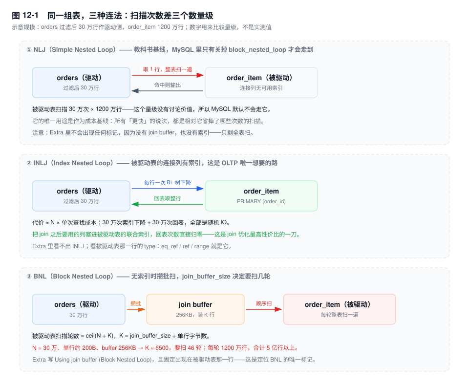
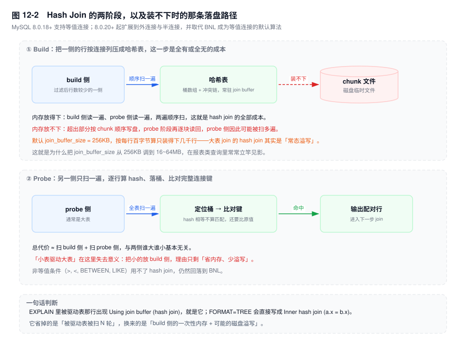
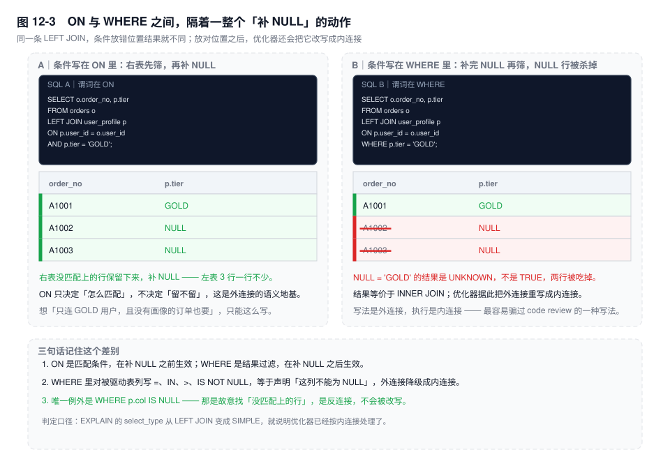

# 第 12 章　连接算法与 Join 优化

> **一句话结论**：JOIN 的耗时 = 驱动侧行数 × 被驱动表单次访问成本。换算法改的是第二个因子，换顺序改的是第一个，而这两个决定由同一份统计信息和同一套成本常数做出来——所以加一个索引，可能同时改掉两者。

## 12.0 场景：一个新索引，把 30ms 的三表 JOIN 推成 4s

周三下午，订单活动页开始超时。这条 SQL 已经安稳跑了三个月：

```sql
SELECT o.order_no, o.amount, i.sku_id, i.qty, p.tier
FROM orders o
JOIN order_item i ON i.order_id = o.id
LEFT JOIN user_profile p ON p.user_id = o.user_id
WHERE o.status = 2
  AND o.created_at >= '2026-11-09'
  AND i.sku_id IN (8842, 8843, /* ……共 300 个活动 SKU */ 9021);
```

监控上，它从 30ms 变成了 4s。当天上午唯一的变更是运维为另一个报表需求加了个索引：

```sql
ALTER TABLE order_item ADD KEY idx_sku_time (sku_id, created_at);
```

没改 SQL、没加数据、没动参数。对比两条执行计划，差异只有一处：`order_item` 从第二行（被驱动）挪到了第一行（驱动）。

- 原计划：`orders` 用 `idx_status_time` 走 range，过滤出约 2 万行当驱动，逐行拿主键去 `order_item` 的 `idx_order` 找，再拿 `o.user_id` 去 `user_profile` 做 `eq_ref`。
- 新计划：`order_item` 用新索引按 `sku_id` 走 range 当驱动，逐行拿 `i.order_id` 回查 `orders` 主键，再查 `user_profile`。

两条计划里都没有 `Using join buffer`，都被优化器判定为"走索引的健康计划"。慢的原因不在算法名，在两个因子上：

**次数。** 优化器估算这 300 个 SKU 只命中一万多行，实际是 40 万行——`IN` 列表超过了 `eq_range_index_dive_limit`（默认 200），估算从逐值 index dive 退回索引基数，热点 SKU 的分布偏斜被"平均值"抹平了。驱动侧从 2 万变成 40 万，20 倍，并且每行都多了一次 `user_profile` 查找。

**局部性。** 原来的两万次查找集中在最近两天的订单页上，几乎全在 Buffer Pool 里；新计划按 `sku_id` 散开，回查的是 `orders` 全时间段、全用户分布的随机页，Buffer Pool 装不下，很大一部分变成真读盘。

成本模型对"读一页"只给了一个固定常数（`engine_cost` 里的 `memory_block_read_cost` 与 `io_block_read_cost`），它不知道具体哪一页在内存里，也算不出"按 sku 散开之后随机性变差"这层代价。所以它算出新计划更便宜，而现实里单次成本差了一个多数量级。

复盘后的处置：`ANALYZE TABLE` 刷统计、把 `IN` 列表拆成"先取明细再按主键批量查订单"（12.1.8 的应用层拼接），`STRAIGHT_JOIN` 只在那半小时的止血窗口里用过。

## 12.1 机制

MySQL 的 join 执行器有两大族：**嵌套循环族**（NLJ / INLJ / BNL / BKA）和**哈希族**（`[8.0.18+]` 的 Hash Join）。前者成本 ≈ 外层行数 × 内层单行成本；后者成本 ≈ 扫 build 侧 + 扫 probe 侧。读懂这一章，就是把这两个公式里的每一项对应到 `EXPLAIN` 的某一列上。



### 12.1.1　谁是驱动表：成本算出来的，不是"表大小"挑的

优化器搜索的不是"用哪张表开头"，而是 **(连接顺序, 每张表的访问方式)** 的组合，代价函数里外层行数是一个乘数。于是同一个"该谁驱动"的问题，在三种算法下有三个不同的答案：

| 内层算法 | 内层单行成本 | 驱动表该怎么选 |
|---|---|---|
| INLJ | 一次索引下降（+ 回表） | 过滤后**行数最少**的那张 |
| BNL | 整表扫一遍 ÷ 每批行数 | 行数少的那张（轮数 = ceil(N/K)） |
| Hash Join | 一次哈希探测 | build 侧选**装得进内存**的那张 |

"小表驱动大表"只在第二行成立，因为只有它把"整表扫描次数"挂在外层行数上。到了 INLJ，真正的判据是"过滤后的行数 × 单次查找成本"：一张五千万行的表被主键过滤到 30 行，照样该它驱动——看的是过滤后的行数，不是表的大小。到了 Hash Join，两侧都只扫一遍，"谁驱动"这个说法本身就不太成立了（12.1.5 展开）。

还有一条硬约束：**`LEFT JOIN` 的左表必须在外层**。优化器可以把外连接改写成内连接之后再调顺序（12.1.6），但只要它还是外连接，顺序就定死了一半。

`STRAIGHT_JOIN` 的适用边界很窄：你已经用 `EXPLAIN ANALYZE` 证明当前顺序更差，且短期内既不能改索引也不能改 SQL。它的代价是**永久钉死顺序**——数据分布变了、数据量涨了十倍，它都不会自适应，下一个接手的人还看不出这是人为干预。8.0 的 optimizer hint 更精细，只影响顺序不动别的：`/*+ JOIN_ORDER(o, i, p) */`、`/*+ JOIN_PREFIX(o) */`、`/*+ JOIN_FIXED_ORDER() */`。

### 12.1.2　INLJ：被驱动表的连接列必须有索引

这是 OLTP 里唯一想要的路。判定不用猜，看被驱动表那一行：`type` 是 `eq_ref`（连接列是唯一索引）、`ref`（非唯一索引）或 `range`，且 `key` 非空。

代价结构是 `N × (索引下降 + 回表)`。B+ 树三层，一次下降是 3~4 次页访问；如果查询列不在索引里，每次还要回聚簇索引再下降一次。**N 大的时候，回表才是主要成本，不是索引查找本身。**

所以 join 场景下最值钱的一刀，是把 join 之后要用的列塞进被驱动表的索引，让回表次数归零：

```sql
-- 原来每次都要回表取 qty 和 price
ALTER TABLE order_item ADD KEY idx_order_cover (order_id, sku_id, qty, price);
```

这里有个反直觉的点：被驱动表"有索引"不等于"索引可用"。类型不一致（`VARCHAR` 列和 `BIGINT` 值比较）、字符集不同（`utf8mb4` 对 `utf8mb3`）、连接列被函数包住、用的是前缀索引但需要完整值——任何一种都会让优化器放弃 `ref`，退成"扫一遍再过滤"——BNL 或 Hash Join。**"退化成 BNL"不是慢一点，是换了算法。**

### 12.1.3　BNL：join buffer 决定被驱动表要扫几遍

被驱动表的连接列没有可用索引时，5.7 和 8.0.20 之前的版本走 BNL：外层一次读一批行进 `join buffer`，然后拿这批行去扫一遍被驱动表，命中就输出。一批扫一遍，所以：

```text
被驱动表扫描轮数 = ceil(驱动侧行数 ÷ K)，K = join_buffer_size ÷ 单行字节数
```

`EXPLAIN` 的标记是 `Using join buffer (Block Nested Loop)`，并且**固定出现在被驱动表那一行**——这一条能帮你在一屏计划里立刻定位"谁在被反复扫"。

按 30 万行驱动、单行 200 字节、`join_buffer_size` 默认 256KB 算，K 约 6500，要扫 46 轮。被驱动表 1200 万行，就是 5 亿行以上的扫描量。这里要注意：如果被驱动表能整张放进 Buffer Pool，这 46 轮是内存扫描，只是 CPU 烧得慌；装不下就是 46 次全表磁盘扫，那就是事故。

调大 `join_buffer_size` 的收益是线性的（轮数下降），代价是**乘数级的内存**：这个 buffer 是每个连接、每个无法用索引的 join 各分配一份，不是全局一份。50 个并发 × 3 表 join × 每个 16MB，理论上限就是 2.4GB 的额外内存，而且是在连接真正跑到那一步时才分配。这是 5.7 时代很典型的一类 OOM。

### 12.1.4　BKA：把随机回表攒成排序后的批量读

BKA（Batched Key Access）是 INLJ 的批量版：不逐行回表，而是先把驱动侧一批行的主键收起来，交给 MRR 排序，再按页顺序批量回表。它把"随机 IO"换成"排序 + 顺序 IO"，**省的是 IO 寻道，不是查找次数**。

它默认是关的，而且不是打开开关就生效：

```sql
SET optimizer_switch = 'mrr=on,mrr_cost_based=off,batched_key_access=on';
```

`mrr_cost_based=on`（默认）时，优化器会自己判断"排序 + 批量"划不划算，而在没有真实 IO 延迟信息的成本模型里，它经常判断不划算。所以要让 BKA 真的跑起来，通常得同时关掉 `mrr_cost_based`——这也解释了为什么它默认关：**收益强依赖存储介质的随机读代价，成本模型估不准，只能由人按场景开。**

值得开的场景很具体：被驱动表远大于 Buffer Pool、回表量大、存储的随机读明显贵于顺序读（机械盘、部分云盘的 IOPS 计费模型）；不值得开的场景同样具体：SSD 上随机读和顺序读差距不大、Buffer Pool 命中率高、或者驱动侧一批本来就只有几十行——排序的开销会盖过收益。

### 12.1.5　Hash Join：等值连接的新默认路径

`[8.0.18+]` 引入，只支持等值连接、只支持内连接；`[8.0.20+]` 扩展到外连接、半连接、反连接，并**取代 BNL 成为等值连接无索引时的默认算法**。触发的必要条件是被驱动表用不上索引（`type=ALL`），只要连接列上有可用的 `ref`，优化器还是优先走 INLJ。

它分两个阶段：build 侧扫一遍，按连接列建哈希表；probe 侧扫一遍，逐行算 hash、落桶、比对完整键。`EXPLAIN` 的标记是 `Using join buffer (hash join)`，`FORMAT=TREE` 里更直白：`-> Inner hash join (i.order_id = o.id)`。



关键在内存。build 侧的内存上限由 `join_buffer_size` 决定，默认 256KB——按每行百字节算是几千行。也就是说，**大表 join 的 hash join 默认就在溢写**：装不下的部分按 chunk 顺序写进磁盘临时文件，probe 阶段再逐块读回来。这一步把"两遍顺序扫"降级成"多轮磁盘读写"，极端情况下比 BNL 还慢，因为多了一次写盘。把 `join_buffer_size` 调到 16~64MB 在报表类查询里经常立竿见影，理由就在这里；但它同样是每连接每 join 一份，OLTP 高并发下不能这么给。

为什么它让"小表驱动大表"失效：BNL 的成本随"驱动行数 ÷ K"增长，所以把小的放外层能少扫几轮；Hash Join 的成本是"扫 build + 扫 probe"，两侧各扫一遍，把谁放 build 侧几乎不改变扫描量，只改变**内存占用和溢写概率**。口诀里的因果关系在这里断掉了。

它的两个真实短板：一是非等值条件（`>`、`<`、`BETWEEN`、`LIKE`）用不了，仍然回落到 BNL；二是数据倾斜时，热点 key 对应的桶内要逐条比对完整键，这部分退化成近似线性扫描。

### 12.1.6　外连接：`ON` 与 `WHERE` 之间隔着一个"补 NULL"

`LEFT JOIN` 的语义是三步：按 `ON` 匹配 → 没匹配上的左表行补 `NULL` → 输出。`ON` 里的条件参与第一步，`WHERE` 里的条件作用于第三步之后。



```sql
-- A：右表先筛，再补 NULL。左表 3 行一行不少
SELECT o.order_no, p.tier FROM orders o
LEFT JOIN user_profile p ON p.user_id = o.user_id AND p.tier = 'GOLD';

-- B：补完 NULL 再筛。NULL = 'GOLD' 是 UNKNOWN，两行被吃掉
SELECT o.order_no, p.tier FROM orders o
LEFT JOIN user_profile p ON p.user_id = o.user_id WHERE p.tier = 'GOLD';
```

B 的结果等价于 `INNER JOIN`。优化器知道这一点：当 `WHERE` 里对被驱动表的列做了"NULL 一定不满足"的判断（`=`、`IN`、`>`、`IS NOT NULL`），它会把外连接重写成内连接，`EXPLAIN` 的 `select_type` 从 `LEFT JOIN` 变成 `SIMPLE`。这个转换有个直接好处——一旦变成内连接，右表就可以被提到外层，连接顺序的自由度回来了。

同一件事反过来说：**看到 `LEFT JOIN` 就以为"左表一定全保留"，是把语法当成了语义**。`WHERE` 里有条件就未必。

唯一不会被改写的是 `WHERE p.col IS NULL`——那是故意找"没匹配上的行"，属于反连接（anti-join），是"找出没有画像的用户"这类需求的正确写法。

谓词下推也是同一个道理。`ON` 里对右表的条件本来就是匹配条件的一部分，可以下推到右表的索引访问；`WHERE` 里对右表的条件在语义上作用于"补完 NULL 之后"，本来没有下推资格——只有当优化器确认外连接能简化成内连接，它才重新获得下推的机会。所以"这个条件能不能下推"不是语法问题，是语义问题。

顺带一个容易忽略的点：`ON` 里对**左表**的过滤不会减少左表的行，它只影响"这一行能不能匹配上"。想让左表少输出，条件必须写在 `WHERE`。

### 12.1.7　顺序搜索：N! 从来不存在，但误差会连乘

优化器不会枚举 N! 种顺序。它做的是深度优先搜索 + 剪枝：

- `optimizer_search_depth` 默认 62。表数不超过它时，搜索接近穷举；超过时退化为贪心——每次只在当前最优的部分计划后面接一张表，不再回溯。
- `optimizer_prune_level` 默认 1，开启剪枝：某个部分计划的估算成本已经明显劣于已知最优，就整枝砍掉，不再往下试。

这两条决定了"表一多就选错"的三个原因：

1. **剪枝基于估算。** 估错一次，那整枝子树再也不会被看到，哪怕里面藏着真正的最优解。
2. **误差连乘。** 每张表的 `rows` 是独立采样的，join 之后的行数 = 上一层行数 × 选择率 × `filtered`。每层误差 2 倍，五张表就是 32 倍。
3. **搜索空间本身。** 8~10 张表的 join，光是枚举的编译成本就开始影响响应时间，这也是"DBA 禁大表 JOIN"的现实理由之一，不全是执行慢。

`optimizer_prune_level=0` 会关掉剪枝做更彻底的搜索，代价是优化耗时可能从毫秒涨到秒级——线上不建议，离线跑批可以试。

### 12.1.8　大表 JOIN 不该做的时候：三条替代路径的边界

不是所有 JOIN 都值得优化，有些应该拆掉。三条路子的适用边界和代价是不同的：

| 方案 | 适用边界 | 代价 |
|---|---|---|
| 应用层拼接 | 驱动侧结果集小（几百~几千），被驱动表能按主键批量 `IN` 查 | 多一次往返；`IN` 列表长度受限；排序、分页、聚合得自己在内存里做 |
| 宽表 / 冗余字段 | join 的列少、变更频率低、读多写少 | 写放大；一致性要靠事务内双写或异步补偿；加字段是 DDL |
| 异构索引表（ES / 列存 / 专用查询表） | 多条件筛选、聚合、跨库 | 同步延迟；两套系统的一致性；多一套运维 |

判断顺序建议是：先问"这个 join 是不是必须实时、必须精确"，再问"能不能把 join 的列冗余过来"，最后才问"要不要换算法"。**能在 SQL 层修好的 join，不要用架构去补；该拆的 join，也别指望调 `join_buffer_size`。**

## 12.2 关键结论

1. **驱动表是成本算出来的，不是表大小挑的。** 外层行数是成本公式里的乘数，"小表驱动大表"只在 BNL 下成立；INLJ 要看"过滤后行数"，Hash Join 下这个说法基本失效。
2. **INLJ 的前提是被驱动表连接列上有可用索引，代价 ≈ N × 单次查找成本。** 回表是主要成本，N 大时优先考虑把查询列并入被驱动表的索引。
3. **`Using join buffer (Block Nested Loop)` 出现在被驱动表那一行，含义是"这张表要被扫 ceil(N/K) 轮"。** 轮数由 `join_buffer_size` 决定，而这个参数是每连接每 join 一份。
4. **Hash Join `[8.0.18+]` 把成本从"N × 内层"变成"扫两遍"，因此让口诀失效；但它的 build 侧受 256KB 默认值限制，大表场景常态溢写。**
5. **`ON` 决定怎么匹配，`WHERE` 决定留不留。** `WHERE` 里对被驱动表列加非空条件，等价于把 `LEFT JOIN` 声明成内连接，优化器会照此重写。
6. **多表顺序搜索是"估算 + 剪枝"，不是穷举。** 表一多，误差连乘与剪枝共同作用，"选错"是常态而不是 bug。

## 12.3 实验验证

### 实验一：不改表，也能让算法切换

```sql
-- 建表与造数见附录 G；orders 约 200 万行，order_item 约 1200 万行
EXPLAIN SELECT o.id, i.sku_id
FROM orders o JOIN order_item i ON i.order_id = o.id
WHERE o.status = 2 AND o.created_at >= '2026-08-01';

-- 用 IGNORE INDEX 模拟"连接列没有索引"，不动表结构
EXPLAIN SELECT o.id, i.sku_id
FROM orders o JOIN order_item i IGNORE INDEX (idx_order, PRIMARY) ON i.order_id = o.id
WHERE o.status = 2 AND o.created_at >= '2026-08-01';
```

预期形态（未实跑，字段含义以此为准）：

```text
# 第一条：INLJ
+----+-------+--------+-----------------+-----------------+---------+------+----------+-----------------------------------+
| id | table | type   | possible_keys   | key             | key_len | ref  | rows     | Extra                             |
+----+-------+--------+-----------------+-----------------+---------+------+----------+-----------------------------------+
| 1  | o     | range  | idx_status_time | idx_status_time | 6       | NULL | 20000    | Using index condition             |
| 1  | i     | ref    | idx_order       | idx_order       | 8       | o.id | 1        | NULL                              |
+----+-------+--------+-----------------+-----------------+---------+------+----------+-----------------------------------+

# 第二条：算法切换，注意 Extra 落在 i 那一行
| 1  | o     | range  | idx_status_time | idx_status_time | 6       | NULL | 20000    | Using index condition             |
| 1  | i     | ALL    | NULL            | NULL            | NULL    | NULL | 12000000 | Using join buffer (hash join)     |
+----+-------+--------+-----------------+-----------------+---------+------+----------+-----------------------------------+
```

读法：`type=ALL` + `Using join buffer (...)` 同时出现，就是"这张表在给每一批驱动行做整体扫描"。注意版本：8.0.18 之前不存在 `hash join` 这个值，这里只会是 `Block Nested Loop`。

### 实验二：数出被驱动表被扫了几遍

```sql
-- 非等值条件用不了 hash join，只能攒批扫，正好用来观察 BNL 的轮数
FLUSH STATUS;
SELECT COUNT(*) FROM orders o
JOIN order_item i IGNORE INDEX (idx_order, PRIMARY) ON i.order_id > o.id
WHERE o.status = 2 AND o.created_at >= '2026-08-01';
SHOW SESSION STATUS LIKE 'Handler_read_rnd_next';
```

`Handler_read_rnd_next` 记录的是"按物理顺序扫过的行数"，**所有被全表扫的表都会计入**，所以不要看绝对值，看变化：

- 先跑一次记下数字，再 `SET SESSION join_buffer_size = 4*1024*1024;` 跑第二次。两次的差值 ÷ 被驱动表行数 ≈ 少扫的轮数，BNL 下这个下降是与 K 成比例的。
- 把条件换回等值（`ON i.order_id = o.id`）并保留 `IGNORE INDEX`，8.0.20+ 会改选 hash join：内存够就只多一遍扫描量，装不下时数字明显高于一遍——这就是溢写的证据。

这个计数器比 `EXPLAIN` 的 `rows` 可靠，因为它是实际发生的，不是估算的。

### 实验三：`ON` 与 `WHERE` 的结果差

```sql
SELECT COUNT(*) FROM orders o
LEFT JOIN user_profile p ON p.user_id = o.user_id AND p.tier = 'GOLD';

SELECT COUNT(*) FROM orders o
LEFT JOIN user_profile p ON p.user_id = o.user_id WHERE p.tier = 'GOLD';
```

预期：第一条 = `orders` 的总行数（左表一行不少，没匹配的 `tier` 为 `NULL`）；第二条 = 匹配到 GOLD 的订单数，通常小一到两个数量级。对第二条跑 `EXPLAIN`，`select_type` 是 `SIMPLE` 而不是 `LEFT JOIN`——优化器已经把外连接改写成内连接了。

### 实验四：看优化器怎么挑的顺序

```sql
SET optimizer_trace = 'enabled=on';
-- 执行目标 SQL
SELECT TRACE FROM information_schema.OPTIMIZER_TRACE\G
```

在 `join_optimization` → `best_access_path` 段里，能看到每个候选顺序的 `cost` 和最终 `chosen` 的那条。**如果 `chosen` 的 `rows` 估算和 `EXPLAIN ANALYZE` 的实际行数差一个数量级以上，问题在统计而不在算法**——这时候调 `optimizer_search_depth` 或加 hint 都只是按住症状。

## 12.4 常见误区

⚠️ **"小表驱动大表，永远没错"**
错在没有边界。这句话成立的完整条件是：被驱动表**没有可用索引**、算法是 BNL、`join_buffer_size` 装不下全部驱动行。三个条件缺一个，结论就可能反过来：INLJ 下应该让"过滤后行数最少"的表驱动；Hash Join 下把小的放 build 侧只是为了省内存，跟"驱动"已经没关系了。

⚠️ **"`LEFT JOIN` 一定保留左表全部行"**
`WHERE` 里对被驱动表列加任何非空条件（`=`、`IN`、`>`、`<>`、`IS NOT NULL`），执行结果都等价于 `INNER JOIN`，补出来的 `NULL` 行会被全部过滤掉。优化器甚至会直接改写成内连接。判断方法：看 `EXPLAIN` 的 `select_type`，是 `SIMPLE` 就说明它已经不把你当外连接了。

⚠️ **"被驱动表连接列有索引，就一定是 INLJ"**
索引"存在"和索引"可用"是两件事。类型不一致的隐式转换、两表字符集/collation 不一致、连接列被函数包裹、用了前缀索引却要完整值——任何一种都会让 `ref` 变成 `ALL`，算法直接换掉。这也是"两个库分别测都很快，放一起 join 就慢"的常见原因。

⚠️ **"`join_buffer_size` 调大就好了"**
它只对两类查询有效：走 BNL 的，和 build 侧溢写的 Hash Join。而且它是**每连接、每 join** 一份，不是全局共享。`max_connections` 是 500 的实例上把它从 256KB 调到 32MB，理论上限就是十几 GB 的额外内存。

⚠️ **"Hash Join 一定比 BNL 快"**
内存装不下时它会溢写到磁盘临时文件，probe 侧可能被扫多遍，代价里还多了一次写盘，极端情况下比 BNL 更慢。判断依据不是版本号，是 `join_buffer_size` 与 build 侧实际行数的比例。

⚠️ **"`STRAIGHT_JOIN` 能治计划选错"**
它只钉死顺序，不解决"被驱动表没索引"，也不解决统计不准。钉死之后，数据量涨十倍、分布变了，它照样按老顺序跑，而且下一个维护者看不出这是人为干预。

## 12.5 生产 Checklist

Code Review 和计划评审时，按这个顺序过：

- [ ] 每个 join 的被驱动表，连接列上是否有**类型、字符集一致**的可用索引？`EXPLAIN` 里那一行的 `type` 是不是 `eq_ref` / `ref` / `range`？
- [ ] 被驱动表那一行有没有 `Using join buffer (...)`？有的话，先确认它是 `hash join` 还是 `Block Nested Loop`——后者意味着 N 轮全表扫。
- [ ] 驱动侧的实际行数，和 `EXPLAIN` 的 `rows` 差多少？差一个数量级以上，先 `ANALYZE TABLE`，再怀疑 `IN` 列表超过 `eq_range_index_dive_limit`（默认 200）导致的估算退化。
- [ ] `LEFT JOIN` 的 `WHERE` 里，有没有对被驱动表列的非空条件？有的话这条 SQL 实际是内连接，写法应该改过来，别让 review 的人误判。
- [ ] join 之后 `SELECT` 的列，能不能并入被驱动表的索引做成覆盖，省掉回表？
- [ ] 参与 join 的表超过 5 张了吗？超过就先算一算，是不是该在应用层拆成两次查询。
- [ ] `join_buffer_size` 是否被全局调大过？乘以 `max_connections`，再乘以可能的 join 数量，看内存上限。
- [ ] 有没有 `STRAIGHT_JOIN` 或 join 顺序 hint？每一个都要能说清"为什么当时必须钉死"，否则就是技术债。
- [ ] 大表 join 的查询，是否跑在从库或专用报表实例上？它消耗的是 Buffer Pool，会把 OLTP 的热数据挤出去（见第 2 章）。

## 12.6 延伸

- **上一章**：执行计划精读——`type`、`rows`、`Extra` 的逐列语义，是这一章的前置。
- **关联章节**：第 9 章（索引设计与失效，决定 `ref` 能不能成立）、第 10 章（统计信息与成本模型，决定"谁驱动"）、第 13 章（子查询与半连接，`IN` 的另一条实现路径）、第 14 章（join 之后的排序与临时表）、第 31 章（反范式与宽表）。
- **面试追问**：
  - "`LEFT JOIN` 和 `IN` 谁快？" → 没有可比性。`IN` 是半连接，优化器会在 `FirstMatch`、`LooseScan`、`Materialization`、`DuplicateWeedout`、`Table Pullout` 五种策略之间选；`LEFT JOIN` 若被 `WHERE` 降级成内连接，两者可能生成同一个计划。要比就比执行计划，不比语法。
  - "为什么 8.0 之后'小表驱动大表'不灵了？" → Hash Join 把成本从"N × 内层"变成"扫两遍"，驱动顺序不再影响扫描量，只影响内存与溢写。
  - "`Using join buffer` 一定是坏事吗？" → 不一定。`hash join` 在小结果集上是合理的；`Block Nested Loop` 才是需要立刻处理的信号。
- **官方文档**：`MySQL Reference Manual` → `Optimization` → `Nested-Loop Join Algorithms`、`Block Nested-Loop and Batched Key Access Joins`、`Hash Join Optimization`、`Outer Join Optimization`、`Optimizer Hints`。
