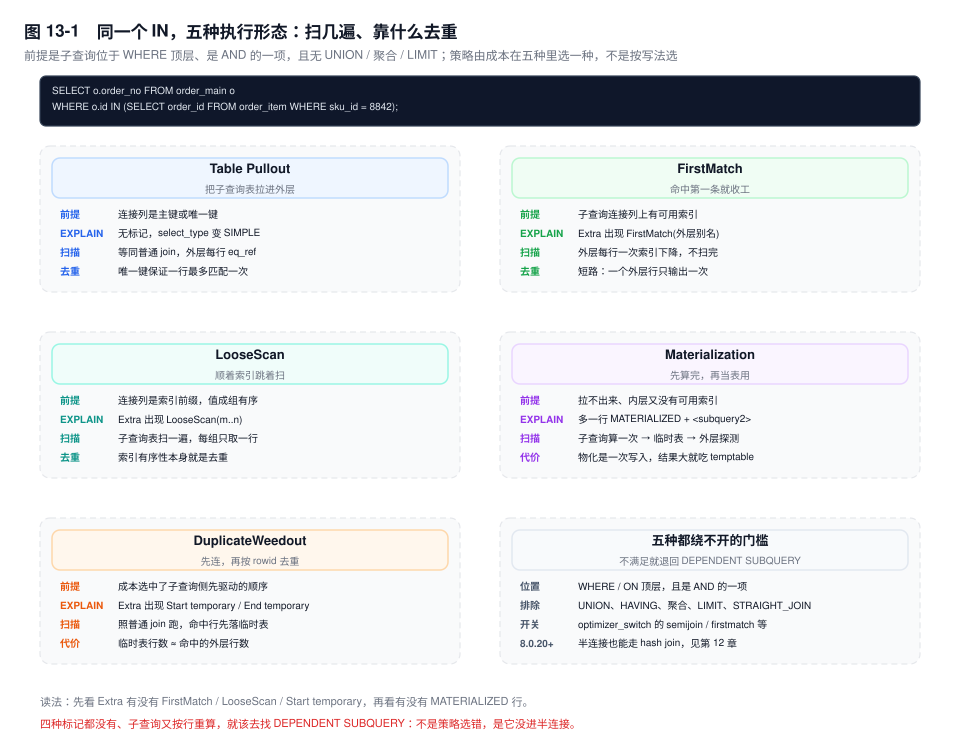
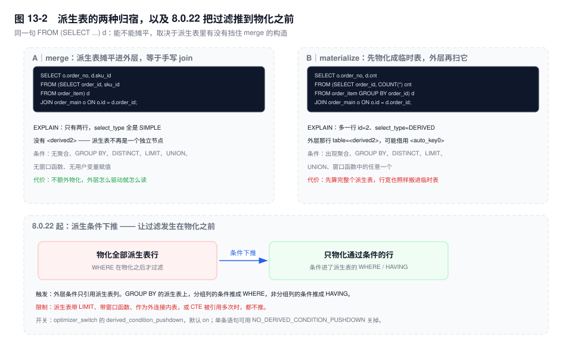

# 第 13 章　子查询、派生表与 CTE

> **一句话结论**：子查询的代价不由 `IN` 还是 `EXISTS` 决定，而由优化器把它变成了什么决定——一次物化、一次半连接，还是外层每行重算一次；这三个结果在 `select_type` 和 `Extra` 里写得清清楚楚。

## 13.0 场景：20ms 的 `IN`，在数据涨起来那年变成 6 秒

对账页有个筛选：查某个 SKU 的全部订单。

```sql
SELECT o.order_no, o.payable, o.created_at
FROM order_main o
WHERE o.id IN (SELECT order_id FROM order_item WHERE sku_id = 8842);
```

`order_item` 八百万行时它是 20ms。涨到四千万行那一季，它变成 6 秒，而且只对爆款 SKU 慢，长尾 SKU 还是 20ms。

值班同学给了三个方案：把 `IN` 改成 `EXISTS`、加 `FORCE INDEX`、说"`IN` 子查询本来就慢，改成 JOIN"。前两个没变化，第三个快了 30%——因为顺手把 `SELECT` 的列减了两列。

真实原因和语法无关。这条 SQL 的计划一直没变：从 `order_item` 的 `idx_sku` 出发拿到命中的明细，再逐行拿 `order_id` 去 `order_main` 主键回查。变的只有"命中多少行"：这个 SKU 的明细从 400 行涨到 30 万行。400 次主键回查，命中哪个页都无所谓，总数就 400 次；30 万次要把 30 万个位置的订单页翻一遍，这些页在 Buffer Pool 里留不住，单次成本从内存读变成随机 IO，顺手还把别的业务的热页挤了出去。**次数涨了三个数量级，单次成本又抬了一档，两个因子一起乘，就是那 300 倍。**

## 13.1 同一段子查询，写在不同位置就是不同的执行次数

子查询按返回形状分三类：标量（一行一列）、行（一行多列）、表（多行多列）。第四类"关联"（correlated）是另一条轴——它说的是子查询里引用了外层表的列，一个子查询可以既是标量又是关联。形状决定它能不能出现在某个位置，关联性决定它能不能被算一次。真正决定代价的是**位置**。

拿同一段 `(SELECT order_id FROM order_item WHERE sku_id = 8842)` 放三处：

| 写在哪 | 执行次数 | 计划里的样子 |
|---|---|---|
| `SELECT` 列表 | 外层每输出一行一次 | 次数看 `EXPLAIN ANALYZE` 的 `loops`，或 `Handler_read_key` 的涨幅 |
| `WHERE`（不相关） | 一次，或被半连接吸收 | `SUBQUERY` / `MATERIALIZED` / 直接 `SIMPLE` |
| `WHERE`（相关） | 外层每行一次 | `DEPENDENT SUBQUERY` |
| `FROM` 里 | 一次；被 merge 时是零次 | `DERIVED` + `<derivedN>`，或什么都没有 |

两处容易被想错。

**第一，`DEPENDENT SUBQUERY` 不等于"外层几行就算几次"。** 相同的外层值组合能命中子查询缓存，缓存键是外层列的值。外层一百万行、只有一万个不同的 `user_id`，实际重算就是一万次。这个兜底会失效：子查询里出现 `RAND()`、`UUID()` 或用户变量，`select_type` 变成 `UNCACHEABLE SUBQUERY`，每行必算。

**第二，`FROM` 里的派生表可能根本没执行"一次"。** 能 merge 就被摊平进外层，等于你手写了一个 join，计划里连 `<derivedN>` 都不出现。所以"派生表先算完再被扫"这句话，只在它被物化时成立。

## 13.2 半连接：优化器把你的 `IN` 拆成五种计划

`IN`、`= ANY`、`EXISTS` 在语义上只问"有没有匹配"，不问匹配几条。优化器据此改写成**半连接**：子查询表并进外层的 join 列表，但保证每个外层行最多输出一次。这就是它的全部意义——不做半连接，就得先连出重复行再 `DISTINCT`。

改写有门槛，不满足就退回逐行。谓词必须是 `WHERE` / `ON` 顶层的 `IN` / `= ANY` / `EXISTS`，可以是 `AND` 的一项；子查询是单个 `SELECT`，不含 `UNION`、`HAVING`、聚合函数、`LIMIT`；语句里没有 `STRAIGHT_JOIN`。`DISTINCT`、不含聚合的 `GROUP BY`、`ORDER BY` 允许出现但会被忽略，去重本来就归半连接管。

过了门槛，成本在五种策略里选一种：

| 策略 | `EXPLAIN` 里的标记 | 扫描次数 | 去重靠什么 |
|---|---|---|---|
| `Table Pullout` | 无标记，子查询表并入外层 block，`select_type` 变 `SIMPLE` | 同普通 join | 连接列是唯一键 |
| `FirstMatch` | `Extra`：`FirstMatch(o)` | 外层行数 × 1 次索引探测 | 命中即停 |
| `LooseScan` | `Extra`：`LooseScan(m..n)` | 子查询表一遍 | 索引有序性 |
| `Materialization` | 多一行 `MATERIALIZED`，`table=<subquery2>` | 子查询一遍，再逐行探测 | 临时表的唯一索引 |
| `DuplicateWeedout` | `Extra`：`Start temporary` / `End temporary` | 同普通 join，另加去重 | 临时表存外层 rowid |



前两种的前提最硬。`Table Pullout` 要求子查询的连接列是主键或唯一键，否则拉出来会放大行数——它其实是"子查询根本不需要存在"的情况，标记消失就是它的标记。`FirstMatch` 要求内层连接列有索引，否则"命中即停"退化成"扫完才知道没有"。

`LooseScan` 要求值在索引里成组有序，它能做到一个值只取一行，代价是子查询表扫一遍，与外层行数无关。`Materialization` 是内层没索引时的主力：只算一次，但要建临时表、建唯一索引，结果集大时这笔写入本身就贵。`DuplicateWeedout` 出现在成本选中"子查询侧先驱动"的顺序时——那时重复行已经产生，只能事后按 rowid 去重，临时表大小约等于命中的外层行数。

`[8.0.20+]` 半连接也能走 hash join：等值条件、内层没索引时，它省掉了 `Materialization` 建索引那一步，代价是 build 侧要全量进内存（见第 12 章）。

## 13.3 `IN` 与 `EXISTS`：口诀失效的地方

「`IN` 先算子查询再比较，`EXISTS` 逐行判断」——这句话在 5.6 之前大致成立。`[8.0.16+]` 起 `EXISTS` 走与 `IN` 完全相同的半连接变换；`[8.0.17+]` 起 `NOT IN`、`NOT EXISTS`、`IN (...) IS NOT TRUE` 统一转成反连接。同一对 SQL 去比 `EXPLAIN`，多数时候两张表长得一模一样，**所以比语法没有意义，要比的就是计划。**

真正需要二选一的只剩语义：`NOT IN` 遇到 NULL 返回 UNKNOWN。`8842 NOT IN (8842, NULL)` 一行都不返回，`NOT EXISTS` 会返回。文档也写明了反连接变换在可空列上不成立——所以 `NOT IN` 撞上可空列，不但结果反直觉，连优化路径也断了。**这是唯一必须换 `NOT EXISTS` 的场景，理由是正确性，不是性能。**

真的进不了半连接的情形，各自的退路并不一样：

| 情形 | 退到哪 |
|---|---|
| 子查询相关，且是 `OR` 的一项 | `DEPENDENT SUBQUERY`，外层每行触发 |
| 子查询不相关，带 `LIMIT` / 聚合 / `HAVING` | 物化成临时表（`SUBQUERY` 或 `MATERIALIZED`），算一次 |
| 同上但相关（`WHERE i.order_id = o.id AND ... LIMIT 1`） | `DEPENDENT SUBQUERY`，每行重算 |
| `NOT IN` 且比较列可空 | 反连接不成立，退回物化（带 NULL 检查） |
| 语句用了 `STRAIGHT_JOIN`，或关了 `semijoin` | `DEPENDENT SUBQUERY` |
| 含 `RAND()` / `UUID()` / 用户变量 | `UNCACHEABLE SUBQUERY`，连相同值的缓存都没有 |

规律很简单：**能不能一次算完，决定它是"算一次"还是"每行算"**。不相关但不满足半连接条件，还能物化；相关又不满足，就只剩逐行——这也解释了为什么"取最新一条"的写法（`ORDER BY ... LIMIT 1` 且带外层关联）几乎总是最慢的那一档。

## 13.4 派生表：merge 还是 materialize

`FROM (SELECT ...) d` 有两种归宿，判定标准是**派生表里有没有挡住 merge 的构造**：聚合函数、窗口函数、`DISTINCT`、`GROUP BY`、`HAVING`、`LIMIT`、`UNION`、选择列表里的子查询、用户变量赋值。有任意一个就物化。

- **merge**：派生表被摊平进外层，`EXPLAIN` 里既没有 `<derivedN>` 也没有 `DERIVED` 行。外层的 `WHERE` 自然落在内层表上，索引照用，等于你手写了 join。
- **materialize**：多一行 `id=2`、`select_type=DERIVED`、`table=<derived2>`；外层那行的 `table` 是 `<derived2>`，需要连接时优化器会给它建一条自动索引（`key` 列显示 `<auto_key0>`）。物化是**延迟**发生的：外层先跑出空集，派生表可能压根不被物化。



`[8.0.22+]` 之前的物化是"整表算完，再套外层 `WHERE`"。派生条件下推（`optimizer_switch` 的 `derived_condition_pushdown`，默认开；也可用 `NO_DERIVED_CONDITION_PUSHDOWN` 单条关掉）把外层条件推进派生表：无聚合时直接进内层 `WHERE`；有 `GROUP BY` 时，分组列上的条件推成 `WHERE`，非分组列上的推成 `HAVING`。它解决的问题很具体——**为了取几十行，先物化了几百万行**。

限制要记：派生表带 `LIMIT`、带窗口函数、作为外连接的内表、条件里含子查询或不确定表达式，都不推；`UNION` 要到 `[8.0.29+]` 才支持；CTE 被引用多次时也不推。

## 13.5 CTE：`WITH` 的物化与递归

非递归 CTE 走与派生表同一套 merge / materialize 判定，只多一条：**被引用多次时只物化一次，多次复用**（optimizer trace 里表现为一次 `creating_tmp_table` 加多次 `reusing_tmp_table`）。这也是 CTE 相对"把子查询抄两遍"的唯一硬优势：省掉第二次计算，代价是临时表和自动索引。

递归 CTE 永远物化。下面是从子单向上追溯母单的标准写法：

```sql
WITH RECURSIVE tree AS (
  SELECT id, parent_id, 1 AS lvl FROM order_main WHERE id = 10086
  UNION ALL
  SELECT o.id, o.parent_id, t.lvl + 1
  FROM order_main o JOIN tree t ON o.parent_id = t.id
  WHERE t.lvl < 10
)
SELECT * FROM tree;
```

三点必须知道。**`UNION ALL` 不去重，`UNION DISTINCT` 去重**——后者用于传递闭包和环检测，代价是每轮一次去重。**`cte_max_recursion_depth` 默认 1000**，超了直接报错、错误信息以 `Recursive query aborted after` 开头，不会静默截断，所以出事的是那条语句而不是数据。`[8.0.19+]` 起递归部分还可以写 `LIMIT`；单条语句想放宽深度，用 `/*+ SET_VAR(cte_max_recursion_depth=...) */`。

代价模型是"深度 × 每层宽度"：每一轮都要把上一轮的结果写进临时表再读出来。五层的组织树很便宜，层级不封顶的评论盖楼不是它擅长的场景。

## 13.6 窗口函数：一次排序换掉 N 次子查询

"每个用户最近一单"是相关子查询的重灾区：

```sql
SELECT * FROM order_main o
WHERE o.created_at = (SELECT MAX(created_at) FROM order_main o2
                      WHERE o2.user_id = o.user_id);
```

典型 `DEPENDENT SUBQUERY`：外层每行都要在内层 `(user_id, created_at)` 上查一次，而且同一秒下单会返回多行。`[8.0]` 起换成窗口函数：

```sql
SELECT * FROM (
  SELECT o.*, ROW_NUMBER() OVER (PARTITION BY user_id
                                 ORDER BY created_at DESC, id DESC) AS rn
  FROM order_main o
) t WHERE t.rn = 1;
```

一次排序、线性扫一遍。`RANK()` 处理并列（1,1,3），`DENSE_RANK()` 不给并列留空位（1,1,2），`LAG` / `LEAD` 取相邻行算环比。这三类需求用自连接写，最难写对、也最容易写慢。

代价在三处：**必然排序**（`Extra` 里 `Using temporary; Using filesort`，除非索引顺序刚好是 `(PARTITION BY 列, ORDER BY 列)`）；**分区必须整体缓冲**（一个分区的行读全了才能定 `rn`，内存临时表超过 `temptable_max_ram` 就落盘）；**不能提前 `LIMIT`**（`rn = 1` 只能在外层过滤，哪怕只要 20 行，内层也得把所有分区排完）。这三项怎么量化，见第 14 章。

## 13.7 识别与改写

`DEPENDENT SUBQUERY` 本身不是错误，它只是把"外层行数 × 内层单次成本"这个乘法摊开了。要不要改先看外层 `rows`：几十行不用管，上万行必须动。

| 症状 | 改写 | 代价与边界 |
|---|---|---|
| 每行取 TopN（最近一单、最新状态） | `ROW_NUMBER()` 窗口函数 | 一次全量排序；只要少量行时反而更贵 |
| 每行一次标量聚合（`SUM`、`COUNT`） | 先聚合的派生表，再 join | 物化一次；派生表结果大就吃临时表 |
| 只判断存在性 | 保留 `IN` / `EXISTS`，给内层连接列补索引 | 没索引时半连接无从下手 |
| 外层千万行、子查询只回几十行 | 应用层两次查询，第二次按主键批量 `IN` | `IN` 列表别超 `eq_range_index_dive_limit`（默认 200），否则估算退化 |
| 子查询在 `OR` 里 | 拆成两条 SQL `UNION ALL`，或改成 `JOIN` | 去重语义要自己保证 |

最后一条的边界值得强调：改 `JOIN` 会放大行数（一个订单多条明细），必须显式 `DISTINCT` 或 `GROUP BY`，否则结果集变大，还平白多一次去重。第 15 章有一整批这种改写案例。

## 13.8 关键结论

1. **决定代价的是位置和计划，不是 `IN` / `EXISTS` 的选择。** 选择列表按行算、`WHERE` 里可能只算一次、`FROM` 里可能被 merge 掉——同一段文本，三个位置差三个数量级。
2. **半连接的标记只有四种是"显式"的**：`FirstMatch(别名)`、`LooseScan(m..n)`、`Start temporary` / `End temporary`、以及 `MATERIALIZED` 行。`Table Pullout` 的标记就是"标记消失"——子查询表变成了普通 join 表。
3. **"`EXISTS` 比 `IN` 快"在 `[8.0.16+]` 已经失效**，两者走同一套变换。唯一必须用 `NOT EXISTS` 的场景是 `NOT IN` 撞上可空列，那是三值逻辑问题。
4. **merge 与否由"有没有挡住 merge 的构造"决定**，聚合、窗口函数、`DISTINCT`、`GROUP BY`、`HAVING`、`LIMIT`、`UNION` 有一个就物化。物化不一定坏，但它一定是一次全量计算加一次临时表写入。
5. **窗口函数用一次排序换掉 N 次子查询，代价是"必须排完"**：`rn = 1` 不能下推，分区必须整体缓冲。在"只要少量行"的场景里，它可能比配好索引的相关子查询更慢。

## 13.9 实验验证

### 实验一：把半连接策略一个个关掉，看计划怎么换

```sql
EXPLAIN FORMAT=TREE
SELECT o.order_no FROM order_main o
WHERE o.id IN (SELECT order_id FROM order_item WHERE sku_id = 8842);

SET optimizer_switch='semijoin=on,firstmatch=off,loosescan=off,duplicateweedout=off,materialization=off';
-- 再跑一次；然后逐个打开，观察 Extra 与 TREE 节点怎么变
```

预期形态（未实跑，字段含义以此为准）：策略全关时退回 `DEPENDENT SUBQUERY`，TREE 里多出一个相关子查询节点（形如 `Select #2 (subquery in condition; dependent)`）；只留 `materialization` 时变成 `MATERIALIZED` 行加 `<subquery2>`；只留 `firstmatch` 时 `Extra` 出现 `FirstMatch(o)`。这张对照表比任何文章都可靠，它来自你自己的数据和你自己的版本。

### 实验二：merge 与 materialize 的判定

```sql
EXPLAIN SELECT * FROM (SELECT order_id, sku_id FROM order_item) d
WHERE d.sku_id = 8842;          -- 预期：没有 DERIVED 行，条件落在内层表上

EXPLAIN SELECT * FROM (SELECT order_id, COUNT(*) c FROM order_item
                       GROUP BY order_id) d WHERE d.order_id < 1000;
-- 预期：多一行 id=2 / DERIVED / <derived2>；8.0.22+ 条件下推后物化行数明显少于全量
```

判据只有一条：计划里有没有 `<derivedN>`。

### 实验三：递归 CTE 的边界

```sql
SET SESSION cte_max_recursion_depth = 5;
WITH RECURSIVE t (n) AS (SELECT 1 UNION ALL SELECT n + 1 FROM t)
SELECT * FROM t;
-- 预期：报错（Recursive query aborted after ...），不是返回 5 行
```

它验证的是 13.5 那句话：超限是**报错**不是截断。生产上要靠递归部分自己的终止条件，别把爆炸半径交给这个上限。

## 13.10 常见误区

⚠️ **"`IN` 子查询比 `JOIN` 慢"**
两者可能生成同一个计划：`IN` 就是半连接，半连接就是一种 join。慢的是"没进半连接"或"策略选错"，不是 `IN` 这个关键字。拿 `EXPLAIN` 比，不拿语法比。

⚠️ **"`EXISTS` 会提前终止，所以一定比 `IN` 快"**
"提前终止"是 `FirstMatch` 的行为，前提是内层有索引且优化器选了 `FirstMatch`。没索引时它是扫完才知道没有，`EXISTS` 的语义帮不上任何忙。

⚠️ **"派生表一定先物化"**
能 merge 就被摊平，计划里连 `<derivedN>` 都看不到。看到 `DERIVED` 才说明真物化了，而物化还可能是延迟发生的。

⚠️ **"CTE 是语法糖，换成它就会快"**
非递归 CTE 和派生表同一套规则；被引用一次时，它与手写子查询毫无区别。它的价值在"引用多次只算一次"和可读性，不在性能。

⚠️ **"窗口函数一定比相关子查询快"**
只在"分区行数占全表比例高、结果行数也多"时成立。为了 `rn = 1` 拿 20 行，却要把全表按分区排一遍——相关子查询配好索引反而更快。

## 13.11 生产 Checklist

- [ ] 子查询在 `SELECT` 列表里吗？在的话，用它乘一次单行求值成本，看换来的列值不值
- [ ] `select_type` 有没有 `DEPENDENT SUBQUERY` / `UNCACHEABLE SUBQUERY`？外层 `rows` 过万就先改
- [ ] 半连接的策略看到的是哪一种？`Materialization` 看子查询结果集大小，`DuplicateWeedout` 看临时表行数
- [ ] 派生表有没有 `<derivedN>`？有的话，里面的 `GROUP BY` / `LIMIT` 能不能挪到外层去
- [ ] `[8.0.22+]` 上物化派生表的查询，`derived_condition_pushdown` 是否被谁关过
- [ ] 递归 CTE 有没有自己的终止条件？只靠 `cte_max_recursion_depth` 等于把爆炸半径交给默认值
- [ ] 窗口函数的 `PARTITION BY` 列基数是多少？基数接近行数时，等于每个分区一行、白排一次
- [ ] `NOT IN` 的比较列可空吗？可空就换 `NOT EXISTS`，这是正确性问题而非性能问题

## 13.12 延伸

- **上一章**：第 12 章讲了 join 的算法与顺序；半连接就是 join 的一种变体，成本模型完全共用。
- **关联章节**：第 11 章（`select_type` 与 `Extra` 的逐列读法）、第 14 章（窗口函数与物化背后的排序和临时表）、第 15 章（改写案例库）。
- **面试追问**：
  - "`IN` 和 `EXISTS` 谁快？" → 8.0.16 之后多数情况是同一个计划，要比就比 `EXPLAIN`。
  - "半连接有几种策略，`EXPLAIN` 里怎么认？" → 五种；`FirstMatch(别名)`、`LooseScan(m..n)`、`Start/End temporary`、`MATERIALIZED`，`Table Pullout` 没有标记。
  - "派生表什么时候物化？" → 出现聚合、窗口函数、`DISTINCT`、`GROUP BY`、`HAVING`、`LIMIT`、`UNION` 之一。
- **官方文档**：`Optimizing IN and EXISTS Subquery Predicates with Semijoin Transformations`、`Optimizing Subqueries with Materialization`、`Optimizing Derived Tables, View References, and Common Table Expressions`、`Derived Condition Pushdown Optimization`、`WITH (Common Table Expressions)`。
