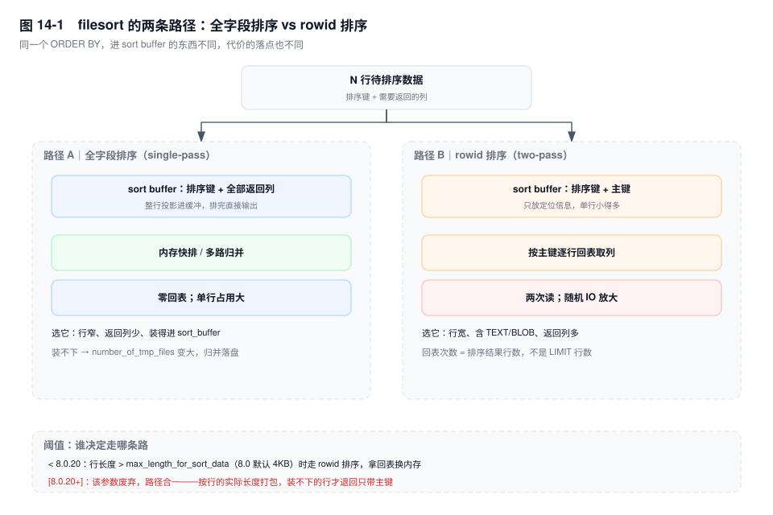
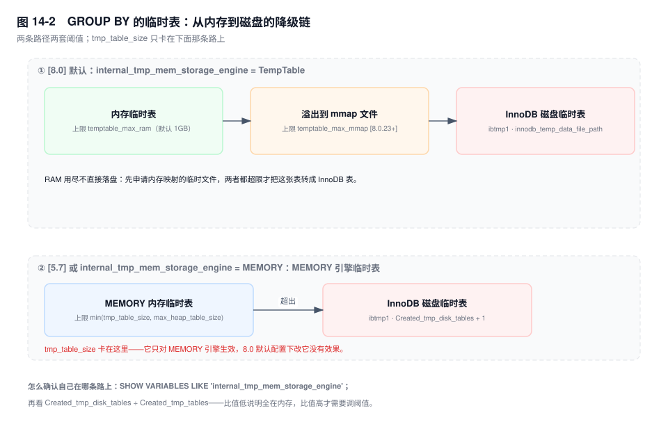

# 第 14 章　排序、临时表与聚合

> **一句话结论**：`Using filesort` 说的是"索引给不了顺序"，不是"用了磁盘"；`Using temporary` 说的是"需要一个中间结果集"，不是"一定落盘"。这两个标签各自的降级开关是 `sort_buffer_size` 与 `temptable_max_ram`，而不是多数人第一反应的那个 `tmp_table_size`。

## 14.0 场景：12ms 变 2.4s，两个指标同时报警

账单表 `bill` 3000 万行，列表页这条 SQL 半年没动过：

```sql
SELECT id, bill_no, merchant_id, amount, status, create_time, remark
FROM bill
WHERE merchant_id = 9021 AND status IN (1, 2)
ORDER BY create_time DESC
LIMIT 20;
```

上周为了另一个"按状态筛商户"的报表，有人把 `idx_merchant_created (merchant_id, create_time)` 换成了 `idx_merchant_status_created (merchant_id, status, create_time)`。换完之后，列表页 P99 从 12ms 涨到 2.4s；同一时刻监控上 `Created_tmp_disk_tables` 每分钟新增 8000 个左右。

两条线索摆在一起，很容易被归成一个故事：慢了 → 建临时表 → 落盘了。实际不是。列表页那条 SQL 从头到尾没建过一张临时表，它的执行计划里只有 `Using filesort`。那 8000 个磁盘临时表来自每小时跑一次的商户月报，它对每个商户循环执行一次 `GROUP BY`。两个问题唯一的共同点是：抢同一块盘的 IO。

旧索引为什么快？因为 `(merchant_id, create_time)` 的叶子记录天然按 `create_time` 有序，优化器顺着索引倒着读，凑够 20 行就停——排序工作量是 20 行级别。新索引把 `status` 插到了中间，`IN (1, 2)` 命中的是两段互不相邻的区间，`create_time` 在两个 `status` 之间没有全局顺序，索引再也给不出"合并后的有序流"，只能把该商户所有 `status ∈ (1,2)` 的行捞出来重排。排序发生在 `LIMIT` 之前，所以代价按结果集行数算，不按 20 算；`remark` 又让单行变宽，`sort_buffer_size` 默认那点空间装不下，于是切块、归并、读写磁盘。

## 14.1 机制

### 14.1.1 filesort 的两条路径

`Using filesort` 只说明一件事：**排不出顺序，得在 Server 层排一次**。排序本身有两种实现，区别在于往 sort buffer 里放什么。

**全字段排序（single-pass）**：把"排序键 + 查询要返回的全部列"整行塞进 sort buffer，排完直接输出，不再回表。

**rowid 排序（two-pass）**：sort buffer 里只放"排序键 + 主键"，排完拿着主键逐行回表取其余列。

取舍很直白。全字段排序一次读完、零回表，代价是单行占的内存多，同样大小的 buffer 能同时排的行数少；rowid 排序省内存、能多排，代价是排完之后每一行都要一次随机回表。注意"每一行"是按**排序结果的行数**算的，不是按 `LIMIT` 算的——排序在 `LIMIT` 之前发生，结果集有十万行就是十万次回表。



判定入口是行长度：

- `[< 8.0.20]` 由 `max_length_for_sort_data` 决定：行长超过它就退到 rowid 排序，用回表换内存。
- `[8.0.20+]` 该参数已废弃，不再存在二选一：sort buffer 直接按行的实际长度打包"排序键 + 需要的附加字段"，装得下就全带走，装不下才退回只带主键的紧凑形态。

`optimizer_trace` 的 `filesort_summary` 里 `sort_mode` 会直接给出答案：`<sort_key, rowid>` 是回表排序，`<sort_key, additional_fields>` 与 `<sort_key, packed_additional_fields>` 是全字段排序（后者把变长字段按实际长度紧凑打包）。所以"要不要调 `max_length_for_sort_data` 逼它走全字段"这类经验，在 8.0.20 之后整体过期了。

### 14.1.2 内存排序还是磁盘归并

待排序的行数在开始排之前并不知道，所以排序只能这么做：装满一块 sort buffer 就排好序、写成一个块（chunk），再读下一批；最后把所有有序块做多路归并。

- 只产生一个块：纯内存排序，全程不碰磁盘。
- 产生多个块：要做归并，反复读写临时文件，这才是"慢"的来源。

块数在 `optimizer_trace` 的 `filesort_summary` 里叫 `number_of_tmp_files`。它不是状态变量，不能 `SHOW STATUS` 直接看；会话级能看的只有三个计数器：

| 状态变量 | 含义 | 什么时候涨 |
|---|---|---|
| `Sort_scan` | 扫描表/索引之后再做排序的次数 | 没有可用顺序的全表排序 |
| `Sort_range` | 按范围读取之后再排序的次数 | `WHERE` 走了 range 但 `ORDER BY` 用不上索引 |
| `Sort_merge_passes` | 归并轮数 | 出现多个块、需要多轮归并时才涨 |

`Sort_merge_passes` 是累计值，必须看两次采样之间的**增量**。它涨了，才证明真的在用磁盘换内存；它不涨而 `Sort_scan` 在涨，说明排序在内存里跑完了，慢的原因在别处——回表、扫描行数、或者锁等待。

### 14.1.3 内部临时表：两种形态，两套引擎

`Using temporary` 表示语句需要一个中间结果集：`GROUP BY`、`DISTINCT`、`UNION`、派生表物化，以及部分 `ORDER BY`。

内存形态由 `internal_tmp_mem_storage_engine` 决定：

- `[8.0]` 默认 `TempTable`，阈值是 `temptable_max_ram`。
- `[5.7]` 只有 `MEMORY`，阈值是 `min(tmp_table_size, max_heap_table_size)`。

磁盘形态是 InnoDB 的内部临时表，落在 `innodb_temp_data_file_path` 指定的 `ibtmp1`；`[8.0]` 还为每个会话分配独立的 session temp tablespace。它的数据不进 binlog、重启后一律重建，但占的磁盘和 IO 是实打实的。



`tmp_table_size` 与 `max_heap_table_size` 必须一致，原因就藏在那句 `min()` 里：两者不等时，实际生效的永远是小的那个，你把大的调大等于白调，还会让下一个看配置的人误判。两个参数默认都是 16MB，所以默认状态下它们本来就相等——不一致只出现在手工调过之后。

监控上读这一对计数器：

- `Created_tmp_tables`：一共建了多少张内部临时表。
- `Created_tmp_disk_tables`：其中有多少张落在磁盘上。

信号在比值，不在绝对值。`Created_tmp_disk_tables / Created_tmp_tables` 长期偏高，说明内存阈值对当前业务太小；两个都在涨但比值很低，说明临时表数量多、代价不大——**一张 3 行的临时表建一万次也不会有人感觉到**。反过来，比值再高，只要分母很小，也只说明"偶尔有几张大表落盘"，那就该去看是哪条 SQL，而不是动参数。

### 14.1.4 TempTable 替换 MEMORY，换掉了什么

`[8.0]` 的 TempTable 相对 MEMORY 有两处实质差异：

1. **变长类型按实际长度分配。** MEMORY 引擎的 `VARCHAR(255)` 在内存里按最大长度占位，一行 20 个字符也吃掉 255 字符的空间；TempTable 按真实字节数从块里分配。
2. **支持 BLOB/TEXT，且能让大字段单独溢出。** MEMORY 引擎根本不支持这两个类型，`[5.7]` 里只要临时表涉及 BLOB/TEXT，就直接被判死刑去落盘；TempTable 支持它们，并把大字段放进独立的溢出块，表头不跟着变胖。

两点合起来的效果是：同样的 `GROUP BY`，在 8.0 里更容易在内存里做完。这就是"升级后磁盘临时表变少"的机制解释，而不是某个参数默认值改大了。

### 14.1.5 GROUP BY 的三种实现

`GROUP BY` 的本质是"把相同的键聚到一起"，有三条路可走。

**索引有序直接分组。** `GROUP BY` 的列是某个索引的前缀时，索引叶子本身就按这个键有序，扫一遍、相邻的键归成一组。零临时表、零排序，是最理想的一条。

**临时表分组。** 没有可用索引时，建一张内部临时表，按键做哈希或唯一索引去重，读到相同的键就累加聚合函数。执行计划里是 `Using temporary`。`[8.0]` 起 `GROUP BY` 不再隐含排序，所以通常不会再多出一个 `Using filesort`；`[5.7]` 里成对出现的 `Using temporary; Using filesort` 是隐式 `ORDER BY` 的产物，8.0 已经没有了（也正因如此，`ORDER BY NULL` 这个老写法在 8.0 里不再需要）。

**松散索引扫描。** `Extra` 显示 `Using index for group-by`：不逐条读索引项，而是对每个分组做一次"跳到下一个键值"的探测。前提是 `GROUP BY` 列必须是索引前缀，且聚合只能用 `MIN` / `MAX` / `COUNT(DISTINCT)` 这类能直接从索引得出结果的函数。

`ONLY_FULL_GROUP_BY`（5.7 起默认开启）会拒绝"既不在 `GROUP BY` 里、又没被聚合"的列，错误码 1055。它留了一个口子：该列函数依赖于分组列时放行——按主键分组之后选其他列就属于这种。不满足时，要么把列补进 `GROUP BY`，要么用 `ANY_VALUE(col)` 明确表态"取哪一行的值无所谓"。后者比关掉 `sql_mode` 安全得多，因为关掉它只是把错误藏起来，语义照样是随机的。

### 14.1.6 DISTINCT 与 UNION 的隐式代价

`DISTINCT` 有两种实现：借索引顺序去重（去重退化成"和上一条比"），或者建临时表靠唯一索引判重。后者是写一行判一次，代价随结果集行数线性增长，与 `LIMIT` 无关。

`UNION` 等价于 `UNION DISTINCT`：两个分支的结果要合并再去重，这一步天然需要临时表，或对两个分支分别排序后归并。`UNION ALL` 什么都不做，直接拼接，因此免掉整张临时表。**只要业务语义允许重复，`UNION ALL` 永远更便宜**；判断标准不是"结果看起来有没有重复"，而是"重复行会不会影响下游计算"。

### 14.1.7 大结果集排序的三条工程解

**游标分页。** `LIMIT 100000, 20` 的代价不在那 20 行，在前面那十万行：有索引顺序时是老老实实扫过十万条再丢掉，没有索引顺序时是排完十万行再丢掉。改成 `WHERE create_time < ? ORDER BY create_time DESC LIMIT 20`，每页从上一页最后一个值开始，扫描与排序都收敛到 20 行量级。

**覆盖索引消除排序。** 让索引顺序恰好等于 `ORDER BY` 的顺序，且 `SELECT` 的列全在索引里。三个前提缺一不可：排序列是索引的连续前缀、方向一致（或 `[8.0]` 用降序索引）、前面没有破坏顺序的范围条件——`status IN (1,2)` 这种前导列上的 `IN` 就会让后面列的顺序失去全局性，正是 14.0 那场事故的成因。

**预计算 / 物化。** 报表类查询本来就不该实时排序。按商户按天预聚合到汇总表，或者把排序结果丢进 Redis 有序集合，把"排序"从查询期挪到写入期。代价是数据延迟和一份额外的存储，适用于"能容忍分钟级延迟"的榜单、报表，不适用于账单流水。

## 14.2 关键结论

1. **`Using filesort` 说明"索引给不了顺序"，不说明"用了磁盘"。** 是否落盘只看 `Sort_merge_passes` 的增量。
2. **`max_length_for_sort_data` 在 `[8.0.20+]` 已废弃**，全字段与 rowid 的二选一不复存在，sort buffer 按实际行长度打包；判断实际形态看 `sort_mode`。
3. **`sort_buffer_size` 是按连接分配的**，乘以并发连接数才是它的真实内存开销，调大它是拿内存换归并次数。
4. **`[8.0]` 默认 TempTable 引擎下，`tmp_table_size` 不控制临时表溢出**，`temptable_max_ram` 才控制；两个 size 参数必须一致，是因为 MEMORY 引擎取二者较小值。
5. **`GROUP BY` 想省掉临时表，唯一的路是让分组键成为索引前缀**，标志是 `Using index for group-by` 或 `Extra` 里干脆没有 `Using temporary`。
6. **`UNION ALL` 免掉去重，`UNION` 不免。**

## 14.3 实验验证

### 实验一：把 filesort 逼到磁盘

```sql
SET SESSION sort_buffer_size = 32768;   -- 32KB，远小于待排序结果集
FLUSH STATUS;
SELECT id, bill_no, amount, remark       -- 前提：ORDER BY 用不上索引顺序（见 14.0）
FROM bill
WHERE merchant_id = 9021
ORDER BY create_time DESC;
SHOW SESSION STATUS WHERE Variable_name IN
  ('Sort_scan', 'Sort_range', 'Sort_merge_passes');
```

预期形态（未实跑，字段含义以此为准）：`Sort_merge_passes` 出现明显增量，且随返回行数增加而变大。把 `sort_buffer_size` 调回默认值再跑一次，增量应显著下降。想拿到精确的块数，开 `optimizer_trace` 看 `filesort_summary.number_of_tmp_files`。

### 实验二：确认 GROUP BY 有没有建临时表

```sql
FLUSH STATUS;
SELECT merchant_id, COUNT(*) FROM bill
WHERE create_time >= '2026-11-01' AND create_time < '2026-12-01'
GROUP BY merchant_id;
SHOW SESSION STATUS WHERE Variable_name IN
  ('Created_tmp_tables', 'Created_tmp_disk_tables');
```

预期形态（未实跑）：没有 `(merchant_id, create_time)` 这类前缀索引时，`Created_tmp_tables` 至少 +1；建好索引后，`EXPLAIN` 的 `Extra` 变成 `Using index for group-by` 或至少不再有 `Using temporary`，两个计数器都不再增长。

### 实验三：确认一条语句自己花了多少临时表

`Created_tmp_tables` 是会话/全局累计值，混了同一连接里的所有语句。要精确到单条语句，查 `performance_schema`：

```sql
SELECT SQL_TEXT, CREATED_TMP_TABLES, CREATED_TMP_DISK_TABLES,
       SORT_MERGE_PASSES, ROWS_EXAMINED, ROWS_SENT
FROM performance_schema.events_statements_history
WHERE SQL_TEXT LIKE '%GROUP BY merchant_id%'
ORDER BY TIMER_END DESC LIMIT 3;
```

预期形态（未实跑）：每行对应一次真实执行，`CREATED_TMP_DISK_TABLES` 大于 0 才是真的落盘。这一步能直接证伪"计数器涨了就是这条 SQL 干的"。

## 14.4 常见误区

⚠️ **"`Using filesort` 就是用了磁盘排序"**
`filesort` 是排序算法的名字，不是"用了文件"。结果集小于 `sort_buffer_size` 时全程在内存里完成，毫秒级。判断依据是 `Sort_merge_passes` 的增量和 `number_of_tmp_files`，不是这个标签。

⚠️ **"`Created_tmp_disk_tables` 涨了，说明这条慢 SQL 建了临时表"**
它是实例级（或会话级）累计值，混了所有语句。14.0 里那 8000 个磁盘临时表来自月报，与 `ORDER BY` 那条 SQL 毫无关系。要定责就看 `events_statements_history` 里该语句自己的计数。

⚠️ **"调大 `tmp_table_size` 就能减少磁盘临时表"**
`[8.0]` 默认走 TempTable，阈值是 `temptable_max_ram`；改 `tmp_table_size` 在默认配置下完全无效。这是升级到 8.0 之后最常见的一次"参数改了没反应"。

⚠️ **"`GROUP BY` 的列建了索引就不建临时表"**
必须是索引的**前缀**。索引是 `(status, create_time)` 而语句是 `GROUP BY create_time`，最左前缀一断，照样建临时表。

⚠️ **"`ORDER BY` 有索引就一定不排序"**
还要满足三件事：索引能提供完整顺序（多列时列序与方向都要对）、前面没有让顺序失效的范围条件、查询不因为要回表而放弃这条索引。任一条不成立，`Using filesort` 照样出现。

## 14.5 生产 Checklist

| # | 检查项 | 阈值 / 判据 | 处理方向 |
|---|---|---|---|
| 1 | `Extra` 含 `Using filesort` | 排序行数 > 1 万 | 建与 `ORDER BY` 同序的索引，或先缩小结果集 |
| 2 | `Sort_merge_passes` 持续增长 | 每分钟增量 > 0 | 排序已落盘，核对 `sort_buffer_size` 与排序行数 |
| 3 | `Created_tmp_disk_tables / Created_tmp_tables` | > 20% 且持续 | `[8.0]` 调 `temptable_max_ram`；MEMORY 下查两个 size 是否一致 |
| 4 | `tmp_table_size` ≠ `max_heap_table_size` | 任意 | 取齐，否则小值才是实际生效值 |
| 5 | `GROUP BY` 带 `Using temporary` | 分组输入行数 > 1 万 | 让分组键成为索引前缀 |
| 6 | 可用 `UNION ALL` 却写了 `UNION` | 任意 | 改 `UNION ALL` |
| 7 | 深分页 `LIMIT offset, n` | offset > 1 万 | 游标分页或延迟关联（见第 15 章） |
| 8 | 排序语句 `SELECT *` | 行宽含 TEXT/BLOB | 只取需要的列，压小单行占用 |

## 14.6 延伸

- 第 8 章讲了索引的有序性从哪来，"覆盖索引消除排序"是它的直接推论。
- 第 11 章的 `Extra` 速查表里，`Using filesort` 与 `Using temporary` 两行在这里展开。
- 第 15 章给深分页三种写法的完整对照与实测。
- 第 40 章给 `tmp_table_size`、`max_heap_table_size`、`internal_tmp_mem_storage_engine` 的参数模板。
- 面试追问：`ORDER BY` 明明有索引为什么还 filesort？`Sort_merge_passes` 高说明什么？8.0 为什么不再需要 `ORDER BY NULL`？
- 官方文档：`ORDER BY Optimization`、`Internal Temporary Table Use in MySQL`、`optimizer_trace` 输出中的 `filesort_summary` 节点。
