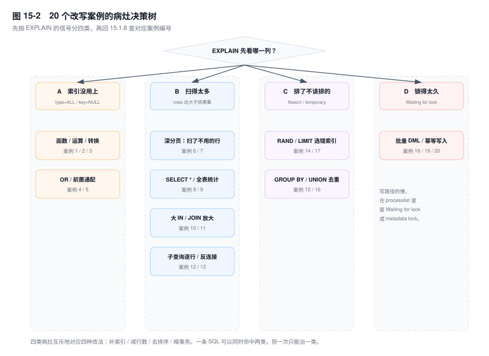
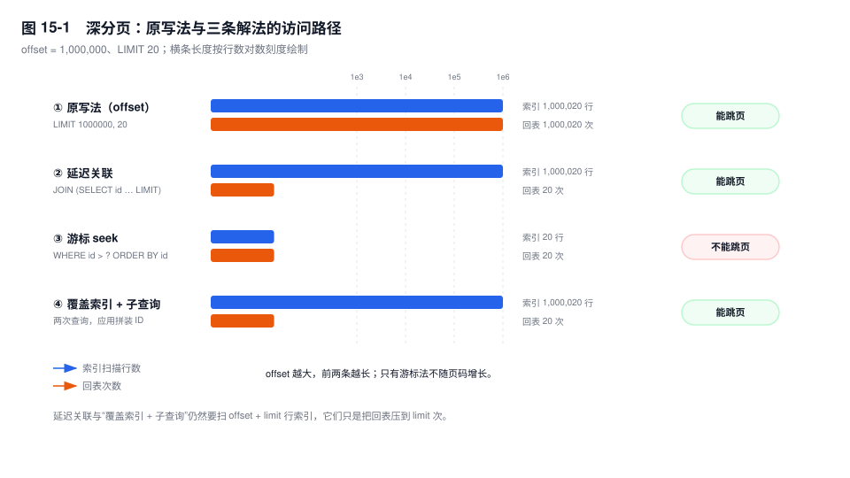

# 第 15 章　查询改写实战

> **一句话结论**：查询改写不是把 SQL 写短，而是把优化器算不准的那部分代价，用手写的访问路径钉死；改写的上限由索引决定，不由语法花样决定。

## 15.0 场景：对账页卡住，运维说要加机器

10 月末对账，财务要按差异金额从大到小看前 20 笔。页面转了很久，监控上 CPU 70%、iowait 高，磁盘读带宽打满。运维看完说：升配，加两核。

升配之后，耗时只掉了不到两成（示意）。因为那条 SQL 是：

```sql
SELECT bill_no, merchant_id, diff_amount, settle_date
FROM settle_bill
ORDER BY diff_amount DESC
LIMIT 20;
```

`settle_bill` 有 500 万行，`diff_amount` 上没有索引。执行计划是 `type=ALL`、`rows` 接近 500 万、`Extra=Using filesort`（输出形态示意）——它必须把 500 万行全部读出来，再排序，才能知道前 20 名是谁。加 CPU 只是让扫描和排序的常数小一点，500 万行的读取和排序一行都少不了。

同一张表上还有一条更常见的慢 SQL，对账明细翻到第 80 万行：

```sql
SELECT id, bill_no, merchant_id, diff_amount, created_at
FROM settle_bill
ORDER BY created_at DESC, id DESC
LIMIT 800000, 20;
```

两条 SQL 的病不一样：一条是"排了不该排的"，一条是"扫了不用的行"。本章按索引、行数、排序、锁四类病灶拆开讲，最后给 20 个可以直接对照的案例。

## 15.1 机制

改写的第一步不是写 SQL，是判断病灶。`EXPLAIN` 的四类信号对应四种病：

- `type=ALL`、`key=NULL`：索引没用上——能力问题。
- `rows` 远大于最终结果：扫得太多——行数问题。
- `Extra` 出现 `Using filesort`、`Using temporary`：排了不该排的——顺序问题。
- `State` 停在 `Waiting for table metadata lock`、`Waiting for lock`：锁得太久——事务长度问题。



四类病各自对应一种改法：补索引、减行数、去排序、缩事务。一条 SQL 可以同时命中两类，但一次只能治一类；先治哪一类，取决于哪一类占了大头。

### 15.1.1　深分页三解法：延迟关联、游标、覆盖索引加子查询

`LIMIT 1000000, 20` 里的 1000000 不是"跳过"，是"先取出来再扔掉"。执行器沿索引顺序读出前 1000020 条，Server 层丢掉前 1000000 条。如果 `SELECT` 的列不在索引里，每一条还要回表一次。

所以深分页的代价是 `offset + limit` 次索引扫描，加上同次数的回表；**它与表有多大无关，只与页码有多深有关**。offset 翻到表的一半，成本就和全表扫描同一量级——这就是加机器没用的原因。



假设有索引 `idx_created_id (created_at, id)`，原写法是：

```sql
SELECT id, bill_no, merchant_id, diff_amount, created_at
FROM settle_bill
ORDER BY created_at DESC, id DESC
LIMIT 1000000, 20;
```

**解法一：延迟关联。** 让内层只取主键，外层再按主键取整行：

```sql
SELECT b.id, b.bill_no, b.merchant_id, b.diff_amount, b.created_at
FROM settle_bill b
JOIN (
  SELECT id
  FROM settle_bill
  ORDER BY created_at DESC, id DESC
  LIMIT 1000000, 20
) t ON t.id = b.id
ORDER BY b.created_at DESC, b.id DESC;
```

内层 `SELECT id` 是覆盖索引——`idx_created_id` 的叶子已经有 `id`，不用回表。它仍然扫 1000020 个索引条目，但只有 20 条走到外层做聚簇索引查找。`EXPLAIN` 里内层应是 `type=index`、`Extra=Using index`，外层是 `type=eq_ref`。

省下来的是 100 万次 B+ 树下降和随机页访问，不是 100 万次索引扫描。索引扫描是顺序的，便宜；回表是随机的，贵。这个区别决定了延迟关联只能把常数降下来，不能把复杂度降下来。

**解法二：游标（seek method）。** 不带 offset，直接从上一页的终点往后取：

```sql
SELECT id, bill_no, merchant_id, diff_amount, created_at
FROM settle_bill
WHERE (created_at, id) < ('2026-10-31 12:00:00', 88421)
ORDER BY created_at DESC, id DESC
LIMIT 20;
```

这是唯一一个复杂度为 `O(limit)` 的解法：`(created_at, id)` 的范围条件直接定位到 B+ 树的起点，扫 20 条就停。代价是接口从"第 N 页"变成"下一页"，客户端必须记住上一页最后一行的排序键。

排序键不唯一时必须带 tiebreaker。只用 `created_at < '2026-10-31 12:00:00'` 会漏掉同一秒内的其他行；`(created_at, id)` 这个行构造器比较才是完整的"上一行之后"。如果排序键就是自增主键，它天然单调，游标最简单；如果排序键是 `created_at` 这类非单调列，就必须靠 `id` 补成全序。`[5.7]` 上先用 `EXPLAIN` 确认行构造器走 `type=range`，如果退化，拆成 `created_at < '2026-10-31 12:00:00' OR (created_at = '2026-10-31 12:00:00' AND id < 88421)`。

游标还有一个隐性好处：翻页期间有人插入或删除数据，offset 分页会重复或漏行（因为"第 800001 行"变了），游标不会。

**解法三：覆盖索引加子查询。** 把一次 JOIN 拆成两次查询，JOIN 放到应用侧做：

```sql
-- 第一次：只取主键，走覆盖索引
SELECT id
FROM settle_bill
ORDER BY created_at DESC, id DESC
LIMIT 1000000, 20;

-- 第二次：应用把 20 个 id 拼进来（这里只列 3 个示意）
SELECT id, bill_no, merchant_id, diff_amount, created_at
FROM settle_bill
WHERE id IN (1000001, 1000002, 1000020);
```

它和延迟关联的差别不在 SQL，在部署形态：第二次查询可以走从库，也可以在分库分表后路由到不同分片；数据库只执行两个简单计划，不用为 JOIN 选顺序。代价是两次网络往返，以及两次查询之间的一致性问题——第二次查到的行可能已经被改过。

三种解法的边界：

| 解法 | 索引扫描 | 回表 | 能否跳页 | 硬前提 |
|---|---|---|---|---|
| 原写法 `LIMIT offset, n` | offset + n | offset + n | 能 | 无 |
| 延迟关联 | offset + n | n | 能 | 排序列有索引，且内层可覆盖 |
| 游标 seek | n | n | 不能 | 排序键能构成全序（自增主键，或 `created_at` 加 tiebreaker） |
| 覆盖索引 + 子查询 | offset + n | n | 能 | 应用能接受两次查询和一致性窗口 |

怎么选：后台列表要页码，用延迟关联；App 下拉和滚动，用游标；分库分表或第二步要走从库，用覆盖索引加子查询。三种都不是 `O(1)`——延迟关联仍是 `O(offset)`，只是常数小了一个量级；只有游标是 `O(limit)`。

它们对主键的要求也不同：延迟关联只要求排序列有索引，主键是否单调无所谓；游标要求排序键能构成全序，自增主键天然满足，`created_at` 这类非单调列必须加 `id` 做 tiebreaker；覆盖索引加子查询和延迟关联一样，只要求内层能覆盖。

### 15.1.2　`COUNT(*)`、`COUNT(1)`、`COUNT(col)` 与亿级表的精确总数

先给结论：**`COUNT(*)` 和 `COUNT(1)` 在 8.0 里是同一件事，`COUNT(col)` 不是。**

MyISAM 的 `COUNT(*)` 不带 `WHERE` 时是 `O(1)`，因为表级锁加无 MVCC，行数可以存在表头。InnoDB 不能这么做：同一时刻，事务 A 的 ReadView 看到 500 万行，事务 B 看到 499 万行（有一行还没提交）。"行数"在 InnoDB 里不是全局常量，是 ReadView 的函数。要存一个全局计数器，就得为每个版本维护计数，等于把 MVCC 的代价搬到计数上。

`COUNT(*)` 和 `COUNT(1)` 都表示"数行"。8.0 的优化器会把 `COUNT(1)` 改写成 `COUNT(*)`，不会为每一行求值一个常量。真正有区别的是 `COUNT(col)`：

- 语义上只数 `col IS NOT NULL` 的行；
- 执行上要读出 `col`、判一次 NULL，不能直接走"数行"的捷径；
- 如果 `col` 声明为 `NOT NULL`，语义上等价于 `COUNT(*)`，8.0 通常也会按"数行"处理；用 `EXPLAIN` 确认它有没有走到最小索引。

`COUNT(DISTINCT col)` 再贵一层：它需要去重，通常走临时表；如果 `col` 上有索引，也可能走松索引扫描（loose index scan）。它和 `COUNT(*)` 不是一个量级。

`COUNT(*)` 选哪个索引？选**最小的二级索引**。二级索引的叶子只存索引列加主键，比聚簇索引窄；同样扫一遍，页数少得多。`EXPLAIN` 里应该看到 `key` 是某个二级索引、`Extra=Using index`。如果表上只有主键，那就只能扫聚簇索引，宽度是整行。

亿级表要一个精确总数，只有四条路：

1. **汇总表**。在写入的同一个事务里 `UPDATE bill_stat SET cnt = cnt + 1 WHERE stat_date = '2026-10-31'`。读是 `O(1)`，写多了一次更新；单行计数器会成为热点，按日期或 hash 分成 16 行再求和，能把冲突摊开。代价是要回填历史数据，并且要和明细对账。
2. **近似值**。`SHOW TABLE STATUS LIKE 'settle_bill'` 或 `information_schema.TABLES.TABLE_ROWS`。InnoDB 用 `innodb_stats_persistent_sample_pages`（默认 20 页）采样估算，误差可能到几十个百分点。适合"已处理 120 万+"，不适合对账、计费、导出。
3. **`information_schema` 估算**。底层是 `mysql.innodb_table_stats.n_rows`，不扫表，但只在统计信息重算时更新，可能滞后到下一次重算。它和上一条是同一份数据，不要以为换了个视图就更准。
4. **异步任务**。定时在从库跑 `COUNT(*)`，结果写 Redis 带 TTL；或者用 CDC 消费 binlog 维护计数器。精确，但有一个延迟窗口，且要处理重复消费。

如果只是分页展示"共 N 条"，用 `LIMIT n + 1` 判断有没有下一页，比 `COUNT(*)` 便宜一个数量级。`SQL_CALC_FOUND_ROWS` 在 `[8.0.17+]` 已废弃，而且它为了返回总数必须把结果集全部产出，通常比单独跑一次 `COUNT(*)` 更慢。

### 15.1.3　`LIMIT` 加 `ORDER BY`：优化器为什么会选错索引

带 `LIMIT` 的 `ORDER BY`，优化器会倾向于用排序索引，边扫边过滤，因为它相信"很快就能凑够 20 行"。这个假设只在过滤条件命中率高时成立。

```sql
SELECT id, bill_no, created_at
FROM settle_bill
WHERE merchant_id = 3021
ORDER BY created_at DESC
LIMIT 20;
```

表上有 `idx_merchant (merchant_id)` 和 `idx_created (created_at)`。假设商户 3021 只占全部行的五千分之一（500 万行里约 1000 行）。如果选 `idx_created` 倒序扫，每读一条都要回表拿 `merchant_id` 判断，要凑够 20 条得扫大约 10 万条；如果选 `idx_merchant`，能一次取出这 1000 行，但还要 filesort。优化器常常觉得前者更便宜，实际前者是 10 万次回表。

8.0.21 之前没有开关能关掉这个偏好，只能改索引。`[8.0.21+]` 可以用会话级开关止血：

```sql
SET SESSION optimizer_switch = 'prefer_ordering_index=off';
```

但这是会话级的，别写进连接池的初始化 SQL——它会影响这个连接上所有带 `LIMIT` 的 `ORDER BY`。真正的修法是让过滤和排序落在同一棵树上：

```sql
ALTER TABLE settle_bill
  ADD KEY idx_merchant_created (merchant_id, created_at);
```

这时 `EXPLAIN` 是 `type=ref`、`rows` 接近 20、`Extra` 里没有 `filesort`。反过来，如果过滤条件命中 90% 的行（比如 `status = 1`），用排序索引扫 20 条就停，确实比"走过滤索引再排序全部命中行"便宜——**不要无条件 `FORCE INDEX`，先算命中率**。

### 15.1.4　批量更新与删除：分批的循环怎么写才不白扫

一条 `DELETE` 删 200 万行，是一个事务：undo 要记 200 万条，history list 一路涨，purge 追不上；redo 和 binlog 都是一个巨型事务；行锁持有到 `COMMIT`；从库要等这个大事务提交完才能看到结果；回滚要再走 200 万次。更隐蔽的是 MDL：DDL 在等这条 `DELETE` 释放表锁，后面所有查询又排在 DDL 后面。

分批的目标不是"每批少一点"，是"每批都能从上一批的终点继续"：

```sql
-- 第一轮从 1000000 之后开始；下一轮换成这一批实际删掉的最大 id
DELETE FROM settle_bill
WHERE status = 9 AND id > 1000000
ORDER BY id
LIMIT 500;
```

应用拿不到被删掉的 id，所以循环体通常是先 `SELECT id ... LIMIT 500`，删完把本批最大 id 作为下一轮的起点；不想多一次查询，就用下面的区间法。这条 SQL 成立的前提是 `(status, id)` 上有联合索引。只有 `(status)` 的话，每一批都要在 `status = 9` 的索引区间里重新定位、再按 id 排序，批次越多越慢；只有 `(id)` 的话，每一批都要沿主键扫过大量 `status <> 9` 的行。**分批的索引必须把"过滤列"和"推进列"放在同一棵树上。**

如果删除条件本身能切成主键区间，用主键跳跃法更稳：

```sql
-- 每批 10000 个 id，扫描量与批大小成正比，与剩余行数无关
DELETE FROM settle_bill
WHERE id >= 2000000 AND id < 2010000
  AND status = 9;
```

它不需要知道上一批删了哪些 id，断点就是区间的下界；代价是当 `status = 9` 很稀疏时，大部分区间会空跑。区间大小按命中密度调，不要固定 10000。

`DELETE` 和 `TRUNCATE` 不是同一个东西：

| | `DELETE` | `TRUNCATE TABLE` |
|---|---|---|
| 语句类型 | DML，可回滚 | DDL，隐式提交，不可回滚 |
| 锁 | 行锁，RR 下还有间隙锁 | MDL，阻塞并发 DML |
| undo / redo | 每行一份 | 重建表，几乎不产生行级 undo |
| 空间 | 不释放，要 `OPTIMIZE` | 释放 |
| 自增 | 保留 | 重置为 1 |
| 触发器 | 触发 | 不触发 |
| 外键 | 可以删 | 被外键引用时失败（ERROR 1701） |

`TRUNCATE` 不是"更快的 DELETE"，它是"重建表"。快是因为不写行级 undo、不触发触发器；代价是不能带 `WHERE`、不能回滚、要拿 MDL。8.0 的 `TRUNCATE` 是原子 DDL，崩溃后不会留下半张表；5.7 不是。

### 15.1.5　`INSERT ... ON DUPLICATE KEY UPDATE` 与 `REPLACE INTO` 的隐式行为

幂等写入最常见的选择是 ODKU：

```sql
INSERT INTO bill_daily (merchant_id, settle_date, amount)
VALUES (3021, '2026-10-31', 100.00) AS new
ON DUPLICATE KEY UPDATE amount = bill_daily.amount + new.amount;
```

`AS new` 的行别名是 `[8.0.19+]`；`VALUES(col)` 的写法在 `[8.0.20+]` 已废弃，新代码不要再写。

它的隐式行为有四条：

- **`affected_rows` 不是行数**。插入返回 1，更新返回 2，值没变返回 0。客户端拿它判断"写了几行"会得到 2 倍的数字。
- **自增会跳号**。唯一键冲突是在分配自增值之后才发现的，每一次失败尝试都烧掉一个 id。`innodb_autoinc_lock_mode=2`（8.0 默认）下，批量插入本来就会跳号，别把自增连续性当业务语义。
- **锁是按唯一键顺序加的**。命中重复键后，ODKU 要在冲突记录上放 X 锁（主键是记录锁，唯一键是 next-key 锁），因为它接下来要更新这一行；RR 下插入还带间隙锁。多行 ODKU 按 `VALUES` 的顺序加锁，两个事务顺序相反就会死锁；批量写入前按主键或唯一键排一次序，能消掉一大半。
- **多个唯一键时会更新错行**。只要任意一个唯一键冲突就触发更新；如果两个唯一键分别指向两行，ODKU 更新先命中的那一行，另一行不动。

`REPLACE INTO` 更危险，它的执行是 **DELETE 加 INSERT**，不是 UPDATE：

```sql
REPLACE INTO bill_daily (merchant_id, settle_date, amount)
VALUES (3021, '2026-10-31', 100.00);
```

这意味着：

- 语句里没列出的列会被重置为默认值，不是保留原值；
- `DELETE` 和 `INSERT` 触发器都会触发，ODKU 只触发 `INSERT` 或 `UPDATE`；
- 如果表上有 `ON DELETE CASCADE` 外键，替换一行父记录会静默删掉子表的相关行；
- undo 和 redo 是双份，二级索引先删后插，页分裂概率更高；
- 未显式指定自增列时，每次 REPLACE 都分配新的自增值，必然跳号；
- 两个唯一键冲突到两行时，两行都被删掉，只插回一行——净丢失一行；
- 删除加插入持有的锁更多、时间更长，并发下的死锁概率高于 ODKU。

还能用 REPLACE 的场景要同时满足五个条件：没有外键、没有触发器、自增没有业务含义、所有列都写在语句里、只有一个唯一键。缺一个就改用 ODKU，或者显式 `UPDATE` 加 `INSERT`。

### 15.1.6　大事务拆分与 `INSERT ... SELECT` 的锁范围

`INSERT ... SELECT` 一条语句就是一个事务（autocommit 下）。它同时做两件事：读源表、写目标表。RR 隔离级别下，InnoDB 会对源表命中的行加共享 next-key 锁——文档把动机写成"语句级 binlog 重放时每条语句必须执行得和原来一样"，但**加锁判断看的是隔离级别**：RR 就加，RC 下源表退化成一致性读，不锁行。目标表始终对插入行加 X 锁。

所以一条 `INSERT INTO archive SELECT * FROM src WHERE ...` 会同时持有源表的共享锁和目标表的排他锁，直到提交。源表上的写入会被挡住，目标表的锁又让从库追得很吃力。

拆分的写法：

```sql
INSERT INTO settle_bill_archive
SELECT *
FROM settle_bill
WHERE settle_date < '2026-01-01'
  AND id > 1000000
ORDER BY id
LIMIT 2000;
```

这里有两个坑，都会让"分批"比一条大 SQL 更慢：

1. **没有 `id > 1000000` 这个下界**。源表没有删行，每一批都从同一段的第一行开始取，2000 行被反复插入，或者撞唯一键。分批的断点必须来自上一批的终点，不能来自 `LIMIT` 自己。
2. **`ORDER BY id` 和过滤列不在同一棵索引上**。如果优化器为了走 `settle_date` 索引而放弃主键顺序，每一批都要把满足条件的全部行排序后取前 2000 行，批次越多，重复排序越多，总代价是 `O(n² log n)`。要么建 `(settle_date, id)`，要么让断点条件走主键。

批次大小取 1000 到 5000 行，按行宽和 `binlog_cache_size` 调。每一批提交一次，换来的是锁范围、undo 链、从库延迟都可控；代价是失去跨批原子性。所以每一批都要可重入：`INSERT IGNORE`、ODKU，或者先按主键区间删目标表再插。

### 15.1.7　集合改写：`UNION`、`OR`、`NOT IN` 的正确姿势

`UNION` 隐含 `DISTINCT`，要去重；`UNION ALL` 不去重，直接拼接。如果两支按业务构造就不会相交（不同状态区间、不同日期分区），永远用 `UNION ALL`：

```sql
SELECT id, bill_no FROM settle_bill WHERE settle_date = '2026-10-30'
UNION ALL
SELECT id, bill_no FROM settle_bill WHERE settle_date = '2026-10-31';
```

用 `UNION` 的代价是临时表去重（可能还带排序），8.0 和 5.7 都一样；更糟的是它把"两支本来不相交"这个业务事实丢掉了，优化器只能老老实实去重。

`OR` 跨两个索引时，优化器可能走 index merge（两个索引各扫一遍再按主键归并），也可能直接全表扫。改成 `UNION ALL` 能让每一支各走自己的索引：

```sql
SELECT id, bill_no FROM settle_bill WHERE merchant_id = 3021
UNION ALL
SELECT id, bill_no FROM settle_bill
WHERE bill_no = 'B20261031001' AND merchant_id <> 3021;
```

第二支的 `merchant_id <> 3021` 是为了去重。如果 `merchant_id` 可空，这个条件会漏掉 `merchant_id IS NULL` 的行（`NULL <> 3021` 是 NULL，不是 TRUE），要写成 `(merchant_id IS NULL OR merchant_id <> 3021)`；不想处理这层语义，就用 `UNION` 让数据库去重。

`NOT IN` 的坑不在性能，在 NULL：

```sql
SELECT 1 NOT IN (2, NULL);  -- 返回 NULL，不是 1
SELECT 1 NOT IN (1, NULL);  -- 返回 NULL，不是 0
```

只要子查询结果里有一个 NULL，`NOT IN` 对每一行都返回 UNKNOWN，整个查询返回空集。这不是"少几行"，是"全空"。正确写法是 `NOT EXISTS`：

```sql
SELECT b.id, b.bill_no
FROM settle_bill b
WHERE NOT EXISTS (
  SELECT 1 FROM merchant_blacklist x
  WHERE x.merchant_id = b.merchant_id
);
```

或者 `LEFT JOIN ... IS NULL`，但判断列要用右表的主键（`x.id IS NULL`），不要用可能为 NULL 的业务列：

```sql
SELECT b.id, b.bill_no
FROM settle_bill b
LEFT JOIN merchant_blacklist x ON x.merchant_id = b.merchant_id
WHERE x.id IS NULL;
```

`[8.0.17+]` 能把 `NOT IN` 和 `NOT EXISTS` 转成 anti-join，但**比较列可空时通常转不了**。所以 `NOT IN` 在可空列上既是语义炸弹，又是优化器的死胡同；`NOT EXISTS` 两个问题一起解决。

### 15.1.8　20 个真实慢 SQL 改写案例

这 20 条不是技巧合集，是同一个判断流程的 20 次实例：先看 `EXPLAIN` 哪一列异常，再决定改 SQL 还是改索引。编号与图 15-2 的叶子一一对应。

| # | 原写法（要点） | 问题定位（EXPLAIN 信号） | 改后写法（要点） | 为什么快（机制） |
|---|---|---|---|---|
| 1 | `WHERE DATE(paid_at) = '2026-10-31'` | `type=ALL`、`key=NULL` | `paid_at >= '2026-10-31' AND paid_at < '2026-11-01'` | 列不被函数包住，B+ 树能定位区间；扫描从全表降到一天 |
| 2 | `WHERE amount + 100 > 500` | `type=ALL`、`key=NULL` | `WHERE amount > 400` | 运算从"每行一次"移到"常量一次"，条件变成索引区间 |
| 3 | `WHERE phone = 13800138000`（`VARCHAR`） | `type=ALL`，`filtered` 极低 | `WHERE phone = '13800138000'` | 避免列被 `CAST(... AS DOUBLE)`；字符串索引按字节序可用 |
| 4 | `WHERE merchant_id = 3021 OR bill_no = 'B20261031001'` | `type=ALL`，或 `type=index_merge` + `Using union` | 拆两支 `UNION ALL`，第二支补 `merchant_id <> 3021` | 每支各走自己的索引，不再全表扫或双索引归并 |
| 5 | `WHERE remark LIKE '%退款%'` | `type=ALL`、`key=NULL` | `LIKE '退款%'`，或全文/倒排索引 | 前缀匹配能定位 B+ 树起点；中缀匹配没有起点 |
| 6 | `LIMIT 1000000, 20` | `rows` 约 1000020 | 延迟关联：`JOIN (SELECT id ... LIMIT 1000000, 20)` | 内层覆盖索引，回表从 100 万次降到 20 次 |
| 7 | 同上，翻下一页 | 同上 | `WHERE (created_at, id) < ('2026-10-31 12:00:00', 88421) ORDER BY ... LIMIT 20` | 直接定位起点，扫描等于 `limit`，复杂度从 `O(offset)` 降到 `O(limit)` |
| 8 | `SELECT * FROM settle_bill WHERE ...` | `Extra` 没有 `Using index` | 只列需要的列，让联合索引覆盖 | 消除回表；少读宽行、少传网络包 |
| 9 | 每次页面都 `SELECT COUNT(*)` | `rows` 约 500 万，`Extra=Using index` 仍扫全索引 | 汇总表 / 近似值 / 异步缓存；分页用 `LIMIT n+1` | 把 `O(N)` 扫描换成 `O(1)` 读；InnoDB 无法存全局行数 |
| 10 | `WHERE id IN (…5000 个…)` | `type=range` 但 `rows` 估算失真，可能退化成 `ALL` | 拆成 200~500 一批，或落临时表再 JOIN | 避开 `eq_range_index_dive_limit`（默认 200）后的基数估算，也避开 `range_optimizer_max_mem_size`（默认 8MB）溢出 |
| 11 | `LEFT JOIN b ON ... WHERE b.status = 1` | 右表条件在 `WHERE`，外连接被改写成内连接 | 条件移到 `ON b.status = 1` | 避免补出的 NULL 行被 `WHERE` 过滤，语义从内连接恢复成外连接 |
| 12 | `WHERE merchant_id NOT IN (SELECT ...)` | `select_type=DEPENDENT SUBQUERY`；子查询含 NULL 时返回空集 | `NOT EXISTS` 或 `LEFT JOIN ... WHERE x.id IS NULL` | 反连接对 NULL 安全；`[8.0.17+]` 可转 anti-join，5.7 只能逐行 |
| 13 | `WHERE EXISTS (SELECT 1 FROM ... WHERE ... = b.id)` | `DEPENDENT SUBQUERY`，外层每行执行一次 | 改 `JOIN (SELECT DISTINCT ...)` 或 `IN` 半连接 | 从 N 次子查询变成一次物化或半连接 |
| 14 | `ORDER BY RAND() LIMIT 10` | `Using filesort`（常伴 `Using temporary`），`rows` 约 500 万 | 先随机取 id 再回查，或预生成随机列并建索引 | 避免为 500 万行各算一次 `RAND()` 并全量排序；随机定位是 `O(log N)` |
| 15 | `GROUP BY merchant_id` 无索引 | `Using temporary`（常伴 `Using filesort`） | 建 `(merchant_id)` 或 `(merchant_id, settle_date)`，或预聚合表 | 索引有序，聚合变成流式扫描，临时表消失 |
| 16 | `UNION` 两支本不相交 | `Using temporary`，临时表去重 | `UNION ALL` | 去掉去重和临时表；两支直接流式拼接 |
| 17 | `WHERE channel = 'BANK' ORDER BY created_at DESC LIMIT 20` | `key=idx_created`，`rows` 很大 | 建 `(channel, created_at)`；`[8.0.21+]` 可会话级 `prefer_ordering_index=off` 止血 | 过滤和排序在同一棵索引上，扫 20 行就停，不再边扫边回表过滤 |
| 18 | `UPDATE ... WHERE status = 9`（200 万行） | `INNODB_TRX.trx_rows_locked` 巨大，history list 持续上涨 | 按 `(status, id)` 每批 500~2000 行，用上一批最大 id 推进 | 锁持有时间、undo 链、从库延迟都从"一个巨型事务"变成"多个小事务" |
| 19 | `INSERT INTO archive SELECT * FROM src WHERE ...` | 单语句大事务；RR 下源表被加共享 next-key 锁 | 按主键 keyset 分批：`id > 1000000 ORDER BY id LIMIT 2000` | 锁范围缩到一批；断点来自上一批终点，不重复扫、不重复排 |
| 20 | `REPLACE INTO bill_daily ...` | `affected_rows=2`，自增跳号，FK 级联静默删子行 | `INSERT ... ON DUPLICATE KEY UPDATE col = new.col` | REPLACE 是 delete+insert（双份 undo、触发器、级联）；ODKU 只更新冲突行 |

读这张表的方式：先在图 15-2 里找到你看到的信号，再看对应编号。每条改完都要用 `EXPLAIN ANALYZE` 对比 `actual rows` 和 `loops`，不要只看 `EXPLAIN` 的估算——改写最容易犯的错，是把"估算变好看了"当成"执行变快了"。

## 15.2 关键结论

1. **深分页的 offset 是"读出来再扔掉"，延迟关联只砍回表，不砍索引扫描。** 只有游标法把复杂度从 `O(offset)` 降到 `O(limit)`；offset 翻得足够深，延迟关联也会退化成全表量级。
2. **InnoDB 不能存行数，是因为行数是 ReadView 的函数。** `COUNT(*)` 和 `COUNT(1)` 等价；`COUNT(col)` 多一次 NULL 判定；`COUNT(DISTINCT)` 再去一次重。
3. **`LIMIT` 会改变优化器的索引偏好。** 过滤列和排序列不在同一棵索引上时，它可能为了"早停"而选排序索引，实际做了大量回表；联合索引比 hint 更稳。
4. **批量 DML 的瓶颈不是单行成本，是事务长度。** 锁、undo、history list、从库延迟都随事务长度线性增长；分批的前提是每批从上一批的终点继续。
5. **`REPLACE` 是 delete 加 insert，不是 update。** 它会重置未列出的列、触发 `DELETE` 触发器、级联删子行、烧自增值；ODKU 是 update，但也会烧自增值、按唯一键顺序加锁。
6. **改写不能改变语义。** `NOT IN` 的 NULL、`UNION` 的去重、`LEFT JOIN` 的补 NULL，都是语义边界；先证明结果集等价，再谈快。

## 15.3 实验验证

### 实验一：三种深分页写法，Handler 计数差在哪

```sql
FLUSH STATUS;
SELECT id, bill_no FROM settle_bill
ORDER BY created_at DESC, id DESC
LIMIT 1000000, 20;
SHOW SESSION STATUS WHERE Variable_name IN
  ('Handler_read_key', 'Handler_read_next', 'Handler_read_rnd_next');
```

预期形态（未实跑，字段含义以此为准）：

```
Handler_read_key      1000020   <- 每次回表一次索引查找
Handler_read_next     1000020   <- 沿 idx_created_id 扫过的索引条目
Handler_read_rnd_next       0
```

把 `SELECT` 换成延迟关联的内层 `SELECT id`，`Handler_read_next` 仍是 1000020，`Handler_read_key` 会掉到 20 左右——**扫描没变，回表变了**。再换成游标写法，两个数字都掉到 20 上下。这三个数字比 `EXPLAIN` 的 `rows` 更接近真相，因为它是实际发生的。

### 实验二：`COUNT(*)` 走的是哪个索引

```sql
EXPLAIN SELECT COUNT(*) FROM settle_bill;
EXPLAIN SELECT COUNT(remark) FROM settle_bill;
```

预期形态（未实跑）：第一条的 `key` 是最小的二级索引，`Extra=Using index`；第二条如果 `remark` 可空且没有索引，`Extra` 里不会有 `Using index`，扫的是聚簇索引（`key` 通常是 `PRIMARY`），宽度是整行。给 `remark` 建索引并改成 `NOT NULL` 后再看，第二条才会出现 `Using index`——`COUNT(col)` 想走覆盖索引，前提是列上有索引且不许为 NULL。

### 实验三：一条大 DELETE 与分批 DELETE 的锁规模

在测试库执行，不要在生产跑：

```sql
-- 会话 A
BEGIN;
DELETE FROM settle_bill WHERE status = 9;

-- 会话 B
SELECT trx_id, trx_rows_locked, trx_rows_modified
FROM information_schema.INNODB_TRX;
```

预期形态（未实跑）：`trx_rows_locked` 随删除行数持续上升，`trx_rows_modified` 接近删除行数；同时 `SHOW ENGINE INNODB STATUS` 的 `History list length` 一路上涨。换成每批 500 行的循环后，这两个值会在每批提交后回落，purge 能跟上。**这就是"分批不是少做事，是让每件事都能结束"的证据。**

## 15.4 常见误区

⚠️ **"`COUNT(1)` 比 `COUNT(*)` 快"**
8.0 里两者是同一个计划，`COUNT(1)` 不会逐行求值常量。真正慢的是 `COUNT(col)`（要判 NULL）和 `COUNT(DISTINCT col)`（要去重）。把这条当成面试题背，不如记住"`COUNT(*)` 选最小二级索引"这条可验证的规则。

⚠️ **"延迟关联把 100 万行变成了 20 行"**
它没有。内层仍然扫 100 万条索引，只是把回表从 100 万次压到 20 次。索引扫描是顺序的，回表是随机的，所以体感差别很大；但 offset 继续涨，它还是会慢。要真正变成 20 行，只有游标。

⚠️ **"`LIMIT` 分批一定比一条大 SQL 快"**
没有断点的分批，每一批都从同一段的第一行开始，源表没删行就重复插入；有 `ORDER BY` 但排序键没索引，每一批都重排全部命中行。两种都会让总代价变成平方级。分批的前提是"每批从上一批的终点继续"，不是"加了 LIMIT 就叫分批"。

⚠️ **"`REPLACE` 就是 upsert，比 `UPDATE` 快"**
它是 delete 加 insert：双份 undo、`DELETE` 触发器、`ON DELETE CASCADE`、未列出的列被重置、自增必跳号。快只可能快在"不用先查再改"，代价藏在副作用里。表上有外键或触发器时，REPLACE 是事故源。

⚠️ **"`UNION ALL` 一定比 `UNION` 好"**
语义不同。两支有重复行时，`UNION ALL` 会多返回行，快没有意义。只有在业务上能证明两支不相交，或者应用侧会按主键去重时，才能换。

⚠️ **"改写可以替代索引"**
改写的上限是索引。没有索引时，延迟关联也要扫 100 万条，游标也定位不到起点。改写能把"有索引但没用对"救回来，救不了"根本没有索引"。

## 15.5 生产 Checklist

- [ ] 深分页的 offset 是否超过 1 万？滚动/下拉场景能否改成游标？排序键是否唯一，需不需要 tiebreaker？
- [ ] 过滤列与排序列是否在同一个联合索引？`EXPLAIN` 的 `rows` 是否接近 `LIMIT`？
- [ ] `COUNT(*)` 是否走了最小二级索引？业务是否真的需要精确值？异步计数的延迟窗口能接受吗？
- [ ] 批量 DML 的单事务是否超过 1 万行？是否有 `id` 推进条件或主键区间？索引是否是 `(过滤列, 推进列)`？
- [ ] `INSERT ... SELECT` 是否在 RR 下锁住源表？能否改 RC、分批，或把源表读到临时表再写？
- [ ] `REPLACE` / ODKU 是否命中外键级联、触发器、多唯一键、自增业务含义？
- [ ] `NOT IN` 的子查询列是否可空？改写成 `NOT EXISTS` 后结果集是否逐行等价？
- [ ] 改写后是否用 `EXPLAIN ANALYZE` 对比过 `actual rows` 与 `loops`，而不是只看估算？

## 15.6 延伸

第二卷到这里收尾。这一卷从一条 SQL 的生命周期开始，依次拆开 Buffer Pool、页、redo/undo、索引、统计、执行计划、Join、子查询、排序，最后落到改写——每一步都在回答同一个问题：这条 SQL 的时间花在了哪里。

- **本卷回顾**：第 9 章（索引设计）、第 10 章（统计信息与成本）、第 11 章（执行计划）、第 12 章（Join）、第 13 章（子查询与 CTE）、第 14 章（排序与临时表）。本章只讲"怎么改"，原理都在那六章里。
- **下一卷**：第 16 章从 ACID 开始讲事务；第 21 章专门讲长事务与大事务治理，会把 15.1.4 和 15.1.6 的锁与 undo 展开。
- **面试追问**：
  - "为什么 InnoDB 的 `COUNT(*)` 不能像 MyISAM 一样 `O(1)`？" → MVCC 下"行数"是 ReadView 的函数，没有全局常量。
  - "延迟关联省掉的是什么？" → 省回表，不省索引扫描；复杂度仍是 `O(offset)`。
  - "`REPLACE` 和 `ON DUPLICATE KEY UPDATE` 的本质区别？" → 前者 delete+insert，后者 update；副作用、undo、触发器、外键级联都不同。
  - "`NOT IN` 为什么会返回空集？" → 子查询含 NULL 时三值逻辑返回 UNKNOWN，整行被过滤。
- **官方文档**：`LIMIT Query Optimization`、`Switchable Optimizations`（`prefer_ordering_index`）、`Locks Set by Different SQL Statements in InnoDB`、`Optimizing IN and EXISTS Subquery Predicates with Semijoin Transformations`。
