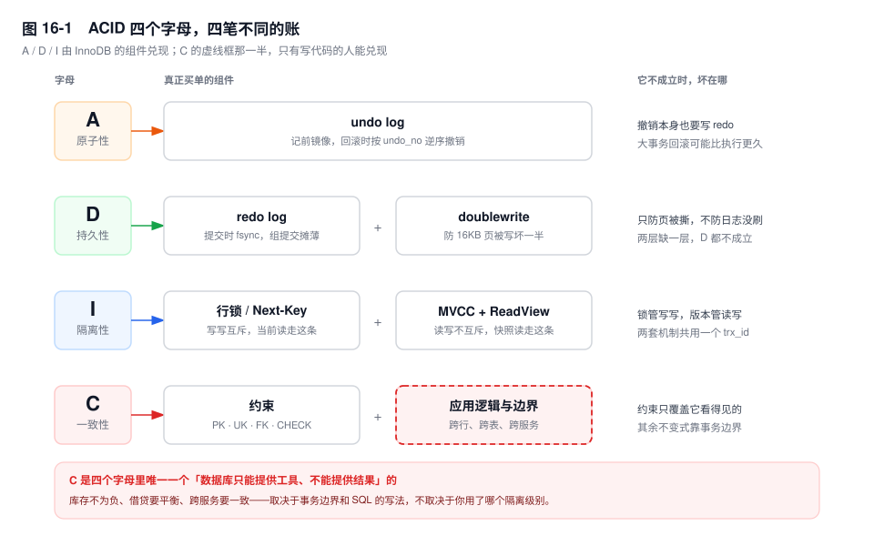
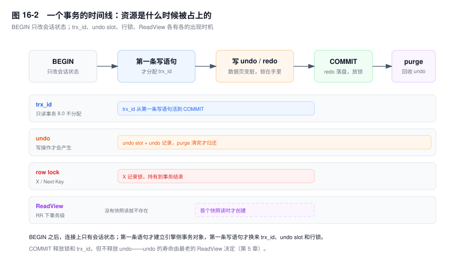

# 第 16 章　事务 ACID 的工程实现

> **一句话结论**：ACID 不是四个并列的保证，而是四笔不同的账：A、D 由 undo 和 redo 付，I 由锁与 MVCC 付，C 只能由写代码的人付——数据库的本事，是保证不把你付的那部分搞丢。

## 16.0 场景：三个 HTTP 调用，把一行库存锁成了全站瓶颈

大促前第二轮压测，下单接口 P99 从 45ms 跳到 9s，错误率还是零——请求都卡着。慢日志里一条都没有：`UPDATE sku_stock SET stock = stock - 1 WHERE sku_id = 8842` 单独跑 1ms，执行计划走主键。

`SHOW ENGINE INNODB STATUS` 的 TRANSACTIONS 段排了一串 `LOCK WAIT`，全指向同一个持有者：thread 88421，`trx_rows_modified = 2`，`trx_started` 显示已经 8 秒没动。`performance_schema.data_locks` 里，它在 `sku_id = 8842` 上的 `X,REC_NOT_GAP` 从 8 秒前就没松过。

翻代码：`SkuStockService.deduct()` 头上挂着 `@Transactional`，方法体四步——扣库存、调优惠券核销、调风控预检、发一条 IM 通知。三个 HTTP 客户端的超时都是 2000ms，压测环境的下游没扩容，三次依次超时，其中一次还重试了一遍——8 秒里属于数据库的时间不到 5ms。

**8 秒不是数据库慢，是锁的持有时间里塞进了几次网络等待。** 一条 1ms 的 UPDATE，因为画错了事务边界，变成了全站共享的一把锁。

redo、undo、binlog 的原理见第 4、5、6 章；这一章只回答一个问题：四个字母分别由谁兑现，边界画在哪。

## 16.1 机制

### 四个字母，四笔不同的账



**A（原子性）由 undo 兑现。** 每条修改在落到数据页之前，先把前镜像写进 undo，用 `DB_ROLL_PTR` 串成版本链；`ROLLBACK` 时按 `undo_no` 从大到小倒着撤，崩溃恢复时未提交的事务也走同一条路（第 7 章）。有个循环依赖：undo 页本身也要写 redo，否则回滚到一半掉电，undo 自己也烂了。**A 是搭在 D 的设施上实现的**——原子性建立在持久性之上。

**D（持久性）是两层，缺一不可。** 第一层是提交时把 redo `fsync`（`innodb_flush_log_at_trx_commit=1`），保证已提交的修改崩溃后能重放；第二层是 doublewrite，保证 16KB 的页写到一半掉电时，磁盘上还有一份完整副本可读。只有 redo 没有 doublewrite，恢复时可能拿到一个半新半旧的页，往上重放 redo 只会把错误焊死。顺带一句：`sync_binlog=1` 管的是主从一致，不是本机的 D。

**I（隔离性）是两套机制，中间有一条分界线：写写冲突用锁，读写冲突用 MVCC。** 只用锁，一条跑两小时的报表就能把整表写入堵死；只用 MVCC，两个事务各自基于同一份旧版本做 `stock = stock - 1`，谁都不知道对方改过，丢失更新。所以 InnoDB 让 `UPDATE` 走当前读加锁、让普通 `SELECT` 走快照读不加锁（第 17 章）。

**C（一致性）是唯一一个数据库单独保证不了的。** 因为它的定义里有一个数据库看不见的东西：什么叫"合法状态"。

标准里的 C 是一句条件式保证：**如果每个事务单独执行时都把数据库从一个合法状态带到另一个合法状态，那么并发执行和故障恢复不会破坏这个合法性。** 前半句是前提，不是结论。"合法"由业务定义，数据库只负责不添乱，不负责判断对错。

数据库能检查的，只有它看得见的那些约束：主键、唯一索引、外键、`NOT NULL`、`CHECK`（`[8.0.16+]` 才真正生效，`[5.7]` 解析但忽略）。它们的共同点是**单行或单次引用就能判定**。一旦不变式需要跨行聚合——账户余额等于流水之和、库存等于入库减出库、发券总量不超过预算——约束就表达不了，只能在 SQL 的写法里保证。

同一句"扣库存"，两种写法在 C 上天差地别：

```sql
-- 写法一：判断和修改在同一条语句里，C 成立
UPDATE sku_stock SET stock = stock - 1
WHERE sku_id = 8842 AND stock >= 1;

-- 写法二：判断在前、修改在后，C 不成立
SELECT stock FROM sku_stock WHERE sku_id = 8842;   -- 快照读到 1
-- 这期间另一个事务把它扣到 0 并提交
UPDATE sku_stock SET stock = stock - 1 WHERE sku_id = 8842;
-- 这条 UPDATE 是当前读，读到 0，减成 -1，而且不会报错
```

写法二在 RR 下不会报错，也不会"丢更新"——`UPDATE` 是当前读，算术用的是最新值。但它把判断留在了快照里：检查时库存是 1，修改时库存已经是 0。**C 不成立，不是因为没加事务，而是因为判断依据不在加锁范围里。**

要修只有两条路：把判断挪进同一条 DML（`WHERE stock >= 1`），或者把判断改成加锁读（`SELECT ... FOR UPDATE`）。两条都是拿 I 换 C。再往外一层，跨服务的一致性（订单扣了库存、优惠券没核销）数据库连"看见"都做不到——那是第 34 章的问题域。

### BEGIN 之后，什么都不会发生



`BEGIN`（或 `START TRANSACTION`）在 Server 层只做一件事：给会话打一个"在事务中"的标志位，并把这期间的单语句自动提交关掉，不碰 InnoDB。只 `BEGIN` 不执行任何语句，`innodb_trx` 里通常连一条记录都没有——监控看不见它，但连接已经被它占着。

第一条访问 InnoDB 的语句到来时，引擎侧的事务对象才建立，`innodb_trx.trx_started` 从这个时刻算起。**`trx_started` 不是 `BEGIN` 的时间。** 一个连接 10:00 `BEGIN`、10:30 才发出第一条 SQL，它的事务年龄是 0 分钟，不是 30 分钟。

第一条**写**语句到来时，三件事同时发生：分配 `trx_id`、从回滚段领一个 undo slot、给涉及的行加锁。只读语句不分配 id——它不写 undo，也不需要 id 来标识自己。

`[8.0]` 把这件事做成了明确的优化：只读事务不分配 `trx_id`。原因是分配 id 要推进一个全局计数器，高并发下是争用点；而只读事务没有自己的修改，ReadView 的 `creator_trx_id` 填 0 就能正常判可见性。于是 `information_schema.innodb_trx` 里会看到 `trx_id = 0`。

`[5.7]` 里只读事务也会分配 id，但它取自一段独立的只读序列，和读写事务不在同一个区间——所以那个值看起来大得离谱，和业务表的自增 id 没有可比性。

三个老现象由此落地：只读事务不写 undo（没有修改就没有前镜像）；`trx_id` 是 0 或一个大数（8.0 不分配，老版本发只读号段）；`BEGIN` 之后确实什么都没发生，除了一个标志位。

两个例外要记住。`START TRANSACTION WITH CONSISTENT SNAPSHOT` 会在 `BEGIN` 的同时建 ReadView，这是"BEGIN 不建视图"唯一的反例（且只在 RR 下有意义）。显式写了 `READ ONLY` 的事务一旦执行写操作会直接报 1792，不会悄悄升级成写事务——它把"我只读"从假设变成了会被验证的约束。

还有一条实践：只读事务不写 undo、不占 `trx_id`、不加行锁，那它无害吗？不是。它持有 ReadView，就是 purge 的水位（第 5 章）。只读不是免费，只是账单开在别人头上。

### COMMIT 释放什么，不释放什么

`COMMIT` 依次做这些事：把 binlog 写完并落盘（内部 XA 的第二阶段，第 6 章）；按 `innodb_flush_log_at_trx_commit` 把 redo 落盘；释放本事务持有的行锁并唤醒排队者；关闭 ReadView；insert undo 直接丢弃，update undo 挂上 history list 等 purge；返回客户端。

它不做的两件事同样重要：**不刷数据页，不归还 undo 的磁盘空间**。所以"提交成功"的准确含义是"锁放开了、日志落盘了、别人能看见我的修改了"，不是"数据文件已经是新的"。

`ROLLBACK` 是另一条路：按 `undo_no` 从大到小把修改一条条撤掉。它不是"翻一个状态位"，是一次真实的写入——撤销本身产生 redo，也要改数据页和 undo 页。所以大事务的回滚耗时和正向执行是一个量级，甚至更久，因为要读的 undo 页可能已经不在 Buffer Pool 里了。

被 `KILL` 的事务更麻烦：回滚在后台线程做，`innodb_trx.trx_state` 变成 `ROLLING BACK`，这期间它持有的锁**不会立刻释放**。"杀了个大事务，业务还是卡"就是这个原因。

两个语法糖。`COMMIT AND CHAIN` 提交后立刻开一个新事务，继承当前事务的隔离级别与读写模式，适合"循环里每批提交一次"；代价是循环体里一旦 `continue` 跳过提交，事务就一直挂着。`COMMIT AND RELEASE` 则提交后断开。

### 隐式提交：事务边界被静默改写

有一批语句，执行前会先把当前事务提交掉，不管 `autocommit` 是什么。它们叫隐式提交语句，最常踩的几类：

| 类别 | 例子 | 备注 |
|---|---|---|
| DDL | `CREATE` / `ALTER` / `DROP` / `RENAME` / `TRUNCATE` | 8.0 的 DDL 自身原子，但仍是独立事务 |
| 锁表 | `LOCK TABLES` / `UNLOCK TABLES` | 常见于备份脚本 |
| 事务控制 | `BEGIN` / `START TRANSACTION` / `SET autocommit=1` | 从 0 切到 1 才提交 |
| 权限 | `GRANT` / `REVOKE` / `CREATE USER` | 改 `mysql` 系统表 |
| 运维 | `ANALYZE` / `OPTIMIZE` / `REPAIR` / `FLUSH` | 顺手在业务库上跑很危险 |
| 复制 | `START REPLICA` / `CHANGE REPLICATION SOURCE TO` | |

危险不在于不知道，而在于它发生得没有声音：

```sql
BEGIN;
DELETE FROM coupon_ledger WHERE created_at < '2025-01-01' LIMIT 5000;
TRUNCATE TABLE coupon_ledger_tmp;   -- 隐式提交，上面的 DELETE 已经落定
ROLLBACK;                           -- 撤不回任何东西，而且不报错
```

最阴的是那行 `ROLLBACK`：它"回滚"了一个空事务，然后安静返回，作者以为删错了还能撤。

`START TRANSACTION` 也在表里，这条更隐蔽：**在一个已经开启的事务里再执行一次 `BEGIN`，外层事务会被提交**。ORM 的"每次操作前先 BEGIN"、嵌套的 service 调用，都可能踩中。

`[8.0]` 的原子 DDL 没有改变这条规则。原子 DDL 说的是"DDL 自己的数据字典、存储引擎、binlog 三处要么都成要么都不成"，它和你的用户事务是两个事务。

### 隐式回滚：错误码决定你该重试一行还是一个事务

报错不一定回滚整个事务。InnoDB 的默认行为是**只回滚当前语句**：事务还在，之前语句的修改还在，锁也还在。

| 错误 | 默认回滚范围 | 重试粒度 |
|---|---|---|
| 1062 唯一键冲突 | 语句 | 换值重试这一条 |
| 1406 数据超长 | 语句 | 修数据 |
| 1452 外键约束失败 | 语句 | 先补主表 |
| 3024 语句超时（`MAX_EXECUTION_TIME`） | 语句 | 缩小范围重试 |
| 1205 锁等待超时 | 语句（默认） | 整个事务 |
| 1213 死锁 | **整个事务** | 整个事务 |

`1205` 是这张表里最反直觉的一行。`innodb_lock_wait_timeout`（默认 50 秒）等满后，InnoDB 只撤销当前这条 `UPDATE`，把错误抛给客户端。事务还在，前面几条写还在，锁还在。如果应用 catch 住、重试这一条、成功了、然后 `COMMIT`——**它提交的是一个部分成功的业务操作**。

`innodb_rollback_on_timeout=ON` 能把 1205 变成整个事务回滚，但它是静态参数，改了要重启，所以大多数线上实例用的还是"只回滚语句"。这意味着应用必须自己收尾：捕获 1205 之后主动 `ROLLBACK`，再从业务入口重试整个操作。

`1213` 相反：InnoDB 挑一个代价最小的事务当牺牲者，整个回滚，客户端拿到 1213。**这时候重试一条 SQL 没有意义，必须重试整个事务**，而且事务里不能有不可重入的副作用。这也是"发消息、扣款一律放到提交之后"的机制原因，不只是风格问题。

### 保存点：能部分回滚，不能部分提交

`SAVEPOINT sp1` 只是给当前位置的 `undo_no` 起个名字。`ROLLBACK TO SAVEPOINT sp1` 把数据撤到这个位置，事务继续；`RELEASE SAVEPOINT sp1` 只删掉这个名字，不提交任何东西。

它常被当成"嵌套事务"，这是个危险的类比。真正的嵌套事务有独立提交能力，保存点没有：内层"提交"了，外层一回滚，内层一样没了。

还有一点：**回滚到保存点不释放之后加的行锁**。数据撤了，锁还攥着，直到事务真正结束——因为锁信息不在 undo 里，回滚数据不会连带回滚锁表。例外是 `INSERT`：新插入行的锁信息由记录上的 `trx_id` 隐含表达，随 undo 一起消失。所以在"用保存点做批量导入、一条失败回滚一条"的方案里，失败的行留下的锁会一直堆到事务结束，锁的数量并没有因为回滚而下降。

保存点真正合适的场景只有一类：**同一个事务里，某一步失败可以降级，后面的步骤还要接着做**。比如先写主记录、再写三条可选的关系记录，某条失败就回滚到保存点、记一条日志、继续写下一条。用它来"把长事务切短"是无效的——事务还是那一个，锁还是那一批，undo 还是那一条链。

### autocommit、连接池与被继承的事务

`autocommit=1` 下每条语句自成一个事务，语句结束就提交、就放锁。这带来一个结构性的问题：`SELECT ... FOR UPDATE` 在 autocommit 下语句一结束就还锁，紧接着的 `UPDATE` 是在没有保护的情况下做的。**check-then-act 在 autocommit 下永远是错的**，不是概率低，是结构上不成立。

更常见的事故来自连接池。事务状态长在连接上，不在应用上。三种典型泄漏：

- 连接池里有一条连接执行过 `SET autocommit=0`，归还时没复位，下一个请求在这条连接上发一条 `SELECT`，事务就开始了，而且没人提交；
- 代码在异常分支里 `return` 了，`COMMIT` / `ROLLBACK` 都没走到，连接带着一个开着的事务回到池里；
- ORM 的 `@Transactional` 传播级别是 `REQUIRED`，内层方法被并进外层事务，而外层还包着一个 3 秒的 RPC。

第一种最隐蔽：下一个请求的 `SELECT` 读到的是几十分钟前的快照，它自己毫不知情。第二种会制造"幽灵长事务"——`innodb_trx` 有记录，`trx_mysql_thread_id` 却指向一个正在服务别的请求的连接。

工程上的解法是让连接池兜底（归还时强制 `rollback`、复位 `autoCommit`）。但兜底只是止血，根因是**事务边界画在了连接的生命周期上，而不是业务操作上**。

### 事务边界的三条硬约束

**第一，事务里不许有 RPC、HTTP、文件 IO。** 锁的持有时间等于事务的墙钟时间，把三次 2 秒超时塞进去就是 6 秒。下游的 P99 会原封不动地变成你的锁等待时间，而且是全网共享的一行。要调外部，就把调用挪到提交之后。

**第二，事务不要画在最外层。** 写在 Controller 或 Facade 上，等于把参数校验、缓存读写、日志、消息发送全部圈进临界区。正确的画法是贴着 DB 写操作画：把"读—判断—写"三步圈进去，其余留在外面。

**第三，单事务的行数要有上限，而且这个上限应该反推。** 一个事务改 N 行，意味着 N 条 undo、N 个锁对象、一份 N 行的 binlog event、从库上不可切分的一段串行回放，以及失败时 N 行的回滚时间。上限该由三个问题反推：回滚要多久、从库回放要多久、锁住的这批行会不会挡住在线请求。最紧的那个答案就是上限。

批处理同理：`LIMIT 5000` 循环删，每批一个事务，批间停一下让 purge 和从库跟上。一个事务删两百万行不是"效率高"，是把 redo、undo、binlog、从库延迟、回滚时间五笔账一起推到极限（第 21 章）。

### 本地事务的边界，是一份 redo log

最后把边界说清楚。本地事务能覆盖的范围，恰好是**共用同一份 redo log 的那些表**。同一个实例、不同库（schema）的两张表共用一份 redo，所以在一个事务里；跨实例，哪怕在同一台机器上，也是两份 redo，本地事务管不到。

这条判据比"是不是同一个数据库"准确得多。它解释了两件事：为什么分库分表之后跨库转账必须走 XA 或者放弃强一致（第 34 章）；为什么 binlog 与 redo 的两阶段提交是引擎内部的事，应用侧拿不到——那是同一份 redo 和一个 Server 层日志之间的一致性，不构成对应用可见的分布式事务接口。

需要跨实例强一致时，MySQL 提供 XA（`XA START` / `XA END` / `XA PREPARE` / `XA COMMIT`），代价是两阶段锁、协调者单点、prepared 事务在崩溃后可能长时间挂住。绝大多数业务的选择是不上 XA：本地事务 + 本地消息表 + 幂等消费，用最终一致换可用性。

## 16.2 关键结论

1. **A 靠 undo，D 靠 redo + doublewrite，I 靠锁 + MVCC，C 只能靠约束和 SQL 的写法。** 前三个是引擎的实现细节，第四个是使用者的责任；数据库对 C 只提供条件式保证。
2. **`BEGIN` 不分配 `trx_id`，第一条写语句才分配；`[8.0]` 的只读事务根本不分配。** 只读事务不写 undo、`innodb_trx.trx_id` 为 0 或一个大数，都是这条规则的投影。
3. **`COMMIT` 释放锁和 `trx_id`，不释放 undo。** undo 的寿命由最老的 ReadView 决定，不由提交时间决定。
4. **隐式提交与"只回滚语句"的错误，是事务边界被静默改写的两个来源。** 前者让 `ROLLBACK` 变成空操作，后者让 `COMMIT` 提交半成品。
5. **事务的代价是锁的持有时间，不是 SQL 的条数。** 边界贴着 DB 写操作画，RPC 一律放到提交之后。
6. **本地事务的边界等于一份 redo log 的边界。** 跨实例就进入分布式问题域。

## 16.3 实验验证

实验用的两张表：

```sql
CREATE TABLE sku_stock (
  sku_id BIGINT PRIMARY KEY, warehouse_id INT NOT NULL, stock INT NOT NULL
) ENGINE=InnoDB;
CREATE TABLE order_item (id BIGINT PRIMARY KEY, qty INT NOT NULL) ENGINE=InnoDB;
INSERT INTO sku_stock VALUES (8842, 3, 10), (8843, 3, 10);
INSERT INTO order_item VALUES (1, 10);
```

### 实验一：`BEGIN` 之后并没有 `trx_id`

```sql
-- 会话 A
BEGIN;
SELECT COUNT(*) FROM information_schema.INNODB_TRX
 WHERE trx_mysql_thread_id = CONNECTION_ID();                 -- ①
SELECT stock FROM sku_stock WHERE sku_id = 8842;              -- ②
UPDATE sku_stock SET stock = stock - 1 WHERE sku_id = 8842;   -- ③
```

```text
① 只执行了 BEGIN      : 0 行
② 只读查询之后        : trx_id = 0
③ UPDATE 之后         : trx_id = <真实的、递增的 id>
# 输出形态（未实跑，字段含义以此为准）
```

三步对应"对象还没建""建了但不分配 id""写语句才分配"；② 在 `[5.7]` 上是一个很大的数，不是 0。

### 实验二：一条 DDL 把 `ROLLBACK` 变成了空操作

```sql
CREATE TABLE t_acid (id INT PRIMARY KEY, v INT) ENGINE=InnoDB;
BEGIN;
INSERT INTO t_acid VALUES (1, 100);
CREATE TABLE t_acid_ddl (id INT);   -- 隐式提交点
ROLLBACK;
SELECT * FROM t_acid;               -- 1 行还在
```

预期形态：`SELECT` 返回 1 行。把中间那行 `CREATE TABLE` 去掉重跑同样的脚本，`SELECT` 返回 0 行——差别只在有没有那条 DDL。

### 实验三：1205 之后，事务还活着

```sql
-- 会话 A：占住这一行的锁，不提交
BEGIN;
UPDATE sku_stock SET stock = stock - 1 WHERE sku_id = 8842;

-- 会话 B
SET SESSION innodb_lock_wait_timeout = 3;
BEGIN;
UPDATE order_item SET qty = 1 WHERE id = 1;                   -- 成功
UPDATE sku_stock SET stock = stock - 1 WHERE sku_id = 8842;   -- 等 3 秒，1205
COMMIT;                                                       -- 提交的是半成品
```

预期形态：第二条 `UPDATE` 报 1205，随后的 `COMMIT` 不报错，`order_item` 的修改被提交。把 `innodb_rollback_on_timeout` 设为 `ON` 重启再跑，同样的 `COMMIT` 之后 `order_item` 不会被改——整个事务已经回滚了。

### 实验四：保存点回滚了数据，没回滚锁

```sql
BEGIN;
UPDATE sku_stock SET stock = stock - 1 WHERE sku_id = 8842;
SAVEPOINT sp1;
UPDATE sku_stock SET stock = stock - 1 WHERE sku_id = 8843;
ROLLBACK TO SAVEPOINT sp1;
-- 另一个会话查：
SELECT OBJECT_NAME, INDEX_NAME, LOCK_MODE, LOCK_DATA
FROM performance_schema.data_locks WHERE LOCK_TYPE = 'RECORD';
```

预期形态：8843 的 `stock` 恢复原值，但 `data_locks` 里两条记录的锁都还在（会话 A 尚未结束）——保存点不是嵌套事务。

## 16.4 常见误区

⚠️ **"`BEGIN` 就开启事务、分配事务 id"**

`BEGIN` 只是 Server 层的标志位：引擎侧对象在第一条语句时建立，`trx_id` 在第一条写语句时分配，8.0 的只读事务不分配。

⚠️ **"事务的隔离性靠锁"**

写写冲突靠锁，读写冲突靠 MVCC，快照读一条锁都不加。全是普通 `SELECT` 的连接既不申请也不释放行锁；一旦用了 `FOR UPDATE`，路径立刻切到当前读并加锁——隔离级别没变，路径变了。

⚠️ **"加了事务就有 C"**

C 的前提是"每个事务单独执行时保持合法性"。先查再改，判断用快照、修改用当前读，窗口里的合法性已经破了；跨服务两步操作，数据库连窗口都看不见。事务只保证"你写对的那部分不被并发和崩溃破坏"。

⚠️ **"报错会回滚整个事务"**

1062、1406、1452、3024 默认都只回滚当前语句，事务还开着、锁还在；整事务回滚的典型只有 1213。重试粒度必须和回滚粒度一致。

⚠️ **"`ROLLBACK TO SAVEPOINT` 是嵌套事务"**

保存点不能提交，外层一回滚内层一起没；而且只撤数据不撤锁（`INSERT` 的隐式锁除外），锁要等事务结束。拿它切分长事务，切完还是一个大事务。

## 16.5 生产 Checklist

- [ ] 事务边界内有没有 HTTP、RPC、消息发送、文件读写？
- [ ] 事务是否画在 Controller / Facade 这类最外层？`REQUIRED` 传播有没有把无关操作并进来？
- [ ] 连接池归还连接时是否强制 `rollback`？有没有连接执行过 `SET autocommit=0` 且未复位？
- [ ] 是否监控 `trx_started` 超阈值的事务，且把 `trx_rows_modified = 0` 的只读事务也算进去？
- [ ] 关键不变式是写在 `WHERE` 条件或约束里，还是散落在"先查再改"的两步之间？
- [ ] 捕获 1205 之后是否显式 `ROLLBACK`？1213 的重试是否是整个事务且幂等？
- [ ] 批量任务的单事务行数上限，是否按回滚时间、从库延迟、锁范围反推过？
- [ ] 迁移脚本里有没有 DDL / `TRUNCATE` 混在事务中间？`ROLLBACK` 有没有被当成保险？

## 16.6 延伸

- **上一章**：第 15 章（查询改写实战）——那里改的是单条 SQL 的代价，这一章改的是 SQL 之间的边界。
- **下一章**：第 17 章（隔离级别与 MVCC 可见性）——本章说"I 由锁 + MVCC 兑现"，下一章把 MVCC 那半边拆到字段级。
- **关联章节**：第 4 章（redo）、第 5 章（undo 与 purge）、第 6 章（binlog 与两阶段提交）、第 7 章（崩溃恢复的回滚阶段）、第 18 章（锁体系）、第 21 章（大事务治理）、第 34 章（分布式事务）。
- **面试追问**：
  - "`BEGIN` 之后事务就开启了吗？" → Server 层打了标记，引擎侧对象和 `trx_id` 都要等第一条语句；8.0 的只读事务不分配 `trx_id`。
  - "C 是数据库保证的吗？" → 是条件式的：前提是每个事务自己保持合法性。约束只能覆盖单行或单次引用可判定的那部分。
  - "锁等待超时和死锁，回滚范围一样吗？" → 1205 默认只回滚语句（`innodb_rollback_on_timeout` 可改成整个事务），1213 回滚整个事务。
- **官方文档**：MySQL 8.0 Reference Manual → *InnoDB Locking and Transaction Model*、*Optimizing InnoDB Transaction Management*（只读事务优化）、*Statements That Cause an Implicit Commit*、*SAVEPOINT, ROLLBACK TO SAVEPOINT, and RELEASE SAVEPOINT Syntax*、`innodb_rollback_on_timeout`。
