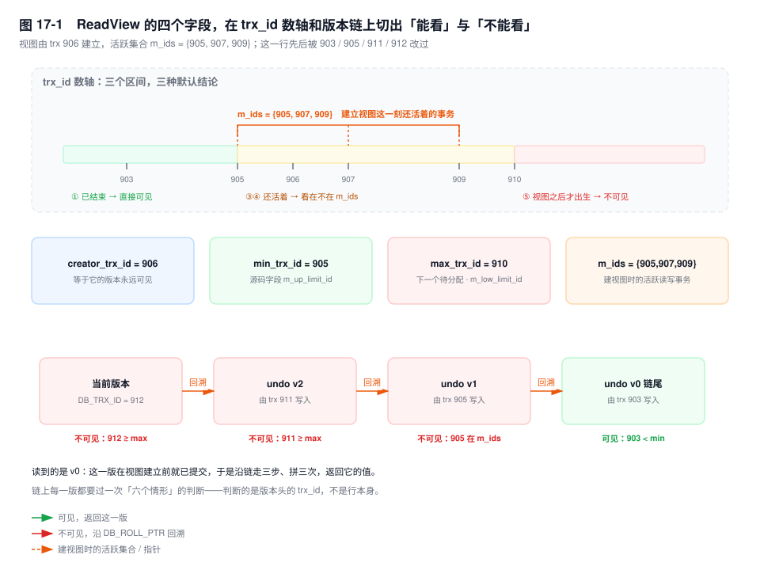
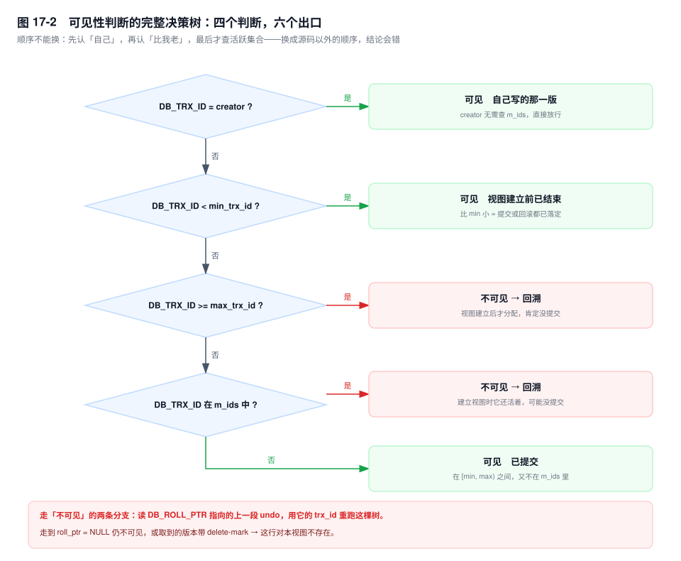
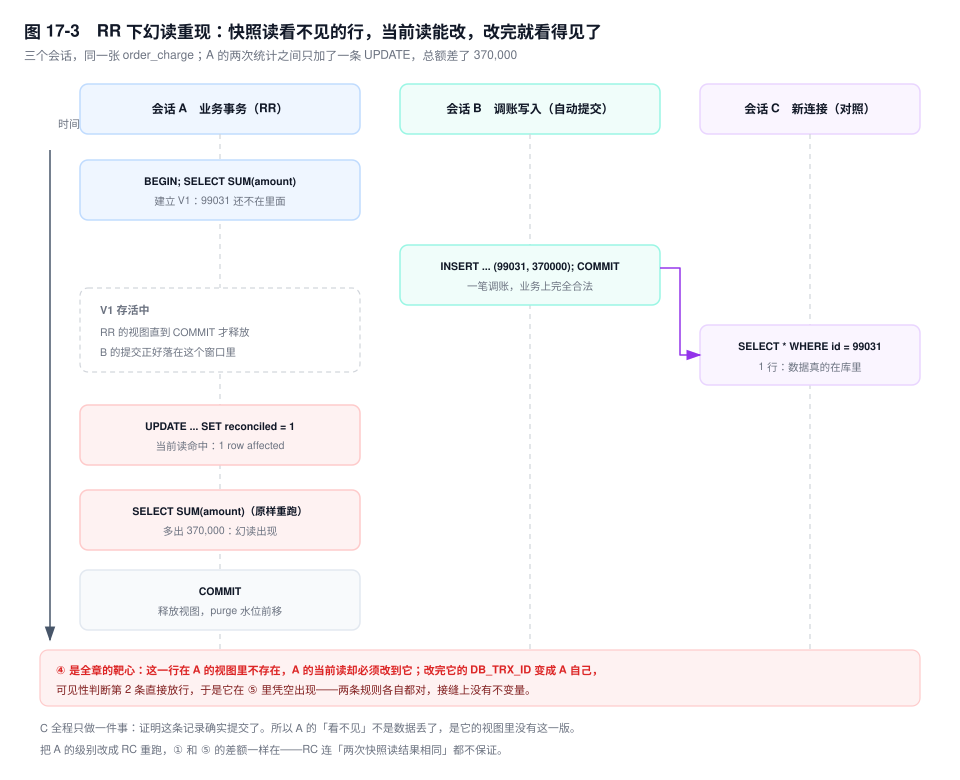

# 第 17 章　隔离级别与 MVCC 可见性

> **一句话结论**：隔离级别不是四档"数据有多新"，而是四种"谁改的东西算数"的规则；InnoDB 把它压成 ReadView 里的一次集合判断，而"同一事务两次读不一样"只可能来自两个地方——这份判断被重建了，或者那一次读根本没用它。

## 17.0 场景：跑了两小时的两次求和，差了 37 万

财务共享中心的对账服务每晚 22:00 起跑，一个事务从头跑到尾，两小时。流程三步：先 `SELECT SUM(amount)` 拿到当日账单总额当基准；再按 `id` 分页拉明细逐条比对，比对上的 `UPDATE ... SET reconciled = 1`；最后再 `SUM` 一遍做自校验。

那一晚自校验报警：基准 12,406,882.00，收尾 12,776,882.00，整整差 370,000。业务方的第一反应是"数据丢了又被补回来了"，让 DBA 去 binlog 里捞那笔 37 万。

binlog 里确实有：23:14 一笔调账，`INSERT` 一张 37 万的补差单，提交成功。渠道手续费退回，本来就该记这一笔，业务上完全合法。

问题出在对账事务自己身上。第一步的 `SUM` 建了 ReadView，那笔补差单在视图之外，看不见；中间那条 `UPDATE ... WHERE reconciled = 0` 是当前读，它看见了这行，把它一起标成了已对账；标完，这行的 `DB_TRX_ID` 换成了对账事务自己的 id——**自己改的行，对自己永远可见**。于是最后那次 `SUM` 里，37 万凭空出现。

同一事务、同一条 SQL、两次结果不同。不是数据丢了，是这份视图里"后来出生的行"，被自己亲手领了进来。这个事务还顺手把 purge 水位钉了两小时（第 5 章），对账跑完，history list 已经八位数。

本章把这件事拆到字段级：先看清"哪几种异常"分别是什么，再看 InnoDB 和标准差在哪，然后是一棵四层的判断树，最后回到这个场景——它有一个标准答案，而且不是"这是 bug"。

## 17.1 机制

### 四种隔离级别，四类异常

标准用三个现象定义隔离级别，区别不在"读到的东西变了"，而在**变的是什么**：

- **脏读（P1）**：读到了另一个事务还没提交的修改。它的错不在新旧，在于那个修改可能永远不存在——对方一回滚，你读到的东西从没发生过。
- **不可重复读（P2）**：同一事务内两次读**同一行**，值不一样。中间有人提交了对这行的修改。
- **幻读（P3）**：同一事务内两次执行**同一个查询条件**，返回的**行集**不一样。中间有行被插入或删除。

差别就在最后一句：不可重复读改的是行里的值，幻读改的是行的集合。判断一个现象属于哪一种，问自己"是这一行变了，还是这一行该不该出现在结果里，变了"。

标准之外还有一类，SQL-92 没写进隔离级别的定义，工程上却比幻读更常见：**丢失更新**。T1 读出 `x = 100`，T2 读出 `x = 100`，T1 写回 90，T2 写回 80。T1 那次扣减消失了。它和不可重复读的区别是：不可重复读只是"读"不一致，丢失更新是"写"被覆盖。

| 隔离级别 | 脏读 | 不可重复读 | 幻读 | InnoDB 怎么做到 |
|---|---|---|---|---|
| READ UNCOMMITTED | 允许 | 允许 | 允许 | 不建视图，读页上的最新版本（可能来自未提交事务） |
| READ COMMITTED | 禁止 | 允许 | 允许 | 每条快照读建一个视图 |
| REPEATABLE READ | 禁止 | 禁止 | 标准允许，当前读禁止 | 事务内第一个快照读建一个视图 + 当前读加 Next-Key Lock |
| SERIALIZABLE | 禁止 | 禁止 | 禁止 | 普通 `SELECT` 隐式转成加锁读 |

三件事值得单独说。

**RU 在 InnoDB 里真的会脏读。** 它不建读视图，读到的是页上那个版本，而那个版本可能来自一个还没提交的事务。所以 RU 只适合"读错了也无所谓"的统计，并且它对 binlog 的限制和 RC 一样（下面会讲）。

**SERIALIZABLE 不是"更强的 MVCC"，是"取消 MVCC"。** 事务块里的普通 `SELECT` 被隐式改成加锁读（`SELECT ... FOR SHARE`），读写互斥，并发度直接掉到接近串行；例外是 autocommit 下的单条查询——它自成一个只读事务，不会被转换。业务库上很少用，但它是出事时最省事的一档：不需要你判断哪条语句该加锁。

**丢失更新那一行，InnoDB 只挡住了一半。** `UPDATE` 是当前读，两个事务同时 `UPDATE ... SET stock = stock - 1` 会在行锁上排队，第二个拿到锁后用最新值算——同一行的丢失更新不会发生。但如果代码是"先 `SELECT` 拿到 100，在内存里算成 80，再 `SET stock = 80`"，第二个人写的仍然是基于旧快照算出来的绝对值，丢照旧。**隔离级别救不了算错了的算术。**

改级别只有一个开关：

```sql
SET SESSION transaction_isolation = 'READ-COMMITTED';
SELECT @@transaction_isolation;      -- [8.0]；[5.7] 的变量名是 tx_isolation
```

### 标准写的和 InnoDB 做的，差三处

**① RR 下的当前读：标准只要求"读一致"，InnoDB 连"写范围"也锁住。**

标准定义 RR 时只谈读：同一事务两次读同一行结果一样。用 MVCC 就够了——每个事务一个视图，读旧版本。InnoDB 多做了一件事：RR 下的当前读默认加 Next-Key Lock（记录锁 + 间隙锁），把"这个范围里不许别人插新行"变成硬约束。

为什么多做？一是历史。next-key lock 诞生在 statement 格式的 binlog 还是默认配置的年代，`UPDATE ... WHERE status = 0` 在主库锁住的范围，决定了这条语句影响哪些行；从库重放同一条 SQL 时，如果范围里多出一行，影响的行集就变了，主从从此分叉。锁住间隙，等于让"同一事务内同一语句"的作用域稳定。二是语义：RR 的可重复读如果只覆盖读不覆盖写，`UPDATE` 两次执行会作用在不同行上，业务照样错。

代价是直接的：gap lock 之间不互斥，但和插入意向锁互斥，于是 RR 的插入并发低于 RC，死锁概率更高。第 19 章会看到，大量死锁的根因就是两个事务在不同间隙上都拿了 gap lock。

**② RC 下 binlog 必须是 ROW。**

RC 下每条语句一个新视图，语句之间数据会变。statement 格式的 binlog 记的是 SQL 原文，从库重放时按从库当时的数据决定影响哪几行；主库执行时命中 500 行，到从库可能只剩 480 行，主从从此不一样。InnoDB 直接把这条路堵死：`binlog_format=STATEMENT` 且隔离级别是 RC 或 RU 时，写 InnoDB 表会报 1665，报错原文里那句 `InnoDB is limited to row-logging when transaction isolation level is READ COMMITTED or READ UNCOMMITTED` 说的就是这件事。ROW 格式记的是"哪一行的前镜像、后镜像"，重放不依赖从库当时的状态，才是确定的。

所以"把隔离级别改成 RC"不是一个孤立动作，它绑了一个前置条件：`binlog_format` 必须是 ROW。8.0 和 5.7 默认都是 ROW，多数人改的时候没感觉——直到有人为了省 binlog 空间调回 STATEMENT，写操作立刻报错。

**③ 标准说 RR 允许幻读，InnoDB 在当前读场景下禁掉了大部分。**

`SELECT ... FOR UPDATE`、`UPDATE`、`DELETE` 会锁住扫描到的间隙，别的事务插不进来，同一条语句再执行一次，行集不会变。但"大部分"这三个字的边界必须划清楚：

- **快照读不锁任何东西。** 它可能"看不到"别人新插的行，但那不叫幻读——幻读要求你再查一次时行集变了，而快照读两次结果一样。
- **gap lock 在 RC 下被关闭**（外键检查和唯一性检查除外）。把级别降成 RC，当前读的幻读保护同时消失。
- **唯一索引等值查询命中记录时，Next-Key Lock 退化成记录锁**，间隙不锁。别的事务可以往相邻间隙插值，只要不撞这个唯一值。这条语句自己不会因此多出行（`WHERE id = 5` 只可能命中一行），但如果事务后续用"范围"或者"另一条 SQL"做判断，判断依据就已经过期。
- `[5.7]` 的 `innodb_locks_unsafe_for_binlog=ON` 会关掉 gap lock；`[8.0]` 已移除这个参数。

一句话收口：**InnoDB 用锁兑现"当前读不幻读"，用 MVCC 兑现"快照读稳定"，没有任何机制承诺这两者一致。** 幻读恰恰长在这条缝上，后面「RR 下幻读依然存在」一节会给出两个完整复现。

### ReadView：四个字段，一次集合判断

快照读要回答一个问题："这一行的这个版本，我该不该看见？"InnoDB 的答案是把它化简成一个关于事务 id 的不等式，加一次二分查找。



四个字段，名字必须对得上，因为不同资料混着用：

- **`m_ids`**：建立视图那一刻**所有活跃的读写事务** id，升序。只读事务不在里面（`[8.0]` 只读事务不分配 id，`[5.7]` 从独立号段取号且不进读写事务链表）。
- **`min_trx_id`**：`m_ids` 的最小值。**源码里的字段名是 `ReadView::m_up_limit_id`**，很多资料（包括本书第 5 章）写作 `min_trx_id`，指的是同一个数——比它小的事务，建视图那一刻一定已经结束。
- **`max_trx_id`**：**下一个将被分配**的事务 id，不是当前最大的 id。源码里叫 `m_low_limit_id`。这一点错一次，整棵树全错：把它当成"最大值"，那个 id 恰好等于它的事务（视图建立之后才出生）就会判成可见。
- **`creator_trx_id`**：创建者自己的 id，作用只有一个——让自己改的行直接可见。`[8.0]` 的只读事务这里是 0。

第 5 章说 purge 的水位由最老的视图决定，这里补一个口径：purge 读的是同一批活跃事务里的 `m_low_limit_no`（以 undo 的 trx_no 计），可见性判断用的是 `m_up_limit_id`（以 trx_id 计）。两个数字来自同一批事务，所以"最老的视图钉住回收位置"成立；区别只在于一个决定"哪些 undo 能删"，一个决定"哪些版本能看"。

判断代码短得不像核心逻辑：

```cpp
// 简化自 storage/innobase/include/read0types.h，去掉了断言与合法性检查
bool changes_visible(trx_id_t id) const {
  if (id < m_up_limit_id || id == m_creator_trx_id) return true;  // ① ②
  if (id >= m_low_limit_id) return false;                         // ⑤
  if (m_ids.empty()) return true;
  return !std::binary_search(m_ids.begin(), m_ids.end(), id);     // ③ ④
}
```

四行代码，六个出口。



拿一个具体视图把六种情形走完：视图由 trx 906 建立，`m_ids = {905, 907, 909}`，于是 `min_trx_id = 905`、`max_trx_id = 910`。

| 情形 | 记录的 `DB_TRX_ID` | 判断路径 | 结论 |
|---|---|---|---|
| ① 比 min 还小 | 903 | `903 < 905`，第一个条件命中 | 可见。视图建立前它已经结束，提交或回滚都落定了 |
| ② 等于自己 | 906 | `906 == creator_trx_id` | 可见。自己改的，不看别人的脸色 |
| ③ 在 `m_ids` 里 | 905 / 907 / 909 | 落在 `[905, 910)`，且二分查找命中 | 不可见。建视图时它还活着，可能还没提交 |
| ④ 落在区间内但不在 `m_ids` | 908 | 落在 `[905, 910)`，二分查找未命中 | 可见。它必然在建视图前已提交，否则一定在 `m_ids` 里 |
| ⑤ 大于等于 max | 910 / 912 | `910 >= 910` | 不可见。这个 id 在视图建立之后才分配，肯定还没提交 |
| ⑥ 回溯到链尾 | `roll_ptr = NULL` | 每一版都判过，没有一版可见 | 这行对本视图不存在 |

第 ④ 种是整张表里最容易想不通的一格。事务 id 在 `[min, max)` 之间，说明它和这个视图"同时代"；不在 `m_ids` 里，说明建视图那一刻它不是活跃的；既然同时代又不活跃，只能是已经结束。所以可见。

再补一个反直觉的点：`m_ids` 是**全局**的活跃读写事务表，里面绝大多数事务跟这一行毫无关系。而一条版本链上，能被回溯经过的旧版本，写它的事务一定已经提交过——没提交的话，后一个事务根本拿不到这把行锁。但"已提交"不等于"在视图建立之前提交"：这些 id 要么 ≥ `max_trx_id`（情形 ⑤），要么当时还活着、被记进了 `m_ids`（情形 ③），两种都不可见。**所以链上的旧版本几乎总是不可见，回溯才可能一次走好几步。**

不可见的时候做什么？顺着 `DB_ROLL_PTR` 读上一段 undo，把旧列拼成上一个版本，用它的 `trx_id` 再走一遍这棵树（第 5 章讲过这条链是"差异 + 指针"，走一步拼一次）。三种结局：某一版可见就返回它；走到 `roll_ptr = NULL` 仍不可见，这行对本视图不存在；找到的版本可见但带 delete-mark，也当它不存在。

这里有一个只在实验里看得见的事实：**回溯是有代价的**。当前版本一次页访问，走到第三个旧版本就是三次 undo 页访问加三次字段合并，undo 页不在 Buffer Pool 里时还是三次随机 IO。同一张表在跑批时段快照读突然变慢、执行计划一点没变，原因常常在这里。

### 哪条语句走快照读，哪条走当前读

| 语句 | 读哪条路 | 加什么锁 |
|---|---|---|
| `SELECT ...` | 快照读 | 不加行锁（只加 MDL） |
| `SELECT ... FOR UPDATE` | 当前读 | X + Next-Key |
| `SELECT ... FOR SHARE`（8.0 新写法，`LOCK IN SHARE MODE` 仍可用） | 当前读 | S + Next-Key |
| `UPDATE` | 当前读，`WHERE` 和 `SET` 都算 | X + Next-Key |
| `DELETE` | 当前读 | X + Next-Key，打 delete-mark |
| `INSERT` | 不读旧版本 | 插入意向锁；唯一性检查是当前读 |
| `INSERT ... ON DUPLICATE KEY UPDATE` | 当前读 | 冲突时 X 锁升级 |

这张表决定三件事：会不会阻塞别人、会不会被别人的未提交事务影响、以及**这个事务到底有没有视图**。最后一条最容易被忽略——一个 RR 事务如果从头到尾只有当前读（`UPDATE`、`FOR UPDATE`），它根本没有 ReadView，一致性读的语义对它不生效。只要出现一条普通 `SELECT`，视图就在那一刻被焊死。

### RC 与 RR 的唯一差别：视图什么时候重建

RR：视图在事务内**第一条快照读**时建立，`COMMIT` 或 `ROLLBACK` 才释放。RC：**每条快照读**建立一个新视图，语句结束就扔。

同一段代码在两个级别下是两种行为：

```sql
-- 会话 A
BEGIN;
SELECT amount FROM order_charge WHERE id = 99030;   -- RR: 建视图；RC: 建完就扔
-- 会话 B
UPDATE order_charge SET amount = 500 WHERE id = 99030;
COMMIT;
-- 会话 A
SELECT amount FROM order_charge WHERE id = 99030;   -- RR: 还是旧值；RC: 500
COMMIT;
```

预期形态（未实跑，字段含义以此为准）：RR 下两次返回同一个旧值，RC 下第二次返回 500。**这是"同一事务两次查询结果不同"的第一个来源，也是唯一一个"换个级别就能改掉"的来源。**

第二个来源是当前读，改级别改不掉。同一事务里 `SELECT` 一次、`UPDATE` 一次、再 `SELECT` 一次，第三次如果走了加锁读，它读的是最新提交版本，跟视图无关。

RR 的视图建立点是"第一条快照读"，不是 `BEGIN`。这两者之间隔着的一切提交，都算进视图：

```sql
BEGIN;
-- 这里隔了 3 秒，别的事务提交了一批数据
SELECT COUNT(*) FROM order_charge;   -- 视图在"这一刻"建立，前面那批看得见
```

`START TRANSACTION WITH CONSISTENT SNAPSHOT` 就是把这个点提前到 `BEGIN` 那一刻：开事务的同时建视图。区别只有一句——**`BEGIN` 到第一条 `SELECT` 之间别人提交的数据，你要不要看见**。做一致性备份（`mysqldump --single-transaction`）要的是"不要看见"，所以用带 `WITH CONSISTENT SNAPSHOT` 的写法。RC 下这个子句几乎等于没用：视图建了，下一条语句就换新的。

### RR 下幻读依然存在，两个场景

这是本章的靶心。先把结论放前面：**RR 的幻读不是"没解决干净"，是两套机制各有各的承诺范围，交叉处本来就没有不变量。**

**场景一：先快照读，再当前读，再快照读。**

```sql
-- 会话 A（RR，对账事务）
BEGIN;
SELECT COUNT(*) FROM order_charge WHERE bill_date = '2026-11-11';   -- ① 1000
-- 会话 B（自动提交）
INSERT INTO order_charge (id, bill_date, amount) VALUES (99031, '2026-11-11', 370000.00);
COMMIT;
-- 会话 C（新连接，只用来证明数据在）
SELECT id, amount FROM order_charge WHERE id = 99031;               -- ② 1 行
-- 会话 A
SELECT COUNT(*) FROM order_charge WHERE bill_date = '2026-11-11';   -- ③ 还是 1000
UPDATE order_charge SET reconciled = 1
 WHERE bill_date = '2026-11-11' AND reconciled = 0;                 -- ④ 1001 rows affected
SELECT COUNT(*) FROM order_charge WHERE bill_date = '2026-11-11';   -- ⑤ 1001
COMMIT;
```

逐步标注每一步的可见性：

- **①** 视图 V1 建立。B 还没开始，99031 这一行不存在，`m_ids` 里没有 B 的事务。
- **②** C 用的是自己刚建的视图，看见 1 行。数据确实提交了，不是幻觉。
- **③** 99031 的 `DB_TRX_ID` 是 B 的 id，它 ≥ V1 的 `max_trx_id`——情形 ⑤，不可见，回溯到链尾仍没有一版可见，这一行对 A 不存在。
- **④** `UPDATE` 走当前读，**不看视图**。B 已提交，行锁拿得到，条件也满足，于是它被改了 1001 行——比 A 自己数出来的 1000 行多一行。写入完成后，这行的 `DB_TRX_ID` 被改成了 A 自己的 id。
- **⑤** 这一版的 `DB_TRX_ID = creator_trx_id`——情形 ②，直接放行。37 万出现在 A 的统计里。



为什么这不是 InnoDB 的 bug：它从来没承诺"一个事务看到的世界是静止的"。它承诺的是——**快照读**看到的世界，在一个视图内静止；**当前读**看到的，是已提交的最新状态。这两句话各自成立，放进同一个事务就必然有接缝。

A 的 `UPDATE` 按当前读的规则办事，它必须改到所有满足条件的行，否则业务上就是漏改；改完之后，这些行按 MVCC 的规则变成了"A 自己写的"，可见性判断第 2 条直接放行。两条规则都没错，错的是"既要求看到静止的世界，又要求改到所有的行"这个期待。

**场景二：先当前读，再快照读。**

```sql
-- 会话 A（RR）
BEGIN;
SELECT * FROM order_charge WHERE id = 99030 FOR UPDATE;   -- ① 当前读，唯一索引等值 → 只有记录锁
-- 会话 B
INSERT INTO order_charge (id, bill_date, amount) VALUES (99031, '2026-11-11', 8800.00);
COMMIT;                                                    -- ② 不被挡：(99030, +∞) 这段间隙没锁
-- 会话 C
SELECT COUNT(*) FROM order_charge WHERE id = 99031;        -- ③ 1，插入确实成功了
-- 会话 A
SELECT * FROM order_charge WHERE bill_date = '2026-11-11'; -- ④ 第一条快照读，此刻才建视图
COMMIT;
```

① 是当前读，不建视图。视图被推到 ④ 才建，那时 B 已经提交，于是 ④ 看得见 99031—— **A 的"第一次读"和"第二次读"用的是两个不同的世界**，中间还夹着一条本该起保护作用的加锁读。

这个坑在真实系统里的样子：先用 `FOR UPDATE` 捞一批待处理订单（视图没建），中间调用别的服务、隔了几百毫秒，再做一次普通 `SELECT` 校验——校验用的是几百毫秒后的世界。根因就是上面那条"RR 的视图从第一条快照读开始"，它比 `BEGIN` 晚，有时比你以为的第一次读也晚。

两个场景合起来是一条规律：**幻读只发生在"两次读走了不同路径"或者"视图换过"的地方。** 两次都是快照读，结果一定一样；两次都是当前读，锁保证行集不变（唯一索引等值那条除外）。

### 一致性读的边界：从库、延迟、备份

"一致性读"这个词的适用范围比多数人以为的窄。它保证的是：**在同一个 ReadView 内，这一组行看起来不变。** 它不保证：

- 这组行是最新的。RC 不保证，RR 在一个长事务里也不保证。
- 跨多张表时看到的是"同一时刻"的业务状态。视图只判断"每个版本由谁写的、算不算数"，不保证这些版本组合起来在业务上自洽——这正是写偏斜的土壤。
- 读到的东西和主库对齐。

从库上这个边界最容易被误读。从库的 `SELECT` 用的是**从库上建的 ReadView**，看到的是"从库已经回放到的最新数据"的一致视图。主库两秒前的提交还没回放过来，从库的视图里就没有它——**这是复制延迟，不是隔离级别**。把 RR 改成 RC 不会让从库新一毫秒，只会让同一个事务里的两次查询也各不相同，问题更难查。

反过来，这个特性有大用。`mysqldump --single-transaction` 在从库上开一个 `WITH CONSISTENT SNAPSHOT` 事务，两小时的备份过程中从库继续回放，而备份看到的是那一刻的一致视图——一份"自洽但可能落后"的数据。所以从库备份要先记下复制位点（`SHOW REPLICA STATUS`，老写法 `SHOW SLAVE STATUS`）：一致性视图只保证内部自洽，不保证与主库对齐。

还有一个老坑：`Seconds_Behind_Master` 为 0 不代表追平了。一个跑了两小时的大事务提交之前，binlog 里一条记录都没有，从库"一点都不落后"（第 5 章）。

## 17.2 关键结论

1. **隔离级别是"谁的修改算数"的规则，落到实现是一次关于事务 id 的集合判断。** `min_trx_id` 和 `max_trx_id` 的边界错一格，整棵判断树全错——前者是"已结束"的分界，后者是"还没出生"的分界。
2. **同一事务两次查询结果不同，只有两个来源：视图被换了（RC 每条语句一个），或者那次读走了当前读。** 前者换个隔离级别就能改，后者改不掉。锁的差别是这条规则的副产品，不是并列的第二条差异。
3. **RR 下幻读的两种复现，都发生在快照读与当前读的接缝上。** 先快照读再当前读，`UPDATE` 把"看不见的行"改成了"自己写的行"；先当前读再快照读，视图建得比第一次读还晚。
4. **"RR 解决了幻读"和"MVCC 解决了幻读"都不对。** 准确说法是：当前读的幻读由 Next-Key Lock 挡住，快照读的"两次结果一样"由视图保证，两者之间没有承诺。
5. **RR 的视图从第一条快照读开始，不是 `BEGIN`。** 这条规则解释了两件事：`WITH CONSISTENT SNAPSHOT` 为什么存在，以及"先 `FOR UPDATE` 再校验"的代码为什么会读到两个世界。
6. **从库读到旧数据是复制延迟，不是隔离级别。** 一致性读只保证"视图内自洽"，不保证"与主库对齐"。

## 17.3 实验验证

```sql
CREATE TABLE order_charge (
  id BIGINT PRIMARY KEY,
  bill_date DATE NOT NULL,
  amount DECIMAL(12,2) NOT NULL,
  reconciled TINYINT NOT NULL DEFAULT 0,
  KEY idx_bill (bill_date)
) ENGINE=InnoDB;

INSERT INTO order_charge VALUES (99030, '2026-11-11', 100.00, 0);
```

### 实验一：RC 与 RR 的两次读

```sql
-- 会话 A
SET SESSION transaction_isolation = 'REPEATABLE-READ';
BEGIN;
SELECT amount FROM order_charge WHERE id = 99030;

-- 会话 B
UPDATE order_charge SET amount = 500 WHERE id = 99030;
COMMIT;

-- 会话 A
SELECT amount FROM order_charge WHERE id = 99030;
COMMIT;
```

预期形态（未实跑，字段含义以此为准）：RR 下两次都是 100.00。把 A 的 `SET SESSION` 换成 `READ-COMMITTED` 重跑，第二次是 500.00。差别不在锁——两次都没有锁——而在视图活多久。

### 实验二：三会话复现幻读

```sql
-- 会话 A
BEGIN;
SELECT COUNT(*) FROM order_charge WHERE bill_date = '2026-11-11';   -- 1

-- 会话 B
INSERT INTO order_charge VALUES (99031, '2026-11-11', 370000.00, 0);
COMMIT;

-- 会话 C
SELECT COUNT(*) FROM order_charge WHERE id = 99031;                 -- 1

-- 会话 A
UPDATE order_charge SET reconciled = 1
 WHERE bill_date = '2026-11-11' AND reconciled = 0;
SELECT ROW_COUNT();                                                 -- 2
SELECT COUNT(*) FROM order_charge WHERE bill_date = '2026-11-11';   -- 2
```

预期形态（未实跑，字段含义以此为准）：`ROW_COUNT()` 是 2，最后一行 `COUNT(*)` 也是 2，而 A 的第一条语句数出来是 1。`ROW_COUNT()` 是当前读的结果，`COUNT(*)` 是视图的结果，两者差的那个 1 就是幻读。把最后一句换成 `SELECT ... FOR UPDATE` 再跑，同样返回 2 行——当前读从头到尾都是 2。

### 实验三：视图建立时机

```sql
-- A 组：普通 BEGIN
BEGIN;
SELECT SLEEP(5);
SELECT COUNT(*) FROM order_charge WHERE bill_date = '2026-11-11';

-- B 组：带一致性快照
START TRANSACTION WITH CONSISTENT SNAPSHOT;
SELECT SLEEP(5);
SELECT COUNT(*) FROM order_charge WHERE bill_date = '2026-11-11';
```

预期形态（未实跑，字段含义以此为准）：让会话 B 在这 5 秒里插入一行并提交，A 组最后那句多 1 行，B 组不多。`SLEEP` 只是占位，真实系统里这段时间是一次 RPC 或者一次文件导出。

## 17.4 常见误区

⚠️ **"MVCC 解决了幻读"**

MVCC 解决的是"同一行读两次值不同"，因为它给了你一个不动的旧版本。幻读问的是"行集变没变"，这需要锁住间隙。InnoDB 把这两件事分别交给了视图和 Next-Key Lock，所以只要在同一个事务里同时用两种读，就一定有缝。

⚠️ **"RC 没有间隙锁，所以 RC 更安全"**

RC 关闭 gap lock 是为了提升并发，代价正是"当前读不再锁住范围"——`UPDATE ... WHERE` 扫描过但没命中的间隙，别人可以随便插。而且不是完全关闭：外键约束检查、唯一性检查照样加 gap 锁，`INSERT` 的插入意向锁一直都在。改成 RC 之后如果发现"批量更新影响的行数在两次执行之间变了"，那正是自己关掉的那把锁。

⚠️ **"RR 就是可串行化"**

RR 保证单个事务的读一致和当前读的行集稳定，不保证多个事务交叉执行的结果等价于某个串行顺序。经典反例是写偏斜：两个事务各自把值班表里"另一个人"调走，各自检查时都还有 2 个人，提交后是 0 人。RR 和 RC 都拦不住，只有 SERIALIZABLE 拦得住。

⚠️ **"把隔离级别改成 RC，长事务就没危害了"**

视图变短只减轻了 undo 那部分压力——一条跑两小时的 `SELECT`，RC 下视图照样活两小时（第 5 章）。行锁、MDL、超大 binlog event 一条都没少。

⚠️ **"从库读到旧数据，是隔离级别配错了"**

从库的视图建在从库上，看到的是从库已回放的数据。主库的提交还没到，视图里当然没有。这是复制延迟，改隔离级别不会让它早到一毫秒。

## 17.5 生产 Checklist

- [ ] 事务里有没有"先读后写"的两步判断？判断在快照里、写按当前读，中间就是缝（第 16 章讲 C 时的那条也一样）。
- [ ] 依赖"同一事务内两次查询一致"的代码，两次都是普通 `SELECT` 吗？中间夹没夹 `UPDATE` 或 `FOR UPDATE`？
- [ ] 对账、报表这类跑分钟级以上的事务，是否全程 RR？能否改成每页一个事务，或者直接读从库？
- [ ] 用了 `FOR UPDATE` 的地方，锁的间隙够不够？唯一索引等值查询只锁记录，不锁间隙。
- [ ] `binlog_format` 是 ROW 吗？不是的话，改成 RC 的写操作会直接报 1665。
- [ ] 从库读的一致性，是按"业务能接受多旧"设计的，还是碰巧没出问题？有没有监控回放位点而不是只看 `Seconds_Behind_Master`？
- [ ] 备份脚本用的是 `WITH CONSISTENT SNAPSHOT` 还是裸 `BEGIN`？后者的"一致性"只是运气。
- [ ] 有没有代码在 RR 事务里读一次、调一次 RPC、再读一次，然后比较两次结果？这是最容易出"数据丢了"误报的写法。

## 17.6 延伸

- **上一章**：第 16 章（事务 ACID 的工程实现）——I 由锁和 MVCC 共同兑现，本章拆的是 MVCC 那一半。
- **下一章**：第 18 章（锁体系全景）——锁的那一半，从分类树讲到 `data_locks`。
- **关联章节**：第 1 章（快照读与当前读的分叉）、第 5 章（undo 版本链与 purge 水位）、第 7 章（崩溃恢复里的回滚）、第 19 章（加锁规则推演）、第 21 章（长事务治理）、第 28 章（binlog 格式与复制）。
- **面试追问**：
  - "RR 解决了幻读吗？" → 当前读解决了大部分（Next-Key Lock），快照读没有"幻读"这回事（它本来就不承诺看见新行）；两者交叉处必然漏，给两个复现序列。
  - "`max_trx_id` 是最大的事务 id 吗？" → 不是，是下一个待分配的 id，等价于"视图建立时刻的高水位"，`>=` 它的一律不可见。
  - "为什么 RC 必须配 ROW 格式的 binlog？" → 语句级日志的语义是"重放这条 SQL"，而 RC 下主从两侧执行时的可见行集可能不同。
  - "同一个事务里 `SELECT` 看到旧值、`UPDATE` 却按新值判断，为什么？" → 两条读路径，一个用视图、一个不看视图。
- **官方文档**：`InnoDB Locking and Transaction Model` → *Consistent Nonlocking Reads*、*Transaction Isolation Levels*；`START TRANSACTION, COMMIT, and ROLLBACK`；`Binary Logging Formats`；`innodb_locks_unsafe_for_binlog`（5.7）。
