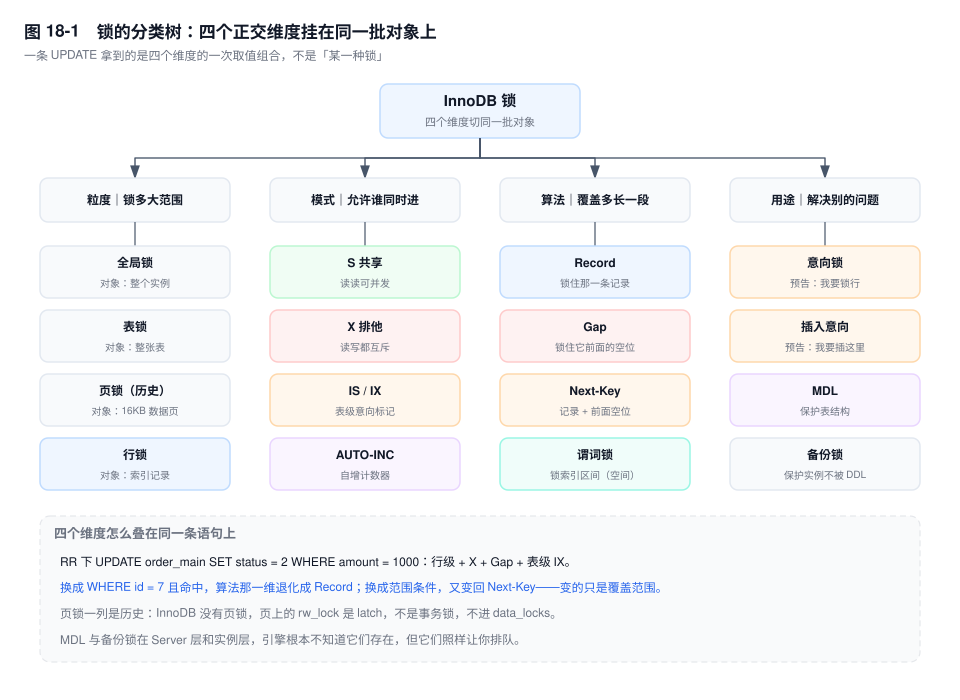
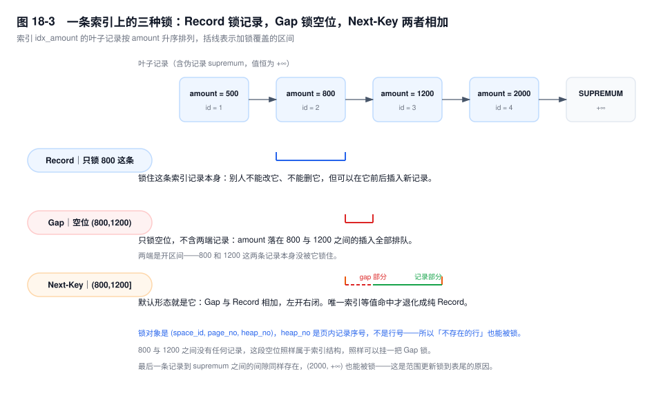

# 第 18 章　锁体系全景

> **一句话结论**：InnoDB 的锁不是一个名词，是四个正交维度——锁多大范围、允许谁进、覆盖多长一段、解决什么问题——组出来的坐标；把维度当种类背，越背越乱。

## 18.0 场景：一条 ADD COLUMN 卡了 40 分钟

2026 年 11 月 11 日 09:12，大促前一小时，运维在订单主表上提了一条加字段的变更：

```sql
ALTER TABLE order_main ADD COLUMN channel VARCHAR(16) NOT NULL DEFAULT 'app';
```

09:40，它还没结束。QPS 从 1.2 万掉到 300，连接数从 300 涨到 1900。`SHOW PROCESSLIST` 四十几行，除了那条 ALTER，其余全是 `SELECT order_no, amount FROM order_main WHERE id = ?`，State 一律是 `Waiting for table metadata lock`。

现场三个数据互相打架：

- CPU 5%，慢日志里一条记录都没有；
- `performance_schema.data_locks` 是空的，一把行锁都没有；
- `information_schema.innodb_trx` 只有一条事务，`trx_started` 是 06:05，`trx_rows_modified = 0`，`trx_is_read_only = 1`。

六点半那个事务只做过一件事：`BEGIN` 之后跑了一条 SELECT，然后卡在一次 RPC 上，连接一直挂着，没提交。它一行数据都没改，却让整张表停了 40 分钟读写。

KILL 掉那个连接，队列在几百毫秒内散尽。挡住全站的不是行锁，是**表结构上的锁**。这一章只做一件事：把 InnoDB 的锁摊成一张地图——有哪几种、各锁什么对象、彼此怎么兼容。至于某条 SQL 具体锁哪几条索引记录，是第 19 章的事。



## 18.1 机制

### 一、四个维度，不是四份清单

多数人记锁的方式是三份清单：粒度一份（全局/表/页/行）、模式一份（共享/排他）、间隙锁再单独开一份。背完之后，遇到"这条语句加的是 IS 还是 IX"仍然要现场拼。

真实的组织是一棵树，根下面挂四个**正交**维度：

| 维度 | 取值 | 回答的问题 |
|---|---|---|
| 粒度 | 全局 / 表 / 页 / 行 | 这把锁的范围有多大 |
| 模式 | S / X（表级另有 IS / IX） | 允不允许别人同时进来 |
| 算法 | Record / Gap / Next-Key | 覆盖多长一段索引区间 |
| 用途 | 意向 / 插入意向 / AUTO-INC / MDL / 备份 / 谓词 | 它到底在解决什么问题 |

一条语句拿到的锁，是四维取值的一次组合。RR 下 `UPDATE order_main SET status = 2 WHERE amount = 1000`（`idx_amount` 非唯一、1000 不存在）是「行级 + X + Gap + 表级 IX」；换成 `WHERE id = 7` 且命中，算法那一维退化成 Record；换成 `WHERE id BETWEEN 100 AND 200`，又变回 Next-Key。同一张表、同一个事务，四个维度各自独立变化——这就是"这条 SQL 加了什么锁"没法用一句话回答的原因。

页锁那一栏要点名：**InnoDB 没有页锁**，那是 Berkeley DB 引擎的东西。B+ 树的页上确实有 `rw_lock`，但它是 latch：保护页内字节的一致性，生命周期以微秒计，不进 `data_locks`，也不会因为你的事务没提交而让别人等。把 latch 当锁，就会得出"改同一页的两行会互相阻塞"这种错误结论。

用途这一维也不能省。MDL 和备份锁在粒度上都算"表"甚至"实例"，但它们的持有者在 Server 层，跟 InnoDB 的行锁没有任何数据结构上的交集。只看粒度，你解释不了"一个只读事务为什么能挡住 DDL"——那是用途维度的答案。

### 二、意向锁：表锁与行锁之间的翻译器

假设没有意向锁。执行 `LOCK TABLES ... WRITE` 或 DDL 之前，必须先回答"这张表现在有没有行锁"。行锁记在索引记录上，唯一的办法是把整张表扫一遍逐个检查——1000 万行的表，加个表锁先扫 1000 万行。

意向锁把这件事压成 O(1)：事务给某一行加锁之前，先在这张表上加一个表级标记，要加 S 就加 IS，要加 X 就加 IX。之后表锁只读表上的标记，一行都不用碰。


16 个格子里有两处值得单独讲。

**IS 与 IX 永远兼容。** 因为它们是记账，不是保护。两个事务各持 IX，只说明"我们都要改这张表的某些行"，至于改的是不是同一行，表级既不知道也不该管。如果 IX 之间互斥，同一张表上两个不相干的行更新就会退化成表级串行——行锁存在的意义被它自己取消。

**IX 与表级 S / X 冲突。** 表级 S/X 的语义是"我要让整张表安静下来"（备份、DDL、`LOCK TABLES`），而 IX 在说"有人正在改行"。这两句话不能同时成立。

### 三、三种算法：锁的是索引记录，不是行

"行锁"这个叫法误导了很多人。InnoDB 的行锁加在**索引记录**上，一把锁由 `(space_id, page_no, heap_no)` 定位，`heap_no` 是记录在页内的序号。所以"锁一行"只在"这行存在、且你走的是能定位到它的索引"时才成立。表上没有主键时，InnoDB 会造一个 6 字节的隐藏 `row_id` 聚簇索引，锁落在那上面（第 8 章）。

三种算法是同一把锁的三种覆盖范围：

- **Record Lock**（`LOCK_REC_NOT_GAP`）：锁住那一条索引记录本身。
- **Gap Lock**（`LOCK_GAP`）：锁住一条记录**之前**的开区间 `(prev, cur)`，两端记录不在内。
- **Next-Key Lock**：Record + 它前面的 Gap，区间左开右闭 `(prev, cur]`。RR 下的默认形态。



**不存在的行为什么也能被锁？** `order_main` 的 `idx_amount` 上有 500 / 800 / 1200 三条记录，执行：

```sql
SELECT * FROM order_main WHERE amount = 1000 FOR UPDATE;
```

1000 这个订单并不存在。可 `data_locks` 里会出现一把 `X,GAP` 的锁，`LOCK_DATA` 显示 `1200, 3`——锁挂在了下一条记录身上。

因为锁的对象是索引上的**位置**，不是行实体。1000 若存在，会落在 800 和 1200 之间；这段空位由索引结构本身提供，与有没有行无关。锁住"1000 会插入的那个位置"，在实现上就是锁住"1200 之前的那段间隙"。**"锁一条不存在的记录"在索引视角下完全自洽**，只有在行的视角下才无法解释。

往后推一步，就是第 19 章最贵的那个结论：没有索引的 `UPDATE`，全表扫过的每一条索引记录都要加 next-key，连 supremum 前那一段也算——锁的数量与"扫描行数"同阶，不与"命中行数"同阶。

### 四、间隙锁的两个反直觉性质

**性质一：间隙锁之间互不冲突。** 会话 A 对 `amount = 1000` 加了 gap 锁，会话 B 执行同一条语句，不等待，立刻成功，两个事务同时持有同一段间隙的锁。

这是设计出来的结果。gap 锁唯一的作用是"阻止插入"，两个都只想阻止别人往这里插的事务之间没有利益冲突，让 B 等 A 纯属浪费。实现上 InnoDB 也不区分 gap S 与 gap X——`LOCK_GAP` 在冲突判定里被归一化，`data_locks` 里两者都显示 `X,GAP`。

**性质二：间隙锁只挡插入。** 它不挡别的 gap 锁（性质一），不挡快照读，也不挡对间隙外记录的修改。它挡的是**插入意向锁**：任何想往这段间隙里放一条记录的请求。

UPDATE 改索引列同样会被挡。把某行 `amount` 从 900 改成 1000，在二级索引上等价于"删一条 + 插一条"，插入那一步要申请 1000 所在间隙的插入意向锁，于是被 A 的 gap 锁拦下。**很多人以为自己只改了自己这行，其实是被别人锁住的空位挡住的。**

这两条性质合起来能解释一类很难查的等待：入库单表按 `batch_no` 建了二级索引，某个事务用 `WHERE batch_no = 1000 FOR UPDATE` 锁住了 `(800,1200)` 这段空位，随后两笔毫无关系的入库（批号 850 和 1100）一起排队——它们既不是同一个 SKU，也不是同一个仓库，冲突发生在"位置"上，不在"数据"上。按业务归属去分析加锁关系，永远分析不出来。

### 五、插入意向锁：gap 锁的一个特例

`INSERT` 写记录之前，先在目标间隙上加一把插入意向锁（`X,GAP,INSERT_INTENTION`）。它本身就是间隙锁的一种，只是粒度更细：锁的不是整段间隙，而是"我要插在这个位置"。

三件事由此推出来。

1. **插入意向锁之间兼容，前提是插入位置不同。** 两个事务往 `(800,1200)` 分别插 900 和 1000，各锁各自的位置，可以并行。这就是 INSERT 之间通常不互斥的实现基础。若插同一个值，第二个会走到唯一性检查上拿 S 锁，那是第 19 章的话题。
2. **插入意向锁与 gap 锁冲突。** gap 锁能挡插入，不是靠 INSERT 额外做一次"这里有没有 gap 锁"的检查，而是它申请的插入意向锁本身与 gap 锁不兼容。
3. **插入意向锁彼此可以共存，但与 gap 锁不能共存。** 于是一种很别扭的局面出现了：两个事务都只想"锁住这段空位"，畅通；一旦有人真要插进去，全部排队。第 20 章那类"先 SELECT ... FOR UPDATE 一个不存在的值、再 INSERT"的死锁，源头就在这里。

### 六、AUTO-INC 锁：自增号的取号窗口

自增列要在并发下取号不重。难点在于一条语句可能插多行：从取第一个号到用完最后一个号，中间是一个窗口，窗口里的并发行为决定了三档模式的差别。

| 模式 | 简单插入（行数已知） | 批量插入（`INSERT ... SELECT`、`LOAD DATA`） | 语句内自增值 |
|---|---|---|---|
| 0 traditional | 表级 AUTO-INC 锁，持有到语句结束 | 同左 | 连续 |
| 1 consecutive | 轻量互斥量，取号后立即释放 | 退化为表级 AUTO-INC 锁 | 连续 |
| 2 interleaved | 只在分配时持互斥量 | 同左，不持表锁 | 可能交错、不连续 |

8.0 默认是 2，5.7 默认是 1。选择的依据不在性能，在复制：

- 0 和 1 保证"一条语句分到的号是连续的"。所以 STATEMENT 格式的 binlog 在从库重放、重新取号时，结果与主库一致。
- 2 不保证语句内连续。同一条 `INSERT ... SELECT` 在主库拿到一段号，在从库可能拿到另一段——只要业务把自增值当单号，主从就对不上。所以 8.0 把模式默认改成 2 的同时，把 `binlog_format` 默认改成了 ROW：ROW 记的是行的具体值，从库不需要重新取号。**`innodb_autoinc_lock_mode=2` 配 `binlog_format=STATEMENT` 是一组不该出现的组合**。

三档都不保证没有空洞：回滚、唯一键冲突都会消耗号。自增的语义只是"唯一且单调递增"，不是"连续"。

一个 [8.0] 变化值得记住：自增计数器的当前值会持久化进 redo，重启后不会退回 `max(id)+1`；5.7 及以前重启按 `max(id)` 重算，把最大那条删掉再重启，号就被重用了。

### 七、MDL：SELECT 也在锁表

MDL 是 Server 层的锁，InnoDB 根本不知道它存在，它保护的是**表结构**而不是数据。加锁顺序上，MDL 在引擎锁之前。

- `MDL_SHARED_READ`：普通 `SELECT`、`SHOW`。语句结束释放，但**事务内一直持有到事务结束**。
- `MDL_SHARED_WRITE`：DML。
- `MDL_EXCLUSIVE`：`ALTER TABLE`、`DROP`、`RENAME` 等 DDL。

把 18.0 的事故拆开，链条只有四步：

1. 06:05，一个连接 `BEGIN` 后执行了一条 SELECT，拿到 `MDL_SHARED_READ`，随后卡在 RPC 上。事务不结束，这把锁不放。
2. 09:12，ALTER 申请 `MDL_EXCLUSIVE`，与 S 冲突，进入等待。
3. 09:13 起，新来的 SELECT 申请 `MDL_SHARED_READ`。**MDL 的授予是排队的**：一个 X 请求在等，后来的 S 请求不许插队，否则 X 可能永远等不到。于是所有新查询排在 ALTER 后面一起等。
4. 连接池被这些等待的查询占满，`SHOW PROCESSLIST` 满屏 `Waiting for table metadata lock`。

准确的表述是：**不是 DDL 锁了表，是排队规则锁了表。** DDL 自己可能只要几毫秒，但它在队头一堵，后面全停。这也解释了现场那三个"矛盾"的数据：CPU 空转，因为没人扫数据；没有行锁，因为冲突发生在表结构上；只有一个只读事务，因为它就是那个队头。

排查时看谁在等没用，要看谁**不**在等。`performance_schema.metadata_locks` 里 `LOCK_STATUS='GRANTED'`、`LOCK_TYPE='SHARED_READ'`、持有线程 `COMMAND='Sleep'` 的那一行才是元凶；`sys.schema_table_lock_waits` 直接给出阻塞关系（第 20 章）。注意 `OWNER_THREAD_ID` 是 Performance Schema 的线程号，要经 `performance_schema.threads.PROCESSLIST_ID` 映射成连接号才能 KILL。

⚠️ 两个超时参数别混：`innodb_lock_wait_timeout` 管行锁，默认 50 秒；`lock_wait_timeout` 管 MDL，默认 31536000 秒——一年。DDL 能一直等下去，是这个默认值给的底气。

### 八、全局锁与备份锁

`FLUSH TABLES WITH READ LOCK`（FTWRL）加的是全局读锁：阻塞所有 DML 和 DDL，只放行 SELECT。它还要等所有活跃事务结束、把所有表刷干净，所以库上有长事务时它自己也会卡住。典型用途是 `mysqldump --single-transaction` 拿到一致性快照后短暂持有，以及备份工具处理非 InnoDB 表。代价是全局的：持有期间整库不可写。

[8.0] `LOCK INSTANCE FOR BACKUP` 是给备份工具准备的轻量替代（Clone 插件、MySQL Enterprise Backup 走这条路）。它挡的是会破坏备份一致性的操作——DDL、`TRUNCATE`、`RENAME`、直接动文件，**不挡 DML**。备份期间业务照常写，只是不能改结构。两者都是实例级，差别在"挡谁"：FTWRL 挡一切写，备份锁只挡结构变更。

`LOCK TABLES ... WRITE` 是另一套：Server 层的表锁，MyISAM 时代的主力，InnoDB 下基本只剩导数场景在用。它会隐式提交当前事务，这一点经常咬人。

### 九、谓词锁与空间索引

空间索引用 R-tree，按最小外接矩形（MBR）组织，没有"按值排序的记录序列"，next-key 无从谈起。为了给空间查询防幻读，InnoDB 用**谓词锁**：在内存里记下"某个索引区间已被这个事务读过或写过"，插入时检查新记录的 MBR 是否落进被锁的区间，落进去才等。

谓词锁完全在内存里，不出现在 `data_locks`（8.0 这张表只列 record 和 table 锁），也没有对应的配置项。空间索引并发度上不去，根本原因是谓词锁的区间由查询条件决定，两个不同查询的区间很容易重叠。

### 十、锁在内存里长什么样

`lock_sys` 是全局单例，核心是一张按 `(space_id, page_no)` 哈希的表。每个锁结构（`lock_t`）记着：所属事务、锁模式与算法、以及一个**位图**——第 N 位为 1，表示"本页第 N 个 `heap_no` 的记录被这个事务锁了"。

三个后果，都跟生产直接相关。

1. **容量的单位是"页 + 位图"，不是"行"。** 一个事务锁住一页里的 100 条记录，锁结构还是 1 个，位图多 100 位；散在 1000 个页上，就是 1000 个锁结构。所以"锁了多少行"与"占多少内存"不是线性关系，中间隔着"这些行分布在多少页上"。
2. **间隙锁天生难合并。** 记录锁能按页合并进同一个位图，间隙锁要区分"锁的是哪条记录前面的间隙"，基本一个间隙一份锁结构。于是一条全表扫描的 `UPDATE` 在 RR 下产生的锁结构数量，与"扫过的记录数"同阶。
3. **锁结构的内存在 buffer pool 之外，没有独立上限。** 它随锁数量线性增长，配置项管不住。这就是"无索引更新把实例打挂"的机制：`UPDATE order_main SET status = 2 WHERE channel = 'app'`，`channel` 没索引，全表扫 100 万行，每条记录一个 next-key，百万级锁结构；此时谁再去查一次 `data_locks`，Performance Schema 还要为它物化一份结果集，内存再翻一倍。语句本身只是慢，把实例推过临界点的是锁和它的观测开销。

每个锁结构上还挂着一个等待队列，记着"谁在等这把锁"。死锁检测（第 20 章）就是沿着这些队列找环——它遍历的是锁结构，不是行，所以一次死锁检测的开销取决于"当前锁的数量"，而不是"涉及的那两行有多大"。

## 18.2 关键结论

**1. 锁的对象是索引记录，不是行。** 一把锁由 `(space_id, page_no, heap_no)` 定位；没有索引就没有"精确到行"的锁，只有"扫过的每一条记录"。

**2. 意向锁是表锁与行锁之间的 O(1) 翻译器，IS 与 IX 必须兼容。** 它们只记账不保护；一旦互斥，行级并发就退化成表级串行。

**3. Gap 锁之间不冲突，它唯一的用途是挡插入意向锁。** 所以 RR 下的等待经常发生在两个毫无数据交集的事务之间。

**4. Next-Key = Record + Gap，区间左开右闭。** 唯一索引等值命中退化为 Record，命中不到退化为 Gap；变的只是覆盖范围，不是锁的种类。

**5. MDL 让"只读"也能阻塞全表。** SELECT 拿 `MDL_SHARED_READ` 并持有到事务结束，DDL 的 X 请求在队头一堵，后来的 S 请求全部排在后面。

**6. `innodb_autoinc_lock_mode=2` 的前提是 ROW 格式。** 它换性能的方式是放弃"语句内自增连续"，STATEMENT 复制下主从会分叉。

## 18.3 实验验证

以下都在 8.0 默认配置下完成（`performance_schema=ON`，`transaction_isolation=REPEATABLE-READ`）。准备一张带二级索引的小表：

```sql
CREATE TABLE order_main (
  id BIGINT PRIMARY KEY AUTO_INCREMENT,
  order_no VARCHAR(32) NOT NULL,
  amount DECIMAL(10,2) NOT NULL,
  status TINYINT NOT NULL,
  UNIQUE KEY uk_order_no (order_no),
  KEY idx_amount (amount)
) ENGINE=InnoDB;

INSERT INTO order_main (id, order_no, amount, status) VALUES
 (1,'A1001',500,1), (2,'A1002',800,1), (3,'A1003',1200,1);
```

### 实验一：锁一个不存在的值

```sql
-- 会话 A
BEGIN;
SELECT * FROM order_main WHERE amount = 1000 FOR UPDATE;
-- 不提交

-- 会话 B（另开连接）
SELECT INDEX_NAME, LOCK_TYPE, LOCK_MODE, LOCK_STATUS, LOCK_DATA
FROM performance_schema.data_locks
WHERE OBJECT_NAME = 'order_main';
```

```text
# 输出形态（未实跑，字段含义以此为准）
INDEX_NAME   LOCK_TYPE  LOCK_MODE  LOCK_STATUS  LOCK_DATA
idx_amount   RECORD     X,GAP      GRANTED      1200, 3
NULL         TABLE      IX         GRANTED      NULL
```

两行要一起看：`TABLE / IX` 是表级意向标记，`RECORD / X,GAP` 是算法维度的取值。`LOCK_DATA` 的格式是"索引列值, 主键值"，锁挂在 1200 而不是 1000 上——1000 不存在，锁只能落在它后面那条记录身上，`GAP` 表示"锁的是这条记录之前的空位"。

把条件换成 `WHERE id = 2`（主键唯一等值命中），`LOCK_MODE` 变成 `X,REC_NOT_GAP`，`LOCK_DATA` 是 `2`。同一张表、同一个事务模型，只有算法维度变了。

### 实验二：两个 gap 锁共存，插入被挡

```sql
-- 会话 A
BEGIN;
SELECT * FROM order_main WHERE amount = 1000 FOR UPDATE;

-- 会话 B：同样语句，立即返回
BEGIN;
SELECT * FROM order_main WHERE amount = 1000 FOR UPDATE;

-- 会话 B：往这段间隙插一条
INSERT INTO order_main (order_no, amount, status) VALUES ('A1004', 1000, 1);
```

预期形态：第三条语句挂住，`data_locks` 里多出一行 `X,GAP,INSERT_INTENTION`、`LOCK_STATUS='WAITING'`，`data_lock_waits` 指向 A 那把 `X,GAP`。把插入值改成 1500（落进 `(1200, +∞)` 另一段间隙），立即成功——这验证了"gap 锁只挡自己那段空位"。

### 实验三：没人动数据，表却被锁住

```sql
-- 会话 A：只读，不提交
BEGIN;
SELECT order_no FROM order_main WHERE id = 1;

-- 会话 B：DDL
ALTER TABLE order_main ADD COLUMN channel VARCHAR(16) NOT NULL DEFAULT 'app';

-- 会话 C：普通查询，会一起挂住
SELECT order_no FROM order_main WHERE id = 1;

-- 第四个连接：看 MDL
SELECT OBJECT_NAME, LOCK_TYPE, LOCK_STATUS, OWNER_THREAD_ID
FROM performance_schema.metadata_locks
WHERE OBJECT_NAME = 'order_main';
```

```text
# 输出形态（未实跑，字段含义以此为准）
OBJECT_NAME  LOCK_TYPE     LOCK_STATUS  OWNER_THREAD_ID
order_main   SHARED_READ   GRANTED      51
order_main   EXCLUSIVE     PENDING      52
order_main   SHARED_READ   PENDING      53
```

读法：51 号线程（会话 A，Sleep 状态）持有 S；52 号（ALTER）在等 X；53 号（会话 C 的 SELECT）在等 S，而且排在 X 后面。**如果 53 号能先拿到 S，52 号就可能永远等不到**，所以 MDL 不允许 S 插队——这就是那 40 分钟的直接成因。

处置顺序：先 KILL 持有 S 的那个连接，等 GRANTED 的 S 消失，X 立刻被授予，PENDING 的 S 跟着通过。应急时也可以先 KILL DDL 让读恢复，但 06:05 那个事务还在，下一次 DDL 会再堵一次。

### 实验四：自增号的空洞

```sql
SHOW VARIABLES LIKE 'innodb_autoinc_lock_mode';   -- 8.0 默认 2
INSERT INTO order_main (order_no, amount, status) VALUES ('A1005', 500, 1);  -- 成功，id = 4
INSERT INTO order_main (order_no, amount, status) VALUES ('A1005', 700, 1);  -- 失败：uk_order_no 冲突
SHOW CREATE TABLE order_main;   -- AUTO_INCREMENT 已是 6，而 MAX(id) 还是 4
```

预期形态：模式 1/2 下简单插入是"先取号再检查"，失败那条在报错前已经把 5 号取走了，计数器继续前进到 6。号比数据多，不代表有数据丢了，只代表有号被吃掉了。依赖自增号连续做对账的系统会在这里出问题。

## 18.4 常见误区

⚠️ **"行锁锁的是行。"**
为什么错：锁落在索引记录上，定位是 `(space_id, page_no, heap_no)`。同一行数据在聚簇索引和每个二级索引上各有一条记录，锁在某一条上，不代表另外几条也被锁。
正确理解："锁行"只是省略了主语；真正决定范围的是"走了哪条索引、扫过哪些记录"。

⚠️ **"间隙锁之间会互相阻塞。"**
为什么错：gap 锁是纯抑制性的，唯一作用是挡插入；两个只想挡插入的事务没有冲突理由，InnoDB 也把 gap S 与 gap X 归一化处理。
正确理解：互斥的是"gap 锁 vs 插入意向锁"。看到两个 `SELECT ... FOR UPDATE` 互等，多半是其中一个后面还跟着 INSERT。

⚠️ **"只有增删改才加锁，SELECT 不加锁。"**
为什么错：SELECT 至少加两样东西——快照读加 MDL 读锁（事务内持有到提交），当前读还加行级 next-key。
正确理解：判断一条 SELECT 会不会阻塞别人，先问它是快照读还是当前读，再问它所在的事务有多长。

⚠️ **"RC 没有间隙锁，所以 RC 更安全。"**
为什么错：RC 取消的是"普通范围扫描为防幻读而加的 gap 锁"。外键检查、唯一性检查、INSERT 冲突检测在 RC 下照样产生间隙等待。
正确理解：降到 RC 减少的是一类等待，不是全部；代价是 STATEMENT 复制不可用，半一致性读还带来新的语义差异（第 17 章）。

⚠️ **"`SHOW PROCESSLIST` 里等 MDL 的那条就是元凶。"**
为什么错：等 MDL 的语句是受害者，它们排在队头那个请求后面。真正持有 MDL 的，往往是一条 `Sleep` 的连接。
正确理解：到 `metadata_locks` 找 `GRANTED` 且线程空闲的那一行；处理它，不是处理排队的。

## 18.5 生产 Checklist

- [ ] 应用账号无 DDL 权限；DDL 走工单，执行前跑一遍长事务检查：`SELECT trx_id, trx_started, trx_mysql_thread_id FROM information_schema.innodb_trx ORDER BY trx_started LIMIT 5`。
- [ ] DDL 会话显式设 `lock_wait_timeout`（如 5 秒），不要用默认的一年；等不到就让 DDL 失败重试，别让它堵在队头。
- [ ] 事务模板禁止 RPC/HTTP；连接池开启"归还时回滚"与最大存活时间，避免 `Sleep` 里挂着未提交事务。
- [ ] 所有 DML 的 `WHERE` 必须能走索引；审核规则把"无索引 UPDATE/DELETE"设为阻断项——它同时是锁爆炸和主从延迟的源头。
- [ ] `binlog_format=ROW` 与 `innodb_autoinc_lock_mode=2` 成对配置；业务单号不依赖自增连续性。
- [ ] 备份工具确认走 `LOCK INSTANCE FOR BACKUP` 路径（Clone / MEB 8.0），不要再让 FTWRL 在大表上长时间持有。
- [ ] 监控 `metadata_locks` 中 `PENDING` 超时的记录，以及 `data_lock_waits` 的等待链长度——这两项比 QPS 更早报警。

## 18.6 延伸

- 一条具体 SQL 到底锁哪些记录：第 19 章（两条原则、两条优化规则、五步法）。
- 锁等待与死锁的现场取证：第 20 章（`data_lock_waits`、`LATEST DETECTED DEADLOCK`）。
- 快照读那一侧：第 17 章（ReadView 与可见性判断）。
- DDL 的 Online 算法与工具选型：第 46 章。
- 长事务治理：第 21 章。

面试最常问的三个：为什么 IS 与 IX 兼容（答"记账不保护"，补一句"否则行锁退化成表锁"）；为什么 gap 锁之间不冲突（答"纯抑制性，只挡插入"）；为什么 8.0 把 autoinc 默认改成 2（答"分配性能 + ROW 格式兜住一致性"）。

官方文档：`dev.mysql.com/doc/refman/8.0/en/innodb-locking.html`（锁类型）、`.../innodb-locking-transaction-model.html`（隔离级别与锁）、`.../metadata-locking.html`（MDL）。锁视图在 8.0 是 `performance_schema.data_locks` 与 `data_lock_waits`；`information_schema.innodb_locks`、`innodb_lock_waits` 在 8.0 已移除，5.7 的排查脚本不能直接搬过来。
