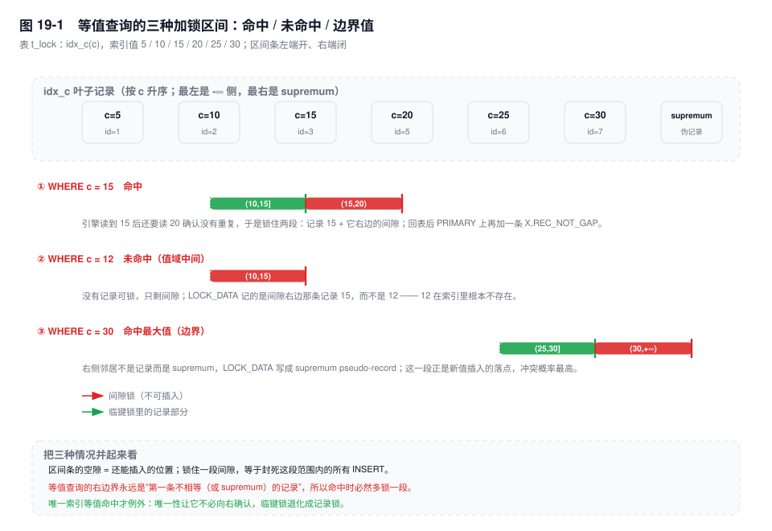
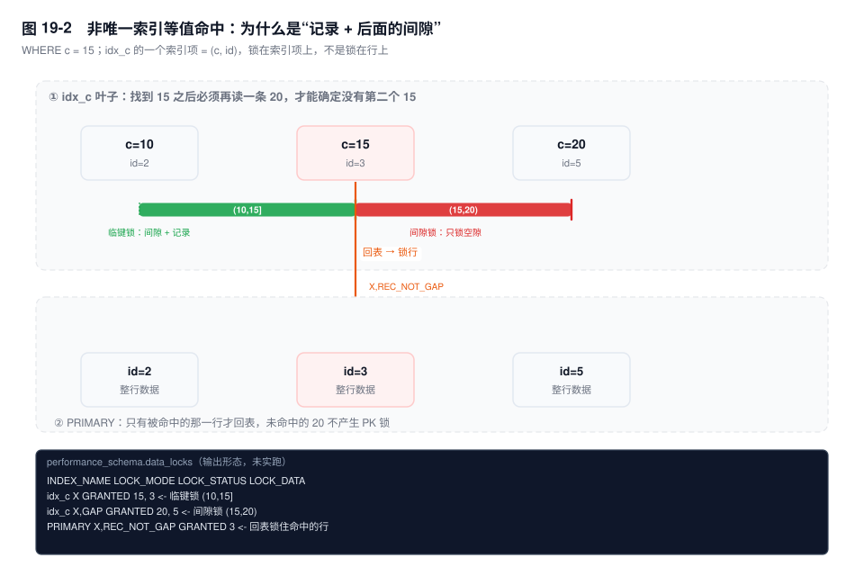
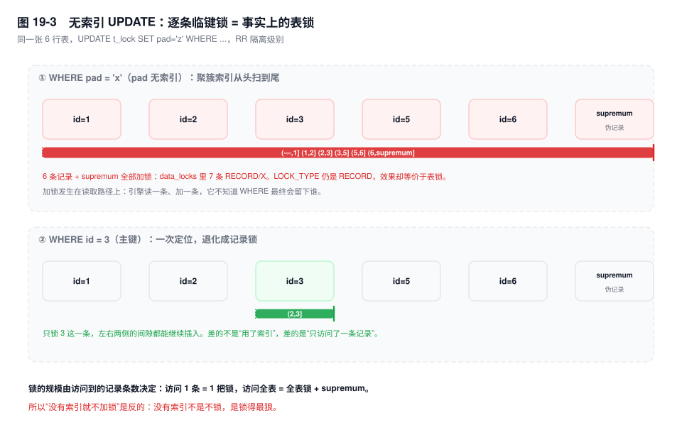

# 第 19 章　加锁规则推演

> **一句话结论**：InnoDB 锁的不是行，是索引上的一段区间——锁范围等于扫描范围，而扫描范围由索引顺序决定，与 `WHERE` 命中几行无关。

## 19.0 场景：一条只改一行的 UPDATE，堵住了整个仓库的铺货

大促前一周，库存服务开始抖。扣减接口的 P99 从个位数毫秒涨到接近 1 秒，`innodb_lock_wait_timeout` 的报错每天几百条。

```sql
UPDATE order_stock
SET available = available - 1, version = version + 1
WHERE sku_id = 8842 AND warehouse_id = 3;
```

`EXPLAIN` 是 `ref`，`rows=1`；慢日志里 `Rows_examined=1`。从任何角度看，它都只碰一行。

但监控上三件事同时发生：

- 同一个 SKU、**不同仓库**的扣减开始互相排队。它们改的是不同的行，却卡在同一把锁上。
- 给这个 SKU 新增仓库库存的 `INSERT` 全部超时——新业务和存量扣减毫无交集，却插不进去。
- `performance_schema.data_locks` 里，这个事务只有三条 RECORD 记录：`idx_sku` 上一条 `X`、一条 `X,GAP`，`PRIMARY` 上一条 `X,REC_NOT_GAP`。

`sku_id` 上建的是普通索引 `KEY idx_sku (sku_id)`——一个 SKU 在多个仓库各有一行，它本来就不唯一。非唯一索引的等值查询，引擎读完 `sku_id = 8842` 的最后一条，还要再往右读一条，确认"没有更多 8842 了"。这一读，就把 `(8842, 下一个 sku_id)` 这段间隙一起锁住了；而 `sku_id = 8842` 这个值的每一条索引项，连同它们左边的间隙，本来就在临键锁里。

于是"扣一个仓库的库存"变成了"锁住这个 SKU 在所有仓库的行，再封死它右边的一段空隙"。前者让不同仓库互相排队，后者让新增仓库的 `INSERT` 撞在间隙锁上。

复盘时最容易得出的结论是"给 `warehouse_id` 也加个索引"，但这会把问题换个方向：多一个索引，优化器可能改走 `idx_warehouse`，锁住整个仓库的所有 SKU——更糟。正确的修法是把 `sku_id` 和 `warehouse_id` 放进同一个唯一键（`UNIQUE KEY uk_sku_wh (sku_id, warehouse_id)`），让等值条件用满唯一键，锁退化成一行的记录锁。

这一章就干一件事：把"这条 SQL 锁了哪些记录"从猜，变成算。

## 19.1 机制

### 一、两条基本原则

**原则一：加锁的基本单位是临键锁，区间前开后闭。**

索引记录 `r` 上的临键锁写作 `(prev(r), r]`：包含 `r` 本身，以及 `r` 与前一条记录之间的间隙。`prev(r)` 是索引里紧挨着它的前一条记录，不是"比它小的某个值"。

为什么必须以"记录 + 间隙"为单位？因为 B+ 树只能按**位置**表达约束，而位置的最小刻度是"一条记录"。假设只锁记录本身：`WHERE c BETWEEN 10 AND 20` 会把 10、15、20 三条记录锁住，但 `(15,20)` 这段空隙无人看守，另一个事务插一条 `c=17` 进来，同一个事务再查一次就多出一行——这就是幻读。间隙锁存在的唯一目的，是让"一个范围"在事务期间成员不变。

代价是它锁的是位置，不是数据。两段毫不相干的业务数据，只要在索引上相邻，就会互相阻塞。19.0 里不同仓库的扣减互相排队，原因就在这里。

**原则二：只有被访问到的索引记录才会加锁。**

"访问"是存储引擎的动作：`row_search_mvcc` 在 B+ 树上每定位、每读取一条索引记录，就给它加一次锁。加锁发生在读取路径上，此时 Server 层还没拿到行，根本不知道它是否满足 `WHERE` 里的全部条件。三个直接推论：

- 锁范围 = 扫描范围，不是命中范围；
- `WHERE` 里用不上索引的条件，只决定返回几行，不决定锁几行；
- 为了确认"没有更多了"，引擎会多读一条，这一条也会被锁。

后面所有结论都是这条的推论。记住它，比记住十二种 case 有用。

### 二、两条优化规则

**优化 1：唯一索引上的等值查询，命中时临键锁退化为记录锁。**

`WHERE id = 3`，`id` 是主键。引擎定位到 3，唯一性保证"不会再有第二条"，它不需要向右多读一条去确认，也就没有理由锁住 3 左边的间隙。`LOCK_MODE` 因此是 `X,REC_NOT_GAP`，`LOCK_DATA` 是 `3`。

退化的收益很具体：3 左边的间隙仍然允许插入（插进来的必然是别的 id），一个点查不会挡住并发写入。

**优化 2：唯一索引上的等值查询，未命中时临键锁退化为间隙锁。**

`WHERE id = 4`，而 4 不存在。没有记录可锁，但语义上必须挡住"别人把 4 插进来"，否则同一事务内再查一次就多出一行。引擎定位到 5（第一条大于 4 的记录），锁住 `(3,5)` 这段间隙，`LOCK_MODE` 是 `X,GAP`，`LOCK_DATA` 显示 `5`。

`LOCK_DATA` 为什么显示 5 而不是 4？因为间隙锁锁的是"某条记录之前的那段空间"，它本身没有值，系统只能用右边那条记录来标识它。

还有一条不是优化、但必须知道的行为：**唯一索引上的范围查询不会退化**。`WHERE id > 3 AND id <= 6` 仍然逐条加临键锁，而且会读到第一条不满足条件的记录（`id = 7`）才停下，7 也被锁。这不是设计，是"扫描到哪里停"的实现结果，社区里常被称作唯一索引范围查询的一个 bug，8.0 依然如此。

把命中、未命中、以及"边界"这三种情况的区间画在一条索引带上，就是图 19-1。图里用的是非唯一索引：同样叫"命中"，它锁的是两段而不是一段——第一段在唯一索引上会退化成一条记录锁，具体差异在后面两节展开。



### 三、三种索引结构，三种锁的规模

| 索引结构 | 引擎怎么走 | 锁什么 | 典型 `LOCK_MODE` |
|---|---|---|---|
| 唯一索引 / 主键 | 一次定位，最多一条 | 命中：那一条；未命中：一段间隙 | `X,REC_NOT_GAP` / `X,GAP` |
| 非唯一索引 | 定位 + 向右多读一条确认 | 命中的条目（临键）+ 右边一段间隙 + 回表后的 PK 行 | `X` + `X,GAP` + `X,REC_NOT_GAP` |
| 无索引 | 聚簇索引全表扫 | 每一条记录 + supremum | `X`（逐条） |

**二级索引命中时为什么有三条锁？** 二级索引记录和聚簇索引记录是两条物理记录，必须分别加锁：只锁二级索引，别人可以改主键行；只锁主键行，别人可以改索引列。所以一次非唯一索引等值命中，`data_locks` 里通常是"索引侧两条 + `PRIMARY` 一条"。

**"唯一索引"要看等值条件用满了没有。** `UNIQUE KEY uk_ab (a, b)` 上写 `WHERE a = 1`，不会退化——`a` 单独并不唯一，引擎仍然要向右读一条确认。只有 `WHERE a = 1 AND b = 2` 把整个唯一键填满，唯一性才成立，才谈得上退化成记录锁。判断标准是"等值条件是否覆盖了索引的全部唯一列"，不是"这个索引定义里有没有 `UNIQUE` 这个词"。

**无索引为什么等于锁全表？** `WHERE pad = 'x'` 走不了任何索引，Server 层只能让引擎从头到尾把表读一遍（`handler::ha_rnd_next`）。引擎没有"过滤"这个概念，它只知道读一条、返回一条；加锁在读取路径上，于是每读一条就加一个临键锁。读到末尾，还要对 supremum 加锁——supremum 是页里的"无穷大"伪记录，锁住它等于宣告"这个索引的末尾不许插入"。

六行的表，`data_locks` 里会有 7 条 `X` 锁（6 行 + supremum）。`LOCK_TYPE` 仍然是 `RECORD`，形式上没有表锁，效果上与表锁无异：任何一行都改不了，任何位置都插不进。



图 19-2 是一次非唯一索引等值命中的完整形态：索引侧两条、主键侧一条。图 19-3 把同样的规模推到极端——没有索引时，一条只改一行的 `UPDATE` 会把每一条记录都变成一把锁。



> ⚠️ 高危提示：把隔离级别降到 RC，能去掉等值与范围扫描上的间隙锁，但语句执行期间不匹配的行仍然被逐条锁过；唯一键冲突的 `S` 锁、外键检查的锁也照旧。拿隔离级别换锁范围，是拿一致性和复制行为做交易，不是免费的优化。

### 四、等值查询的三种 case

**case A：命中。** `WHERE c = 15`（非唯一索引）。引擎读 15，锁 `(10,15]`；再读 20 确认没有重复，20 不满足条件，于是只锁它左边的间隙 `(15,20)`；15 这一行的主键回表，加 `X,REC_NOT_GAP`。

**case B：未命中，落在值域中间。** `WHERE c = 12`。读到 15 就停了，没有记录命中，只有一段间隙 `(10,15)`，`LOCK_MODE` 是 `X,GAP`，`LOCK_DATA` 是 `15, 3`。没有回表，所以没有 PK 锁。

case B 有个容易被想错的地方：`c = 12` 明明夹在 10 和 15 之间，为什么只锁一段而不是两段？因为这一段就是"12 会被插入的位置"，锁住它，12 进不来；而 10 左边的间隙与 12 无关，引擎在 15 这一条上只取了间隙部分（`X,GAP`），没有取记录部分，10 那一侧的间隙自然也不在锁里。等值未命中的锁，永远只有一段，边界就是"前一条记录到后一条记录"。

**case C：边界。** 两种形态：查询命中索引里的最大值（`c = 30`），右边的邻居不是记录而是 supremum，锁变成 `(25,30]` 加 `(30,+∞)`，`LOCK_DATA` 写成 `supremum pseudo-record`；查询值越过最大值（`c = 32`），只剩 `(30,+∞)` 一段。同理，小于最小值的值（`c = 3`）只锁 `(-∞,5)`，`LOCK_DATA` 是 `5`——注意 infimum 不会出现在 `LOCK_DATA` 里，左侧边界只能用右边第一条记录来表达。

边界为什么要单独说？因为这一段间隙正好是新值插入的落点：自增主键、按时间递增的订单号、不断新增的 SKU，全都在索引尾部生长。同样是"锁一段间隙"，锁在尾部造成的阻塞比锁在中间高一个量级。

### 五、范围查询：不背结论，数两条记录

统一判定法只有一句：

**锁区间 = `(第一个被访问记录的前驱, 最后一个被访问的记录]`，永远左开右闭。**

推导很短：每条被访问的记录 `r` 加的是 `(prev(r), r]`；一串连续被访问的记录 `r1..rk`，并集就是 `(prev(r1), rk]`。所以你只要数两件事——从哪条开始读、读到哪条停——区间自动出来，不必记 `>=` 锁哪、`>` 锁哪。

用 `c` 值 5/10/15/20/25/30 的表逐条推：

| 条件 | 第一条被访问 | 最后一条被访问 | 锁区间 | 备注 |
|---|---|---|---|---|
| `c > 15` | 20 | supremum（无上界） | `(15,+∞)` | 15 本身没被访问，但 `(15,20)` 被 20 的临键锁覆盖 |
| `c >= 15` | 15 | supremum | `(10,+∞)` | 多锁了 15 本身和它左边的间隙 |
| `c < 25` | 5 | 25（第一条不满足） | `(-∞,25]` | 右边界含 25 本身 |
| `c <= 20` | 5 | 25（第一条不满足） | `(-∞,25]` | 与 `c < 25` 完全相同 |
| `BETWEEN 15 AND 25` | 15 | 30（第一条不满足） | `(10,30]` | 等价于 `>= 15 AND <= 25` |

第三、四行值得停一下：`c < 25` 和 `c <= 20` 锁的范围一模一样，因为 20 和 25 之间没有别的值。这不是 bug，是"按位置锁"的必然结果——锁的最小刻度是一条记录，不是一个数值。所以想靠把 `<=` 改成 `<` 来少锁一行，多半徒劳；真正有用的是让边界正好落在某条记录之前。

`>` 和 `>=` 的差别也不是"锁不锁边界那条记录"这么简单：索引上，一条记录和它左边的间隙绑在同一次临键锁里，你没法只锁其中一个（唯一索引等值命中是唯一例外）。所以 `>=` 一定比 `>` 多锁"边界记录 + 它左边的间隙"，这两件事是一起发生的。

### 六、`LIMIT` 为什么能少锁

锁是在读的时候加的，执行器拿到够数的行就不再调 `handler`，引擎不会读到下一条——少读一条，就少一段间隙锁（往往还少一条 PK 锁）。

`WHERE c = 15 LIMIT 1`：读到第一条 15 就返回，不再读 20，锁只剩 `(10,15]`；不加 `LIMIT` 时是 `(10,20)`。返回的行数都是 1，锁的范围差一倍。

"读够即停"要成立，有三个前提：

1. **不需要排序。** 有 `filesort` 就必须读完全部候选再排，`LIMIT` 只能截断输出，截断不了扫描。
2. **没有聚合。** `COUNT`、`MAX` 要读完整个范围才能给答案。
3. **前几行就能满足 `WHERE`。** 如果前 100 行都不满足，`LIMIT 1` 也要扫到第一条满足的位置，锁范围由那条记录决定，与 `LIMIT` 无关。

这三条里最容易踩的是第一条。`WHERE c = 15 ORDER BY amount LIMIT 1`，如果 `amount` 不在索引里，优化器要么走 `idx_c` 回表后排序（读完全部 `c=15` 的行），要么直接全表扫加临时表——两种都比不加 `ORDER BY` 锁得多。

还有一层位置关系要分清：`LIMIT` 是执行器的概念，引擎不知道它的存在。引擎只会在"下一次被调用"时才知道不用再读了，所以少锁的那一段，是"执行器没有发出下一次读请求"的结果，不是引擎主动省下来的。

### 七、`ORDER BY` 与扫描方向

索引是有方向的，扫描可以正着走，也可以倒着走。8.0 的 `Backward index scan` 让 `ORDER BY c DESC` 不必排序，但**起点换了**：正向扫描从 `WHERE` 的左端开始，反向扫描从索引末尾（supremum 侧）开始。

`WHERE c < 30 ORDER BY c DESC LIMIT 1`：从尾部进入，先读到 30（不满足），锁 `(25,30]` 和 supremum 间隙；再读 25，命中，返回。只返回一行，锁的却是 `(25,+∞)`——把索引尾部整段封死。

同一张表上 `WHERE c < 30 ORDER BY c ASC LIMIT 1` 只锁 `(-∞,5]`，一个在最左，一个在最右。差别不在 `LIMIT`，在起点。

为什么反向扫描必须锁住 supremum 那段？因为扫描的起点本身是一个位置。事务执行到一半，别人插入一条 `c = 35`，起点就变了，"再查一次结果一样"这个承诺就破了。锁住尾部，是为了让起点在事务期间不动。

结论：`ORDER BY` 的方向与索引顺序一致时，锁范围由 `WHERE` 决定；方向相反时，锁范围由"扫描起点"决定，通常大得多。[8.0] 建一个降序索引 `KEY idx_c_desc (c DESC)` 就能把反向扫变回正向扫，锁的形状跟着变。

### 八、插入：意向锁、唯一键冲突与那把 `S` 锁

普通 `INSERT` 加的是**插入意向锁**，`LOCK_MODE` 是 `X,GAP,INSERT_INTENTION`，加在"新记录要落入的那个间隙"上，语义是"我打算在这个间隙的这个位置插入"。

它有两个特点：

- **多个插入意向锁之间不互斥。** 同一间隙的不同位置可以并发插入，所以 `INSERT` 与 `INSERT` 不排队。这也是它虽然带 `GAP` 字样、却与间隙锁行为相反的原因。
- **它与间隙锁、临键锁互斥。** 别人用 `SELECT ... FOR UPDATE` 锁住 `(15,20)`，你要往 17 插，就阻塞在 `INSERT_INTENTION` 上。`data_locks` 里那条 `WAITING` 的 `X,GAP,INSERT_INTENTION`，就是"有人在等插入"的铁证。

它锁的其实不是"一条记录"，而是"间隙里的一个点"。多个插入意向锁能共存，正是因为它们声明的点不同；只有两条 `INSERT` 抢同一个点时，第二条才会等——而那种情况，本来就该由唯一索引来拦。

插入成功后，新记录上还有一把隐含的排他锁：本事务提交前，别的事务改不了它；至于"看不到"，那是 MVCC 的可见性规则在起作用，与锁无关。这把锁通常不体现在 `data_locks` 里——它是"隐式锁"，只有发生冲突时才转换成显式锁对象。

**唯一键冲突时为什么加 `S` 锁？** `INSERT` 发现重复，需要"确认这条记录存在，并保证它在自己结束之前不被删掉"。它不想改这条记录，所以只要共享锁：`S,REC_NOT_GAP`。用 `S` 而不是 `X`，是为了让多个冲突的 `INSERT` 能并发失败，不必互相排队。

代价是这把 `S` 锁要持有到事务结束。经典死锁就长这样：

```sql
-- T1、T2 同时插入同一个主键，都收到 1062，各自持有 id=3 的 S 锁
-- T1
INSERT INTO t_lock VALUES (3, 99, 'y');   -- 1062，持 S,REC_NOT_GAP
UPDATE t_lock SET pad = 'z' WHERE id = 3; -- 要 X，等 T2 的 S
-- T2
INSERT INTO t_lock VALUES (3, 99, 'y');   -- 1062，持 S,REC_NOT_GAP
DELETE FROM t_lock WHERE id = 3;          -- 要 X，等 T1 的 S  → 死锁
```

两个事务都在等对方释放 `S`，谁也不肯先退。要避开它，用 `INSERT ... ON DUPLICATE KEY UPDATE`：它在冲突时直接拿 `X` 改行，没有 `S → X` 的升级步骤。

### 九、加锁分析五步法

拿到一条 `UPDATE` / `DELETE` / `SELECT ... FOR UPDATE`，按这个顺序走：

1. **定索引。** 看 `EXPLAIN` 的 `key`，不是 `possible_keys`。`key = NULL` 直接按全表扫推，后面几步都不用做。
2. **定扫描范围。** `type` 是 `ref` 还是 `range`；`key_len` 告诉你用到联合索引的第几列；范围条件之后的条件不参与定位，只能过滤。
3. **定边界。** 用 `(第一个被访问记录的前驱, 最后一个被访问记录]`。等值查询的"最后一个被访问记录"是下一条记录（要确认没有重复），范围查询的是第一条不满足条件的记录。
4. **判断退化。** 只有"唯一索引 + 纯等值"才退化：命中退成记录锁，未命中退成间隙锁。带范围、带 `IN`、非唯一索引，都不退化。
5. **验证。** 在另一个会话查 `performance_schema.data_locks`，过滤 `LOCK_TYPE = 'RECORD'`，按 `INDEX_NAME` 分组，把 `LOCK_DATA` 排序，相邻区间会自动拼成一整段。

第 5 步不是可选项。规则推演能覆盖九成情况，剩下那一成——优化器换了索引、ICP 改变了扫描终点、`LIMIT` 提前结束——只有 `data_locks` 说得清。

## 19.2 关键结论

1. **锁范围 = 扫描范围，不是命中范围。** `WHERE` 决定返回几行，索引决定扫几行，扫几行就锁几行。
2. **每条被访问的记录，锁的是 `(前一条, 这一条]`。** 一串连续访问的记录并起来就是 `(起点前驱, 终点]`，永远左开右闭；范围条件不必背结论，数"从哪读、读到哪停"即可。
3. **只有"唯一索引 + 等值"会退化。** 命中退成记录锁，未命中退成间隙锁；非唯一索引的等值查询必然多锁右边一段间隙，因为引擎要多读一条确认没有重复。
4. **没有索引 = 逐条临键锁扫全表 + supremum。** 形式上是行锁，效果上是表锁；RC 只能减轻，不能消除。
5. **锁的刻度是"记录的位置"，不是"值"。** `c < 25` 与 `c <= 20` 锁的范围可能完全相同；想缩小锁范围，只能改变扫描的起止记录。
6. **`LIMIT` 能少锁的前提是"读够即停"成立。** 一旦有 `filesort`、聚合，或前几行不满足条件，`LIMIT` 就不再限制扫描。

## 19.3 实验验证

### 建表与数据

```sql
CREATE DATABASE IF NOT EXISTS lab19;
USE lab19;

CREATE TABLE t_lock (
  id  BIGINT      PRIMARY KEY,
  c   INT         NOT NULL,
  pad VARCHAR(16) NOT NULL,
  KEY idx_c (c)
) ENGINE=InnoDB;

INSERT INTO t_lock VALUES
  (1, 5, 'a'), (2, 10, 'b'), (3, 15, 'c'),
  (5, 20, 'd'), (6, 25, 'e'), (7, 30, 'f');
```

`id = 4` 故意留空，用来验证"唯一索引等值未命中"。

### 会话脚本

```sql
-- 会话 A：制造锁，不要提交
SET SESSION transaction_isolation = 'REPEATABLE-READ';
BEGIN;
SELECT * FROM t_lock WHERE c = 15 FOR UPDATE;

-- 会话 B：读锁清单
SELECT INDEX_NAME, LOCK_MODE, LOCK_STATUS, LOCK_DATA
FROM performance_schema.data_locks
WHERE OBJECT_SCHEMA = 'lab19'
  AND OBJECT_NAME = 't_lock'
ORDER BY INDEX_NAME, LOCK_DATA;
```

`data_locks` 默认就有数据，前提是 `setup_consumers` 里 `events_transactions_current` 为 `YES`：

```sql
SELECT NAME, ENABLED FROM performance_schema.setup_consumers
WHERE NAME LIKE 'events_transactions%';
```

### 预期输出形态

```text
-- 输出形态（未实跑，按规则推演，字段含义以此为准）
INDEX_NAME  LOCK_MODE        LOCK_STATUS  LOCK_DATA
idx_c       X               GRANTED      15, 3
idx_c       X,GAP           GRANTED      20, 5
PRIMARY     X,REC_NOT_GAP   GRANTED      3
```

三条 RECORD 之外还有一条 `LOCK_TYPE = 'TABLE'`、`LOCK_MODE = 'IX'` 的行，`LOCK_DATA` 为 `NULL`。它每个事务都有，看锁清单时先过滤掉。

`LOCK_DATA` 的格式要单独记一句：**二级索引上的锁，显示的是"索引值 + 主键值"**，`15, 3` 读作"`c = 15`、`id = 3` 那条索引项"；主键索引上只有主键值。

### 12 组 SQL × 索引结构推演清单

以下为按规则推演的结果，实跑请用附录中的会话脚本对照（19.3 的两段脚本即为其一，逐条替换 SQL 就能复现）；表中省略 `LOCK_TYPE = 'TABLE'` 的 `IX` 行。

| 索引结构 | SQL（均带 `FOR UPDATE`） | 锁模式 | `LOCK_DATA` | 说明 |
|---|---|---|---|---|
| 主键 | `WHERE id = 3` | `X,REC_NOT_GAP` | `3` | 等值命中，退化；`(2,3)`、`(3,5)` 都不锁 |
| 主键 | `WHERE id = 4` | `X,GAP` | `5` | 未命中，锁 `(3,5)`；`LOCK_DATA` 是间隙右侧记录 |
| 主键 | `WHERE id > 3 AND id <= 6` | `X`<br>`X`<br>`X` | `5`<br>`6`<br>`7` | 范围不退化；7 不满足条件仍被访问并加锁 |
| 非唯一 `idx_c` | `WHERE c = 15` | `X`<br>`X,GAP`<br>`X,REC_NOT_GAP` | `15, 3`<br>`20, 5`<br>`3` | 前两条在 `idx_c`：`(10,15]` + `(15,20)`；第三条在 `PRIMARY` |
| 非唯一 `idx_c` | `WHERE c = 12` | `X,GAP` | `15, 3` | 未命中，锁 `(10,15)`；无 PK 锁（没有行返回） |
| 非唯一 `idx_c` | `WHERE c = 30` | `X`<br>`X,GAP`<br>`X,REC_NOT_GAP` | `30, 7`<br>`supremum pseudo-record`<br>`7` | 命中最大值；右侧邻居是 supremum，锁到 `+∞` |
| 非唯一 `idx_c` | `WHERE c >= 15 AND c < 25` | `X`<br>`X`<br>`X`<br>`X,REC_NOT_GAP`<br>`X,REC_NOT_GAP` | `15, 3`<br>`20, 5`<br>`25, 6`<br>`3`<br>`5` | 锁 `(10,25]`；25 不满足仍被访问；只有命中的 3、5 回表加 PK 锁 |
| 无索引 | `WHERE pad = 'x'` | `X`（7 条） | `1`<br>`2`<br>`3`<br>`5`<br>`6`<br>`7`<br>`supremum pseudo-record` | 全表扫：6 行 + supremum，等价表锁 |
| 无索引 | `WHERE pad > 'x'` | `X`（7 条） | 同上 | 范围条件用不上索引，锁范围与等值完全相同 |
| 非唯一 `idx_c` | `WHERE c = 15 LIMIT 1` | `X`<br>`X,REC_NOT_GAP` | `15, 3`<br>`3` | 读够即停，不再读 20，少锁 `(15,20)` |
| 非唯一 `idx_c` | `WHERE c < 30 ORDER BY c DESC LIMIT 1` | `X,GAP`<br>`X`<br>`X,REC_NOT_GAP` | `supremum pseudo-record`<br>`30, 7`<br>`6` | 反向扫从尾部进入，锁 `(25,+∞)`；返回的是 `c=25`（`id=6`） |
| 唯一（`PRIMARY`） | `INSERT INTO t_lock VALUES (3, 99, 'y')` | `S,REC_NOT_GAP` | `3` | 1062；冲突检查加 `S` 锁，持有到事务结束 |

读这张表的方式：先看有几条锁，再看每条落在哪个索引上，最后按 `LOCK_DATA` 的数值顺序把区间拼起来——`(10,15]` 和 `(15,20)` 拼起来就是 `(10,20)`，业务上等于"15 附近的整段被占了"。

## 19.4 常见误区

⚠️ **"只锁 `WHERE` 命中的行"**
错在把加锁当成了过滤的副产品。引擎是"读到就锁"，读到之后才发现不满足条件，锁已经加上了。范围查询末端那条不匹配的记录，连记录本身一起被锁；等值查询右边那条用来确认的记录，则贡献出它左边的间隙——两者都是同一条规则的产物。

⚠️ **"没有索引就不加锁，或者直接加表锁"**
两个方向都错。它不是不加锁，是逐条加临键锁，比表锁还贵（每行一个锁对象）；它也不是表锁，`LOCK_TYPE` 仍然是 `RECORD`。这种"形似行锁、实为表锁"的状态最危险，因为监控上看不出表锁，业务上却已经全表串行。

⚠️ **"唯一索引等值查询只锁一行"**
只在"命中"时成立。未命中是间隙锁；`SELECT ... FOR UPDATE` 走二级唯一索引时，还会多一条 `PRIMARY` 上的 `X,REC_NOT_GAP`；带范围、带 `IN` 都不退化。

⚠️ **"间隙锁只在 RR 有，所以降 RC 就没事了"**
RC 去掉的是等值与范围扫描上的间隙锁。唯一键冲突的 `S` 锁、外键检查的锁、`INSERT ... SELECT` 在特定配置下对源表的锁，都还在。把隔离级别当锁优化开关，往往会换来主从数据不一致。

⚠️ **"`LIMIT 1` 一定只锁一行"**
有 `filesort`、有聚合、或前几行不满足条件时，`LIMIT` 截断的是输出，不是扫描。

⚠️ **"`ORDER BY` 不影响加锁"**
方向决定起点，起点决定区间。同一张表、同一个 `LIMIT 1`，正序锁最左一段，倒序锁最右一段。

⚠️ **"`UPDATE` 和 `SELECT ... FOR UPDATE` 的加锁一模一样"**
只在"不改索引列"时成立。`UPDATE` 如果改了索引列（包括主键），旧位置的索引项要被标记删除，新位置要插一条新索引项，于是会多出两件事：新位置所属间隙的插入意向锁，以及旧位置上的删除标记。更新主键尤其贵——所有二级索引都要重建这一行的索引项，锁的数量随二级索引个数翻倍。

## 19.5 生产 Checklist

- [ ] 这条 `UPDATE` / `DELETE` 的 `EXPLAIN key` 是什么？`key = NULL` 的一律按"全表加锁"评审。
- [ ] `WHERE` 里过滤的列都在同一个索引里吗？不在索引里的条件能过滤行，不能缩小锁。
- [ ] 等值条件落在唯一索引上吗？是命中还是未命中？未命中会锁一段间隙，业务能接受吗？
- [ ] 非唯一索引上的等值更新，右边那段间隙会不会挡住高频 `INSERT`（新用户、新订单、新 SKU）？
- [ ] 范围条件的两端分别对应哪两条记录？末端那条不满足条件的记录也会被锁，影响评估过吗？
- [ ] 带 `LIMIT` 的语句，有没有 `ORDER BY` 非索引列、聚合、或前 N 行不满足？有的话 `LIMIT` 不减少锁。
- [ ] `ORDER BY` 的方向与索引一致吗？反向扫描会锁索引尾部与 supremum 间隙。
- [ ] 事务里 `SELECT ... FOR UPDATE` 之后有没有 RPC / HTTP 调用？间隙锁要持有到提交。
- [ ] 批处理是否按主键顺序更新？顺序不一致是交叉死锁的常见来源。
- [ ] 上线前存过 `data_locks` 快照吗？十二组典型 SQL 的结果应当作为评审基线留档。

## 19.6 延伸

- **上一章**：第 18 章给了锁的分类（记录锁、间隙锁、临键锁、插入意向锁），本章给的是算法——同样的锁，落在不同的索引结构上，覆盖的记录条数差几个数量级。
- **下一章**：死锁日志怎么逐行读、wait-for graph 怎么建、六种高频死锁模式，见第 20 章。本章只回答"锁了哪些记录"，"为什么互相等"是下一章的事。
- **关联章节**：第 8 章（锁对象为什么是索引记录）、第 9 章（有序性断在哪，扫描范围就断在哪）、第 17 章（RR 下间隙锁与幻读的真实关系）、第 21 章（长事务持有间隙锁的代价）。
- **面试追问**：
  - "`WHERE c = 15`（非唯一索引）为什么锁两段？" → 引擎要读 20 确认没有第二个 15，这一读锁住了 `(15,20)`。
  - "唯一索引 `id = 4` 不存在时锁什么？" → `(3,5)` 这段间隙，`LOCK_MODE = X,GAP`，`LOCK_DATA = 5`。
  - "无索引 `UPDATE` 在 RR 下锁多少行？" → 每条记录一个临键锁，再加 supremum。
  - "`LIMIT 1` 为什么能少锁？" → 读够即停，少读一条就少一段间隙；有 `filesort` 时失效。
- **官方文档**：`InnoDB Locking`、`Locks Set by Different SQL Statements in InnoDB`、`performance_schema.data_locks Table`、`Transaction Isolation Levels`。
