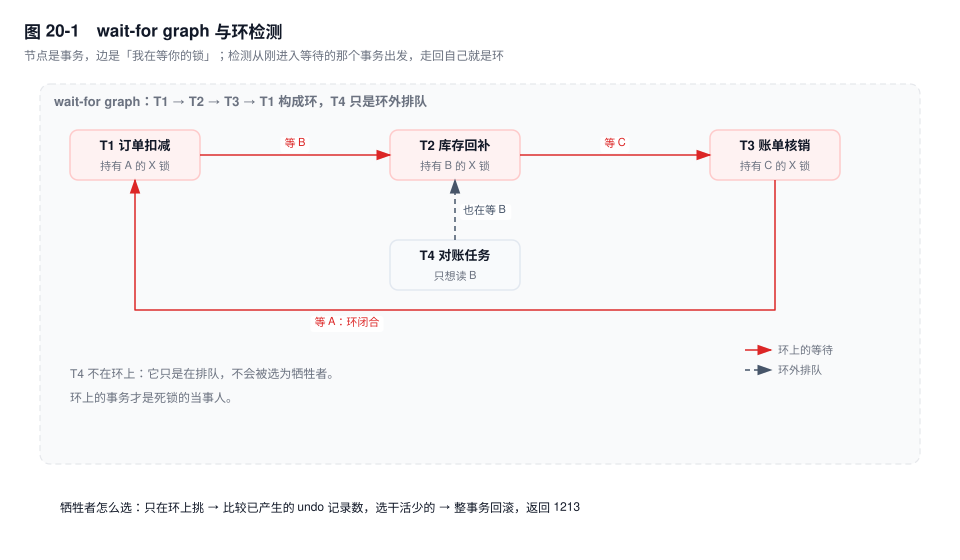
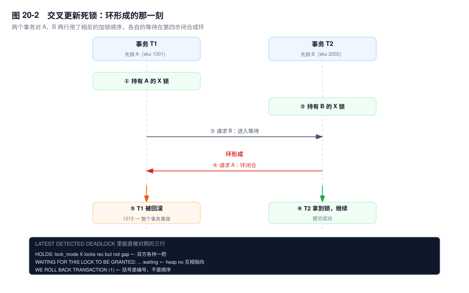
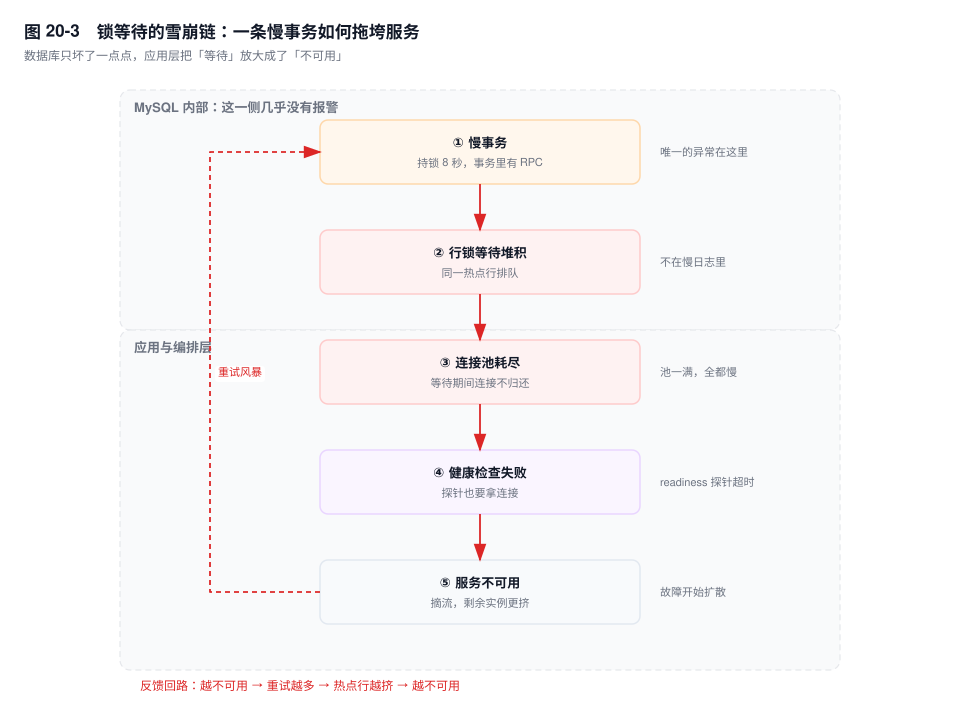

# 第 20 章　死锁与锁等待排查

> **一句话结论**：死锁不是锁坏了，是两段代码对同一批行用了两种加锁顺序；排查的目标不是消灭死锁，而是在五分钟内分清"死锁、锁等待、MDL 排队"这三种不同的东西，然后改掉那个顺序。

## 20.0 场景：监控全绿，下单偶发失败

大促前第三轮压测。看板上 CPU 35%，QPS 曲线平稳，慢查询一条没有，连接数 120/500，主从延迟 0。所有人准备签字。

只有一处对不上：下单接口成功率 99.7%，每分钟几十笔返回"系统繁忙"。

`SHOW ENGINE INNODB STATUS` 的 `LATEST DETECTED DEADLOCK` 段每隔几百毫秒就被覆盖一次——库存服务 8 个实例，合计每秒 3~5 个死锁。段里的内容高度雷同：两条 `UPDATE sku_stock`，各持一把主键上的 `X locks rec but not gap`，各等对方那一把。

监控看不见它，是因为**死锁是快速失败**。检测器发现环，立刻回滚一方，整个过程毫秒级：不产生慢查询（没超过 `long_query_time`），不堆积连接（请求立刻带着 1213 返回），不烧 CPU（DFS 走的是一张几十个节点的图）。它伤害的是业务成功率，不是数据库指标。

锁等待正相反：它慢、它占连接、它把一切指标拖红，但它不产生错误码，直到 50 秒超时。

这条分界线是本章的骨架：**死锁伤业务，锁等待伤数据库，MDL 伤整张表**。加锁规则本身见第 19 章，锁的种类见第 18 章，这一章只讲怎么在凌晨三点把它们认出来。

## 20.1 机制

### 四个必要条件，只有一条是你能拆的

四条在 InnoDB 里各有对应物。逐条映射，才知道哪条该找数据库、哪条该找代码。

| 必要条件 | 在 InnoDB 里的实体 | 能不能消除 |
|---|---|---|
| 互斥 | 行锁的 X/S 模式：两个 X 不能同时存在于同一行 | 写写之间消不掉，只能靠 MVCC 把读写挪出去 |
| 持有并等待 | 锁随语句逐条申请，持有到 `COMMIT`/`ROLLBACK` | 只能缩小窗口，消不掉 |
| 不可剥夺 | 运行中的事务持有的锁不能被抢走 | 数据库不做，唯一的"剥夺"是整事务回滚 |
| 循环等待 | 两个事务对同一批行的加锁顺序相反 | **能，靠应用侧统一顺序** |

**互斥是锁的定义，不是缺陷。** X 锁存在的意义就是不让别人同时改这一行。数据库能做的只有一件事：让读不要走进这个互斥区——快照读不加锁，走 undo 版本链（第 17 章）。所以 MVCC 并没有消除互斥，它只是把互斥的范围从"读写之间"缩到"写写之间"。剩下的这块，谁也消不掉。

**持有并等待是事务语义的直接后果。** `BEGIN` 之后，InnoDB 不可能预知你要改哪些行——它只在语句真正访问到某一行时才加锁。锁一旦加上就持有到事务结束，因为提前释放会破坏可回滚性：undo 里记着"我把这行从 100 改成了 90"，如果锁提前放了，别人改成 80，你回滚时把这行写回 100，别人的修改就被吞了。所以"缩小事务"能缩短窗口，但窗口永远存在。

**不可剥夺是原子性的代价。** 把锁从别人手里抢过来，等于让那个事务已经写下的 undo 失去对应关系。InnoDB 唯一的处理方式是**回滚整个事务**——注意是事务，不是锁。代价极高，所以它只在检测到环时才动手。

**循环等待是唯一一条纯靠代码就能拆掉的。** 所有事务按同一个顺序申请锁（比如永远按 `sku_id` 升序），环在数学上就不可能形成。这是本章唯一"根治"的手段，其余都只是降低概率。

于是结论很收敛：**互斥消不掉，只能绕；持有并等待和不可剥夺只能缩窗口；真正能拆的是环，而环在应用侧。**

### 检测：没有图，只有队列

`wait-for graph` 是个好用的心智模型，但 InnoDB 并没有真的维护一张图。它维护的是锁对象的等待队列，遍历时顺着队列走：

- 每个事务有一个等待中的锁请求，请求指向它想拿的那个锁对象。
- 锁对象上挂着已经持有它的、以及排在它后面等它的那些事务。
- 从"刚进入等待的那个事务"出发，遇到一个等不到的锁，就跳到持有/等待这个锁的下一个事务，继续走；走回起点，就是环。

检测的触发点很明确：**锁请求拿不到、被挂进等待队列的那一刻**，由这个线程自己跑一遍 DFS。所以死锁是即时发现的，不用等超时；环也一定经过刚进来的这个等待者——DFS 只从它出发、只找回到它自己的路。



`innodb_deadlock_detect` 默认 `ON`。它有代价：

- DFS 在 `lock_sys` 的全局闩锁下执行，也就是说，检测期间别的加锁/放锁请求要排队。
- N 个事务等同一行时，第 N 个等待者要遍历约 N 个节点，前 N-1 个各自也遍历过一次。总代价接近 N²。
- 热点行 + 上千并发时，CPU 会耗在 `lock_deadlock_check` 上，表现为"QPS 上不去、CPU 高、但 SQL 执行本身不慢"。这种形态常被误判成"机器不够"。

关掉检测（`SET GLOBAL innodb_deadlock_detect = OFF`，动态生效）能让锁操作变快，代价是环不会自己散，只能等 `innodb_lock_wait_timeout`（默认 50 秒）超时。**50 秒的锁等待比死锁危险得多**：持锁者不放，后面排一队，连接池开始见底。真要关，必须同时做三件事——把 `innodb_lock_wait_timeout` 调到 5~10 秒、应用对 1205 有幂等重试、热点行的并发被限流挡住。少一件，就是把死锁换成了雪崩。

两个错误码必须先分清，因为重试粒度完全不同：

| 错误码 | 含义 | 回滚范围 | 应用该做什么 |
|---|---|---|---|
| `1213` (40001) | `Deadlock found when trying to get lock` | **整个事务** | 从 `BEGIN` 重做，且必须幂等 |
| `1205` (HY000) | `Lock wait timeout exceeded` | 默认只回滚**当前语句** | 重试这一条语句即可 |

第二条的"默认"取决于 `innodb_rollback_on_timeout`，它默认 `OFF`。设成 `ON` 之后，1205 也会回滚整个事务。这一点在重试代码里是硬约束：把 1213 当语句级重试，会拿着一个已经被回滚的事务继续往下跑；把 1205 当事务级重试，会重复执行前面已经成功的语句。

### 死锁日志：把 LATEST 拆成七段

死锁现场只留一份，在 `SHOW ENGINE INNODB STATUS` 里，会被下一次死锁覆盖——压测时"日志里全是死锁"却抓不到完整样本，就是这个原因（解药见「治理」）。

下面是**结构示意**（表名、SQL 取自库存扣减，"..." 表示被我省略的记录字段）：

```text
------------------------
LATEST DETECTED DEADLOCK
------------------------
2026-11-11 03:12:47 0x7f9c8c3ff700
*** (1) TRANSACTION:
TRANSACTION 421588, ACTIVE 0 sec starting index read
mysql tables in use 1, locked 1
LOCK WAIT 4 lock struct(s), heap size 1136, 3 row lock(s), undo log entries 1
MySQL thread id 88421, OS thread handle 140245378301696, query id 9988112 10.12.3.44 app_rw updating
UPDATE sku_stock SET qty = qty - 1 WHERE sku_id = 2002
*** (1) HOLDS THE LOCK(S):
RECORD LOCKS space id 218 page no 5 n bits 72 index PRIMARY of table `shop`.`sku_stock` trx id 421588 lock_mode X locks rec but not gap
Record lock, heap no 4 PHYSICAL RECORD: n_fields 7; compact format; info bits 0
 0: len 8; hex 80000000000003e9; asc         ;;
 ...
*** (1) WAITING FOR THIS LOCK TO BE GRANTED:
RECORD LOCKS space id 218 page no 5 n bits 72 index PRIMARY of table `shop`.`sku_stock` trx id 421588 lock_mode X locks rec but not gap waiting
Record lock, heap no 5 PHYSICAL RECORD: n_fields 7; compact format; info bits 0
 0: len 8; hex 80000000000007d2; asc         ;;
 ...
*** (2) TRANSACTION:
TRANSACTION 421591, ACTIVE 0 sec starting index read
mysql tables in use 1, locked 1
LOCK WAIT 4 lock struct(s), heap size 1136, 3 row lock(s), undo log entries 2
MySQL thread id 88437, OS thread handle 140245361868544, query id 9988130 10.12.3.44 app_rw updating
UPDATE sku_stock SET qty = qty - 1 WHERE sku_id = 1001
*** (2) HOLDS THE LOCK(S):
RECORD LOCKS space id 218 page no 5 n bits 72 index PRIMARY of table `shop`.`sku_stock` trx id 421591 lock_mode X locks rec but not gap
Record lock, heap no 5 PHYSICAL RECORD: n_fields 7; compact format; info bits 0
 ...
*** (2) WAITING FOR THIS LOCK TO BE GRANTED:
RECORD LOCKS space id 218 page no 5 n bits 72 index PRIMARY of table `shop`.`sku_stock` trx id 421591 lock_mode X locks rec but not gap waiting
Record lock, heap no 4 PHYSICAL RECORD: n_fields 7; compact format; info bits 0
 ...
*** WE ROLL BACK TRANSACTION (1)
```

**第一段，时间戳。** `2026-11-11 03:12:47` 是检测时刻，不是事务开始时刻；后面那串是触发检测的线程句柄，跟业务线程对不上，别拿它查应用日志。

**第二段，事务头。** `TRANSACTION 421588` 是事务 id，对应 `information_schema.innodb_trx.trx_id`，这是把日志和会话对起来的唯一钥匙。`ACTIVE 0 sec` 是它已经活了多久——0 秒不代表它没干活，只代表它开得很快。后面的 `starting index read` 是当前状态，常见值还有 `fetching rows`、`updating`。

`LOCK WAIT 4 lock struct(s), heap size 1136, 3 row lock(s), undo log entries 1` 这行信息量最大：

- `4 lock struct(s)` 是锁结构数（一个事务在一个页上的一组锁算一个结构），`3 row lock(s)` 是具体锁住的行数。差得越多，说明它锁得越散。
- `undo log entries 1` 是它已经写了几条 undo 记录，等于"已经改了几行"。**这个数是后面挑牺牲者的依据之一**。

**第三段，线程与语句。** `MySQL thread id 88421` 直接对上 `SHOW PROCESSLIST` 的 `Id`，是回查"哪个实例、哪条连接"的唯一抓手。最后一行的 `UPDATE ...` 是它**当前正在执行**的语句，不是整个事务的第一条——这点最容易看错。

**第四段，HOLDS。** 它现在拿着什么。

- `lock_mode X` 是排他锁，`lock_mode S` 是共享锁。
- `locks rec but not gap` 是记录锁（只锁这一行），`locks gap before rec` 是间隙锁（锁的是记录前面的空隙），没有 `rec but not gap` 也没有 `gap before rec` 的裸 `lock_mode X` 通常是 next-key lock（记录 + 间隙）。
- 结尾带 `waiting` 的，是没拿到的；不带的，是已经拿到的。
- `index PRIMARY` 说明锁加在主键上。如果这里出现的是二级索引名，加锁范围就要按第 19 章的规则重算——同一行数据在主键和二级索引上是两把锁。

**第五段，WAITING FOR。** 它在等什么。日志里的原文是 `WAITING FOR THIS LOCK TO BE GRANTED`，不是很多文章里抄的 `WAITS FOR ...`，按后者去 grep 会一条都搜不到。

把 (1) 的 HOLDS 和 (2) 的 WAITING 对上：`heap no 4` 在 (1) 手里，正是 (2) 在等的；(2) 手里的 `heap no 5`，正是 (1) 在等的。环就在这里，只是对照两个 `heap no`。

**第六段，(2) 的同样三段。** 两边对照，才知谁先动手。

**第七段，`WE ROLL BACK TRANSACTION (1)`。** 括号里的数字指的是上面标着 `(1)` 的那个事务，不是"第一个开始的事务"，也不是"锁最多的那个"。InnoDB 在两个候选之间比较已产生的 undo 记录数，倾向回滚干活少的那个——本例 (1) 是 `undo log entries 1`，(2) 是 `2`，所以回滚 (1)。这是启发式，不是承诺，**不要写出依赖"一定回滚对方"的代码**。

回滚的是整个事务，客户端收到的就是 1213，之前那些成功的语句一起没了。

### 六种高频死锁

六种模式覆盖多数线上样本，每种给条件、SQL、日志特征、解法。

**模式一：交叉更新。** 两个事务按相反顺序改两行。库存服务里最常见——扣减 A 再扣减 B，和扣减 B 再扣减 A。



```sql
-- T1                          -- T2
BEGIN;                         BEGIN;
UPDATE sku_stock SET qty=qty-1 WHERE sku_id=1001;
                               UPDATE sku_stock SET qty=qty-1 WHERE sku_id=2002;
UPDATE sku_stock SET qty=qty-1 WHERE sku_id=2002;   -- 等 T2
                               UPDATE sku_stock SET qty=qty-1 WHERE sku_id=1001;  -- 1213
```

日志特征：两边 HOLDS 都是 `lock_mode X locks rec but not gap`，索引都是 `PRIMARY`，`heap no` 互相指向。解法：按主键排序后再逐条更新；或者把两条合并成一条 `UPDATE ... WHERE sku_id IN (1001, 2002)`——单条语句内部按索引顺序加锁，顺序天然一致。

**模式二：间隙锁互斥。** 两个事务先锁同一段范围，再往这段范围里插不同的值。间隙锁之间是兼容的，所以第一步都不阻塞；第二步各自申请插入意向锁，与对方的间隙锁冲突，环成立。

```sql
-- 前提：sku_id 100 和 200 已存在，RR 隔离级别
-- T1、T2 各自执行
BEGIN;
SELECT * FROM sku_stock WHERE sku_id BETWEEN 100 AND 200 FOR UPDATE;  -- 都拿到 (100,200) 的间隙锁
-- T1
INSERT INTO sku_stock VALUES (150, 10);   -- 插入意向锁，等 T2 的间隙锁
-- T2
INSERT INTO sku_stock VALUES (160, 10);   -- 1213
```

日志特征：HOLDS 里是 `lock_mode X locks gap before rec`，WAITING 里是 `lock_mode X insert intention waiting`。看到 `insert intention` 加 `gap before rec` 这一对，基本可以判定是这一类。解法：降到 RC（普通扫描不再加间隙锁）、或先插入再范围查询、或把"范围锁 + 插入"改成按主键的单行操作。

**模式三：唯一键冲突引发的锁升级。** `INSERT ... ON DUPLICATE KEY UPDATE` 撞到唯一键时，先对冲突记录加 S 锁做重复性检查，再升级为 X 去改。两个事务同时走这条路，就各持一把 S、各要一把 X。

```sql
-- T1、T2 同时执行（biz_no 上有唯一索引）
INSERT INTO coupon_ledger (biz_no, amount) VALUES ('A20261111001', 100)
ON DUPLICATE KEY UPDATE amount = amount + 100;
```

日志特征：两边 HOLDS 都是 `lock_mode S locks rec but not gap`，WAITING 都是 `lock_mode X locks rec but not gap waiting`。S 与 S 兼容，X 与 S 互斥——环是锁升级造出来的，不是加锁顺序。解法：先 `UPDATE`（直接拿 X，没有升级过程），影响行数为 0 再 `INSERT` 并捕获 1062 重试；或者让同一唯一键的写入串行化（同一个分片键、同一把分布式锁）。

**模式四：`INSERT ... SELECT` 的加锁范围。** RR 下，`INSERT ... SELECT` 为了保证 statement 格式 binlog 可重放，会对**源表**的扫描行加 S next-key 锁。两个方向相反的语句就成环。

```sql
-- T1：从订单表汇总到账单表
INSERT INTO bill_detail (bill_id, sku_id, qty)
SELECT id, sku_id, qty FROM order_item WHERE order_id = 9001;
-- T2：反向的两张表操作
INSERT INTO order_item (...) SELECT ... FROM bill_detail WHERE bill_id = 9002;
```

日志特征：HOLDS 里出现 `lock_mode S`，且 `table` 是 SELECT 的来源表而不是插入目标表——这是最容易看反的一处。解法：`binlog_format=ROW` 且隔离级别为 RC 时，源表走一致性读、不加锁，这一类直接消失；或者拆成"先 SELECT 到应用，再分批 INSERT"，并保证批内顺序固定。

**模式五：DDL 与事务。** 严格说这不是死锁，但它长得像，而且破坏力大一个数量级。

一个长事务持有某行的锁，`ALTER TABLE` 需要 MDL 排他锁，于是排队；MDL 队列是公平的，DDL 后面的所有查询（包括普通 `SELECT` 需要的 MDL 共享锁）全部排在 DDL 后面。结果是一张表上的所有语句一起卡住，`SHOW PROCESSLIST` 里一片 `Waiting for table metadata lock`。

区分三个特征：

- `LATEST DETECTED DEADLOCK` 里什么都没有——MDL 等待没有行锁的环。
- 影响面是整张表，不是某几行。
- 错误码可能同样是 1205（`lock_wait_timeout` 管 MDL，默认 31536000 秒，等于一年），所以**不能靠错误码区分**，要看 `performance_schema.metadata_locks` 和 processlist 的状态字符串。

处置见第 46 章。这里只记一条：看到 `Waiting for table metadata lock`，先找 `GRANTED` 状态里活得最久的那个事务，别去 KILL 排队的 DDL——杀了它，队列会重新排一遍，问题原样复现。

**模式六：批量更新顺序不一致。** 定时任务和对账任务各更新同一批账单，一个按主键分批，一个按 `create_time` 分批，同一个事务里第二次访问同一批行的顺序就变了。

```sql
-- worker1：按主键区间推进
UPDATE bill SET status = 2 WHERE bill_id BETWEEN 9001 AND 9100;
-- worker2：按创建时间推进（走 idx_created）
UPDATE bill SET status = 2 WHERE created_at >= '2026-11-11 00:00:00' AND created_at < '2026-11-11 01:00:00';
```

日志特征：HOLDS 的 `index` 一个是 `PRIMARY`、一个是 `idx_created`，两条 UPDATE 的 WHERE 条件完全不同，但命中的是同一批行。**注意，这不是 `IN` 列表字面顺序的问题**——单条语句内部按访问路径的索引顺序加锁，字面顺序不影响。真正的不一致来自"两条语句走了不同索引"，或者"分批边界不同"。

解法：批任务统一按主键分批（`WHERE id > ? ORDER BY id LIMIT 500`），并保证同一批数据只有一个 worker 在处理。

### 锁等待：没有环，只有一条链

不是所有等待都会成环。一个事务持锁不放、另一个干等，等到 50 秒，`1205 Lock wait timeout exceeded`。这种情况比死锁常见得多，也危险得多。

`innodb_lock_wait_timeout` 默认 50 秒（会话级可调）。它的取值要大于正常事务的持锁时间、小于应用的整体超时。麻烦在于多数应用的整体超时是 3~10 秒——**数据库还在等，应用早就放弃了**，连接却不归还。

一条 SQL 看单跳阻塞，用 `sys.innodb_lock_waits`：

```sql
SELECT waiting_pid,
       waiting_age,
       waiting_query,
       blocking_pid,
       blocking_query,
       blocking_age,
       locked_table,
       locked_index,
       waiting_lock_mode,
       blocking_lock_mode
FROM sys.innodb_lock_waits
ORDER BY waiting_age DESC;
```

这个视图只给一跳，三层等待时给三行，看不出链尾在哪。

完整的阻塞链，8.0 用 `performance_schema.data_lock_waits` 递归出来：

```sql
SET @waiter := 0;   -- 填 data_lock_waits 里的 REQUESTING_ENGINE_TRANSACTION_ID

WITH RECURSIVE chain AS (
  SELECT dlw.REQUESTING_ENGINE_TRANSACTION_ID AS waiter,
         dlw.BLOCKING_ENGINE_TRANSACTION_ID   AS blocker,
         1                                    AS hop
  FROM performance_schema.data_lock_waits AS dlw
  WHERE dlw.REQUESTING_ENGINE_TRANSACTION_ID = @waiter
  UNION ALL
  SELECT c.blocker, dlw.BLOCKING_ENGINE_TRANSACTION_ID, c.hop + 1
  FROM chain AS c
  JOIN performance_schema.data_lock_waits AS dlw
    ON dlw.REQUESTING_ENGINE_TRANSACTION_ID = c.blocker
  WHERE c.hop < 20
)
SELECT c.hop,
       c.waiter,
       r.trx_state                                  AS waiter_state,
       LEFT(r.trx_query, 60)                        AS waiter_sql,
       c.blocker,
       LEFT(b.trx_query, 60)                        AS blocker_sql,
       b.trx_state                                  AS blocker_state,
       TIMESTAMPDIFF(SECOND, b.trx_started, NOW())  AS blocker_age_sec,
       b.trx_rows_locked                            AS blocker_rows_locked,
       b.trx_rows_modified                          AS blocker_rows_modified
FROM chain AS c
LEFT JOIN information_schema.innodb_trx AS r ON r.trx_id = c.waiter
LEFT JOIN information_schema.innodb_trx AS b ON b.trx_id = c.blocker
ORDER BY c.hop;
```

读结果只有一条规矩：**看链尾，不看链头**。`hop` 最大的那一行，`blocker` 就是根；根的 `blocker_age_sec` 是它持锁的时长。如果根的 `blocker_sql` 是 `NULL`，不代表它没干活——它多半是执行完语句、事务没提交，正卡在应用侧的某次 RPC 上（第 16 章那个案例）。**这种"空闲但持锁"的事务，比正在跑的慢 SQL 更难查**，因为它不出现在慢日志里。

版本差异必须记清楚：

| 版本 | 锁信息在哪 | 说明 |
|---|---|---|
| `[5.7]` | `information_schema.innodb_locks` + `innodb_lock_waits` | 三表 join（再连 `innodb_trx`） |
| `[8.0]` | `performance_schema.data_locks` + `data_lock_waits` | 上面两个视图已移除，查询会报 1109 |

`[5.7]` 用 `innodb_lock_waits` 连两次 `innodb_trx`，一次按 `requesting_trx_id`、一次按 `blocking_trx_id`。8.0 的列名全大写、带 `ENGINE_` 前缀，别照抄 5.7 的写法。

### 雪崩：数据库坏了 1%，服务坏了 100%

一条链路，五个环节，每个环节都在放大上一个环节的后果。



起点是一个持有行锁 8 秒的事务（事务里塞了 RPC，第 16 章）。同样的热点行，每秒几百个请求。

第一跳，锁等待堆积。等锁的请求不消耗 CPU、不产生 IO，只是站着——所以数据库指标看着还挺健康，只有 `Innodb_row_lock_current_waits` 在涨。

第二跳，连接池见底。这一跳是整条链的拐点，也是最容易被忽略的一跳：**请求在等锁期间一直占着数据库连接**。粗算一下：池子 200 个连接，正常每请求占 20ms，理论上限是一万 QPS。当 1% 的请求卡在锁上 5 秒，平均占用时间变成 `20ms + 1% × 5000ms = 70ms`，吞吐直接掉到三分之一。**只有 1% 的请求变慢，整体吞吐掉 65%**——这就是 Little's law 在连接池上的表现，也是"为什么没人觉得慢，服务却顶不住了"的答案。

第三跳，健康检查失败。探针打 `/health`，里面一句 `SELECT 1`，看着很轻，但它走同一个连接池；池满时它也得排队，超时 3 次，K8s 判定不健康，摘流。

第四跳，服务不可用，而且是**加速恶化**的那种不可用。摘掉一个实例，剩余实例分担的流量变多，热点行上的并发更高，锁等待更久，池子更快见底——反馈回路闭合了。

还有一条隐藏的加速器：应用层重试。一个失败请求重试 3 次，就是把一个事务放大成 3 个，且都打在同一行上。超时越久，重试越多，队列越长。

所以扩容在这个阶段经常没用，甚至有害：新实例没有预热，缓存全空，请求照样落到同一个热点行上，只是排队的人更多了。

### 治理：五个动作，按性价比排序

**第一，固定加锁顺序。** 唯一能根治的手段。所有涉及多行的写操作，先按主键排序再执行；跨服务的多行操作，按"类型 + id"的全局顺序。代码里通常是一行 `ids.sort()`，收益是这一整类死锁归零。

**第二，缩小事务。** 事务里只留数据库操作，RPC、HTTP、消息发送全部挪到事务外。这一条同时治锁等待和雪崩：持锁时间从"秒"回到"毫秒"，排队长度按比例下降。

**第三，降到 RC。** 收益很具体：普通扫描不再加间隙锁，模式二那一类直接消失；`INSERT ... SELECT` 在 `binlog_format=ROW` 下对源表走一致性读，模式四也消失；`UPDATE` 在 RC 下有 semi-consistent read，不匹配的行提前放锁。代价同样具体：同一事务内两次读可能看到不同结果，依赖 RR 的"先读后判再写"逻辑会失效；`binlog_format` 必须是 `ROW`，否则主从不一致；唯一性检查和外键检查仍然会加间隙锁，所以不是"RC 就没有间隙锁"。

**第四，拆分热点行。** 一个 `sku_id` 拆成 N 个桶（`bucket = CRC32(order_no) % N`），每次只更新一个桶，锁冲突降到 1/N。代价是读总库存要 `SUM`，还要处理单桶不足（借桶、预扣）。只在真正的秒杀热点上做。

**第五，把死锁采下来。** `innodb_print_all_deadlocks` 默认 `OFF`，此时只有最近一次死锁留在 `SHOW ENGINE INNODB STATUS` 里，压测时每秒 5 次死锁，你连一次完整样本都抓不到。打开它（动态参数），每一次死锁都会写进 error log：

```sql
SET GLOBAL innodb_print_all_deadlocks = ON;
```

再用 `pt-deadlock-logger` 或日志采集落到表里，按"表名 + 索引名 + 锁模式"聚合，看哪一类占多数。应用侧同步统计 1213 的 QPS——这个数字比数据库任何指标都更早反映问题，因为死锁在监控上是隐形的。

## 20.2 关键结论

1. **四个必要条件里，只有循环等待能靠应用侧打破。** 互斥是锁的定义，消不掉；持有并等待、不可剥夺只能缩窗口。所以"治理死锁"翻译过来就是"统一加锁顺序 + 缩小事务"。
2. **1213 回滚整个事务，1205 默认只回滚当前语句。** 重试粒度搞反，轻则无效重试，重则重复扣款。
3. **死锁是快速失败，所以监控大盘看不见它。** 它不产生慢查询、不堆连接、不烧 CPU，只拉低成功率。必须靠 error log + 应用侧 1213 计数来观测。
4. **`WE ROLL BACK TRANSACTION (1)` 的 `(1)` 是日志里的编号，不是执行顺序。** 牺牲者按回滚代价（undo 记录数）启发式挑选，代码不能依赖它选谁。
5. **一个 8 秒的慢事务比一百个死锁更致命。** 死锁毫秒级自愈；慢事务把连接池抽干，再经由健康检查把局部故障放大成整体不可用。

## 20.3 实验验证

### 实验一：手工造一个交叉更新死锁，对照日志

```sql
CREATE TABLE sku_stock (
  sku_id BIGINT PRIMARY KEY,
  qty    INT NOT NULL
) ENGINE=InnoDB;

INSERT INTO sku_stock VALUES (1001, 100), (2002, 100);
```

两个会话按下面的顺序执行（会话 A 与 B 的第三条语句谁先发都行）：

```sql
-- A                            -- B
BEGIN;                          BEGIN;
UPDATE sku_stock SET qty=qty-1 WHERE sku_id=1001;
                                UPDATE sku_stock SET qty=qty-1 WHERE sku_id=2002;
UPDATE sku_stock SET qty=qty-1 WHERE sku_id=2002;
                                UPDATE sku_stock SET qty=qty-1 WHERE sku_id=1001;
```

预期形态：后发第三条语句的那个会话**立即**（毫秒级，不是 50 秒）返回 `ERROR 1213 (40001)`。紧接着在第三个会话执行：

```sql
SHOW ENGINE INNODB STATUS\G
```

在 `LATEST DETECTED DEADLOCK` 段里核对四件事：两边 HOLDS 的 `heap no` 是否互相出现在对方的 WAITING 里；`index` 是否都是 `PRIMARY`；`lock_mode` 是否都是 `X locks rec but not gap`；末尾回滚的是哪一个编号。**回滚编号取决于两边的 `undo log entries`，不是固定答案。**

### 实验二：间隙锁死锁，注意第一步不阻塞

```sql
-- 会话隔离级别确认为 RR（默认）
SELECT @@transaction_isolation;

-- A
BEGIN;
SELECT * FROM sku_stock WHERE sku_id BETWEEN 100 AND 200 FOR UPDATE;
-- B
BEGIN;
SELECT * FROM sku_stock WHERE sku_id BETWEEN 100 AND 200 FOR UPDATE;   -- 不阻塞
-- A
INSERT INTO sku_stock VALUES (150, 10);    -- 阻塞在这里
-- B
INSERT INTO sku_stock VALUES (160, 10);    -- 1213
```

预期形态：第二个 `SELECT ... FOR UPDATE` 直接返回（间隙锁互相兼容，这是最容易误判的一步——"它没阻塞，说明没锁住"，错的）；两条 INSERT 里后发的那个收到 1213。日志里 HOLDS 出现 `lock_mode X locks gap before rec`、WAITING 出现 `lock_mode X insert intention waiting`。

把隔离级别切到 RC 再跑一遍（`SET SESSION transaction_isolation = 'READ-COMMITTED'`），两条 INSERT 都不再互相阻塞——间隙锁没了，这一类死锁消失。

### 实验三：三层阻塞链，一条 SQL 打出全链

```sql
-- S1                            -- S2                              -- S3
BEGIN;                           BEGIN;                             BEGIN;
UPDATE bill SET status=2 WHERE bill_id=9001;
                                 UPDATE bill SET status=2 WHERE bill_id=9002;
                                 UPDATE bill SET status=2 WHERE bill_id=9001;  -- 等 S1
                                                                    UPDATE bill SET status=2 WHERE bill_id=9003;
                                                                    UPDATE bill SET status=2 WHERE bill_id=9002;  -- 等 S2
```

在第四个会话里取到 S3 的 `REQUESTING_ENGINE_TRANSACTION_ID`，填进上面递归查询的 `@waiter`。

预期形态（三行，`hop` 递增）：

```text
hop  waiter   blocker  blocker_state  blocker_age_sec
1    4217xx   4217yy   RUNNING        12
2    4217yy   4217zz   RUNNING        12
```

`hop = 2` 那一行的 `blocker` 就是根。此时去看它的 `blocker_sql`，很可能是 `NULL`——S1 执行完 UPDATE 之后没有再发语句，事务也没提交。**这个"什么都没干"的事务，就是整条链的根。**

## 20.4 常见误区

⚠️ **"死锁是 MySQL 的 bug，升级版本就好了"**
环是应用造出来的：两条代码路径对同一批行用了相反的加锁顺序，换哪个版本都会成环。版本升级能改的是检测算法和检测开销，改不了加锁顺序。

⚠️ **"降到 RC 就不会死锁了"**
RC 消掉的是**间隙锁相关**的那几类（模式二、模式四），交叉更新（模式一）、唯一键锁升级（模式三）、批量顺序不一致（模式六）在 RC 下照样发生——它们的成因是记录锁的申请顺序，跟间隙无关。

⚠️ **"`WE ROLL BACK TRANSACTION (2)` 说明事务 (2) 是后开始的"**
括号里是日志里的编号，与时间无关。判据是 `undo log entries`，谁干活少回滚谁，而且这是启发式。

⚠️ **"收到 1213 重试一下这条 SQL 就行"**
1213 回滚的是整个事务。只重试最后一条语句，前面已经成功的扣减、插入全部丢失，数据就错了。必须整事务重做，并且重做要幂等。

⚠️ **"MDL 等待也是死锁，一起按死锁处理"**
MDL 等待没有环，是一条队列：DDL 等 MDL 排他锁，后面的查询再排 DDL 后面。`LATEST DETECTED DEADLOCK` 里是空的。按死锁处置（杀等待者）无效，还会让队列重排、故障时间翻倍。

⚠️ **"死锁检测开着最安全，检测又不要钱"**
检测在全局 `lock_sys` 闩锁下做 DFS，N 个等待者的总代价接近 N²。热点行上千并发时，它会变成 CPU 的主要消耗者，表现为"CPU 高但 SQL 不慢"。这个开关该按负载调，不是一个"越安全越好"的选项。

## 20.5 生产 Checklist

按顺序过，前三步决定后面的动作：

- [ ] 先分类：`1213`（死锁）/ `1205`（锁等待）/ `Waiting for table metadata lock`（MDL）。三者处置完全不同，别混
- [ ] 1213：抓 `LATEST DETECTED DEADLOCK`，记下两边的 `index`、`lock_mode`、`heap no`，判断属于六种模式里的哪一种
- [ ] 1205：跑递归阻塞链，先看 `hop` 最大那行的 `blocker_age_sec`，再看它的 `trx_state`（`RUNNING` 还是在等应用）
- [ ] MDL：查 `performance_schema.metadata_locks`，找 `GRANTED` 状态里最老的那个事务，不要 KILL 排队的 DDL
- [ ] 确认 `transaction_isolation` 与 `binlog_format`：是不是 RC + ROW，决定了模式二、四是否可能存在
- [ ] 批量/定时任务：是否按不同索引分批处理同一批行，是否有多个 worker
- [ ] `innodb_print_all_deadlocks` 是否 `ON`，error log 是否有采集，应用侧是否统计了 1213 的 QPS
- [ ] 超时链条：`innodb_lock_wait_timeout` 要小于应用请求超时（数据库先返回 1205，连接正常归还）；健康检查用独立小池，别和业务抢
- [ ] 事务里是否有 RPC / HTTP / 消息发送（有则必拆）
- [ ] 应用侧重试：1213 整事务重试且幂等，1205 只重试语句，重试次数有上限

## 20.6 延伸

- **前置章节**：第 18 章（锁的分类与 MDL）、第 19 章（加锁范围怎么算，本章所有"为什么锁到这一行"都要回到那里）。
- **关联章节**：第 16 章（事务边界与锁持有时间）、第 17 章（RC 与 RR 的可见性差异，决定你敢不敢降级）、第 21 章（长事务的发现与处置）、第 46 章（MDL 与在线 DDL）、第 52 章（应急 SOP）。
- **面试追问**：
  - "死锁的四个必要条件，哪一条是数据库不能消除的？" → 互斥；能拆的是循环等待，靠统一加锁顺序。
  - "`innodb_deadlock_detect` 关掉会怎样？" → 环不会自己散，只能等 `innodb_lock_wait_timeout`（默认 50 秒），必须同时调小超时并加重试。
  - "1213 和 1205 有什么区别？" → 前者整事务回滚，后者默认只回滚语句；重试粒度不同。
  - "死锁日志里 `WE ROLL BACK TRANSACTION (1)` 的 1 是什么意思？" → 日志里的编号，牺牲者按 undo 记录数启发式挑选。
- **官方文档**：`InnoDB Locking and Transaction Model` → `Deadlocks in InnoDB`；`Performance Schema Lock Tables`（`data_locks` / `data_lock_waits`）；`innodb_print_all_deadlocks`、`innodb_deadlock_detect`、`innodb_lock_wait_timeout` 三个系统变量条目。
