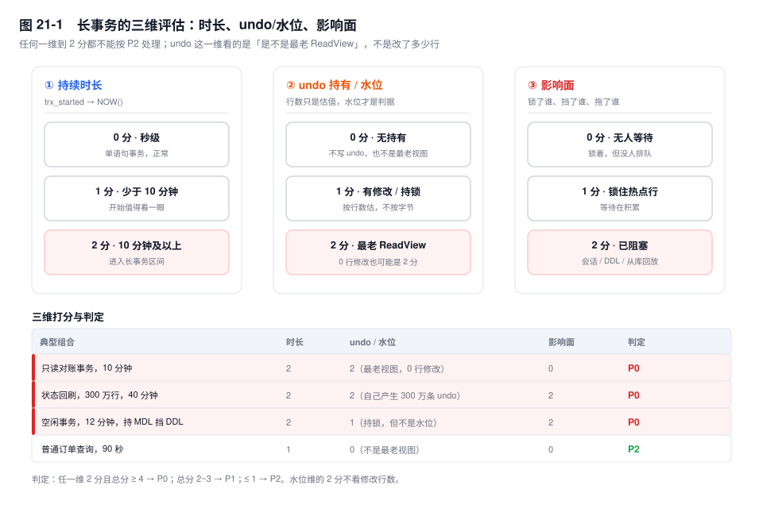
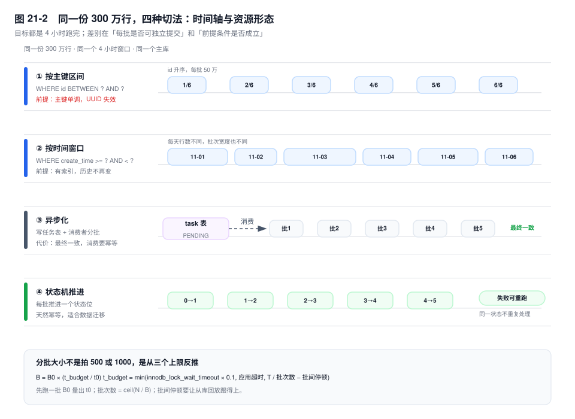

# 第 21 章　长事务与大事务治理

> **一句话结论**：长事务不是"跑得久的 SQL"，而是"还没放手的资源"；判断它危不危险，看它钉住了哪个水位、锁住了谁、挡住了哪条 DDL，而不是只看它跑了多少秒。

## 21.0 场景：一个 40 分钟的对账事务，三种故障

凌晨 1:00，对账服务启动。为了"保证一致"，它把 300 万行账单的状态回刷包在一个事务里：逐条比对、逐条改 `bill.recon_status`，最后一次性 `COMMIT`，全程 40 分钟。

1:00 到 1:40，监控很安静：主库（source）QPS 平稳，从库（replica）延迟 0——事务没提交，binlog 里一条记录都没有。

1:40，事务提交，三个症状同时出现：300 万个行锁在同一刻释放，同时 40 分钟的 binlog 要整块落盘、发给每个从库，主库写入抖动；从库延迟从 0 跳到 2400 秒，因为那 300 万行是一整块，回放线程只能一段一段啃；2:00，从库上的备份失败——`mysqldump --single-transaction` 开头的 `FLUSH TABLES WITH READ LOCK` 要等复制线程执行完那个大事务，等不到就超时。

运维的第一反应是"加从库"。新从库同样要回放这块 binlog，延迟一样跳。**三个症状，一个根因：一个事务。**

机制见第 5、18、20 章：undo 与 purge 水位、MDL、锁等待雪崩。这一章只回答：怎么发现、怎么量化、怎么拆、怎么收尾。

## 21.1 三维定义：时长只是其中一维

`SHOW PROCESSLIST` 里 `Time` 大的不一定是长事务，`innodb_trx` 里 `trx_started` 早的也不一定最危险。只按执行时长切，会漏掉两类：**空闲但持锁**、**0 行修改但钉住水位**。

| 维度 | 看什么 | 回答什么 | 典型误判 |
|---|---|---|---|
| 持续时长 | `TIMESTAMPDIFF(SECOND, trx_started, NOW())` | 占了多久 | 把"SQL 执行时间"当成"事务时间" |
| undo 持有 | `trx_rows_modified`、是否最老 ReadView、history list 增速 | 多少 undo 不能回收 | 以为 0 行修改就无害 |
| 影响面 | `trx_rows_locked`、`data_lock_waits`、`metadata_locks` | 锁了谁、挡了哪条 DDL | 不看排队的人 |

**第二维必须拆成两件事。** `trx_rows_modified` 是行数估值，不是 undo 字节数：一行带 2KB `remark` 的更新，undo 是整型更新的几百倍。更关键的是它**是不是最老 ReadView**：purge 水位由所有活跃视图里最老的 `up_limit_id` 决定，一个 0 行修改的只读事务占住这个位置，全库 update undo 就得原地罚站。**它的修改行数是 0，undo 这一维却是满分。**

| 分数 | 时长 | undo / 水位 | 影响面 |
|---|---|---|---|
| 0 | 小于 1 分钟 | 不写 undo，也不是最老视图 | 锁着但无人等待 |
| 1 | 少于 10 分钟 | 有修改或持锁，但不是水位 | 锁住热点行，等待在积累 |
| 2 | 10 分钟及以上 | 是最老 ReadView，或修改行数超过 10 万 | 已阻塞会话 / DDL / 从库回放 |

判定：任一维 2 分且总分不低于 4 → **P0**；总分 2~3 → P1；不高于 1 → P2。水位维的 2 分不看修改行数。



反直觉的那一格：**时长 10 分钟 + 修改 0 行 + 无人等待 = P0**。它是唯一的最老视图，history list 单调涨。按 `trx_rows_modified DESC` 排序的巡检抓不到它。

## 21.2 发现手段：四条路，各答一半问题

`information_schema.innodb_trx` 的八个原列，加上一个算出来的年龄：

```sql
SELECT trx_id, trx_state, trx_started,
       TIMESTAMPDIFF(SECOND, trx_started, NOW()) AS trx_age,
       trx_mysql_thread_id, trx_rows_locked, trx_rows_modified,
       trx_is_read_only, trx_autocommit_non_locking
FROM information_schema.innodb_trx
ORDER BY trx_started
LIMIT 20;
```

| 列 | 能回答 | 不能回答 |
|---|---|---|
| `trx_id` | 事务身份；`[8.0]` 只读事务为 0 | 它是不是最老视图 |
| `trx_state` | `RUNNING` / `LOCK WAIT` / `ROLLING BACK` / `COMMITTING` | 它卡在哪一句 |
| `trx_started` | 引擎侧事务对象的建立时间 | 它之前执行过什么 |
| `trx_mysql_thread_id` | 对上 `SHOW PROCESSLIST.Id` | 连接属于哪个应用实例 |
| `trx_rows_locked` | 锁了多少行（估值） | 锁的是哪几行、什么模式 |
| `trx_rows_modified` | 改了多少行（估值） | undo 占了多少字节 |
| `trx_is_read_only` | 是否显式 `READ ONLY` 事务 | 它有没有写过 |
| `trx_autocommit_non_locking` | `[8.0]` 单语句、autocommit、非锁定读 | 长查询是否仍在钉水位 |

三个高频误读。`trx_started` 不是 `BEGIN` 时间：10:00 `BEGIN`、10:30 才发第一条 SQL，事务年龄是 0。`trx_rows_modified = 0` 不是"没干活"：只读事务全是 0，却可能持有两小时的 ReadView。`trx_is_read_only` 也不能判断"有没有写"——autocommit 的 `SELECT` 这一列也是 0。

`trx_autocommit_non_locking` 单独说。`[8.0]` 对"单语句 + autocommit + 非锁定读"做了优化：不分配 `trx_id`，不进读写事务链表，一闪而过的行不该进长事务告警。但**别读成"不卡 purge"**：它仍持有语句级 ReadView，一条跑两小时的 `SELECT` 照样是最老视图。它能排除毫秒级短语句，不能排除长查询。

`sys.innodb_trx` 是直通视图，没有现成的 `trx_age`；`sys.session` 把事务状态和连接信息拼在一行，能回答"谁、什么状态"，不能回答"是不是最老视图"。

定位"卡在哪一句"要靠 `performance_schema`：

```sql
SELECT t.PROCESSLIST_ID, t.PROCESSLIST_TIME,
       e.TRX_ID, e.STATE AS trx_lifecycle, e.ISOLATION_LEVEL, e.ACCESS_MODE,
       s.SQL_TEXT, s.TIMER_WAIT / 1e12 AS stmt_sec, s.ROWS_EXAMINED
FROM performance_schema.events_transactions_current AS e
JOIN performance_schema.threads AS t ON t.THREAD_ID = e.THREAD_ID
LEFT JOIN performance_schema.events_statements_current AS s
       ON s.THREAD_ID = e.THREAD_ID
WHERE e.STATE = 'ACTIVE'
ORDER BY t.PROCESSLIST_TIME DESC;
```

`events_transactions_current` 给 `TRX_ID`、隔离级别，`events_statements_current` 给当前语句和 `TIMER_WAIT`；事务空闲时后者为空，翻 `events_statements_history` 能看到它最后几条语句——**这是唯一能看到"事务里之前跑过什么"的口子**。

`SHOW ENGINE INNODB STATUS` 的 `TRANSACTIONS` 段只为一句：每个持有 ReadView 的事务都有一行 `Trx read view will not see trx with id >= N, sees < N`，这个 N 就是它的 `up_limit_id`。所有活跃 ReadView 里 **N 最小的那个就是 purge 水位**。段首的 `History list length` 是积压条数，`Purge done for trx's n:o` 是清理进度，一个涨一个不动就是水位被钉死；它不给精确锁清单，锁清单在 `data_locks`。

审计只在事后归因时开：`general_log` 全量写语句，QPS 一高就是 IO 灾难；`audit_log` 可按事件过滤，开销与事件量成正比。回答"谁在何时发了哪条语句"，不管"为什么慢"。

## 21.3 五类危害：每一类都有可算的指标

| 危害 | 量化指标 | 机制 |
|---|---|---|
| undo 膨胀 | undo 表空间 `ALLOCATED_SIZE` 的斜率；`Innodb_history_list_length` 的斜率 | 水位不动，update undo 只进不出 |
| purge 阻塞 | `History list length` 与 `Purge done for trx's n:o` 的差值 | purge 只能清到最老视图之前 |
| MDL 挡 DDL | `metadata_locks` 里 `GRANTED` 且 `PROCESSLIST_TIME` 最大的那个 | 事务持有 MDL 读锁到提交，DDL 的排它锁排队 |
| 复制延迟 | `Seconds_Behind_Source` `[8.0.23+]`、`Exec_Source_Log_Pos` `[8.0.26+]` | binlog 以事务为单位，大事务在从库不可切分 |
| 备份失败 | 备份耗时、redo 拷贝速率、`FTWRL` 等待时长 | 逻辑备份自己变成最老视图；物理备份追不上 redo |

**undo 的增速可以算。** 采样两次 `SELECT SUM(ALLOCATED_SIZE)/1024/1024 FROM information_schema.INNODB_TABLESPACES WHERE SPACE_TYPE='Undo';`，差值除以间隔秒就是字节增速；条数增速用 `Innodb_history_list_length` 两次采样之差。`INNODB_METRICS` 的 `trx_rseg_history_len` 是同一个数；若 `STATUS` 是 `disabled`，先 `SET GLOBAL innodb_monitor_enable='trx_rseg_history_len'`。

**purge 阻塞是加法。** 水位钉住 T 秒、写入 R 行/秒，积压约 `R × T` 条。5000 行/秒被钉 40 分钟就是一千多万条；purge 恢复后按每秒几千条追，要几十分钟到几小时。

**MDL 要提前查。** 今晚要 `ALTER TABLE bill`，下午先跑：

```sql
SELECT ml.OBJECT_NAME, ml.LOCK_TYPE, ml.LOCK_STATUS,
       t.PROCESSLIST_ID, t.PROCESSLIST_TIME, t.PROCESSLIST_INFO
FROM performance_schema.metadata_locks AS ml
JOIN performance_schema.threads AS t ON t.THREAD_ID = ml.OWNER_THREAD_ID
WHERE ml.OBJECT_SCHEMA = 'shop' AND ml.OBJECT_NAME = 'bill'
  AND ml.LOCK_STATUS = 'GRANTED'
ORDER BY t.PROCESSLIST_TIME DESC;
```

`PROCESSLIST_TIME` 最大且 `PROCESSLIST_INFO` 为空的行，就是今晚 DDL 的炸弹：它空闲、事务没提交，MDL 锁还攥着。别用"先试一下 DDL"探测——MDL 队列公平，试的那一秒里，整张表的新查询都排在 DDL 后。

**复制延迟是断崖。** 主库跑 40 分钟，binlog 里 0 条，从库延迟是 0；提交那一刻，整个事务作为一块写进 binlog，从库的 SQL 线程（或 MTS 的某一个 worker）必须从头执行到尾，位点才推进。延迟读数从 0 跳到 2400 秒，`Exec_Source_Log_Pos` 在事务结束前不前进。跳变的不是数据量，是"这个事务能不能被切"。

**备份有两种卡法。** `mysqldump --single-transaction` 开头拿 `FLUSH TABLES WITH READ LOCK`，要等所有活跃事务结束；随后 `START TRANSACTION WITH CONSISTENT SNAPSHOT` 的 ReadView 活到 dump 结束，**备份自己变成最老视图**，dump 越久，undo 越涨。XtraBackup 是物理拷贝：开头也要短暂的全局锁，风险在拷贝阶段——它要持续记录 redo，写入速率高到 redo 被覆盖，备份就以日志链断裂告终。

## 21.4 拆分四模式：切法不同，前提不同

| 模式 | 切法 | 适用前提 | 反例 |
|---|---|---|---|
| 主键区间 | `WHERE id BETWEEN ? AND ?` | 主键单调，区间可枚举 | UUID/随机主键：区间稀疏，批次代价差几个数量级 |
| 时间窗口 | `WHERE create_time >= ? AND < ?` | 时间列有索引，历史不再变 | 用 `update_time` 切：行会跨窗口移动，漏处理或重复 |
| 异步化 | 写任务表，消费者分批取 | 允许最终一致，消费端幂等 | 结账要强一致，任务表自己成热点 |
| 状态机 | 每批推进一个状态位 | 状态单调，状态位与改动同事务 | 状态会被在线业务回退，中间态可见 |



**分批大小怎么定。** 不是拍 500 或 1000，是反推：

```text
批次数 = ceil(N / B)
t_budget = min(innodb_lock_wait_timeout × 0.1, 应用请求超时, T / 批次数 − 批间停顿)
B = B0 × (t_budget / t0)
```

先跑一批 `B0` 量出 `t0`；`t_budget` 是单批允许占用的时间。锁等待上限保护被这批行挡住的在线事务，不是让你真等 50 秒；应用超时保护连接池；`T / 批次数` 保证总窗口。批间停顿给从库回放：**每批的 binlog 在从库要执行 `t_apply`，而主库每 `t_batch + sleep` 才产出一批，就必须让 `sleep ≥ t_apply − t_batch`**，否则延迟单调累积。

## 21.5 不得已的处置：KILL 之后还有一段路

`KILL QUERY` 只终止当前语句，事务还在，锁还在；对一个已经空闲的事务，它什么也不做——没有语句可杀。要终止事务只能 `KILL CONNECTION`，但**连接断开不等于事务消失**：回滚在后台线程做，`trx_state` 变成 `ROLLING BACK`（枚举值带空格，写成 `ROLLBACK` 查不到），这期间锁和 undo 都还占着。

执行时是顺序追加 undo，回滚要按 `undo_no` 倒序逐条撤：读 undo 页（可能已不在 Buffer Pool，成了随机 IO）、把前镜像写回数据页、再为此写 redo。`innodb_rollback_segments`（默认 128）决定"多少事务能并行写 undo"，不是"一个事务能并行回滚"；一个事务的 undo 链只有一条，回滚线程只能顺着走。`innodb_undo_log_truncate` 只截断空闲表空间，不加速回滚。

安全终止的顺序：

1. 先查它持有什么：`data_locks`、`metadata_locks`、`data_lock_waits` 各看一遍。
2. 估回滚成本：`trx_rows_modified` 越大越久；它自己是 `LOCK WAIT` 时，**它等的持锁者才是根**。
3. 选低峰期执行。长 `SELECT` 先 `KILL QUERY` 确认语句能停；需要终止事务再 `KILL CONNECTION`。
4. 轮询 `innodb_trx` 直到那行消失。`ROLLING BACK` 期间不要重复 KILL，也不要以为锁已经放了。

## 21.6 事务模板规范

1. **事务贴着实写操作画，画在最内层。** 参数校验、缓存、日志、RPC、HTTP、MQ 都在事务外，提交后再发消息。锁的持有时间等于事务的墙钟时间。
2. **单事务行数设上限，由三个约束反推。** 回滚时长、从库回放时长、锁住的行是否挡住在线请求，取最紧的。没有实测数据按"单批 1~2 秒、单事务万行级"起步，再用 21.4 校准。
3. **事务内禁止无索引条件的 `SELECT` / `UPDATE`。** 没有索引就是扫到哪锁到哪，RR 下还加间隙锁；锁范围按第 19 章算，不是"命中几行锁几行"。
4. **超时链条从内到外递减。** `innodb_lock_wait_timeout` < 应用请求超时 < 连接池借出超时；只读查询加 `MAX_EXECUTION_TIME`；DDL 会话把 `lock_wait_timeout` 调到几秒，宁可失败重试。
5. **长流程用状态机 + 任务表，不用长事务。** 每批一个事务，批间可暂停、可重试；任务表记录 `status`、`lease_until`、`retry_count`，消费者按租约抢占。
6. **连接池归还强制 `rollback` 并复位 `autocommit`。** 事务状态长在连接上，不在应用上；漏一次就是一条幽灵长事务。
7. **只读事务也要设上限。** 报表、导出、对账的 `SELECT` 加 `MAX_EXECUTION_TIME`，或挪到只读从库、离线库；只读不写 undo，但钉水位。

## 21.7 关键结论

1. **长事务的判据是"还没放手的资源"，不是"已经跑了多久"。** 空闲持锁、0 行修改的最老视图，都比一条跑得久的普通查询危险。
2. **undo 这一维看水位，不看行数。** `trx_rows_modified` 是估值，0 行修改的只读事务照样能让 history list 涨到八位数。
3. **五类危害都能算：** `R × T` 估积压，`ALLOCATED_SIZE` 斜率估增速，`metadata_locks` 提前找 DDL 的拦路者，`Seconds_Behind_Source` 的跳变估复制延迟。
4. **拆分的核心不是切小，是让每批都短于三个上限：锁等待、应用超时、从库回放能力。** 批大小由 `B0 × (t_budget / t0)` 反推。
5. **`KILL` 只是开始回滚，不是结束事务。** `ROLLING BACK` 期间锁还在，回滚可能比执行更久。

## 21.8 实验验证

### 实验一：0 行修改的最老视图

```sql
-- A：只读事务，不提交
BEGIN;
SELECT SUM(amount) FROM bill WHERE bill_id <= 1000;

-- B：持续写
UPDATE bill SET status = 2 WHERE bill_id BETWEEN 1001 AND 3000;

-- C：观察
SELECT trx_id, trx_state,
       TIMESTAMPDIFF(SECOND, trx_started, NOW()) AS age,
       trx_rows_modified, trx_is_read_only
FROM information_schema.innodb_trx ORDER BY trx_started;
SHOW GLOBAL STATUS LIKE 'Innodb_history_list_length';
```

预期形态：A 的 `trx_rows_modified` 是 0，`age` 持续增长；B 提交后 history list 只涨不落；A `COMMIT` 后开始回落。把 A 换成 autocommit 的长 `SELECT`，`trx_autocommit_non_locking` 会是 1、`trx_id` 是 0，但只要语句没结束，history list 照样涨。

### 实验二：`KILL QUERY` 对空闲事务无效

```sql
-- A
BEGIN;
UPDATE bill SET status = 2 WHERE bill_id = 9001;
-- 另一个会话
KILL QUERY <A 的 thread_id>;   -- 没有语句在跑，什么也不会发生
SELECT trx_state FROM information_schema.innodb_trx
 WHERE trx_mysql_thread_id = <A 的 thread_id>;   -- 还在
KILL CONNECTION <A 的 thread_id>;
-- 立刻再查：trx_state 可能是 ROLLING BACK
```

预期形态：`KILL QUERY` 之后事务原样存在；`KILL CONNECTION` 之后 `trx_state` 进入 `ROLLING BACK`，`data_locks` 里那一行仍然被锁着，直到事务行消失。

### 实验三：备份卡在 FTWRL

在从库上跑 `mysqldump --single-transaction`，同时让它回放一个大事务。预期形态：`SHOW PROCESSLIST` 里 dump 连接的 `State` 是 `Waiting for global read lock`，从库的 `Replica_SQL_Running_State` 在回放大事务。**备份不是慢，是在等复制线程放手。**

## 21.9 常见误区

⚠️ **"长事务就是慢 SQL"**
慢日志只记录执行完的语句；`BEGIN` 后空闲两小时的事务 `trx_query` 是 `NULL`，慢日志里没有。它持着锁、钉着水位，慢日志巡检看不见。

⚠️ **"`trx_rows_modified` 大才是大事务"**
它是行数估值，不是字节数。一行 2KB 和一行 4 字节的更新，行数一样，undo 差几百倍；0 行的只读事务却能让别人产生上千万条 undo。

⚠️ **"`KILL` 完锁就放了"**
回滚是后台线程干的，`ROLLING BACK` 期间锁和 undo 都还在。大事务回滚可能比执行更久，再 KILL 无意义。

⚠️ **"大事务拆小，就是多加几个 `LIMIT`，最后一起提交"**
不提交就还是同一个事务，undo、锁、binlog 一条不少；`SAVEPOINT` 也一样，它撤数据不撤锁。拆分的标志是每批 `COMMIT`。

⚠️ **"从库延迟慢慢涨，加从库就能分担"**
大事务的 binlog 是一整块，每个从库都要完整回放一遍；加从库只是多一个受害者，不会让这一块变小。

## 21.10 生产 Checklist

- [ ] 巡检是否覆盖：`trx_age` 超阈值、`trx_rows_modified = 0` 的最老视图、`LOCK WAIT` 超 N 秒
- [ ] 是否监控 `Innodb_history_list_length` 的斜率，而非瞬时值
- [ ] undo 表空间 `ALLOCATED_SIZE` 是否有磁盘水位告警
- [ ] 批量任务是否按主键或时间分批、每批 `COMMIT`、批间停顿
- [ ] 对账单、报表、导出是否设了 `MAX_EXECUTION_TIME`，是否跑在只读从库
- [ ] DDL 前是否查过 `metadata_locks` 的 `GRANTED` 长持有者
- [ ] `innodb_lock_wait_timeout` 是否小于应用请求超时，`lock_wait_timeout` 是否给 DDL 设了短值
- [ ] 备份窗口是否避开大事务，`mysqldump` 的 ReadView 是否被计入最老视图巡检

## 21.11 延伸

- 前置：第 5 章（undo 与 purge 水位）、第 16 章（事务边界与隐式提交）、第 18 章（MDL）、第 20 章（锁等待链）。
- 下一卷：第 22 章（复制事件流）——从 binlog 一侧再讲一遍大事务。
- 面试追问：
  - "长事务怎么定义？" → 三维：时长、undo/水位、影响面；0 行修改的最老视图也是 P0。
  - "`KILL` 之后事务立刻消失吗？" → 不，`ROLLING BACK` 期间锁还在，回滚可能比执行更久。
  - "大事务怎么拆？" → 主键、时间、异步、状态机，批大小由三个上限反推。
- 官方文档：`InnoDB INFORMATION_SCHEMA Transaction and Locking Information`、`Performance Schema Transaction Tables`、`Optimizing InnoDB Transaction Management`、`KILL Syntax`、`mysqldump --single-transaction`。
