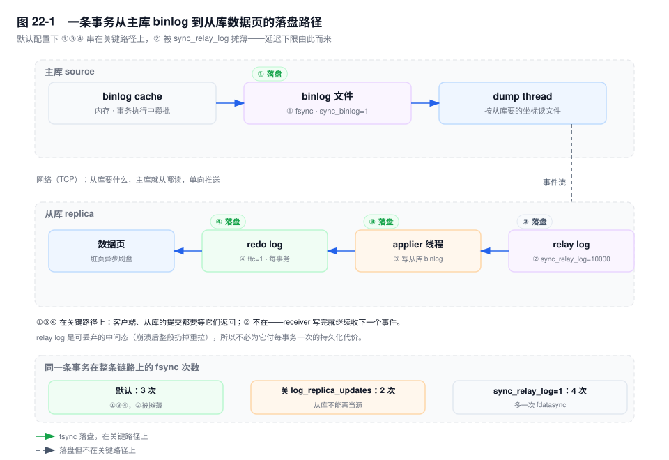
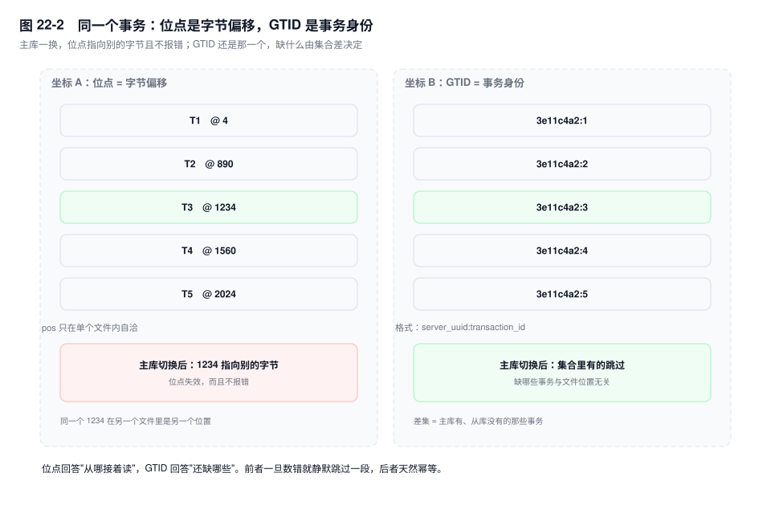
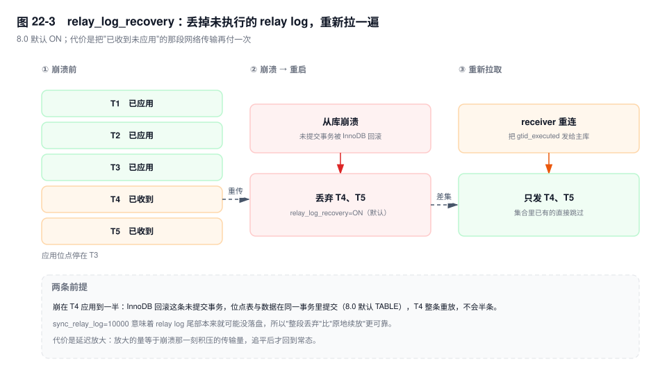

# 第 22 章　复制原理与事件流

> **一句话结论**：复制不是"把数据拷过去"，而是"把一条已经落盘的事件流搬到另一台机器上再放一遍"；搬和放各自要落一次盘，所以从库永远落后，延迟的下限不是 0。

## 22.0 场景：填错一个偏移量，两周后对账才发现

机房搬迁，凌晨三点完成主从切换。原来的从库被提升为主库（source），其余从库改指向它。第一条命令就报错：

```text
Last_IO_Error: Got fatal error 1236 from master when reading data from binary log:
'Could not find first log file name in binary log index file'
```

原因简单：老主库的 binlog 叫 `mysql-bin.000041`，新主库的 index 里只有它自己那几个文件。从库手里攥着一个不存在的文件名。

运维按流程修：`SHOW BINLOG EVENTS` 里挑一行，抄下 `End_log_pos`，`CHANGE MASTER TO MASTER_LOG_FILE='mysql-bin.000007', MASTER_LOG_POS=15123456`。复制起来了，`Slave_IO_Running` 与 `Slave_SQL_Running` 都是 Yes，`Seconds_Behind_Master` 归零，监控全绿。

他抄的是切换窗口之后的一个位置。中间那几十个事务——四百多条库存扣减——一个字都没过去。链路没有任何异常，因为从那个字节开始，后面的一切都是合法的 binlog。

两周后盘点，库存流水和订单对不上。教训一句话：**位点是字节偏移，不是事务身份**。数错一个偏移，等于静默跳过一段历史。

## 22.1 链路：一条事务到从库数据页之前，落了几次盘

先把角色摆好。主库（source）侧有一个 dump 线程，从库（replica）侧有一个 receiver 线程（IO 线程）和若干 applier 线程（SQL 线程）。整条链路就三个线程、两个日志文件：主库的 binlog 与从库的 relay log。`[8.0.26+]` 术语从 master/slave 改成 source/replica，旧名作为参数别名保留，`SHOW SLAVE STATUS` 也还能用。



六个阶段，四个落盘点：

1. 事务执行期间，row event 攒在会话私有的 **binlog cache** 里（第 6 章）。
2. 提交时写进 **binlog 文件**，`sync_binlog=1` 触发第一次 `fsync`——**落盘 ①**。
3. dump 线程从已经落盘的文件里读事件，按从库要的位置往后发，经 TCP 送到从库。
4. receiver 线程收到就写 **relay log**。默认 `sync_relay_log=10000`，每 10000 次写才 `fdatasync` 一次——**落盘 ②，而且故意不在关键路径上**。
5. applier 线程读 relay log 并应用，这里发生两件事：写从库自己的 binlog（`log_replica_updates=ON`，默认）一次 `fsync`（**落盘 ③**），写 redo 一次 `fsync`（**落盘 ④**，`innodb_flush_log_at_trx_commit=1`）。
6. 数据页变脏，由后台线程异步刷，不占提交路径。

**默认配置下，同一条事务在复制链路上有 3 次串在关键路径上的 fsync（①③④），②被摊薄到几乎为零。** 这就是"延迟下限不为 0"的来源：一次网络往返 + ①的组提交等待 + ③④的刷盘，之和就是这条事务最早能被从库读到的时间。

改参数会改这个次数，账要算清楚：

| 配置 | 每事务 fsync | 代价 |
|---|---|---|
| 默认（`sync_binlog=1`、`sync_relay_log=10000`、`log_replica_updates=ON`、`ftc=1`） | 3 次：①③④ | — |
| `log_replica_updates=OFF` | 2 次 | 从库的 binlog 里没有刚应用的事务：不能给下游当源（级联断），也不能用自己的 binlog 做 PITR |
| `sync_relay_log=1` | 4 次 | 每事务多一次 `fdatasync`，买到的是"relay log 尾巴完整"——而这段本来就可以丢 |
| `sync_relay_log=0` | 3 次 | 尾部可能撕开，靠 `relay_log_recovery` 重拉兜底 |

为什么 ② 敢不刷？因为 **relay log 是可丢弃的中间态**。从库崩溃后（`relay_log_recovery=ON`，8.0 默认），没执行的那段会被整段扔掉，重新向主库要一遍。既然丢了也能重来，就没必要为它付每事务一次的持久化代价。

而 ③④ 一定在关键路径上：它们决定"从库自己崩了之后，redo、binlog、数据页三者能不能对上"。③ 和主库一样是两阶段提交的一半，④ 是 InnoDB 的提交点——省掉任何一个，从库就不再是一个可以独立恢复的实例。

## 22.2 三个线程：谁在等谁

### dump 线程：它不是推送，是被订阅

`SHOW PROCESSLIST` 里它的 `Command` 是 `Binlog Dump GTID`（位点模式是 `Binlog Dump`），`State` 长期停在 `Source has sent all binlog to replica; waiting for more updates`。名字叫 dump，行为是"从库说要什么就从哪读"：GTID 下从库把 `gtid_executed` 发过去，位点模式下发 `(file, pos)`。

它断开的两种典型方式：

- **`net_write_timeout`（默认 60 秒）。** 从库读得比主库发得慢，写 socket 阻塞超过这个值，dump 线程主动关连接，从库侧表现为 `Reconnecting after a failed binlog dump request`。网络丢包、从库 CPU 打满，都会走到这里。
- **`max_allowed_packet`。** 主库侧限制单个事件能不能发出去，从库侧限制能不能收下。一行超过 16MB 的 BLOB 会把单个 row event 撑到几十 MB，任何一侧不够大，复制就断在这一行，报 `ER_NET_PACKET_TOO_LARGE`（1153）。从库不小于主库。

### receiver 线程：只负责搬运

`Replica_IO_State` 的取值基本覆盖了它的全部状态机：

| 取值 | 含义 |
|---|---|
| `Connecting to source` | 正在建连 / 认证 / 注册为从库 |
| `Requesting binlog dump` | 已连上，正在告诉主库要什么 |
| `Waiting for source to send event` | 空闲：主库没有新事件，或事件还在路上 |
| `Queueing source event to the relay log` | 收到了，正在往 relay log 里写 |

表里是 8.0.26 之后的取值，此前的写法把 `source` 换成 `master`（`Waiting for master to send event` 等）。`Replica_IO_Running` 只有 Yes / No / Connecting 三态（5.7 及 8.0.22 之前叫 `Slave_IO_Running`）。卡在 `Connecting` 而 `Last_IO_Error` 为空，通常是网络或账号问题；报 1236 则是坐标问题，见 22.3。

### applier 线程：真正改数据的那一个

`Replica_SQL_Running` 为 Yes 时，它在 `Reading event from the relay log` 和 `Executing event` 之间循环。开了并行复制（`replica_parallel_workers > 0`）后它变成一个 coordinator 加 N 个 worker，各有独立的 `THD`，但都长期复用，见第 25 章。

### 线程数与连接数的对应关系

一个从库对一个主库固定是 **1 个 receiver + 主库侧 1 个 dump + N 个 applier**，所以主库的 `SHOW PROCESSLIST` 里每个从库只占一行。多源复制是例外：每个 channel 有自己的 receiver。

这条对应关系解释了一个常见的误判：主库上看到 40 条 `Binlog Dump`，不是"40 个线程在并发写"，是 40 个从库各要一条流。

## 22.3 两套坐标：字节偏移与事务身份



位点是一个二元组 `(binlog_file, pos)`，`pos` 就是事件头里的 `end_log_pos`——**下一个事件的起始字节**。它描述"在哪个文件的第几个字节"，不描述"哪个事务"。三个细节决定了它的脆弱：

- `pos` 只在文件内有意义。`mysql-bin.000007:1234` 和 `mysql-bin.000008:1234` 是两个完全不同的位置。`FLUSH LOGS` 本身不会让已有坐标失效（旧文件还在，从库读完会跟着 `ROTATE` 走），但它让"位点"这个数字彻底失去跨文件的可比性。
- `PURGE BINARY LOGS` 删掉文件，坐标就永远指不到东西，报 1236。
- 主库切换后，新主库的 binlog 是另一条流，同名的文件里是完全不同的内容。这是 22.0 那个场景的根源。

GTID 是 `server_uuid:transaction_id`，一个事务一个编号，与文件、字节、甚至实例的位置都无关。

`MASTER_AUTO_POSITION=1`（`[8.0.26+]` 写作 `SOURCE_AUTO_POSITION=1`）的机制值得拆开看，因为"GTID 自动找位点"这句话容易让人以为它在算一个位置：

1. receiver 建连时，把从库的 `gtid_executed` 集合发给主库（协议层是 `COM_BINLOG_DUMP_GTID`）。
2. dump 线程在内存里算差集：主库有、从库没有的那些事务。
3. 从差集里**最早的那个事务**开始发。主库会顺着 binlog index 往回找，定位到第一个含有该事务的文件。

全程没有任何"位点"被算出来，被算出来的是一个事务集合。这就是它能在切换、改名、换目录之后照常工作的原因。

| 场景 | 位点 `(file, pos)` | GTID |
|---|---|---|
| 主库切换 | 失效。新主库是另一条流，同名文件内容不同 | 不变。事务身份与实例无关，新主库有这段就能接上 |
| 日志被 PURGE | 致命，1236 | 同样致命，但报错点名缺哪些 GTID，能判断要不要重做全量 |
| 跳过一条事务 | `sql_slave_skip_counter` 按事件数跳，会连带同一位置的其他语句；GTID 模式下这个变量直接被禁用 | `SET GTID_NEXT='uuid:n'; BEGIN; COMMIT;` 注入一条空事务，精确到一条 |
| 幂等重放 | 没有这个概念。同一段重放两次就是重复写 | 天然幂等。`gtid_executed` 里有的直接跳过 |
| 多源复制 | 多套文件坐标挤在一个 `relay-log.info` 里，极易混 | 每个 channel 一个集合，天然隔离 |

`gtid_purged` 缺失怎么修、errant transaction 怎么找，是第 23 章的事。这里只需要记住一句：**位点回答"从哪接着读"，GTID 回答"还缺哪些"**。后者是幂等的，前者不是。

## 22.4 relay log：一个可以丢的日志

relay log 与 binlog 同格式、同事件结构，区别只在归属：它是从库本地的一份"待播队列"。里面的事件**保留主库的 `server_id` 和 `end_log_pos`**，拿主库的位点去 `mysqlbinlog` 一个 relay log，能直接定位到同一个事务。

配套的两个 info：`relay-log.info` 记"relay log 读到哪、应用到哪"，`master.info` 记"主库是谁、读到主库哪个位点"。`[8.0]` 默认把这两份写进 `mysql.slave_relay_log_info` 和 `mysql.slave_master_info` 两张表（`relay_log_info_repository=TABLE`），`[8.0.23+]` 这两个仓库参数被废弃、固定为表。这个默认值的意义比看上去大：**应用位点的推进和用户事务的数据变更在同一个引擎事务里提交**，崩溃后不会出现"数据改了、位点没推进"这种半状态。

### relay_log_recovery：8.0 默认 ON

这是 8.0 与 5.7 的一个默认值反转（5.7 默认 OFF）。行为是：启动时把 relay log 里没执行的部分**全部丢弃**，receiver 重连，从 applier 记录的位点重新拉。

代价很实在：崩溃前已经传过来、还没执行的那段白传了，要重传一遍，延迟放大的量等于"崩的那一刻积压了多少"。收益是不必相信 relay log 尾部完整——而它确实可能不完整（`sync_relay_log=10000`）。拿一次重传换掉一整类"尾部解析失败"，划算。



### relay_log_purge 与两个尺寸参数

- `relay_log_purge=ON`（默认）：applier 执行完就删。设成 OFF 用于排查——"到底执行到哪个事务"，可以拿 relay log 和主库 binlog 逐事件对比，代价是磁盘只增不减。
- `max_relay_log_size`：默认 0，表示沿用 `max_binlog_size`。它是软限制，一个大事务会让单个 relay log 超过它。
- `relay_log_space_limit`：默认 0（不限）。**设成非 0 是个陷阱**：总量到顶，receiver 就停下来等 applier 追上来；如果 applier 正卡在一个十分钟的 DDL 或一个大事务上，这个"等"就是复制完全停摆，而且监控上只表现为"延迟在涨"。它看起来像磁盘保护，实际是把磁盘风险换成了可用性风险，没有特殊理由不要设。

### 命名：同一个东西三个名字

`[8.0.22+]` `SHOW REPLICA STATUS` 与 `SHOW SLAVE STATUS` 输出等价，后者保留为别名；`[8.0.26+]` 参数从 `MASTER_*`/`SLAVE_*` 改成 `SOURCE_*`/`REPLICA_*`，旧名继续可用。于是同一件事有三套写法：`Seconds_Behind_Master`/`Seconds_Behind_Source`、`MASTER_DELAY`/`SOURCE_DELAY`、`CHANGE MASTER TO`/`CHANGE REPLICATION SOURCE TO`。搜不到文档时，先想想名字是不是换了。

## 22.5 四种模式：各自承诺什么，不承诺什么

| 模式 | 承诺 | 不承诺 | 代价 |
|---|---|---|---|
| 异步（默认） | 主库提交不被从库拖慢 | 任何持久性。主库宕机时"已提交、未发出"的事务永久丢失 | RPO > 0，而且丢多少事前不可知 |
| 半同步 | 至少一个从库**收到并写入 relay log** 之后才返回 | 从库已经应用；也不承诺不丢（几个从库可能一起挂） | 每次提交多一个 RTT；`rpl_semi_sync_source_timeout` 到期会静默降级为异步（第 24 章） |
| 全同步（MGR） | 多数派认证并落盘之后才提交 | 业务无冲突；低延迟 | 多一次多数派往返、流控、只支持 InnoDB |
| 延迟复制 | 从库至少落后 N 秒 | 自动回滚；在 N 秒内被发现 | 切换时 RTO 增加 N 秒；依赖两端时钟一致 |

半同步在这里只占一行位置：它把承诺从"主库写了"推进到"另一台机器收到了"，没推进到"应用了"——差这一步就是第 24 章。

延迟复制最常被误解成"备库"。它不是——备库是接管，延迟复制是**时间机器**。`CHANGE REPLICATION SOURCE TO SOURCE_DELAY=3600`（`[8.0.26+]`，原名 `MASTER_DELAY`）之后，applier 会把每条事件压到"事件时间戳 + 3600 秒"才执行。误删发生在 10 分钟前，从库还停在一小时前，你有五十分钟把它捞出来：

```sql
-- 停在那条 DELETE 之前，把数据导出来
START REPLICA SQL_THREAD UNTIL SQL_BEFORE_GTIDS = '3e11c4a2-...:88421';
-- 导出、比对、补回主库，然后再让复制追平
START REPLICA SQL_THREAD;
```

`UNTIL` 的三种写法各有用途：`SQL_BEFORE_GTIDS` 停在某个事务之前（回滚误操作最常用），`SQL_AFTER_GTIDS` 停在其后，`SOURCE_LOG_FILE` + `SOURCE_LOG_POS` 停在某个位点（位点模式，同样有 22.0 那个坑）。

延迟按事件的 `timestamp` 计量，不按"到达时间"。两个后果：两端时钟必须由 NTP 校准，否则一小时的窗口可能是五十分钟；崩溃重拉之后窗口不会重置——重传回来的时间戳没变，该等多久还是等多久。

## 22.6 复制过滤：这一节的坑能把整个库搞坏

MySQL 提供两组过滤：主库侧决定"写不写进 binlog"，从库侧决定"应不应用"。两组都很危险，但危险的方式不同。

### 主库侧：`binlog_do_db` 判的是默认库

这条规则的判定依据是 Query 事件的**默认库**——连接上 `USE` 选中的那个，不是语句里写的表名。

```sql
-- 主库参数：--binlog-do-db=settle_db
USE order_db;
UPDATE settle_db.bill SET state = 2 WHERE bill_no = 'B20261111001';
```

这条 UPDATE 不会进 binlog。默认库是 `order_db`，不在白名单里，整条语句被判掉。从库、备份、CDC、闪回，全都看不到这次变更。

它为什么在生产上特别容易中招：连接池的连接通常固定 `USE app_db`，而业务代码习惯写全限定表名 `settle_db.bill`。这两件事一叠加，被丢掉的恰好是"用全限定名写的那部分写入"——漏得毫无规律，对账时表现为"某些表少了一些行"。

`binlog_format=ROW` 只让 DML 变成表级判定（`TABLE_MAP` 里有库名）。**DDL 仍然是 Query 事件，没有表可判，只能按默认库判**——`USE order_db; CREATE TABLE settle_db.bill_2027` 在 `binlog_do_db=settle_db` 下照样被丢。同一个参数，DML 按表判、DDL 按默认库判，没法从名字推断行为。

它丢的是**源头**：事件根本没被写下来。这不是"从库少了几行"，是"这段历史不存在了"，任何补救手段都拿不回来。

### 从库侧：`replicate_wild_do_table` 是唯一能用的那个

`replicate_do_db` 与 `binlog_do_db` 同样按默认库判，同样不能用。`replicate_wild_do_table` 按"库名.表名"的通配匹配，判定单位是表，是这一组里唯一逻辑自洽的。但它有三个前提，每一个都会让事务变成半截：

1. **它破坏事务原子性。** 一个事务改了 `bill` 和 `bill_detail`，只匹配 `bill`，从库就只应用 `bill`。主库上"扣款并写明细"是原子的，从库上不是。这不是"少同步一张表"，是"这张表在从库上的状态从来没有一致过"。
2. **`CREATE TABLE ... SELECT` 会半途而废。** ROW 下它被拆成"建表"和"插行"两组事件：建表按新表名匹配，插行按源表名匹配。只匹配新表，得到一张空表；只匹配源表，行事件找不到表，SQL 线程报 1146 停住。
3. **触发器内部的语句不属于你写的这条 SQL。** STATEMENT 下按触发它的语句的默认库判定，ROW 下按触发器写入的那张表判定。过滤主表、放过触发器改的表，副作用照样过去；反过来则是本体过去、副作用被丢。两种都是数据错。

### 什么时候过滤能接受

替代方案只有两条，都不在 MySQL 参数里：**业务隔离**（不共享实例，从根上没有"要过滤的东西"）和**消费端过滤**（CDC 拉全量事件，在下游决定丢什么，源端日志保持完整，PITR 与闪回不受影响）。

一定要在服务端过滤时，判据是四条全中：被过滤的表与保留的表之间不存在跨表原子性要求；过滤对象是只写自己、不被别人 JOIN 的日志类表；规则按整库配而不是按表配；你接受这个从库不再是主库的完整副本，不能直接提升。任何一条不满足，就不要过滤。

## 22.7 会话状态：一条复用的连接，带着别人的上下文

applier 是长期复用的线程（并行复制下是 N 个 worker），不是每条语句新建连接。所以状态会在两条语句之间残留。这就是为什么每个 Query 事件开头都要重发一遍 `SET @@session.*`——**不重发，上一个事务的 `sql_mode` 会污染下一个事务**。

随事件走的状态（`Query_log_event` 的 status_vars 块）：

- **`sql_mode`**：`SET @@SESSION.sql_mode=1168113696`。注意它是个位图整数，不是字符串，所以在 binlog 里搜 `STRICT_TRANS_TABLES` 是搜不到的。从库全局设成非严格模式没有用，事件会覆盖它。
- **字符集三项**：`character_set_client`、`collation_connection`、`collation_server`。它们决定字符串字面量按什么编码解释、`ORDER BY` 按什么规则排序。
- **`time_zone`**：`TIMESTAMP` 存的是 UTC，但 `NOW()`、`FROM_UNIXTIME()` 的渲染按会话时区。
- **`auto_increment_increment` / `auto_increment_offset`**。
- **`SET INSERT_ID`**：自增分配结果。STATEMENT 下没有它，从库会自己再分配一次，然后所有 `WHERE id = ?` 都改错行（第 6 章）。
- **`SET TIMESTAMP`**：事件时间，`NOW()` 靠它。

不随事件走、会导致分叉的：

- **用户变量**。`@price` 不复制。STATEMENT 下 `UPDATE bill SET amount = @price` 在从库上读到 NULL。
- **临时表**。`INSERT INTO bill SELECT * FROM tmp_settle` 在从库上查的是一张空表。
- **隔离级别**。`transaction_isolation`（5.7 叫 `tx_isolation`）**不在**状态变量块里，applier 用它自己会话的默认值。这是 RC + STATEMENT 被直接禁掉的另一半原因：第 6 章讲的是"语句级日志没有行锁语义"，这里补上"会话状态也没跟过来"。
- **`@@hostname` / `CONNECTION_ID()` / `USER()` / `SYSDATE()`**，理由见第 6 章。

时间这一类最容易写反，必须说准：**`NOW()` 不会导致不一致**。ROW 下它记的是行镜像里的字面值；STATEMENT 下事件带 `SET TIMESTAMP`，从库执行前把会话时钟拨回主库那一刻。`DEFAULT CURRENT_TIMESTAMP` 作为列定义里的关键字也安全，因为求值发生在插入时，而插入本身带值。

真正会分叉的是**在 DDL 执行时才求值的默认值**：

```sql
ALTER TABLE bill ADD COLUMN checked_at DATETIME DEFAULT CURRENT_TIMESTAMP;
```

这条 DDL 在从库上被重新执行，回填已有行用的是**从库执行那一刻**的时钟，两边差一个复制延迟。DDL 走的是 Query 事件，ROW 格式救不了它。同类问题还有 `ALTER TABLE ... ADD COLUMN c INT DEFAULT (UNIX_TIMESTAMP())` 这类表达式默认值 [8.0.13+]。

双主场景还有一条硬要求：两个主库 `auto_increment_increment=2`，`auto_increment_offset` 分别设 1 和 2。事件里带 increment 只保证 applier 执行时的分配行为一致，解决不了两台主库各自分配主键——offset 相同，迟早撞同一个 id。

## 22.8 从库只读：两层，挡的东西不一样

`read_only=ON` 挡的是"没有 `SUPER` 权限的用户"。有 `SUPER` 的用户照样能写，也能自己 `SET GLOBAL read_only=OFF`。root 账号满天飞的环境里，这一层约等于没设——"从库被写脏"多半不是没配参数，是能连上来的账号权限太宽。

`super_read_only=ON`（`[5.7.8+]`）把 `SUPER` 也挡上。两个副作用要记住：

- `SET GLOBAL read_only=OFF` 会连带把 `super_read_only` 一起关掉（文档行为：设 `super_read_only=ON` 隐式设 `read_only=ON`，反过来设 `read_only=OFF` 隐式关掉 `super_read_only`）。切换工具如果只会这一句，提升是会成功的——前提是它有权限。
- 一批运维脚本会当场失败：建影子表的 online DDL 工具、写心跳表的探针、`mysql_upgrade`。

它挡不住什么，同样要说清：

- **已建立的连接上正在跑的事务不会被中断。** 它拒绝新语句，不 kill。开启瞬间正在写的大事务照常写完。
- **复制线程照常写。** applier 走的是内部路径，不受只读检查影响——否则从库根本无法应用。
- **`SET GLOBAL super_read_only=OFF` 本身只需要权限。** 它是"防手滑"的围栏，不是"防越权"的墙——越权防护靠账号权限。

## 22.9 关键结论

1. **复制链路上默认有 3 次关键路径 fsync：主库 binlog、从库 binlog、从库 redo。** relay log 那一次被 `sync_relay_log=10000` 摊薄，因为它是可丢弃的中间态。这 3 次刷盘加一次网络往返，就是延迟下限的物理来源。
2. **一个从库对一个主库只有一个 receiver 和一个 dump，但有 N 个 applier。** 主库上看到的 N 条 `Binlog Dump` 是 N 个从库，不是 N 个并发写线程。
3. **位点是字节偏移，GTID 是事务身份。** 位点在主库切换和 PURGE 后失效且静默；GTID 的"自动找位点"本质是主库算 `gtid_executed` 差集，全程没有位点参与。前者不幂等，后者幂等。
4. **`relay_log_recovery=ON` 的默认值意味着从库崩溃会丢掉"已收到未应用"的那段并重传。** 安全，但会放大延迟；换来的是不必相信 relay log 尾部完整。
5. **过滤器的判定单位随格式漂移：DML 在 ROW 下按表判，DDL 永远按默认库判。** 丢掉的是源头事件，下游手段补不回来。
6. **`read_only` 挡不住 SUPER，`super_read_only` 挡得住但不拦已在执行的事务。** 它是防手滑的围栏，越权防护得靠账号权限。

## 22.10 实验验证

### 实验一：relay log 与 binlog 的同一个事务

```bash
# 主库
mysqlbinlog -vv --base64-output=DECODE-ROWS --start-position=15123456 \
  /var/lib/mysql/mysql-bin.000007 | head -40
# 从库
mysqlbinlog -vv --base64-output=DECODE-ROWS \
  /var/lib/mysql/relay-log.000002 | head -40
```

预期形态（未实跑，字段含义以此为准）：两边同一个事务的 `end_log_pos` 完全相同，`server id` 也是主库的——relay log 保留了主库的位点与来源，只有文件开头的 `FORMAT_DESCRIPTION` 属于从库自己。

同一份输出里还能看到 `SET @@session.sql_mode=1168113696` 这类行——每个 Query 事件自带的状态变量块，就是 22.7 那张清单的实物。

### 实验二：让过滤规则静默吞掉一次更新

```sql
-- 实验实例启动参数：--binlog-do-db=settle_db --binlog-format=STATEMENT
USE order_db;
UPDATE settle_db.bill SET state = 2 WHERE bill_no = 'B20261111001';
SHOW BINLOG EVENTS IN 'mysql-bin.000003';
```

预期形态（未实跑）：`SHOW BINLOG EVENTS` 里找不到这条 UPDATE；把 `USE` 换成 `settle_db` 再执行一次就能找到。判定依据是会话默认库，不是 SQL 里写的表名。

把 `binlog_format` 改成 ROW 重跑第一条，DML 这次会被记录（表级判定）；把语句换成 `USE order_db; CREATE TABLE settle_db.bill_2027 (...)`，又会被丢掉——DML 和 DDL 的判定单位不同，这是它最不该被使用的地方。

### 实验三：只读的两层

```sql
-- 用有 SUPER 的账号
SET GLOBAL read_only = ON;
INSERT INTO settle_db.bill (bill_no, amount) VALUES ('B20261111002', 100);  -- 成功
SET GLOBAL super_read_only = ON;
INSERT INTO settle_db.bill (bill_no, amount) VALUES ('B20261111003', 100);  -- 失败
```

预期形态（未实跑）：第二条插入报 `ERROR 1290 (HY000)`，提示服务器运行在只读模式；第一条成功，证明 `read_only` 对 SUPER 用户无效——这正是"从库被写脏"最常见的形态。

## 22.11 常见误区

⚠️ **"从库延迟是网络慢"**
延迟里最硬的一段是三次 fsync，不是网络。延迟稳定在某个值上不涨，多半是 applier 单线程追不上（见第 25 章）。

⚠️ **"GTID 就是自动找位点，所以不用管位点了"**
GTID 找的是"缺哪些事务"，`SHOW REPLICA STATUS` 里的 `Read_Source_Log_Pos`、`Exec_Source_Log_Pos` 仍然是位点。排查时你还是要靠这两个数字判断"读到哪、执行到哪"。

⚠️ **"过滤只影响复制，不影响备份"**
主库侧过滤是在写 binlog 之前丢事件，备份里的 binlog 同样没有这段。等你需要做时间点恢复时，恢复出来的库天然缺这块数据，而且没有任何报错提示你。

⚠️ **"从库设了 `read_only` 就是只读的"**
它只挡没有 SUPER 的用户。业务用的是 root、监控用的是 root、运维脚本用的还是 root 的环境里，它一条写都挡不住。

## 22.12 生产 Checklist

- [ ] `sync_binlog=1`、`innodb_flush_log_at_trx_commit=1`、`log_replica_updates=ON` 同时成立；关掉 `log_replica_updates` 的实例不作为可提升备库
- [ ] `sync_relay_log` 保持默认 10000，`relay_log_recovery=ON`，`relay_log_space_limit=0`
- [ ] `max_allowed_packet` 从库 ≥ 主库，且能容纳最大单行（大 BLOB 表单独评估）
- [ ] 复制用 `SOURCE_AUTO_POSITION=1`；仍手填 `(file, pos)` 的流程视为高危，需双人复核
- [ ] 主库与从库都不配置 `binlog_do_db` / `binlog_ignore_db` / `replicate_do_db`；确需过滤时走 CDC 消费端
- [ ] 从库 `super_read_only=ON` 写进配置文件，并确认切换工具知道"关 read_only 会连带关掉 super_read_only"
- [ ] 双主实例校验 `auto_increment_increment` 与 `auto_increment_offset` 两端互补
- [ ] 监控 `Replica_IO_Running` / `Replica_SQL_Running` / `Replica_IO_State` / `Last_IO_Errno`，1236 单独告警

## 22.13 延伸

- **关联章节**：第 6 章（binlog 事件结构与组提交）、第 7 章（从库崩溃时 InnoDB 的恢复判据）、第 23 章（GTID 的运维细节与 errant transaction）、第 24 章（半同步的 ACK 时机）、第 25 章（并行复制与延迟治理）、第 26 章（切换流程与 `read_only` 兜底）、第 28 章（用 binlog 做 PITR）。
- **面试追问**：
  - "一条事务从主库到从库落几次盘？" → 默认 3 次关键路径 fsync；relay log 那次被 `sync_relay_log=10000` 摊薄，因为可丢弃。
  - "主库上为什么看到 40 个 `Binlog Dump` 线程？" → 40 个从库，每个从库一条流、一个 receiver；applier 是另一侧的事。
  - "GTID 怎么做到自动找位点？" → 从库发 `gtid_executed`，主库算差集，从最早缺失的事务开始发，全程不算位点。
  - "`binlog_do_db` 为什么会丢数据？" → 判定依据是会话默认库；DML 在 ROW 下按表判、DDL 永远按默认库判，判定单位随格式漂移。
- **官方文档**：`Replication → Replication Implementation`（线程模型与 relay log）、`Replication → Replication Coordinate`、`Replication → How Servers Evaluate Replication Filtering Rules`、`Replication → Delayed Replication`、`Server Administration → Server System Variables`（`relay_log_recovery` / `sync_relay_log`）。
