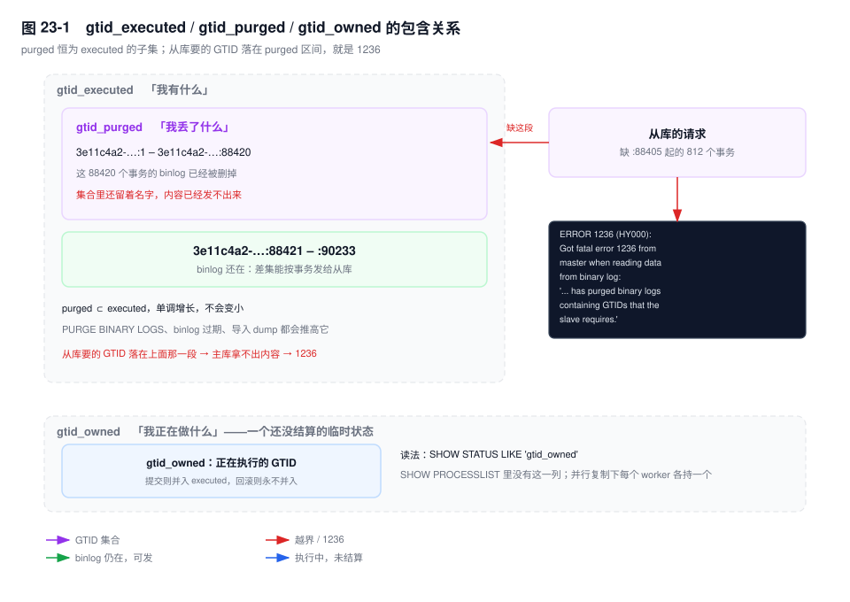
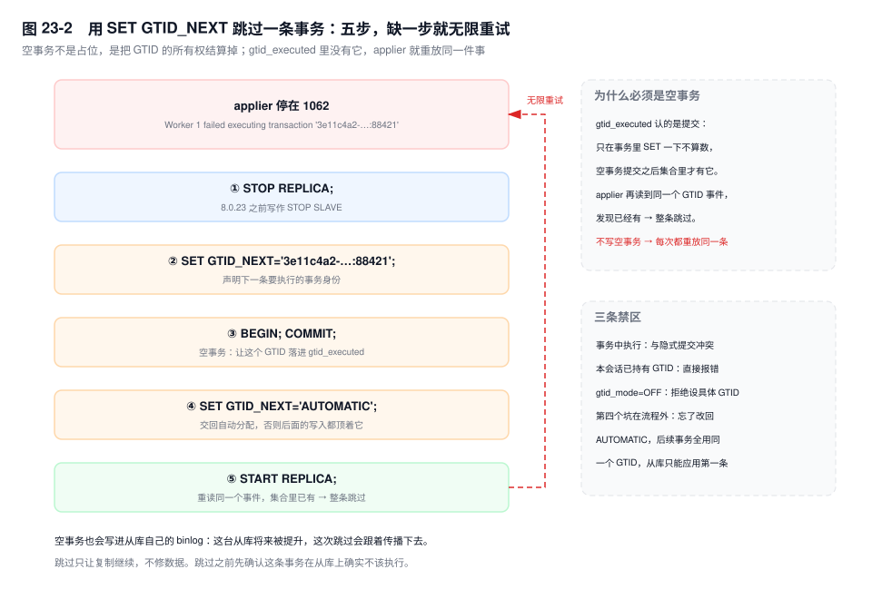

# 第 23 章　GTID 与复制运维

> **一句话结论**：GTID 把"复制到哪"从字节坐标换成了事务集合，代价是所有运维动作都变成集合运算——谁有、谁丢、谁多，三个集合读错一个就是一次事故。

## 23.0 场景：校验通过之后的那二十分钟

凌晨一点，计划内切换。老主（source）停写，新主追平，`SHOW REPLICA STATUS` 归零。运维照流程校验：

```sql
-- 在新主上执行：老主有的，新主是否全覆盖
SELECT GTID_SUBTRACT('3e11c4a2-…:1-90233', @@GLOBAL.gtid_executed);
-- 返回空集
```

空集，通过。切流量，老主下线做硬件检查。

二十分钟后老主作为从库（replica）回来，IO 线程当场停住：

```text
Last_IO_Error: Got fatal error 1236 from master when reading data from binary log:
'The slave is connecting using CHANGE MASTER TO MASTER_AUTO_POSITION = 1,
but the master has purged binary logs containing GTIDs that the slave requires.'
```

根因是两个 `gtid_purged`，而校验只看了 `gtid_executed`。老主在切换前刚做过一轮 `PURGE BINARY LOGS` 腾空间，`gtid_purged` 已经推到 88420；新主当晚的清理脚本又把自己那份删了。老主缺的那八百多个事务两边都没有 binlog，剩下唯一的路是从备份重做这个从库。

`gtid_executed` 只说明"我有什么"，不说明"我还能给出什么"。后者由 `gtid_purged` 回答，而它几乎没人看。

## 23.1 GTID 是什么：一个事务一个编号，且不可分割

格式是 `server_uuid:transaction_id`，例如 `3e11c4a2-9a1f-11ee-8b3d-0242ac120002:88421`。uuid 是实例初始化时生成、落在 `auto.cnf` 里的；`transaction_id`（文档里叫 GNO）是**这个实例自己的**计数器，从 1 开始，按提交顺序递增——它不全局，两台机器都会有 `:1`，所以必须拼上 uuid 才唯一。

分配发生在写 binlog 的瞬间：提交时先写一个 `GTID_LOG_EVENT`，带着 GTID 和并行复制用的 `last_committed`/`sequence_number`，事务结束标记仍是 `XID`（第 6 章）。所以"一个事务一个 GTID"的准确含义是：**一个 GTID 覆盖从 `GTID_LOG_EVENT` 到 `XID` 之间的全部事件，中间不能切**。

这条"不可分割"派生出后面所有运维约束：跳过只能整条跳过，不存在"跳一半"；重放天然幂等，`gtid_executed` 里有的直接丢；一条语句若在 binlog 里落成两个事务（`CREATE TABLE ... SELECT`）就装不进一个 GTID，于是被禁（23.8）；提交点跨会话的（`XA`）也归不了属。

`gtid_mode` 四个取值：`OFF`、`OFF_PERMISSIVE`、`ON_PERMISSIVE`、`ON`。中间两个是过渡态，允许两种事务在同一条流里共存，切换只能逐级走（23.8）。

## 23.2 三个变量：我有什么、我丢了什么、我正在做什么

三个集合混用，是 GTID 运维里最常见的误判。

| 变量 | 回答的问题 | 读法 | 什么时候变 |
|---|---|---|---|
| `gtid_executed` | 我执行过哪些事务（含从库重放来的） | `SELECT @@GLOBAL.gtid_executed`；也等于 `SHOW MASTER STATUS` 的 `Executed_Gtid_Set` | 每提交一个事务就变长；只有 `RESET MASTER` 会清空 |
| `gtid_purged` | 我执行过、但 binlog 已经删掉的那部分 | `SELECT @@GLOBAL.gtid_purged` | `PURGE BINARY LOGS`、binlog 过期、导入 dump 时被 `SET` |
| `gtid_owned` | 我此刻正在执行哪些 | `SHOW STATUS LIKE 'gtid_owned'` | 拿到 GTID 时出现，提交或回滚后消失 |

**`gtid_executed` 只增不减，是"我有什么"。** 它含从主库重放来的事务——从库与主库最终相等，这就是"追平"。除 `RESET MASTER` 外没有操作能让它变小，`PURGE` 也不行。

**`gtid_purged` 是它的子集，是"我丢了什么"。** 事务先进 `gtid_executed`，binlog 被删之后才进 `gtid_purged`。这个顺序决定了 `purged ⊆ executed` 恒成立，也决定了它单调增长。

从库连上来时主库算 `主库.executed − 从库.executed`，从差集里最早的事务开始发。如果它落在 `purged` 区间，主库只有名字、没有内容，直接报 1236。所以 **`gtid_purged` 才是决定"从库还能不能接上"的集合**，而它不在 `SHOW REPLICA STATUS` 里。

**`gtid_owned` 是"我正在做什么"，不属于上面任何一个集合。** GTID 只有提交那一刻才并入 `gtid_executed`，回滚则永不并入。读法有个坑：`SHOW PROCESSLIST` 里**没有**这一列，要看状态变量；会话级是本会话持有的，全局级是全实例正在执行的，并行复制下每个 worker 各持一个。

长事务执行期间看 `gtid_executed`，会发现"这个 GTID 不在里面"——它还没提交；此刻主库宕机，它不会存在于任何地方。



## 23.3 `mysql.gtid_executed` 表：没有 binlog 时的唯一凭据

`[8.0]` 起允许 `gtid_mode=ON` 与 `log_bin=OFF` 并存。没有 binlog 可写时，GTID 集合只能落到 `mysql.gtid_executed` 表：每个事务提交写一行，后台再把同一 uuid 的连续编号压成区间。5.7 不允许这种组合——`gtid_mode=ON` 要求 `log_bin=ON`。

`log_bin=ON` 时这张表不是逐事务更新的：它在轮转和正常关库时把上一批文件的 GTID 落进表里，所以表里大致是"已经离开 binlog 的那部分"，即 `gtid_purged` 的镜像。完整的 `gtid_executed` 是**这张表 ∪ 现存 binlog 里的 GTID 事件**，启动时算出来。

于是 binlog 全被误删后实例仍说得清"我执行过什么"；而 `RESET MASTER` 之所以危险，是因为它清空这张表、清空 executed 与 purged、删掉全部 binlog——实例失忆，从库坐标一起作废。

## 23.4 搭建：把坐标写进 dump，而不是写进命令

导出侧的关键参数是 `--set-gtid-purged`：

```bash
mysqldump --single-transaction --source-data=2 --set-gtid-purged=ON \
  --databases order_db settle_db > /backup/full.sql
```

`ON` 会在 dump 头部写入两行（`[8.0]` 形态）：

```sql
SET @@SESSION.SQL_LOG_BIN= 0;
SET @@GLOBAL.GTID_PURGED=/*!80000 '+'*/ '3e11c4a2-…:1-88420';
```

第二行是重点：导入后从库的坐标**直接等于导出时刻的主库坐标**，不用再算；第一行关掉本会话 binlog，避免导入本身产生一堆无意义的 GTID。

`OFF` 什么都不写，从库 `gtid_executed` 为空，`AUTO_POSITION` 会要求主库从 `:1` 发——那段早被 purge，报 1236；就算没 purge 也要重放全部历史。它只适合 dump 不进复制链路的场合。

导入的目标实例，`gtid_executed` 必须为空（新实例，或刚 `RESET MASTER` 过），否则那行 `SET @@GLOBAL.gtid_purged` 会被拒绝——这个变量只能在集合为空时赋值。

从库侧只需要一条：

```sql
CHANGE REPLICATION SOURCE TO
  SOURCE_HOST='10.0.3.11', SOURCE_USER='repl', SOURCE_PASSWORD='…',
  SOURCE_AUTO_POSITION=1;
START REPLICA;
```

不再给 `SOURCE_LOG_FILE`/`SOURCE_LOG_POS`——与 `SOURCE_AUTO_POSITION=1` 互斥，同时给直接报错。坐标不再是输入，而是差集算出来的结果。

`[8.0.26+]` 术语换成 source/replica；旧写法 `CHANGE MASTER TO`、`START SLAVE`、`SHOW SLAVE STATUS` 仍然可用。

## 23.5 切换：两个集合都要校验，少一个就是 23.0

GTID 下切换只剩集合运算：新主只要**拥有老主的全部事务**。

校验于是变成两次减法：

```sql
-- ① 在新主上：老主有的，我是否都有（必须为空集）
SELECT GTID_SUBTRACT('3e11c4a2-…:1-90233', @@GLOBAL.gtid_executed);

-- ② 在新主上：老主回来时要的那段，我的 binlog 是否还留着
SELECT GTID_SUBTRACT(
         GTID_SUBTRACT(@@GLOBAL.gtid_executed, '3e11c4a2-…:1-90233'),
         @@GLOBAL.gtid_purged);
```

① 为空说明数据追平；② 必须**等于**里层那个差集本身，少一个 GTID 就说明有一段已被 purge，老主切回来必定 1236。

promote 之前更稳的是显式等到位，而不是眼看延迟：

```sql
SELECT WAIT_FOR_EXECUTED_GTID_SET('3e11c4a2-…:1-90233', 30);
-- 0 = 30 秒内已全部执行；1 = 超时
```

它等的是 SQL 线程执行完集合，前提是 SQL 线程在跑；`STOP REPLICA SQL_THREAD` 之后它永远返回 1。

还有一条**时间维度**：② 在切换那一刻成立，不等于二十分钟后成立。切完要立刻确认新主的 `binlog_expire_logs_seconds` 和清理脚本能覆盖"老主重新加入的最长窗口"——23.0 就栽在这里。

## 23.6 跳过一条事务：`SET GTID_NEXT` 的唯一正确姿势

从库报 1062 时先想清楚：主库这条事务是成功提交的，否则进不了 binlog。所以 1062 只可能是两边数据已经不一致——**跳过只是让复制继续，不是修复**。

真要跳过，五步，一步都不能少：

```sql
STOP REPLICA;                                        -- ① 停掉所有 applier
SET GTID_NEXT = '3e11c4a2-…:88421';                  -- ② 声明下一条事务的身份
BEGIN; COMMIT;                                       -- ③ 空事务
SET GTID_NEXT = 'AUTOMATIC';                         -- ④ 交回自动分配
START REPLICA;                                       -- ⑤
```

**为什么必须是空事务。** GTID 的所有权在提交时结算，只有提交过才进 `gtid_executed`。applier 重读 relay log 里同一个 `GTID_LOG_EVENT` 时先查集合，有就整条跳过。不写空事务，集合里永远没有它，`START REPLICA` 后 applier 再撞一次 1062 再停——那是个可以无限循环的红色回环。

`BEGIN; COMMIT` 之间不要插任何语句，插进去的写入会被算在这个 GTID 名下。



**三个禁区**，每一个都会直接报错：

1. **不能在事务中执行。** 它只在事务边界上生效，事务未结束时设置会报错；先 `COMMIT` 或 `ROLLBACK`。
2. **本会话已持有 GTID 时不能执行。** 上一件事没结算完，不能再认领一个。
3. **`gtid_mode=OFF` 时不能设成具体 GTID。** 只能设 `AUTOMATIC`，报错原文是 `Cannot set GTID_NEXT to a GTID while GTID_MODE = OFF`。

还有一个流程外的坑：**忘了 ④**。后续事务全顶着 `88421` 写进 binlog，从库看到"这个 GTID 我已经有了"，全部丢掉——从这一刻起静默分叉。另外 8.0 的报错本身已带 GTID，不用再去 `SHOW BINLOG EVENTS` 里翻。

## 23.7 errant transaction：本机有、全局没有的那些

定义：**本实例 `gtid_executed` 里有、当前主库没有的 GTID**，uuid 通常就是本机自己的。

三个来源：从库被直接写（`read_only` 挡不住 `SUPER`，第 22 章），一次手工订正就留下一个只有这台机器认识的事务；切换后回切，老主在降级前多写了几个事务；双主残留，只对齐了数据没对齐集合。

识别是一次减法：

```sql
SELECT GTID_SUBTRACT(@@GLOBAL.gtid_executed, '3e11c4a2-…:1-90233') AS errant;
```

危害两层。它**扩散**：任何指向它的从库都会把这些事务应用一遍，从此在整个集群永久存在，"集合相等"这个判据作废。它**阻止提升**：切换工具 promote 前检查 errant，非空即拒绝。

修复顺序不能反：先列出 errant，到 binlog 里看清它改了什么（`mysqlbinlog --include-gtids`），把数据补回主库状态，**然后**才用空事务消费 GTID。反过来做，集合干净了，数据永远补不回来。

顺带澄清：`SET sql_log_bin=0` 期间的写入**不产生 GTID**，不是 errant，是更隐蔽的一种——数据在本机存在却没有全局身份，复制、备份、CDC 都看不见。

## 23.8 五条限制，各自的原因

| 限制 | 原因 | 现状 |
|---|---|---|
| `CREATE TABLE ... SELECT` | 一条语句在 binlog 里落成两个事务（建表 DDL + 插行 DML），一个 GTID 装不下 | 5.7 与 8.0.21 之前禁止；`[8.0.21+]` 起按两个 GTID 记录、放开，代价是不再原子（以官方 Restrictions on Replication with GTIDs 为准） |
| 事务内的临时表 | 临时表会话私有、不进 binlog，一个 GTID 描述不了"只存在于某一台上的对象" | `CREATE TEMPORARY TABLE` / `DROP TEMPORARY TABLE` 在事务内、函数内、触发器内都报 `ERROR 1787`；挪到事务外建 |
| `XA` 事务 | prepared 状态可跨连接、跨崩溃存活，提交点不在一个会话里，无法归属到 GTID | `gtid_mode=ON` 下不可用 |
| `sql_slave_skip_counter` | 按事件数跳过，与"一个事务一个 GTID"的粒度对不上，跳过头会连带丢掉同位置的其他语句 | 与 GTID 互斥，必须用 `SET GTID_NEXT` |
| `gtid_mode` 逐级切换 | 中间两个 PERMISSIVE 态让匿名事务与 GTID 事务共存；跳级等于跳过混跑阶段 | 只能 `OFF → OFF_PERMISSIVE → ON_PERMISSIVE → ON`，回退同理一次一级 |

逐级切换的实际约束是：升到下一级之前，**集群里所有实例（含从库）都要先到当前级**；有一台落后，切上去后它的 binlog 里就有主库无法归属的事务。

## 23.9 复制中断的十类速查

| 错误码 / 关键词 | 现场 | 根因 | 处置 |
|---|---|---|---|
| 1062 `Duplicate entry` | applier 停 | 从库已有这一行：被写脏、跳过过、或 errant | 比对两侧，人工修；确认只是从库多出才跳过 |
| 1032 `Can't find record` | applier 停 | 从库缺行，UPDATE/DELETE 找不到目标 | 补行；跳过会让后续每条语句继续 1032 |
| 1236 `ER_MASTER_FATAL_ERROR_READING_BINLOG`：`purged binary logs containing GTIDs` | IO 线程停 | 差集里最早的事务已被主库 purge | 从备份重做；或指向仍有这段的实例补齐 |
| 1236 `Could not find first log file name` | IO 线程停 | 位点模式残留，文件在主库上不存在 | 改用 `SOURCE_AUTO_POSITION=1` |
| 1594 `Relay log read failure` | applier 停 | relay log 尾部损坏（崩溃、写坏） | `relay_log_recovery=ON` 重启；GTID 下不算位点 |
| 2003 `Can't connect` | `Connecting to source` | 网络、防火墙、主库没起 | 从从库侧手工连一次 |
| 1045 `Access denied` | `Connecting to source` | 账号、密码、授权主机不符 | 用同一账号手工登录复现 |
| 磁盘满 | 延迟暴涨后断开 | relay log 或 binlog 撑满（大事务） | 清 binlog 时 `gtid_purged` 会跟着涨；扩盘 |
| 1153 `ER_NET_PACKET_TOO_LARGE` | 断在大行上 | 单事件超过一侧 `max_allowed_packet` | 主从一起调大；根治是拆大事务 |
| `Worker N failed executing transaction` | 并行复制 worker 停 | 该 worker 上的事务报错，N=0 是 coordinator | 查 `replication_applier_status_by_worker` 的 `LAST_ERROR_*`，别只看 `Last_SQL_Error` |

1236 出现时先分清"缺 GTID"还是"缺文件"：前者要补数据，后者只是配置残留。区别在报错正文，不在错误码。

## 23.10 关键结论

1. **三个变量各回答一个问题：我有什么（`gtid_executed`）、我丢了什么（`gtid_purged`）、我正在做什么（`gtid_owned`）。** 前者只增不减，`purged ⊆ executed` 单调增长；决定从库能否接上的是第二个，而它不在 `SHOW REPLICA STATUS` 里。
2. **切换要校验两个集合。** ① 新主是否包含老主全部；② 老主缺的那段是否还在新主 binlog 里。少第二条就是 23.0。
3. **跳过事务的本质是把 GTID 消费掉，不是让复制往前走一步。** 空事务提交才有 `gtid_executed`，有它 applier 才跳过。
4. **errant 必须先补数据再消费 GTID。** 顺序反了，集合干净、数据永错。
5. **GTID 的五条限制都源于"一个 GTID 必须完整对应一个可独立重放的事务单元"。** 做不到这一点的语句形态都会被禁或降级。

## 23.11 实验验证

### 造一个 errant，再把它抓出来

```sql
-- 从库上（先 SET GLOBAL super_read_only=OFF）
INSERT INTO order_db.order_stock (sku_id, warehouse_id, available)
VALUES (8842, 3, 0) ON DUPLICATE KEY UPDATE available = available;
SHOW MASTER STATUS;   -- Executed_Gtid_Set 里多出一段

-- 抄下主库的 Executed_Gtid_Set，回到从库：
SELECT GTID_SUBTRACT(@@GLOBAL.gtid_executed, '3e11c4a2-…:1-90233') AS errant;
```

预期形态（未实跑，字段含义以此为准）：`errant` 里出现一条属于从库自己 uuid 的 GTID，主库里没有它。这个差集只有在主库重放一遍才会变空——这也是"errant 会扩散"的实证。

## 23.12 常见误区

⚠️ **"GTID 模式下没有位点了"**

`SHOW REPLICA STATUS` 里 `Read_Source_Log_Pos`、`Exec_Source_Log_Pos` 一直在，它们回答"读到哪个文件的哪个字节"，是排查 IO 卡住的第一手信息。GTID 取消的是"用位点指定起点"。

⚠️ **"`gtid_purged` 是给从库看的，主库不用管"**

主库的 `gtid_purged` 决定每个从库能不能接上，也决定切换后老主能不能回来。它只在 `SELECT @@GLOBAL.gtid_purged` 里，监控模板通常没有。

⚠️ **"跳过这条事务就修好了"**

跳过只消费 GTID，数据仍然不一致。下一个碰到同一行的语句会继续 1032 或 1062，直到数据被补上——或者直到有人放弃这个从库。

## 23.13 生产 Checklist

- [ ] `gtid_mode=ON` 且 `enforce_gtid_consistency=ON` 写进配置文件，不是运行时 `SET`
- [ ] 复制统一用 `SOURCE_AUTO_POSITION=1`；脚本里出现 `SOURCE_LOG_FILE` 的视为高危，双人复核
- [ ] 监控采集 `gtid_executed` 与 `gtid_purged` 两个值，并计算 `GTID_SUBTRACT(executed, purged)` 的规模趋势
- [ ] 切换脚本包含 23.5 的两条校验，② 不通过禁止切
- [ ] 切换后 24 小时内不执行 `PURGE BINARY LOGS`，也不让 `binlog_expire_logs_seconds` 生效
- [ ] 定期跑 `GTID_SUBTRACT(从库.executed, 主库.executed)`，非空即告警（errant 巡检）
- [ ] 从库 `super_read_only=ON` 且业务账号无 `SUPER`；`mysql.gtid_executed` 表纳入备份核对——binlog 全丢时它是唯一凭据

## 23.14 延伸

- **关联章节**：第 6 章（`GTID_LOG_EVENT` 与 `XID`）、第 22 章（三线程模型与差集机制）、第 24 章（半同步的 ACK 时机）、第 25 章（`Worker N failed` 的定位）、第 26 章（切换流程与工具侧的 errant 检查）、第 28 章（用 GTID 做 PITR）。
- **面试追问**：
  - "跳过一条事务，为什么必须写空事务？" → 所有权在提交时结算，不提交就不进 `gtid_executed`，applier 会一直重放同一条。
  - "切换时除了 `gtid_executed` 还要看什么？" → `gtid_purged`：老主缺的那段若已被新主 purge，回来必报 1236。
  - "errant 怎么产生，为什么危险？" → 本机多出的 GTID，随复制扩散、阻止提升；修复必须先补数据再消费。
- **官方文档**：`Replication → GTID Concepts`、`Replication → Restrictions on Replication with GTIDs`、`Server Administration → mysql.gtid_executed Table`、`Functions and Operators → GTID Functions`。
