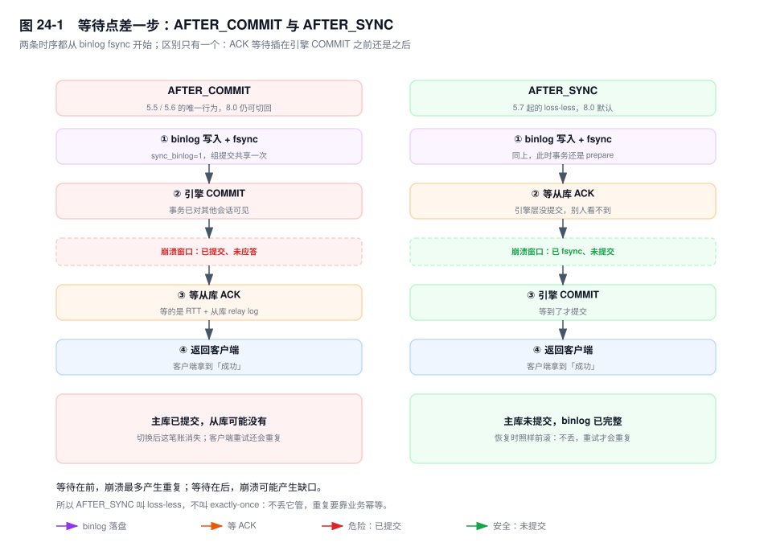
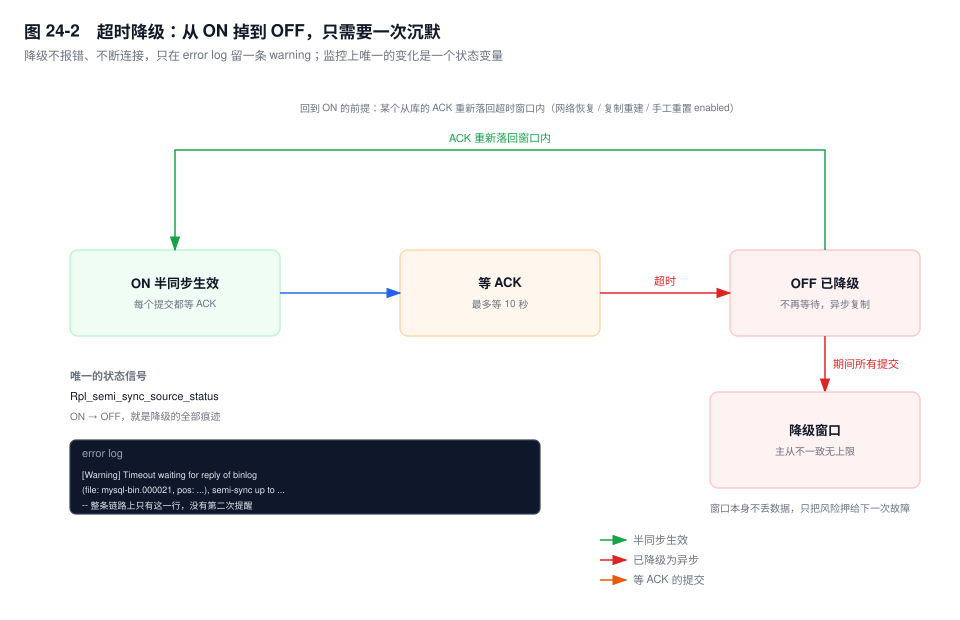

# 第 24 章　半同步与无损复制

> **一句话结论**：半同步把"客户端收到成功"的前提，从"主库写了"改成"至少一台从库收到了"；那个 ACK 插在 2PC 的哪一步之后，决定了事故是"丢一笔"还是"重一笔"。

## 24.0 场景：把 10 秒改成 1 秒

切换演练里最刺眼的一幕：给从库压上延迟，主库（source）下单接口的 P99 跟着从库一起涨，最慢的一次卡满 10 秒才返回。

问题被归到一个参数上：`rpl_semi_sync_source_timeout`（旧名 `rpl_semi_sync_master_timeout`）默认 10000 毫秒。一个不健康的从库（replica）能把主库的写拖住 10 秒，于是改成 1000，"让抖动快点过去"。

大促当天 21:47，从库机房网络抖了两秒。1 秒的超时先于网络恢复生效，主库转成异步。之后没有回来：大促的写入把从库 relay log 的写入排队打满，ACK 稳定地慢过 1 秒，主库就一直没等到过。22:27，主库宿主机内存告警，进程被 OOM killer 杀掉重启。

重启后主库从 binlog 恢复到崩溃前一刻，而从库手里没有那 40 分钟里"已提交、还没发出去"的部分。对账少了 3000 多笔支付流水。

复盘只剩三句话：

- 降级没有任何告警。监控只看 `Replica_IO_Running` 和 `Seconds_Behind_Source`，这两项在降级期间恰好最正常。
- 降级本身一笔都没丢。丢的是"降级 + 又崩了一次"这个组合——降级不产生缺口，它只是撤掉了保护。
- 1 秒比大促期间 ACK 抖动的上限还低。系统于是从"异常才降级"变成"高峰就降级"。

## 24.1 承诺的边界：收到，不等于应用

把定义收窄：主库把事务的 binlog 发给从库，等到至少 N 个从库回 ACK，才向客户端返回成功。N 由 `rpl_semi_sync_source_wait_for_replica_count`（旧名 `wait_for_slave_count`）控制，默认 1。

它有三件事不承诺。

**不承诺应用。** ACK 在从库把事件写进 relay log 之后就发出，applier 还没执行这条事务。从库上 `SELECT` 读不到刚提交的那一行，不是复制坏了，是承诺本来就没走到这一步。要"读到刚写的"，只能读主库（路由见第 25 章）。

**不承诺落到从库的磁盘。** ACK 发出时 relay log 是否已经 fsync，由 `sync_relay_log` 决定，默认 10000 意味着绝大多数时候还在 page cache 里。半同步买到的是"另一台机器的内存里有这份事件"。这个差别只在"主库宕机 + 从库同时掉电"的连锁故障里显形，而那时的代价是整整一个窗口。

**不承诺不丢。** N=1 只有一份额外副本，主库和这个从库同时不可用，一样丢。

## 24.2 差一个 ACK 的位置

第 6 章把提交拆成 flush → sync → commit，第 1 章把引擎侧拆成 prepare → commit。半同步的等待点，就是插在这条链的某个位置上。



`AFTER_COMMIT`（5.5/5.6 唯一的行为，8.0 仍可切回）：binlog fsync → 引擎 COMMIT → **等 ACK** → 返回客户端。

等待的时候，事务在引擎里已经提交，别的会话能读到它。此刻崩溃，两个坏结果都可能发生：主库恢复后这条事务还在（redo 已提交、binlog 完整），客户端拿到的却是失败，重试就是重复扣款；如果主库彻底起不来、被提升的从库恰好没收到，这条别人已经读过的数据就消失了，账面上表现为"有出库、没入账"。

`AFTER_SYNC`（5.7 起，参数 `rpl_semi_sync_source_wait_point` 的默认值）：binlog fsync → **等 ACK** → 引擎 COMMIT → 返回客户端。

等待的时候事务还是 prepare 状态，别的会话看不到它。此刻崩溃，binlog 已经完整落盘，恢复时按"binlog 完整就提交"这条判据被前滚：主库有，回过 ACK 的从库也有，**不丢**；但客户端拿到的仍然是失败，重试照样重复。

这里有个容易搞反的地方：`AFTER_SYNC` 下崩溃**不是回滚**。binlog 已经 fsync，恢复一定会把它前滚。"客户端看到失败"和"数据库回滚了"是两件事，前者是应答缺失，后者是日志不完整。把这两件事混在一起，就会以为重试是安全的。

所以 loss-less 的准确含义是"不丢"，不是"不重"。它消掉的是"丢了还没人知道"，没消掉"客户端超时重试"。后者只能靠业务幂等：支付流水号做唯一键，订单号做去重表。

**`AFTER_COMMIT` 的等待在"已提交之后"，`AFTER_SYNC` 的等待在"提交之前"。位置差一步，语义差一个数量级。**

## 24.3 静默降级

`rpl_semi_sync_source_timeout` 默认 10000 毫秒。等不到 ACK 的后果不是报错，是放弃等待：主库把这批事务按异步提交掉、照常返回客户端，把 `Rpl_semi_sync_source_status`（旧名 `Rpl_semi_sync_master_status`）置 OFF，在 error log 留一行：

```text
[Warning] Timeout waiting for reply of binlog (file: mysql-bin.000021, pos: ...), semi-sync up to ...
```



降级之后主库不再等任何人。从库落后多久，窗口就有多大，没有上限。窗口本身不产生不一致，它只是把"会不会丢"押给了下一次主库故障。

恢复也不由你控制。主库要等某个从库的 ACK 重新落回超时窗口内才会回到 ON；从库侧复制断了，ACK 永远不会回来，状态就停在 OFF 上，没有任何东西提醒你。切换脚本和演练流程里该有一条：把 `rpl_semi_sync_source_enabled` 关掉再打开，强制重置一次状态。

监控看三个量，判读方式不一样：

| 变量 | 含义 | 怎么判读 |
|---|---|---|
| `Rpl_semi_sync_source_status` | ON / OFF | 告警写"OFF 持续 > 30s"，别写"出现 OFF"：网络抖一下就报会把告警调死 |
| `Rpl_semi_sync_source_no_tx` | 未等 ACK 就提交的事务数（累计） | 看增量。它直接等于"窗口里有多少笔账处于风险中"，比状态值有用 |
| `Rpl_semi_sync_source_timefunc_failures` | 计时函数调用失败次数 | 非 0 说明等待逻辑没按预期计时（虚拟化、时钟源），查"超时为什么不准"从这里进 |

`rpl_semi_sync_source_wait_no_replica`（旧名 `wait_no_slave`）默认 ON，语义是"即使当前没有半同步从库，也等到超时再降级"。设成 OFF 会让主库在从库数不足时立刻转异步，省下 10 秒，也省掉了"从库只是瞬断"时的保护。默认值是对的：宁可写慢，不要写快了却没人知道。

## 24.4 8.0 的名字与行为变化

5.7 用 `plugin_load_add = semisync_master.so` 加载，参数叫 `rpl_semi_sync_master_*`；8.0 的插件叫 `semisync_source.so` / `semisync_replica.so`，`[8.0.26+]` 参数统一成 `rpl_semi_sync_source_*`，旧名作为别名保留。同一个东西三个名字，搜文档、抄监控模板、读别人的 my.cnf，三处都可能拿到旧名。

`wait_for_replica_count` 调到 2 以上，代价不是"多等一个 RTT"，是木桶效应：一批 ACK 要等到齐，最慢的那台决定所有事务的延迟。三台从库分别 2ms、3ms、40ms，设成 3 等于给每个事务加 40ms，另外两台的存在感为零。除非有"两台同时挂"的硬要求，保持 1。

`wait_point` 在 8.0 里仍然保留 `AFTER_COMMIT` 选项，它不是历史包袱，是给 5.6 迁移留的开关。新系统没有理由设成它。

`[8.0.23+]` 有一处不体现在参数里的改动：ACK 的接收从 dump 线程挪到了独立线程。之前每个 dump 线程发完事件顺手读 socket 收 ACK，多个从库时收和发的节奏互相牵制，`wait_for_replica_count > 1` 的等法要等每个 dump 线程的读循环各自转到。独立线程之后 ACK 走自己的路径，等待方只消费计数。多从库、高并发下这是实打实的尾延迟改善。

## 24.5 损耗怎么算

不要背"半同步慢 30%"，这个数随四个变量变。单事务的增量是：

```text
Δ ≈ 网络 RTT + 从库写 relay log 的时间 + 主库唤醒等待线程的调度延迟
```

第一项是常数，第二项取决于从库 IO（`sync_relay_log=1` 时多一次 fdatasync），第三项取决于主库负载。

但**吞吐的下降不等于单事务延迟的增量**。组提交让一批事务共用一个 ACK 等待：`AFTER_SYNC` 的等发生在 sync 之后、commit 之前，等的是这一组的 leader，组里所有事务一起被解冻。并发高、组大的系统，吞吐损失远小于"每个事务都加一个 RTT"的直觉。尾延迟则一定上升——P99 至少加一个 RTT，从库在做备份或批量写入时还要加它的 IO 排队。`binlog_group_commit_sync_delay` 能把组攒大、让 ACK 摊薄，代价是每个事务多等一个 delay，两头不能同时优化。

损耗随什么变：网络 RTT（跨机房直接进关键路径）、从库 IO 能力、从库数量与 `wait_for_replica_count`、并发度与组提交批大小。

跨机房基本不可行，原因就是第一项进了关键路径：同城 0.3~1ms 可以接受，跨地域 30ms 意味着这条链路每个提交的下限就是 30ms，上面堆多少索引优化、缓存、连接池都没用，瓶颈不在数据库里。

## 24.6 它管不到的四件事

**从库读到的旧数据。** 只保证收到，不保证应用，更不保证应用到你这条连接看到的时间点。

**脑裂。** 主库被网络分区隔离，写还在进来；它等不到 ACK，超时之后降级继续收写。半同步在这里的行为恰恰是"分区久了就自己变异步"。

**多点写入。** 两个主库各等各自的从库，两台之间的冲突它一个字都管不了。

**备份。** 误删的 `DELETE` 一样同步到从库，十分钟后两份都没有。它替代不了延迟复制和全备（第 28 章）。

## 24.7 什么时候必须用，什么时候该换 MGR

必须用半同步的画像：账务、支付、订单这类"丢一笔就是事故"的链路；同城部署，RTT 在 1ms 量级；能接受单事务多几毫秒、峰值时可能多几十毫秒。

该换 MGR 的画像：需要自动选主，不再依赖外部工具的探活与仲裁；需要多数派确认，"一个从库"不够；团队能承担多一套协议、流控和运维复杂度，也能接受更高的写入延迟。

两者的分工差别不在"谁更安全"，在**选主的归属**：

| | 半同步 + 外部 HA（MHA / orchestrator） | MGR |
|---|---|---|
| 数据到达 | 主库等 N 个 ACK | 多数派认证通过才提交 |
| 选主 | 外部工具探活后执行切换 | 协议内生，多数派选出 |
| 脑裂窗口 | 有：探活有间隔，旧主可能还在收写 | 无：少数派一侧提交不了 |
| 代价 | 每个提交一个 RTT | 多一次多数派往返、只支持 InnoDB |

判据一句话：**"数据到达"和"谁是主"如果由两个系统分别负责，中间就必然有一条缝，这条缝只能靠切换脚本的严谨度去堵。** 能接受这条缝，半同步 + 外部 HA 是最省事的方案；不能接受，才轮到 MGR。

## 24.8 关键结论

1. **半同步的承诺止于"从库收到"，不到"从库应用"。** 它防的是主库宕机丢已提交事务，防不了读写分离下的旧数据。
2. **`AFTER_COMMIT` 与 `AFTER_SYNC` 的唯一区别是 ACK 等待插在引擎 COMMIT 前还是后。** 在前，崩溃最多重复；在后，崩溃可能丢。
3. **`AFTER_SYNC` 崩溃不是回滚。** binlog 已 fsync，恢复一定前滚；"客户端失败"不等于"事务没发生"。
4. **超时降级不报错、不断连接、不告警。** 唯一信号是一个状态变量和两个计数器，`no_tx` 的增量等于风险窗口里的事务数。
5. **降级撤掉的是保护，不是数据。** 缺口只在"降级 + 主库故障"同时发生时才兑现。
6. **损耗由 RTT 主导，组提交只能摊薄吞吐、摊不薄尾延迟。** 同城可接受，跨机房不可行。

## 24.9 实验验证

### 实验一：用 STOP REPLICA IO_THREAD 制造收不到 ACK

```sql
-- 从库
STOP REPLICA IO_THREAD;
-- 主库
SET GLOBAL rpl_semi_sync_source_timeout = 3000;
INSERT INTO pay_flow (flow_no, order_no, amount) VALUES ('P20261111001', 'O20261111001', 199.00);
```

预期形态（未实跑，字段含义以此为准）：语句约 3 秒后才返回成功。这 3 秒里另一个会话 `SELECT * FROM pay_flow WHERE flow_no='P20261111001'` 查不到——`AFTER_SYNC` 下事务还没提交。3 秒后 `Rpl_semi_sync_source_status` 变 OFF，`no_tx` +1。

把 `wait_point` 改成 `AFTER_COMMIT` 重跑：同样 3 秒不返回，但那 3 秒里另一个会话**查得到**这一行。一句 `SELECT` 就能看出两个等待点的差别。

### 实验二：量化 ACK 等待

```sql
SHOW GLOBAL STATUS LIKE 'Rpl_semi_sync_source_net%';
-- Rpl_semi_sync_source_net_avg_wait_time   平均等待（微秒）
-- Rpl_semi_sync_source_net_waits           等待次数
```

压测前后各取一次，差值就是这条链路的真实 RTT 加从库排队时间。换机房、换从库规格、加从库，都用这组数说话，别用"感觉变快了"。

## 24.10 常见误区

⚠️ **"开了半同步就是强一致"**
它只保证至少一台从库收到了 binlog。从库上读到的仍可能是旧值——应用在另一条线程上，延迟在另一条链路上。

⚠️ **"AFTER_SYNC 下崩了会回滚，所以重试安全"**
binlog 已经 fsync，恢复会把它前滚。客户端拿到的失败只说明应答丢了。重试必须幂等，否则就是重复扣款。

⚠️ **"超时了主库会报错，至少能看见"**
不报错。客户端照常拿到成功，只是这条事务没等 ACK。痕迹只有一条 warning 和一个状态变量。

⚠️ **"`wait_for_replica_count` 设大更安全"**
安全性提升有限（防的是多台同时挂），代价是木桶效应——最慢的那台决定全部延迟。1 是绝大多数场景的正确值。

⚠️ **"跨机房加带宽就能开半同步"**
RTT 不是带宽问题。30ms 的往返直接进每个提交的关键路径，加带宽一点都改变不了它。

## 24.11 生产 Checklist

- [ ] `rpl_semi_sync_source_enabled=ON`、`rpl_semi_sync_replica_enabled=ON` 写进配置文件，重启后核对 `Rpl_semi_sync_source_status=ON`
- [ ] `wait_point` 为 `AFTER_SYNC`；从 5.6 迁移来的实例重点核对这一项
- [ ] `wait_for_replica_count=1`，除非有明确的多副本要求
- [ ] `wait_no_replica=ON`（默认），不要在"怕慢"的压力下改成 OFF
- [ ] `timeout` 不低于正常 ACK 抖动的上限；改这个值之前先用 `net_avg_wait_time` 量一遍
- [ ] 告警：`Rpl_semi_sync_source_status` 持续 OFF 超过 30 秒；`no_tx` 增量超过阈值
- [ ] 切换与演练脚本包含"重置 enabled"和"核对 status"两步
- [ ] 业务侧幂等：支付流水号唯一键、订单状态机乐观锁——半同步不解决重复

## 24.12 延伸

- **关联章节**：第 6 章（组提交三阶段，ACK 插在哪）、第 1 章（2PC 与崩溃恢复判据）、第 22 章（复制链路与 relay log 的落盘次数）、第 25 章（并行复制与从库延迟）、第 26 章（切换流程与选主）、第 28 章（延迟复制与 PITR）。
- **面试追问**：
  - "半同步和 MGR 的差别在哪？" → 前者等一个 ACK、选主在外部；后者等多数派、选主在协议里。
  - "`AFTER_SYNC` 崩溃后事务是回滚还是提交？" → 提交，因为 binlog 已经完整。
  - "从库延迟 3 秒，半同步会怎样？" → 每个提交多 3 秒，超过 timeout 就降级，并从此不再等。
- **官方文档**：`Replication → Semisynchronous Replication`、`Semisynchronous Replication Administrative Interface`、`Semisynchronous Replication Monitoring`。
