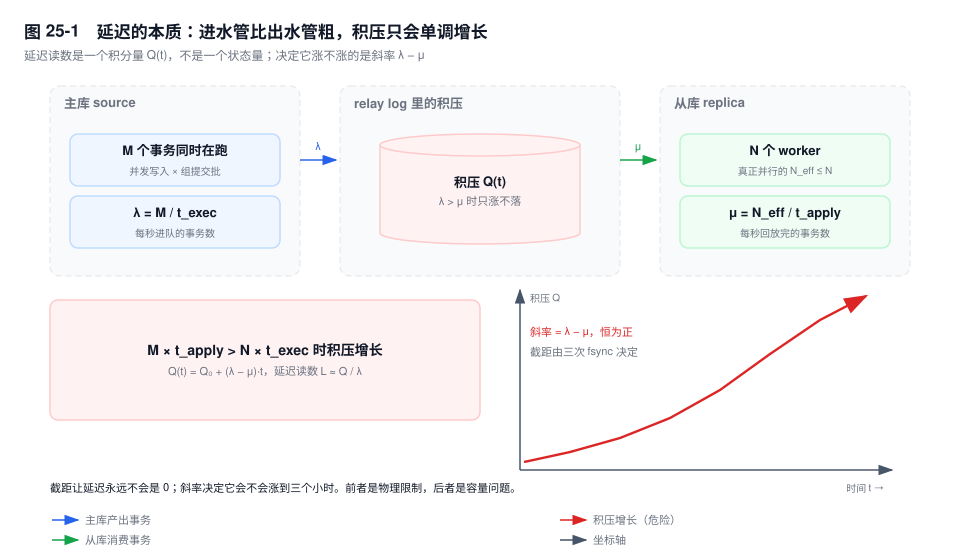
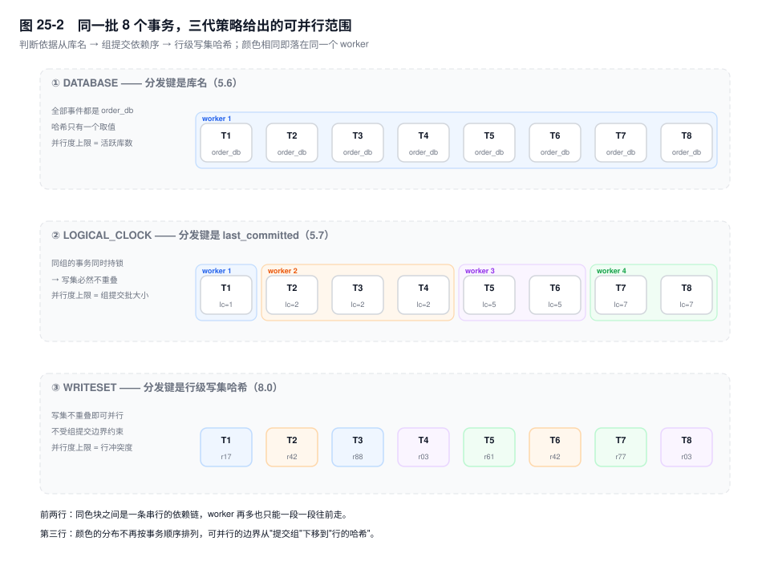
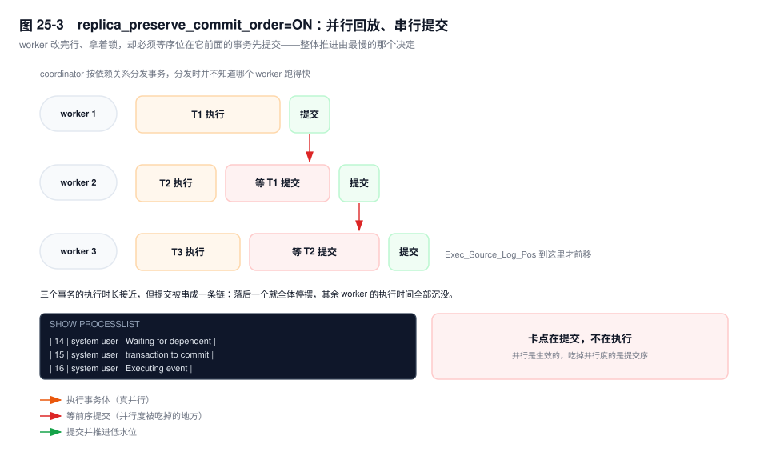

# 第 25 章　并行复制与延迟治理

> **一句话结论**：从库追不上不是某天突然坏了，是"主库产生事务的速率超过从库回放速率"这条斜率先转正；并行复制的每一招，都只是在改这个不等式里的某一项。

## 25.0 场景：16 个 worker，只有一个在改数据

大促第二天下午，订单从库的延迟读数爬到 10800 秒。运维先看线程状态，`Replica_SQL_Running`（旧名 `Slave_SQL_Running`）是 Yes；再看 `SHOW PROCESSLIST`，17 个 `system user` 线程：1 个停在 `Executing event`，15 个停在 `Waiting for dependent transaction to commit`。`replica_parallel_workers`（旧名 `slave_parallel_workers`）配的是 16，一个都没少。

第一反应是"worker 不够，加到 64"。延迟纹丝不动——那 15 个 worker 根本没在执行事务体，它们等的是同一个东西：排在前面的那个事务提交。

根因在业务侧。改单接口是 `UPDATE order_main SET status = ?, update_time = ? WHERE merchant_id = ? AND order_no = ?`，当天所有改单请求集中在几个头部商户的批量操作上。这些事务改的是同一批行，写集必然重叠，因此无论多少个 worker，都只能排成一条链，链上每个事务都要等前一个提交。第 2 个 worker 到第 64 个 worker，拿到的都是同一行的锁。

处置是第二天的事：把商户的状态字段拆到独立表、批量改单按订单号区间分批。当天能做的只有把一部分读流量切回主库——代价是主库 CPU 从 40% 冲到 70%，而大促期间主库本来就没多少余量。

## 25.1 延迟的本质：一条不等式，和一个斜率

设主库（source）同时在执行事务的平均个数为 M（并发写入连接数，配合组提交把多少个事务攒成一批），单事务在主库的平均执行耗时为 `t_exec`、在从库（replica）的平均回放耗时为 `t_apply`，从库有 N 个 worker，则两侧的速率是：

- 主库产生事务：`λ = M / t_exec`
- 从库消费事务：`μ = N_eff / t_apply`，`N_eff ≤ N` 是真正能并行的 worker 数

积压 Q 增长的条件是 `λ > μ`，两边交叉相乘得到本章唯一需要记住的不等式：

> **M × t_apply > N × t_exec 时，积压按 Q(t) = Q₀ + (λ − μ)·t 单调增长，延迟读数 L ≈ Q/λ 跟着线性上升。**



三个判断，后面每一节都是它们的推论：

**延迟是积分量，不是状态量。** 它不会因为一次抖动结束就自己回到 0。只有 `μ > λ`，积压才开始被消化，消化所需的时间是 `Q/(μ − λ)`。所以"延迟 3 小时"并不是"坏了 3 小时"，而是"积分了三小时"——故障的开始时间在曲线上，不在告警时间上。

**"平时好好的"不是安全信号。** 平时 `λ = 0.8μ`，余量 20%；大促 `λ` 翻倍，斜率瞬间为正。同一个系统、同一套参数，只是左边那一项变了。所有"某天突然"的延迟事故，都能在这条斜线上找到那天。

**截距和斜率是两件事。** 第 22 章算过的那三次 fsync 决定的是截距——延迟永远回不到 0 的那一小段。截距是物理限制，斜率是容量问题。前者改不动，后者能改，治理手段全都作用在斜率上。

不等式里有三个可调项：`M`（主库产生事务的密度）、`N_eff`（从库真正并行的有效度）、`t_exec` 与 `t_apply`（单个事务的体量）。25.2 到 25.3 在改 `N_eff` 的判定精度，25.5 在解释哪些东西把 `N_eff` 乘小了，25.7 按"改哪一项"给方案。

## 25.2 三代并行策略：凭什么判断两个事务可以并行

并行回放的前提是一个判断：这两个事务会不会互相干扰。判断得越准，能放进同一个时间窗口的事务就越多。三代策略的差别，只是判断依据的粒度。

### DATABASE：分发键是库名

5.6 引入。coordinator（8.0.26 前叫 `SQL thread`）从 `TABLE_MAP` 事件里取出表所属的库名，按库名哈希到 worker。同一个库的所有事务必然落到同一个 worker，所以 `N_eff` 的上限就是活跃库数。

**单库业务上完全无效**：分发键只有一个取值，哈希结果只有一个 worker，加到 64 个也是 1 个在干活。它被淘汰的根本原因不是"粒度粗"，而是**分发键和业务的分库方式强绑定**——分库分表之后，单实例多库、且库间完全独立的场景本来就少；剩下的多库实例里，跨库事务又让顺序没人保证。8.0.29 起这个取值被标记废弃。

代价几乎为零：主库不用多做任何事，从库只读事件里已有的库名。

### LOGICAL_CLOCK：分发键是组提交的依赖序

5.7 引入，8.0.27 起成为默认值。主库在每个事务的 GTID 事件里写两个数：`sequence_number` 单调递增，`last_committed` 是本事务开始执行前、最后一个已提交事务的 `sequence_number`。

**`last_committed` 相同的两个事务一定可以并行。** 机制在第 6 章的组提交：它们属于同一批，在同一时刻各自持有行锁、各自进入 prepare 等同一次 fsync。两个事务能同时持锁，说明它们的写集不重叠；写集不重叠，回放顺序就无关紧要。

判据的精度由组提交批大小决定。批大小 ≈ 每秒提交事务数 × 一次 fsync 的时长（再加上 `binlog_group_commit_sync_delay` 主动攒的那一段）。写入越密集、单事务越小，批越大，从库能并行的越多；一个低频写入的系统，每个事务自成一"组"，`last_committed` 严格递增，`N_eff` 退化成 1。

级联复制还有一个衰减：每多一级从库，并行度掉一档。中间那层的提交被 `replica_preserve_commit_order` 串行化了，它写进自己 binlog 的组信息是重新形成的，批比主库窄——这是"三层复制延迟越往下越大"的机制来源，不是网络。

### WRITESET：分发键是行

8.0 引入。主库对事务改过的每一行算一个哈希：库名 + 表名 + 主键值 + 被修改列的哈希，用 XXHASH64 折叠成 64 位。所有哈希存进一张长度 `binlog_transaction_dependency_history_size`（默认 25000）的表；事务提交时，查自己写过的每个哈希上一次出现在哪个事务里，取最大的 `sequence_number` 当 `last_committed`。

效果是**能识别组提交之外的可并行事务**：T1 和 T7 改的是不同表的不同行，中间隔了几百个事务，只要没有共同的哈希，两者可以拿到相同的 `last_committed`，从库就能让它们同时跑。

三个前置条件缺一不可：`binlog_format=ROW`、`transaction_write_set_extraction=XXHASH64`（8.0 默认）、`binlog_transaction_dependency_tracking=WRITESET`（8.0 默认是 `COMMIT_ORDER`，只按组提交算依赖）。只有第三个要动手改，且必须改在**主库**：从库读的是主库写进 binlog 的依赖信息，自己改没有效果。

代价也在主库：每行多一次哈希计算，每事务多一次哈希表查找。哈希表不够大时按 LRU 淘汰，被淘汰的行再次出现会被判成"有冲突"——判断偏保守，方向安全，只是并行度回落。



| 策略 | 判断依据 | 并行度上限 | 主库代价 | 失效条件 |
|---|---|---|---|---|
| `DATABASE` | 表所属库名 | 活跃库数（单库 = 1） | 无 | 单库、跨库事务 |
| `LOGICAL_CLOCK` | `last_committed` | 组提交批大小 | 无（组提交本来就在做） | 低频写入、大事务 |
| `WRITESET` | 行级写集哈希 | 行冲突度 | 每行一次哈希 + 哈希表查找 | 无主键表、热点行 |

`[8.4]` `binlog_transaction_dependency_tracking` 被移除，WRITESET 的行为成为唯一选择。从 8.0 升到 8.4 之后"什么都没改但延迟变好了"，多半是这一条。

## 25.3 replica_preserve_commit_order：不开会怎样，开了为什么会慢

并行回放最危险的后果不是慢，是顺序。

worker 各自提交时，从库对外暴露的事务顺序与主库不同。两个后果，第二个更致命：

1. **从库上会出现主库任何时刻都不存在的状态。** 主库上 T1 把订单改成已支付、T2 把账单改成已结算；从库上 T2 先提交，此刻读从库能看到"账单已结算、订单未支付"。单条 SQL 读不出问题，跨事务的一致性读、报表、对账会读出来。
2. **从库自己的 binlog 顺序错了。** 开了 `log_replica_updates` 的从库会把事务写进自己的 binlog，顺序就是提交顺序。级联的下游按这个顺序放，错误被复制一层；拿这份 binlog 做 PITR，恢复出来的中间状态是错的，而 GTID 集合看起来完全正确——这是最难被发现的一类不一致。官方把这个现象叫 gap（事务序列里的空洞），清它的命令是 `START REPLICA UNTIL SQL_AFTER_MTS_GAPS`。

`replica_preserve_commit_order=ON`（旧名 `slave_preserve_commit_order`）把提交串起来：worker 执行完事务体后不立刻提交，要等所有 `sequence_number` 比它小的事务都提交完。于是有一个反直觉的结论——**并行回放、串行提交**：并行的是执行，串行的是提交，整体推进速度由最慢的那个事务决定，而不是平均速度。



默认值：5.7 与 8.0.26 及更早默认 OFF，8.0.27 起默认 ON（同版本 `replica_parallel_workers` 的默认值也从 0 变成 4）。从 5.7 升级上来的实例里，显式写着 OFF 的配置文件很常见，这是升级后最容易漏掉的一条。

什么时候可以关，判据只有两条：

- `replica_parallel_workers ≤ 1`。此时这个参数本来就被忽略，写什么都一样。
- 这个从库是纯只读的：不开 `log_replica_updates`、不做级联、不用于 PITR，**并且**没有任何业务依赖它做跨事务一致读。四条缺一条，关掉就是拿数据一致性换那点回放速度。

反过来说，**开 `log_replica_updates` 又关 `replica_preserve_commit_order` 是自相矛盾的组合**：一边要写一份给下游用的 binlog，一边允许这份 binlog 的顺序是乱的。

## 25.4 Seconds_Behind_Master：四个具体的失真

`Seconds_Behind_Master`（8.0 另有 `Seconds_Behind_Source` 的等价列）的算法只有一行：

```text
SBM = 从库当前时间 − 最后一个被应用的事件的时间戳 − 建连时算出的两端时钟差
```

四个场景会让这个数字失去意义，每一个都能在线上复现：

1. **大事务回放期间一路涨，提交瞬间跳回 0。** 它测的是"最后一个完成的事件有多旧"，不是"还有多少活没干"。一个在主库跑了 40 分钟的事务，从库回放期间读数从 0 一路涨到 2400 秒上下，事务一提交立刻归零。
2. **主库空闲时虚高，主库繁忙时虚低。** 夜里主库没有写入，最后一个事件的时间戳是昨晚的，从库明明完全同步，读数却是几小时。反过来，主库持续高频写入时，即使从库落后一万个事务，最后一个已应用事件也只是几秒前生成的，读数只有几秒。
3. **多线程下被抹平。** 它取的是一个全局的"最后提交时间戳"，worker 之间的进度差异不单独反映：15 个 worker 跑完、1 个卡在大事务上，读数上看不出差别。
4. **时钟不同步时直接失真。** 公式里那个时钟差在 receiver 建连时算一次并缓存，之后两端 NTP 各自漂移就不再修正。从库时钟慢 10 分钟，读数恒定多 600 秒；NTP 往回跳，读数可能变成负数并被截断成 0。

三个替代品，回答的问题不是同一个：

- **`pt-heartbeat`**：主库每秒往一张心跳表写一行时间戳，从库算 `NOW(6) - ts`。它与业务写入无关，主库空闲时也准，读数是"事件从产生到在从库可见"的真实时长。代价是要建表、要一个常驻的更新进程，而且这行写入本身也进 binlog。
- **GTID 差值**：`GTID_SUBTRACT(received, gtid_executed)` 给出"收到但没应用"的事务集合。单位是事务个数，不是秒。它回答"还差多少"，不回答"还差多久"：一万个事务可能是两秒，也可能是两小时。
- **`performance_schema`**：8.0 的 `replication_applier_status_by_worker` 每一行都带着该 worker 正在处理的那个事务在主库的提交时刻，可以直接算"这个事务已经等了多久"。这是几个指标里唯一能定位到单个事务的。

```sql
SELECT w.WORKER_ID,
       w.SERVICE_STATE,
       w.APPLYING_TRANSACTION                                   AS gtid,
       w.APPLYING_TRANSACTION_IMMEDIATE_COMMIT_TIMESTAMP        AS src_commit,
       TIMESTAMPDIFF(SECOND, w.APPLYING_TRANSACTION_IMMEDIATE_COMMIT_TIMESTAMP,
                     NOW(6))                                    AS txn_lag_s,
       TIMESTAMPDIFF(SECOND, w.APPLYING_TRANSACTION_START_APPLY_TIMESTAMP,
                     NOW(6))                                    AS applied_for_s
FROM performance_schema.replication_applier_status_by_worker AS w
WHERE w.CHANNEL_NAME = ''
  AND w.APPLYING_TRANSACTION <> ''
ORDER BY txn_lag_s DESC;
```

`txn_lag_s` 最大、同时 `applied_for_s` 也大的那一行，就是卡住队列的事务。所有 worker 的 `txn_lag_s` 一起匀速上涨，说明不是单个事务的问题，是整体回放能力不够——回到 25.1 的不等式。`APPLYING_TRANSACTION_IMMEDIATE_COMMIT_TIMESTAMP` 是主库侧的提交时刻，`APPLYING_TRANSACTION_START_APPLY_TIMESTAMP` 是从库开始应用的时刻，两个相减就是这个事务从提交到开始被回放之间走过的真实时间，不受两端时钟差的缓存影响，但仍然要求两端 NTP 基本对齐。

## 25.5 延迟放大的四个来源：为什么是乘法

这四项的作用方式是乘法，不是加法。每一项要么把有效并行度乘上一个小于 1 的系数，要么把单个事务的耗时乘上一个大于 1 的系数。四项各让并行度减半时，叠加结果是 1/16，不是 1/4——按加法预估容量，会低估一个数量级。

**大事务。** 一个事务在 relay log 里是一整块，不可切分。主库上跑 T 秒的事务，从库要 T 秒量级才能越过；这期间新到的事务积压 `λ·T` 条，之后只能按 `N−1` 路的速率追，追回这批要 `λ·T/(N−1)` 秒。开了 `replica_preserve_commit_order` 时它还独占提交位：它没提交，后面所有已执行完的 worker 都不能提交，整条链一起冻住。第 21 章讲的是它在主库上的三种危害，这里补上第四种：在从库上它是并行度的天花板。

**无主键表。** WRITESET 的行哈希输入里有主键值，没有主键就没有稳定的行标识，算不出写集，依赖判定退回提交顺序——效果等于这张表上的事务全部串行。这是"必须加主键"最硬的理由：不是为了查得快，是为了从库能并行。

**DDL。** 从库执行 `ALTER TABLE` 要拿 MDL 排它锁，而并行 worker 可能正持有该表的 MDL 读锁，于是 DDL 要等所有在途事务结束；一旦拿到锁，后续涉及这张表的事务全部排队。差异不在语句本身——同一条 DDL 在主库和从库执行的逻辑一样——差异在它前后排着多少事务：主库上它跑在业务低峰，从库上它往往落在延迟高峰，前面还压着成千上万个待回放事务。

**唯一键冲突与外键。** 关闭或部分丢失保序时，主库上的执行顺序与从库的回放顺序不同，先执行的 `INSERT` 撞上后执行的 `DELETE` 残留的唯一键，报 1062 让 worker 停下；外键检查让子表插入去父表行上加共享锁，两个 worker 争同一父行就变成行锁等待。从库上的死锁不做重试，直接以 1213 终止，复制停住等人工介入。

## 25.6 Waiting for dependent transaction to commit 到底在等什么

这个状态出现在 `SHOW PROCESSLIST` 里 `system user` 的 worker 线程上。此刻的事务体已经执行完了：行改在 Buffer Pool 里、行锁已经持有、undo 已经写好，只差一个 `COMMIT`。而 `COMMIT` 被提交顺序管理器拦住，因为 `sequence_number` 比它小的某个事务还没提交。

**看到这个状态，说明并行是生效的。** 很容易判反：如果并行压根没开，你只会看到一个线程在 `Executing event`，根本不会有第二个 worker 存在。有 worker 停在这句话上，恰恰证明分发已经发生、多个事务已经同时在跑，瓶颈在提交顺序，不在"并行没开"。

三种形态对应三种结论：

- 15 个在 `Waiting`、1 个在 `Executing event`：一个慢事务卡住队列，去看那 1 个在执行的是什么。
- 全部在 `Waiting`、没有人在执行：卡点不在事务体，在那个正在刷盘的提交里——它可能只是慢在 `fsync`，也可能在等行锁。
- `Waiting` 与 `Executing event` 交替出现、比例均衡：并行度是健康的，延迟还在涨说明 `μ` 整体不够，回到不等式，别在提交顺序上找原因。

还有一点容易困惑：多线程下 `Exec_Source_Log_Pos` 是低水位，不是"最新那个事务的位置"，且按 `replica_checkpoint_group`（默认 512 个事务）或 `replica_checkpoint_period`（默认 300 毫秒）批量推进，看到的是台阶而不是进度条。

## 25.7 工程解法：改不等式的哪一项

| 手段 | 改哪一项 | 机制 | 代价 |
|---|---|---|---|
| 拆热点行、缩短事务 | 降 `M` 的冲突度，抬 `N_eff` | 写集不重叠，`last_committed` 才能分散 | 业务改造；读侧要聚合 |
| 主库开 `WRITESET` | 抬 `N_eff` | 依赖判定从"同组"放宽到"同行" | 主库每行一次哈希计算 |
| 加 worker | 抬 `N` 的上限 | 只有 binlog 里真有可并行事务才有效 | 每 worker 一份会话内存；超过可并行度只增加上下文切换 |
| 拆大事务 | 降 `t_apply`，解除提交位独占 | 单事务不再独占 worker 与提交序 | 见第 21 章的拆分四模式与前提 |
| 关键读走主库 | 绕过 | 不依赖从库的新鲜度 | 主库压力上升，且通常不可逆——一旦切过去很难切回来 |
| 延迟阈值熔断 | 绕过 | 超过阈值把读流量切回主库 | 阈值设低了会在主库最脆弱时把流量压上去 |

两条判断规则：

**先看 `Waiting for dependent transaction to commit` 的占比，再决定加不加 worker。** 15 个 worker 都停在 `Waiting`，说明可并行的事务已经被分发完了，加 worker 只是多几个排队的人；反过来，worker 全部在 `Executing event` 而延迟还在涨，才是真的缺 worker。

**熔断阈值按主库余量设，不按从库延迟设。** "延迟超 300 秒切 50% 读流量"这条规则，会在从库被一个大事务卡住时，把读流量压到正跑着那个大事务的主库上。做法是双阈值加冷却：先切一小部分，看主库 CPU 与连接数再决定，并设"最多切多少"的硬上限。

## 25.8 关键结论

1. **延迟是积分量，判断依据是斜率不是读数。** `M × t_apply > N × t_exec` 时积压单调增长，`Q(t) = Q₀ + (λ − μ)·t`；读数 3 小时代表积分了 3 小时，不代表坏了 3 小时。
2. **三代策略的差别是"凭什么判断两个事务可以并行"**：库名（单库恒为 1）、组提交的 `last_committed`（上限是批大小）、行级写集哈希（上限是冲突度）。主库的 `binlog_transaction_dependency_tracking` 决定从库能拿到多少并行度，从库改这个参数无效。
3. **`replica_preserve_commit_order` 保护的是顺序而不是速度**：不开会出现主库从未存在过的中间状态，以及一份顺序错乱、让级联与 PITR 全部失效的从库 binlog。开了之后是"并行回放、串行提交"，推进速度由最慢的那个事务决定。
4. **`Seconds_Behind_Master` 只在"无大事务、主库持续写入、时钟对齐"三条同时成立时才近似可用**；生产上以 `pt-heartbeat` 为主指标，用 `replication_applier_status_by_worker` 定位到具体事务。
5. **延迟放大是乘法**：大事务独占提交位、无主键表退化为串行、DDL 阻塞后续、唯一键与外键制造锁等待，四项各减半就是 1/16。
6. **`Waiting for dependent transaction to commit` 说明并行生效、瓶颈在提交序**，不是并行没开。判读方向搞反，会一路加 worker 而毫无效果。

## 25.9 实验验证

### 实验一：看见并行度到底是多少

```sql
-- 主库：8 个会话并发更新不同商户的订单
-- 从库：观察 worker 都在干什么
SELECT WORKER_ID, SERVICE_STATE, APPLYING_TRANSACTION
FROM performance_schema.replication_applier_status_by_worker
WHERE CHANNEL_NAME = '';

SELECT ID, STATE, TIME FROM information_schema.PROCESSLIST
WHERE USER = 'system user' ORDER BY ID;
```

预期形态（未实跑，字段含义以此为准）：`replica_parallel_workers=16` 时不一定有 16 行 worker，`SERVICE_STATE` 为 `ON` 的行才是活着的；`STATE` 列里 `Executing event` 的行数就是此刻的真实并行度。把 8 个会话改成更新同一个商户的同一批行，`Executing event` 会掉到 1，`Waiting for dependent transaction to commit` 涨到 7——这就是 25.0 的形态。

### 实验二：同一个 binlog，两种依赖信息

```bash
# 主库 binlog_transaction_dependency_tracking=COMMIT_ORDER 时导出
mysqlbinlog -vv --base64-output=DECODE-ROWS mysql-bin.000012 | grep -E "last_committed|sequence_number" | head -20
# 改成 WRITESET 重跑一轮压测后，再导出
```

预期形态（未实跑）：`COMMIT_ORDER` 下 `last_committed` 呈严格阶梯（每个事务的 `last_committed` 等于前一个的 `sequence_number`），说明没有任何跨组并行；`WRITESET` 下会出现多个事务共享同一个 `last_committed`，且这些事务在时序上并不相邻。

### 实验三：大事务造成的读数跳变

```sql
-- 主库：一次改 200 万行（分批会破坏实验目的，仅测试库执行）
UPDATE order_main SET update_time = NOW() WHERE create_time < '2026-01-01';
-- 从库：每 5 秒采样一次
SHOW REPLICA STATUS\G
```

预期形态（未实跑）：事务提交前，从库的 `Seconds_Behind_Master` 从 0 缓慢爬升，`Exec_Source_Log_Pos` 完全不动；事务提交瞬间读数跳回 0。按主键区间切成 200 批重跑，锯齿消失，读数稳定在一个非零的小值上——那是截距的量级。

## 25.10 常见误区

⚠️ **"延迟高就是 worker 不够，加就完了"**
worker 只在"binlog 里存在可并行事务"时才有效。所有 worker 都停在 `Waiting for dependent transaction to commit` 时，加 worker 只是让队伍更长。判断依据是 `Executing event` 的行数，不是 `replica_parallel_workers` 的配置值。

⚠️ **"`Seconds_Behind_Master` 归零就是追平了"**
归零有三种可能：真的追平、刚刚提交完一个大事务、两端时钟差把读数吃掉了。它不看"还剩多少事务没应用"，只看"最后一个完成的事件有多旧"。

⚠️ **"开了并行复制，从库就能扛住主库的写入量"**
并行度由主库写进 binlog 的依赖信息决定，从库只是消费者。主库没开 `WRITESET`、事务又都挤在少数热点行上，从库的 `N_eff` 就是 1，worker 数与它无关。

⚠️ **"开了 `replica_preserve_commit_order`，从库的数据就一定对"**
它只保证"提交顺序与主库一致"，不保证内容一致。过滤规则、跳过的错误事务、`replica_exec_mode=IDEMPOTENT` 掩盖的冲突，都会让数据错，而顺序依然完美。

⚠️ **"从库延迟是网络问题"**
网络只影响 receiver 那一段，表现是 `Replica_IO_State` 停在连接类状态、`Replica_IO_Running` 不是 Yes。回放侧的延迟与网络无关。

## 25.11 生产 Checklist

- [ ] `replica_parallel_workers > 1`，且 `replica_preserve_commit_order=ON`；配置文件里没有从 5.7 带过来的显式 OFF
- [ ] 主库 `binlog_transaction_dependency_tracking=WRITESET`、`transaction_write_set_extraction=XXHASH64`、`binlog_format=ROW` 三者同时成立
- [ ] 延迟监控以 `pt-heartbeat` 为主指标，`Seconds_Behind_Master` 只作参考，并对"读数突然归零"单独告警（可能是大事务刚结束，也可能是复制中断）
- [ ] 告警里带"延迟变化速率"，持续每秒涨 1 秒的从库永远不会自己恢复
- [ ] 业务表全部有主键；无主键表单独列出并评估它对并行回放的影响
- [ ] 单事务修改行数有上限并纳入发布检查（见第 21 章），大事务在 binlog 体积监控里提前发现
- [ ] 从库延迟熔断阈值按主库余量设置，带冷却时间与最大切流比例，避免把主库打垮
- [ ] `Exec_Source_Log_Pos` 与 `Retrieved_Gtid_Set` 差值纳入监控，区分"收不到"与"放不完"

## 25.12 延伸

- **关联章节**：第 6 章（组提交三阶段，`last_committed` 的物理来源）、第 21 章（大事务的拆分模式与前提）、第 22 章（三线程模型与延迟下限）、第 23 章、第 24 章（半同步只承诺"收到"）、第 26 章（延迟对切换 RTO 的影响）。
- **面试追问**：
  - "从库延迟三个小时，16 个 worker 只有一个在跑，怎么排查？" → 看 `Waiting for dependent transaction to commit` 的占比判断瓶颈在提交序还是回放能力，再看热点行的写集冲突。
  - "`LOGICAL_CLOCK` 凭什么认为同一组提交的事务可以并行？" → 它们同时持锁、同时进 prepare，写集不重叠；`last_committed` 相同即同组。
  - "`WRITESET` 比 `LOGICAL_CLOCK` 多解决了什么？" → 能识别组提交之外的可并行事务，判据从"同组"下移到"同行"。
- **官方文档**：`Replication → Replication Threads → Replica Parallelization`、`Replication → Replication and Transaction Inconsistencies`（gap 与 `preserve_commit_order`）、`Replication → Replica Server Options and Variables`（`replica_parallel_workers` / `replica_preserve_commit_order`）、`Performance Schema → Replication Tables → replication_applier_status_by_worker`。
