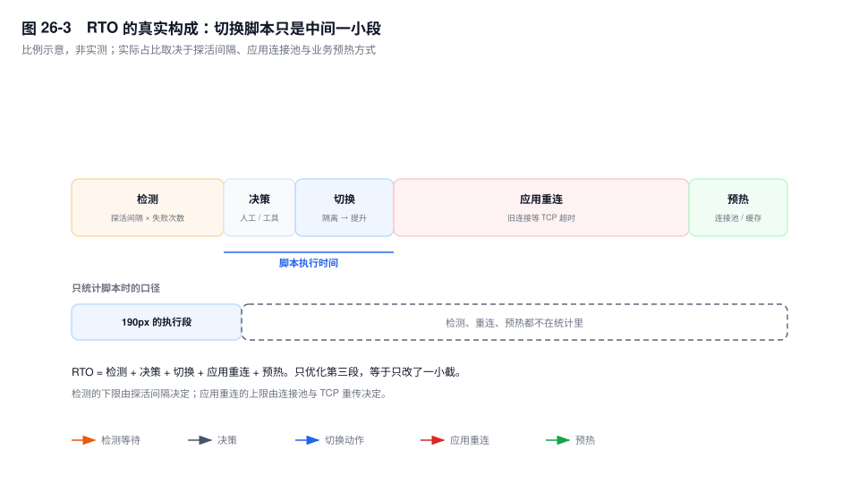
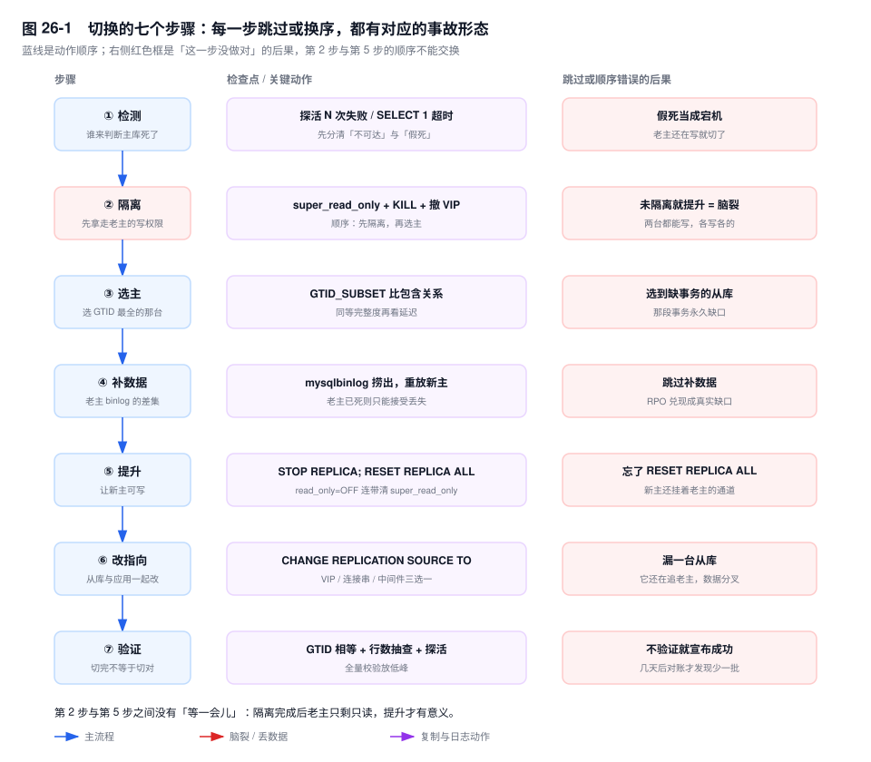
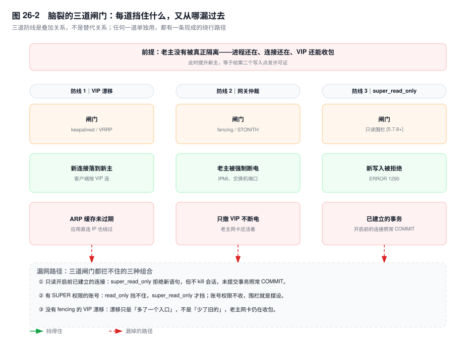

# 第 26 章　高可用架构与故障切换

> **一句话结论**：RPO 由最后一次 ACK 决定，RTO 由探活间隔和应用重连决定；切换脚本只负责把"谁写"换个地方，它既不补数据，也不重建连接。

## 26.0 场景：22 秒切完，4 分钟后业务才回来

周六早上 7:14，支付集群主库（source）所在物理机的网卡故障。MHA 的 `masterha_manager` 在三次探活失败后触发切换，日志时间戳显示从判定到新主可写用了 22 秒。DBA 在群里发了一句"已切换"，收工。

业务侧的曲线没动。支付接口的成功率从 99.9% 掉到 12%，持续了 4 分钟才自己爬回来。

原因不在数据库：应用连接池里挂着 800 条指向老主 VIP 的连接。VIP 已经漂到新主，但这些连接是 TCP 长连接，内核不知道对端网卡已经没了；发出去的请求包得不到 ACK，按 `tcp_retries2` 的默认值重传十几分钟才报错。连接池的 `connectTimeout` 只管"建连"，管不了"已建立连接上的读写"；`socketTimeout` 没配，`testOnBorrow` 也没开，坏连接一直被借出去。直到第一批连接把 TCP 重传耗尽、被池子逐条淘汰，新连接才建到新主上。

切换成功是数据库视角的结论。业务恢复是另一个计时器：**检测 + 决策 + 切换 + 应用重连 + 预热**，任何一段没走完，用户看到的就是故障。

## 26.1 机制

### 26.1.1 RPO 与 RTO：落到机制上才有意义

**RPO 不是"配了半同步就等于 0"，而是"最后一次 ACK 成功的事务之后，所有已提交但没被任何可提升副本持久化的事务"。**

半同步的 ACK 在从库（replica）把事件写进 relay log 之后发出（第 24 章），applier 可能还没执行。`AFTER_SYNC` 下，主库等 ACK 才做引擎 COMMIT、才返回客户端，客户端拿到"成功"的事务至少有一台从库收到；这台从库活着并被提升，RPO=0。`AFTER_COMMIT` 下，引擎先提交再等 ACK，等待期间别的事务已能读到这笔数据；主库彻底损坏、被提升的从库又没收到，这笔"别人已看见"的数据就消失，RPO>0。

三个开关会把 RPO 从 0 拉走：

- `rpl_semi_sync_source_timeout` 到期静默降级为异步（第 24 章），降级期间的提交没有副本保证。
- ACK 只承诺"写进 relay log"，默认 `sync_relay_log=10000` 不保证落盘；主库和这台从库同时掉电就没了。
- `wait_for_replica_count=1` 只买一份副本，两台一起不可用照样丢。

**RTO 不是"切换脚本跑多久"，而是"从最后一次正常服务，到业务重新稳定"的总和。** 它由五段组成：

```text
RTO = 检测（探活间隔 × 失败次数）
    + 决策（人工确认 / 工具策略）
    + 切换（隔离 + 选主 + 补数据 + 提升 + 改指向）
    + 应用重连（旧连接失效 + 新连接建立 + 重试）
    + 预热（连接池、Buffer Pool、缓存、限流器）
```

第三段最容易度量，团队往往只盯着它。真正失控的是第一段和第四段：探活间隔 10 秒、连续 3 次失败，检测下限就是 30 秒；800 条半开连接，按 TCP 重传算是分钟级。**把 RTO 压到 30 秒，先要压的是这两段，不是把切换脚本改快 2 秒。**



| 级别 | 典型业务 | RPO | RTO | 要付的成本 |
|---|---|---|---|---|
| L1 | 支付、账务、余额 | 0 | < 30 秒 | `AFTER_SYNC` 半同步 + 同城第三副本 + 自动 fencing + 应用秒级重连 + 定期演练 |
| L2 | 订单、库存 | 秒级 | < 1 分钟 | 半同步或异步 + GTID 选主 + 中间件路由；少量丢单靠对账补 |
| L3 | 报表、归档、日志 | 分钟级 | < 30 分钟 | 异步复制 + 人工切换；不配自动选主，省钱 |

同城双活能扛 RPO=0：同城 RTT 在 1ms 量级，半同步的 ACK 进关键路径还能接受。两地三中心不行，跨地域 RTT 几十毫秒，同步复制会把每个提交拖到几十毫秒；这类架构通常接受分钟级 RPO，用异步复制加延迟从库兜底。

### 26.1.2 方案全景：谁探活、谁选主、谁承担脑裂

方案拆成三个动作：**探活**（怎么判断主库死了）、**选主**（凭什么指定新主）、**隔离**（怎么保证老主不再写）。谁负责哪个动作，决定脑裂风险落在哪。

| 方案 | 检测方式 | 选主依据 | 数据丢失风险 |
|---|---|---|---|
| 双主 + Keepalived | `vrrp_script` 调脚本探活 | 没有选主，VIP 漂移 | 高：双写窗口两边各写一批 |
| MHA | `masterha_manager` 周期探活 + SSH | relay log 最靠前，位点/GTID 校验 | 中：补 binlog 成功则小 |
| Orchestrator | 直连探活 + `orchestrator-agent` | GTID 最全 + 拓扑规则 | 低到中：取决于是否补完差集 |
| MGR + Router | 组成员互相探活 | 协议内多数派选举 | 低：少数派提交不了 |
| ProxySQL / MySQL Router | 后端健康检查 | 不选主，只路由 | 取决于背后的复制 |
| 云 RDS 高可用 | 平台探活 | 平台内部 | 取决于套餐 |

| 方案 | 脑裂风险 | 运维复杂度 | 适用规模 | 现状 |
|---|---|---|---|---|
| 双主 + Keepalived | 最高：VIP 可能两边都在 | 低 | 小规模、同机房 | 存量多，事故多 |
| MHA | 中：隔离靠 SSH 脚本 | 中 | 几十套实例 | 社区停止更新，最后版本 0.58 |
| Orchestrator | 低到中：有 RAFT 与 agent | 高 | 上百套实例 | 社区活跃 |
| MGR + Router | 低：多数派才能提交 | 高 | 新系统、金融级 | 官方主推，细节见第 27 章 |
| ProxySQL / MySQL Router | 不解决，只做路由 | 中 | 作为接入层 | 活跃 |
| 云 RDS 高可用 | 平台负责 | 低 | 不想自建 | 主流，代价是不可见 |

MHA 最后版本 0.58，社区已停止更新。它不是不能跑，是出问题没人修：依赖 SSH 免密和 Perl 模块，GTID 下选主仍要人工核对集合。迁移有两条路：保留主从就换 Orchestrator，接走探活、选主、拓扑发现；能改架构就上 MGR / InnoDB Cluster，把选主收进协议。

Orchestrator 的价值在拓扑：它维护主从关系图，用 RAFT 让多个节点对"谁是主"有一致看法，`orchestrator-agent` 在被管实例上执行动作；GTID 下按集合完整度选主，切换前查 errant。代价是组件多，它自己挂了自动切换就没了。

ProxySQL 与 MySQL Router 不选主：探活后端、把读写分到主从、新主确定后把写流量切过去。**新主是谁，仍要由 MHA、Orchestrator、MGR 或人决定。** 把中间件当 HA 方案，等于把选主留空。

云 RDS 把探活、选主、VIP/DNS 切换收进平台，代价是过程不可见：切换花了多久、老主是否真隔离、有没有丢事务，通常只有一个"切换完成"事件。RPO/RTO 要按套餐承诺验收。

### 26.1.3 七步切换：每一步的检查点与失败形态



命令用 8.0 语法；`STOP SLAVE` / `CHANGE MASTER TO` / `RESET SLAVE ALL` 仍可用，新脚本不要再写。

**第 1 步：检测。** 三个信号：端口不可达、`SELECT 1` 超时、从库 `Replica_IO_Running=No`。连续 N 次失败才判定，单次多半是抖动。最难的是假死：进程在、端口在、`SELECT 1` 不返回。此时"重启"比"切换"危险——老主可能还在写，重启会回滚未落盘事务，而新主已提升。

检查点：`mysqladmin ping` 与 `SELECT 1` 都失败；从库 `Last_IO_Error` 是 2013/2003，不是 1236。

失败会怎样：把假死当宕机，老主还活着就切，两台都能写。

**第 2 步：隔离。** 顺序是：`SET GLOBAL super_read_only=ON` → `SET GLOBAL read_only=ON`（前者隐式设后者）→ 查 `information_schema.innodb_trx`，等在跑的事务结束，等不到就 `KILL CONNECTION` → 撤 VIP → `iptables` 封 3306。

为什么先隔离：提升是给新主写权限，隔离是拿走老主写权限；先给后拿，中间两个都能写。`super_read_only`（`[5.7.8+]`）只拒绝新语句，不 kill 会话，也不中断已在跑的事务；所以还要 `KILL`，并等 `innodb_trx` 清空——一个 40 分钟的对账事务，会让切换卡在"只读已开、仍在提交"（第 21 章）。

检查点：`@@global.super_read_only` 为 1；`SHOW PROCESSLIST` 没有业务连接；VIP 不在老主网卡；`innodb_trx` 为空。

失败会怎样：只开 `read_only` 没 `KILL`，老主上已建立的事务照常提交；或者切换工具为了提升执行 `SET GLOBAL read_only=OFF`，连带关掉 `super_read_only`（第 22 章），隔离前功尽弃。

**第 3 步：选主。** 先排 errant：在候选上执行 `GTID_SUBTRACT(@@GLOBAL.gtid_executed, '<老主的集合>')`，必须为空。再比包含：A 包含 B 等价于 `GTID_SUBSET('<B 的集合>', @@GLOBAL.gtid_executed)=1`，取不被任何其他候选真包含的那台。两个候选互不包含（各有对方没有的事务）就不能自动选——这已经是分叉，不是切换。

同等完整度时，选延迟最小、同机房、规格够、复制账号可用的那台。`Seconds_Behind_Source` 不能单独当依据：它可能为 0，但 `Executed_Gtid_Set` 仍缺一段；延迟大的那台也可能只是应用慢，事务并不缺。

检查点：`GTID_SUBSET` 结果；`Replica_SQL_Running=Yes`；候选的 `gtid_purged` 不高于老主，否则老主回来接不上（第 23 章）。

失败会怎样：选了缺事务的从库，那段事务永久丢；选了有 errant 的从库，提升后 errant 扩散到全集群。

**第 4 步：补数据。** 老主还活着：`FLUSH BINARY LOGS`，记下 `SHOW MASTER STATUS` 的 `Executed_Gtid_Set`，再用 `mysqlbinlog --include-gtids='<差集>'` 把缺的事务捞出来，重放到新主。重放前在新主上 `STOP REPLICA` 并临时关 `super_read_only`；它还没接流量，风险可控。重放要在改指向之前完成，否则其他从库先接上来，会在缺数据的状态下继续追。

老主死了：没源可捞，差集就是丢失量。**这一步是 RPO 的兑现时刻**——前面所有承诺，到这里变成"少了几笔、能不能对上"。

检查点：新主 `gtid_executed` 包含老主最后记录的集合；`GTID_SUBTRACT(老主集合, 新主集合)` 为空。

失败会怎样：跳过这步直接提升，新主缺一段，其他从库接上来后也缺，链路没有任何报错。

**第 5 步：提升。** `STOP REPLICA; RESET REPLICA ALL; SET GLOBAL read_only=OFF;`。`RESET REPLICA ALL` 清掉指向老主的连接元数据；`SET GLOBAL read_only=OFF` 会连带清掉 `super_read_only`。配置文件里的 `read_only` / `super_read_only` 也要改，否则下一次重启新主又变只读。

检查点：`read_only` 与 `super_read_only` 都是 0；`SHOW REPLICA STATUS` 为空；配置文件已改。

失败会怎样：忘了 `RESET REPLICA ALL`，新主还挂着老主的复制通道，老主恢复后可能反向覆盖；只改运行时没改配置，重启后业务全挂。

**第 6 步：改指向。** 其余从库逐台执行：

```sql
STOP REPLICA;
CHANGE REPLICATION SOURCE TO
  SOURCE_HOST='10.0.3.12', SOURCE_PORT=3306,
  SOURCE_AUTO_POSITION=1;
START REPLICA;
```

应用侧三条路：改连接串（最慢，要发布）、VIP 漂移（快，受 ARP 影响）、中间件改后端（最快，但要确认健康检查已认出新主）。

检查点：每台从库两个 `Replica_*_Running=Yes`、`Last_IO_Error` 为空；`Source_Host` 是新主；应用新连接查到的 `@@server_uuid` 是新主。

失败会怎样：漏一台从库，它还在追老主，数据分叉；应用长连接没断，还在往老主写，只读后报 1290，业务报错但监控可能显示"正常"。

**第 7 步：验证。** 粗校验：其他从库追平后 `GTID_SUBTRACT(新主.executed, 从库.executed)` 为空；关键表 `COUNT(*)` 与基线比；支付、账务表按时间窗口抽查最近一批；业务探活返回成功。全量 `pt-table-checksum` 放低峰。

检查点：GTID 集合一致、行数差异在预期内、业务写入成功、复制延迟归零。

失败会怎样：不验证就宣布成功，几天后对账才发现少一批，已无法判断是哪一步丢的。

### 26.1.4 脑裂：不是"两台都是主"，是"两台都在写"



脑裂要三个条件同时成立：老主没被真正隔离、新主已提升、两边都还有写入路径。老主"还活着"不够，必须"还能写"。被 `super_read_only` 锁住的老主，进程还在也不构成脑裂。

三道防线的缺口：

- **VIP 漂移。** 挡住"按 VIP 连的新连接"，漏掉 ARP 缓存：客户端和交换机的 ARP 表、MAC 表有老化时间，VIP 漂过去后，一部分机器仍把老 IP 解析到老 MAC；应用直连 IP 的完全绕过 VIP。
- **网关 / 仲裁（fencing，STONITH）。** 挡住"老主还能收包"本身：IPMI 断电、交换机端口 disable、云安全组封禁。这是唯一能保证"老主物理上不能写"的手段。漏掉"只撤 VIP 不断电"——VIP 只是入口，不是电源。
- **`super_read_only`。** 挡住"新语句写入"，漏掉两类：有 `SUPER` 权限的账号，`read_only` 挡不住，只有 `super_read_only` 挡得住；**开启只读前已建立的连接和已在跑的事务**——它拒绝新语句，不 kill 会话，一个 `BEGIN` 后已执行过 `UPDATE` 的事务照样能 `COMMIT`。

第二类最容易被忽略：隔离完，`innodb_trx` 里还有一条跑了半小时的事务，它提交那一刻，老主就比新主多一段。所以隔离的最后一步不是"设只读"，是"事务清空"。

脑裂之后的数据修复，先算两个差集：

```sql
-- 在老主上执行，得到「只有老主有」的事务
SELECT GTID_SUBTRACT(@@GLOBAL.gtid_executed, '<新主的 gtid_executed>') AS only_on_old;
-- 在新主上执行，得到「只有新主有」的事务
SELECT GTID_SUBTRACT(@@GLOBAL.gtid_executed, '<老主的 gtid_executed>') AS only_on_new;
```

两个集合通常不相交，因为是两台机器各自分配的 GTID。用 `mysqlbinlog --include-gtids='<集合>'` 读出每边改了什么，判断和另一边有没有冲突。保留哪边是业务判断：支付流水以"钱实际到账"为准，订单状态以"用户看到"为准。补完数据，再用空事务把不保留那侧的 GTID 消费掉（第 23 章），否则它会作为 errant 永久留在集群里。

### 26.1.5 数据校验与补齐：先粗后细，先读后写

**切换后立刻做粗校验**：关键表行数、最近一小时单据数、支付流水按 `flow_no` 抽查、GTID 集合相等。这些查询要在分钟级跑完，目的是"能不能开流量"，不是"证明完全一致"。

**业务低峰做全量校验**：`pt-table-checksum`。原理是分块 checksum：按主键或唯一索引把表切成 chunk，在主库对每个 chunk 执行一条聚合查询（列做 `CRC32`，加 `COUNT(*)`），结果写进 `percona.checksums`；同一条查询通过复制在从库用自己的数据再算一遍，两边比对。它读全列、全行，每个 chunk 都是一次范围扫描，对主库 IO 和 Buffer Pool 是实打实的压力；用 `--chunk-size` 控制单块行数，`--max-lag` 在复制延迟超阈值时暂停，`--max-load` 在负载高时退让。

前提是"聚合查询以语句形式复制到从库重算"。全 ROW 环境下先在小表验证工具行为，别直接对大表跑——如果从库只是收到主库算好的结果，校验就成了自欺欺人。

`pt-table-sync` 负责修。它生成 `REPLACE` / `DELETE` / `UPDATE` 直接写数据；默认按你给的一端为准，`--sync-to-master` 以主库为准修从库。**先 `--dry-run` 或 `--print` 看它准备执行什么**，再单表、小批量跑。风险有二：写从库时，从库短暂地"比主库新"，读流量可能读到修复中的中间状态；写主库时，变更随复制下去，可能和复制线程撞行。修复完必须再跑一次 checksum。

基于 binlog 的补偿适合"知道缺哪一段"：从老主 binlog 里按 GTID 捞出差集，重放到新主。它比 `pt-table-sync` 精确：重放的是原始事务，不是工具猜出来的行差异；代价是 binlog 还在，重放顺序不能乱。

### 26.1.6 中间件：健康检查的三种语义与连接风暴

ProxySQL 的 `check_type` 有三个常用值，语义差别很大：

| 检查 | 实际动作 | 能发现 | 发现不了 |
|---|---|---|---|
| `connect` | TCP 三次握手 | 端口不通、进程没了 | 进程在但不响应、只读角色变了 |
| `ping` | 发 `COM_PING` | 进程能处理协议包 | SQL 层卡死、复制断了 |
| `read_only` | 查 `SELECT @@read_only` | 角色变了（主变从、从变主） | 有 SUPER 的账号仍能写、假死 |

三个都要开，`read_only` 是切换后把写流量引到新主的关键；`connect` 单独用会把"假死"当成"活着"。`replication_lag` 检查用 `SHOW SLAVE STATUS` 判断延迟，适合摘读流量，不适合判断主库死活。

读写分离规则靠 `mysql_query_rules`：按正则匹配 `SELECT` / `INSERT`，给不同的 `destination_hostgroup`；主库组和从库组用 `read_only` 检查区分。规则写错会把写发到从库，报 1290，这类事故在切换当天特别多：老主变成从库后 `read_only=ON`，规则还按旧主机组在发。

**连接风暴**最容易打满新主。应用侧几百上千条连接同时失效，重连线程同一秒涌向新主；ProxySQL 的多路复用能把"应用连接数"和"后端连接数"解耦，但解不干净——事务中的连接不能被复用，切换后第一批全是新事务。要做三件事：新主 `max_connections` 预留老主峰值；连接池设最大池大小、预热和获取超时，重连加随机退避；入口限流，别让重试流量超过新主容量。

### 26.1.7 演练 SOP 与八个失败点

演练是在真实应用上验证五个计时器。SOP 包含：窗口与回滚方案、切换前基线（GTID、行数、连接数）、按 26.1.3 七步执行并记录时间戳、切换后业务探活、观察 30 分钟再回切。产出的是 RTO 分段数据，不是一句"切换成功"。

八个失败点都在演练里出现过：

| 失败点 | 现象 | 机制 | 处置 |
|---|---|---|---|
| DNS 缓存未过期 | 应用连到老 IP | JVM/操作系统按 TTL 缓存解析结果 | 用 VIP 或服务发现，别把地址写死在 DNS；TTL 秒级也要应用配合 |
| 长连接未断 | 应用还打老库 | TCP 半开连接，内核按 `tcp_retries2` 重传 | 隔离时 `KILL`，应用配 `socketTimeout`，连接池开保活 |
| 应用未实现重连 | 池里坏连接一直借出 | 缺 `testOnBorrow` / `validationQuery` | 开借出检测，`maxLifetime` 短于基础设施回收时间 |
| VIP 漂移后 ARP 未更新 | 部分客户端仍打老主 | ARP 缓存、交换机 MAC 表老化 | 漂移后发免费 ARP；关键链路用 fencing，不只靠 VIP |
| GTID 不一致导致新从库接不上 | 1236，`purged binary logs` | 新主 `gtid_purged` 超过从库所需起点 | 切换后 24 小时内不 purge；按第 23 章校验两个集合 |
| 双主自增冲突 | 1062 主键冲突 | 两端 `auto_increment_increment` / `offset` 相同 | 双主必须配互补的 increment/offset；切单主后改回 1/1 |
| 时区 / 字符集不一致 | 时间差 8 小时、中文乱码 | 会话状态随事件走，但 DDL 默认值、`CONVERT_TZ` 依赖实例配置 | 主从 `time_zone`、`character_set_server`、`collation_server` 一致；装 tzinfo |
| 只读从库上的定时任务失败 | 1290，任务不执行 | `event_scheduler` 或外部任务写从库 | 从库关 `event_scheduler`，定时任务只连主库或单独的任务库 |

## 26.2 关键结论

1. **RPO 的边界是"最后一次 ACK"，不是"最后一次提交"。** `AFTER_SYNC` 下客户端拿到成功时至少一台从库已收到，RPO=0；`AFTER_COMMIT` 下已提交但未 ACK 的事务在切换时可能消失，RPO>0。
2. **RTO 的大头在检测和应用重连，不在切换脚本。** 探活间隔 × 失败次数是检测的下限；半开 TCP 连接的重传时间是重连的上限。只优化脚本，等于只改了一小截。
3. **切换的顺序是"先隔离、后提升"，反过来就是脑裂。** 隔离的完成标志不是 `super_read_only=ON`，是 `innodb_trx` 清空；只读不 kill，已建立的事务照样提交。
4. **选主看 GTID 包含关系，不看延迟。** `GTID_SUBSET` 判断超集，互不包含就是已经分叉，必须停下来人工判断。
5. **半同步不等于不丢。** 超时降级、ACK 未落盘、唯一副本同时故障，都会把 RPO 从 0 拉走；它保证的是"收到"，不是"应用"，更不是"永远有一份"。
6. **切换成功不等于业务恢复。** 数据库可写只是第三段结束；应用连接、连接池、缓存、限流器都就位，RTO 才停表。

## 26.3 实验验证

### 实验一：证明 `super_read_only` 拦不住已在跑的事务

```sql
-- 会话 A：开事务并写入，不提交
BEGIN;
UPDATE settle_db.bill SET state = 2 WHERE bill_no = 'B20261111001';

-- 会话 B：隔离老主
SET GLOBAL super_read_only = ON;
SELECT @@global.read_only, @@global.super_read_only;   -- 1, 1

-- 会话 A：继续提交
COMMIT;   -- 成功
```

预期形态（未实跑，字段含义以此为准）：会话 A 的 `COMMIT` 成功，行状态变成 2。`super_read_only` 在语句入口检查，`COMMIT` 不是一条需要写权限的新语句，不会被拦。把会话 A 换成"提交前先执行一条新 `UPDATE`"，那条会报 1290。

隔离必须配 `KILL`：先查 `trx_mysql_thread_id`，对业务连接执行 `KILL CONNECTION`，再轮询到 `innodb_trx` 为空。

### 实验二：用 `GTID_SUBSET` 选主，用 `GTID_SUBTRACT` 找分叉

```sql
-- 三个候选从库各自执行，抄下结果
SELECT @@GLOBAL.gtid_executed;

-- 在新主候选 C1 上：C2 是不是 C1 的子集
SELECT GTID_SUBSET('<C2 的集合>', @@GLOBAL.gtid_executed);   -- 1 = 是

-- 在 C1 上：C2 有、C1 没有的事务
SELECT GTID_SUBTRACT('<C2 的集合>', @@GLOBAL.gtid_executed); -- 空 = 没有缺口
```

预期形态（未实跑）：完整度最高的那台，对任何其他候选的 `GTID_SUBSET` 都返回 1；两台互不包含时，两个方向的 `GTID_SUBTRACT` 都非空，这就是分叉，不能自动选主。

### 实验三：量一次 RTO 的分段

在演练脚本里给每一步打时间戳，应用侧用探活接口记录"第一个成功请求"的时间：

```bash
t0=$(date +%s.%N)          # 最后一次正常服务
# 检测、隔离、选主、补数据、提升、改指向、验证，每步后打点
t1=$(date +%s.%N)          # 新主可写
# 应用侧记录首个成功请求 t2
```

预期形态（未实跑）：`t1 - t0` 是数据库视角的切换时间，`t2 - t0` 是业务视角的 RTO，两者通常差一个数量级。把 `t2 - t1` 再拆成"连接建立"和"预热完成"，才知道下一次该优化哪里。

## 26.4 常见误区

⚠️ **"开了半同步就不会丢数据"**
半同步只承诺至少一台从库收到并写进 relay log，不承诺应用、落盘，也不承诺那台从库活着。超时降级后窗口没有上限。RPO=0 的前提是 `AFTER_SYNC` + 未降级 + 被提升的正是 ACK 过的从库。

⚠️ **"VIP 切过去业务就好了"**
VIP 漂移只影响新连接。应用池里的长连接是 TCP 半开的，写请求要等到 `tcp_retries2` 耗尽。切换脚本必须 `KILL` 老主连接，应用配 `socketTimeout` 和借出检测。

⚠️ **"RTO 就是切换脚本跑的时间"**
脚本只覆盖"检测之后、新主可写之前"；检测间隔、人工确认、应用重连、预热都不在脚本里，往往还占大头。按脚本耗时报 RTO，等于把最贵的两段藏起来。

⚠️ **"`read_only=ON` 就能防止双写"**
它挡不住 `SUPER` 账号，也挡不住开启前已建立的事务。要 `super_read_only` 加 `KILL` 加事务清空，再叠加 VIP/网关隔离。

⚠️ **"MHA 还在维护，继续用没问题"**
MHA 最后版本 0.58，社区已停止更新。它能跑，但新内核、认证插件、复制特性出问题没人修。存量系统要么把切换动作抽成 runbook，要么迁到 Orchestrator / MGR。

## 26.5 生产 Checklist

- [ ] 每个业务域标明 RPO/RTO 等级，L1 业务必须 `AFTER_SYNC` 半同步且 `wait_for_replica_count=1`
- [ ] 半同步降级有告警：`Rpl_semi_sync_source_status` 持续 OFF、`no_tx` 增量超阈值
- [ ] 探活间隔 × 失败次数 < RTO 预算的 1/3；假死判定不只看端口
- [ ] 切换脚本包含隔离四件事：`super_read_only`、`KILL`、撤 VIP、`innodb_trx` 清空
- [ ] 切换脚本包含两次 GTID 校验：候选包含老主、老主缺的那段仍在新主 binlog 里
- [ ] 新主 `max_connections` 留出老主峰值 + 重连风暴余量；应用连接池有最大大小和获取超时
- [ ] 应用侧配 `socketTimeout`、`connectTimeout`、`testOnBorrow`/`validationQuery`、`maxLifetime`
- [ ] 从库 `super_read_only=ON` 写进配置文件；提升后记得改回来，否则重启又变只读
- [ ] 双主实例的 `auto_increment_increment` / `offset` 互补；切单主后改回 1/1
- [ ] 每季度一次真实应用参与的切换演练，记录 RTO 五段的时间戳

## 26.6 延伸

- **关联章节**：第 22 章（三线程与只读）、第 23 章（GTID 校验）、第 24 章（半同步 ACK）、第 25 章（延迟治理）、第 27 章（MGR 选主）、第 28 章（PITR 兜底）。
- **面试追问**：
  - "半同步能不能保证 RPO=0？" → 只有 `AFTER_SYNC`、未降级、被提升的正是 ACK 过的从库时才是 0；`AFTER_COMMIT` 下已提交未 ACK 的事务会丢。
  - "主库挂了，怎么选新主？" → 先排 errant，再用 `GTID_SUBSET` 找包含所有其他候选的那台；互不包含就是分叉，人工判断。
  - "为什么必须先隔离再提升？" → 提升给新主写权限，隔离拿走老主写权限；顺序反了，中间窗口两台都能写。
  - "RTO 为什么不是切换脚本的耗时？" → 还要算检测、决策、应用重连、预热；最容易失控的是检测间隔和半开连接的重传。
- **官方文档**：`Replication → Switching Sources and Replicas`、`Replication → GTID Functions`、`MySQL Server Administration → Server System Variables`（`super_read_only` / `read_only`）、`MySQL Router`、`Group Replication`；工具侧：MHA `masterha_manager`、Orchestrator `recover`、ProxySQL `mysql_servers`。
