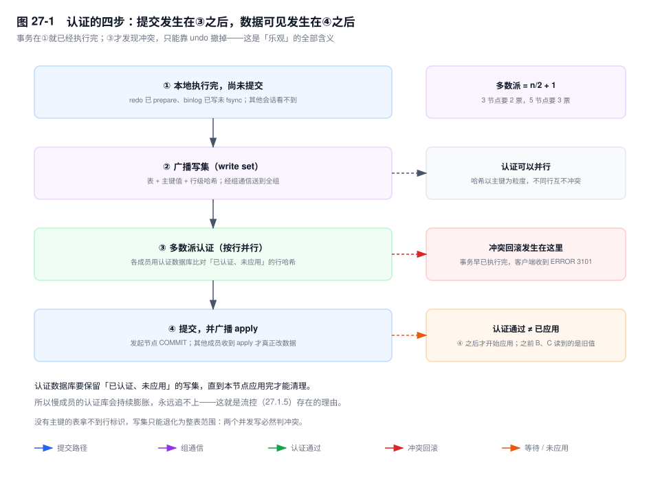

# 第 27 章　MGR 与 InnoDB Cluster

> **一句话结论**：MGR 换掉的不是复制链路，是提交规则——一个事务能不能提交，从"本地 redo 写完了"变成"全组多数派认证过了"；代价是整个组的写入速度被最慢的那个成员按住。

## 27.0 场景：切换不用人了，TPS 也回不来了

某支付系统从双主（primary/primary）+ Keepalived 迁到 MGR：三节点、单主（single-primary）模式，前端挂 MySQL Router，切换演练用 `kill -9` 打掉主节点（primary）。十几秒后 Router 把写流量挪到新主，没有人登机器，没有 VIP 漂移脚本，也没有"补数据"那一步。

上线一周后压测报告的数字不对：同样写入模型，TPS 明显下降；`SHOW PROCESSLIST` 里没有慢 SQL，CPU 和磁盘都不饱和。

指向根因的是两列数字。`performance_schema.replication_group_member_stats` 里，那台"老机器"（上一代 SSD、内存减半）的 `COUNT_TRANSACTIONS_REMOTE_IN_APPLIER_QUEUE` 降不下去，发起节点上的 `COUNT_TRANSACTIONS_IN_QUEUE` 长期非零。队列堆着，说明事务不是卡在 SQL 上，是卡在"等组"上：流控把全组的写入配额压到了最慢成员的可持续应用速度。

这不是参数没调好。这是 MGR 的固有代价第一次显形。

## 27.1 机制

### 27.1.1 它替换的是提交规则，不是复制链路

三种方案的区别，可以用一句"什么时候算提交成功"讲完：

- 异步复制：本地 redo 落盘就算提交，binlog 由 dump 线程**事后**发出去，发到哪一步与客户端无关。
- 半同步：本地 binlog fsync + 至少一个从库（replica）把事件写进 relay log 并回 ACK（第 24 章）。
- MGR：本地执行完 + 写集被组内多数派认证通过。

**MGR 把"提交"从本地事件变成了组事件。** 直接推论是：被网络分区隔到少数派那一侧的节点，连"提交"这个动作都完不成。它不需要外部工具告诉它"你已经不是主了"——写不进去本身就是判决。第 26 章那套先隔离、再选主的七步流程，在这里被协议吸收掉了。

代价是每个事务多一次组内往返与认证，开了写同步还要等别的成员应用。

### 27.1.2 认证：先执行完，才检查冲突



事务在发起节点上走的是普通 InnoDB 流程：改行、写 undo、redo 进 prepare、binlog 写入 cache——到这一步它已经"执行完"了，只差提交。此时 MGR 把它变成一个**写集**（write set）：涉及哪些表、哪些主键值、行镜像的哈希。

写集经组通信（Paxos 变体，实现叫 xcom）广播给全组。每台成员用自己的**认证数据库**（certification info）查一件事：这些行哈希，是否与"已经认证、但还没应用"的事务撞上。

多数派通过 → 发起节点提交 → 广播 apply → 其他成员把事务应用到自己的数据上。

三个后果必须记住：

**认证是乐观的，冲突只能回滚。** 检查发生在事务执行完之后：行锁早就加了，undo 已经写了。撞上冲突时唯一出路是按 undo 撤掉，客户端收到 `ERROR 3101 (HY000)`（插件要求回滚当前事务），不是锁超时，也不是语法错误。

**认证通过不等于已应用。** 认证通过的那一刻，其他成员只是把写集记进认证数据库、排进 applier 队列。此时在成员 B 上 `SELECT`，读到的仍是旧值——除非用一致性级别去等。

**行哈希是并行的前提。** 哈希以主键为粒度：改第 1 行和改第 900 行的两个事务互不冲突，可以同时认证。反过来，没有主键的表拿不到行标识，写集只能退化成整表范围，任何两个并发写都判冲突。这也是"表必须有主键"的真正原因。

### 27.1.3 `group_replication_consistency`：五个级别，五种等待

这一节决定"读到什么"，最该背下来。

| 级别 | 保证什么 | 代价 | 适用 |
|---|---|---|---|
| `EVENTUAL`（默认） | 不等待，读可能看到旧值 | 无 | 报表、列表页 |
| `BEFORE_ON_PRIMARY_FAILOVER` | 新主先应用完积压才接受读 | 只在切主后生效 | 所有集群都该开 |
| `BEFORE` | 读之前等本节点应用完已认证事务 | 读延迟 | 写后立刻读的详情页 |
| `AFTER` | 写提交后等成员应用完才返回 | 写延迟 | 支付、库存扣减 |
| `BEFORE_AND_AFTER` | 两边都等 | 最慢 | 账务核对 |

`BEFORE_ON_PRIMARY_FAILOVER` 是唯一一个平时不花钱的级别：正常运行不加任何等待，只在故障转移后拦住读请求，直到新主把积压追平。它防的正是"切过去读到更旧的数据"，半同步和异步复制都没有这个东西（[8.0.16+]）。

`BEFORE` 让读变慢，因为它要把本地 applier 队列排空——这条读才能看到"它开始之前全组已认证的所有提交"。

`AFTER` 让写变慢，因为它要等别的成员把这条事务应用完。这里有个配置陷阱：同步点只由处在非 `EVENTUAL` 级别的成员应答。把一台只读成员长期留在 `EVENTUAL`，它就不在这次等待里，`AFTER` 的覆盖范围比你以为的窄。

它解决的具体问题是"读己之写"跨会话、跨节点：写走主节点，返回后 Router 把下一条读发到成员 B。`EVENTUAL` 下 B 可能还没应用；`AFTER` 让写返回时 B 已经应用完；`BEFORE` 让那次读自己等。


### 27.1.4 单主与多主

单主（`group_replication_single_primary_mode=ON`，默认）只有一个成员接受写，认证几乎不冲突——冲突只可能出现在切换瞬间的两个写点。绝大多数生产集群停在这里。

多主（`cluster.switchToMultiPrimaryMode()`）让每个成员都能写，代价是三项：

- **冲突概率随节点数和热点重叠度上升。** 认证失败就是回滚，业务侧看到 3101，重试逻辑必须能处理。
- **自增值要重新规划。** 多主下 `auto_increment_increment` 被自动设成 `group_replication_auto_increment_increment`（默认 7），offset 按成员序号分配。自增值变稀疏，任何假设"自增连续"或"`id % 16` 分片"的代码都会错。
- **`SELECT ... FOR UPDATE` 的语义变重。** 任意成员都可能写，行锁要对所有成员成立，加锁动作要广播，一次加锁变成一次组内往返。

判据只有一条：**写负载能不能按行天然分区**（按租户、按仓库，且不同分区从不交叉写同一行）。能，多主才成立；不能，多主只是把单主的认证队列换成冲突回滚。

组通信是一条全序日志，所有事务排同一个认证队列：多主增加的是写入口，不是认证带宽。

### 27.1.5 流控：木桶效应的制度化

认证数据库要保留"已认证、未应用"的写集哈希，直到本节点应用完才能清理。一个应用慢的成员，认证库会持续膨胀——内存涨，恢复时要回放的时间也涨。放任下去，它永远追不上。

流控是对此的制度化回答：每台成员周期性广播自己的队列长度，任何一台超过阈值，全组按最小配额降速。`group_replication_flow_control_mode` 默认 `QUOTA`；`group_replication_flow_control_certifier_threshold` 和 `group_replication_flow_control_applier_threshold` 默认都是 25000；`group_replication_flow_control_hold_percent` 默认 10，是限速时留的余量。

**这是 MGR 相对异步复制最大的性能代价，也最常被忽略：异步复制里慢从库只拖自己的延迟，主库照写；MGR 里慢成员拖住全组。** 把它设成 `DISABLED` 不会让写入变快，只会把积压藏进内存和恢复时间里。

### 27.1.6 分区、驱逐与节点数

成员之间互相探活，5 秒窗口内收不到心跳就判定可疑，再加上 `group_replication_member_expel_timeout`（[8.0.13+] 可调，默认 0）的宽限期后驱逐。被驱逐的成员进入 `ERROR` 状态，**不会自动回来**——要人工 `START GROUP_REPLICATION`，且先确认它追得上。

少数派被踢出、停止服务；多数派继续。**这正是 MGR 不需要外部选主工具的原因：没有"提升"这个动作，只有"谁还在多数派里"。**

"5 节点比 3 节点更脆弱"是个流传很广的错判。多数派是 3/5，能容忍 2 台同时故障，比 3 节点容忍 1 台强；代价是每个事务的认证与应用要跨更多成员、流控对单点抖动更敏感、运维面更大。4 节点不该出现——多数派仍是 3，容忍的故障台数与 3 节点相同，流控风险却多一份。

### 27.1.7 限制清单与它们的机制原因

- **表必须有主键**：写集的行标识只能来自主键（或非空唯一索引），没有它就无法收敛到行。
- **大事务**：`group_replication_transaction_size_limit`（默认约 150MB，[8.0.20+] 可动态调）超限的事务直接被拒。一个事务在组内是"一整块"认证与应用的单元，它会占住所有成员的 applier，延迟被放大到全组。
- **部分复制过滤不可用**：`replicate_*` 会让成员的数据集不同，认证数据库的写集对不齐；MGR 启动时直接拒绝这类配置。
- **`SAVEPOINT` 不能跨成员**：事务边界在组内是原子的整体，保存点没有跨节点语义。
- **外键**：8.0.19 之前有已知限制，级联删除会放大冲突面；8.0.19 起放宽。
- **只支持 InnoDB**，且要求 `binlog_format=ROW`、GTID、`log_bin` 打开。
- **最大 9 个成员**：每多一个成员，认证与应用的扇出就多一份。

### 27.1.8 InnoDB Cluster / Router / Shell

Shell 的价值是把一组手工步骤封成幂等操作：`dba.createCluster('prod')` 引导第一个成员并配好一整套 `group_replication_*`；`cluster.addInstance()` 自动用 clone（[8.0.17+]）或增量恢复接入新成员；`cluster.status()` 把成员状态映射成 `OK`、`OK_NO_TOLERANCE`、`NO_QUORUM` 这类"能不能扛故障"的结论。

Router 从集群元数据表读拓扑，按 primary / secondary 分流，健康检查靠定期探测加元数据刷新。它不选主——选主已经在协议里了。

排障仍要落到底层两个视图：`replication_group_members` 看 `MEMBER_STATE` 和 `MEMBER_ROLE`，`replication_group_member_stats` 看队列与冲突。Shell 说 `OK` 而 `COUNT_CONFLICTS_DETECTED` 在涨，说明有成员正在回滚——这个信号 Shell 不会替你看。

## 27.2 关键结论

1. **MGR 改的是提交规则**：多数派认证通过才算提交，少数派根本写不进去，所以选主不需要外部工具。
2. **认证是乐观的，冲突只能回滚**，报 `ERROR 3101`。检查发生在执行完之后，冲突的代价是整笔撤销。
3. **认证通过不等于已应用**：从节点（secondary）默认读到的仍可能是旧值，要读新值只能靠一致性级别。
4. **一致性级别买的是可见性，不是提交安全性**：`AFTER` 让写变慢，`BEFORE` 让读变慢，`BEFORE_ON_PRIMARY_FAILOVER` 只在切主后花钱。
5. **流控让全组按最慢成员的速度写**，这是 MGR 相对异步复制最大的性能代价，`DISABLED` 只是把问题藏起来。
6. **节点数看多数派**：3 与 5 是标准，4 没有收益；被驱逐的成员不会自动归队。

## 27.3 实验验证

### 实验一：制造一次认证冲突

```sql
-- 多主模式下，两个成员上并发执行
UPDATE stock_item SET available = available - 1 WHERE sku_id = 8842;
```

预期形态（未实跑，字段含义以此为准）：其中一方返回 `ERROR 3101 (HY000): Plugin instructed the server to rollback the current transaction.`，另一方成功。随后在任一成员上查：

```sql
SELECT MEMBER_HOST, COUNT_CONFLICTS_DETECTED, COUNT_TRANSACTIONS_LOCAL_ROLLBACK
FROM performance_schema.replication_group_member_stats;
```

被回滚那一侧的这两个计数器各 +1。它们不为零，就是"你在用多主承担冲突成本"的证据。

### 实验二：用 `AFTER` 把写延迟换成读一致性

```sql
-- 成员 A（新会话生效）
SET GLOBAL group_replication_consistency = 'AFTER';
UPDATE stock_item SET available = available - 1 WHERE sku_id = 8842;
-- 写完立刻在成员 B 上读
SELECT available FROM stock_item WHERE sku_id = 8842;
```

预期形态（未实跑）：开了 `AFTER`，写语句的返回时间包含"B 应用完"的时间，B 上立刻能读到新值；切回 `EVENTUAL`，同样的代码在 B 上可能读到旧值，而写延迟下降。**同一段业务代码跑两遍，差值就是一致性的价格。**

### 实验三：让一台成员变慢，看流控接管

```sql
-- 在成员 C 上停掉 applier
STOP REPLICA SQL_THREAD FOR CHANNEL 'group_replication_applier';
```

预期形态（未实跑）：几秒后 C 的 `COUNT_TRANSACTIONS_REMOTE_IN_APPLIER_QUEUE` 单调上涨，压测机上的写入 TPS 随之下降，发起节点的 `COUNT_TRANSACTIONS_IN_QUEUE` 变成非零。执行 `START REPLICA SQL_THREAD FOR CHANNEL 'group_replication_applier'` 后队列排空、TPS 回升。这条实验把 27.0 的场景复现了一遍：不用改参数，只要一台机器慢。

## 27.4 常见误区

⚠️ **"MGR 是强一致，所以不会有脏读"**
MGR 保证的是"提交要过多数派认证"，不是"读一定看到最新"。默认 `EVENTUAL` 下，成员读到的仍是"它自己已应用的事务"那个状态。强一致要靠一致性级别，而它明码标价。

⚠️ **"多主能线性提升写吞吐"**
所有事务排同一条全序日志、同一个认证队列；多主的冲突回滚还要吃掉一部分吞吐。写入口变多了，认证带宽没变。

⚠️ **"5 个节点比 3 个节点更脆弱"**
多数派 3/5 容忍 2 台故障，比 3 节点容忍 1 台强。代价在延迟与流控敏感度，不在安全性。

⚠️ **"被踢出的成员会自己回来"**
不会。`MEMBER_STATE=ERROR` 之后要人工 `START GROUP_REPLICATION`，而且要它追得上——跟不上就会在分布式恢复阶段失败或触发 clone。

⚠️ **"把流控关掉，TPS 就回来了"**
`DISABLED` 只是不再限速。积压会转移成认证库膨胀、恢复变慢、慢成员越来越追不上。TPS 回来的代价是可用性余量。

## 27.5 生产 Checklist

- [ ] 集群规模为 3 或 5，多数派能容忍的故障台数与 RPO/RTO 目标对得上
- [ ] 所有表有主键；上线前扫一遍没有主键的表
- [ ] 全局 `group_replication_consistency=BEFORE_ON_PRIMARY_FAILOVER`，支付、库存类会话设 `AFTER`
- [ ] `group_replication_transaction_size_limit` 与最大批处理事务对齐，批处理拆小
- [ ] 流控阈值保持默认，先补齐最慢成员的 IO 再谈调参；禁止用 `DISABLED` 换 TPS
- [ ] 监控四个数：`COUNT_TRANSACTIONS_IN_QUEUE`、`COUNT_TRANSACTIONS_REMOTE_IN_APPLIER_QUEUE`、`COUNT_CONFLICTS_DETECTED`、`COUNT_TRANSACTIONS_LOCAL_ROLLBACK`
- [ ] 告警 `MEMBER_STATE` 不等于 `ONLINE`，并明确"驱逐后不自动归队"的处置人
- [ ] Router 多实例部署；`cluster.status()` 落到 `OK_NO_TOLERANCE` 时按降级处理
- [ ] 演练从"切换七步"改为"杀主 + 观察自动选主"，同时验证应用重连（第 26 章）

## 27.6 延伸

- **关联章节**：第 24 章（半同步的 ACK 与 MGR 的多数派）、第 26 章（七步切换为什么在 MGR 里消失）、第 6 章（组提交与 2PC）、第 22 章（复制链路）、第 25 章（applier 并行度如何影响流控）。
- **面试追问**：
  - "MGR 为什么不需要 MHA？" → 提交要多数派认证，少数派写不进去，选主是协议的结果而非外部动作。
  - "认证通过是不是就一致了？" → 不是，只说明不与已认证事务冲突，应用可能还没发生。
  - "为什么表必须有主键？" → 写集靠主键生成行哈希，没有它冲突判定退化为整表。
- **官方文档**：`Group Replication`（含 `Group Replication Consistency`、`Flow Control`、`Group Replication Limits`）、`MySQL Shell AdminAPI`、`MySQL Router`。
