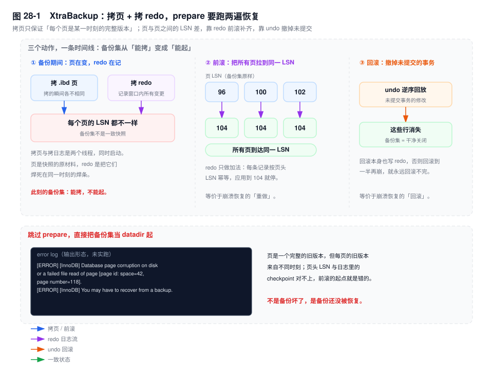
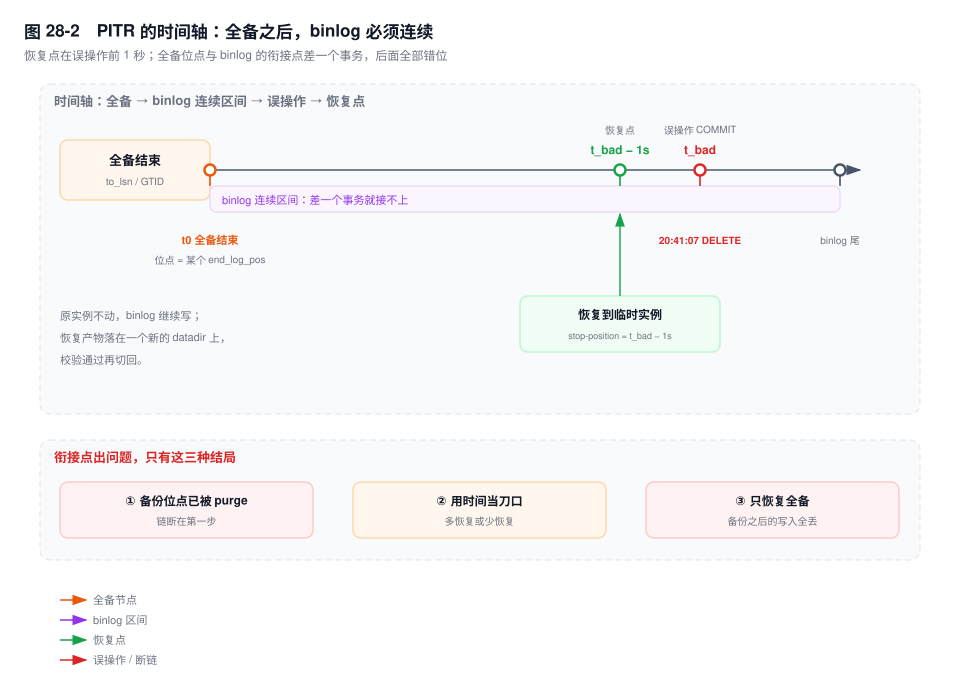

# 第 28 章　备份、恢复与 PITR 演练

> **一句话结论**：备份能不能用，不取决于它有多完整，取决于它和 binlog 的衔接点有没有对齐到同一个事务边界；恢复的瓶颈从来不在 `--prepare`，在找那个 stop position。

## 28.0 场景：40 分钟的恢复，25 分钟在找一个数字

双十一之后的第一次对账，运营发现 11 日的账单明细里混进了一批已作废的单据，要求挑出来重算。DBA 写了一条订正：

```sql
DELETE FROM bill_detail WHERE bill_date = '2026-11-11';
```

少了 `AND status = 0`。180 万行，20:41:07 提交。

20:44 对账任务报总数对不上，20:47 确认误删。后面 40 分钟这样花掉：

| 时间 | 在做什么 |
|---|---|
| 20:47–20:52 | 确认最近一次全备是当天 02:00，找到备份目录，读 `xtrabackup_binlog_info` 拿到位点 |
| 20:52–21:12 | 在 6 个 binlog 文件里定位那条 `DELETE`，确认 `BEGIN` 的起始位置 |
| 21:12–21:19 | `--copy-back` 到临时实例、起库、重放 binlog 到误操作之前 |
| 21:19–21:27 | 按 `bill_date` 分组比行数、抽 200 单核金额 |

搬数据的 7 分钟里没有一步是难的。难的是前 25 分钟：**哪份备份、对应哪个位点、误操作落在哪个文件的哪个偏移**。

## 28.1 机制

### 三个正交维度：热备回答的是"锁不锁表"，不是"一致不一致"

备份的三个分类维度经常被压成一个词，然后开始互相误导。

- **物理 vs 逻辑**：拷的是数据文件（页）还是 SQL 文本。前者恢复是文件级替换，后者恢复是重新执行一遍。
- **全量 vs 增量**：这次拷"全部页"还是"上次之后变过的页"。增量必须依附一条链，链断了整条作废。
- **冷 / 温 / 热**：备份期间实例能不能写。冷备停库，温备只读，热备可读写。

三个维度互不蕴含：XtraBackup 是"物理 + 增量 + 热"，`mysqldump` 是"逻辑 + 全量 + 热"，停机 `cp` 是"物理 + 全量 + 冷"。

关键在一句话：**热备只承诺"不锁表"，一致性是另外一套机制给的**。同样是热备，两条路线的做法完全相反：

| | 一致性来自 | 备份里装的是什么 |
|---|---|---|
| XtraBackup / Clone | 事后补齐：拷贝期间的所有变更都记在 redo 里 | 一堆 LSN 参差的页 + 覆盖整个拷贝窗口的 redo |
| `mysqldump --single-transaction` | 事前定格：一个 RR 事务的一致性快照 | 一份 SQL 文本，执行它等于重演那一刻的读结果 |

所以"我们是热备，所以备份是一致的"这句话不成立。热备的一致性要么来自 redo 补齐，要么来自 MVCC 快照，没有第三种。

### XtraBackup：拷贝的是页，修复的是 LSN

`xtrabackup --backup` 干的活，本质是 `cp` 加一个补丁：按文件顺序把 `.ibd` 读出来写进备份目录，同时**另起一个线程持续拷贝 redo**。

为什么必须拷 redo？拷页不是原子动作。一张大表要拷十几分钟，这期间业务在写、Buffer Pool 在刷脏，同一个页可能在拷它之前、之中、之后被改。**你拷到的每一个页，来自各自不同的时刻**——把页头的 `FIL_PAGE_LSN` 排成一排，是参差的。

只拷页的备份集，是一个"没有崩溃现场、但页之间互不同步"的库：InnoDB 起来时要么认为页损坏，要么按自己的 checkpoint 前滚一段对不上的日志。

补丁就是那一路 redo：从备份开始那一刻的 checkpoint 追到备份结束（日志流由 `--log-stream` 控制），把窗口内的页变更抄了一份。恢复时反过来做：**拿 redo 把参差的页推到同一个 LSN**。

`--prepare` 就是这件事的名字。它做的正是第 7 章那套崩溃恢复，只不过对象从"数据目录"换成了"备份集"：

1. **前滚**：把备份集里的 redo 应用到每一个拷来的页上，直到所有页到达同一个一致 LSN。这一步只做加法，按页头 LSN 幂等。
2. **回滚**：拷贝窗口里必然有没提交的事务（业务一直在写），它们的修改已经随 redo 前滚到了页上，必须按 undo 逆序撤销。这一步结束，备份集才是一个"干净关闭"的实例。



**不 prepare 直接用会怎样**：把备份集当数据目录起库，InnoDB 在启动的 redo 校验阶段发现页上的 LSN 和日志对不上，error log 里出现 `Database page corruption on disk or a failed file read of page ...`，然后 abort；运气差一点是起来了，但数据字典页和用户页来自不同时刻，后续查询报出莫名其妙的错误。备份集不是"拷完就能用"，是"prepare 完才能用"。

增量备份走同一套 LSN 逻辑。`--incremental-basedir` 指向上一次的备份目录，XtraBackup 读那里的 `xtrabackup_checkpoints`，取 `last_lsn` 当起点，只拷页 LSN 大于它的页。所以增量不是"按时间"，是"按 LSN 水位"——它和 binlog 位点是两个坐标系，别混。

合并增量有一条不能破的规则：中间层 `--prepare` 必须加 `--apply-log-only`。

```bash
xtrabackup --prepare --apply-log-only --target-dir=/backup/full
xtrabackup --prepare --apply-log-only --target-dir=/backup/full \
           --incremental-dir=/backup/inc1
xtrabackup --prepare --target-dir=/backup/full \
           --incremental-dir=/backup/inc2      # 最后一层，不加 --apply-log-only
```

回滚阶段会清理 undo。中间层就回滚，等于把"后面那层还要用来撤销的 undo"当垃圾收了，合并出的页在逻辑上不成立。`--apply-log-only` 只前滚、不回滚，把回滚留到最后一层。

### Clone Plugin：把 prepare 挪到接收端启动时

`[8.0.17+]` 内置的 Clone 插件做同一件事，形态不同。

```sql
-- 把本机数据目录克隆到另一个路径，产物可以直接 --datadir 起一个新实例
CLONE LOCAL DATA DIRECTORY = '/data/clone-1112';

-- 从远端 donor 拉，接收端数据目录被整体替换，完成后实例自动重启
CLONE INSTANCE FROM 'clone_admin'@'10.0.3.21':3306 IDENTIFIED BY '***';
```

一致性来源和 XtraBackup 一模一样：donor 上拿一把 `LOCK INSTANCE FOR BACKUP`（挡 DDL，不挡 DML），页级拷贝的同时追 redo；接收端拿到页和 redo 后，**在启动时做一次崩溃恢复**。所以 Clone 没有 `--prepare`——不是不需要恢复，是恢复藏在 `mysqld` 的启动流程里。

三个硬约束：

- **版本必须一致**。8.0.17 只能克隆 8.0.17，小版本也要对齐。页级二进制拷贝，跨版本的数据字典布局对不上。
- **平台必须一致**。操作系统、字节序、页大小都要相同。
- **`clone_valid_donor_list` 是接收端的白名单**，一串 `host:port`，分号分隔。默认空，空的意思是谁都不许往我这里推数据。扩容、迁移时忘了改它，报的是连接被拒，不是权限错。

和 XtraBackup 的取舍：

| | XtraBackup | Clone Plugin |
|---|---|---|
| 是否要装额外软件 | 要 | 不要，装个插件即可 |
| 备份期间能否写 | 能（DML 可写，DDL 被 backup lock 挡住） | 能（同上） |
| 增量 | 支持，按 LSN | 不支持，每次全量 |
| 跨版本 | 支持按升级路径跨版本 | 必须同版本 |
| 输出到远端或对象存储 | 可以（`xbstream` + `xbcloud`） | 不可以，只到本地目录或另一个实例 |
| 产物形态 | 一个可搬运的目录或流 | 一个能直接启动的 datadir |

选型只有一句话：**要增量、要异地归档、要跨版本，用 XtraBackup；只是加一个同版本的从库（replica），Clone 更省事**。

### 逻辑备份的边界：什么时候它是错的

`mysqldump --single-transaction` 的一致性来自一个 RR 事务的一致性快照。这个"来自"划定了它的能力边界。

**只对 InnoDB 有效。** 快照是 MVCC 给的，MyISAM 没有它。库里只要有一张 MyISAM 表，备份期间对它的写入就会以"当前值"进 dump，和其他表的时间点错开：

```sql
SELECT COUNT(*) FROM information_schema.tables
 WHERE engine <> 'InnoDB'
   AND table_schema NOT IN ('mysql','sys','information_schema','performance_schema');
```

非零就要重新设计备份方案。

**开头那一瞬间仍然要锁。** `--single-transaction` 不是完全不锁：它要短暂 `FLUSH TABLES WITH READ LOCK` 拿位点，再开快照、解锁。这一瞬间要等所有活跃事务结束。库上有一个跑了两小时的大查询，或一个 `BEGIN` 后挂着不动的连接，备份就停在 `Waiting for global read lock`——第 21 章实验三复现的就是这个。备份窗口莫名变长，先看这个状态。

**位点和 GTID 要写对。** `--source-data=2`（8.0.26 之前的名字是 `--master-data`）把位点写成注释，`=1` 写成可执行语句；`--set-gtid-purged=ON` 在文件头写入 `SET @@GLOBAL.gtid_purged=...`，`=OFF` 不写。这两项决定了这份 dump 能不能当 PITR 的起点，不是可选项（第 23 章 23.4）。

三条硬伤，每条都足以让它出局：

1. **恢复慢，而且慢在看不见的地方。** 物理恢复是拷文件，逻辑恢复是把 SQL 重放一遍：解析、加锁、维护 B+ 树、写 redo 和 binlog。差的不是工具快慢，是"要不要重建一次索引"。
2. **粒度不够细。** 逻辑备份只有库和表两级。想只恢复一个页、一行、一个索引分区，做不到。
3. **类型和字符集是暗礁。** `BLOB` / `BINARY` / `JSON` 要加 `--hex-blob`，否则按连接字符集转写会改字节；`utf8mb4` 的库用 `latin1` 连接导出，回来是一堆问号，还不报错。

逻辑备份什么时候仍然是对的？跨大版本升级（物理文件不能直接搬，逻辑导出再导入是官方路径之一）、只导几张表、需要人眼审阅数据、库很小且能接受恢复窗口。

`mysqlpump` 在 8.0.34 已废弃；多线程逻辑导出没有官方替代品，要并行只能分库分表跑多个 `mysqldump`。

### PITR：六步，和一个必须找对的数字

PITR = 全备 + binlog 重放，六步，每一步都有一个能毁掉整件事的细节。



**① 确认衔接点。** 备份集对应哪个 binlog 位点，写在 `xtrabackup_binlog_info` 里：

```bash
cat /backup/full/2026-11-12_02/xtrabackup_binlog_info
# mysql-bin.000007	194	3e11c4a2-...:1-88213
# 输出形态（未实跑）：三个字段依次是 binlog 文件名、位点、GTID 集合
```

这三个字段就是"从哪儿接上"：`--single-transaction` 下它们是备份开始那一刻的位点，备份集恰好是那一刻的快照。差一个事务，后面全部错位——这不是精度问题，是**坐标系原点错了**。

**② 恢复到临时实例，绝不覆盖原实例。** 这是纪律，不是建议。

```bash
xtrabackup --prepare --target-dir=/backup/full/2026-11-12_02
xtrabackup --copy-back --target-dir=/backup/full/2026-11-12_02 \
           --datadir=/data/restore-3307
chown -R mysql:mysql /data/restore-3307
mysqld --defaults-file=/etc/my3307.cnf --datadir=/data/restore-3307 &
```

两条理由都很硬：`--copy-back` 覆盖目标目录的同名文件，那是在服役的数据文件；PITR 过程中原库的 binlog 还得继续写，停了原库等于把原料和现场一起毁了。

**③ 应用 binlog 到卡点之前。**

```bash
mysqlbinlog --start-position=194 --stop-position=4410233 \
  /var/log/mysql/mysql-bin.000007 /var/log/mysql/mysql-bin.000008 \
  | mysql -h127.0.0.1 -P3307 -uroot -p
```

**④ 卡点，三种方式，精度差一个量级。**

- **时间**：`--stop-datetime='2026-11-11 20:41:07'` 包含这一秒内的**所有**事务，包括那条误删。时间只能用来缩小范围，不能当刀口。
- **位点**：精确到字节。`--stop-position` 取误操作 `BEGIN` 那条事件的 `# at` 位置，也就是它前一条事件的 `end_log_pos`。
- **GTID**：`--include-gtids` / `--exclude-gtids` 按事务挑；或者在临时实例上注入空事务把误操作顶掉——`SET GTID_NEXT='uuid:n'; BEGIN; COMMIT; SET GTID_NEXT='AUTOMATIC';`，五步见第 23 章 23.6。

**怎么找到那一秒。** 这就是 28.0 里花掉 20 分钟的那一步：

```bash
mysqlbinlog --base64-output=DECODE-ROWS -v \
  --start-datetime='2026-11-11 20:40:00' --stop-datetime='2026-11-11 20:45:00' \
  /var/log/mysql/mysql-bin.000009 | less
```

在输出里搜 ``### DELETE FROM `bill`.`bill_detail` ``，往上找最近的 `BEGIN`（记下它的 `# at`，这就是 stop position），往下看 `Xid` 确认提交。`-v` 把行事件解成带 `###` 的伪 SQL，`DECODE-ROWS` 必须有，否则 base64 一坨没法看。

`SHOW BINLOG EVENTS` 也能用，但它**不输出时间戳**，只有 `Pos`、`Event_type`、`Info`：按表名缩小范围靠它，把时间和位置对上靠 `mysqlbinlog --start-datetime`。

**⑤ 校验。** 三件事：按业务维度 count（`SELECT bill_date, COUNT(*) FROM bill_detail GROUP BY bill_date`，和误删前的监控快照比）、`CHECKSUM TABLE bill_detail`（跨实例可比，前提是表结构完全一致）、抽一批单据核金额。行数对不代表数据对，但行数不对一定不对。

**⑥ 切回。** 改 VIP 或域名指向新实例，或者只把这张表导回原库。前者快、风险集中在一处；后者影响面小，但要处理"导回期间原库还在写"的冲突。

### 两种误操作，两条恢复路径

同样是"删错了"，`DROP TABLE` 和"`DELETE` 少写 `WHERE`"的路径完全不同。

**`DROP TABLE`**：表结构和数据一起没了。恢复点必须在 DROP 之前，落在临时实例上，再把这张表搬回来。难点在于目标库里这张表已经不存在，你不能在原库上直接补数据，只能整表替换。binlog 里它是一条 `Query` 事件，闪回工具对它无能为力——反向操作要重建表结构和全部数据。

**`DELETE` 少写 `WHERE`**：表还在、索引还在，缺的是行。这时不必整库回滚：从 binlog 里把被删的行反向生成 `INSERT`，只补数据。前提是 `binlog_row_image=FULL`，`MINIMAL` 只记主键和被改的列，before image 不全，整行补不回来。这个差别直接决定你的 `binlog_row_image` 该设成什么。

### 四种单表恢复：按代价排序


| 路线 | 前提 | 耗时量级 | 主要代价 |
|---|---|---|---|
| 表空间导入 | 同版本、同页大小、表结构一致、无外键、有 `.cfg` | 分钟级 | 前置条件最苛刻，一条不满足就得换路 |
| 闪回工具（`binlog2sql` / `my2sql`） | `binlog_row_image=FULL`、有主键、期间无 DDL | 分钟级 | 反向 SQL 在并发下可能不正确 |
| 逻辑过滤重放 | binlog 可读，或 dump 里有表段 | 十分钟级 | 只适合小表，大表重放慢 |
| 临时实例导回 | 有可用临时实例和网络 | 小时级 | 最慢，但适用范围最广 |

**表空间导入**：`ALTER TABLE ... DISCARD TABLESPACE` 丢掉本地 `.ibd`，把 prepare 过、`--export` 导出的 `.ibd` 和 `.cfg` 拷进数据目录，再 `IMPORT TABLESPACE`。`.cfg` 是元数据校验文件，没有它导入会被拒——这就是必须走 `xtrabackup --export` 而不是直接 `cp` 一个 `.ibd` 的原因。

**闪回工具**把 `Delete_rows` 翻成 `INSERT`、把 `Update_rows` 的前后镜像对调。这套翻转只在"后续没有其他事务碰过这些行"时成立；一旦有并发事务在误操作之后又改了它们，反向 SQL 就会撞主键、撞唯一索引。产出必须人工审核，不能直接管道给 `mysql`。

**逻辑过滤**：`mysqlbinlog --database=bill` 只重放某个库；表级没有官方参数，实践中按 `Table_map` 事件里的表名过滤，或从 dump 里按 `CREATE TABLE` 切段。

**临时实例导回**最笨也最稳：整库恢复到临时实例，把表导出来灌回主库。它不依赖结构一致，也不依赖行镜像格式，代价是时间和磁盘。

### 延迟从库：卖的是时间窗，不是备份

`SOURCE_DELAY`（8.0.22 之前的名字是 `MASTER_DELAY`）让从库的**应用**推迟 N 秒：

```sql
CHANGE REPLICATION SOURCE TO SOURCE_DELAY = 3600;
```

从库的网络线程照常拉 relay log、照常落盘，卡住的是 SQL 线程——它要等事件的原始时间戳比当前时间早 N 秒才应用。延迟的不是"传输"，是"生效"：误操作在主库（source）提交后，从库（replica）上还有一小时的窗口，数据停在误操作之前。

窗口是抢来的，不是等来的：发现误删，第一件事 `STOP REPLICA SQL_THREAD` 把窗口冻住；`SHOW REPLICA STATUS` 里的 `SQL_Delay` / `SQL_Remaining_Delay` 告诉你还剩多久；要精确到事务，用 `START REPLICA UNTIL SQL_BEFORE_GTIDS = 'uuid:88421'`。它不能当只读副本——每行都比主库旧一小时，报表跑在上面的数字是另一套；要提成主库，先追平再切。

两个失效条件：

- **`relay_log_recovery` 在重启时丢掉未应用的 relay log**，从已应用位点重新向主库要。主库的 binlog 若已清到那个位点之前（`binlog_expire_logs_seconds` 太短，或有人手工 `PURGE BINARY LOGS`），窗口永久消失。**binlog 保留时长必须大于延迟时长**。
- **它不能替代备份**。误操作三天后才发现，延迟一小时也救不了；机器和主库在同一个故障域，一起没。

### 备份打满 IO 的三个开关

备份是"顺序读 + 顺序写"，CPU 不高，但会占满磁盘 IO 队列，在线随机读被排到后面。

- **在从库上备**。前提是这个从库的 `Exec_Source_Log_Pos` 在主库 binlog 里还可查——否则你拿到一份"位点已经不可用"的备份，PITR 从第一步就断了。
- **限速**。`xtrabackup --throttle=N` 限制每秒 IO 次数，0 为不限。限得太狠，备份窗口拉长，备份集里的 redo 更多、prepare 更慢。这是条 U 形曲线，不是越慢越好。
- **限 IO 优先级**。`ionice -c2 -n7` 把备份进程压到 best-effort 最低档；cgroup v2 的 `io.max` 能按设备限带宽，比 `ionice` 更硬。

`mysqldump` 还要管 `--max-allowed-packet`（必须大于最大的行，否则大字段被截断）和网络带宽（1Gbps 上搬几百 GB 就是几小时）。

## 28.2 关键结论

1. **热备不等于一致性。** 热备只说明"备份期间能写"，一致性要么来自 redo 补齐（XtraBackup / Clone），要么来自 MVCC 快照（`--single-transaction`）。
2. **`--prepare` 就是崩溃恢复，只是对象换成了备份集。** 前滚把参差的页拉到同一 LSN，回滚把拷贝窗口里未提交的事务撤掉；不做这一步，备份集是一个页损坏的库。
3. **增量链必须用 `--apply-log-only` 逐层合并。** 中间层做完整回滚会清掉后面还要用的 undo，合并结果不成立。
4. **PITR 的成败在衔接点，不在恢复速度。** 备份位点与 binlog 必须严丝合缝，卡点精确到 `BEGIN` 的起始位置；时间只能缩小范围，不能当刀口。
5. **单表恢复按代价选：** 表还在就补行（闪回、逻辑过滤），表没了才整表替换（表空间导入、临时实例导回）。闪回产出的反向 SQL 必须人工审核。
6. **延迟从库卖的是时间窗，不是备份。** 窗口长度受 binlog 保留时长约束，重启时受 `relay_log_recovery` 影响；误操作超出窗口，只能回备份。

## 28.3 实验验证

### 实验一：完整走一遍"全备 → 误删 → PITR 到误操作之前"

建表：

```sql
CREATE TABLE bill_detail (
  id BIGINT PRIMARY KEY AUTO_INCREMENT,
  bill_date DATE NOT NULL,
  status TINYINT NOT NULL,
  amount DECIMAL(12,2) NOT NULL,
  KEY idx_date_status (bill_date, status)
) ENGINE=InnoDB;
```

灌入 11 日的数据（`status` 取 0/1），做一次全备并记下位点：

```bash
xtrabackup --backup --target-dir=/backup/full/2026-11-12_02 \
           --user=backup --password=***
cat /backup/full/2026-11-12_02/xtrabackup_binlog_info
# mysql-bin.000007	194	3e11c4a2-...:1-88213
```

然后"误操作"，再找卡点：

```bash
mysqlbinlog --base64-output=DECODE-ROWS -v /var/log/mysql/mysql-bin.000008 \
  | grep -n -B10 'DELETE FROM `bill`.`bill_detail`'
```

```text
# at 4410233
#261111 20:41:07 server id 1  end_log_pos 4410245  Query  thread_id=88  exec_time=0  error_code=0
SET TIMESTAMP=1762864867/*!*/;
BEGIN
# 输出形态（未实跑）：取 BEGIN 这条事件的 # at，不是 COMMIT 的位点
```

恢复：

```bash
xtrabackup --prepare --target-dir=/backup/full/2026-11-12_02
xtrabackup --copy-back --target-dir=/backup/full/2026-11-12_02 \
           --datadir=/data/restore-3307
mysqld --datadir=/data/restore-3307 --port=3307 --socket=/tmp/m3307.sock &
mysqlbinlog --start-position=194 --stop-position=4410233 \
  /var/log/mysql/mysql-bin.000007 /var/log/mysql/mysql-bin.000008 \
  | mysql -S /tmp/m3307.sock -uroot -p
```

校验：

```sql
SELECT bill_date, status, COUNT(*), SUM(amount)
  FROM bill_detail GROUP BY bill_date, status;
CHECKSUM TABLE bill_detail;
```

预期形态：11 日两个 `status` 的行数与误删前的监控快照一致。`CHECKSUM` 只有和同一时刻的另一个实例比才有意义，跨时刻比较不成立。

### 实验二：把"不 prepare 直接用"造出来

```bash
mysqld --datadir=/backup/full/2026-11-12_02 --port=3308 &
tail -n 20 /var/log/mysql/error.log
```

```text
[ERROR] [InnoDB] Database page corruption on disk or a failed file read of page [page id: space=42, page number=118].
[ERROR] [InnoDB] You may have to recover from a backup.
# 输出形态（未实跑）：页号每次不同，也可能换成 checksum mismatch 或直接 abort
```

解读：这不是"备份坏了"，是"备份还没被恢复"。同一个目录 `--prepare` 之后再起，什么都不会报。

### 实验三：检查备份集与 binlog 的衔接完整性

```bash
cat /backup/full/2026-11-12_02/xtrabackup_binlog_info
mysql -e "SHOW BINARY LOGS" | head -3
```

预期形态：`xtrabackup_binlog_info` 里的文件名必须出现在 `SHOW BINARY LOGS` 里。不在，说明 binlog 已经清到备份点之前，这份备份**不能用于 PITR**，只能当"某天的全量"。

健康度看三个数：最近成功备份、最近成功演练、备份与 binlog 的衔接。第三个每天查：`xtrabackup_binlog_info` 里的文件名还在不在 `SHOW BINARY LOGS` 里。

## 28.4 常见误区

⚠️ **"备份成功了就是能恢复"**

成功只说明 `xtrabackup` 退出码是 0。没跑过 `--prepare`、没在临时实例起过、没做过一次 PITR 的备份，跟没有备份的区别只是多占一块磁盘。

⚠️ **"热备不锁表，所以随时都能备"**

不锁表不等于没影响。备份 IO 挤占在线请求，`--throttle` 限得太狠又拉长窗口——窗口越长，redo 越多、prepare 越慢，DDL 还被 backup lock 挡着。要选时间，不是"随时"。

⚠️ **"逻辑备份更安全，因为它能看懂"**

能看懂的是**文本**，不是**一致性**。`--single-transaction` 对 MyISAM 无效；忘了 `--hex-blob`，二进制字段就变了；恢复要重建索引，大库的窗口可能是物理备份的几十倍。它的优势在"可审阅、可跨版本"，不在"更安全"。

⚠️ **"有延迟从库就不用备份了"**

延迟从库和主库在同一故障域：磁盘坏、机房断电两边一起没。它解决手滑不解决灾难，窗口还受 binlog 保留约束。

⚠️ **"闪回工具能一条命令把数据变回去"**

它生成的是"按 binlog 顺序排列的反向 SQL"，成立前提是"执行它时，库的状态和执行原 SQL 之前一样"。有并发写、有 DDL、有唯一键冲突，前提就不成立。它是生成补丁的工具，不是执行回滚的工具。

⚠️ **"`--stop-datetime` 精确到秒就够了"**

一秒内可能有几十个事务。时间卡点恢复出来的是"那一秒结束时"，可能多恢复了误操作，也可能少了同一秒的正常业务。要精确就用位点或 GTID。

## 28.5 生产 Checklist

- [ ] 每份备份都有可查的 `xtrabackup_binlog_info`（或 dump 头部的位点/GTID），并且和 binlog 保留窗口对得上
- [ ] binlog 保留时长 ≥ 最长的"从误操作到被发现的间隔"，含周末与节假日；并单独监控"最早可用 binlog 的时间"
- [ ] 备份一律恢复到临时实例验证，`--copy-back` 的目标目录永不指向在服役的 datadir
- [ ] 增量合并脚本里，中间层都有 `--apply-log-only`，最后一层没有
- [ ] `binlog_row_image=FULL`，否则闪回和行级补数都做不了
- [ ] 延迟从库的 `SOURCE_DELAY` 小于 binlog 保留时长，且验证过 `relay_log_recovery` 下的行为
- [ ] 每季度至少一次恢复演练，记录两个数字：从备份到能查询的耗时、卡点定位的耗时
- [ ] 备份健康度三个指标有告警：最近成功备份时间、最近成功演练时间、衔接完整性检查结果

## 28.6 延伸

- **前置**：第 6 章（binlog 是 PITR 的唯一原料）、第 7 章（恢复三阶段，`--prepare` 的机制来源）。
- **关联**：第 21 章（长事务卡住 FTWRL）、第 22 章（延迟从库的复制原理）、第 23 章（GTID 卡点与 `SET GTID_NEXT`）。
- **下一卷**：第 29 章从数据类型讲起，`BLOB` 与字符集正是逻辑备份最容易出错的地方。
- **面试追问**：
  - "备份期间数据页还在变，为什么备份是一致的？" → 拷页只保证每个页是某一时刻的完整版本，一致性由同时拷贝的 redo 在 `--prepare` 时补齐。
  - "增量备份怎么判断哪些页要拷？" → 比对页头 LSN 与基准备份 `xtrabackup_checkpoints` 里的 `last_lsn`，大于它的页才拷。
  - "PITR 怎么精确到误操作之前？" → 找到误操作 `BEGIN` 事件的 `# at` 位置作 `--stop-position`，或用 GTID 排除该事务。
- **官方文档**：MySQL 8.0 Reference Manual → *Backup and Recovery*（`mysqldump`、PITR、表空间导入）、*Clone Plugin*；Percona XtraBackup 8.0 → *How XtraBackup works*、*Prepare*、*Incremental backups*。
