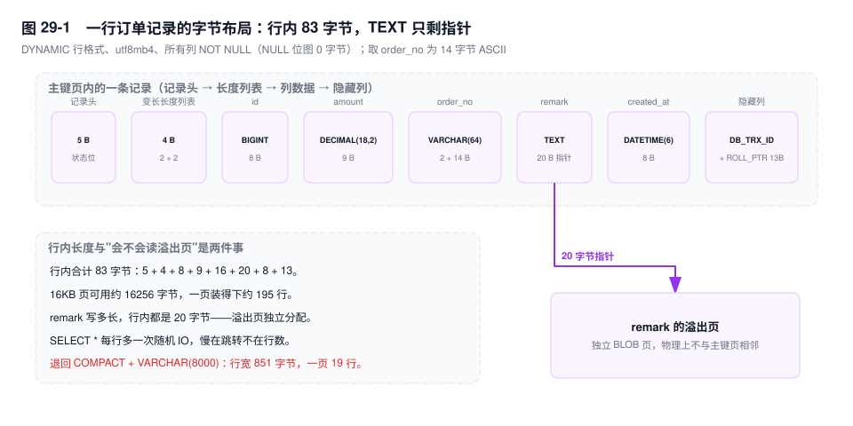
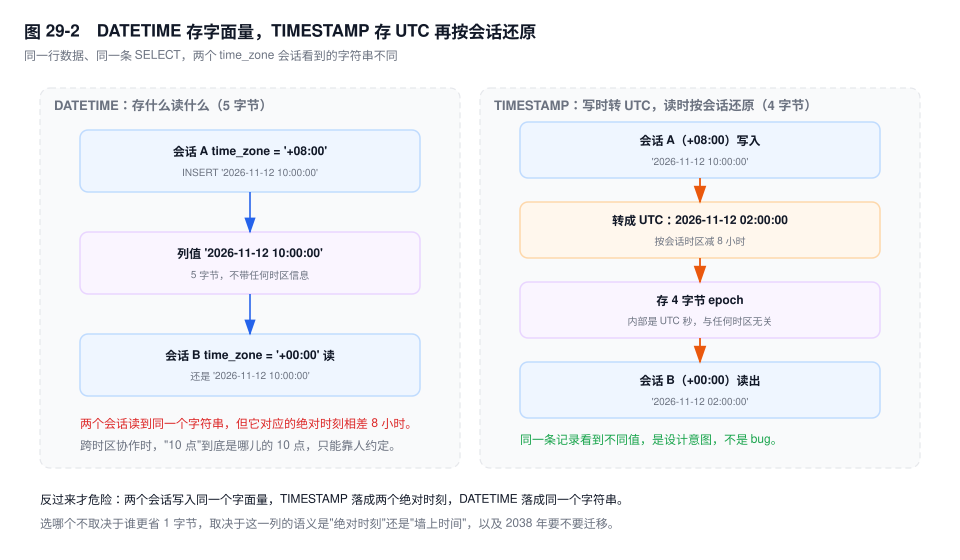
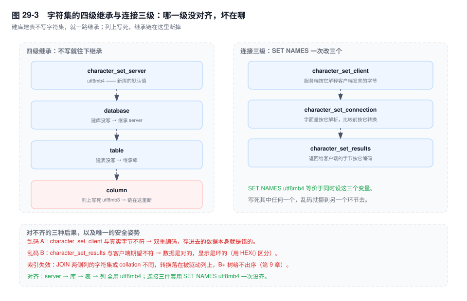

# 第 29 章　数据类型与字符集

> **一句话结论**：字段类型不是语义标签，是磁盘上的字节契约——长度决定索引能建多长，collation 决定谁和谁相等，精度决定三年后对账差多少钱。

## 29.0 场景：一张三年前的表，今天四处碰壁

三年前建这张订单表的人，审美没有问题：

```sql
CREATE TABLE `order_main` (
  `id` bigint NOT NULL AUTO_INCREMENT,
  `order_no` varchar(255) DEFAULT NULL,
  `amount` double DEFAULT NULL,
  `status` enum('draft','paid','shipped') DEFAULT NULL,
  `remark` text,
  `created_at` datetime DEFAULT NULL,
  `updated_at` timestamp NULL DEFAULT CURRENT_TIMESTAMP ON UPDATE CURRENT_TIMESTAMP,
  PRIMARY KEY (`id`),
  KEY `idx_created` (`created_at`)
) ENGINE=InnoDB DEFAULT CHARSET=utf8mb4 ROW_FORMAT=COMPACT;
```

注意它没写 `COLLATE`。建表那年是 5.7，`utf8mb4` 的默认 collation 就是 `utf8mb4_general_ci`，省略等于选中。库迁到 8.0 之后，同一条 `SHOW CREATE TABLE` 会多出半行：

```text
) ENGINE=InnoDB DEFAULT CHARSET=utf8mb4 COLLATE=utf8mb4_general_ci ROW_FORMAT=COMPACT
```

多出来的这半行说明：这张表的判重规则，和今天新建的表不是一套（8.0 的默认是 `utf8mb4_0900_ai_ci`）。这句话本身不疼，疼的是它后面连着四件事。

- 财务对账，系统汇总比对方多 **0.03 元**。金额是 `DOUBLE`。
- 想给 `order_no` 加唯一索引，`ERROR 1071 (42000): Specified key was too long; max key length is 767 bytes`。列是 `utf8mb4`，行格式是 `COMPACT`，255×4 = 1020 字节。
- 运营要按 `ORDER BY created_at, remark` 出报表，`Sort_merge_passes` 一路涨——排序带着一个 `TEXT` 列，缓冲区装不下。
- 产品要加状态 `refunding`，`ALTER TABLE` 排了四十分钟没拿到 MDL，写入全堵在 `Waiting for table metadata lock`。

四个问题，四个类型决策。它们都不是"当时写错了"，是"当时没算三年后的账"。

## 29.1 机制

数据的物理形态由两层决定：行格式决定"字段怎么排布"，类型决定"每个字段占几个字节"。两层叠起来是一条记录的物理长度，物理长度决定一页装几行、一棵树几层、一个索引多长。

一个具体例子：把上面那张表的行格式换成 `DYNAMIC`、所有列改成 `NOT NULL`，一条记录是这样排的。



| 区段 | 字节 | 来源 |
|---|---|---|
| 记录头 | 5 | 记录状态位、变长列个数、下一条记录的页内偏移 |
| 变长长度列表 | 4 | `order_no` 2 字节 + `remark` 2 字节（最大字节数超过 255 就用 2 字节） |
| `id` | 8 | `BIGINT` |
| `amount` | 9 | `DECIMAL(18,2)`，下面算 |
| `order_no` | 16 | 2 字节长度前缀 + 14 字节 ASCII 数据（`SO202611120001`） |
| `remark` | 20 | `DYNAMIC` 下整列溢出，行内只剩指针 |
| `created_at` | 8 | `DATETIME(6)`，5 + 3 |
| `DB_TRX_ID` + `DB_ROLL_PTR` | 13 | 6 + 7，隐藏列 |

83 字节。16KB 的页可用约 16256 字节，一页装得下约 195 行——这就是主键页的密度。把 `remark` 从 `TEXT` 换成 `VARCHAR(8000)`（utf8mb4 下上限 32000 字节，任何一行都放不下），`DYNAMIC` 下整列溢出、行内仍是 20 字节指针，行宽不变；一旦退回 `COMPACT`，行内要先留 768 字节前缀再加 20 字节指针，行宽涨到 851 字节，一页只剩 19 行。**同一批数据，页数差十倍，Buffer Pool 的有效容量也差十倍**（页内布局见第 3 章，这里不重复）。

### 一、整数：`INT(11)` 的 11 是给人看的

`INT` 恒占 4 字节，有符号范围 −2147483648 ~ 2147483647，`UNSIGNED` 是 0 ~ 4294967295。括号里的 11 与这两件事都无关，它只在 `ZEROFILL` 时代有意义：`INT(4) ZEROFILL` 存 42，显示成 `0042`。8.0.19 起显示宽度被废弃，`SHOW CREATE TABLE` 不再输出它——除了 `TINYINT(1)`，因为几乎所有连接器拿这个 `1` 当布尔标记（`BOOLEAN` 就是 `TINYINT(1)` 的同义词）。

真正的坑在 `UNSIGNED`：

```sql
CREATE TABLE wallet (
  id BIGINT PRIMARY KEY,
  balance INT UNSIGNED NOT NULL
) ENGINE=InnoDB;
INSERT INTO wallet VALUES (8842, 100);

SELECT balance - 200 FROM wallet WHERE id = 8842;
-- ERROR 1690 (22003): BIGINT UNSIGNED value is out of range
--   in '(`shop`.`wallet`.`balance` - 200)'
```

机制：减法结果的类型在解析阶段就定了。只要有一侧是 `UNSIGNED`，整个表达式就是无符号的，运行时再做范围检查。于是"查余额不足的账户"这条 SQL，**恰好只在余额真的不足时报错**——越是需要它返回结果的行，它越报错。应用层把 1690 统一 catch 成"系统繁忙"，这个 bug 就能藏半年。

两个常见的错误修法：

- `SET sql_mode = 'NO_UNSIGNED_SUBTRACTION'`，减法按有符号算，得到 −100。但这一列是 `UNSIGNED`，写回去立刻 `ERROR 1264 (22003): Out of range value for column 'balance'`。它是把报错从读挪到了写。
- `SELECT CAST(-1 AS UNSIGNED)` 得到 18446744073709551615。无符号世界里没有负数，只有绕回来的极大值——用它参与比较，`balance > -1` 会变成"所有行"。

正确做法是把减法改写回比较：`WHERE balance < 200`。金额、库存、额度这类"只能非负"的列用 `UNSIGNED` 是对的，**但不要用减法去判边界**。

### 二、浮点与定点：0.1 在二进制里没有精确值

`FLOAT` 4 字节、有效位约 7 位十进制；`DOUBLE` 8 字节、约 15~16 位。两者都是 IEEE 754 二进制浮点，而 0.1 的二进制是无限循环小数，只能截断存储。

```sql
CREATE TABLE recon_detail (id BIGINT PRIMARY KEY, amount DOUBLE NOT NULL);
INSERT INTO recon_detail VALUES (1, 0.10), (2, 0.20);

SELECT SUM(amount) FROM recon_detail;   -- 0.30000000000000004
SELECT SUM(amount) = 0.30;              -- 0
```

有意思的是 `SELECT 0.1 + 0.2` 返回干净的 `0.3`——因为字面量是 `DECIMAL`，`DECIMAL + DECIMAL` 还是 `DECIMAL`。要看见误差，必须让值真的经过 `DOUBLE` 列或显式 `CAST`。这就是"本地测不出来、线上天天错"的原因。

`DECIMAL(M,D)` 是定点数，按十进制分组存：每组 9 位十进制占 4 字节，不足 9 位的尾巴按 1~2 位 1 字节、3~4 位 2 字节、5~6 位 3 字节、7~9 位 4 字节补。**小数点左右是分开分组的**，不拼成一串。

| 声明 | 整数位 | 小数位 | 字节 | 推导 |
|---|---|---|---|---|
| `DECIMAL(10,2)` | 8 | 2 | 5 | 8 位 → 4B；2 位 → 1B |
| `DECIMAL(18,2)` | 16 | 2 | 9 | 16 = 9 + 7 → 4B + 4B；2 位 → 1B |
| `DECIMAL(20,6)` | 14 | 6 | 10 | 14 = 9 + 5 → 4B + 3B；6 位 → 3B |
| `BIGINT` | — | — | 8 | 定长整数 |

`DECIMAL(18,2)` 是 9 字节而不是 8 字节，许多"18 位数字就是两组 9 位"的算法都漏了那 1 字节的小数部分。它比 `BIGINT` 只贵 1 字节，换来 16 位整数位的安全范围——按元记金额，上限约 10^16 元，按分记就是 10^18 分。

代价在 CPU：`DECIMAL` 是软件实现的十进制运算（以 10^9 为基做 limb 运算），`DOUBLE` 是一条 FPU 指令。同一条聚合，`DECIMAL` 慢几倍是常态。但这个代价必须付，因为错的不是性能，是账：

```sql
SELECT ROUND(CAST(2.675 AS DOUBLE), 2);   -- 2.67
SELECT ROUND(CAST(2.675 AS DECIMAL(10,3)), 2);  -- 2.68
```

2.675 的二进制近似值是 2.674999999999999822…，落在 2.675 的下方，所以"四舍五入"往下去。一笔手续费按 5% 算是 2.675 元，`DOUBLE` 给出 2.67，`DECIMAL` 给出 2.68，差 1 分。

1 分钱不可怕，可怕的是它不是随机的。分摊、计税、退款拆分，每一步都是一次独立的舍入，误差单向累积。1 亿条流水里只要有 3% 落在这种分界点上，按每条差 1 分算：`1e8 × 3% × 0.01 = 30000` 元。那个"系统汇总比财务多 0.03 元"的月初，只是因为当月只有 3 笔命中边界。

### 三、`CHAR` 与 `VARCHAR`：定长语义与长度前缀

`CHAR(n)` 是定长：值在存储时补齐到 n 个字符，**读取时默认把尾部空格去掉**（除非开 `PAD_CHAR_TO_FULL_LENGTH`）。所以 `CHAR(8)` 存 `'SH'`，`SELECT` 回来是 `'SH'`，`LENGTH()` 是 2——看起来像 `VARCHAR`。真正的差别在比较：

```sql
CREATE TABLE buyer_code (
  code VARCHAR(8) NOT NULL,
  UNIQUE KEY uk_code (code)
) ENGINE=InnoDB DEFAULT CHARSET=utf8mb4 COLLATE=utf8mb4_general_ci;

INSERT INTO buyer_code VALUES ('SH');
INSERT INTO buyer_code VALUES ('SH ');
-- ERROR 1062 (23000): Duplicate entry 'SH ' for key 'uk_code'
```

`utf8mb4_general_ci` 是 `PAD SPACE` collation，比较前把短的一侧补空格到等长，于是 `'SH'` 与 `'SH '` 相等，唯一索引拦住了第二条。`CHAR` 更彻底：存 `'SH'` 时补齐到 8 个空格，读的时候再裁掉，`LENGTH()` 返回 2——连"当初写了几个空格"这件事都被抹平了。**如果你的业务里尾部空格有语义（外部系统同步过来的编码、定宽的对账文件），`CHAR` + `PAD SPACE` 会把它吃掉，而且不报错。**

换成 8.0 默认的 `utf8mb4_0900_ai_ci`，同一段 SQL 的结论反过来：它是 `NO PAD`，`'SH'` 与 `'SH '` 不相等，两条都能插进去。同一份数据、同一个判重需求，在两套 collation 下结论相反——这是第 29.0 节那半行 `COLLATE` 的第一个后果。

`VARCHAR` 是变长，行内按实际长度存，前面加长度前缀：**最大字节数 ≤ 255 时 1 字节，否则 2 字节**。注意是字节，不是字符：

| 字符集 | 1 字节前缀的上界 | 2 字节前缀的起点 |
|---|---|---|
| `latin1` | `VARCHAR(255)` = 255B | `VARCHAR(256)` |
| `utf8mb3` | `VARCHAR(85)` = 255B | `VARCHAR(86)` = 258B |
| `utf8mb4` | `VARCHAR(63)` = 252B | `VARCHAR(64)` = 256B |

所以在 `utf8mb4` 下，`VARCHAR(255)` 与 `VARCHAR(256)` **都是 2 字节前缀，一个字节都不差**。真正的分界在 63/64。那句"255 和 256 差一个长度字节"是 `latin1` 时代的记忆。

那"`VARCHAR(255)` 比 `VARCHAR(20)` 慢"到底成不成立？要分四个场景，只有一半成立：

| 场景 | 按什么分配 | `VARCHAR(255)` 相对 `VARCHAR(20)` |
|---|---|---|
| InnoDB 行内（`DYNAMIC`） | 实际字节 + 1/2 字节前缀 | 每行只多 1 字节前缀 |
| `[5.7]` `MEMORY` 临时表 | 最大长度 × 字符集字节宽 | 每行多 940 字节 |
| `[8.0]` `TempTable` 临时表 | 实际字节（按块分配） | 基本无差 |
| filesort 排序缓冲区 | 字段的 `max_length` | 每行多 940 字节，更容易溢出 |

940 = (255 − 20) × 4。`[5.7]` 的 `MEMORY` 引擎没有变长存储，`VARCHAR` 在内存里按 `CHAR` 处理；排序缓冲区在算单行 record 长度时用的是字段声明的 `max_length`，不是本批数据的实际长度。**这两种"按上限预留"才是那句话的唯一成立场景**，与 InnoDB 的行内存储无关。

### 四、`TEXT` / `BLOB`：行内只留一个指针

行内放不下时，变长列挪到独立的溢出页。`COMPACT` 保留前 768 字节再跟 20 字节指针，`DYNAMIC`（`[5.7.9+]` 起的默认）一个字节都不留，行内只有 20 字节指针。硬约束是"一页至少放两行"，16KB 页下单行上限约 8126 字节。

`TEXT` 的四条限制，每条都对应一次真实的返工：

- **不能有默认值**。`[8.0.13+]` 起可以，但必须写成表达式：`remark TEXT DEFAULT ('')`，括号不能省；省了是 1064。5.7 上想给默认值，只能拆成 `VARCHAR` 或让应用层兜。
- **只能前缀索引**。`KEY idx_remark (remark(64))`，索引项占 64×4 = 256 字节。前缀索引不能覆盖查询、不能用于 `ORDER BY`（第 9 章）。
- **排序要落盘**。`[5.7]` 的内部临时表是 `MEMORY` 引擎，它根本不支持 `BLOB`/`TEXT`，所以 `GROUP BY remark`、`SELECT DISTINCT remark` 一律强制磁盘临时表。`[8.0]` 的 `TempTable` 支持这两个类型，还能把大字段放进独立溢出块，但只要总量超过 `temptable_max_ram` 一样落盘，而且比较与拷贝的成本随字段长度线性上升。
- **`ORDER BY` 会撑爆排序缓冲区**。不是"临时表不支持"，而是 filesort 的 addon 字段按 `max_length` 预留，一个 `TEXT` 列最大 65535 字节，几十行就把 `sort_buffer_size` 撑满，触发多路归并。`[8.0]` 只是把"必然落盘"变成"大值才落盘"，没有变快多少。

### 五、时间类型：墙上时间，还是绝对时刻

先纠正一个流传很广的字节数：`DATETIME` 现在是 **5 字节**，不是 8。8 字节是 5.5 及更早的实现，`[5.6.4]` 起重构了时间类型的存储，顺便加上了小数秒。

| 类型 | 字节 | 说明 |
|---|---|---|
| `DATE` | 3 | 年、月、日压进 3 字节位域 |
| `DATETIME` | 5 | 不存时区，存字面量 |
| `DATETIME(3)` | 6 | 5 + 2（小数秒 3~4 位占 2B） |
| `DATETIME(6)` | 8 | 5 + 3 |
| `TIMESTAMP` | 4 | 存 UTC 秒 |
| `TIMESTAMP(6)` | 7 | 4 + 3 |

语义差别比字节差别重要：

```sql
CREATE TABLE tz_demo (id INT PRIMARY KEY, dt DATETIME, ts TIMESTAMP NULL);

-- 会话 A
SET time_zone = '+08:00';
INSERT INTO tz_demo VALUES (1, '2026-11-12 10:00:00', '2026-11-12 10:00:00');

-- 会话 B
SET time_zone = '+00:00';
SELECT dt, ts FROM tz_demo;
-- dt = 2026-11-12 10:00:00
-- ts = 2026-11-12 02:00:00
```

`TIMESTAMP` 在写入时按会话时区换算成 UTC 秒，读取时再换算回来；`DATETIME` 原样存、原样读。所以"同一行数据在不同时区的客户端看到不同值"只发生在 `TIMESTAMP` 上，而且这是设计意图，不是 bug。



反过来才是事故：会话 A（+08:00）和会话 B（+00:00）都插入字面量 `'2026-11-12 10:00:00'`，`TIMESTAMP` 存下两个相差 8 小时的绝对时刻，`DATETIME` 存下同一个字符串。**谁对，取决于这一列的语义是"墙上时间"还是"绝对时刻"**：

- 打卡时间、预约到店时间、账单日——用户说的是墙上时间，用 `DATETIME`，不要替他换算。
- 支付成功时刻、日志时间、跨时区排序的事件流——绝对时刻，用 `TIMESTAMP`，或 `DATETIME` + 应用层强制写 UTC 并在字段注释里写死。

`TIMESTAMP` 的两个硬伤：4 字节有符号秒，上限 2038-01-19 03:14:07 UTC；以及转换发生在服务端，`time_zone` 一改，历史数据的展示全变。所以大型系统更常见的做法是**全库 `DATETIME(3)` + 应用只写 UTC**，把时区这件事关在应用层，代价是每个读的人都要记得加 8 小时。

`created_at` / `updated_at` 有一处静默行为：

```sql
UPDATE order_main SET status = 'paid', updated_at = '2026-01-01 00:00:00' WHERE id = 1;
-- updated_at 变成 NOW()，你传的值被丢掉
```

`ON UPDATE CURRENT_TIMESTAMP` 的优先级高于显式赋值——只要这一行有别的列发生变化，自动更新就会覆盖你写的值。补数据、修状态、回放事故时，这条会把时间线改得无法追溯。要保留业务时间，只能去掉 `ON UPDATE` 子句，由应用显式维护。

顺带记一个 5.7 与 8.0 的差异：`[8.0]` 的 `explicit_defaults_for_timestamp` 默认是 `ON`，`TIMESTAMP` 列不再自动变成 `NOT NULL DEFAULT CURRENT_TIMESTAMP ON UPDATE CURRENT_TIMESTAMP`；`[5.7]` 默认是 `OFF`，第一个 `TIMESTAMP` 列会白拿这三个属性，插入 `NULL` 还会被改写成当前时间。

至于索引与 `ORDER BY`：会话内 `TIMESTAMP` 的显示值与存储值只差一个常量偏移，索引顺序不变，`ORDER BY ts` 与 `ORDER BY dt` 都能走索引。但两列互相比较时，`TIMESTAMP` 会先按会话时区还原成字面量再比，语义是"墙上时间相同"，不是"时刻相同"。

### 六、`ENUM` / `SET`：省下的字节，用 DDL 还

`ENUM` 存的是内部序号，不是字符串：成员 ≤ 255 个占 1 字节，否则 2 字节。序号从 1 开始，0 保留给"非法值"。省空间是真的，省下来的账也是真的。

```sql
CREATE TABLE shipment (
  id BIGINT PRIMARY KEY,
  status ENUM('pending','paid','shipped','cancelled') NOT NULL
);
SELECT status FROM shipment GROUP BY status ORDER BY status;
-- pending / paid / shipped / cancelled
```

`ORDER BY status` 排的是序号，也就是声明顺序，不是字典序（字典序应是 `cancelled / paid / pending / shipped`）。要字典序，得写 `ORDER BY CAST(status AS CHAR)`——这一步把列包进函数，索引排序直接失效。**把 `ENUM` 当排序键，等于把"声明顺序"这个隐含约定写进了业务。**

改枚举值要 DDL，代价分三档：加在末尾，`[8.0]` 只改数据字典，不重建表、不阻塞 DML，但**仍然要拿 MDL**，前面有一个长事务就得排队；加在中间，要 `COPY` 重建；成员数从 255 跨到 256，存储从 1 字节变 2 字节，也必须重建。

非法值的处理更隐蔽：严格模式下 `INSERT ... 'refunded'` 报 `ERROR 1265 (01000): Data truncated for column 'status'`；非严格模式下它被静默存成 `''`（序号 0）。而 `WHERE status = 'refunded'` 不会报错，只会返回空集——拼错的状态名看起来像"没有数据"，不像"写错了"。

`SET` 是位图，最多 64 个成员、最多 8 字节。`FIND_IN_SET('gift', tags)` 用不上索引，`tags & 4` 这种写法只能全扫。它适合"标签数量固定、只做包含判断"的场景，一旦要按成员过滤或统计，就该拆成关联表。

### 七、`JSON`：二进制文档，不是文本字段

`[5.7.8+]` 的 `JSON` 是二进制格式：每个值带类型标记和长度前缀，跳过一棵子树不需要解析整个文档。`JSON_EXTRACT(ext, '$.channel')` 因此比"把文本读出来再正则"快一个量级——但它仍然是一次函数调用，**没有索引就永远是逐行计算**。

给它建索引有两条路。`[5.7.8+]` 用生成列：

```sql
ALTER TABLE order_main
  ADD COLUMN channel VARCHAR(32)
    GENERATED ALWAYS AS (JSON_UNQUOTE(JSON_EXTRACT(ext, '$.channel'))) VIRTUAL,
  ADD KEY idx_channel (channel);
```

`[8.0.13+]` 可以直接建函数索引，注意必须 `CAST`：`JSON_EXTRACT` 返回的是 `JSON` 类型，不能直接进 B+ 树。

```sql
ALTER TABLE order_main
  ADD KEY idx_channel ((CAST(ext->>'$.channel' AS CHAR(32))));
```

要展开成关系表，用 `[8.0.4+]` 的 `JSON_TABLE`：

```sql
SELECT o.id, j.item_id, j.qty
FROM order_main o,
     JSON_TABLE(o.ext, '$.items[*]' COLUMNS (
       item_id BIGINT PATH '$.item_id',
       qty     INT    PATH '$.qty'
     )) AS j
WHERE o.id = 8842;
```

不该用 `JSON` 的四种情形，每一种都有明确的机制：

1. **要按字段过滤、排序、聚合**。每次都得算表达式，除非建生成列——而建了生成列，就等于承认它本来就是结构化字段，那为什么不直接建列。
2. **要唯一约束或外键**。`JSON` 列上两者都不支持，只能靠应用层保证。
3. **要行级更新**。`JSON` 没有字段级锁，两个事务改同一个文档的不同 key，锁的还是同一行。物理上更糟：一次 `UPDATE` 默认是整个文档重写，undo 里存整列旧值，binlog 行镜像里也是整列——改 1 个字段，写的还是整篇文档。`[8.0]` 对 `JSON_SET`/`JSON_REPLACE`/`JSON_REMOVE` 支持部分更新，但只在新值能原地放下时生效；一旦变长或删除片段，还是整文档替换。
4. **要当宽表用**。把 20 个业务字段塞进一个 `JSON`，等于把 20 个可索引、可约束、可统计的列，换成一个只能整体读写的黑盒。

### 八、字符集与 collation：谁和谁相等

`utf8` 是 `utf8mb3` 的别名，只支持最多 3 字节的码点，emoji 与一部分生僻字存不进去。`[8.0.28+]` 起在 DDL 里写 `utf8` 会收到弃用警告，8.0 的默认字符集是 `utf8mb4`，默认 collation 是 `utf8mb4_0900_ai_ci`。

`ci` 是 case insensitive，`ai` 是 accent insensitive。这决定了唯一索引的判重：

```sql
CREATE TABLE buyer_login (
  email VARCHAR(120) NOT NULL,
  token CHAR(32) NOT NULL,
  UNIQUE KEY uk_email (email),
  UNIQUE KEY uk_token (token)
) ENGINE=InnoDB DEFAULT CHARSET=utf8mb4 COLLATE=utf8mb4_0900_ai_ci;

INSERT INTO buyer_login VALUES ('A@x.com', 'a1b2c3d4');
INSERT INTO buyer_login VALUES ('a@x.com', 'x9y8z7w6');
-- ERROR 1062 (23000): Duplicate entry 'a@x.com' for key 'uk_email'

INSERT INTO buyer_login VALUES ('b@x.com', 'A1B2C3D4');
-- ERROR 1062 (23000): Duplicate entry 'A1B2C3D4' for key 'uk_token'
```

第一条是**你要的**：邮箱大小写不敏感，`A@x.com` 和 `a@x.com` 是同一个人。第二条是**事故**：`token`、邀请码、短信验证码、外部订单号这类"大小写不同就是两个值"的字段，在 `ci` 下被判重，用户拿到的 token 直接被拒。

修法是把 collation 下沉到列：`token CHAR(32) COLLATE utf8mb4_bin`（按字节比）或 `utf8mb4_0900_as_cs`（区分大小写与重音，仍按语言规则排序）。**不要改表的默认 collation**，那会把邮箱的行为一起改掉。

`0900` 系列与 `general_ci` 的差异不止"新一点"：

- **`PAD SPACE` vs `NO PAD`**。`general_ci` 比较前补空格，`0900_ai_ci` 不补。`SELECT 'a' = 'a ' COLLATE utf8mb4_general_ci` 是 1，换成 `0900_ai_ci` 是 0。唯一索引判重、`GROUP BY` 分组、`DISTINCT` 去重，全部跟着变。
- **排序规则不同**。`0900` 基于 UCA 9.0.0，多语言（德语变音、越南语声调）的先后顺序与 `general_ci` 的简单映射不一致。索引页内的顺序由 collation 决定，所以换 collation 必须重建索引，`ORDER BY` 的结果也会变——分页游标会错位。

升级到 8.0 时的典型事故链是这样：老表全是 `utf8mb4_general_ci`，新表默认 `utf8mb4_0900_ai_ci`，业务做 `ON o.order_no = s.order_no`。同字符集、不同 collation，MySQL 不会替你选一个，直接 `ERROR 1267 (HY000): Illegal mix of collations`；如果两侧字符集也不同（`utf8mb4` vs `utf8mb3`），则会把其中一侧转成另一侧，**转换落在被驱动列上时索引失效**——这一条在第 9 章第 3 例有完整推演，这里只留结论：JOIN 两侧的字符集与 collation 必须逐列对齐。

字符集有四级继承，连接有三个变量：



- **四级继承**：`character_set_server` → 库 → 表 → 列。不写就用上一级的；列上写死，后面所有 `ALTER` 都改不动它。
- **连接三级**：`character_set_client` 决定服务端怎么解释客户端发来的字节；`character_set_connection` 决定字面量按什么字符集解析、与列比较前怎么转换；`character_set_results` 决定返回的字节按什么编码。`SET NAMES utf8mb4` 就是同时改这三个。

乱码只有两种，靠 `HEX()` 区分：

- **`client` 与真实字节不符**：客户端发的是 GBK 字节，服务端按 `latin1` 解释，再转成 `utf8mb4` 存进去——双重编码，数据本身就是错的。这种只能靠 `CONVERT(CONVERT(col USING latin1) USING utf8mb4)` 救，且必须确认原编码后才能动手。
- **`results` 与客户端期望不符**：数据是对的，显示是坏的。`SELECT HEX(col)` 能看到正确的 UTF-8 字节序列，改连接串就好。

最后一条容易搞反的规则：列的 coercibility 是 2、字面量是 4（数值越大优先级越低），所以 `WHERE code = '中文'` 的转换发生在常量上，不在列上，**索引不失效**；而两列相比时优先级相同，转换可能落在被驱动列上，索引就没了（第 9 章）。

## 29.2 关键结论

1. **整数括号里的数字只是显示宽度**，`INT(11)` 不限制范围、不影响存储、不改变索引；8.0.19 起它已从 `SHOW CREATE TABLE` 里消失，只有 `TINYINT(1)` 因为连接器的布尔约定被保留。
2. **`UNSIGNED` 把减法变成无符号运算**，`a - b` 在 `a < b` 时抛 1690 而不是返回负数；判"够不够"必须写成比较，不能写成减法后判正负。
3. **金额只能用 `DECIMAL`**：`DECIMAL(18,2)` 占 9 字节，`ROUND(CAST(2.675 AS DOUBLE), 2)` 是 2.67、`ROUND(CAST(2.675 AS DECIMAL(10,3)), 2)` 是 2.68；1 亿条流水里 3% 命中边界就是 3 万元。
4. **"`VARCHAR(255)` 更慢"只在按最大长度分配的场景成立**：`[5.7]` 的 `MEMORY` 临时表与 filesort 缓冲区；InnoDB 行内与 `[8.0]` 的 `TempTable` 都按实际长度。utf8mb4 下 255 与 256 都是 2 字节前缀，真正的分界在 63/64。
5. **`DATETIME` 存字面量，`TIMESTAMP` 存 UTC 再按会话时区渲染**；选型不是精度问题，是"这一列的语义是墙上时间还是绝对时刻"，以及要不要在 2038 年前做一次全表迁移。
6. **collation 决定"谁等于谁"**：`ci` 让邮箱唯一索引符合预期，也让 token 唯一索引失效；`0900` 的 `NO PAD` 与 `general_ci` 的 `PAD SPACE` 会让同一份数据在两套表上判重结论相反。

## 29.3 实验验证

### 实验一：看见 `DOUBLE` 与 `DECIMAL` 的分岔

```sql
SELECT ROUND(CAST(2.675 AS DOUBLE), 2)              AS as_double,
       ROUND(CAST(2.675 AS DECIMAL(10,3)), 2)       AS as_decimal,
       CAST(2.675 AS DOUBLE) = 2.675                AS exact_match;
```

预期形态：`as_double = 2.67`，`as_decimal = 2.68`，`exact_match = 0`。第三列是关键——`DOUBLE` 值与 `DECIMAL` 字面量比较时，字面量被转成 `DOUBLE`，两者都是近似值也不相等。

再补一组，看清"误差怎么被放大"：

```sql
CREATE TABLE recon_demo (id BIGINT PRIMARY KEY, fee DOUBLE);
INSERT INTO recon_demo VALUES (1, 2.675), (2, 2.675), (3, 2.675);
SELECT SUM(ROUND(fee, 2)) FROM recon_demo;   -- 8.01
```

三笔各 2.675，`DECIMAL` 下是 2.68×3 = 8.04，`DOUBLE` 下是 2.67×3 = 8.01——三笔差 3 分。行数越多，偏差越像"随机噪声"，但对账要求的是零。注意这里必须先落进 `DOUBLE` 列；直接对字面量做 `ROUND(2.675, 2)` 得到的是 2.68，因为字面量是 `DECIMAL`。

### 实验二：看清长度前缀与 `PAD SPACE`

```sql
SELECT LENGTH('中') AS utf8mb4_bytes,
       CHAR_LENGTH('中') AS chars,
       LENGTH(_utf8mb4'😀') AS emoji_bytes;      -- 3, 1, 4

SELECT 'a' = 'a ' COLLATE utf8mb4_general_ci  AS pad_space,
       'a' = 'a ' COLLATE utf8mb4_0900_ai_ci  AS no_pad;   -- 1, 0
```

第二组是第 29.0 节那半行 `COLLATE` 的全部代价：同一份数据，两套判重规则。

想直接看到 767 字节的上限，用 `COMPACT` 行格式建表并加索引：

```sql
CREATE TABLE key_len_demo (
  id BIGINT PRIMARY KEY,
  order_no VARCHAR(255) NOT NULL
) ENGINE=InnoDB DEFAULT CHARSET=utf8mb4 ROW_FORMAT=COMPACT;

ALTER TABLE key_len_demo ADD UNIQUE KEY uk_no (order_no);
-- ERROR 1071 (42000): Specified key was too long; max key length is 767 bytes
```

`ALTER TABLE key_len_demo ROW_FORMAT=DYNAMIC` 之后同一句能成功：上限从 767 变成 3072 字节。这不是"加个参数"，是一次全表重建，重建期间写入照旧被 MDL 卡住。

### 实验三：`TIMESTAMP` 的时区转换

按 29.1 第五节的 `tz_demo` 建表，两个会话分别设 `time_zone`，一个写、一个读。预期：`dt` 两次读都是 `2026-11-12 10:00:00`，`ts` 在 `+00:00` 会话里读成 `2026-11-12 02:00:00`。

再做一个反向验证：在 `+00:00` 会话里插入 `'2026-11-12 02:00:00'`，回到 `+08:00` 会话读，`ts` 是 `10:00:00`——**两条不同的字面量，落到同一个绝对时刻**。这就是"跨时区写入去重"必须用 `TIMESTAMP` 或显式 UTC 的原因。

### 实验四：`TEXT` 的排序与临时表

```sql
FLUSH STATUS;
SELECT remark, COUNT(*) FROM order_main GROUP BY remark;
SHOW SESSION STATUS LIKE 'Created_tmp_disk_tables';

FLUSH STATUS;
SELECT id FROM order_main ORDER BY created_at, remark LIMIT 500;
SHOW SESSION STATUS LIKE 'Sort_merge_passes';
```

预期形态（`[5.7]`）：第一条的 `Created_tmp_disk_tables` 直接 +1，因为 `MEMORY` 引擎不支持 `TEXT`；第二条的 `Sort_merge_passes` 明显增长，因为 addon 字段按 `max_length` 预留，几十行就撑满 `sort_buffer_size`。`[8.0]` 下第一条可能不落盘（`TempTable` 支持 `TEXT`，看 `temptable_max_ram`），第二条仍会增长——**换引擎解决的是"必然落盘"，不是"排序很贵"**。

## 29.4 常见误区

⚠️ **"`INT(11)` 的 11 是长度限制，`INT(4)` 只能存 4 位"**
它只是显示宽度，`INT(4)` 照样存 2147483647，`INT(11)` 也不会多占一个字节。`ZEROFILL` 时代它控制补零位数，现在连 `SHOW CREATE TABLE` 都不显示了。

⚠️ **"`VARCHAR(255)` 比 `VARCHAR(20)` 慢，所以要按需给长度"**
在 InnoDB 行内，两者都按实际长度存，差别只有 1 字节长度前缀。"按最大长度分配"只发生在 `[5.7]` 的 `MEMORY` 临时表、filesort 缓冲区和 `MEMORY` 引擎表上。按需给长度是对的，但理由不是"行内更慢"，而是索引长度上限、临时表内存、以及给未来留的余量。

⚠️ **"`utf8` 就是 `utf8mb4`，只是叫法不同"**
`utf8` 是 `utf8mb3` 的别名，最多 3 字节。往 `utf8mb3` 列插 emoji 会报 `ERROR 1366 (HY000): Incorrect string value`，插生僻字同理。`[8.0.28+]` 起写 `utf8` 还会收到弃用警告。

⚠️ **"`TIMESTAMP` 只占 4 字节，比 `DATETIME` 省，所以时间列都用 `TIMESTAMP`"**
省 1 字节，换来的是每次读写都要做时区转换、2038 上限、以及 `time_zone` 一改历史数据展示全变。一次跨时区的 JOIN 与转换开销，远大于每行省下的那 1 字节。

⚠️ **"`DECIMAL` 比 `DOUBLE` 慢，金额用 `DOUBLE` 加 `ROUND` 就行"**
`ROUND` 不能修复已经丢失的精度：2.675 存进 `DOUBLE` 就已经是 2.674999…，再 `ROUND` 只会错得更稳定。慢的是 CPU，错的是账。

⚠️ **"`TEXT` 给个默认值就行"**
`[8.0.13]` 之前根本不支持；之后也只支持表达式默认值，`DEFAULT ''` 是 1064，必须写 `DEFAULT ('')`。

## 29.5 生产 Checklist

建表评审时逐条过，每条都能落到一条 DDL 或一个 `SHOW` 上：

- [ ] 金额、费率、税额是 `DECIMAL` 吗？整数位按 3 年后的量级算过吗（`DECIMAL(18,2)` 上限约 10^16 元）
- [ ] 所有 `VARCHAR(n)` 的 n 有业务依据吗？还是习惯性写了 255
- [ ] 要建唯一索引的字符列，`n × 4 ≤ 3072` 吗？表的 `ROW_FORMAT` 是 `DYNAMIC` 还是 `COMPACT`（后者上限 767）
- [ ] 新表 collation 是 `utf8mb4_0900_ai_ci` 吗？老表还是 `general_ci` 吗？两者会 JOIN 吗
- [ ] 大小写敏感的字段（token、邀请码、外部单号）显式写了 `utf8mb4_bin` 或 `utf8mb4_0900_as_cs` 吗
- [ ] 时间列统一了吗？`DATETIME(3)` 还是 `TIMESTAMP`，跨时区写入的语义写进注释了吗
- [ ] `updated_at` 的 `ON UPDATE` 会不会覆盖业务传入的值？补数据流程知道这件事吗
- [ ] `TEXT`/`BLOB` 在主表里吗？`SELECT *` 会不会把溢出页一起拖出来
- [ ] `ENUM` 的成员会变吗？加在末尾还是中间，DDL 窗口评估过吗
- [ ] `JSON` 里要过滤的 key 建了生成列 + 索引吗？还是每次都在算表达式

## 29.6 延伸

- **下一章**：第 30 章讲主键——为什么自增比 UUID 省一半页，以及 `INT UNSIGNED` 用完之后会发生什么。
- **关联章节**：第 3 章（行格式与 20 字节指针）、第 8 章（字段长度如何放大索引与树高）、第 9 章（隐式转换与 collation 不一致导致的索引失效）、第 14 章（临时表与 filesort）、第 31 章（大字段拆表与宽表代价）。
- **面试追问**：
  - "`INT(11)` 的 11 是什么意思？改成 `INT(5)` 会怎样？" → 显示宽度，什么都不变，8.0.19 起连显示都不显示了。
  - "`VARCHAR(255)` 和 `VARCHAR(20)` 谁快？" → 行内一样快；只在按最大长度分配的场景（5.7 `MEMORY` 临时表、filesort 缓冲区）里 255 更吃亏。
  - "为什么金额不能用 `DOUBLE`？" → 二进制浮点无法精确表示 0.1 这类十进制小数，多次舍入后误差单向累积，`SUM()` 与财务系统对不上。
  - "`TIMESTAMP` 和 `DATETIME` 怎么选？" → 看语义是绝对时刻还是墙上时间，再看要不要跨时区自动转换与 2038 的迁移成本。
- **官方文档**：`Data Types`、`Character Sets, Collations, Unicode`、`InnoDB Row Formats`、`Optimizing Data Size`。
