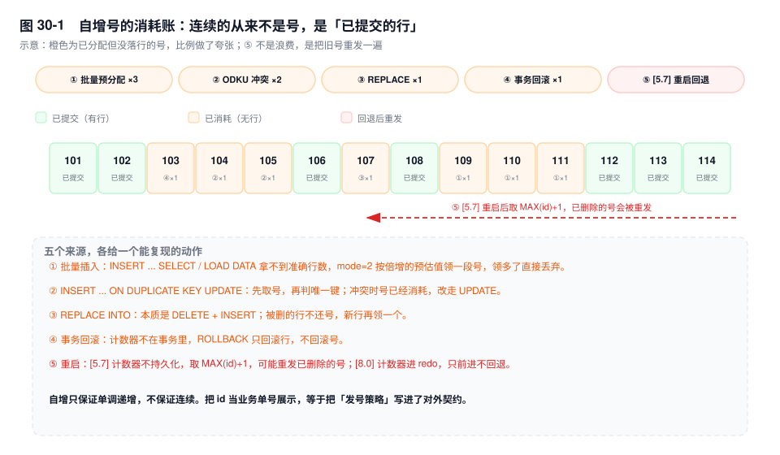
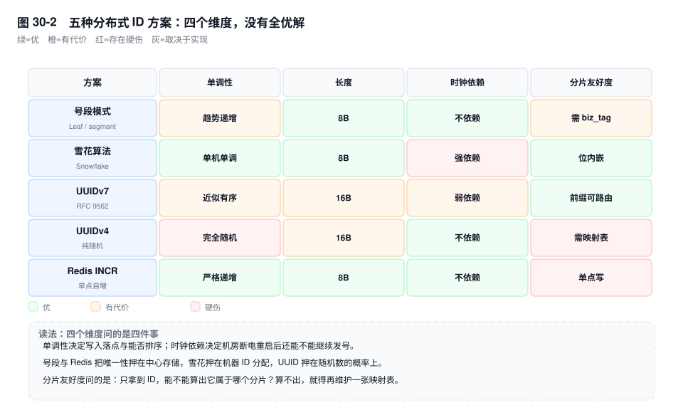
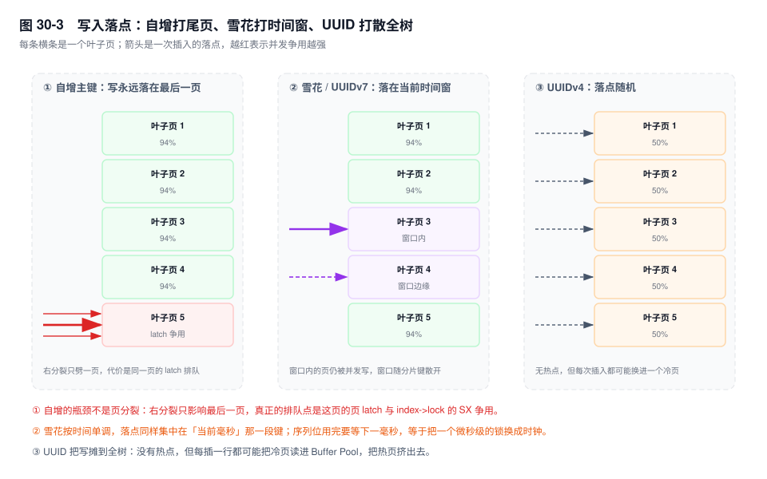

# 第 30 章　主键、唯一 ID 与自增

> **一句话结论**：主键只承担一件事——给每一行一个短、稳定、不重复的地址；自增能给地址，给不了"连续的单号"，这两件事被混为一谈时，账单会在第四年一次性到期。

## 30.0 场景：41 亿之后的那个 ALTER

订单主表 `order_main`，2019 年建表，主键 `id INT UNSIGNED AUTO_INCREMENT`。理由很朴素：一天几十万单，42 亿够用到公司上市。

2026 年 11 月，DBA 巡检时把 `SHOW TABLE STATUS` 的 `Auto_increment` 抄进了周报：4123988761。日增 280 万单，按这个速度还剩 60 天。

评审会开了两次，结论一次比一次难看。

第一次：`ALTER TABLE order_main MODIFY id BIGINT UNSIGNED NOT NULL AUTO_INCREMENT` 必须重建表。改数据类型不在 8.0 的 INSTANT/INPLACE 白名单里，只能 `ALGORITHM=COPY`（版本间白名单会变，先拿 `ALGORITHM=INPLACE` 试一次，报 1845 就是必须 COPY，需实测确认）。1.2TB 的数据加索引，在预发环境同规格实例上跑过一遍，落在 3 小时量级。`LOCK=SHARED` 允许读、不允许写——三个小时的停写窗口，大促前不可能批。

第二次：有人提议"等真用完再说"。查了一圈，`id` 被当订单号印在面单上，二维码区按 10 位定宽排版；财务的日对账文件也是定长文本，订单号占 10 列。扩列等于承认这个号还会涨，定宽约定必须现在就改成 `SO` + 12 位——前端正则、报表列宽、对账解析、客服输入框的 `maxlength`，四处一起改，上下游排期两周。

这条 ALTER 真正贵的不是那三个小时，是它逼所有人承认：一个从没打算给外人看的自增号，四年前贴到了面单上，现在它是一份有格式、有长度、有校验规则的外部契约。改列类型，等于改协议。

## 30.1 机制

### 一、自增号是怎么发出来的

InnoDB 的自增计数器挂在表对象上，不在事务里，也不在行里。一条不带 `id` 的 INSERT 要做的事是：

1. 进临界区，读计数器的当前值 `v`；
2. 把计数器写成 `v + 1`，退出临界区；
3. 拿 `v` 去构造这一行的聚簇索引记录。

第 1 步到第 2 步之间由 AUTO-INC 锁保护，保证并发下不重号。三档 `innodb_autoinc_lock_mode` 的差别只在这把锁持有多久、批量插入时怎么切号段，第 18 章已拆过，这里一句话对齐：`mode=0` 表级锁持到语句结束，`mode=1` 简单插入用互斥量、批量插入退化为表级锁，`mode=2`（8.0 默认）交错分配、不保证语句内连续。

关键在第 2 步与第 3 步之间：**号一旦加出去，就与这一行、与这个事务再无关系。** 后面无论这行插入失败、事务回滚、还是从库根本没收到这个事务，号都已经用掉了。所有跳号现象都是这一条的推论。

### 二、跳号的五个来源



**① 批量插入按预估值领号。** `INSERT INTO order_main (...) SELECT ... FROM order_stage` 在 `mode=2` 下，InnoDB 事先不知道 SELECT 会吐多少行，只能按倍增策略领号段：先领 1 个，不够领 2 个，再不够 4 个、8 个……语句结束时多领的部分直接丢弃。一条插 10 万行的语句可能消耗 13 万个号，最容易被误判成"数据丢了"——号比行多，行一行没少。

**② `INSERT ... ON DUPLICATE KEY UPDATE` 先取号再判冲突。** 语句进来时先按普通插入取号并尝试写聚簇索引，撞上唯一键才改走 UPDATE 分支。取号发生在判断之前，冲突那一刻号已经消耗。

```sql
INSERT INTO order_main (order_no, buyer_id, amount) VALUES ('SO20261112001', 8842, 199.00) AS new
ON DUPLICATE KEY UPDATE amount = new.amount;
-- order_no 已存在：id 已取走，走 UPDATE，号作废
```

**③ `REPLACE INTO` 是删加插。** 语义是"删掉冲突行，再插一行新的"：被删的行不还号，新行再取一个。所以 REPLACE 之后这行的 `id` 会变，任何按 `id` 建立的外部引用（消息、缓存 key、对账明细）全部失效。

**④ 事务回滚不回滚号。** 计数器不在 undo 里。`BEGIN; INSERT ...; ROLLBACK;` 之后号已经前进，下一行拿更后面的号。业务回滚是常态，而发号不是事务性的。

**⑤ 重启与主从切换。** 这一条必须写准，两个版本行为不同：

- `[5.7]` 计数器不持久化。重启后 InnoDB 按 `SELECT MAX(id)` 重算，把计数器设到 `MAX(id) + 1`。最大那条订单被硬删了，它的号就会在重启后被重发一遍。5.7 时代"重启后订单号重复"的事故根因就在这里：号被复用，旧号却早已进了对账文件和数仓。
- `[8.0]` 计数器随 redo 持久化，重启后取"redo 里的值"与 `MAX(id)` 中的较大者，只前进不回退。崩溃恢复后可能留下一段空洞（分配了但没落行的号不回收），但不会再重发已删除的号。

主从切换是另一个入口：新主库的计数器只保证不小于**它自己**的 `MAX(id)`，旧主库发出去又被回滚掉的号，在新主库眼里从未存在过，切换后可能再次发出。哪怕在 8.0 上，"用过的号永不复现"也不成立。

**自增只保证单调递增，不保证连续。** 它甚至不保证跨主从切换"绝不重号"。把自增号当业务单号展示给用户、写进对账文件、印在面单上，等于把一个纯内部的发号策略升级成了对外契约——30.0 里的两周排期就是这么来的。

### 三、自增用尽

| 类型 | 上限 | 备注 |
|---|---|---|
| `INT` | 2147483647（21.4 亿） | 有符号列半路用尽，比 `INT UNSIGNED` 早一半 |
| `INT UNSIGNED` | 4294967295（42.9 亿） | 本章场景里的那张表 |
| `BIGINT` | 9223372036854775807 | 按每秒 100 万号算，够 29 万年 |
| `BIGINT UNSIGNED` | 18446744073709551615 | 值域用满约 1.8×10¹⁹ |

用尽后的行为不是回绕，也不是"报个范围错误继续写"，而是取不到下一个自增值：

```text
ERROR 1467 (HY000): Failed to read auto-increment value from storage engine
```

1467 与 1264（`Out of range value`）要分清：1264 是"你给的值超范围"，换个值还能写；1467 是"引擎发不出号了"，这张表**不带 id 的插入**全部失败，多行 INSERT 一行都进不去。

扩列的代价在 30.0 算过，机制上补一句：`ALGORITHM=INPLACE` 对改数据类型通常不支持，试的时候会直接报 1845（`Cannot change column type INPLACE. Try ALGORITHM=COPY`）。COPY 的代价是"重建聚簇索引 + 重建全部二级索引 + 额外一份 1.2TB 临时空间"，不是"改 4 个字节"。

比扩列更早该做的是监控。使用率要读计数器本身，不能用 `MAX(id)`——删过数据之后 `MAX(id)` 会偏低，把危险期算得比实际晚：

```sql
SELECT TABLE_SCHEMA, TABLE_NAME, COLUMN_TYPE, next_id, cap,
       ROUND(next_id / cap * 100, 2) AS used_pct
FROM (
  SELECT t.TABLE_SCHEMA, t.TABLE_NAME, c.COLUMN_TYPE,
         t.AUTO_INCREMENT AS next_id,
         CASE
           WHEN c.DATA_TYPE = 'int'    AND c.COLUMN_TYPE LIKE '%unsigned%' THEN 4294967295
           WHEN c.DATA_TYPE = 'int'                                        THEN 2147483647
           WHEN c.DATA_TYPE = 'bigint' AND c.COLUMN_TYPE LIKE '%unsigned%' THEN 18446744073709551615
           WHEN c.DATA_TYPE = 'bigint'                                     THEN 9223372036854775807
         END AS cap
  FROM information_schema.TABLES t
  JOIN information_schema.COLUMNS c
    ON c.TABLE_SCHEMA = t.TABLE_SCHEMA
   AND c.TABLE_NAME = t.TABLE_NAME
   AND c.EXTRA LIKE '%auto_increment%'
  WHERE t.TABLE_SCHEMA NOT IN ('mysql','sys','performance_schema','information_schema')
    AND t.AUTO_INCREMENT IS NOT NULL
) x
WHERE cap IS NOT NULL AND next_id / cap > 0.7
ORDER BY used_pct DESC;
```

`information_schema.TABLES.AUTO_INCREMENT` 与 `SHOW TABLE STATUS` 读的是同一个内存计数器，都可能有一层缓存导致轻微滞后，用 `SHOW TABLE STATUS` 交叉验证一次即可。真正的阈值不该定在 90%：从发现到完成一次 COPY 重建要按月排期，70% 就该进季度规划。

### 四、无主键表的四重代价

**第一重：隐藏的 `DB_ROW_ID` 不能当标识用。**

建表不写主键，InnoDB 不会拒绝，它会偷偷加一列 6 字节的 `DB_ROW_ID` 当聚簇键。三个事实叠在一起，让这列完全不可依赖：

- 它是**全局一个计数器**，所有无主键表共用同一个序列：同一条 SQL 连插两张无主键表，rowid 是交错的。
- 它是**内存态**，不持久化。重启后从低位重新分配，重启前后插入的行可能拿到相同的 rowid。
- 它会被**复制进每一个二级索引**，每个索引项白多 6 字节（第 8 章那张"六份账单"又多一份）。

**第二重：ROW 格式复制退化为全列比对。**

ROW 格式下，从库靠 before image 定位"要改哪一行"。有主键时，before image 带主键就够；没有键，只能把整行所有列写进 binlog，从库再按全列匹配。`slave_rows_search_algorithms` 默认 `INDEX_SCAN,HASH_SCAN`：没有可用索引就扫全表，或者对 before image 在内存里建哈希表再找。一张 8 亿行的流水表，主库一条 UPDATE，从库一次全表扫。

更隐蔽的是**完全重复的行**（没有主键，这是允许的）：从库的全列匹配会命中多行，改哪一行不确定。主库改第 3 行、从库改第 7 行，两边从此不一致，而且不报错。

`binlog_row_image=MINIMAL` 在这里帮不上忙：省列的前提是"有键能唯一定位"。

**第三重：MGR 直接不收。**

认证以主键为粒度做行哈希：改不同主键的两个事务可以并行认证；没有主键，写集退化成整表范围，任意两个并发写都判冲突。这不是"性能差一点"，是"表必须有主键"被写进了准入条件（见第 27 章）。

**第四重：在线 DDL 与分批处理失去锚点。**

`pt-online-schema-change` 和 `gh-ost` 的 copy 阶段都是"按唯一键切片"：`WHERE id > ? ORDER BY id LIMIT 1000`。没有唯一键只能退化成全表扫或按非唯一索引切，切不齐会重复拷贝或漏行（随版本与参数变化，需实测确认）。业务侧同理：清理三年前的历史订单，有主键就是 `DELETE ... WHERE id > ? LIMIT 2000` 循环推进；没有主键只剩 `DELETE ... LIMIT 2000`，每轮都从头扫表，清 10 亿行的总扫描量按平方增长。

### 五、业务主键与代理主键

四个维度：

| 维度 | 业务主键（订单号、手机号、身份证） | 代理主键（自增 / 雪花 / UUID） |
|---|---|---|
| 唯一性来源 | 由业务规则保证，规则会变（订单号改版、手机号回收再放号） | 由发号器保证，与业务无关 |
| 长度 | 不可控，且往往很长（订单号 20~32 字符） | 可控，8 或 16 字节 |
| 变更频率 | 会变：换绑、纠错、合并账号、改规则 | 不变（这是它存在的全部意义） |
| 可读性 | 好，客服能直接念给用户 | 差，需要额外一列做展示 |

组合起来的判断只有三句：**天然唯一 + 永不变更 + 短定长**可以做聚簇主键（现实中极少，`country_code` 之类才算）；**天然唯一但会变**（手机号、邮箱、身份证）只做唯一索引——聚簇主键是行的物理位置，改它等于把行搬走，还要在每个二级索引里删旧条目插新条目（第 8 章）；**不唯一或可空**必须代理主键，没有选择余地。

"业务主键会变"的连锁代价值得算一遍。假设 `order_main` 用 `order_no` 做主键，某天要统一加渠道前缀：

1. 每行都要删旧聚簇记录、按新键插入新位置——聚簇索引整表重排；
2. 5 个二级索引，每个索引里这一行的条目都要删旧插新，等于 5 棵树跟着重写；
3. 以 `order_no` 做外键的子表（订单明细、退款单、结算单）要么级联更新，要么先删外键；
4. 系统之外：数仓的订单维度表、对账文件、缓存 key、已发出的消息体，全部指向一个不存在的号。

代理主键把这一切变成"改一列普通字段"：`order_no` 只是另一个带唯一索引的列，不影响物理位置，也不影响关联。

### 六、分布式 ID 的五个方案



再看依赖与失效模式：

| 方案 | 依赖 | 时钟风险 | 适用场景 |
|---|---|---|---|
| 号段 | 一个可用的库 | 无 | 多机写入、要趋势递增 |
| 雪花 | 机器 ID 分配 | 高，回拨即重号 | 高并发、8 字节、能治理 workerId |
| UUIDv7 | 无 | 低，只影响有序性 | 客户端生成、不想运维机器 ID |
| UUIDv4 | 无 | 无 | 只做等值匹配的标识，不做主键 |
| Redis INCR | Redis 高可用 | 无，但持久化会回退 | 已有 Redis、能接受重发 |

**号段模式（Leaf-segment）。** 库里一张 `leaf_alloc(biz_tag, max_id, step, update_time)`，用 `UPDATE ... SET max_id = max_id + step WHERE biz_tag = ?` 一次领一段，在内存里慢慢发。不依赖时钟、趋势递增，落点集中在尾部一小段。代价是重启会浪费内存里没发完的那一段（和自增跳号同理）；多实例必须各用各的 `biz_tag`，否则会领到重叠号段；`step` 越大，撑得越久，重启浪费也越多。

**雪花算法（Snowflake）。** 64 位 = 1 位符号 + 41 位毫秒时间 + 10 位机器 ID + 12 位序列。41 位毫秒约 69.7 年，单机每毫秒 4096 个号；8 字节、去中心、按时间单调。两个代价：

- **时钟回拨**。机器 ID 由运维分配，时钟却由 NTP 管；一次 step 校正往回跳 500ms，这台就会重发这 500ms 内已经发过的号。三种处置：**等**（回拨小于阈值如 5ms，自旋到 `last_timestamp`；超过阈值不能等，等 500ms 等于写全停）、**报错**（拒绝发号并告警，由上游重试或降级）、**借位**（机器 ID 的若干位临时当扩展时间位，用空间换可用性，代价是 ID 与机器的映射关系临时变了）。
- **机器 ID 分配**。10 位只够 1024 台，K8s 里 Pod 重建就换 IP，拿 IP 末段做 ID 会撞；用 ZooKeeper/etcd 注册租约是常规做法，但这又把"去中心"打了折。

**UUIDv7 `[RFC 9562]`。** 前 48 位毫秒时间戳 + 版本位 + 12 位 `rand_a` + 62 位 `rand_b`。时间前缀让它近似有序，落点和雪花类似，都集中在当前时间窗；不需要机器 ID，也不需要中心服务。代价是 16 字节——主键长度会被每个二级索引复制一遍（第 8 章）；同毫秒内不严格单调，只能当"近似有序的键"。**UUIDv4** 则是 122 位纯随机，落点全树随机，页分裂与 Buffer Pool 污染见第 8 章——它适合 trace id 这种只做等值匹配的标识，不适合做聚簇主键。

**Redis `INCR`。** 一条命令一个号，实现成本最低。代价是多一个必须高可用的依赖与全局串行点，以及持久化：RDB 是定时快照，两次快照之间宕机，重启后 `INCR` 从快照值继续，中间发出去的号全部重发；AOF `everysec` 仍可能丢最后 1 秒。

决策顺序是三个问题，不是打分表：

1. **能不能接受中心依赖？** 不能 → 雪花或 UUIDv7；能 → 下一问。
2. **要不要趋势递增？** 要 → 号段或雪花；不要、只要唯一 → UUIDv4，但别做聚簇主键。
3. **长度预算多少？** 8 字节 → 号段、雪花、Redis；16 字节可接受且不想运维机器 ID → UUIDv7。

### 七、分库分表下的全局唯一

**步长法。** 两台以上的库各自自增，靠两个参数错开：

```sql
-- 3 个分片，第 1 个分片
SET GLOBAL auto_increment_increment = 3;
SET GLOBAL auto_increment_offset = 1;   -- 产出 1, 4, 7, 10 ...
```

- 优点：零改造，MySQL 原生支持。
- 代价一，**扩容会撞号**。分片从 3 个变 6 个，`increment` 改成 6 之后，老分片已有的号与新步长产生的号会在同一个模类里重叠。正确做法是"一代步长翻倍 + offset 规划"，或者双倍扩容再迁移。
- 代价二，**ID 与分片无关**。`WHERE id = 12345` 还是得把所有分片问一遍，从 12345 算不出它在哪个分片。

**基因法。** 把分片键的哈希值嵌进 ID 的固定几位，让"按 ID 查"也能直接路由。16 个分片，取 `buyer_id % 16` 占 4 位，放进 ID 的低 4 位：

```text
order_id = [41 位时间][10 位机器][8 位序列][4 位基因 = buyer_id % 16]
```

拿到一个 `order_id`，取低 4 位就知道去哪个分片，不用广播。这是解决"分片键与主键不一致"的关键技巧——订单按 `buyer_id` 分片，用户手里却只有订单号。

代价是位预算：基因位要从序列位或机器位里抠，序列从 12 位降到 8 位，单机每毫秒从 4096 个号降到 256 个。基因位宽度必须按五年后的分片数一次留够——留 4 位只撑 16 个分片，扩到 32 个就要重新布局，历史 ID 不兼容。分片策略本身见第 33 章。

### 八、主键顺序与写入热点



三种主键的落点差别，第 8 章已经从页分裂和填充率的角度讲过。这里只讲并发：**自增慢，慢在哪一把锁上。**

**自增：尾部热点，排队点在页 latch。** 所有插入落在最右一页，右分裂只劈这一页，页分裂本身不多。真正的排队点是这一页的 latch（`buf_block_t` 上的读写锁）：N 个并发插入要改同一个页，就得排队拿同一把页锁。页要分裂时插入走悲观路径，短暂升级到 `index->lock` 的 SX 模式——这一瞬间连"往别的页插"也要等（读不受影响）。再叠上计数器那把短暂的 mutex，以及热脏页在 checkpoint 时集中刷的抖动，就是自增表在几千 TPS 后曲线变平的原因。

`innodb_autoinc_lock_mode=1` 是另一种慢法：批量插入持表级 AUTO-INC 锁到语句结束，整表插入串行。8.0 把默认改成 2 解决的正是这个，但解决不了页 latch。

**雪花 / UUIDv7：中间热点，区间更窄。** ID 随时间单调，落点集中在"当前毫秒"对应的那一段键。这个区间比"最后一页"宽，宽度大致等于并发写入量乘单行大小，页 latch 争用被摊薄。摊薄程度取决于两件事：单机能分到多少个 workerId，低位能不能把不同业务的写入散开。序列位用完时进程要自旋到下一毫秒，表现为每秒一次的小尖刺。

**UUIDv4：无热点，代价在别处。** 落点随机，没有哪一页是热点，但每次插入都可能把冷页读进 Buffer Pool、把热页挤出去。随机写把"写热点"换成了"读放大 + 页分裂"，不是消失了。

## 30.2 关键结论

1. **自增号在行插入之前就发出去了，且不在事务里。** 回滚、冲突、批量预分配、重启，四条路径都会留下"已消耗未落行"的空洞；自增只保证单调递增，不保证连续。
2. **`[5.7]` 重启按 `MAX(id)+1` 重算，会重发已删除的号；`[8.0]` 把计数器写进 redo，只前进不回退。** 这是两个版本在"号会不会重复"上的实质差异。
3. **自增用尽是 1467，不是回绕。** 到达上限后这张表所有插入全部失败，恢复手段只有重建表，成本与表体积成正比。
4. **无主键表没有行标识。** `DB_ROW_ID` 是全局共享、不持久化的 6 字节内部值；ROW 复制退化为全列比对，`MINIMAL` 也省不掉；MGR 不收；分批清理失去锚点。
5. **业务主键的问题不是"可读性太好"，是"会变"。** 改主键值 = 删旧行 + 插新行 + 每个二级索引删旧插新 + 所有外部引用失效；代理主键把这个代价压成一次普通 UPDATE。
6. **分布式 ID 的选型是三次取舍：要不要中心依赖、要不要趋势递增、长度预算多少。** 号段与 Redis 押在中心存储，雪花押在机器 ID 分配，UUID 押在随机数上；三种落点（尾页、时间窗、全树）只是把排队点搬到了不同位置，没有一种把它消掉。

## 30.3 实验验证

### 实验一：四种动作，四种跳号

```sql
CREATE TABLE t_seq (
  id INT UNSIGNED NOT NULL AUTO_INCREMENT PRIMARY KEY,
  order_no VARCHAR(32) NOT NULL,
  UNIQUE KEY uk_order (order_no)
) ENGINE=InnoDB;

SHOW VARIABLES LIKE 'innodb_autoinc_lock_mode';   -- 8.0 默认 2

INSERT INTO t_seq (order_no) VALUES ('A'), ('B');  -- id = 1, 2

-- ② 唯一键冲突：先取号，再改走 UPDATE
INSERT INTO t_seq (order_no) VALUES ('A') AS new
  ON DUPLICATE KEY UPDATE order_no = new.order_no;  -- 消耗 3

-- ④ 事务回滚：号不跟着回滚
BEGIN;
INSERT INTO t_seq (order_no) VALUES ('C');          -- 消耗 4
ROLLBACK;

INSERT INTO t_seq (order_no) VALUES ('D');          -- id = 5

-- ③ REPLACE：删掉 B，再插一行新的
REPLACE INTO t_seq (order_no) VALUES ('B');         -- 消耗 6，B 的 id 从 2 变成 6

SELECT id, order_no FROM t_seq ORDER BY id;
```

```text
-- 输出形态（未实跑，字段含义以此为准）
id  order_no
1   A
5   D
6   B
```

读法：`2` 被 REPLACE 删掉，`3`、`4` 是空洞，`6` 是 B 的新号。行数还是 3，号从 2 涨到 6。**号的数量和行的数量之间没有守恒关系**，拿自增号对账一定会出错，原因就在这里。

### 实验二：把自增逼到用尽

不用等四年，把计数器直接推到边界：

```sql
CREATE TABLE t_tiny (
  id INT UNSIGNED NOT NULL AUTO_INCREMENT PRIMARY KEY,
  v INT
) ENGINE=InnoDB AUTO_INCREMENT = 4294967294;

INSERT INTO t_tiny (v) VALUES (1);   -- id = 4294967294
INSERT INTO t_tiny (v) VALUES (2);   -- id = 4294967295
INSERT INTO t_tiny (v) VALUES (3);   -- ERROR 1467 (HY000)
SHOW TABLE STATUS LIKE 't_tiny'\G     -- Auto_increment: 4294967295
```

```text
-- 输出形态（未实跑，字段含义以此为准）
ERROR 1467 (HY000): Failed to read auto-increment value from storage engine
```

三次插入，前两次成功，第三次整个语句失败。之后再怎么重试都是 1467，`Auto_increment` 停在 4294967295 不动。生产上对应的是"某天早上开始这张表写入 100% 失败"，不是"慢慢变慢"——它没有退化过程，只有断崖。

### 实验三：无主键表的 before image 有多宽

```sql
CREATE TABLE t_nopk (
  order_no VARCHAR(32) NOT NULL,
  amount   DECIMAL(12,2) NOT NULL,
  status   TINYINT NOT NULL
) ENGINE=InnoDB;

INSERT INTO t_nopk VALUES ('SO20261112001', 199.00, 1), ('SO20261112002', 88.00, 1);
UPDATE t_nopk SET status = 2 WHERE order_no = 'SO20261112001';

SHOW INDEX FROM t_nopk;   -- 空结果：没有任何索引
```

```bash
mysqlbinlog -vv --base64-output=DECODE-ROWS mysql-bin.000007 \
  | sed -n '/t_nopk/,/^COMMIT/p'
```

```text
-- 输出形态（未实跑，字段含义以此为准）
### UPDATE `shop`.`t_nopk`
### WHERE
###   @1='SO20261112001'   /* VARCHAR(32) meta=32 nullable=0 */
###   @2=199.00            /* DECIMAL(12,2) meta=... */
###   @3=1                 /* TINYINT meta=0 nullable=0 */
### SET
###   @3=2
```

`WHERE` 里三列全在，尽管只改了 `status`。有主键的表，定位只靠主键。把 `binlog_row_image` 改成 `MINIMAL` 重跑，这三行不会变少——省列的前提是"有键能唯一定位"。从库拿到这条事件后，要么扫全表匹配三列，要么对整行建哈希再找。

## 30.4 常见误区

⚠️ **"自增号是连续的，可以拿来做单号和对账"**

自增只保证单调递增。预分配、唯一键冲突、REPLACE、事务回滚、重启与主从切换，五条路径都会留下空洞；`[5.7]` 重启甚至会让旧号重现。单号要的"连续、可校验、不重用"，自增一个都不保证。

⚠️ **"用 `MAX(id)` 就能算出还剩多少号"**

删除不还号，`MAX(id)` 会低于真实计数器。表里删过一大截数据，`MAX(id)` 可能比 `Auto_increment` 小很多，你以为还剩 10%，实际只剩 2%。算使用率只能读计数器（`SHOW TABLE STATUS` / `information_schema.TABLES`）。

⚠️ **"没主键也能跑，加个自增列纯属浪费空间"**

InnoDB 会给无主键表补一个 6 字节的 `DB_ROW_ID`——空间一分没省，只是把这列藏起来了。省下的是"一行有意义的标识"，代价是 `DB_ROW_ID` 不能外部引用、ROW 复制全列比对、MGR 拒收、分批清理没有切片锚点。加主键不是加开销，是把隐式开销换成显式可控的开销。

⚠️ **"UUID 换成 UUIDv7 就没有写放大问题了"**

v7 只解决了"有序"，没解决"16 字节"。页数、扇出、比较成本都按 16 字节走，主键长度还会被每个二级索引复制一遍（第 8 章）。它的正确用法是"确实需要客户端生成、又不想运维机器 ID"，而不是替换一个跑得好好的 `BIGINT` 自增。

## 30.5 生产 Checklist

建表与评审时逐条过：

- [ ] 主键是代理键吗？如果是业务字段，它会不会被修改（换绑、改规则、纠错）？
- [ ] 自增列的类型与预期增速对得上吗？按当前日增量算过 `Auto_increment / 上限` 的剩余时间吗？
- [ ] 用尽比例超过 70% 的表进季度规划了吗？COPY 的停写窗口和临时空间评估过吗？
- [ ] 有没有表没有主键？扫一遍 `information_schema.TABLES` 里 `AUTO_INCREMENT IS NULL` 且无唯一键的表。
- [ ] 业务单号是独立字段吗？它和主键是两列，而不是"把 id 拼个前缀"？
- [ ] 分片表的 ID 生成方式定了吗：步长法（扩容撞号）、号段（要 `biz_tag`）、雪花（要机器 ID）、基因法（要位预算）？
- [ ] 用雪花的话，机器 ID 怎么分配、时钟回拨怎么检测、拒绝发号时上游怎么降级？
- [ ] 用 UUID 做主键的话，存 `BINARY(16)` 还是 `CHAR(36)`？
- [ ] `binlog_format=ROW` 与 `innodb_autoinc_lock_mode=2` 成对配置（第 18 章）？
- [ ] 批量清理历史数据有主键锚点吗（`WHERE id > ? ORDER BY id LIMIT n`）？

## 30.6 延伸

- **上一章**：第 29 章讲数据类型与字符集——它决定字符串主键的比较成本，也决定 `VARCHAR` 主键到底占多少字节。
- **下一章**：第 31 章把"主键选型"放进整张表的结构演进里看：范式、反范式、加列与拆表。
- **关联章节**：第 8 章（聚簇索引、页分裂、主键长度的六份账单）、第 18 章（`AUTO-INC` 锁的三档模式）、第 22 章（ROW 格式复制与行镜像）、第 27 章（MGR 为什么要求主键）、第 33 章（分片键选择与基因法的完整推演）。
- **面试追问**：
  - "自增主键为什么会跳号？" → 号在插入前发出且不在事务里；预分配、ODKU、REPLACE、回滚、重启五条路径。5.7 重启按 `MAX(id)+1` 重算还会重发旧号。
  - "自增用完了会怎样？" → 1467，整表插入全部失败；恢复只有重建表，改类型走 COPY，成本与表体积成正比。
  - "为什么表必须有主键？" → 没有主键就没有行标识：`DB_ROW_ID` 全局共享且不持久化、ROW 复制退化成全列比对、MGR 认证退化成整表冲突、分批清理失去锚点。
  - "雪花怎么处理时钟回拨？" → 等（小回拨）、报错（大回拨，配合降级）、借位（临时换 workerId）；源头把 NTP 配成 slew。
- **官方文档**：`Auto-Increment Handling in InnoDB`、`innodb_autoinc_lock_mode`、`Replication and AUTO_INCREMENT`、`Binary Log Row Events`（`binlog_row_image`）、`RFC 9562`（UUIDv7）。
