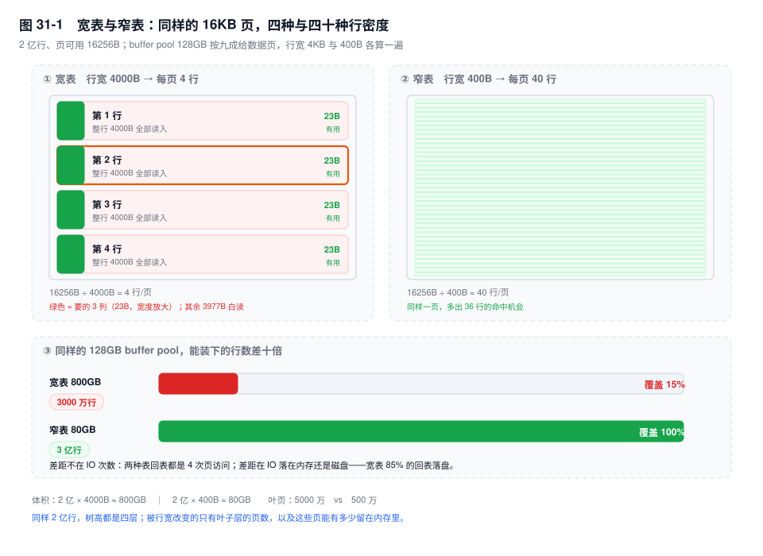
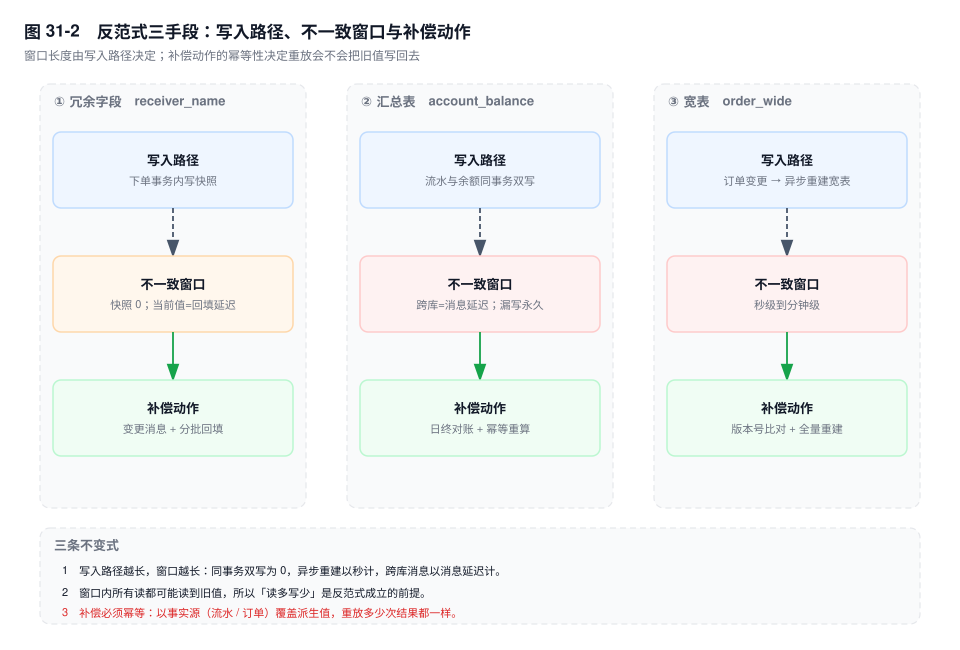
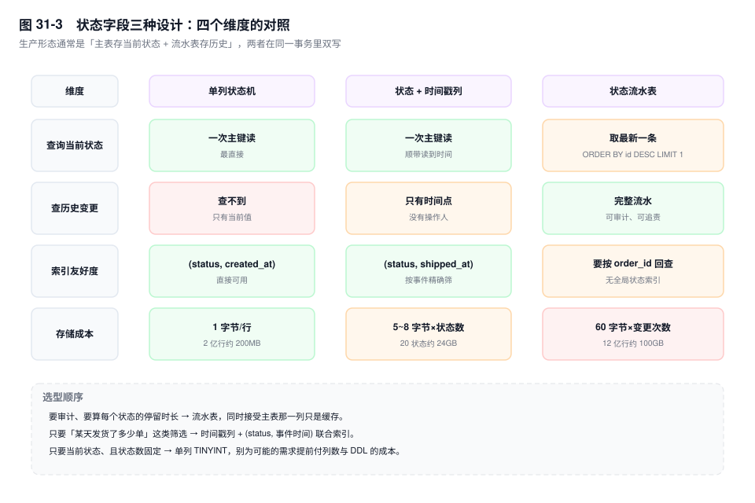

# 第 31 章　表设计：范式、反范式与结构演进

> **一句话结论**：范式回答"一份事实存几遍"，反范式回答"用多少存储换掉多少次 JOIN"；前者是对错问题，后者是成本问题，混在一起讨论就永远没有结论。

## 31.0 场景：一张 60 列的表，和一次 40 分钟的 DDL

`order_main` 建于 2019 年，建表时 12 列。之后每来一个需求加一列：收件人、地址、发票、税号、优惠明细、风控标签——每次都有正当理由，"查询方便，不用 JOIN"。五年后 60 列，单行 4KB。

```sql
CREATE TABLE order_main (
  id             BIGINT UNSIGNED NOT NULL AUTO_INCREMENT,
  order_no       VARCHAR(20)   NOT NULL,
  buyer_id       BIGINT UNSIGNED NOT NULL,
  status         TINYINT       NOT NULL DEFAULT 0,
  total_amount   DECIMAL(12,2) NOT NULL DEFAULT 0.00,
  receiver_name  VARCHAR(32)   NOT NULL DEFAULT '',
  receiver_addr  VARCHAR(256)  NOT NULL DEFAULT '',
  invoice_title  VARCHAR(128)  NOT NULL DEFAULT '',
  coupon_detail  JSON          DEFAULT NULL,
  ext_json       JSON          DEFAULT NULL,
  remark         TEXT,
  created_at     DATETIME(3)   NOT NULL DEFAULT CURRENT_TIMESTAMP(3),
  updated_at     DATETIME(3)   NOT NULL DEFAULT CURRENT_TIMESTAMP(3)
                               ON UPDATE CURRENT_TIMESTAMP(3),
  PRIMARY KEY (id),
  UNIQUE KEY uk_order_no (order_no),
  KEY idx_buyer_ct (buyer_id, created_at)
) ENGINE=InnoDB DEFAULT CHARSET=utf8mb4;
```

上面是节选，剩下四十多列平均每列 50 字节。2026 年 11 月，三件事同时发生：

- Buffer pool 128GB，按九成给数据页、4KB 一行只能装约 3000 万行；表里 2 亿行，覆盖率 15%。点查 P99 完全跟着磁盘随机读走。
- `SELECT order_no, status FROM order_main WHERE buyer_id = 8842` 走了 `idx_buyer_ct`，`EXPLAIN` 一片绿，但要回表读整行：每次回表是一次 16KB 的页访问，只为取 23 个字节。
- 想加一个 `channel_id`，`ALGORITHM=INSTANT` 用不上（要加在中间），只能 COPY 重建：读一遍 800GB、写一遍 800GB，按 500MB/s 估是 3200 秒，加上索引重建与主从延迟，40 分钟。

三件事是同一个原因的四笔账。



## 31.1 范式：哪条约束该放数据库，哪条放应用

讨论"要不要遵守范式"是无效的：范式约束不是一组，是四组规则。真正要决策的是**每一条约束由谁执行**。

### 1NF：原子性什么时候可以放弃

`coupon_ids VARCHAR(255)` 存 `'12,45,78'` 是最典型的反 1NF，它带来三个具体后果：

```sql
-- 想查"用过 45 号券的订单"，只能这样写
SELECT id FROM order_main WHERE coupon_ids LIKE '%45%';
```

第一，用不上索引，2 亿行全表扫；第二，`%45%` 会误命中 `145`、`450`；第三，删除一张券要读出来、改字符串、写回去，两个并发就丢一次更新。这一列还随时可能被静默截断——非严格模式下超长部分直接丢，不报错。

`JSON` 有资格谈条件。可以放弃 1NF 的三个前提同时成立：**结构不固定、整取整存、不按内部字段做过滤或排序**。渠道回调原文、商品可变规格都符合。一旦 `WHERE ext_json->>'$.channel' = 'APP'` 出现在高频查询里，前提就不成立，两条路：提生成列建索引（见第 29 章），或把字段拆成真正的列。

### 2NF / 3NF：冗余的两张面孔

违反 2NF 的经典形态在库存表：`stock(warehouse_id, sku_id)` 复合主键，却存了 `warehouse_name`——它只依赖 `warehouse_id` 这一半的键。违反 3NF 的经典形态在订单表：存 `buyer_city`，它依赖 `buyer_id`，而 `buyer_id` 依赖 `order_id`，是传递依赖。仓库改名后，历史行全部指向旧值。

这里有个陷阱：**订单表存 `receiver_addr` 不违反 3NF，它是快照；存 `buyer_city` 才违反**。区别不在"是否冗余"，在"这一列记的是下单那一刻的事实，还是对另一张表的实时引用"。前者是事件记录，后者是缓存。这条区分贯穿全章。

### 判据：两个数字划线

把约束的归属先定下来：

- **放数据库**：`NOT NULL`、`UNIQUE`、`CHECK`（`[8.0.16+]` 起才真正生效）、同库同分片的外键。它们的共同点是单行可判定，数据库能在写入路径上以行锁粒度执行。
- **放应用层**：跨表不变量（订单总额 = 明细之和）、跨库引用、状态机跃迁合法性。它们要么要读多行，要么跨实例，数据库没有能力在提交时判定。

反范式的判据只有一条不等式：**省掉的 JOIN 成本 > 冗余带来的传播成本**。两边都能量化：

```text
收益 = 该字段每秒被读次数 × 单次 JOIN 的回表次数 × 单次回表成本
成本 = 该字段每天变更次数 × 平均每次变更影响的行数 × 单行回填成本
```

代入订单场景：昵称展示 1000 QPS，每单一次回表；改名每天 100 次，每次影响该买家近三个月的 20 单，即 2000 行。收益侧一天省 8640 万次回表，成本侧一天写 2000 行——差四个数量级，冗余。

库存是反例：`available` 每秒变上千次、每次读取都要最新值，收益侧没有 JOIN 可省，成本侧每次变更都要传播给所有引用方。

阈值写成两条：**同一字段读 QPS ≥ 1000 且每天变更 ≤ 100 次，冗余；读 QPS < 10，老实 JOIN；中间地带先量一次回表次数再决定。**

## 31.2 反范式三手段，与它们各自的一致性账单

互联网公司用冗余换 JOIN，不是因为 JOIN 慢，是因为**两者的成本曲线形状不同**：JOIN 随查询次数线性增长，冗余随变更传播增长。读写比 100:1 的业务里，这两条曲线差两个数量级。再加上分库分表之后跨库 JOIN 直接不可用（见第 33 章），冗余就从"优化选项"变成了"准入条件"。

手段只有三种，区别在不一致窗口有多长、由谁兜底。

### 冗余字段：先问是快照还是当前值

`receiver_name` 冗余在订单里，用户改名之后历史订单显示旧名字。这不是 bug，是**订单本来就该记住下单时的收件人**。快照语义不需要补偿，不一致窗口为零——它在写入那一刻就固化了。

真正会出事的是另一种：把 `buyer_nick` 冗余进订单，用于"我的订单"列表展示。用户改名后列表里还是旧昵称，用户会来投诉，因为列表要的是当前值。

两种冗余的处置完全不同：

| 语义 | 例子 | 一致性窗口 | 补偿 |
|---|---|---|---|
| 快照 | 收件人、下单时价格、发票抬头 | 0，写时固化 | 不需要 |
| 当前值 | 昵称、店铺名、会员等级 | 改名到回填完成之间 | 变更消息 + 分批回填 |

当前值的回填必须限流：一个买家三个月 20 单，改一次名回填 20 行；一个企业账号三个月 20 万单，改一次名就是 20 万行。回填要走消息队列分批，`WHERE buyer_id = ? AND created_at > ? LIMIT 2000` 循环推进，不能在一次请求里做完。

### 汇总表：双写与对账

余额、库存、订单总额属于同一类：读多到不能每次 `SUM`，写又没少到可以纯异步。

```sql
CREATE TABLE account_balance (
  account_id BIGINT UNSIGNED NOT NULL,
  balance    DECIMAL(18,2)   NOT NULL DEFAULT 0.00,
  version    BIGINT          NOT NULL DEFAULT 0,
  updated_at DATETIME(3)     NOT NULL DEFAULT CURRENT_TIMESTAMP(3),
  PRIMARY KEY (account_id)
) ENGINE=InnoDB;

CREATE TABLE bill_detail (
  id         BIGINT UNSIGNED NOT NULL AUTO_INCREMENT,
  account_id BIGINT UNSIGNED NOT NULL,
  amount     DECIMAL(18,2)   NOT NULL,
  biz_no     VARCHAR(32)     NOT NULL,
  created_at DATETIME(3)     NOT NULL DEFAULT CURRENT_TIMESTAMP(3),
  PRIMARY KEY (id),
  UNIQUE KEY uk_biz (biz_no),
  KEY idx_acct (account_id, id)
) ENGINE=InnoDB;
```

同库时两个写在同一本地事务里，原子性有保证；跨库退化成消息或 TCC（见第 34 章），窗口等于消息延迟。风险不在窗口，在**代码路径漏写**：退款走了新链路，只写流水没减余额，三个月后对账才发现。

兜底只有一个：日终对账 + 幂等重算。

```sql
SELECT b.account_id, b.balance, d.total,
       b.balance - d.total AS diff
FROM account_balance b
JOIN (SELECT account_id, SUM(amount) AS total
      FROM bill_detail GROUP BY account_id) d
  ON d.account_id = b.account_id
WHERE b.balance <> d.total;
```

差异行不是"自动修"，是进工单：差异说明某条链路有 bug，先修链路再重算。重算要幂等，以流水为准覆盖余额。

### 宽表：写入放大与更新传播

把 JOIN 结果物化成 `order_wide`，代价不是"多存一份"，是**更新传播**。订单自身变更只影响 1 行，维度变更会炸开：

```text
一次店铺改名影响的行数 = 该店铺近 N 天订单数
一次买家等级变更影响的行数 = 该买家近 N 天订单数
```

一个日销 5 万单的店铺改一次名，就是 5 万行、200MB 的写入，必须异步分批；兜底靠版本号——宽表行带上源表 `updated_at`，重建任务按主键比对，落后的重算。宽表适合报表与检索，不适合交易主链路。



## 31.3 宽表的账：从行宽推到命中率

"宽表不好"是废话。要算的是它具体吃掉了什么。下面每一步都给假设，任何一步的假设变了，结论跟着变。

### 第一步：行宽 → 每页行数

16KB 的页扣掉页头、页尾、Infimum/Supremum 与页目录，可用约 16256 字节（推导见第 8 章）。行整体存储，不能只存一半：

```text
宽表：16256 ÷ 4000 ≈ 4 行/页
窄表：16256 ÷ 400  ≈ 40 行/页
```

400 字节的窄表是同一张订单表只留 15 个核心列（`id` 8 + `order_no` 16 + `buyer_id` 8 + `status` 1 + 金额 6 + 两个时间 12 + 几个整型 + 记录头 5 + 隐藏列 13）。十倍的行宽差，十倍的行密度差。

### 第二步：行数 → 体积

```text
宽表：2 亿行 ÷ 4 行/页 = 5000 万叶页 × 16KB ≈ 800GB
窄表：2 亿行 ÷ 40 行/页 = 500 万叶页 × 16KB ≈ 80GB
```

顺带破一个流传很广的说法：**宽表不会让二级索引变大**。二级索引的叶子只存 `(索引列, 主键)`，与行宽无关——除非主键变长（第 8 章那六笔账）。宽表多出来的 720GB 全在聚簇索引的叶子层里。

### 第三步：树高与"能缓存多少"

按扇出 947 算。三层树的叶子层最多 947 × 947 ≈ 90 万页，两个表都超了：

```text
宽表：5000 万叶页 → 上层 52800 → 56 → 1，四层
窄表：500 万叶页  → 上层 5280  → 6  → 1，四层
```

层数一样，都是四次页访问——"宽表把树推高一层"在这组数字下不成立。差距在叶子层：5000 万页对 500 万页，体积差十倍，而 buffer pool 只有 128GB。

```text
宽表覆盖率：128GB × 0.9 ÷ 4KB ≈ 3000 万行，占 2 亿行的 15%
窄表覆盖率：128GB × 0.9 ÷ 400B ≈ 3 亿行，2 亿行全部装得下
```

这就是最隐蔽的那笔账：**它不体现在单条 SQL 的耗时上，体现在整体命中率上**。同一条回表，宽表上 85% 落盘，窄表上全命中；CPU 几乎相同，等待时间差一个数量级。监控看到的是"库整体变慢"，不是"某条 SQL 慢"，所以它进不了慢查询日志。

### 第四步：`SELECT *` 的 IO 放大

行整体加载，整页进 buffer pool：

```text
要的列：order_no 16 + status 1 + total_amount 6 = 23 字节
读的列：整行 4000 字节
放大倍数：174 倍
```

100 万行的报表查询，宽表要读 4GB 进内存，而结果集本身只有 24MB。更糟的是 `SELECT *` 让覆盖索引彻底失效：少一列不在索引里，`Using index` 就变成回表，100 万行就是 100 万次随机页访问。

按 15% 命中率算，1000 次回表里 850 次落盘：

```text
850 × 16KB ≈ 13.6MB 磁盘读，换回 23KB 有效数据
```

### 第五步：DDL

`[8.0.12+]` 的 `ALGORITHM=INSTANT` 加列不重建表，但限制很硬：**新列只能加在最后一列之后**（`AFTER` 任意位置要 `[8.0.29+]`），行格式得是 `DYNAMIC`（`COMPACT` 表要另测）；每次 INSTANT 变更在表上留一个行版本，8.0.29 起上限 64 个，超了还是要重建。8.0.29 之前，加过一次 INSTANT 列之后再改列属性也走不了 INSTANT。

加在中间只能 COPY：读 800GB、写 800GB，按 500MB/s 有效吞吐是 3200 秒；期间 `LOCK=SHARED` 允许读不允许写，这是一次真实的停写窗口。列顺序在宽表上不是审美问题——业务列和历史列混排，每次加列都插在中间。

## 31.4 垂直拆分：把哪些列搬走

拆表的判据是两条，任一条成立就该拆：

- **单行超过 8KB**，即半个页。InnoDB 的硬约束是"一页至少放两行"，行内上限约 8126 字节（第 29 章），接近这条线时每页只剩 2 行，空间利用率崩掉。
- **某几列的访问频率低于主表列的 1/10**。详情页读 `remark`，列表页、状态机、对账、风控都不读它，那它占的行宽就是在给 99% 的查询收税。

拆法按访问模式分，不按字段类型分。订单表拆成主表 + 扩展表：

```sql
CREATE TABLE order_ext (
  order_id       BIGINT UNSIGNED NOT NULL,
  ext_json       JSON,
  coupon_detail  JSON,
  invoice_detail TEXT,
  updated_at     DATETIME(3) NOT NULL DEFAULT CURRENT_TIMESTAMP(3)
                             ON UPDATE CURRENT_TIMESTAMP(3),
  PRIMARY KEY (order_id)
) ENGINE=InnoDB;
```

主表留 15 列约 350 字节，一页 46 行，2 亿行约 70GB，buffer pool 能整表装下；扩展表只在详情页按主键取一行。收益是列表页与状态机的回表全命中内存，代价是详情页两次 IO。

两次 IO 可以省掉一半：

```sql
-- 列表页先在窄表分页，再批量取扩展字段
SELECT id FROM order_main
WHERE buyer_id = 8842 ORDER BY created_at DESC LIMIT 20;

SELECT order_id, ext_json FROM order_ext
WHERE order_id IN (1001, 1002, ...);
```

20 行按主键连续，通常落在 1~2 个页里，是一次批量读而非 20 次随机读——延迟关联，与第 12 章 BKA 的批量回表同理。

关于"大字段独立表"：`TEXT` 在 `DYNAMIC` 下（`[5.7.9+]`）行内只留 20 字节指针，拆出去**几乎不减少行宽**；它值得拆的理由是更新会整行重写、`SELECT *` 会连溢出页一起读。真正该拆的是行内的大 `VARCHAR` 与 `JSON`——`coupon_detail` 和 `ext_json` 各占几百字节到 1KB，实打实躺在叶子页里。`COMPACT` 表另算，行内留 768 字节前缀，拆出去立刻省 788 字节。

## 31.5 状态字段：一张表要记住"何时"

`status TINYINT` 只能回答"现在是什么"。业务问的第二句话永远是"什么时候变的"，它决定了表结构。

**方案一，单列状态机。** 一列 `status`，配代码里的常量。优点是简单，写入只改一列；缺点是没有任何时间信息。别指望 `updated_at` 顶上——它会被任何字段的更新覆盖（第 29 章的 `ON UPDATE` 行为），改个备注就把发货时间冲掉了。

**方案二，状态 + 时间戳列。**

```sql
ALTER TABLE order_main
  ADD COLUMN paid_at     DATETIME(3) DEFAULT NULL,
  ADD COLUMN shipped_at  DATETIME(3) DEFAULT NULL,
  ADD COLUMN finished_at DATETIME(3) DEFAULT NULL,
  ADD KEY idx_status_ship (status, shipped_at);
```

`(status, shipped_at)` 直接支撑"昨天发货的订单"，也能算各状态停留时长。代价三条：列数随状态线性增长；状态回退要把时间戳置回 `NULL`，否则出现 `shipped_at` 有值而 `status = paid`；"未发生"只能用 `NULL`，`'0000-00-00'` 在 `NO_ZERO_DATE` 下插不进去。

**方案三，流水表。**

```sql
CREATE TABLE order_status_log (
  id          BIGINT UNSIGNED NOT NULL AUTO_INCREMENT,
  order_id    BIGINT UNSIGNED NOT NULL,
  from_status TINYINT NOT NULL,
  to_status   TINYINT NOT NULL,
  operator_id BIGINT UNSIGNED NOT NULL DEFAULT 0,
  created_at  DATETIME(3) NOT NULL DEFAULT CURRENT_TIMESTAMP(3),
  PRIMARY KEY (id),
  KEY idx_order (order_id, id)
) ENGINE=InnoDB;
```

能审计、能追责、能算每个状态的停留时长。代价是查当前状态要么 `ORDER BY id DESC LIMIT 1`（列表页就是 N+1），要么聚合 `MAX(id)`。所以生产形态几乎都是**主表存当前状态 + 流水表存历史，同一事务双写**：主表那列是缓存，流水表是事实来源。

存储要算：2 亿单 × 平均 6 次变更 = 12 亿行，按 60 字节一行加索引约 100GB。这是继订单主表之后第二张只增不减的表。



状态码用 `TINYINT` 还是 `VARCHAR`，判据是"会不会做范围查询"：

- 需要 `status >= 30` 表达"已支付之后"，必须 `TINYINT`，码值按阶段分段（10 待支付 / 20 已支付 / 30 已发货 / 90 已关闭），留空隙是为了以后在中间插值而不打乱比较语义。
- 状态要给外部系统传、要在 binlog 里肉眼可读，用 `VARCHAR(16)`。比 `TINYINT` 多 7~16 字节，2 亿行就是 1.4~3GB，换的是排障不用查字典表。
- **不要用一个列表达两个正交维度**。支付状态和履约状态合成一列会得到 5×4=20 个组合，每个组合都要单独写分支；拆成 `pay_status` 和 `ship_status`，各 5 个值。

## 31.6 软删除：一条 UPDATE 换来的四笔债

软删除的动机是"数据不能丢"，落地通常是一列 `deleted TINYINT DEFAULT 0`。看起来只是把 `DELETE` 换成 `UPDATE`，实际上是四笔债。

**债一，唯一索引被永久占位。** `uk_order_no` 里那条索引项还在，用户取消订单后想用同一单号重新下单——不论单号来自系统重发还是外部渠道——直接 `ERROR 1062`。业务侧的修法是"删除时把单号改成 `order_no#id`"，那是把垃圾写进业务字段，下游对账立刻崩。

**债二，唯一索引无法容纳多次删除。** 有人改成 `UNIQUE(order_no, deleted)`，只能删一次；删第二次还是 1062。正确做法是让第二列变成删除序号：

```sql
-- deleted_seq：活跃行为 0，删除时写入本行 id
ALTER TABLE order_main
  ADD COLUMN deleted_seq BIGINT UNSIGNED NOT NULL DEFAULT 0,
  DROP INDEX uk_order_no,
  ADD UNIQUE KEY uk_order_no (order_no, deleted_seq);
```

`deleted_seq` 存 `id` 而不是时间戳，因为时间戳会撞（同一秒删两条同号单）。别用 `deleted_at DATETIME NULL` 做唯一键第二列：`NULL` 在唯一索引里互不相等，活跃行的唯一约束直接失效。

**债三，索引选择性下降，而这个条件几乎不过滤任何行。** 正常业务里删除率 1%~5%，`WHERE deleted_seq = 0` 滤掉的是极少数。放进索引前缀（`KEY idx_buyer (buyer_id, deleted_seq)`）不会更有效，只是每项多 8 字节，5000 万项就是 400MB。真正的伤害在别处：所有查询都必须记得带上它，漏一条就把已删除数据算进报表，而这种错不报错。

**债四，数据只增不减。** `DELETE` 变成 `UPDATE`，行永远在。每年 10% 的订单被取消，五年后 2 亿行变 3 亿行，1 亿是死行——buffer pool 里三分之一是垃圾，全表扫描多读 50%，备份多备 400GB。**软删除把"删除"从一次操作摊成了永久的容量成本。**

替代方案是"标记"与"搬迁"分开：加 `deleted_at DATETIME(3) NULL`，先标记，再由归档任务搬到 `order_main_archive` 并真删。

```sql
-- 步骤一：搬走（按主键切片，避免大事务）
INSERT INTO order_main_archive
SELECT * FROM order_main
WHERE deleted_at < '2026-01-01' AND id > ? ORDER BY id LIMIT 2000;

-- 步骤二：真删，单号随之释放
DELETE FROM order_main
WHERE deleted_at < '2026-01-01' AND id > ? ORDER BY id LIMIT 2000;
```

`deleted_at` 比 `deleted` 多两个能力：能查"什么时候删的"，能按 TTL 定期清理（`deleted_at < NOW() - INTERVAL 90 DAY`）。它仍是软删除，但至少可回收。

## 31.7 关键结论

1. **范式约束要按"谁能执行"分流，不是按"要不要遵守"决策。** 单行可判定的（`NOT NULL` / `UNIQUE` / `CHECK` / 同库外键）留给数据库；要读多行或跨实例的（总额守恒、状态跃迁）只能放应用层。
2. **冗余的成本曲线随变更传播增长，JOIN 的成本随查询次数增长。** 读 QPS ≥ 1000 且日变更 ≤ 100 次时冗余稳赚；库存、余额这种每秒都在变、每次都要最新值的字段，冗余的传播成本是无穷大。
3. **冗余前先分清快照与当前值。** 收件人、下单价格是快照，改名后显示旧值正是需求；昵称、店铺名是当前值，冗余就必须配回填，而回填会随"单用户历史订单数"放大。
4. **宽表真正的代价是命中率，不是单条 SQL 的耗时。** 行宽 4KB 时 128GB 只覆盖 15% 的行，回表 85% 落盘；这个损失不体现在慢查询日志里，只体现在整体 P99 和 IOPS 上。
5. **拆表的判据是"单行超过半页"或"列访问频率差一个数量级"**，不是"列太多"。`TEXT` 在 `DYNAMIC` 下行内只有 20 字节，拆它省不了行宽；该拆的是行内的大 `VARCHAR` 与大 `JSON`。
6. **软删除的代价是永久的**：唯一键永久占位、索引多一列、表只增不减。`deleted_at` + 归档表是唯一能回收空间的形态，`deleted` 标记只会把问题推到第五年。

## 31.8 实验验证

### 实验一：反推行宽与每页行数

```sql
SELECT TABLE_NAME,
       TABLE_ROWS,
       DATA_LENGTH,
       ROUND(DATA_LENGTH / NULLIF(TABLE_ROWS, 0)) AS bytes_per_row
FROM information_schema.TABLES
WHERE TABLE_SCHEMA = 'shop'
  AND TABLE_NAME IN ('order_main', 'order_main_narrow');

SELECT index_name, stat_name, stat_value
FROM mysql.innodb_index_stats
WHERE database_name = 'shop' AND table_name = 'order_main'
  AND index_name = 'PRIMARY'
  AND stat_name IN ('size', 'n_leaf_pages');
```

```text
-- 输出形态（未实跑，字段含义以此为准）
bytes_per_row ≈ 4100  /  380
n_leaf_pages  ≈ 5000 万 级  /  500 万 级
```

`TABLE_ROWS ÷ n_leaf_pages` 是实测每页行数，`n_leaf_pages × 16384 ÷ TABLE_ROWS` 是实测行宽，与第一步对一下。`DATA_LENGTH` 含碎片与空洞，`bytes_per_row` 会略高。

### 实验二：`SELECT *` 与覆盖索引的 IO 差

```sql
FLUSH STATUS;
-- 要的列都在 idx_buyer_ct (buyer_id, created_at) 里，覆盖
SELECT buyer_id, created_at FROM order_main WHERE buyer_id = 8842;
SHOW SESSION STATUS WHERE Variable_name IN
  ('Handler_read_key', 'Handler_read_next');

FLUSH STATUS;
SELECT * FROM order_main WHERE buyer_id = 8842;
SHOW SESSION STATUS WHERE Variable_name IN
  ('Handler_read_key', 'Handler_read_next');
```

```text
-- 输出形态（未实跑，字段含义以此为准）
第一条：Handler_read_next ≈ N，Handler_read_key ≈ 1（覆盖，不回表）
第二条：Handler_read_next ≈ N，Handler_read_key ≈ N（每行一次回表）
```

把索引补成 `(buyer_id, created_at, order_no, status)`，`SELECT order_no, status` 的 `Handler_read_key` 也会掉回 1——**这就是"把要查的列塞进索引"的意义**，省的不是磁盘 IO，是 N 次 B+ 树下降（第 8 章）。

### 实验三：软删除的唯一键冲突

```sql
CREATE TABLE t_soft (
  id      BIGINT UNSIGNED NOT NULL AUTO_INCREMENT,
  order_no VARCHAR(20) NOT NULL,
  deleted TINYINT NOT NULL DEFAULT 0,
  PRIMARY KEY (id),
  UNIQUE KEY uk_no (order_no)
) ENGINE=InnoDB;

INSERT INTO t_soft (order_no) VALUES ('SO20261112001');
UPDATE t_soft SET deleted = 1 WHERE order_no = 'SO20261112001';
INSERT INTO t_soft (order_no) VALUES ('SO20261112001');
-- ERROR 1062 (23000): Duplicate entry 'SO20261112001' for key 't_soft.uk_no'
```

行已经不"存在"了（业务视角），但索引项还在。把唯一键换成 `(order_no, deleted)` 再插一次，还是 1062；换成 `(order_no, deleted_seq)`、删除时写 `deleted_seq = id`，才能删第二次。

## 31.9 常见误区

⚠️ **"60 列的表只是列多，行还是那一行"**

行整体存储、整体加载。60 列 4KB 意味着每页 4 行，2 亿行要 5000 万叶页。列多不是问题，**列多导致的行宽**才是：它同时推高体积、降低页密度、压低 buffer pool 覆盖率，三件事乘起来才是 P99 拐弯的原因。

⚠️ **"加列用 `ALGORITHM=INSTANT` 就没事了"**

`[8.0.12+]` 的 INSTANT 加列只能加在最后一列之后，每次变更留一个行版本且上限 64 个。业务上"这个字段该放在 `status` 后面"这类要求，直接把 INSTANT 变成 COPY——800GB 的表就是 40 分钟停写。

⚠️ **"软删除只是多一个 `WHERE deleted = 0`"**

多出来的条件不是成本，成本是它挡住了唯一索引的复用、让表只增不减、让全表扫多读一半死行。`deleted=0` 的选择性接近 1，加进索引前缀不会让查询更快，只会让索引更大。

⚠️ **"`TEXT` 拆到独立表能大幅减小行宽"**

`DYNAMIC` 下 `TEXT` 行内只有 20 字节指针，拆出去只省 20 字节。真正占行宽的是 `VARCHAR(256)` 这类"看起来不大"的列，五六个就占掉一半。

⚠️ **"反范式就是错的，规范要求 3NF"**

3NF 解决的是"同一份事实存多遍导致的更新异常"。读是写的 1000 倍时，更新异常被摊薄到可忽略，JOIN 的成本被放大 1000 倍——这时候坚持 3NF 才是错的。判断依据是不等式，不是教条。

## 31.10 生产 Checklist

建表评审逐条过，每条后面是"不做会怎样"：

- [ ] 表有主键吗？——没有就是 `DB_ROW_ID`：不能外部引用、ROW 复制退化成全列比对、MGR 拒收、分批清理无锚点（第 30 章）。
- [ ] 每个二级索引能说出支撑哪条查询吗？——说不出的索引每天按写入量收费，还占 buffer pool。
- [ ] 金额是 `DECIMAL` 吗？——`DOUBLE` 的 0.1 没有精确表示，分摊、计税、退款各舍入一次，误差单向累积（第 29 章）。
- [ ] 时间是 `DATETIME` 还是 `TIMESTAMP`？——后者按会话时区换算且 2038 年溢出；墙上时间用 `DATETIME`，绝对时刻才用 `TIMESTAMP`。
- [ ] 列允许 `NULL` 吗？——`COUNT(col)` 不统计 `NULL`，`SUM`/`AVG` 跳过 `NULL`，`NOT IN` 遇到 `NULL` 返回空集，唯一索引允许多个 `NULL`。
- [ ] `NOT NULL` 列都给 `DEFAULT` 了吗？——严格模式下漏写，`INSERT` 少一列直接 `ERROR 1364`，批量插入整批失败。
- [ ] 命名统一吗？——表名单数、列名 `snake_case`、布尔列 `is_`/`has_` 前缀；避开保留字（`rank`、`system`），否则每次都要反引号。
- [ ] 每列都有 `COMMENT` 吗？——注释进 `information_schema.COLUMNS.COLUMN_COMMENT`，字典、血缘、脱敏都靠它消费；没注释的列三个月后就是黑盒。
- [ ] 审计字段齐吗？——`created_at` / `updated_at` / `created_by` / `updated_by`，缺一个就查不出"谁在什么时候改的"。
- [ ] 删除是硬删还是软删？——软删就要回答唯一键怎么办、历史怎么归档、`COUNT` 怎么带条件（见 31.6）。
- [ ] 并发更新靠什么防丢？——`UPDATE ... SET version = version + 1 WHERE id = ? AND version = ?`，用 `affected_rows = 0` 判冲突。
- [ ] 单行估算过字节数吗？——超过 8KB 就该垂直拆分；`SELECT *` 放大超过 100 倍就要收紧查询列。

## 31.11 延伸

- **上一章**：第 30 章讲主键选型——它决定行的物理地址、树高与写入热点。本章讲主键之外的列怎么摆。
- **下一章**：第 32 章讲分区表，它是"结构演进"的另一条路：不动列定义，靠分区裁剪把扫描范围切小。
- **关联章节**：第 8 章（行宽决定层数与页密度）、第 12 章（INLJ 的回表成本、宽表替代 JOIN 的边界）、第 29 章（字段字节数、`TEXT` 的行内指针、`ON UPDATE` 的覆盖行为）、第 33 章（分片后 JOIN 不可用，冗余成为准入条件）、第 34 章（汇总表的跨库双写）、第 35 章（归档与冷热分层）。
- **面试追问**：
  - "为什么互联网公司普遍冗余字段？" → 两条成本曲线形状不同：JOIN 随查询次数线性增长，冗余随变更传播增长；读写比 100:1 时差两个数量级，分片之后 JOIN 更是直接不可用。
  - "订单表存用户昵称对吗？" → 看语义。收件人、下单价格是快照，存了不该回填；昵称是当前值，存了就要配回填，而回填量随单用户历史订单数放大。
  - "宽表最隐蔽的代价是什么？" → buffer pool 覆盖率。4KB 行宽下 128GB 只装 3000 万行，2 亿行的表 85% 回表落盘；损失不在单条 SQL 上，在整体命中率上。
- **官方文档**：`Online DDL Operations`（INSTANT 的适用与限制）、`InnoDB Row Formats`（`DYNAMIC` 的溢出规则）、`CREATE TABLE ... CHECK Constraints`、`Data Type Storage Requirements`、`Server Error Reference`（1062 / 1364 / 1845）。
