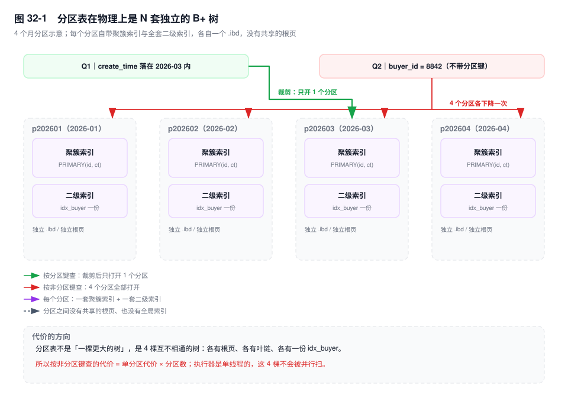
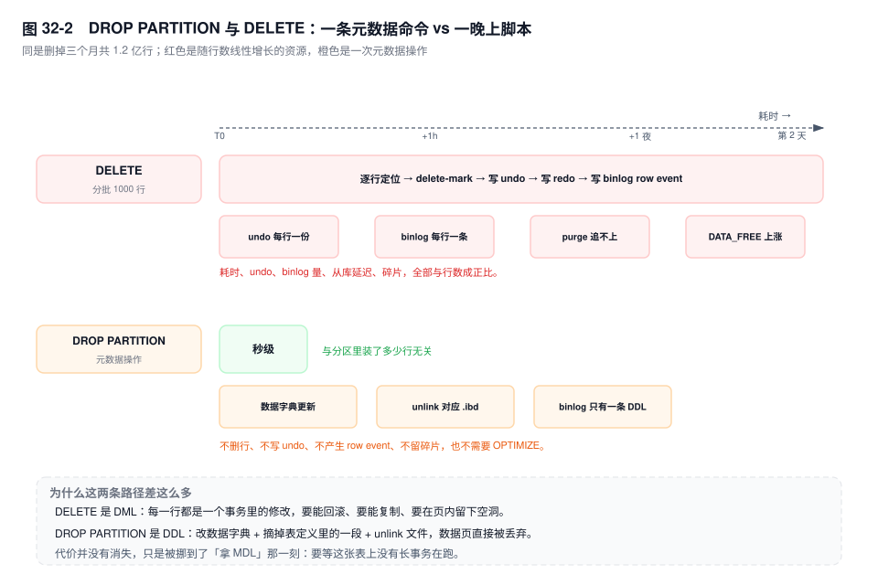

# 第 32 章　分区表

> **一句话结论**：分区表不是"一张更大的表"，是 N 棵互不相通的 B+ 树共用一个表名——它唯一不可替代的能力是秒级删掉一段历史，而不是让查询变快。

## 32.0 场景：加了买家索引，还是打开了 36 个分区

`bill_detail`，8 亿行，按 `create_time` 月分区，36 个分区。客服系统要查"某买家近一年的账单"，反馈很慢。买家维度没有索引，于是：

```sql
ALTER TABLE bill_detail ADD INDEX idx_buyer (buyer_id);
```

上线，还是慢。`EXPLAIN` 摊开看：

```sql
EXPLAIN SELECT bill_no, amount, create_time FROM bill_detail
WHERE buyer_id = 8842
  AND create_time >= '2025-11-01' AND create_time < '2026-11-01';
```

`partitions` 列：`p202511,p202512,...,p202610`，12 个。去掉时间条件（客服只给了买家 ID），`partitions` 列出全部 36 个。

索引没白加：分区内的定位确实从全扫变成了走 `idx_buyer`。但**选分区这件事，索引帮不上忙**。`idx_buyer` 不是全局索引，是 36 张一模一样的索引，每个分区各一份。先知道去哪几个分区，才轮得到索引干活；而这个决定只认分区键。

## 32.1 机制

### 一、分区表 = 一个表名 + N 套 B+ 树

第 8 章那句话要改一个字：InnoDB 的表是**一棵**按主键排序的 B+ 树；分区表是 **N 棵**，每棵装一个区间（或一个哈希桶）的行，并且每棵都带一整套自己的二级索引。

物理上也分开：`innodb_file_per_table=ON` 时每个分区是一个独立的 `.ibd`，独立的根页、独立的叶链、独立的段与区。`information_schema.PARTITIONS` 里一个分区一行，`TABLE_ROWS`、`DATA_LENGTH`、`DATA_FREE` 各算各的。没有"全局根页"这种东西——SQL 层得先决定打开哪几棵树，这个决定叫分区裁剪。



### 二、四种分区类型

| 类型 | 怎么划边界 | 适合什么 | 坑 |
|---|---|---|---|
| `RANGE` | 区间，`VALUES LESS THAN` | 时间、自增 ID 段 | 分区表达式必须是整数：日期列得包 `TO_DAYS()` 或 `YEAR()` |
| `LIST` | 枚举，`VALUES IN` | 地区、租户类型、渠道 | 值要穷举，漏一个写入就报 `ERROR 1526` |
| `HASH` / `KEY` | 取模打散，`PARTITIONS n` | 没有天然时间维、只想均匀分摊 | `KEY` 能吃字符串列（内部按列值算哈希，字符串先过一遍 MD5 那一类摘要），`HASH` 只吃整数表达式 |
| `RANGE COLUMNS` / `LIST COLUMNS` `[5.5+]` | 直接比较列值，支持多列与字符串 | 按月、按 `(region, tenant_type)` 组合 | 比 `RANGE` 少一层函数包裹，裁剪边界更好推 |

一张能直接跑的月分区表（只列前三个月，实际按月一直排到 `pmax`）：

```sql
CREATE TABLE bill_detail (
  id          BIGINT UNSIGNED NOT NULL,
  bill_no     VARCHAR(32)     NOT NULL,
  buyer_id    BIGINT UNSIGNED NOT NULL,
  amount      DECIMAL(12,2)   NOT NULL,
  status      TINYINT         NOT NULL,
  create_time DATETIME        NOT NULL,
  PRIMARY KEY (id, create_time),
  KEY idx_buyer (buyer_id)
) ENGINE=InnoDB
PARTITION BY RANGE COLUMNS (create_time) (
  PARTITION p202601 VALUES LESS THAN ('2026-02-01'),
  PARTITION p202602 VALUES LESS THAN ('2026-03-01'),
  PARTITION p202603 VALUES LESS THAN ('2026-04-01'),
  PARTITION pmax    VALUES LESS THAN (MAXVALUE)
);
```

三个细节都有账可算：`create_time` 用 `DATETIME`（5 字节）而不是字符串（19 字节，第 29 章）；`pmax` 必须留着兜底，否则越界写入直接失败；`RANGE COLUMNS` 让 `'2026-02-01'` 这样的字面量直接参与比较，不必写 `TO_DAYS()`。

### 三、"分区列必须在唯一键里"：唯一性只到分区边界

主键若写成 `PRIMARY KEY (id)`，建表就失败：

```text
ERROR 1503 (HY000): A PRIMARY KEY must include all columns in the table's partitioning function
```

机制很短：唯一性靠索引保证，而索引是**分区本地**的。`PRIMARY KEY (id)` 意味着 36 个分区各有 1 棵按 id 排的唯一索引，`p202601` 里能有 id=100，`p202603` 里也能有 id=100，两棵树互相看不见，没有任何一层能跨分区判重。要让引擎敢承诺唯一，唯一键的列集必须是分区函数列集的超集：同一个分区键值一定落在同一个分区，判重才只需要看一棵树。

改成 `PRIMARY KEY (id, create_time)` 就过了。连锁反应有三条。

**一、`id` 单独的唯一性没有数据库兜底了。** `UNIQUE KEY (id)` 撞同一条错误 1503。账单号的唯一性从此只靠上游发号器——分区表把一条本来由数据库兜的底，挪到了应用层。

**二、所有二级索引变大。** 二级索引叶子存主键（第 8 章），主键从 8 字节变成 13 字节（`BIGINT` + `DATETIME`），`idx_buyer` 的每一项从 `buyer_id, id` 变成 `buyer_id, id, create_time`：页内条目变少、树可能高一层，回表也要拿两列去定位。索引越多，这份 5 字节付得越多。

**三、"按 id 查"的语义变了。** `WHERE id = 1024` 仍是复合主键的最左前缀，能用；但"id 唯一"这个前提没了，任何靠它做等值假设的代码都要重看。

### 四、分区裁剪：能裁的条件与五种失效

优化器在优化阶段拿 `WHERE` 里的常量去和分区边界比大小，能证明"这个分区不可能有匹配行"就跳过。

```sql
-- 生效：常量直接落在分区列上
WHERE create_time >= '2026-03-01' AND create_time < '2026-04-01'
WHERE create_time BETWEEN '2026-03-01' AND '2026-03-31'
WHERE create_time IN ('2026-03-01', '2026-04-01')
```

失效的五种，本质都是"优化器推不出区间"：

1. **函数包住分区列**：`WHERE YEAR(create_time) = 2026`。分区函数是列本身，条件作用在 `YEAR()` 的结果上，边界比不了。
2. **表达式**：`WHERE create_time + INTERVAL 1 DAY > '2026-03-01'`，左边已经不是列。
3. **值来自子查询或用户变量**：`WHERE create_time = (SELECT ...)`，裁剪发生在优化阶段，值那时还没算出来，通常只能全开。
4. **`OR` 的一支不含分区列**：`WHERE create_time > '2026-06-01' OR amount > 100`，第二支必须扫全部分区，整个条件就退化成全开。
5. **类型不匹配**：分区列是 `DATETIME`，条件写成 `create_time >= 20260301`，比较前的隐式转换让边界推导失效。

验证只有一个动作：`EXPLAIN` 的 `partitions` 列。列出 `p202603` 才算裁掉了，列出 `p202601,...,pmax` 就是全扫。它比 `rows` 可信——`rows` 是估算，`partitions` 是优化器的真实决策。

### 五、真实收益：删历史与局部维护

`DROP PARTITION` 是分区表唯一无法替代的能力。它做的是元数据操作：更新数据字典、把分区从表定义里摘掉、unlink 对应的 `.ibd`。不删行、不写 undo、不产生行级 binlog、不留碎片。

拿 `DELETE FROM bill_detail WHERE create_time < '2026-01-01'` 对比，假设三个月共 1.2 亿行：

- 逐行定位、逐行 delete-mark，每行写一份 undo（可回滚）和 redo；
- 每行在 binlog 里是一条 row event，1.2 亿行足以把从库压出几十分钟延迟；
- 删完页内是空洞，空间不还给操作系统，要再 `OPTIMIZE TABLE`（等于重建整表）才收得回来；
- 单个大事务会撞上 undo 膨胀和锁等待，工程上只能分批 1000 行，于是"一条 SQL"变成跑一晚上的脚本。

`DROP PARTITION` 的耗时和分区里装了多少行基本无关。



收益二是局部维护：`ALTER TABLE ... REBUILD PARTITION p202603` 只重建一个分区的索引，新分区可以单独 `ANALYZE TABLE`；`REORGANIZE PARTITION` 负责拆分与合并，`[5.6+]` 的 `EXCHANGE PARTITION` 负责整块换数据（32.3 实验三）。

### 六、真实代价：没有全局索引，代价按分区数线性涨

这是分区表始终没成为主流的真正原因。

**没有全局索引。** 每个分区的 `idx_buyer` 是独立的树。`WHERE buyer_id = 8842` 要打开 36 个分区、在 36 棵树里各下降一次，再合并 36 份结果。一次下降约 3 次页访问，乘 36 就是一百多次；MySQL 的执行器是单线程的，**不会**把这些分区并行扫。

**跨分区查询是线性的，不是对数的。** 分区把一棵 N 行的树切成 k 棵 N/k 行的树，树高只降了零头（三层通常还是三层），要打开的树却变成 k 棵。所以分区最乐观的情况是"不变慢"，从来不是"变快"。

**DDL 仍然要拿 MDL。** `DROP PARTITION` 只动一个分区，可它是 `ALTER TABLE`：先在 server 层拿表的元数据锁，有长事务或大查询在跑就排队，并把它后面所有语句一起堵住（第 19 章）。分区让"改一个分区"变便宜，没让"改表"变成不用锁。

**分区数有硬上限。** `[8.0]` 单表最多 8192 个分区（含子分区）。更早撞上的是文件句柄：`innodb_file_per_table=ON` 时每个分区一个 `.ibd`，`open_files_limit`、`table_open_cache`、备份工具要遍历的文件数全跟着涨。按天一年 365 个还行，按小时就是 8760 个，直接越界。

**`COUNT(*)` 不会变快，`FOR UPDATE` 会变慢。** InnoDB 不在分区上记行数，`COUNT(*)` 仍是扫一个最小的二级索引，分区后变成 k 个分区各扫一遍再相加；`SELECT ... FOR UPDATE` 的条件不带分区键，就在 k 个分区的索引上各加一遍锁，锁集合按分区数放大，死锁面跟着放大（第 20 章）。

### 七、什么时候分区不够

| 判据 | 分区够用 | 必须分库分表 |
|---|---|---|
| 要解决什么 | 数据生命周期（秒删历史）、局部维护 | 容量与并发：单表写入打满单机 IO、连接数到顶 |
| 扩展方式 | 单实例内切分，**不增加任何写入能力** | 加机器，容量与 QPS 近似线性增长 |
| 查询模式 | 高频查询能带上分区键（时间范围） | 查询天然不带分片键且改不了，或单表已无法在单机维护 |

分区解决"老数据怎么办"，分表解决"新数据放不下"。顺序是先分区、后分表：前者改 DDL，后者改应用。

## 32.2 关键结论

1. **分区表是 N 套独立的 B+ 树加 N 套二级索引**，没有全局根页，也没有全局索引；`EXPLAIN` 的 `partitions` 列是唯一可信的"打开了几棵树"的证据。
2. **唯一键必须包含分区列**，因为唯一性只能在单个分区的一棵树里校验；代价是主键变复合键，`id` 失去数据库级唯一性，所有二级索引跟着变长。
3. **裁剪只认"对分区列的常量区间"**：函数包裹、表达式、子查询、跨列 `OR`、类型隐式转换，任一出现就退化为全分区扫描。
4. **分区真正的收益是 `DROP PARTITION` 秒删历史与局部重建索引**，不是查询加速——不带分区键时它是线性变差，带分区键时基本打平。
5. **8192 个分区上限与"每分区一个 `.ibd`"的文件句柄**，是分区方案的物理天花板。
6. **分区管生命周期，分表管容量**：分区只在一个实例内切分，不增加写入能力。

## 32.3 实验验证

### 实验一：裁剪是否发生，只看 `partitions`

```sql
EXPLAIN SELECT COUNT(*) FROM bill_detail
WHERE create_time >= '2026-03-01' AND create_time < '2026-04-01';

EXPLAIN SELECT COUNT(*) FROM bill_detail WHERE YEAR(create_time) = 2026;

EXPLAIN SELECT COUNT(*) FROM bill_detail WHERE buyer_id = 8842;
```

```text
-- 输出形态（未实跑，字段含义以此为准）
-- ①  type: index   partitions: p202603
-- ②  type: index   partitions: p202601,p202602,p202603,pmax
-- ③  type: ref     key: idx_buyer   partitions: p202601,p202602,p202603,pmax
```

第二、三条都退化成全开：一条是函数包住分区列，一条是没用到分区列。第三条尤其要看清——它走的是 `idx_buyer`，`key` 列很漂亮，`partitions` 却是全部。`key` 说"分区内怎么找"，`partitions` 说"打开哪几个分区"。

### 实验二：`DROP` 与 `DELETE` 的账

```sql
ALTER TABLE bill_detail DROP PARTITION p202512;
DELETE FROM bill_detail WHERE create_time < '2025-12-01' LIMIT 1000;  -- 循环执行
```

第一条秒级返回，`information_schema.PARTITIONS` 里直接少一行，binlog 里只有一条 DDL。第二条要盯三个指标：`DATA_FREE`（碎片在涨）、`History list length`（purge 跟不上，undo 在膨胀）、`Seconds_Behind_Source`（从库在追 1000 行一批的 row event）。

### 实验三：`EXCHANGE PARTITION` 把一批数据整块贴进去

要往 `p202607` 灌 2000 万行归档账单，`INSERT` 走普通写入路径：每行过分区路由、更新索引、写 undo 与 binlog。`EXCHANGE PARTITION` 换个顺序——先在普通表里把数据备好，再做一次元数据交换。

```sql
-- 1. 暂存表：列与索引必须完全一致，且不带 PARTITION BY
CREATE TABLE bill_detail_stg (
  id          BIGINT UNSIGNED NOT NULL,
  bill_no     VARCHAR(32)     NOT NULL,
  buyer_id    BIGINT UNSIGNED NOT NULL,
  amount      DECIMAL(12,2)   NOT NULL,
  status      TINYINT         NOT NULL,
  create_time DATETIME        NOT NULL,
  PRIMARY KEY (id, create_time),
  KEY idx_buyer (buyer_id)
) ENGINE=InnoDB;

-- 2. 灌数据：可分批、可并行、可临时关 binlog
INSERT INTO bill_detail_stg VALUES (...);

-- 3. 整块换成 p202607 的内容
ALTER TABLE bill_detail EXCHANGE PARTITION p202607 WITH TABLE bill_detail_stg;
```

四条前提缺一不可：两张表的列与索引定义完全一致（列顺序、类型、索引名都要对上）；都是 InnoDB、都不是临时表、都不带外键；暂存表不能带分区；暂存表里每一行都必须落在 `p202607` 的区间内，越界会让整次交换失败。交换完暂存表变成空表，可以接着装下一个月；回滚也是再交换一次。

交换本身是元数据操作，代价集中在拿 MDL 的那一刻：要等 `bill_detail` 上没有长事务在跑。

## 32.4 常见误区

⚠️ **"分区能提升查询性能"**
分区不减少要读的行，只改变"从哪棵树里读"。带分区键的查询，从一棵大树下降一次变成一棵小树下降一次，树高通常不变，是打平；不带分区键的查询，从一棵树下降一次变成 k 棵树各下降一次，是变差。分区确定的性能收益只在维护操作上：删历史、重建索引、灌数据。

⚠️ **"分区表就是分库分表的轻量版"**
分表把数据摊到多个实例，写入能力线性增长；分区在一个实例内切分，写入能力一点不涨——所有分区共用一个 Buffer Pool、一套 redo、一个执行器。两个维度，不能互相替代。

⚠️ **"分区越细越灵活，按天分区更好"**
每个分区一套 B+ 树、一套二级索引、一个 `.ibd`、一份打开的文件句柄。按天分区一年 365 个，一条跨年查询要合并 365 份结果；按小时 8760 个直接越过 8192 上限。按月够用时按天分，是拿"删得更细"换"每次查询多开 30 倍的分区"。

⚠️ **"给分区表加了索引就能按那列查"**
索引是分区本地的，加 `idx_buyer` 只让每个分区内部变快，`partitions` 列一个都不会少。想减少打开的分区数，只能改分区键，或者把这条查询交给别的存储（ES、归档库）。

## 32.5 生产 Checklist

- [ ] 分区键是不是"删除条件里的那一列"（时间）？如果分区是为了查询加速，重新评估。
- [ ] 唯一键是否已包含分区列？不包含时的替代方案（发号器、去重表）定下来了吗？
- [ ] 高频 SQL 的 `EXPLAIN` 里，`partitions` 是否只列出预期分区？有没有函数、表达式、跨列 `OR` 在破坏裁剪？
- [ ] `pmax` 兜底分区存在吗？越界写入是报错还是落进 `pmax`，监控对上了吗？
- [ ] 分区总数的两年增长算过吗？会不会先撞 8192，或者先把 `open_files_limit` 撞了？
- [ ] 删历史走 `DROP PARTITION` 还是 `DELETE`？后者分批了吗、binlog 量与从库延迟算过吗？
- [ ] 分区 DDL 的窗口评估过吗？`ALTER` 要拿 MDL 这件事进变更流程了吗？
- [ ] "不带分区键"的查询量级评估过吗？QPS × 分区数，单机扛得住吗？

## 32.6 延伸

- **上一章**：第 31 章的表结构演进——分区是其中最便宜的一档，因为它只改 DDL。
- **下一章**：第 33 章分库分表。本章的判据表就是它的入口：单实例的容量与写入到顶之后，分区再细也没用。
- **关联章节**：第 8 章（每棵 B+ 树的结构与二级索引）、第 19 章（`ALTER` 的 MDL）、第 20 章（跨分区加锁与死锁）、第 29 章（分区列的类型与长度）、第 35 章（按时间分区做冷热分层）。
- **面试追问**：
  - "为什么分区列必须在主键里？" → 唯一性只能在一个分区的一棵树里校验，跨分区没有全局判重；唯一键列集必须是分区函数列集的超集。
  - "分区表能提升查询性能吗？" → 不带分区键是线性变差，带分区键基本打平，收益在维护操作。
  - "分区和分表怎么选？" → 看要解决生命周期还是容量。前者用分区，后者用分表，顺序不能反。
  - "`DROP PARTITION` 为什么快？" → 元数据操作：摘掉分区定义、unlink 对应 `.ibd`，不删行、不写 undo、不产生行级 binlog。
- **官方文档**：`Partitioning`、`Partition Pruning`、`EXCHANGE PARTITION`、`Restrictions and Limitations on Partitioning`、`information_schema.PARTITIONS Table`。
