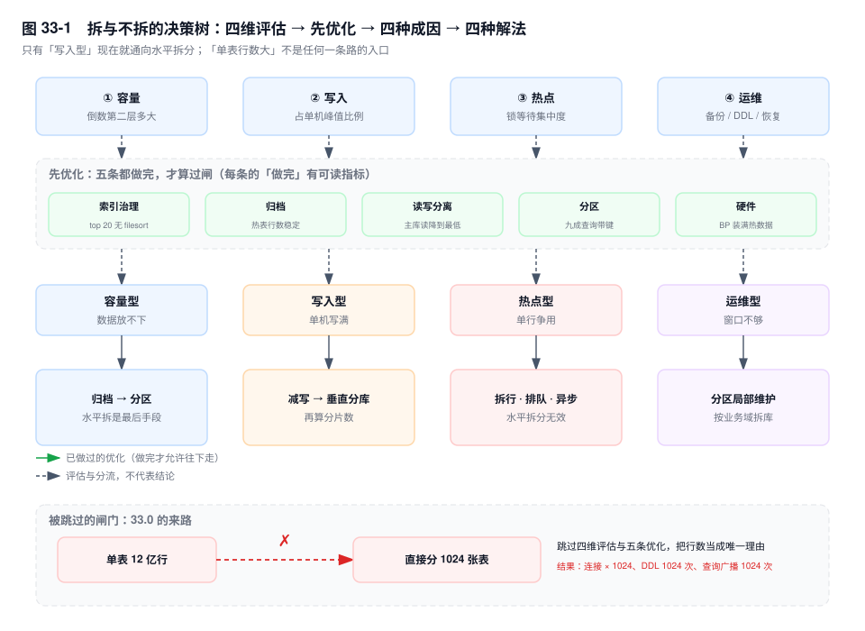
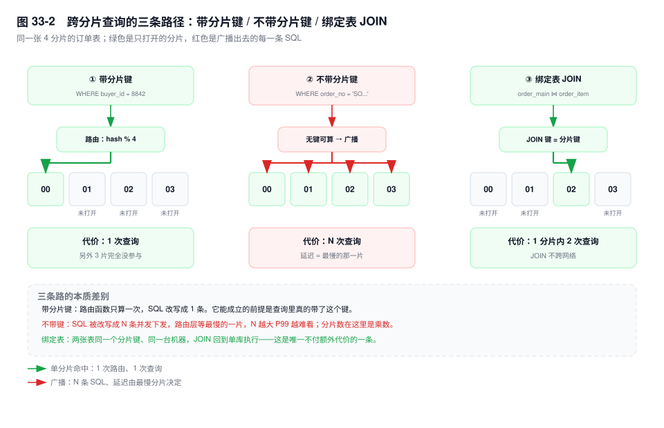
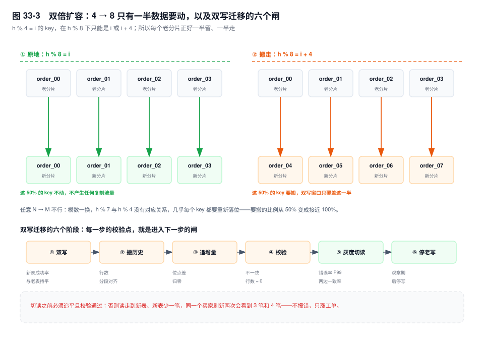

# 第 33 章　分库分表

> **一句话结论**：分片不是把表切小，是把"一条 SQL 能碰到几台机器"这个决定从优化器手里拿走、交给一个由你写的路由函数——分片键选错，代价不发生在切流那天，而发生在之后每一次查询。

## 33.0 场景：1024 张表，三个月

`order_main` 12 亿行，单实例 1.4TB。评审会上，PPT 写"一步到位，1024 张表，撑到百亿"。方案通过得很快——1024 是 2 的幂，听起来就很工程。

三个月后的周报：

- **连接数打满。** 20 个应用实例，每个实例 1024 个数据源、每源一个连接池，`minimum-idle` 设 10，光保活就要 20 万个连接。1024 张表落在 16 个实例上，每实例 64 个池，`max_connections` 调到 8000 仍不够。
- **加一个字段，跑了 6 小时。** `ALTER` 广播 1024 次，串行；第 700 多张表撞上长事务卡在 MDL，脚本超时退出，前 700 张有列、后面没有。第二天所有 `INSERT` 在一半分片上报 1054。
- **报表超时。** `SELECT COUNT(*) FROM order_main WHERE create_time >= ?` 要扫 1024 张表。
- **客服查单变慢。** 按订单号查详情，订单号里没有分片键，广播 1024 次，P99 从 30ms 走到 4s。

1024 张表，平均每张 117 万行，这个量级单表连索引都不必认真建。**根因不是分片，是分片数与业务查询模式不匹配**：拆得比数据需要的细八倍，查询模式一条都没跟着改。

## 33.1 机制

### 一、四维门槛：先证明必须拆

第 32 章只回答了"分区够不够"。拆之前还有四道闸，每道都能读出数。

**容量。** 第 8 章算过：`BIGINT` 主键的非叶子记录 17 字节，一页扇出约 947；行宽 200B 时叶子页 78 行，三层装 7000 万行。判容量不该看"几层"，该看**倒数第二层有多大**：三层时它固定约 950 页、15MB，常驻 Buffer Pool，点查只有 1 次落盘；跨进四层后它变成"叶子页 ÷ 947"，随数据量从几个页一路涨到九十万页、十几 GB（四层的上限），一旦超过 Buffer Pool 能容纳的份额，点查就固定 2 次随机 IO。层数是结果，这一层的大小才是原因。

这个量能直接算：`innodb_index_stats` 里 `size` 与 `n_leaf_pages` 一减就是非叶子页，`leaf_pages / 947` 乘 16KB 是倒数第二层的常驻内存，超过 Buffer Pool 四分之一，四层就在收税（SQL 见 33.3 实验一）。该表只在 `ANALYZE TABLE` 或触发自动重算阈值时更新，别当实时值读。

**写入。** 单机写入上限不由 QPS 绝对值决定，由三处排队决定：redo 刷盘（`innodb_flush_log_at_trx_commit=1` 与 `sync_binlog=1` 时每次提交至少两次 fsync，8.0 靠组提交合并并发事务）、行锁等待、二级索引维护的随机写。判据是比例：写入 QPS 到同规格实例压测峰值的 60%~70%，同时 `Threads_running` 长期高于核数、`Innodb_row_lock_waits` 单调涨、redo 写入量逼近磁盘带宽。这时加从库（replica）没用——写只有一个主库（source）。

**热点。** `performance_schema.data_lock_waits` 里等待集中在个别 `LOCK_DATA` 值上，就是热点行；自增主键的尾部页争用是另一类，见第 30 章。**热点型拆分无效**——那一行无论怎么分都只在一个分片里。

**运维。** 三条时间线：全备加增量回放能否在 RTO 内完成、加索引或改列的 DDL 能否在变更窗口内完成、恢复到任意时间点要多久。任一条靠"申请更长窗口"维持，就是运维型到顶。

### 二、先优化，再拆分：每条给"做完"的定义

| 手段 | 做法 | 做到什么程度算做完 |
|---|---|---|
| 索引与慢查询治理（第 9、10 章） | 按 `performance_schema` 的耗时排序，top 20 逐条看 `EXPLAIN` | top 20 无 `Using filesort`／`Using temporary`，都走覆盖索引；慢查询不再出现新形态 |
| 归档（第 35 章） | 只增不改的历史搬到归档库或冷存储 | 热表行数稳定在目标区间，归档链路可回放、可对账 |
| 读写分离（第 25、26 章） | 只读流量走从库 | 主库 `Com_select` 占比降到只读无法再降；从库延迟在业务容忍内 |
| 分区（第 32 章） | 按时间 `RANGE` 分区，`DROP PARTITION` 删历史 | 删除条件就是时间，九成以上查询带分区键，`partitions` 只有预期分区 |
| 硬件 | NVMe、内存装下热数据 | `innodb_buffer_pool_size` 到物理内存 70%~80%，物理读与逻辑读之比稳定 |

五条都做完还不过闸，才轮到拆分。前四条改的是数据怎么放、怎么读，拆分改的是数据在哪台机器；后者落地后，前四条的成本乘以分片数。

**单表行数本身不是拆分理由。** 5000 万行的表，查询都走索引、写入无热点、DDL 能在窗口内完成，拆它只是给每次查询加一次跨分片路由。反过来，500 万行的表有跨行热点写，拆也救不了——热点行还在同一个分片。

四种成因对应四条不同的路，不是都通向水平拆分：

| 成因 | 表现 | 首选解法 | 水平拆分的位置 |
|---|---|---|---|
| 容量型 | 倒数第二层大到装不进内存 | 归档 → 分区 | 最后手段 |
| 写入型 | 写 QPS 打满单机，加从库无效 | 合并写、批量、去掉冗余索引 → 垂直分库 | 真正需要，但先算分片数 |
| 热点型 | 少数行的锁等待占主导 | 热点行拆行（第 19 章）、排队、异步化 | **无效** |
| 运维型 | 备份、DDL、恢复超窗口 | 分区做局部维护、按业务域拆库 | 通常不需要 |



### 三、垂直拆分：按业务域拆库

第 31 章讲按列拆：冷热字段、大字段、宽表拆窄。这里按**业务域**拆库：订单库、账务库、商品库，各占一个实例。

判据不是"表太多"，是**写事务的原子性边界**：一个事务里必须一起成功的表，必须留在同一个库。下单要写 `order_main`、扣 `order_stock`、记 `bill_detail`，三张表在同一个事务里，拆开就意味着本地事务变成跨库写（第 34 章）。反过来，商品信息与订单不必同步——下单时把商品快照冗余进订单行，跨库的那次写就变成了一次冗余写。**不动事务，动数据的冗余方式**，这是垂直拆分绕开分布式事务的唯一办法。

收益三块：故障隔离（账务库挂了，浏览和下单还能跑）、团队边界（各自的 DDL 窗口，不为一张表 `ALTER` 排队）、资源按业务配比。代价三块：原来的 `JOIN` 要么冗余、要么应用层拼（N+1 回来了）；跨库统计要汇总；某个业务域的数据量涨上来，垂直拆分不提供水平扩展能力——它把问题切开，没有把问题变小。

按读写拆是把写留在主库、读分到从库，分摊的是读不是写。按冷热拆的是行，见第 31、35 章。

### 四、水平拆分：分片键的取舍



| 分片键 | 均匀性 | 天然命中的查询 | 必须广播的查询 |
|---|---|---|---|
| `buyer_id` | 好，哈希后接近均匀 | C 端"我的订单"、订单详情 | 商户后台、运营报表 |
| `merchant_id` | 差，大商户独占一个分片 | 商户后台、结算 | C 端订单列表（买家跨多家） |
| `create_time` | 极差，写全落在当前分片 | 按时间对账、归档 | 用户查历史订单 |

**均匀性：取模与范围。** 取模均匀，代价是扩容搬数据——双倍扩容只搬一半（见 33.1 八），4→6 这种非双倍就几乎全动。范围分片扩容方便（加一段就行），代价是倾斜：按时间切范围时，新写入全落在最后一个分片。**范围分片的前提是键本身分布均匀**，按 `buyer_id` 分段可以，按时间分段不行，否则只是把一台热点机器换成一台热点加九台闲机器。

**业务穿透。** 选了 `buyer_id`，"商户后台按 `merchant_id` 查订单"就不知道去哪个分片。三种解法：

1. **异构索引表。** 建 `order_idx_merchant`，按 `merchant_id` 分片，只存 `(merchant_id, order_id, create_time, status)`。写订单时同步写它；跨分片不能同事务，只能靠本地消息表或 binlog 订阅补（第 34 章）。查询两跳：先在索引表拿 `order_id` 列表，再回原分片——`order_id` 带没带基因位，决定第二跳是路由还是又一次广播。代价是双份写入与秒级不一致。
2. **基因法。** 把分片键的哈希位嵌进主键低位，让"按主键查"直接算出分片（推导见第 30 章）。它解决的是"分片键与主键不一致"，**不解决两个维度都要单分片命中**——一条订单只能带一个维度的基因，选了 `buyer_id`，商户维度照样穿透。
3. **冗余一份商户维度的表。** 建 `merchant_order`，按 `merchant_id` 分片，把订单摘要冗余进去。查询在本地完成，代价是状态变更写两处、存储翻倍。查得多写得少的场景，这个代价最划算。

**时间为什么不能做分片键。** 所有写入都落在"当前时间"那一片。分片数 64，实际只有一个在写，另外 63 个在睡觉——**等于没拆**。历史分片也不会退休：查三个月前的订单跨三个分片，查一年跨十二个，分片数还随时间无限增长。时间适合做**分区**（第 32 章），因为能裁剪、能 `DROP`；要做分片只能是两级：先按时间分库（老库只读），库内再按 `buyer_id` 分表。

**分片数怎么定。** 不是拍 1024，按三步算：

```text
目标分片数 = 当前行数 × (1 + 年增长率)^3 ÷ 单分片目标行数
```

12 亿行、年增 40%、单分片目标 3000 万行：`12 亿 × 1.4³ ≈ 32.9 亿`，`÷ 3000 万 ≈ 110`，向上取 2 的幂得 **128**。三年后每片 2570 万行，仍在三层树的舒适区。换成 1024 片，三年后每片 321 万行，单表小到索引都多余，而连接数、DDL、广播成本全部乘 8。

分片数过多的代价有四笔：**连接数**（实例数 × 池大小 × 1024 = 20 万）、**DDL** 跑 N 次、**元数据**（路由规则、分片拓扑）要人维护、**跨分片查询**线性涨（跨片 JOIN 是组合爆炸）。

### 五、路由层选型

| 方案 | 工作方式 | 侵入性 | 跨分片能力 | 适用场景 |
|---|---|---|---|---|
| ShardingSphere-JDBC | 驱动内的 jar，改写 SQL 后直连各分片 | 改数据源配置，不改业务代码 | 支持归并、绑定表、广播表；跨片 JOIN 有限 | Java 栈，能统一驱动版本 |
| ShardingSphere-Proxy | 独立进程，对外说 MySQL 协议 | 改连接串，零代码改动 | 同上，且多语言表现一致 | 多语言栈、DBA 想统一入口 |
| MyCat | 代理层，源自早期 Cobar | 改连接串 | 依赖其分片规则 | 存量系统；新项目需评估社区活跃度与对新版协议的支持 |
| 应用层自路由 | 自己算分片、自己拼 SQL | 侵入最深，改 DAO | 全部自己写 | 规则简单到能写进一页纸，且有人长期维护 |
| 云原生分布式数据库 | 存储层透明分片（PolarDB-X、TiDB、OceanBase 这类） | 基本不改 | 由产品实现 | 不想自己运维路由层，能接受锁定与成本 |

判据三条：能不能接受在应用里引一个 jar、改数据源配置（能接受，JDBC 版最省事；应用侧一点都不想动，选 Proxy 或云原生）；有没有非 Java 客户端（有，只能 Proxy 或云原生）；DBA 能不能维护代理层的升级与故障切换（不能，回到 JDBC 或云原生）。自路由只在规则一页纸写得完、且有人长期维护时成立。

### 六、跨分片五难题

**JOIN。** 三条路，都要求设计阶段就想清楚"哪些表必须同分片"。

- **广播表**：字典、配置、门店这类小表在每个分片存一份。代价是写入广播到 N 片，还要保证一致——异步同步有窗口，同步写要处理"部分成功"。
- **绑定表**：`order_main` 与 `order_item` 用同一个分片键。容易漏的细节：订单按 `buyer_id` 分片时，`order_item` 也得冗余一列 `buyer_id`，否则没有可路由的键，绑定不成立。绑上之后 JOIN 退化成单库 JOIN，这是唯一不付额外代价的一条。
- **异构索引**：把要 JOIN 的维度冗余成另一张按它分片的表，代价同上一节。

**分页。** `LIMIT 100000, 20` 在单库是"跳过 10 万行"，分片下变成"每片各跳 10 万行、各取 20 行、归并后再跳"。10 个分片就是 100 万行扫描，而用户只想看第 5001 页的 20 条。

二次查询法把"按位置跳过"换成"按值定位"：第一轮每片 `LIMIT offset/N, size`，拿到各片第 `offset/N` 名的排序值，最小者就是全局第 `offset` 名的下界 `v`；第二轮每片 `WHERE sort_key <= v ORDER BY sort_key DESC LIMIT size`，归并后精确取。每片读的行从 `offset + size` 降到 `offset/N + size`，但**第一轮仍要跳过 offset/N 行**——它只把系数从 N 降到 1，没改变量级。

真正的解法是不让用户翻那么深：改成游标分页 `WHERE sort_key > :last ORDER BY sort_key LIMIT 20`。每片用索引定位到 `last` 之后取 20 行，10 个分片一共 200 行归并，与页码无关，是 O(1)。代价是不能跳页。

**排序。** 归并在路由层的内存里做：N 个分片各返回 `size` 行，再 N 路归并。排序字段在分片上有索引，每片只读 `size` 行；没有索引就是 N 次 filesort（第 13 章）、N 次磁盘临时表。能不能下推，取决于排序字段是否与分片键同序。

**聚合。** `SUM` 与 `COUNT` 可加，各片算完相加。`AVG` 不行：分片 A 两笔 100 元、分片 B 一百笔 1 元，真实均值 `(200+100)/102 ≈ 2.94`，"平均的平均"却是 `(100+1)/2 = 50.5`。必须改写成 `SUM(x)/SUM(cnt)`，或让每片返回 `(sum, count)` 在路由层汇总。`COUNT(DISTINCT)` 几乎无解：全局去重要把 N 个集合搬到一处合并，传输量与基数成正比；工程上只有近似（HyperLogLog）或预聚合两条路。

**`COUNT(*)` 与总数。** InnoDB 不存行数，分片后总数要 N 片各扫一遍。业务上的"总数"往往只是装饰，三种处理：不显示，只给"下一页"（成本 0）；给近似值（采样或 `EXPLAIN` 的 `rows`）；单独维护计数表（写时 `+1`、读时 O(1)，代价是计数器变成热点行，第 19 章的拆行方案同样适用）。

### 七、全局唯一 ID、全局二级索引与跨库写

ID 的四种发法在第 30 章推导过，这里只留取舍：步长法零改造但扩容撞号，基因法能自路由但位预算要一次留够。全局二级索引就是异构索引表的产品化叫法，实现要么同步双写（一致性强、写入放大），要么订阅 binlog 异步建（写入无放大、有秒级延迟）——选哪条，取决于业务能不能接受"刚写入的数据查不到"。跨分片的写没有本地事务可用，第 34 章专讲。

### 八、扩容：双倍扩容与双写迁移

**为什么是双倍。** N=4 扩到 8，`h % 8` 的结果只可能是 `i` 或 `i+4`：原来在 `order_01` 的 key，新位置要么还是 1，要么是 5。每个老分片只需搬一半，另一半原地不动。任意 N→M 就不行：模数一换，`h % 7` 与 `h % 4` 没有对应关系，几乎全部 key 都要重新落位。扩容的代价不是"数据量"，是"要搬的比例"。



**双写迁移六个阶段，每步都有校验点。**

1. **双写（写影子表）。** 新表与老表同时写。校验点：新表写入成功率与老表持平，双写补偿队列归零并稳定一段时间。
2. **全量搬历史。** 按主键或时间分段，批量读老表、写新表，限速。校验点：两边行数**分段**对齐，不是全表一个总数对得上。
3. **增量追平。** binlog 订阅或双写补偿，把第 2 步期间的新写入补到新表。校验点：位点差归零、补偿队列为零。
4. **校验。** `pt-table-checksum` 或自建分段 checksum，先抽样后全量，按主键区间比对 `COUNT(*)` 与 `SUM(CRC32(...))`。校验点：不一致行数为 0。
5. **灰度切读。** 按 `buyer_id` 白名单或百分比切。校验点：灰度组错误率、P99，以及同一请求读两边的结果一致率。回滚预案必须在这步之前演练——老表还在双写，切回去只是改一个开关。
6. **停老写。** 观察期后停掉老表写入，保留只读一段时间。

**切读之前必须让新表追平且校验通过。** 否则会出现"同一个买家刷新一次看到 3 笔订单、再刷新看到 4 笔"——读走到新表，新表少一笔。这种问题不报错，只涨客服工单。

### 九、倾斜与热点分片

发现靠三个方差：各分片行数（`information_schema.TABLES` 的 `TABLE_ROWS`）、QPS、磁盘使用率。最大分片超均值 1.5 倍就该看。

成因三类：大商户（一个 `merchant_id` 吃掉两成订单，按它分片时独占一片）、ID 段集中（注册雪崩或号段分配不均）、哈希函数对某类 key 天然不均。

治理按代价从低到高：**路由表兜底**（给大客户指定专属分片，没命中的走哈希，等于在哈希前加一层特例）；**加盐打散**（热点 key 加后缀拆成多个逻辑 key，代价是查询要聚合）；**热点行拆行**（第 19 章，库存拆成 10 个桶）。第一种改路由，第二种改键，第三种改行——先试改路由，它不动数据。

### 十、拆完之后，运维变了什么

**DDL 从一次变 N 次。** 一次 `ALTER` 广播到 N 个分片、串行执行，中途失败就是"一部分分片有新列、一部分没有"——最难处理的状态，同一份代码在一半分片上报 1054。两条纪律：DDL 脚本必须幂等（执行前查 `information_schema.COLUMNS`），失败能原地重跑；每分片一张 `schema_version` 表，随时能回答"哪几片落后"。`gh-ost`／`pt-osc` 在分片下要逐实例跑，每个实例一套影子表与 binlog 消费；能走 `ALGORITHM=INSTANT` 的加列（8.0 要求加在表末尾，`[8.0.29+]` 放宽到任意位置）优先 INSTANT，只改数据字典。

**备份从一份变 N 份，而且要对齐时刻。** N 个实例的全备起止时间不同，恢复出来各分片来自不同时刻，跨分片对账会凭空多出或少掉一批订单。解法是给每次备份打一个全局逻辑时间戳、恢复后按它过滤，或者用一致性快照组在同一瞬间对所有实例做快照。

**监控从实例级变分片级。** 指标要带 `shard_id`，否则只能回答"集群慢了"，回答不了"是全局慢还是某个分片慢"。P99 的分片分布里，最大值与中位数之比持续大于 2，就是倾斜或单分片故障。

**故障影响面变小，语义变复杂。** 一个分片挂了是"部分用户不可用"，不是全站不可用——这是拆分最大的隐性收益。代价是一个请求可能横跨三个分片，其中一个挂了：整体失败，还是降级返回部分数据？这个策略要在拆分之前定。

## 33.2 关键结论

1. **单表行数不是拆分理由。** 四道闸：容量（倒数第二层装不进内存）、写入（到单机峰值 60%~70% 且加从库无效）、热点（单行单页争用）、运维（备份、DDL、恢复超窗口），任一没过都不该拆。
2. **热点型拆分无效。** 热点行落在哪个分片，争用就在哪个分片；拆行、排队、异步化才是解法。
3. **分片键的选择等于"哪些查询要广播"的选择。** 选 `buyer_id` 就意味着商户维度穿透；基因法只能编码一个维度；时间做分片键等于没拆。
4. **分片数按"三年后数据量 ÷ 单分片目标容量"向上取 2 的幂**，不是拍 1024；1024 片的连接数、DDL 与广播成本都是 128 片的 8 倍。
5. **分片下的分页只有游标分页是 O(1) 的**，二次查询法只把系数从 N 降到 1；`AVG` 必须拆成 `SUM/COUNT`，`COUNT(DISTINCT)` 只能近似或预聚合。
6. **扩容选双倍，因为只有一半数据要搬**；切读前必须追平并校验，否则同一用户会看到不同的订单数。

## 33.3 实验验证

### 实验一：从 `innodb_index_stats` 反推第三层有多大

```sql
ANALYZE TABLE order_main;

SELECT index_name,
       MAX(CASE WHEN stat_name = 'size'         THEN stat_value END) AS pages,
       MAX(CASE WHEN stat_name = 'n_leaf_pages' THEN stat_value END) AS leaf_pages
FROM mysql.innodb_index_stats
WHERE database_name = 'order_db' AND table_name = 'order_main'
GROUP BY index_name;
```

```text
-- 输出形态（未实跑，字段含义以此为准）
-- PRIMARY     pages=1843200   leaf_pages=1820000
-- idx_buyer   pages= 921000   leaf_pages= 908000
```

`pages - leaf_pages` 是非叶子页总数，但这个总数会骗人：三层树的倒数第二层约 950 页，四层时它是 `leaf_pages / 947` 个页。样例里 182 万叶页除以 947 约 1922 页、30MB，还在内存里躺得下；叶页涨到九十万页时，这一层就是 950 页乘 947、约 14GB。该看的不是"层数"这个标签，是这一层多大。

### 实验二：深分页在分片下的放大

```sql
EXPLAIN SELECT id, order_no FROM order_main
WHERE buyer_id = 8842 ORDER BY create_time DESC LIMIT 100000, 20;

EXPLAIN SELECT id, order_no FROM order_main
WHERE buyer_id = 8842 AND create_time < '2026-11-01 00:00:00'
ORDER BY create_time DESC LIMIT 20;
```

```text
-- 输出形态（未实跑）
-- ① type: ref  key: idx_buyer_ct  rows: 100020  Extra: Using index; Using filesort
-- ② type: ref  key: idx_buyer_ct  rows: 20      Extra: Using index
```

第一条的 `rows` 是 100020 而不是 20，这就是放大倍数；16 个分片时路由层要收 16 × 100020 行再归并。第二条把"跳过 offset 行"换成按 `create_time` 定位，`rows` 掉到 20 量级，`Using filesort` 也没了——索引 `(buyer_id, create_time)` 直接给出顺序。每片独立成立，所以分片下同样是 O(1)。

### 实验三：分段 checksum

```sql
SELECT COUNT(*) AS cnt,
       SUM(CRC32(CONCAT_WS('#', order_no, buyer_id, amount, status))) AS sig
FROM order_main
WHERE id >= 1000000 AND id < 2000000;
```

源端与新端各跑一次，`cnt` 与 `sig` 都相等这一段才算对齐。分段的意义是能定位差异落在哪一段。`pt-table-checksum` 做同一件事，结果落 `percona.checksums`，分片下要逐实例跑再汇总。

## 33.4 常见误区

⚠️ **"单表超过 5000 万行就必须分"**
行数只是间接指标。第 8 章算过，三层树的容量从 1400 万到 7000 万，取决于行宽。该看四项代价是否同时压顶：查询能不能走索引、写入有没有热点、DDL 能不能在窗口内完成、备份能不能在 RTO 内恢复。都成立时，拆它只是加一个网络跳。

⚠️ **"一步到位分 1024 张表"**
分片数是算出来的，不是按"看起来能撑很久"拍的。1024 片的后果是连接数、DDL 次数、跨片广播全部乘 1024，而每片只有一百多万行，小到用不上拆分的好处。分片数定下之后，缩容比扩容难得多。

⚠️ **"用时间做分片键，顺便按时间归档"**
所有写入落在当前那一片，等于只有一个分片在写，历史分片还要被反复查询。归档是分区与冷热分层的事（第 32、35 章），不是分片键的事。

⚠️ **"分了片，JOIN 交给中间件就行"**
中间件的跨片 JOIN 是把 N 片结果拉到内存做哈希连接或笛卡尔积，数据量一大就 OOM。能落地的只有广播表、绑定表、异构索引三种，都要求设计阶段就把"哪些表必须同分片"定下来。

## 33.5 生产 Checklist

- [ ] 四维门槛逐条给过数吗：层数与倒数第二层大小、写入占峰值比例、锁等待集中在哪些行、备份与 DDL 耗时？
- [ ] "先优化"的五条（索引、归档、读写分离、分区、硬件）做到位了吗，还是直接跳到拆分？
- [ ] 分片键选了哪个维度，哪些高频查询会因此广播？这些查询的 QPS 算过吗？
- [ ] 分片数有推导过程吗（三年数据量 ÷ 单分片容量），还是拍的 2 的幂？
- [ ] 连接数算过吗：实例数 × 池大小 × 分片数，是否在单实例 `max_connections` 的 70% 以内？
- [ ] 哪些表必须与主表同分片？`order_item` 有没有冗余分片键列？
- [ ] 商户维度走异构索引还是冗余表？一致性延迟能接受吗？
- [ ] 深分页改成游标分页了吗？改不了的话，二次查询法的两轮 RTT 算进 P99 了吗？
- [ ] 迁移六个阶段各有校验点吗？灰度切流的回滚开关演练过吗？
- [ ] DDL 脚本幂等吗？`schema_version` 能回答"哪几片落后"吗？备份能对齐到同一时刻吗？
- [ ] 单分片故障时是部分返回还是整体失败，定了吗？

## 33.6 延伸

- **上一章**：第 32 章分区表。它的判据表是这一章的入口——分区解决生命周期，分表解决容量。
- **下一章**：第 34 章分布式事务。垂直拆分把本地事务变成跨库写，一致性问题在那里收口。
- **关联章节**：第 8 章（树高与单表容量）、第 9、10 章（索引治理）、第 13 章（filesort）、第 19 章（热点行拆行）、第 25、26 章（读写分离）、第 30 章（全局唯一 ID）、第 31 章（垂直拆列）、第 35 章（归档与冷热）。
- **面试追问**：
  - "单表 10 亿行，你拆不拆？" → 先问：查询能不能走索引、写入有没有热点、DDL 与备份窗口够不够。都踩线才拆，且先归档与分区。
  - "分片键怎么选？" → 列高频查询的维度，选覆盖最多且最均匀的那个；其余用异构索引补。
  - "为什么扩容要双倍？" → `h % 2N` 只会让 key 留在原位或跳到 `i+N`，一半数据不动；任意 N→M 几乎全动。
  - "`AVG` 为什么不能直接平均？" → 各分片样本数不同，平均的平均是加权错误的，要拆成 `SUM/COUNT`。
- **官方文档**：`mysql.innodb_index_stats Table`、`information_schema.TABLES`、ShardingSphere 的 Sharding／Broadcast／Binding Table、`pt-table-checksum`。
