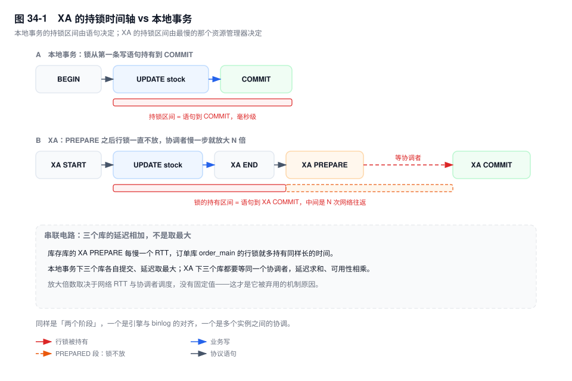
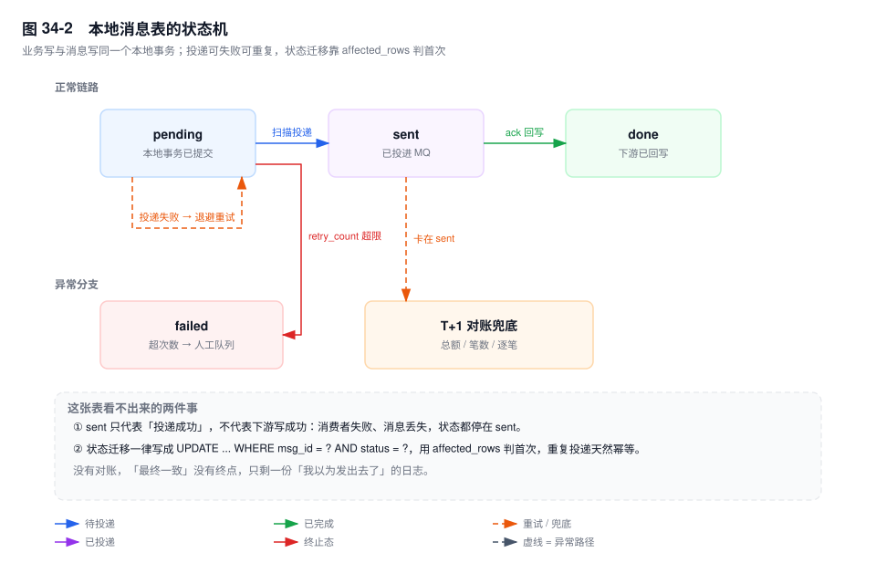

# 第 34 章　分布式事务与最终一致性

> **一句话结论**：跨实例没有事务，只有协议；你要选的不是"哪个框架更强"，而是"在哪一刻允许不一致、由谁补回来"。

## 34.0 场景：三个库被串成了一根导线

支付回调成功后，下单链路要连做三件事：`stock` 扣减、`point` 加积分、`notify` 发通知。三个库在不同实例上，团队用 XA 把三段写包成一个全局事务——看上去最"正确"。

大促当晚库存库的 `XA PREPARE` 变慢。订单库 `order_main` 那行的行锁持有时间，监控上从 2ms 量级涨到 800ms：`XA PREPARE` 已经锁住行，却要等协调者收齐三个库的应答才发 `XA COMMIT`。等锁的请求排满连接池，P99 破秒，链路雪崩。

根因不是流量，是 **XA 把三个库的延迟做成了串联电路**：总延迟求和，可用性求积。单库时只要优化最慢的那个，XA 之后每个库的抖动都变成订单库的持锁时间。这是第 33 章留下的账：拆分切断了本地事务的边界。

## 34.1 机制

### 两个 2PC 必须分开看

| | InnoDB 内部 2PC | XA 2PC |
|---|---|---|
| 阶段 | `redo prepare` → `binlog write + fsync` → `redo commit` | `XA START` → `XA END` → `XA PREPARE` → `XA COMMIT` |
| 解决什么 | 存储引擎与 binlog 的一致性 | 多个独立资源管理器之间的一致性 |
| 谁发起 | Server 层在 `COMMIT` 时自动执行 | 应用（协调者）显式发 SQL |
| 崩溃之后 | 恢复线程按 XID 对齐，前滚或回滚 | 事务悬空，等人处理 |
| 应用可见性 | 完全透明 | 应用自己就是协调者 |

一句话钉住：**前者在单机内、后者跨实例；前者是崩溃恢复用的、后者是业务协调用的**。共同点只有"分两个阶段"这个形状——像 2PL 与 2PC 都带 2，却不是一层东西。混同的后果是以为开了 binlog 就"有了分布式事务"。

### XA 为什么在互联网被弃用



**同步阻塞。** `XA PREPARE` 之后，RM 已写好 redo、锁住行，却不提交也不回滚，等协调者的下一句。这期间别的会话碰这些行全部排队。本地事务持锁到 `COMMIT`，通常毫秒；XA 持锁到 `XA COMMIT`，中间至少两轮网络往返加一次调度，**持锁时间从毫秒级变成 RTT 级**。

**协调者单点。** 协调者崩了，`PREPARED` 状态的 RM 不知道提交还是回滚。它在 `information_schema.innodb_trx` 里还活着：`trx_state='PREPARED'`、`trx_mysql_thread_id` 为空（连接已断），锁不放；`XA RECOVER` 只给出 `gtrid`/`bqual`，看不出业务该怎么办。它还挂着一个 `trx_id` 在活跃列表里，purge 水位降不下去（第 5 章、第 21 章）。

**提交摊不薄。** `XA COMMIT` 是独立提交，协调者要等这个 RM 应答才发下一个，一次业务提交于是变成 N 次提交与成倍往返（第 6 章）。

版本：`innodb_support_xa` 在 [5.7] 存在（默认 `ON`），[8.0] **已移除**，XA 内置于引擎、关不掉；8.0 上"关掉 XA 换性能"是无效经验。

判据：**同机房、毫秒级事务、低 QPS**（调账、迁移），XA 仍最省事，因为不用写补偿；跨服务或高并发，它把 N 个库的可用性乘在一起。

### TCC：三个坑都长在"网络不确定"上

TCC 把一次业务动作拆成 Try（预留）、Confirm（确认）、Cancel（释放）。它不依赖数据库锁，靠业务冻结资源，所以能跨服务；代价是每个动作三个接口，且要在"请求会丢、会重、会乱序"里正确。

**空回滚**：Try 没到（超时、重启），协调者判失败并发起 Cancel。Cancel 必须识别"我没做过 Try"并直接返回成功；若它去释放一个不存在的冻结还抛异常，协调者会一直重试，事务永远结束不了。

**悬挂**：Cancel 先到（Try 在网络上延迟），执行完 Try 才到，资源被已取消的业务空占，且不会再有第二次 Cancel。解法是 Cancel 落一条防悬挂标记，Try 前置检查。

**幂等**：三者都可能因重试、重投、人工补偿被重复调用，必须幂等，且 Confirm 与 Cancel 互斥。

| 坑 | 触发时序 | 必须的实现 |
|---|---|---|
| 空回滚 | Try 未达 → Cancel 到达 | 无 Try 记录则直接成功 |
| 悬挂 | Cancel 先到 → Try 后到 | Cancel 写防悬挂标记，Try 前置校验 |
| 重复调用 | 任一环节发生重试 | 三个接口按业务主键幂等 |

TCC 只有"资源必须预留"（库存、资金冻结）才值得付这份侵入成本。

### Saga：补偿不是回滚

Saga 拆成 T1..Tn，每步配补偿 C1..Cn，失败时倒着补偿。

**补偿是"再做一个相反的业务动作"，不是"把之前那步撤掉"。** "扣款"的补偿是"退款"——一笔新流水；把扣款那行 `DELETE` 掉，账对不上，审计断链。补偿接口必须业务原生、可审计，不能是 `ROLLBACK`。

状态机编排由一个 orchestrator 持有全局状态，链路清晰可查；事件编排由服务订阅上一步的事件，耦合低，但链路散在 N 个服务里，出事时没人说得出"走到第几步"。超过四步或需要人工介入，选状态机。

绕不过去的缺陷是**没有隔离性**：T2 完成、T3 未完成时的中间态对外可见（订单已建、库存未扣），别人可能基于半成品决策。缓解只有把中间态做成业务上不可用（`status='待确认'` 不允许发货）加"处理中"语义锁。治不了根，只能缩小暴露窗口。

### 本地消息表：把跨库降级成"本地事务 + 异步重试"

```sql
CREATE TABLE local_msg (
  msg_id        BIGINT UNSIGNED NOT NULL AUTO_INCREMENT,
  biz_type      VARCHAR(32)  NOT NULL,   -- order_paid / stock_deduct
  biz_id        VARCHAR(64)  NOT NULL,   -- 业务主键，对账用
  payload       JSON         NOT NULL,
  status        ENUM('pending','sent','done','failed') NOT NULL DEFAULT 'pending',
  retry_count   INT          NOT NULL DEFAULT 0,
  next_retry_at DATETIME(3)  NOT NULL,
  created_at    DATETIME(3)  NOT NULL DEFAULT CURRENT_TIMESTAMP(3),
  PRIMARY KEY (msg_id),
  UNIQUE KEY uk_biz (biz_type, biz_id),
  KEY idx_scan (status, next_retry_at)
) ENGINE=InnoDB;
```

它能成立的全部原因是这一句：

```sql
BEGIN;
INSERT INTO order_main (...) VALUES (...);
INSERT INTO local_msg (biz_type, biz_id, payload, next_retry_at) VALUES (...);
COMMIT;
```

**业务写与消息写在同一本地事务里**，本地事务保证"业务成了消息一定在，回滚了消息一定不在"，原子性由 redo 兜底。跨库那步从"事务"退化成"投递"：可以失败、可以重复，只要最终到达。

投递由定时任务扫 `status='pending' AND next_retry_at<=NOW(3)`，配 `FOR UPDATE SKIP LOCKED`（[8.0]，多实例不抢同一批）；发出后 `UPDATE ... SET status='sent' WHERE msg_id=? AND status='pending'`，用 `affected_rows` 判首次。消费端靠 `msg_id` 去重。

失败三步：`retry_count+1`、`next_retry_at=NOW()+2^retry_count` 秒（指数退避、封顶几分钟）、超上限置 `failed` 进人工队列；不设上限，坏消息会变成永久的后台噪音。

**`status` 卡在 `sent`** 是所有人的坑：投递成功不等于下游成功，消费者写库失败或压根没消费，这张表看不出来。兜底两条——下游回写 `done`，以及 T+1 按 `biz_type` 对账，"`sent` 超 N 小时未 `done`"直接进对账任务。没有对账，它只是一份"我以为发了"的日志。



### 事务消息与 binlog 订阅：解决的不是同一个问题

| | RocketMQ 事务消息 | Canal binlog 订阅 |
|---|---|---|
| 时机 | 事前：先发半消息（half message），再执行本地事务 | 事后：业务提交后从 binlog 捕获 |
| 解决什么 | 发消息与本地事务的原子性 | 变更的捕获与投递 |
| 流程 | 半消息 → 本地事务 → `commit`/`rollback` → 未确认则 Broker 回查 | 伪装从库 `COM_BINLOG_DUMP` → 解析 ROW 事件 → 投 MQ |
| 延迟 | 毫秒级、确定 | 秒级、不可控 |

事务消息的关键在回查：半消息发出后若 Broker 没收到 `commit`/`rollback`（生产者挂了），它反查生产者本地事务的状态再决定投不投。**它保证"本地事务成了消息一定发得出，没成一定不发"**，是事前机制。

binlog 订阅把"发消息"从业务里拿走：业务只管写库，Canal 伪装从库拉 binlog（要求 `binlog_format=ROW`）。它保证"改了一定会被看到"，不保证"什么时候被看到"——落盘、拉取、解析、投递四段都有延迟。

判据：**要消息必达且顺序确定，用事务消息；要业务零改造、能接受秒级延迟，用 binlog 订阅**。

坑：下游若又写回同一个库，新 binlog 会再被订阅成环，要按 `server_id` 过滤或打"已处理"标记。

### 最大努力通知与对账

提交后通知下游，重试 N 次仍不成功就放弃，记一条待对账。它只承诺"我尽力了"。

接住它的是对账，分三层：**总额对**（余额 = 流水汇总，发现"有差异"）、**笔数对**（成功订单数 = 支付流水数，定位到某类）、**逐笔对**（按 `biz_id` 全量 diff，定位到具体一笔）。前两层做到小时级，第三层成本高，通常 T+1。

所有"最终一致"方案的失败模式最后都收敛成"**有一条记录永远没被补偿**"，对账是唯一能翻出这类静默失败的机制。

### 幂等：四种手段

| 手段 | 强度 | 前提 | 失效场景 |
|---|---|---|---|
| 唯一索引 | 最强，数据库强制 | 有天然唯一键（订单号、`biz_id`） | 同一动作每次生成不同的键 |
| 去重表 | 强，通用 | `msg_id` 唯一索引，与业务写同事务 | 清理窗口短于重试窗口 |
| 状态机前置校验 | 强，无需额外表 | 状态跃迁单向不可逆 | 状态机允许回退 |
| Token | 中，只防重提交 | 客户端可控（表单、APP） | 服务间调用、MQ 消费拿不到 token |

状态机前置校验最优雅：

```sql
UPDATE pay_flow SET status='paid', paid_at=NOW(3)
 WHERE pay_id='P20261113001' AND status='pending';
-- affected_rows = 1：首次执行；= 0：已处理过，直接返回成功
```

判断与修改在同一条语句里，由行锁保证原子，不需要额外表，也不需要先查后改。代价是只对"状态单向流转"有效：一旦允许 `paid → pending`，这套就失效。

### 选型：三问定方案

**能不能不做？** 同实例多 schema 共用一份 redo，合并成一个库就还是本地事务；把"同时"改成"先后 + 补偿"，问题就降级。多数跨库需求，本质是拆库时边界没想清楚。

**能不能接受最终一致？** 能，就在本地消息表、Saga、事务消息里选；不能，只剩 XA，或承认拆分不成立、把库合回去。

**窗口能容忍多久？** 秒级 → 事务消息；分钟级 → 本地消息表；小时或天级 → 最大努力通知 + 对账。

| 方案 | 一致性 | 性能 | 复杂度 | 适用 |
|---|---|---|---|---|
| XA | 强一致 | RT 受最慢 RM 约束 | 中（运维重） | 同机房、短事务、低并发 |
| TCC | 强一致（业务层） | 三次调用 | 高 | 资金、库存预留 |
| Saga | 最终一致 | 链越长失败面越大 | 中高 | 跨服务长流程 |
| 本地消息表 | 最终一致 | 一次本地事务 + 异步 | 低 | 绝大多数业务 |
| 事务消息 | 最终一致（消息必达） | 一次 RTT + 回查 | 中 | 已用 RocketMQ |
| binlog 订阅 | 最终一致（延迟不可控） | 零侵入 | 低 / 高（运维） | 已有 CDC 体系 |

## 34.2 关键结论

1. **InnoDB 的内部 2PC 与 XA 是两个层次的东西。** 前者在单机内对齐 redo 与 binlog；后者在实例之间协调，应用自己当协调者。
2. **XA 的代价不是"慢"，是"把持锁时间交给网络"。** 协调者慢一个 RTT，每个 RM 的持锁时间各加一个 RTT。
3. **TCC 的正确性全在异常分支上**：空回滚识别"没做过"，悬挂拒绝"迟到的 Try"，三者都幂等。写不出这三个分支，就不要用 TCC。
4. **本地消息表的支点是"业务写与消息写同事务"**，不是那张表本身。有了这一点，跨库原子性才降级成投递可靠性。
5. **补偿不是回滚，对账不是可选项。** 没有对账，"最终"就没有终点。


## 34.3 实验验证

### 实验一：看一眼悬空的 XA 事务

```sql
-- 会话 A：把事务推进到 PREPARED 就不管了，模拟协调者崩溃
XA START 'trx_order_001';
UPDATE stock SET available = available - 1 WHERE sku_id = 8842;
XA END 'trx_order_001';
XA PREPARE 'trx_order_001';

-- 会话 B
SELECT trx_id, trx_state, trx_mysql_thread_id
  FROM information_schema.innodb_trx WHERE trx_state = 'PREPARED';
XA RECOVER;
```

输出形态（未实跑，字段含义以此为准）：

```text
+--------+-----------+---------------------+
| trx_id | trx_state | trx_mysql_thread_id |
+--------+-----------+---------------------+
| 12847  | PREPARED  |                NULL |
+--------+-----------+---------------------+

+----------+--------------+--------------+------+
| formatID | gtrid_length | bqual_length | data |
+----------+--------------+--------------+------+
| 1        | 13           | 0            | ...  |
+----------+--------------+--------------+------+
```

`trx_mysql_thread_id` 为空，说明发起它的连接已不在；`PREPARED` 说明引擎不会自己决定去留。此时会话 B 更新同一行会一直等——锁还在，持有者是个"幽灵"。处置只有手工 `XA COMMIT` 或 `XA ROLLBACK`，选哪个数据库不知道。

### 实验二：用 `affected_rows` 做幂等

```sql
CREATE TABLE pay_flow (
  pay_id VARCHAR(32) PRIMARY KEY,
  status ENUM('pending','paid') NOT NULL,
  paid_at DATETIME(3) NULL
) ENGINE=InnoDB;
INSERT INTO pay_flow VALUES ('P20261113001', 'pending', NULL);

UPDATE pay_flow SET status='paid', paid_at=NOW(3)
 WHERE pay_id='P20261113001' AND status='pending';   -- 1 row affected
UPDATE pay_flow SET status='paid', paid_at=NOW(3)
 WHERE pay_id='P20261113001' AND status='pending';   -- 0 rows affected
```

预期形态：第一条 1 行、第二条 0 行。注意区分 `affected_rows` 与 `found_rows`：后者是匹配行数，用它判断第二次也返回 1，幂等直接失效——这是这段代码最常见的写错方式。


## 34.4 常见误区

⚠️ **"XA 就是 InnoDB 的两阶段提交"**

前者跨实例、应用发起、可能悬空；后者在单机内、`COMMIT` 时自动执行。混同之后会得出"开了 binlog 就有分布式事务"。

⚠️ **"用了 TCC 就不会不一致"**

正确性不在三个正常路径上，而在空回滚、悬挂、重复调用这三个分支上。少写一个，补偿就会撤掉一个成功的 Try。

⚠️ **"发了 MQ 就不需要本地消息表"**

两个系统之间没有原子性：先发消息后写库，写库失败就是一条指向不存在业务的通知；先写库后发消息，崩在中间就永久丢失。除非用事务消息，否则必须把两者绑进同一个本地事务。

⚠️ **"binlog 订阅是实时的"**

延迟由落盘、拉取、解析、投递四段组成，大事务会成倍放大。它适合对时间不敏感的同步，不适合"下单后立刻要结果"。

## 34.5 生产 Checklist

- [ ] 跨库写是否必要？同实例多库能否合并，"同时"能否改成"先后 + 补偿"？
- [ ] 若用 XA：协调者是否高可用？`trx_state='PREPARED'` 是否告警？`XA RECOVER` 有无处置流程？
- [ ] 若用 TCC：空回滚、防悬挂标记、三接口幂等，三样是否都有代码与用例？
- [ ] 若用 Saga：每步是否有补偿，补偿是否可重入、可审计？中间态是否在业务上被禁用？
- [ ] 本地消息表：业务写与消息写是否同一个本地事务？扫描是否用 `SKIP LOCKED`？有最大重试次数吗？
- [ ] 幂等：是否用 `UPDATE ... WHERE status=?` 的 `affected_rows`，而不是先查后改？有没有误用 `found_rows`？
- [ ] 对账：是否有 T+1 逐笔对账、小时级总额对账？差异是否有自动修复与人工工单两条路？
- [ ] binlog 订阅：`binlog_format` 是否为 `ROW`？下游写库会不会成环？延迟有监控与阈值吗？

## 34.6 延伸

- **上一章**：第 33 章（分库分表）——那里把表拆成 N 份，这一章处理拆出来的跨库写。
- **关联章节**：第 6 章（内部 2PC 与组提交）、第 16 章（本地事务的边界是一份 redo）、第 5 章与第 21 章（prepared 事务如何顶住 purge）、第 22 章（binlog 订阅的复制基础）。
- **面试追问**：
  - "XA 与 binlog 的两阶段提交是一回事吗？" → 不是，一个跨实例、应用发起，一个单机内、崩溃恢复用。
  - "`XA PREPARE` 之后协调者宕机怎么办？" → 悬空、锁不放，只能靠 `XA RECOVER` 加人工决策。
  - "TCC 的空回滚和悬挂有什么区别？" → 前者是 Cancel 先于 Try 成功，后者是资源被空占。
- **官方文档**：MySQL 8.0 Reference Manual → *XA Transactions*、*`XA` Statement*、`information_schema.INNODB_TRX`；RocketMQ → *Transactional Message*；Canal → *Client API / Binlog 解析*。
