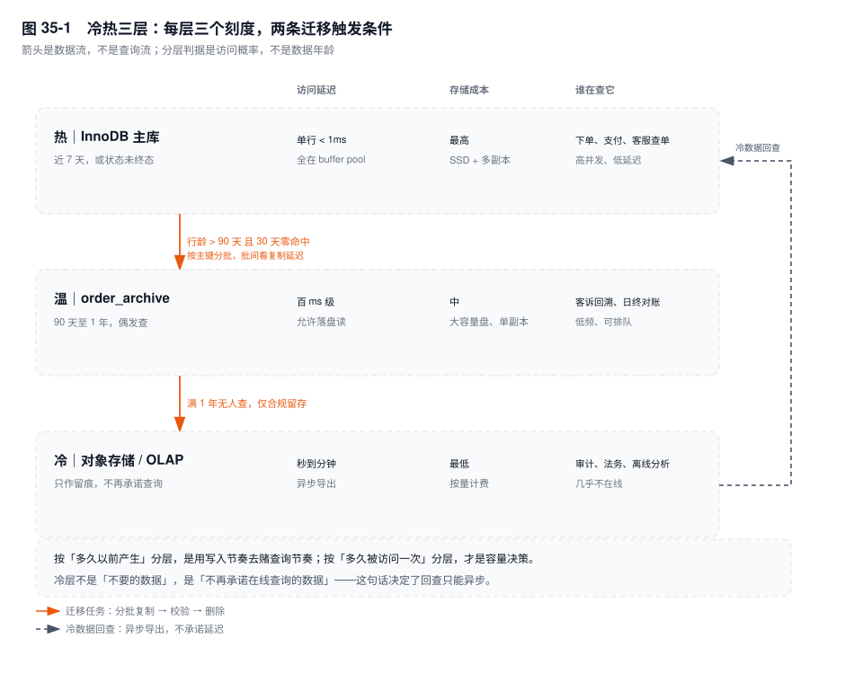
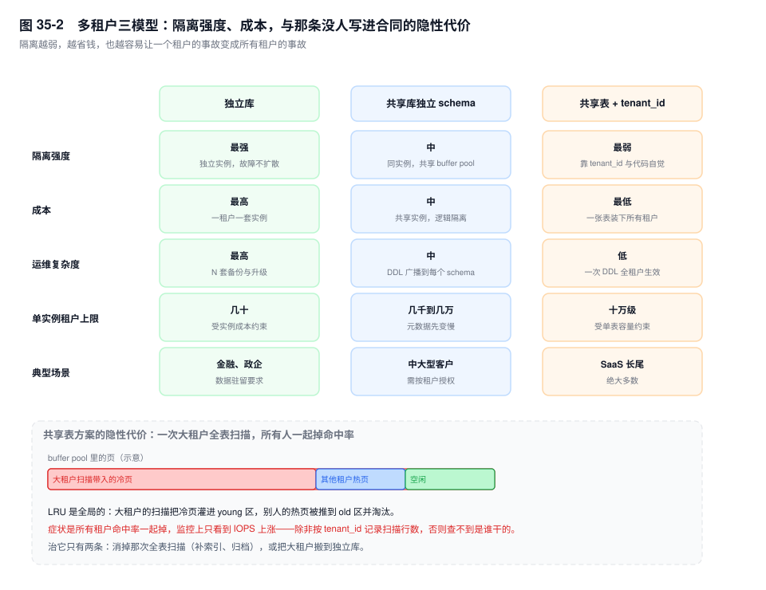

# 第 35 章　数据生命周期与多租户

> **一句话结论**：数据放哪一层由"多久被访问一次"决定，不由"多久以前产生"决定；租户要不要隔离，由"一个租户能不能拖垮别人"决定，不由租户数量决定。

## 35.0 场景：删了三天，undo 涨到 400GB

8 亿行的 `order_main` 攒了五年。团队决定归档三年前的单，第一版脚本是这样：

```sql
DELETE FROM order_main WHERE create_time < '2023-11-13' LIMIT 1000;
-- 外层 shell 循环，每轮 sleep 0.5
```

跑了三天没跑完。主库（source）写入正常，从库（replica）延迟常年 2000 秒，purge 完全追不上，undo 表空间涨到 400GB。

三个问题叠在一起：`create_time` 上没有索引，每一轮都要从表头全表扫一遍找那 1000 行，8 亿行被扫了几百遍，这是主因；每删一行都是一次完整 DML，undo、redo、binlog 的 row event 一份不少；`LIMIT 1000` 也不等于小事务，它照样在一千行上持锁。

补索引只是止损。真正错的是**拿删除当归档**：删除要能回滚、能复制、会在页里留空洞，而归档只需要一个事实——这些行不在主表里。

## 35.1 机制

### 一、冷热分层的判据

判据要能算出来。**索引级**：`sys.schema_index_statistics`（底层是 `performance_schema.table_io_waits_summary_by_index_usage`）一行一个索引，`rows_selected` 是被读过的行数。某索引 `rows_selected = 0` 而 `rows_inserted` 与主键齐平，它就只产生维护成本。

**时间级**：没有系统表能直接回答"某个时间区间内的行被访问了多少次"，`events_statements_summary_by_digest` 只存指纹和总行数、不存参数。只能在从库上把 `long_query_time` 调到 0 采样十几分钟，再把采样到的参数按 `create_time` 分桶回放成 `COUNT(*)`。

典型形态是最近 7 天占九成以上访问、一个月前不到 1%。这不是普遍规律，但订单、账单类业务大多如此：访问跟着业务状态走，不随时间均匀衰减。

| 层 | 位置 | 进入条件 | 硬约束 |
|---|---|---|---|
| 热 | InnoDB 主库 | 近 7 天有访问，或状态未终态 | 必须被 buffer pool 覆盖 |
| 温 | `order_archive`（可另起实例） | 90 天至 1 年偶发查 | 允许慢查，允许不在内存 |
| 冷 | 对象存储 / OLAP | 仅合规留存 | 不承诺在线查询 |



"状态未终态"比时间更要紧：待支付、退款中的单行再老也要留在热层，归档一个还在流转的单，等于把状态机拆成两半。

### 二、归档三策略

**分区 DROP** 最快：`ALTER TABLE order_main DROP PARTITION p202311` 是元数据操作，与分区里装多少行无关（见第 32 章）。前提是建表那天就按 `create_time` 分区；没分区，这条路当场作废。

**按主键批量迁移**，边界用 id 不用时间：

```sql
INSERT INTO order_archive
SELECT * FROM order_main
WHERE id > ? AND id <= ? AND create_time < '2023-11-13'
ON DUPLICATE KEY UPDATE id = id;      -- 重跑幂等

DELETE FROM order_main
WHERE id > ? AND id <= ? AND create_time < '2023-11-13';
```

为什么按 id：它是聚簇索引键，区间扫描顺序、预读有效；边界本身就是断点，重启读回 `last_id` 就能续；同一段 id 可切给多个线程并行。按 `create_time` 切，边界不唯一（同一毫秒几百行），续传要记 `(create_time, id)` 复合位点，而这列没索引时每批都是全表扫。

先复制再删，还是先删再复制：前者安全，代价是复制完到删除之间源行若被更新，归档里是旧值——所以归档对象必须是终态行；`INSERT` 做了幂等，重跑不产生重复。后者快，源表立刻瘦身，代价是复制进程崩在删除之后，数据只剩 binlog 一份。

> ⚠️ `DELETE` 慢是结构性的：逐行删除 → 每行一份 undo（要留到没有更老的视图，见第 5 章）→ 每行一条 redo → ROW 格式下每行一个 binlog event → 页内留空洞 → `DATA_FREE` 上涨 → 只能 `OPTIMIZE TABLE` 重建表，而重建要双倍磁盘。这条链决定了归档只能"少量多次"。

归档任务不能变成大事务：每批 N 行提交一次，N 按"单批耗时小于可容忍的复制延迟、undo 不撑爆"反推，再挂闭环——`Seconds_Behind_Source`（8.0.22 前叫 `Seconds_Behind_Master`）超阈值就暂停。固定 `sleep 0.5` 在低峰期是浪费，在高峰期是事故（见第 21 章）。

**双写切换**：新数据写新表，历史慢慢搬，查询看两张。代价是每条查询要么 UNION、要么在应用层按时间路由，写入侧要保证老单的更新仍落到老表。

### 三、历史查询的透明化

```sql
CREATE VIEW all_orders AS
SELECT * FROM order_main
UNION ALL
SELECT * FROM order_archive;
```

视图把复杂度藏起来，代价挪到执行期。UNION ALL 展开成派生表，两表各自出计划，但 `ORDER BY` 与 `LIMIT` 只能在归并之后做——`ORDER BY create_time DESC LIMIT 20` 会从两边各取一批再排序，`EXPLAIN` 里常见 `<union1,2>` 加 `Using filesort`；分区裁剪不跨分支下推；视图不可更新，历史修正要直接打归档表。

`FEDERATED` 引擎（8.0 需 `INSTALL PLUGIN federated SONAME 'ha_federated.so'`）把远端表映射成本地表，代价是逐行拉取、用不上本地索引、不支持事务，只适合低频的后台查询。

### 四、多租户三模型



| 维度 | 独立库 | 共享库独立 schema | 共享表 + `tenant_id` |
|---|---|---|---|
| 隔离强度 | 最强，故障与资源不扩散 | 中，共享 buffer pool | 最弱，靠 `tenant_id` 与代码自觉 |
| 成本 | 最高，一租户一套实例 | 中，共享实例 | 最低，一张表装下全部租户 |
| 运维复杂度 | 最高，N 套备份与升级 | 中，DDL 广播到每个 schema | 低，一次 DDL 全租户生效 |
| 单实例租户上限 | 几十 | 几千到几万，元数据先变慢 | 十万级，受单表容量约束 |
| 典型场景 | 金融、政企大客户 | 中大型客户，需按租户授权 | SaaS 长尾租户 |

选型的拐点不在租户数量，在**风险归属**：一个租户的慢查询、一次误删、一次 DDL，会不会变成所有租户的事故。

必须升级到独立库的判据有四个：合规要求数据驻留或按租户独立加密密钥；单租户吃掉单实例容量的一大块（经验上三成以上，它的 DDL 与备份会绑架全站）；单租户峰值 QPS 与实例能力同量级，或它的慢查询出现在别人的 P99 里；需要按租户单独 PITR。

### 五、tenant_id 的索引与类型

共享表方案的技术核心只有一句：**`tenant_id` 是所有索引的第一列**。每条查询都带着它，它是天然的高选择性前缀。

反例最能说明问题：`INDEX(created_at)` 在多租户下几乎是废索引——"查最近一小时的订单"对每个租户都成立，这个索引扫出来的却是所有租户的行，再逐行过滤。

```sql
UNIQUE KEY uk_order_no (tenant_id, order_no),
KEY idx_tenant_ct (tenant_id, create_time)
```

唯一索引也要带 `tenant_id`，否则两个租户的订单号会撞：外部渠道给的流水号在不同商户之间重复，是常态。

类型：租户数一万以内 `SMALLINT UNSIGNED` 就够，但改类型要重建全部索引，而 `INT UNSIGNED` 只多 2 字节，换"以后不用再改"划算。`CHAR(12)` 只在租户 ID 是外部不可控字符串时用，代价是每行与每个索引项多 8 到 10 字节，还要处理 collation（见第 29 章）；两头都要，就存内部 `INT` 主键加外部 `tenant_code` 列。

数据倾斜：大租户占八成数据时，`WHERE tenant_id = ?` 对它内部毫无选择性，`(tenant_id, create_time)` 的前缀也退化成"扫这个租户的全部"。统计信息看到"几万个租户"，执行时看到"一个租户八亿行"——大租户单独分片最省事（见第 33 章）。

### 六、租户级资源隔离

- **连接池按租户限额。** 一个租户打满连接，全站 `ERROR 1040`，监控上只看到"连接数高"。
- **`[8.0]` `RESOURCE GROUP`** 把不同租户的线程绑到不同 CPU 组（`CREATE RESOURCE GROUP rg_big TYPE=USER VCPU=0-3`，再 `SET RESOURCE GROUP`）。它只管 CPU，不管 IO 与 buffer pool，配置也重，通常只给 Top 3 租户用。
- **`max_execution_time` `[5.7.8+]`** 只对 `SELECT` 生效，超时抛 3024。写语句不受约束——归档脚本的 `DELETE` 只能靠批大小兜。

最容易忽略的是第四层：**共享 buffer pool**。LRU 是全局的，大租户一次全表扫描把冷页灌进 young 区，其他租户的热页被推到 old 区淘汰。结果是所有租户命中率同时下降，监控上只看到"IOPS 和 P99 都涨了"，定位不到是谁干的。治它只有两条：消掉那次扫描，或把大租户搬走。

### 七、数据合规

被遗忘权落到 MySQL 上是两个动作：物理 `DELETE`（就是 35.0 那条慢路径），或匿名化（`UPDATE` 覆盖手机号、地址，行还在）。能匿名化就别删——不产生空洞，也不破坏外键关系。

备份才是难题：备份文件不可改。三条路径——恢复后重放删除（要长期保留一张删除请求表）；按租户或按用户加密，删密钥即不可读（代价是密钥管理与查询解密）；让备份保留期短于合规响应期（备份只留 7 天，删除请求 30 天内完成，自然过期）。行业里多是第一条加第三条。

脱敏分两种。静态脱敏是洗数据到测试库，可接受不可逆。动态脱敏 MySQL 原生做不到——视图里拿不到业务身份，`CASE WHEN CURRENT_USER()` 只能区分数据库账号，所以要么一个业务角色一个账号加视图授权，要么在代理层改写 SQL。

审计：官方 `audit_log` 属企业版，社区版没有。替代是 `general_log`（IO 放大明显，只能短时开）、`performance_schema` 的语句聚合（只有统计、没有个体），或 Percona 的 `audit_log`。常开的只该是 DDL 与高权限 DML（见第 21 章）。

### 八、缓存与 DB 的一致性

Cache Aside：读未命中就查库回填；写，先更新库再删缓存。删而不是更新：并发两次"更新缓存"会乱序，后写的可能是旧值，删除是幂等的。

为什么不能先删缓存再更新库：删完到更新完成之间，一个读请求没命中，回填的就是旧值，此后一直留到过期——不一致窗口从毫秒级被拉成了整个 TTL。先更新库再删缓存，最坏只是两次操作之间有人读到旧缓存。

延迟双删补的就是这个窗口：更新前删一次，更新后延迟 T 再删一次，T 取主从延迟加一次回填耗时。失效方式很具体：T 是拍死的，从库延迟抖到 2000 秒时不够（见第 25 章）；第二次删失败没人管；之后还有读了旧库的请求回填——窗口只是变小，没有消失。

订阅 binlog 更新缓存（Canal 一类，见第 34 章）把这件事挪出业务代码：伪装成从库解析 row 事件，按主键刷新缓存。好处是不侵入；坏处是延迟等于复制延迟加消费延迟，且同一 key 的事件必须哈希到同一消费线程，否则乱序会用旧值覆盖新值。

DB 侧能做的防护只有三件：

| 故障 | 现象 | DB 侧对策 | 代价 |
|---|---|---|---|
| 击穿 | 热点 key 失效，请求全打到库 | `SELECT ... FOR UPDATE` 让一个请求加载，其余等 | 行锁变成应用串行点，持锁时间等于加载耗时 |
| 雪崩 | 大批 key 同一秒失效 | 过期时间加随机抖动 | 只是错峰，不解决容量 |
| 穿透 | 查不存在的 id | 空值缓存，或布隆过滤器 | 空值占内存；布隆有假阳性、删除困难 |

核心那句：缓存一致性本质是"业务允许读到多久以前的旧值"，这是产品决策，不是技术选型。TTL 就是对外承诺的最坏延迟，双删与订阅只是缩短它，不会归零。

## 35.2 关键结论

1. **分层判据是访问概率，不是数据年龄。** 用"3 个月前算冷"划线，等于假设读写节奏同步，而两者从不齐步。
2. **归档的主语不能是 DELETE。** 删除是 DML，要 undo、要复制、要留空洞；归档要的是"行离开主表"，最快是 DROP PARTITION，次快是按主键搬。
3. **批量任务的边界用聚簇索引键。** id 区间天然可断点、可并行、可顺序预读；时间列不唯一，续传要复合位点。
4. **多租户选型看风险归属，不看租户数。** 隔离强度就是一个租户的事故变成公共事件概率的倒数。
5. **`tenant_id` 必须是所有索引的第一列，唯一索引也不例外**，否则跨租户扫描与单号冲突会同时出现。
6. **共享 buffer pool 是共享表方案藏得最深的代价。** 大租户的全表扫描挤掉别人的热页，症状是全局命中率下降，按实例维度查不出是谁。

## 35.3 实验验证

### 实验一：这个索引到底有没有被用过

```sql
SELECT table_name, index_name, rows_selected, rows_inserted, rows_updated
FROM sys.schema_index_statistics
WHERE table_name = 'order_main'
ORDER BY rows_selected DESC;
```

```text
# 输出形态（未实跑，字段含义以此为准）
+------------+----------------+---------------+----------------+---------------+
| table_name | index_name     | rows_selected | rows_inserted  | rows_updated  |
+------------+----------------+---------------+----------------+---------------+
| order_main | PRIMARY        |    8213749201 |     812004411  |    1902331102 |
| order_main | idx_tenant_ct  |    4102993110 |     812004411  |             0 |
| order_main | idx_created    |             0 |     812004411  |             0 |
+------------+----------------+---------------+----------------+---------------+
```

`rows_selected = 0` 而 `rows_inserted` 与主键齐平，说明它只有写没有读，删掉它省的是每次写入的一次 B+ 树维护。注意它是实例启动以来的累计值。

### 实验二：批大小与复制延迟的闭环

```sql
-- 每批前后各看一次，取 Seconds_Behind_Source
SHOW REPLICA STATUS\G
```

把批大小从 500 拉到 5000 看延迟斜率：500 行一批时是锯齿（涨、追平、再涨），5000 行一批时是持续上升的斜线，说明复制线程的追平速度已低于产生速度。拐点就是这个时段的批大小上限。

## 35.4 常见误区

⚠️ **"归档就是把老数据删掉"** → 删掉的是可回滚性、可复制性和页空间，留下的是空洞与碎片。正确做法是先搬走核对行数，再从主表移除。

⚠️ **"分批删就不会有问题"** → 分批解决的是事务大小，不解决扫描方式。没有索引时每批仍是一次全表扫，分批只是把一次长痛切成无数次长痛。

⚠️ **"多租户就是加个 tenant_id 列"** → 索引不带它等于没加：`INDEX(created_at)` 依旧跨租户扫，`UNIQUE(order_no)` 依旧撞号。

## 35.5 生产 Checklist

- [ ] 归档条件列有索引，`EXPLAIN` 是 range 不是 ALL
- [ ] 任务按主键区间切片，`last_id` 持久化，可断点续跑
- [ ] 每批提交，批大小由复制延迟闭环控制，不写死 `sleep`
- [ ] 归档表与主表按分段核对行数，不只对总数
- [ ] 含 `tenant_id` 的表，索引与唯一键都以它打头
- [ ] 大租户有独立连接配额，`max_execution_time` 已生效

## 35.6 延伸

- 分区裁剪与 `DROP PARTITION`：第 32 章；分片倾斜与大客户单独分片：第 33 章
- 长事务与批大小：第 21 章；purge 与 undo 回收：第 5 章
- 复制延迟的四个失真：第 25 章；binlog 订阅与最终一致：第 34 章
- 面试追问：`DELETE` 为什么比 `DROP PARTITION` 慢一个量级？共享表下怎么证明某个租户拖慢了全站？
- 文档：`sys.schema_index_statistics`、`performance_schema.table_io_waits_summary_by_index_usage`、`RESOURCE GROUP`
