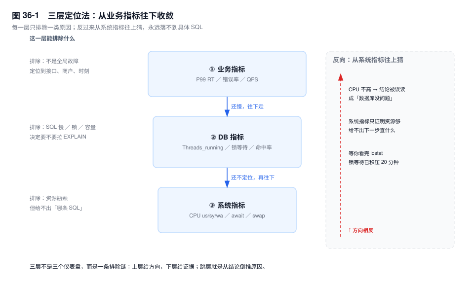
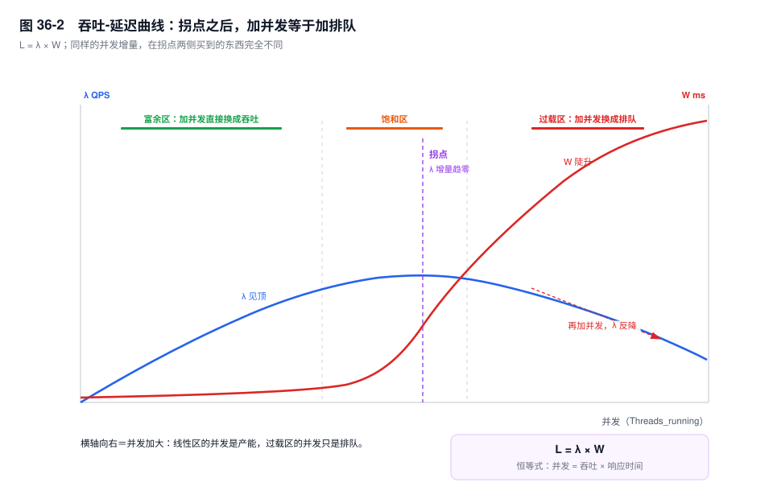
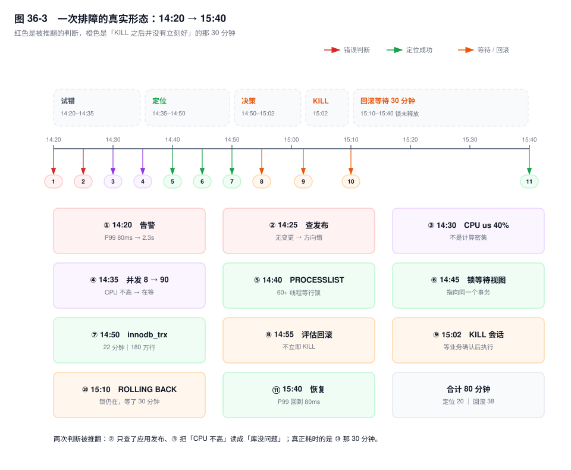

# 第 36 章　性能分析方法论

> **一句话结论**：CPU 高是结果不是原因；排查的正确方向是从业务指标的突变点出发，用 `Threads_running` 把故障收敛成"计算、IO、锁"三类之一，最后才用系统指标验证资源假设。

## 36.0 场景：登上机器，第一个命令敲什么

14:20，下单接口的 P99 从 80ms 涨到 2.3s，错误率 0.3%，总 QPS 没有明显变化。群里只有四个字：数据库慢。

你 SSH 上去，第一个命令敲什么？

多数人敲 `top`。它不算错，但把排查偷换成了"看资源满没满"，而这只回答一件事：要不要加机器。

先把四个字拆成四个问题：

- **谁慢**：整个库，还是某个接口、某个商户、某类 SQL？
- **多慢**：P99 还是平均值？错误率动了没有？
- **什么时候开始的**：突变点落在哪一分钟？
- **那之前变了什么**：发布、数据量、参数、流量，还是有人在后台点了个批量操作？

四个问题里，最后一个最接近答案，也最容易被"先看 CPU"跳过。这一章讲的就是这四问之后的十分钟：按什么顺序排除，什么信号指向什么方向。

## 36.1 CPU 高是结果，不是原因

"数据库慢"和"CPU 高"之间没有因果关系，只有相关性，而且方向经常是反的。

**第一种错位：CPU 高是低效计划的副产品。** 一条没有索引的 `UPDATE` 扫 800 万行，每行都要在 Server 层判一次 `WHERE`，CPU 当然高。`us` 冲到 90% 不是原因，是"引擎被迫逐行搬运"的结果；加完索引它会自己掉下来，先扩容只是让机器更久地做无用功。我处理过的案子里，十次有八次根因落在 SQL 与索引这一层。

**第二种错位：CPU 不高，数据库照样慢。** 等待中的线程睡在条件变量、IO 完成事件或网络 socket 上，不进 runqueue，不消耗 CPU 时间片。所以"CPU 空闲"和"系统卡住"可以同时成立，而且是常态：

| 等待类型 | 线程停在哪 | CPU 表现 |
|---|---|---|
| 行锁 / MDL | 引擎的锁对象上挂起 | 几乎为 0 |
| 物理读 | `pread` 未返回 | `wa` 升高，但单盘低并发时可能看不出来 |
| 连接池耗尽 | 还没连上 MySQL | 数据库侧完全无感 |
| 从库回放（replica） | 从库 SQL 线程 | 主库毫无异常 |

**第三种错位：CPU 高，业务不慢。** 备份、批量对账、DDL 的并行读都会把 CPU 打满，而 P99 一动不动。这说明系统指标和业务指标本就不同步，拿它当唯一判据必然误判。

于是立一条原则：**从业务指标反向定位，不从系统指标正向猜。** 系统指标只能证明"资源是不是瓶颈"，它是一个排除项，不是定位项。反过来猜的代价在图 36-1 的右侧：你会因为"CPU 只有 40%"过早关掉数据库这条线，把问题推回业务方，然后花半小时对应用日志。



## 36.2 三层定位法：每一层只排除一类原因

### 第一层：业务指标——先确认"慢"的形状

看三个数：**P99 响应时间、错误率、QPS**。

平均值必须扔掉：1000 个请求里 990 个 5ms、10 个 3s，平均只有 35ms，P99 却是 3s——被稀释的平均值看不见那 10 个人。P99 才反映尾部用户的感受。

"P99 涨了、平均没变、QPS 没变"是本章最典型的开局，它对应三种完全不同的原因：

1. **少数慢查询**：某个商户的账单表数据量是别人的一百倍，或者某条 SQL 昨天换了计划。慢的请求集中在特定参数上。
2. **锁等待**：只有撞到热点行（同一商户、同一 SKU）的请求排队，比例小，但一排队就是几百毫秒起步。
3. **连接池排队**：请求卡在应用侧拿连接，根本没到 MySQL。数据库指标全绿，`Threads_connected` 甚至没满——因为瓶颈是应用自己的池子大小。

三者的分界线是**错误率**。纯 SQL 变慢，错误率通常不动；锁等待久了会有少量 `ERROR 1205`（`Lock wait timeout exceeded`，默认等 50 秒）；连接池耗尽会让错误率明显抬升，且报错在应用日志而非 MySQL 日志里。**延迟涨、错误率不动，先怀疑等待；两个一起涨，先怀疑容量或连接。**

### 第二层：DB 指标——把"慢"收敛成"谁在等"

状态变量全是累计值，单点读数没有意义，必须两次采样求差。间隔 30 秒，除以秒数得到速率。

- `Questions` 的增速 ≈ 客户端发来的语句数/秒。用 `Questions` 而不是 `Queries`：后者把存储过程内部的语句也数进去，接口 QPS 会被放大好几倍。
- `Com_select` / `Com_insert` / `Com_update` 的比例突变，比总量更有信息量。读突然掉、写突然涨，往往是一个定时任务或缓存集体失效。
- **`Threads_running` 是这一层最重要的一个数。** 它是"没在 Sleep 的线程数"，反映并发，不是连接数。正在算、正在等 IO、正在等锁的线程都算在里面，正好适合和 CPU 一起做判别。
- `Threads_connected` 与 `max_connections` 的比值是使用率，不是压力。连接多但都在 Sleep，说明池子配大了或者有泄漏。
- `Innodb_row_lock_waits` 的增速说明"每秒有多少次等锁"，`Innodb_row_lock_time_avg` 说明"平均等多久"。两个一起看：次数涨、均值低，是热点行争抢；次数不多、均值极高，是有人长时间持锁。
- 命中率用 `1 - Innodb_buffer_pool_reads / Innodb_buffer_pool_read_requests` 算。下降 0.1 个点在百万级 QPS 下就是大量物理读；但命中率高也不代表健康——全表扫把页读进来只用一遍，比值照样漂亮。

**什么时候该拉 `EXPLAIN`？** 满足任一才拉：慢日志能定位到具体 SQL 且重放稳定地慢；`Rows_examined` 是 `Rows_sent` 的几十倍；同一条 SQL 昨天快今天慢。反过来说，单跑 3ms、并发时变 800ms 的 SQL，`EXPLAIN` 一个字段都不会变——那是等待，不是计划。读法见第 11 章。

**从库延迟算不算"数据库慢"？** `Seconds_Behind_Master`（8.0 同义列 `Seconds_Behind_Source`）测的是"最后一个被应用的事件有多旧"，不是"还差多少活"。大事务回放期间它一路上涨、提交瞬间归零；主库（source）空闲时虚高，繁忙时虚低。看到"从库延迟 3000 秒"，先问三件事：读流量有没有打到这台从库、两次采样的差值是正还是负、`pt-heartbeat` 读数是多少。只有"读请求落在从库 + 业务对新鲜度敏感"时，它才转成 RT 问题；否则它是新鲜度指标，不是性能指标。机制见第 25 章。

### 第三层：系统指标——只用来验证，不用来定位

- **CPU**：`us` 是用户态计算（SQL 执行、排序、函数），`sy` 是内核态（系统调用、上下文切换、内存分配），`wa` 是"CPU 空闲但仍有 IO 未完成"。`wa` 高说明 IO 有积压，**但 `wa` 不高不能反推 IO 没问题**——单盘低并发时 IO 很慢而 CPU 一直在干别的，`wa` 就是起不来。这条单边性经常害人。
- **IO**：`iostat -x 1` 看三个值。`await` 是单次 IO 的平均耗时（含排队），它高才是真慢；`%util` 是设备忙的时间占比，100% 只说明队列一直非空，对支持并发的 SSD/NVMe 参考价值有限；`aqu-sz`（旧版 `avgqu-sz`）是平均队列深度，它才是排队程度的直接读数。
- **内存**：只看一件事——swap 有没有在被使用（`vmstat` 的 `si`/`so`）。Buffer Pool 被换出会让一次内存读变成一次磁盘读，性能是断崖式的，没有中间态。
- **网络**：MySQL 场景下少见，典型表现是大结果集传输或跨机房半同步等待，特征是 DB 侧 `Sending data` 很久但 CPU、IO 都闲。见 36.5。

三层串起来，就是本章最实用的一张表：

| 观测组合 | 指向 | 下一步 |
|---|---|---|
| `Threads_running` 高 + `us` 高 | 计算密集：坏计划、函数包裹、排序 | 慢查询 topN，看 `Rows_examined/Rows_sent` 的比值 |
| `Threads_running` 高 + `wa` 高 | IO：物理读、刷脏、临时表落盘 | 命中率、`Created_tmp_disk_tables`、`iostat await` |
| `Threads_running` 高 + `us`/`wa` 都低 | 锁等待，或在等 MDL | `data_lock_waits`、`metadata_locks` |
| `Threads_running` 不高 + P99 高 | 连接池排队、网络、个别超长 SQL | 应用池等待数、`Threads_connected` |
| `Threads_connected` 逼近 `max_connections` | 连接泄漏，或池上限配错 | `Aborted_connects`、Sleep 线程占比 |
| `Innodb_buffer_pool_reads` 占比上升 | 工作集超出内存 | 大查询、Buffer Pool 大小、冷数据扫描 |

## 36.3 吞吐与延迟：拐点之后，加并发等于加排队

这一节只用一个公式：**`L = λ × W`**，并发数 = 吞吐 × 响应时间（Little's Law）。它是恒等式，不是近似模型，任何系统上都成立，所以推论也很硬。

一台 8 核机器，单语句服务时间 2ms，单线程理论 500 QPS。并发 8 时 `λ` 约 4000，`W` 还是 2ms。此时加并发，`λ` 线性涨，`W` 几乎不动——产能有富余。

继续加，`λ` 的增速开始落后于并发增速，`W` 从 2ms 涨到 20ms。拐点到了：**`λ` 的增量趋近于零，而 `W` 开始陡升**。这时多出来的线程不生产吞吐，只生产排队。

再往后是过载区：`λ` 不再增长，甚至下降。原因不是玄学，是四笔账同时到期——上下文切换吃掉了 `sy`；锁竞争让事务重试甚至回滚；Buffer Pool 和脏页刷不过来，用户线程被迫参与刷脏；redo 组提交的队列变长，每次提交都在等别人。这四件事都在消耗有效算力，于是同样的 CPU 干出的活更少。



**拐点在哪，可以量出来，不用猜。** 固定数据集、固定 SQL 组合做阶梯压测：并发取 8 / 16 / 32 / 64 / 128，每档稳定运行 3 分钟，记录 `λ`、P99、`Threads_running`。找"`λ` 增幅小于 10% 而 P99 翻倍"的那一档，它前一是容量上限。生产上的等效判据是 **`Threads_running` 持续超过 CPU 核数的 2~3 倍**——注意是"持续"，秒级尖峰不算。

这条判据有一个必须补的前提：`Threads_running` 里混着等锁的线程。如果它高、`us` 却不高，那不是容量拐点，是锁或 IO 拐点，**加机器没有任何用**，因为锁是全局串行点。同样是"过载"，成因不同，解法相反：算力不够加机器有效，锁竞争加机器无效。

最后一个推论：过载时**重试是正反馈**。应用超时重试，`λ` 上升，`W` 进一步上升，更多请求超时，更多重试。拐点右侧，"再加重试"和"再压一波流量"是同一件事。

## 36.4 USE：把"用满了"和"在排队"分开

USE 是三个词：Utilization（使用率）、Saturation（饱和度）、Errors（错误）。在 MySQL 上的价值，是逼你把"资源用了多少"和"有多少人在等"分成两个问题。

| 维度 | MySQL 上的具体指标 | 读到什么算信号 |
|---|---|---|
| Utilization | CPU 使用率、Buffer Pool 页使用率、`Threads_connected / max_connections`、磁盘空间使用率 | 高只说明"用得多"，不说明"不够用" |
| Saturation | `Threads_running`、`Innodb_row_lock_current_waits`、`aqu-sz`、`Threads_running` 与核数的比值 | 看趋势与持续时长，不看瞬时值 |
| Errors | `Aborted_connects`、`Connection_errors_*`、`Table_open_cache_misses`、`Innodb_buffer_pool_wait_free` | 任何一个不为 0 都要给解释 |

**Utilization 高不一定是问题，Saturation 高才是问题。** 一个 CPU 跑满 100%、`Threads_running` 稳定在核数附近、P99 平稳的系统是健康的——它只是把买来的机器用足了。反过来，CPU 30%、`Threads_running` 200 的系统是病态的：大量线程在等，而 CPU 在闲着。

四个 Errors 里，`Innodb_buffer_pool_wait_free` 最容易被忽略也最严重：它统计"要一个新页、池子里没有干净页可用、只能等刷脏"的次数。大于 0 说明刷脏跟不上页面分配，所有读都可能被拖住；这时改 SQL 救不了，只能从写入速率和刷脏能力上解决。

## 36.5 SHOW PROCESSLIST：30 秒快照怎么读

这是最快也最容易读错的手段，原因只有一个：**单次快照分不清"卡住"和"正在跑"。** 等了 5 分钟行锁的线程，和刚跑 200ms 的查询，在快照里长得一样。

所以采三次，间隔 10 秒：三次都是同一个 `State` 且 `Time` 在涨，才是卡住；`State` 在变，说明它在推进，只是慢。

先聚合，再看个体：

```sql
SELECT STATE, COMMAND, COUNT(*) AS n, MAX(TIME) AS max_s, AVG(TIME) AS avg_s
FROM information_schema.PROCESSLIST
GROUP BY STATE, COMMAND
ORDER BY n DESC;
```

行数上千时 `SHOW PROCESSLIST` 要拿全局锁，自身就会慢到几百毫秒，改用 `performance_schema.threads`。聚合结果里某个 `State` 独占 60 个线程，方向基本就定了。

| State | 它实际在干什么 | 下一步查什么 |
|---|---|---|
| `Sending data` | **不是"在发数据"**：读行、处理、发结果都算在这里，扫描时间包含在内 | 慢日志的 `Rows_examined`；这条最常见于全表扫 |
| `Waiting for ... lock` | 等 InnoDB 行锁 | `data_lock_waits`（8.0）找阻塞者 |
| `Waiting for table metadata lock` | 等 MDL，通常是长事务或未提交的 `SELECT` 挡着 DDL | `metadata_locks`；见第 18 章 |
| `Waiting for commit lock` | 提交阶段的全局锁被占：binlog 轮转、`FTWRL`、备份 | 找备份/DDL 任务，KILL 业务会话没用 |
| `copying to tmp table` | 内部临时表在攒结果，可能已落盘 | `Created_tmp_disk_tables` 增速、`tmp_table_size` |
| `Creating sort index` | filesort 正在生成排序结果 | `Using filesort` 的执行计划；见第 14 章 |
| `Sorting result` | 对结果集排序（多见于 `GROUP BY`） | 同上 |
| `Opening tables` | 打开表定义；表/分区太多或 `table_open_cache` 命中差 | `Opened_tables`、`Table_open_cache_misses` |
| `statistics` | 优化器在算代价、做 index dive | 大表 + 多分区时常见；也可能是统计信息在更新 |
| `Sleep`（`Info` 为空） | 连接空转，可能还开着事务 | `innodb_trx` 里对 `trx_mysql_thread_id`，多半是持锁源头 |

**`Sending data` 是最容易被误解的一个。** 它的名字来自很早的版本，语义却一直是"正在读数据并把结果发给客户端"。一条 `Sending data` 持续 60 秒的 `SELECT`，问题在扫描量，不在网卡。

**`Info` 为 `NULL` 且 `Time` 很大，是最危险的一行。** 它什么都没干，但可能开着事务、持着锁、钉着 purge 水位。这类线程在 `PROCESSLIST` 里毫不起眼，却是锁等待最常见的源头，见第 21 章。

## 36.6 火焰图、`pt-pmp`、`perf`：什么时候值得抓栈

这两个工具解决"指标已指向计算或阻塞、但不知道在哪个函数"的问题，是排查的第三步，不是第一步。

**`pt-pmp` 回答"线程都阻塞在什么函数上"。** 它周期性抓取所有线程的调用栈（默认走 gdb，也可以读 `/proc/<pid>/stack` 拿内核栈），把相同的栈聚合计数，按出现次数排序。它适合"卡住"类问题：锁等待、IO 等待、mutex 争用。输出形态是这样的：

```text
  1420 pthread_cond_wait,os_event::wait_low,srv_conc_enter_innodb,...
   980 pthread_cond_wait,os_event::wait_low,lock_wait_suspend_thread,...
   120 io_submit,os_aio_func,fil_io,row_search_mvcc,...
```

第一列是采样次数：1420 个样本落在 `srv_conc_enter_innodb` 这条栈上，说明瓶颈在 InnoDB 并发控制。**它不给 CPU 热点**——阻塞的线程不烧 CPU。

**`perf record` 回答"CPU 时间花在哪个函数"。** 采样 CPU 的调用栈：

```bash
perf record -F 99 -g -p $(pidof mysqld) -- sleep 30
perf script | stackcollapse-perf.pl | flamegraph.pl > ch36-flame.svg
```

火焰图只有两条读法：横轴是调用栈合并后的宽度，等于出现频率（**不是时间顺序**），纵轴是深度。要找**平顶**——某个函数自己占了一大块宽度、下面没有更细的分支，说明 CPU 烧在它自己身上；窄而深的栈是"路径长但很少发生"，优先级低。

边界必须说清楚，否则火焰图就是一堆十六进制地址：

- 官方二进制不带调试符号，`perf report` 里会大量出现 `[unknown]`。要么装对应版本的 debuginfo 包，要么自编译带 `-g`。
- `-O2` 把小函数内联进调用者，栈上的名字与源码对不上，宽度归属会错。看到"所有时间都在一个巨大函数里"，先怀疑内联。
- 采样是统计性的，30 秒 99Hz 约 3000 个样本，占比低于 1% 的路径看不出来。别用它解释一次性的抖动。

判据：**CPU 高用 `perf`，卡住用 `pt-pmp`；两个都用不上，说明问题在 SQL 与索引层。**

## 36.7 复盘：14:20 到 15:40

以下是一次真实形态的复盘（时间点为示意，数字取自一次生产事故的量级），重点不在结论，在于两次判断被推翻的过程。

| 时间 | 动作 | 依据 | 判断 |
|---|---|---|---|
| 14:20 | 收到告警 | P99 80ms→2.3s，错误率 0.3%，QPS 持平 | 先确认影响面 |
| 14:25 | 查发布系统与变更单 | 两小时内无应用发布 | **猜"新代码"，错了**（漏掉运营后台的批量操作） |
| 14:30 | `top`：`us` 40%、`wa` 3% | CPU 不高 | "不是计算密集"——对的；但险些推出"库没问题" |
| 14:35 | `Threads_running` 8→90 | 并发涨 11 倍，CPU 没动 | 指向锁等待或 IO 等待 |
| 14:40 | 连采三次 `PROCESSLIST` | 60 多个线程停在 `Waiting for ... lock` | 方向定了：行锁排队 |
| 14:45 | `performance_schema.data_lock_waits` | 所有等待指向同一个 `trx_id` | 找到阻塞者 |
| 14:50 | `information_schema.innodb_trx` | 该事务已 22 分钟，`trx_rows_modified` 约 180 万 | 一条无索引 `UPDATE` 全表扫、锁全表 |
| 14:55 | 评估回滚成本 | 180 万行的回滚与执行同量级 | 不立即 KILL，先找业务确认 |
| 15:02 | `KILL` | 业务确认是运营后台的批量改价 | 会话终止 |
| 15:10 | `trx_state` 变 `ROLLING BACK`，锁仍在 | 回滚逐行反向执行并写 undo | **意外：KILL 不等于恢复** |
| 15:40 | 回滚完成，`Threads_running` 回落 | P99 回到 80ms | 恢复 |



**错误方向一：只查了应用发布。** 14:25 什么都没查到，不是方法错了，是查错了变更源：发布系统只覆盖"代码上线"，不覆盖"人在后台点了个批量改价"。真正该问的是"过去 30 分钟哪个写指标突变"——`Com_update` 增速、`Innodb_rows_updated` 增速、`Threads_running` 的拐点，这三个数一分钟能拿到，也不会被"没有发布"这个结论挡住。

**误读风险：把"CPU 不高"读成"库没问题"。** 14:30 的判断没错，错在它太容易被翻译成"数据库是清白的"，方向随之被推回业务方。加一句限定就能防住：**CPU 不高只排除计算密集，不排除等待。** 而 0.3% 的错误率恰好是等待型故障的指纹——少量请求等满 `innodb_lock_wait_timeout`（默认 50 秒）报 1205，其余只是变慢。

**意外：KILL 之后并没有立刻好。** 14:55 决定 KILL 时，大家都以为 15:00 前能恢复。实际时间线是：15:02 会话终止，15:10 才看到 `ROLLING BACK`，15:40 才回滚完。机制不复杂：KILL 只是给会话打标记，语句在下一个检查点退出；已修改的 180 万行要逐条反向执行 undo，**回滚期间锁不释放**（否则原子性就破了），排队的线程继续等。评估回滚成本要看 `trx_rows_modified` 的量级，而不是拍脑袋觉得"杀掉就好了"。收尾细节见第 21 章。

复盘时最容易得出的结论是"下次早点 KILL"，没什么用。真正的时间账：从"CPU 不高"到"意识到是锁等待"花了 10 分钟（14:30→14:40）；从"知道要 KILL"到"系统恢复"花了 38 分钟。前者靠方法能压缩，后者只能靠事前预防——让那条 `UPDATE` 走索引，或者把批量改价拆成小批提交。

如果重来一次，第一个命令不是 `top`，而是连采三次 `PROCESSLIST`，或者直接一条 `sys.innodb_lock_waits`：

```sql
SELECT waiting_pid, blocking_pid, waiting_age, blocking_query
FROM sys.innodb_lock_waits;
```

30 秒内就能看到"谁在等谁"。`top` 可以留到第三步，用来验证"资源不是瓶颈"。

## 36.8 关键结论

1. **CPU 高是结果，不是原因。** 它只能证明"有大量计算在发生"，证明不了"计算是必要的"。
2. **`Threads_running` 与 CPU 的 `us`/`wa` 一起看，绝大多数故障能收敛成三类**：计算密集、IO 等待、锁等待。三者解法互斥，猜错方向就是白干。
3. **P99 涨而错误率不动，先怀疑等待；两个一起涨，先怀疑容量或连接耗尽。** 平均 RT 没有诊断价值。
4. **拐点右侧，加并发只加排队。** 拐点的生产判据是 `Threads_running` 持续超过核数 2~3 倍，且必须配合 `us` 判断成因——锁造成的过载，加机器无效。
5. **Saturation 才是问题，Utilization 不是。** 跑满 CPU 但队列稳定的系统是健康的；CPU 闲着而线程排队的系统是病态的。
6. **单次 `PROCESSLIST` 没有判读价值，三次才有。** 区分"卡住"和"正在跑"的唯一办法是看 `State` 和 `Time` 在两次采样之间有没有变化。

## 36.9 实验验证

### 实验一：30 秒算出真实的增速

```sql
CREATE TEMPORARY TABLE snap1 AS
SELECT VARIABLE_NAME, CAST(VARIABLE_VALUE AS UNSIGNED) AS v
FROM performance_schema.global_status
WHERE VARIABLE_NAME IN ('Questions','Com_select','Com_update',
       'Threads_running','Threads_connected','Innodb_row_lock_waits',
       'Innodb_buffer_pool_read_requests','Innodb_buffer_pool_reads');

DO SLEEP(30);

SELECT s.VARIABLE_NAME,
       ROUND((CAST(g.VARIABLE_VALUE AS UNSIGNED) - s.v) / 30, 2) AS per_sec
FROM snap1 AS s JOIN performance_schema.global_status AS g
  ON g.VARIABLE_NAME = s.VARIABLE_NAME
ORDER BY per_sec DESC;
```

输出形态（未实跑，字段含义以此为准）：`Threads_running` 是瞬时值，两次求差没有意义，列在这里只作对照；`Questions`、`Com_update`、`Innodb_row_lock_waits` 的 `per_sec` 才是可用信号。若 `Innodb_row_lock_waits` 每秒几十次而 `Com_update` 只有几百，锁争用比例已经很高。

### 实验二：造一次锁等待，看三样东西

```sql
-- 会话 A
BEGIN;
UPDATE order_main SET status = 9 WHERE id = 1001;   -- 不提交

-- 会话 B
UPDATE order_main SET status = 8 WHERE id = 1001;   -- 卡住，最多等 50 秒
```

在 B 卡住期间：`PROCESSLIST` 里 B 是 `Waiting for ... lock`，`Time` 逐秒增长；`data_lock_waits`（8.0）或 5.7 的 `information_schema.innodb_lock_waits` 里能看到 `BLOCKING_ENGINE_TRANSACTION_ID` 指向 A；`innodb_trx` 里 A 的 `trx_state` 是 `RUNNING`、`trx_rows_locked` 不为 0。三次快照里 B 的 `State` 不变，A 的 `State` 是 `Sleep`——**持锁的人往往在睡觉**。

### 实验三：压出拐点

用 sysbench 固定数据集，只改并发：

```bash
for c in 8 16 32 64 128; do
  sysbench oltp_read_write --threads=$c --time=180 --report-interval=10 run
done
```

预期形态（未实跑）：8 到 32 并发 QPS 近似线性；64 时增幅明显收窄而 P99 翻倍；128 时 QPS 反而低于 64。同步采 `Threads_running`，它会在拐点附近开始持续高于核数。换一个磁盘受限的数据集，曲线整体左移且 `wa` 先起来——这是 IO 型拐点与 CPU 型拐点的区别。

## 36.10 常见误区

⚠️ **"CPU 不高，说明数据库没问题"**
CPU 空闲只排除计算密集。锁等待、IO 等待、连接池排队、从库回放慢，全都可以在 CPU 30% 的情况下把 P99 打到秒级。判据是 `Threads_running`，不是 CPU。

⚠️ **"平均响应时间没变，用户没感觉"**
平均值被大量快请求稀释。99% 的请求 5ms、1% 的请求 3s，平均只有 35ms。SLO 要按分位定，容量要按 P99 算。

⚠️ **"`Threads_connected` 高就是并发高"**
连接数是"占着的坑"，`Threads_running` 才是"正在干活的人"。连接 2000、`Threads_running` 5 很常见——池子配大了，或者应用拿了连接不释放；连接 50、`Threads_running` 50，才是真满载。

⚠️ **"`Sending data` 说明网络慢"**
它涵盖"读行 + 处理 + 发送"整个过程，扫描时间全算在里面。一条 `Sending data` 持续几十秒的查询，九成是扫描量或排序的问题，跟网卡无关。

⚠️ **"KILL 掉就恢复了"**
KILL 只终止会话，已修改的行要回滚。回滚期间锁不释放，等待者继续等，回滚时长与修改行数是同一量级。先看 `trx_rows_modified` 再决定，别把 KILL 当开关。

## 36.11 生产 Checklist

拿到"数据库慢"之后的十分钟，按顺序过：

- [ ] 先问四个问题：哪个接口、P99 还是平均、几点开始、那之前变了什么
- [ ] 看错误率：只有延迟涨 → 等待；延迟和错误一起涨 → 容量或连接
- [ ] 采两次状态变量（间隔 30 秒）：`Questions`、`Com_*`、`Innodb_row_lock_waits` 的增速
- [ ] 看 `Threads_running` 的绝对值与拐点，同时看 CPU 的 `us`/`wa`
- [ ] 连采三次 `PROCESSLIST`，按 `State` 聚合，找那个独占多数线程的状态
- [ ] 有锁等待就查 `data_lock_waits`，把阻塞者的 `trx_id` 落到 `innodb_trx` 上
- [ ] 阻塞事务看三件事：`trx_started`、`trx_rows_modified`、`trx_state`
- [ ] 决定 KILL 前估算回滚成本，并确认业务影响（可能是运营的批量任务）
- [ ] `Threads_running` 高但 CPU 不高时，不要再提"加机器"
- [ ] 收尾时补一条：这次的突变点，下次用什么指标能在 1 分钟内发现

## 36.12 延伸

- **下一章**：第 37 章会把这一章提到的指标整理成可采集、可告警的清单，包括阈值与告警等级。
- **关联章节**：第 11 章（`EXPLAIN` 怎么读）、第 18 章（MDL 与锁的分类）、第 21 章（长事务与回滚成本）、第 25 章（复制延迟的度量）、第 38 章（慢查询与 `performance_schema`）。
- **面试追问**：
  - "CPU 只有 30%，但接口 P99 是 3 秒，怎么排查？" → 先看 `Threads_running`，再看 `PROCESSLIST` 的 `State` 分布，最后落到锁或连接池。
  - "为什么加并发 QPS 不涨反跌？" → 过了拐点，排队、上下文切换、锁竞争吃掉了有效算力；用 `L = λ × W` 解释，用阶梯压测定拐点。
- **官方文档**：`Server Status Variables`（`Threads_running`、`Innodb_row_lock_waits`）、`performance_schema` 的 `data_lock_waits` 与 `threads`、`sys` schema 的 `innodb_lock_waits`。
