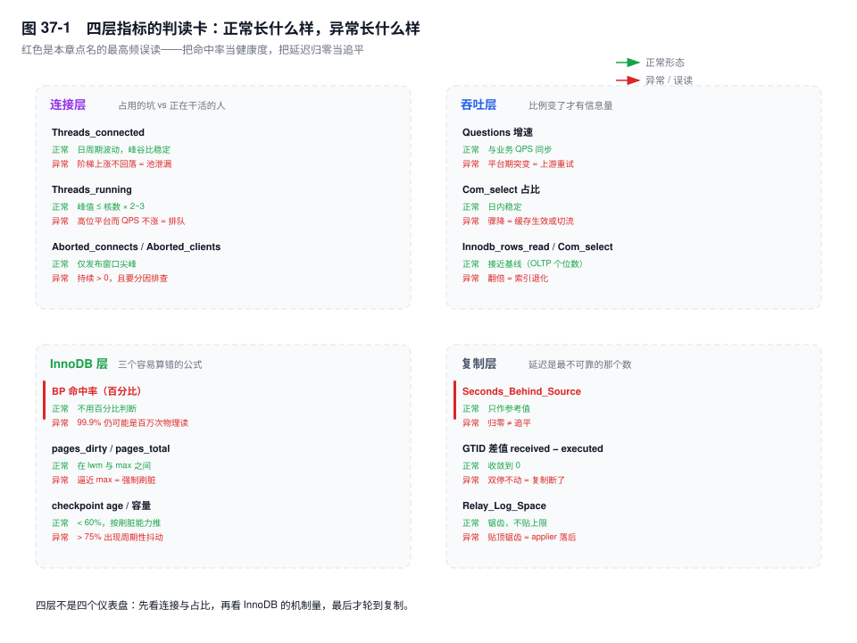
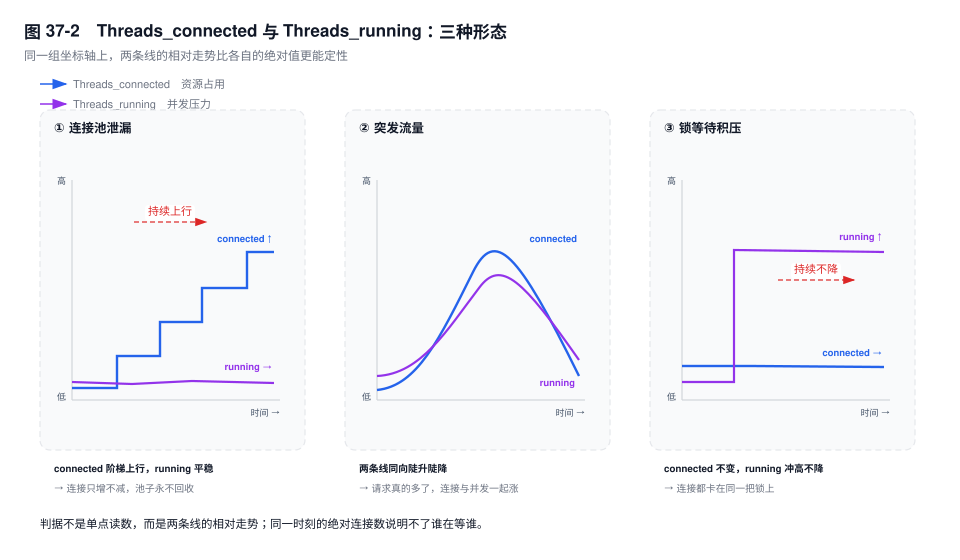

# 第 37 章　监控指标体系

> **一句话结论**：指标的价值不在"采到了"，而在异常时能指向唯一机制；回答不了"它涨了说明什么、它会被误读成什么"的指标，不该进告警面板。

## 37.0 场景：监控全绿的那 40 分钟

20:05，账单批量入账开始。P99 从 6ms 涨到 420ms，入账 QPS 掉三成，没有一条错误。

大盘干净：CPU 35%，`Threads_connected` 120 / `max_connections` 1000，BP 命中率 99.97%，复制延迟 0，慢查询 0 条。值班的人翻完面板只能得出"数据库没问题"，方向被推回应用。

40 分钟后有人手工查了一个不在面板上的数：`Innodb_buffer_pool_pages_dirty / Innodb_buffer_pool_pages_total` = 91%。

机制不复杂：脏页顶到 `innodb_max_dirty_pages_pct`，page cleaner 进入强制刷脏，用户线程被拉去同步刷一个 16KB 的页。一条 `UPDATE` 从 3ms 变成 400ms，其中 390ms 在等一次随机写，CPU 上不去——线程在睡，不在算。

**监控的盲区不是没采，是采了没告警。**

## 37.1 先看比值，再看差值，最后才看绝对值

**累计计数器**（`Questions`、`Com_*`、`Innodb_rows_read`、`Innodb_row_lock_waits`）从启动起单调累加，单点读数只说明实例活了多久，必须两次采样求差除以间隔。**瞬时量**（`Threads_connected`、`Threads_running`、`Innodb_buffer_pool_pages_dirty`）可以直接读，但单帧没有判读价值，要看四五个连续采样点的形状。

差值有个边界：**重启会让计数器归零，rate 变负**。把这一窗当 0 会同时污染"跌零"告警和小时均值；正确做法是整窗丢弃，用 `Uptime` 校验。

**间隔要小于目标故障持续时间的一半。** 15 秒能看见 30 秒的刷脏尖峰；云监控默认 60 秒，20 秒的 checkpoint 抖动被平均掉，面板上什么都不会发生。

**优先看比值。** 连接使用率、读写占比、`Innodb_rows_read / Com_select`、脏页占比、checkpoint age 占容量——分母带着业务量一起动，把"今天流量涨了"约掉。

次序按排除成本排：连接层排除打满与泄漏；吞吐比例区分"流量变了"还是"结构变了"；InnoDB 层读机制；复制层只在读流量打到从库（replica）时才算故障。图 37-1 每张卡片给的是"正常长什么样、异常长什么样"。



## 37.2 连接层：把"占着坑"和"在干活"分开

`Threads_connected` 是已建连接，度量**资源占用**；`Threads_running` 是没在 Sleep 的线程，度量**并发压力**。一起看，分出三种形态：

| 形态 | `Threads_connected` | `Threads_running` | 伴随信号 |
|---|---|---|---|
| 连接池泄漏 | 阶梯上涨、不回落 | 平稳 | Sleep 占比升高，QPS 不变 |
| 突发流量 | 陡升陡降 | 同步涨落 | QPS 同步抬升 |
| 锁等待积压 | 不变 | 冲高不降 | QPS 不涨，错误率微升 |

泄漏之所以缓慢单调上涨，机制在池子：应用拿了连接不还，池子只能新建，每条新连接都是永不释放的线程。突发流量两条线同向；锁等待只有 `running` 涨，因为连接都卡在同一把锁上。

**连接本身有内存成本。** 线程栈、net buffer，加会话级 buffer（`sort_buffer_size`、`read_buffer_size`、`join_buffer_size`），后三者按需分配、分配后不还给 OS。单连接常态几百 KB，跑大排序的会话能到几 MB。调大 `max_connections` 把最坏情况的内存需求一起调大了。

`max_connections` 的推导不是留 20%：

```text
≥ Σ(应用实例数 × 单实例池上限) + 运维与备份通道 + 后台任务 + 切换余量
```

最容易漏的是切换余量：双机房互备时一台故障，连接全涌向另一台，总数翻倍。按"今天峰值的 1.2 倍"配，切换那一刻必然收到 1040。**基准是切换后的连接总数。**

告警线也不该按比例：`max_connections = 5000` 时 80% 还剩 1000 个空位，`= 500` 时只剩 100 个。按**剩余绝对连接数**加**上涨斜率**告警。

两个中断计数器必须分开告警：

- `Aborted_connects`：握手阶段失败。密码错、权限表未加载、`max_connections` 满、LB 空闲超时短于 `connect_timeout`。配合 `Connection_errors_max_connections`，后者非零就排除认证问题。
- `Aborted_clients`：连接建立后异常断开。客户端没 close 就退出、`wait_timeout` 到期、结果集没读完。发布重启会让它尖峰，先对齐发布窗口。

`Max_used_connections` 是**自启动以来**的高水位，重启归零；它记的是历史峰值，不是未来需求。

库内看不见的是**连接池排队**：请求卡在应用侧，MySQL 一个字节没收到（第 36 章）。应用侧的 pending 数与等待时长必须采。



## 37.3 吞吐层：比例变了比总量变了更有信息量

`Questions` 的增速就是客户端语句数/秒。用 `Questions` 不用 `Queries`，后者把存储过程内部的语句也数进去，接口 QPS 会被放大几倍。

四个 `Com_*` 的**占比**比绝对值稳。占比突变先分清两件事：`Questions` 同降是流量走了；`Questions` 不变而占比变，是请求结构变了。

`Com_select` 占比下降有三种原因：缓存层命中率提高（读没到库）、只读流量切到从库、业务改成批量接口。

`Com_update` 突增通常是批量任务或热点行重试。它数的是**语句数不是行数**：一条改 100 万行的 `UPDATE` 只 +1。判"是不是批量"要交叉看 `Innodb_rows_updated` 增速。upsert 会让写类计数与新增行数对不上，别拿 `Com_insert` 当订单量。

**`Innodb_rows_read / Com_select` 是最值得进面板的比值**：平均每条查询扫了多少行。QPS 稳定、比值从 8 涨到 60，说明同样的请求扫了七倍的行，通常是索引退化、统计信息失真或数据分布变了，而 QPS 曲线一片平静。绝对值没有统一标准（join 会累加多表行数），基线和趋势有；告警用同一天同时段的基线翻倍。

## 37.4 InnoDB 层：三个容易算错的公式

### 命中率：按物理读次数告警，不按百分比

`1 - Innodb_buffer_pool_reads / Innodb_buffer_pool_read_requests`。

99.9% 看着很好，但 `read_requests` 是十亿级时，0.1% 就是一百万次物理读。**百分比的分母是业务自己撑大的。** 反方向也错：新实例池子是空的，第一次访问全是物理读，判据是"若干分钟内是否单调回升"，不是"是否立刻高于 99%"。

把 `Innodb_buffer_pool_reads` 的**速率**放进面板，阈值取稳态基线的 3 倍；更严格的是"物理读速率 × 平均读延迟 ≤ 设备可用 IOPS 的固定比例"。基线必须按实例配。

### 脏页：区间指标，两头都要看

`Innodb_buffer_pool_pages_dirty / Innodb_buffer_pool_pages_total`。

上限这一头：page cleaner 按 `innodb_max_dirty_pages_pct`（8.0 默认 90）判定，接近它时强制刷脏，用户线程被征用同步刷页。表现是写入 RT 阶跃、CPU 不高，正是 37.0 那 40 分钟。`Innodb_buffer_pool_wait_free` 一旦非 0，说明已经在等干净页。

下限这一头：低于 `innodb_max_dirty_pages_pct_lwm`（默认 10）说明刷得过勤，checkpoint 失去批量收益，IO 被白白消耗。

阈值：`告警线 = innodb_max_dirty_pages_pct − (脏页产生速率 × 采集间隔 × 2) / pages_total`，即留出两个采集周期。它随池大小和写入强度自己走，不用拍 80%。

### checkpoint age：别拿 `lsn − flushed` 当它

正确的是 `Log sequence number − Last checkpoint at`，除以容量（8.0.30+ 是 `innodb_redo_log_capacity`，之前是 `innodb_log_file_size × innodb_log_files_in_group`）。

常见错误是 `Log sequence number − Log flushed up to`。这一段是**还没 fsync 的 redo**，通常几十 KB 到几 MB，除以容量永远在 1% 以下，面板永远健康。它测的是日志落盘延迟，不是刷脏欠账。

checkpoint age 逼近容量时，InnoDB 必须等 page cleaner 刷掉最老的脏页，写入出现周期性尖峰（第 4、7 章）。四个水位从 `SHOW ENGINE INNODB STATUS` 的 LOG 段读；8.0.30+ 另有 `Innodb_redo_log_current_lsn` / `Innodb_redo_log_checkpoint_lsn`，以 `SHOW GLOBAL STATUS` 实际输出为准。

### history list length：看趋势，不看绝对值

它数的是 undo 记录条数，不是事务数（第 5 章）。业务量差十倍，健康值也差十倍，固定阈值必然误报。

判据是**连续多个窗口差值不为负，且累计涨幅超出一个批量任务能解释的量**。一次批量 `DELETE` 会让它台阶式跳高再线性回落，正常；回落斜率为 0 才是水位被钉住，根因是最老的 ReadView（第 21 章）。

### 行锁：看窗口内的平均，不看累计平均

`Innodb_row_lock_waits` 增速配平均等待，四象限很清楚：次数高、均值低是热点行争抢；次数低、均值极高是有人长持锁；同涨是雪崩前兆。

陷阱在 `Innodb_row_lock_time_avg` 是**自启动以来**的累计均值。跑了三个月的实例，今天多等 2 秒，它几乎不动。要自己算：`ΔInnodb_row_lock_time / ΔInnodb_row_lock_waits`。

## 37.5 复制层：延迟是最不可靠的那个数

`Seconds_Behind_Source` [8.0.22+，原名 `Seconds_Behind_Master`] 的四个失真场景在第 25 章。它是新鲜度指标，不是性能指标。补三个更早、更硬的。

**GTID 差值**：`GTID_SUBTRACT(received, executed)` 给事务个数，回答"还差多少"，不回答"还差多久"。误读在于"差值不涨就是追平"——IO 线程断了，`received` 也不涨，差值恒定。必须同时看 `Replica_IO_Running` [8.0.22+，原 `Slave_IO_Running`]，`Connecting` 持续也算异常。

**`Relay_Log_Space`** 持续增长，说明 SQL 线程回放主库（source）跟不上 IO 线程，applier 是瓶颈。它比延迟更早：延迟要等"最后一个已应用事件变旧"才动，relay log 从第一秒就开始积。归零有两种解释：追上后被 purge，或复制被重启清空——先看 `Replica_SQL_Running` 与 GTID 差值，别急着庆祝。它的绝对值被 `max_relay_log_size` 截顶，**贴着上限走锯齿**才是满负荷，所以看增速，不看单点。

**`Replica_open_temp_tables`** 不为 0 且单调增长，说明 SQL 线程有临时表泄漏，常见于 STATEMENT 格式下的复杂查询——`UNION`、子查询、`GROUP BY` 各开一张，用完不释放。短暂非 0 正常，持续增长才告警。

## 37.6 慢查询与缓存层：趋势和比值

慢查询看**每小时条数**与**每小时总耗时**。一条 3 秒的语句一天一次，和每小时 3000 条 200ms，后者伤害大得多。告警按"慢查询总耗时 / DB 总执行耗时"或小时条数基线。改 `long_query_time` 会让 `Slow_queries` 阶跃，基线必须带参数版本，否则一次调参就是一次假故障。

`Table_open_cache` 看 `Table_open_cache_misses` 占 `Opened_tables` 的比例。`FLUSH TABLES`、备份、`information_schema` 查询都会推高它；分区表把每个分区算一张表，几百个分区表就能撑爆，调大只是延后。

临时表看 `Created_tmp_disk_tables / Created_tmp_tables`。`Created_tmp_tables` 高本身不可怕——内存临时表便宜，落盘才贵。比值升高说明参数不够，或结果集里有 BLOB/TEXT：MEMORY 引擎不支持这两类，直接落盘，调大参数没用（第 14 章）。

## 37.7 采集方案：三条路径各自的代价

| 方式 | 采集粒度 | 对 DB 的压力 | 标签基数 | 适用场景 |
|---|---|---|---|---|
| Prometheus + `mysqld_exporter` | 15s 起，可调 | 每次一条 `SHOW GLOBAL STATUS` | instance 级，可控 | 通用自建，需要比值告警 |
| 云监控 | 常见 60s，不可调 | 托管侧统一采集 | 只到实例 | 无专职 DBA，接受粗粒度 |
| 自建 Agent 推送 | 秒级，可本地聚合 | 一次连接跑多条 | 自己控制 | 数千实例，需自定义聚合 |

exporter 侧算差值。代价在默认 collector 会执行 `SHOW REPLICA STATUS`，从库多、版本杂时开销可观（要读 relay log 索引算延迟）；`perf_schema` collector 更重，按需开。

云监控省掉运维，代价有三：看不到原始变量名；粒度固定，抓不住 20 秒的刷脏尖峰；告警只能对单指标设静态阈值——37.3 与 37.4 那几个比值和差分算不出来。

**高基数是自建方案最容易踩的坑。** `schema` 或 `sql_digest` 做成 label，时序数 = 实例 × schema × digest，digest 每天新增成百上千；Prometheus 内存随活跃 series 线性涨，百万级吃紧。明细留在 `events_statements_summary_by_digest` 快照表里。

`information_schema` 的查询不免费：8.0 的 `I_S` 是数据字典上的视图，`I_S.TABLES` 要打开表定义，某些列还会触发统计信息重算。秒级采集会和业务抢 buffer pool。

## 37.8 关键结论

1. **累计计数器只能求差，且要处理重启归零。** 负的 rate 是重启，不是跌零，整窗丢弃。
2. **`Threads_connected` 看资源，`Threads_running` 看压力。** 泄漏是前者单涨，突发是两者同涨，锁积压是后者单涨。
3. **`max_connections` 按"切换后的连接总数"配**，切换余量只在关键时刻生效。
4. **`Aborted_connects` 与 `Aborted_clients` 必须分告警。** 一个在握手前，一个在连接后，根因没有交集。
5. **命中率按物理读的绝对次数告警。** 99.9% 在十亿级请求下是百万次物理读；预热期的低命中率是正常的。
6. **复制层不能只看延迟。** `Relay_Log_Space` 的增速更早，GTID 差值回答"还差多少"，三个一起才能分清慢与断。

## 37.9 实验验证

### 实验一：算 rate，并把重启窗口丢掉

```sql
CREATE TEMPORARY TABLE s0 AS
SELECT VARIABLE_NAME, CAST(VARIABLE_VALUE AS UNSIGNED) AS v
FROM performance_schema.global_status
WHERE VARIABLE_NAME IN ('Uptime','Questions','Innodb_buffer_pool_reads',
      'Innodb_row_lock_time','Innodb_row_lock_waits');

DO SLEEP(60);

SELECT g.VARIABLE_NAME,
       ROUND((CAST(g.VARIABLE_VALUE AS UNSIGNED) - s0.v) / 60, 2) AS per_sec
FROM s0 JOIN performance_schema.global_status AS g
  ON g.VARIABLE_NAME = s0.VARIABLE_NAME
WHERE s0.VARIABLE_NAME <> 'Uptime';
```

输出形态（未实跑）：第二次 `Uptime` 小于 60 即整窗丢弃，负值同理。

### 实验二：本窗口的锁等待均值

```sql
CREATE TEMPORARY TABLE l0 AS
SELECT VARIABLE_NAME, CAST(VARIABLE_VALUE AS UNSIGNED) AS v
FROM performance_schema.global_status
WHERE VARIABLE_NAME IN ('Innodb_row_lock_time','Innodb_row_lock_waits');

DO SLEEP(60);

SELECT ROUND((t.d - w.d) / NULLIF(w.d, 0), 2) AS win_avg_ms, w.d AS waits
FROM (SELECT CAST(g.VARIABLE_VALUE AS UNSIGNED) - l.v AS d
      FROM performance_schema.global_status AS g JOIN l0 AS l
        ON l.VARIABLE_NAME = g.VARIABLE_NAME
      WHERE g.VARIABLE_NAME = 'Innodb_row_lock_time') AS t,
     (SELECT CAST(g.VARIABLE_VALUE AS UNSIGNED) - l.v AS d
      FROM performance_schema.global_status AS g JOIN l0 AS l
        ON l.VARIABLE_NAME = g.VARIABLE_NAME
      WHERE g.VARIABLE_NAME = 'Innodb_row_lock_waits') AS w;
```

预期形态（未实跑）：一次 10 秒的锁等待能让本窗口均值跳到几千毫秒，而 `Innodb_row_lock_time_avg` 可能 1 毫秒都没动。

### 实验三：把脏页顶到 90%

```bash
sysbench oltp_write_only --tables=8 --table-size=2000000 --threads=64 --time=600 run
```

同步每 10 秒采 `pages_dirty / pages_total` 与 `Innodb_buffer_pool_wait_free` 增速，在另一个会话里循环跑一条只改一行的 `UPDATE` 并计时。预期形态（未实跑）：比例爬到 `innodb_max_dirty_pages_pct` 附近后，单行 `UPDATE` 出现阶跃（毫秒级跳到几百毫秒），CPU 不涨，`wait_free` 从 0 增长；停掉压测后恢复。

## 37.10 常见误区

⚠️ **"命中率 99.9%，说明 Buffer Pool 够大"**
分母被业务撑大了。十亿次请求里的 0.1% 是一百万次物理读。看 `Innodb_buffer_pool_reads` 速率与稳态基线。

⚠️ **"复制延迟归零就是追平了"**
IO 线程断开时 `received` 与 `executed` 一起停住，延迟读数同样是 0。判据是 GTID 差值与 `Replica_IO_Running`。

⚠️ **"`Aborted_clients` 在涨，有人在攻击"**
握手前的失败才计入 `Aborted_connects`。`Aborted_clients` 是连接建立之后的断开，多数来自 `wait_timeout` 到期和应用进程被杀。

⚠️ **"`Threads_connected` 没到 `max_connections`，连接就没问题"**
池等待在应用侧，MySQL 一条连接都看不到。库内正常而接口超时，多半是池子耗尽。

⚠️ **"脏页比例越低越好"**
低于 lwm 说明刷得过勤，checkpoint 拿不到批量收益。

## 37.11 生产 Checklist

- [ ] 累计计数器配成 rate，实现里处理重启负值
- [ ] 采集间隔 < 故障时长 / 2，并写进文档
- [ ] `Threads_connected` 与 `Threads_running` 同图，泄漏形态有独立告警
- [ ] `max_connections` 推导包含切换后连接总数
- [ ] `Aborted_connects`、`Aborted_clients`、`Connection_errors_max_connections` 三条独立告警
- [ ] 应用侧有池 pending 数与等待时长，与库内指标同屏
- [ ] `Innodb_rows_read / Com_select` 有基线告警，基线按同时段取
- [ ] 脏页比例设上下两条线，上线由 `innodb_max_dirty_pages_pct`、产生速率、间隔推出
- [ ] checkpoint age 用 `Last checkpoint at` 算，不用 `Log flushed up to`
- [ ] 复制层同时采 GTID 差值、`Relay_Log_Space` 增速、`Replica_open_temp_tables`
- [ ] 每季度把某个指标推到异常，确认告警真的会响

## 37.12 延伸

- **下一章**：第 38 章用慢查询与 `performance_schema` 定位具体 SQL。
- **关联章节**：第 4 章（LSN 与 checkpoint）、第 5 章（purge 水位）、第 7 章（恢复时长）、第 21 章（长事务）、第 25 章（延迟失真）、第 36 章（怎么排）。
- **面试追问**："BP 命中率 99.9% 还有问题吗？"先问请求总量，十亿级下 0.1% 是百万次物理读。"从库延迟 0 能切吗？"先看 GTID 差值与 `Replica_IO_Running`，延迟 0 可能是线程停了。
- **官方文档**：`Server Status Variables`、`Performance Schema Status Variables`、`replication_applier_status_by_worker`、`mysqld_exporter` 的 collector 说明。
