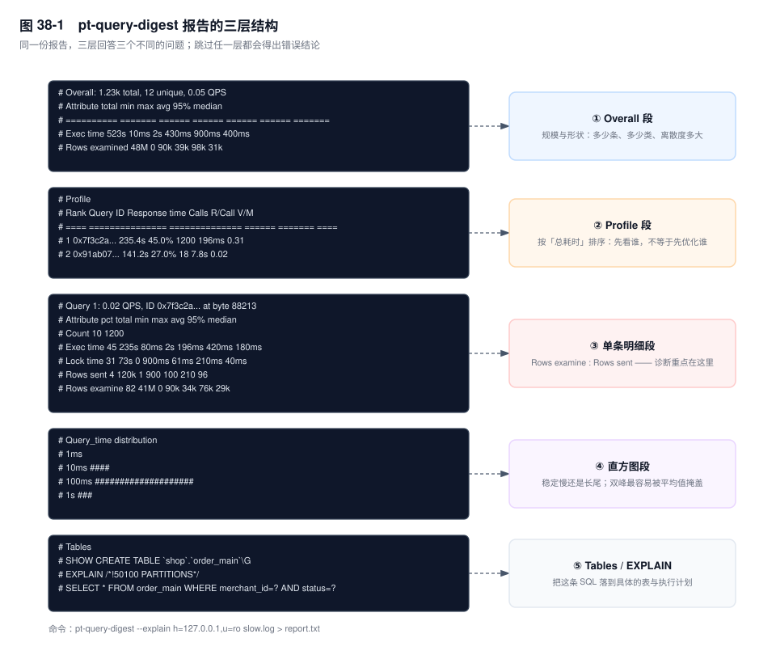
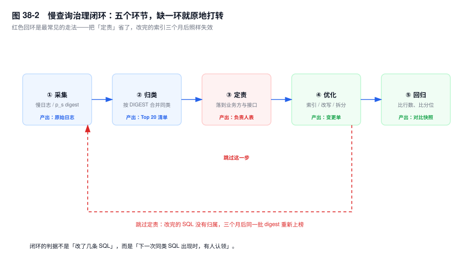
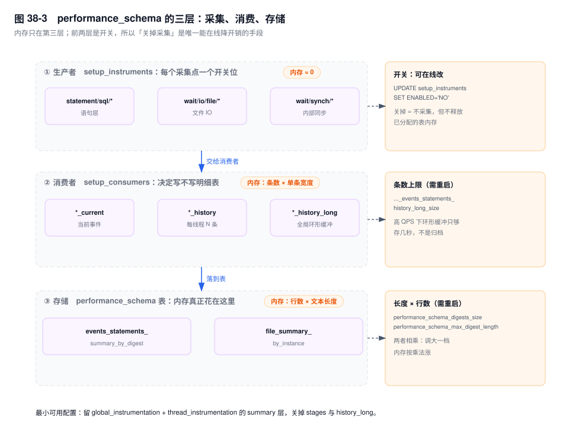

# 第 38 章　慢查询与 performance_schema 实战

> **一句话结论**：慢日志按单条语句判定，`performance_schema` 按累计时间记账；前者回答"哪条 SQL 越线了"，后者回答"时间被谁花掉了"，这两个问题不能互换。

## 38.0 场景：慢日志里一条慢查询都没有

下单接口 P99 从 120ms 涨到 900ms，持续一个下午。`long_query_time` 是 1，那天的慢日志里，属于这个库的记录是 0 条。

值班的人先怀疑开关（`slow_query_log` 是 ON，文件在长，只是里面全是别的库），再怀疑阈值被人改过（全局值确实是 1）。最后把接口链路打出来：一次下单 12 条 SQL——查商户配置、查商品、扣库存、写订单、写明细、更新账单、查优惠券……每条 70~90ms，没有一条到 1 秒。

慢日志的判据是 `Query_time > long_query_time`，**一条语句一个判据**。12 条各 80ms 的语句，在日志里是 12 个"不慢"；在用户那里是一次 900ms 的等待。日志没说谎，它回答的是另一个问题。

第二种形态是每条 0.8 秒、每秒 50 条：单条永不越线，每秒却占用 40 秒的数据库时间，等于 40 个连接被它按住。这两种形态都只有 `performance_schema` 的累计值看得见。

## 38.1 慢日志：三个决定，每个都有代价

### 决定一：`long_query_time` 设 0 还是 1

设 0 记录所有执行完的语句。写入量正比于 QPS，单条记录从几十字节到几百字节（SQL 越长越大），几千 QPS 的实例上这是一天几十 GB 的量级。代价不在"写"这一下：`log_output=FILE` 是追加写，本身不慢；贵在磁盘带宽被吃掉一块、轮转压缩上传的链路被撑爆、`pt-query-digest` 解析几千万行要跑很久。

设 1 就漏掉 38.0 的两种形态。

判据是分期的：**排查期设 0 并限时**，开之前记下原值，`SET GLOBAL long_query_time=0` 打开，30 分钟后改回去。**常态设一个与 SLO 挂钩的值**：单条语句如果已经吃掉接口预算的十分之一，它就值得被记录——P99 目标 200ms 的接口，20ms 是个合理起点。这个值全局唯一、不分接口，所以它真实的含义是"这条语句单独就够得上一次告警"。

有个坑必须先说：`long_query_time` 是 global + session 两级变量，`SET GLOBAL` 只影响之后建立的连接。连接池里那些活着的会话仍用旧值——这是"我明明改了、日志里还是没有"的第一大原因。

### 决定二：`log_queries_not_using_indexes` 是噪音源

它记的不是"慢"，是"没走索引"。判据在执行时：这条语句有没有用索引定位。于是两类不该进日志的语句会进来——几十行的小表，优化器主动选全表扫（走索引再回表更贵）；大表上优化器判断"回表成本高于全扫"的查询。它们和真问题混在同一份文件里。

治理手段是配 `log_throttle_queries_not_using_indexes` `[5.6.5+]`：每秒最多写 N 条此类语句，默认 0 表示不限。设 5，意味着每分钟最多 300 条，其余丢弃。日志从"被淹没"变成"能看"，代价是限流窗口外的那一条真问题也可能被丢掉——所以它适合做常态配置，排查期应当关掉限流。要么配限流，要么别开，只开不限流等于自造噪音。

### 决定三：`log_slow_admin_statements` 与 `log_slow_replica_statements`

`ALTER TABLE`、`ANALYZE`、`CHECK`、`OPTIMIZE`、`REPAIR`、`CREATE INDEX`、`DROP INDEX` 默认不进慢日志（`log_slow_admin_statements=OFF`）。一次 40 分钟的 `ALTER` 在日志里是空的。要不要记，取决于你是否在业务低峰跑 DDL——低峰期它不占用用户时间，记下来只是历史。

`log_slow_replica_statements` `[8.0.26+]`（原 `log_slow_slave_statements`）默认也是 OFF，从库（replica）上 applier 线程回放的语句**默认不记录**。这一条最容易忽略，后果也最贵：排查"读从库慢"时，从库慢日志是空的，于是得出"从库没问题，是读流量太大"，然后把读流量切回主库（source），把主库压垮。

机制在 THD 的身份上：applier 是 system thread，语句级的慢日志记录点会跳过 system thread，这个开关就是为它开的。开了之后还有一处细节——日志里的 `User@Host` 不是业务账号，而是复制线程的身份。**从库慢日志只能告诉你"哪条 SQL 慢"，定不了责**，要落到业务方，得拿这条语句回主库的 binlog 或慢日志里对，见第 25 章。

### 补充两个不常改的开关

`min_examined_row_limit=N` 让"扫描行数少于 N"的语句不入日志，它与 `long_query_time` 是正交的两个过滤器：一个按时间，一个按扫描量。把它设大（十万级），日志里只剩大扫描，专门用来抓"扫了很多行"的语句。反方向没有对应的参数——没有"最大扫描行数"，想抓"扫得多但很快"的语句只能去 `performance_schema` 按 `SUM_ROWS_EXAMINED` 排序。

`log_output` 取 `FILE`（默认）、`TABLE`、`NONE`。`TABLE` 写进 `mysql.slow_log`，CSV 引擎、无索引，任何过滤都是全扫；它的价值只在排查期——可以直接用 `WHERE query_time > 0.5 AND sql_text LIKE '%order_main%'` 在库里筛，不必把文件拖回本地。量大之后，这张被反复全扫的无索引表自己就成了负担。

## 38.2 `pt-query-digest`：一份报告读三层

下面是一份报告的结构（数字是示意量级，未实跑，字段含义以此为准）：

```text
# Overall: 1.23k total, 12 unique, 0.05 QPS
# Attribute        total    min    max    avg    95%  median
# ==========     ======= ====== ====== ====== ====== =======
# Exec time         523s   10ms     2s  430ms   900ms   400ms
# Rows examined      48M      0    90k    39k    98k     31k

# Profile
# Rank Query ID        Response time  Calls  R/Call  V/M
# ==== =============== ============== ====== ======= ====
#    1 0x7f3c2a...       235.4s 45.0%   1200   196ms  0.31
#    2 0x91ab07...       141.2s 27.0%     18   7.8s   0.02

# Query 1: 0.02 QPS, ID 0x7f3c2a... at byte 88213
# Attribute     pct   total     min     max     avg     95%  median
# Count          10    1200
# Exec time      45    235s    80ms      2s   196ms   420ms   180ms
# Lock time      31     73s       0   900ms    61ms   210ms    40ms
# Rows sent       4    120k       1     900     100     210      96
# Rows examine   82     41M       0     90k     34k     76k     29k

# Query_time distribution
#   1ms
#  10ms  ####
# 100ms  ####################
#    1s  ###
```



### 第一层 Overall：先看规模与离散度

`1.23k total` 是被分析的语句条数，`12 unique` 是唯一 digest 数。注意 `0.05 QPS` 是**从日志时间跨度反算的**，不是实例 QPS：日志有轮转、有限流、有空洞时，这个数会被显著低估，别拿它当容量依据。

属性表的六列里，`total` 是这一类语句的累计耗时。**`95%` 与 `max` 的差距是这一层唯一值得盯的读数**：

- 差距大（95% 是 420ms，max 是 2s），说明存在离群值。两种来源——参数不同（某个头部商户的订单表是别人的一百倍）或锁等待。这类语句的优化起点不是加索引，是先把长尾那几条的**实际参数**捞出来。
- 差距小（95% 与 max 都在同一量级），说明它**稳定地慢**。稳定慢基本等于执行计划有问题，加索引或改写有效。

一条可用的判据：`max / 95% > 3` 就先查离群，别急着改 SQL。

### 第二层 Profile：排序依据是总耗时，不是单次耗时

`Rank` 按 `Response time` 的总耗时降序排。所以一条每次 5ms、每秒一万次的 SQL 排第一——这是对的：它每秒占用 50 秒的数据库时间，在 8 核机器上等于 6 个核满载。**总耗时 = 单次耗时 × 调用次数，这一列才是资源账。**

`R/Call` 是平均单次耗时，`V/M` 是方差均值比，越大越不稳定。

但 Profile 只决定"先看谁"，**不等于"先优化谁"**。排第一的高频简单查询，把 5ms 压到 1ms 已经是极限；排第三的那条 8 秒报表，优化空间是 7 秒。榜单是入口，不是结论。

### 第三层 单条明细：`Rows examine` 与 `Rows sent` 的比值才是诊断重点

两个字段来自慢日志的 `Rows_examined` 与 `Rows_sent`，报告里截短了名字。

- 比值 1000:1：扫 1000 行只返回 1 行。三种可能——索引选择性差（区分度低的列建了索引）、没走覆盖索引（回表后才发现条件不满足）、条件下推不了（函数包裹、隐式转换）。
- 比值接近 1:1：索引很准，**慢在别处**。看 `Lock time` 占比，占比高说明时间不是自己花的，是等锁，优化 SQL 无用，要去查阻塞者（第 18 章）；若 `Lock time` 也低，看 `Rows sent` 与 `Bytes sent`，是不是结果集太大、传输本身就慢。

`Query_time distribution` 是直方图，读法只有两种：所有 `#` 集中在同一档（比如全在 `100ms`），是稳定慢；`10ms` 一档有一大块、`1s` 一档还有几根，是**双峰**——说明存在两类执行计划或两类参数，平均值和中位数都会把它抹平，这类最该去抓那几根长尾的实际参数。

`Tables` 段给的是可以照着跑的命令（`SHOW CREATE TABLE`），加了 `--explain` 会把 `EXPLAIN` 一起带出来。注意它 EXPLAIN 的是归一化后的样本 SQL，字面量已被替换成占位符，真实参数下的计划可能不同——它只能证明"这条语句长什么样"，不能替代用真实参数跑一次 `EXPLAIN`（读法见第 11 章）。

### 从报告里挑出该优化的三条

三个判据按顺序过，命中即停：

| 先看 | 命中条件 | 结论 |
|---|---|---|
| `Lock time` 占比 | > 30% | 不是 SQL 的问题，转锁与事务排查（第 18 章） |
| `Rows examine / Rows sent` | > 100 且总耗时占比 > 5% | 索引或改写问题（第 9 章、第 15 章） |
| `unique` 数 vs Top10 占比 | unique 很大、Top10 只占三成 | 长尾型，问题在动态拼 SQL，不在单条（第 15 章） |

第三行最容易被跳过：十几个 digest 各占不到 15% 时，逐条优化没有尽头——该改的是 ORM 生成 SQL 的方式，或者给高频查询加缓存。

## 38.3 治理闭环：五步，每步都有产出物



**采集。** 三条来源互补：慢日志（带 `User@Host`，能定责，但有阈值盲区）、`performance_schema` 的 digest 表（全量，没有 user/host 维度）、云平台的调用链（有接口名，粒度粗）。产出物是一份带时间窗的原始日志，加一份 digest 表的快照落库——p_s 的表在重启后清空，不落库就等于没采。

**归类。** 按 `DIGEST` 合并，不逐条看。字面量被替换成 `?` 之后文本相同的，算同一类。产出物是 Top 20 digest 清单，每行带 `COUNT_STAR`、`SUM_TIMER_WAIT`、`SUM_ROWS_EXAMINED/SUM_ROWS_SENT`。

**定责。** 这是唯一一步工具替不了的。`events_statements_summary_by_digest` 只有 `SCHEMA_NAME`，没有用户和主机——聚合维度和归属维度天生是分开的。三个通道：`SCHEMA_NAME` 加 `DIGEST_TEXT` 里的表名；慢日志原文的 `User@Host`；或 `events_statements_history_long` 按 `THREAD_ID` 关联 `performance_schema.threads` 的 `PROCESSLIST_USER`、`PROCESSLIST_HOST`。

在 SQL 注释里打标（`/* app=order,api=createOrder */`）能不能用，取决于注释是否参与 digest 归一化。这一点各版本行为不一致，别猜，上线前自己验一次：

```sql
SELECT 1 /* app=probe */;
SELECT 2 /* app=probe */;
SELECT DIGEST, DIGEST_TEXT, COUNT_STAR
FROM performance_schema.events_statements_summary_by_digest
WHERE DIGEST_TEXT LIKE '%probe%';
```

查得到带 `probe` 的行，说明注释保留在 `DIGEST_TEXT` 里，打标可用；查不到，说明注释在归一化时被剥掉，打标对 digest 无效，只能改用 `SCHEMA_NAME` 和表名定责。

**优化。** 索引、改写、拆分，方法论在第 9 章和第 15 章。产出物是变更单，必须带**预期收益**——预期 `Rows_examined` 从多少降到多少，没有这个数就没法做下一步。

**回归验证。** 看三个数，不看感觉：`SUM_ROWS_EXAMINED` 的每次调用均值降了没有、`95%` 分位降了没有、`COUNT_STAR` 变了没有（次数不变才说明业务量没变、前后可比）。

**跳过定责这一个动作，整个闭环会在三个月后回到原点。** 因为 digest 只告诉你哪条 SQL 慢，不告诉你谁能改。改动落在 DBA 手里时，能做的只有加索引；加不了索引的那些（分页深翻、动态拼接、一次查太多列）就永远留在榜上，慢慢长回原来的形状。图 38-2 那条红色回环就是这个意思。

## 38.4 `performance_schema` 核心表：每张表回答一个问题

### `events_statements_summary_by_digest`：全量账本

关键列：`COUNT_STAR`（执行次数）、`SUM_TIMER_WAIT`（累计耗时，单位皮秒）、`SUM_ROWS_EXAMINED`、`SUM_ROWS_SENT`、`SUM_NO_INDEX_USED`、`SUM_CREATED_TMP_DISK_TABLES`、`DIGEST_TEXT`、`FIRST_SEEN`/`LAST_SEEN`。

**坑一：`SUM_TIMER_WAIT` 是累计值**，从实例启动或表被 `TRUNCATE` 起算。三天前跑过一次的坏 SQL 会永久占据榜首，而它今天一次都没跑。必须配 `COUNT_STAR` 的增速看，或者定期清账——`TRUNCATE TABLE performance_schema.events_statements_summary_by_digest` 是允许的，只清这一张汇总表。

**坑二：`DIGEST_TEXT` 受 `performance_schema_max_digest_length` 限制**（默认 1024，精确值以实际版本为准）。超长的 SQL 被截断，截断后前缀相同的两条不同语句可能落进同一个 digest。超长 `IN` 列表、大 `VALUES` 批量插入最容易撞上。

**坑三：表有行数上限**，由 `performance_schema_digests_size` 控制（默认 10000 行，以实际版本为准）。满了之后新 digest 归到 `DIGEST` 为 `NULL` 的那一行——看到一行 `DIGEST_TEXT IS NULL` 却占用大量时间，就是溢出信号，说明这类语句的种类已经超出表的容量。

两条查询，结论经常相反：

```sql
-- 单条最疼：平均耗时 Top 20
SELECT SCHEMA_NAME, DIGEST_TEXT, COUNT_STAR,
       ROUND(AVG_TIMER_WAIT / 1e9, 2) AS avg_ms,
       ROUND(SUM_ROWS_EXAMINED / NULLIF(SUM_ROWS_SENT, 0), 1) AS exam_per_sent
FROM performance_schema.events_statements_summary_by_digest
WHERE DIGEST_TEXT IS NOT NULL AND COUNT_STAR >= 100
ORDER BY AVG_TIMER_WAIT DESC
LIMIT 20;
```

```sql
-- 最占资源：总耗时 Top 20
SELECT DIGEST_TEXT, COUNT_STAR,
       ROUND(SUM_TIMER_WAIT / 1e12, 1) AS total_s,
       ROUND(SUM_TIMER_WAIT / 1e9 / COUNT_STAR, 2) AS avg_ms,
       SUM_ROWS_EXAMINED, SUM_ROWS_SENT,
       SUM_NO_INDEX_USED, SUM_CREATED_TMP_DISK_TABLES
FROM performance_schema.events_statements_summary_by_digest
WHERE DIGEST_TEXT IS NOT NULL
ORDER BY SUM_TIMER_WAIT DESC
LIMIT 20;
```

第一张榜的第一名通常是报表或批量；第二张榜的第一名常常是一条 3ms 的高频简单查询。前者影响个别用户，后者影响整体容量——处置优先级不同，见 38.5。

### `events_waits_summary_global_by_event_name`：时间花在等什么

它按等待事件聚合 `COUNT_STAR`、`SUM_TIMER_WAIT`、`AVG_TIMER_WAIT`、`MAX_TIMER_WAIT`。`wait/io/file/innodb/innodb_data_file` 高是数据文件 IO；`wait/io/file/innodb/innodb_log_file` 高是 redo 写入；`wait/synch/mutex/innodb/*` 高是内部争用（第 39 章逐个讲）。

两个坑：一是层级不能相加，`wait/io/table/sql/handler` 是 Server 层的表 IO 抽象，与文件层的 `wait/io/file/*` 是包含关系不是并列关系；二是 idle 事件默认不采集，`COUNT_STAR` 为 `NULL`，所以不能对整表做 `SUM/COUNT` 算平均。

它只给全局占比，不按 SQL 拆。要按 SQL 拆，用 `events_waits_history` 的 `NESTING_EVENT_ID` 去关联 `events_statements_history` 的 `EVENT_ID`（同一 `THREAD_ID` 下），这个 join 很贵，只在复现单条语句时做。

### `file_summary_by_instance`：定位到文件

按文件聚合 `COUNT_READ`/`SUM_NUMBER_OF_BYTES_READ`、`COUNT_WRITE`/`SUM_NUMBER_OF_BYTES_WRITE`。全库 IO 高时，这一张表能一眼指出是哪个 `.ibd`——这是"从库级指标落到表"最快的手段：分区表的每个分区是独立文件，比按表聚合更细。

`FILE_NAME` 是相对 datadir 的路径，`ibtmp1`、`undo_001`、`#innodb_temp` 也会出现在里面，别把它们当成业务表。它统计的是真正落到文件层的 `pread`/`pwrite`，Buffer Pool 命中不会出现在这里。

### `table_io_waits_summary_by_table` / `table_lock_waits_summary_by_table`

前者按表聚合 IO 次数与耗时（`COUNT_READ`、`SUM_TIMER_READ`、`COUNT_WRITE`、`SUM_TIMER_WRITE`），能直接看出某张表是读多还是写多。后者按表聚合锁等待（`COUNT_READ_NORMAL`、`SUM_TIMER_WRITE_NORMAL` 等），累计的是**等待时间**，不是持锁时间——这两个数经常被读反。

它们的局限一样：按表聚合，分区表的各分区合在一起，看不出哪个分区热，要落到分区只能用 `file_summary_by_instance`。

### `events_statements_history_long`：复现"刚刚那一次"

每行一条语句，带 `TIMER_WAIT`、`LOCK_TIME`、`ROWS_EXAMINED`、`ROWS_SENT`、`SQL_TEXT`、`THREAD_ID`。38.0 里那 12 条 80ms 的语句，慢日志看不见，这张表看得见：按 `TIMER_WAIT` 降序取前若干条，就是"最近一段时间最慢的语句明细"。

限制必须说清楚：它是**固定大小的环形缓冲**，条数由 `performance_schema_events_statements_history_long_size` 决定，取值 `-1` 时由服务自动定尺，实际条数用 `SELECT @@performance_schema_events_statements_history_long_size` 查。条数固定意味着覆盖的时间窗与 QPS 成反比——几千 QPS 下只能存几秒。它是"出事后 30 秒内去看"的工具，不是归档，别指望第二天再翻。

## 38.5 `sys` schema：六个视图够用

`sys` 是把 p_s 的原始表翻译成人话的一组视图，时间单位变成带单位的字符串，join 也预先写好。

| 视图 | 它解决什么问题 |
|---|---|
| `sys.statement_analysis` | digest 表的人读版，默认按 `total_latency` 降序 |
| `sys.innodb_lock_waits` | 把 `data_lock_waits`、`innodb_trx`、线程表关联成"谁阻塞了谁" |
| `sys.schema_table_statistics` | 一张表看清哪张表最忙：行操作、IO、延迟 |
| `sys.schema_unused_indexes` `[5.7+]` | 从未被用过的索引，删冗余索引入口 |
| `sys.io_global_by_file_by_bytes` | 哪个文件读写字节最多 |
| `sys.statements_with_full_table_scans` | 全表扫过的语句，按扫描行数排 |

**`total_latency` 与 `avg_latency` 排序结论相反时，怎么定优先级。** 一条低频复杂报表：`avg_latency` 高、`total_latency` 低；一条高频简单查询：反过来。前者影响的是个别用户的一次操作，后者影响的是整体的容量水位——它每秒占用多少数据库时间，直接决定这套库还能不能接更多流量。一般的处置顺序是先压总量（高频），再压单次（低频），因为总量的收益是线性的、可持续的，单次的收益只落在少数请求上。反过来做也常见：报表把 Buffer Pool 冲掉了，那它的隐性成本不在自己的 `total_latency` 里。

`sys.schema_unused_indexes` 有个必须知道的前提：统计从实例启动开始累计。**刚重启过的实例上，这个视图会把所有索引都报成"未使用"**，照着删就是事故。用它之前先确认 `Uptime` 覆盖了完整的业务周期。

## 38.6 生产者与消费者：p_s 的内存账



三层，从上到下：`setup_instruments` 是采集点开关，`setup_consumers` 决定采到的数据往哪一层写，表是最终存储。**内存只在第三层**，前两层是开关位。

`setup_instruments` 和 `setup_consumers` 都支持在线 `UPDATE`，这是**唯一能在线降开销的手段**：关掉不用的 instrument，或者关掉整条 consumer 链，采集立刻停止。但已经分配的表内存不会因此释放——它是启动时按参数预分配的。

真正占内存的是这些参数，且大多需要重启：

- `performance_schema_max_digest_length`（默认 1024）：每条 digest 文本的上限。
- `performance_schema_max_sql_text_length`（默认 1024）：`SQL_TEXT` 列的上限。
- `performance_schema_digests_size`（默认 10000）：digest 表的行数上限。
- `performance_schema_events_statements_history_long_size`：明细环形缓冲的条数。

内存是**乘法**关系：行数 × 单条宽度。把 digest 长度从 1024 提到 4096，所有带 `DIGEST_TEXT` 的表每一行占的字节按四倍算，行数不变而总内存按四倍算；再把 `digests_size` 从一万提到十万，是再乘一次。两个都调，就是两次乘法叠加——这就是"开了 p_s 之后 OOM"的常见配方。

看实际占用不用猜：`SHOW ENGINE PERFORMANCE_SCHEMA STATUS`，里面带 `memory/` 的行就是各缓冲区的实际字节数。

最小可用配置的思路：保留 `global_instrumentation` 和 `thread_instrumentation`（summary 表依赖它们），关掉 `events_stages_*` 全系、`events_transactions_history_long`、`events_waits_history_long`。语句层保留 summary 加 `events_statements_history`（每线程固定条数，很便宜）作为过渡，只在排查期临时打开 `history_long`。

## 38.7 `SHOW PROFILE` 已废弃，用什么替代

`SHOW PROFILE` `[5.7.1+]` 起被标记废弃，8.0 仍然能用，但会带 deprecated 警告。它的问题不只是"要废弃"：只对当前会话有效、历史条数受 `profiling_history_size` 限制（默认 15）、粒度停在 `Sending data`、`Creating sort index` 这种粗阶段上，看不出算子里发生了什么。

替代方案一：`performance_schema.events_stages_history`，同 `THREAD_ID` 取最近若干条 stage，每条带 `TIMER_WAIT`。前提是 `events_stages_current`/`events_stages_history` 这两个 consumer 是开的，而它们恰是最该关掉的那一层——只适合临时开。

替代方案二：`EXPLAIN ANALYZE` `[8.0.18+]`，8.0 最实用的新工具。它**真的执行**语句，在每个算子上打印实际行数与耗时：

```sql
-- 输出形态（未实跑，字段含义以此为准）
EXPLAIN ANALYZE
SELECT o.order_no, o.amount
FROM order_main o JOIN merchant m ON m.id = o.merchant_id
WHERE o.status = 3;
```

```text
-> Nested loop inner join  (cost=4820 rows=812) (actual time=0.09..41.2 rows=812 loops=1)
    -> Filter: (o.status = 3)  (cost=1210 rows=9800) (actual time=0.06..26.8 rows=9800 loops=1)
        -> Table scan on o  (cost=1210 rows=120000) (actual time=0.04..18.3 rows=120000 loops=1)
    -> Single-row index lookup on m using PRIMARY (id=o.merchant_id)
       (cost=0.35 rows=1) (actual time=0.0015..0.0015 rows=1 loops=9800)
```

读法三件事。`actual time=A..B` 是"首行..末行"的毫秒数，**单次循环**的，不是总耗时；`rows` 也是每循环的平均行数，总行数是 `rows × loops`；`cost` 与 `actual` 并列，估算与实际差一个量级就说明统计信息不准或条件无法下推。

这段输出说明：总耗时 41ms 里，18ms 花在扫 12 万行上，剩下 15ms 是 9800 次回表（每次约 1.5 微秒）。而 `rows` 估算 9800、实际也是 9800，说明统计信息是准的——**计划没错，是这条 SQL 本来就要扫 12 万行**，缺的是索引，不是统计信息。这比 `EXPLAIN` 的估算值硬得多。

代价也要说：它真跑语句，不能拿去跑大报表和写操作；8.0.18 时只支持 `SELECT`。

## 38.8 关键结论

1. **慢日志的判据是"单条语句 vs 阈值"，它对"链路总耗时"和"高频中等耗时"天然失明。** 这两类问题只能靠 `performance_schema` 的累计值和明细表看见。
2. **`SUM_TIMER_WAIT` 是累计值，不是当前值。** 不配 `COUNT_STAR` 的增量看，榜单前三名可能全是三天前跑过一次的语句。
3. **`pt-query-digest` 的 Rank 按总耗时排，所以高频简单 SQL 排第一是对的；但"先看谁"不等于"先优化谁"。** 真正的诊断信息在单条明细的 `Rows examine : Rows sent` 与 `Lock time` 占比里。
4. **`95%` 与 `max` 的差距决定优化方向。** 差距大是离群（参数或锁），差距小是稳定慢（计划），两者的处置完全不同。
5. **从库慢日志默认不记 applier 语句。** 不开 `log_slow_replica_statements` 就得出"主库没问题"，是把盲区当成结论。
6. **没有定责环节的治理会回到原点。** 因为 digest 只给出"哪条 SQL 慢"，给不出"谁能改"。

## 38.9 实验验证

### 实验一：让 12 条 80ms 的语句现形

```sql
-- 会话 A：制造一条 80ms 的语句（SLEEP 代替真实耗时，机制等价）
SELECT SLEEP(0.08);
```

`long_query_time=1` 时，它不进慢日志。改从 p_s 看：

```sql
SELECT THREAD_ID, ROUND(TIMER_WAIT/1e9,1) AS ms, ROWS_EXAMINED, ROWS_SENT,
       LEFT(SQL_TEXT, 60) AS sql_head
FROM performance_schema.events_statements_history_long
WHERE SQL_TEXT LIKE 'SELECT SLEEP%'
ORDER BY TIMER_WAIT DESC LIMIT 10;
```

预期形态：能看到每一条的 `ms` 在 80 上下，而慢日志里一条没有。把 12 条加总，就是用户感知的那 900ms——**这个加总动作，慢日志永远不会替你做**。

### 实验二：增量快照

```sql
CREATE TABLE perf.digest_snap_1420 AS
SELECT DIGEST, DIGEST_TEXT, COUNT_STAR, SUM_TIMER_WAIT, SUM_ROWS_EXAMINED, SUM_ROWS_SENT
FROM performance_schema.events_statements_summary_by_digest;

-- 30 分钟后
CREATE TABLE perf.digest_snap_1450 AS
SELECT DIGEST, DIGEST_TEXT, COUNT_STAR, SUM_TIMER_WAIT, SUM_ROWS_EXAMINED, SUM_ROWS_SENT
FROM performance_schema.events_statements_summary_by_digest;

SELECT n.DIGEST_TEXT,
       n.COUNT_STAR - o.COUNT_STAR AS calls,
       ROUND((n.SUM_TIMER_WAIT - o.SUM_TIMER_WAIT) / 1e9
             / NULLIF(n.COUNT_STAR - o.COUNT_STAR, 0), 2) AS avg_ms,
       ROUND((n.SUM_ROWS_EXAMINED - o.SUM_ROWS_EXAMINED)
             / NULLIF(n.COUNT_STAR - o.COUNT_STAR, 0)) AS rows_per_call
FROM perf.digest_snap_1450 n JOIN perf.digest_snap_1420 o USING (DIGEST)
ORDER BY (n.SUM_TIMER_WAIT - o.SUM_TIMER_WAIT) DESC
LIMIT 20;
```

这才是"这半小时谁最耗资源"，而且 `rows_per_call` 的两个快照差本身就是回归验证要看的那个数。

### 实验三：`EXPLAIN ANALYZE` 与 `EXPLAIN` 的差别

同一条 SQL 连跑两次，一次 `EXPLAIN`、一次 `EXPLAIN ANALYZE`，把估算 `rows` 与实际 `rows` 并排看。差一个量级：统计信息或条件下推有问题；差不多：计划没错，问题在扫描量本身。这个对比能在两分钟内把"该改索引"和"该改 SQL"分开。

## 38.10 常见误区

⚠️ **"慢日志开着了，没有记录，说明数据库不慢"**
慢日志的判据是单条语句超阈值。链路型慢（12 条各 80ms）和高频型慢（0.8s × 50/s）都不越线。判据换成 `SUM_TIMER_WAIT` 的增量与 `events_statements_history_long` 的明细。

⚠️ **"`log_queries_not_using_indexes` 记下来的都是要优化的"**
它记的是"没走索引"，不是"该建索引"。几十行的小表和优化器主动选全扫都会被记，加索引反而更慢。先看 `Rows_examined` 的量级，再看要不要动。

⚠️ **"从库慢日志是空的，说明从库没问题"**
`log_slow_replica_statements` 默认 OFF，applier 回放的语句根本不写。排查读从库慢之前先确认这个开关，否则结论一定错。

⚠️ **"`SHOW PROFILE` 还能用，就用它"**
能用，但粒度停在阶段级（`Sending data` 一把抓），且只对当前会话、只留最近十几条。要看算子级，用 `EXPLAIN ANALYZE`；要看会话级的时间分布，用 `events_stages_history`。

⚠️ **"p_s 开着不影响性能，反正是内存表"**
内存是启动时按 `行数 × 文本长度` 预分配的，两个参数各调大一档是乘法叠加。`SHOW ENGINE PERFORMANCE_SCHEMA STATUS` 能看到实际占用；在线只能关 instrument 和 consumer 降采集开销，降不了已分配的内存。

## 38.11 生产 Checklist

- [ ] `long_query_time` 的值与接口 SLO 挂钩了吗？改过之后，连接池里的老会话重连了吗？
- [ ] 开了 `log_queries_not_using_indexes` 的话，配 `log_throttle_queries_not_using_indexes` 了吗？
- [ ] 从库上 `log_slow_replica_statements` 是 ON 吗？排查读从库慢之前确认过吗？
- [ ] 慢日志的 `log_output` 是 FILE 还是 TABLE？TABLE 时 `mysql.slow_log` 会不会被反复全扫？
- [ ] 看 digest 榜之前，`COUNT_STAR` 的增量算过吗？还是直接看了累计 `SUM_TIMER_WAIT`？
- [ ] Top 20 里 `Rows examine / Rows sent` 的比值算过吗？`Lock time` 占比算过吗？
- [ ] 每一条待优化的 digest 都有负责人吗？没有的话，改完之后谁保证它不再回来？
- [ ] 优化后有前后两个快照可比吗？`COUNT_STAR` 变了没有（业务量变了就不可比）？
- [ ] `performance_schema_max_digest_length` 和 `digests_size` 调大过吗？调大后复算过内存吗？
- [ ] `events_stages_*`、`*_history_long` 这些消费层，是常年开着还是只在排查期开？

## 38.12 延伸

- **关联章节**：第 9 章（索引设计）、第 11 章（`EXPLAIN` 怎么读）、第 15 章（查询改写与深分页）、第 18 章（锁等待与 MDL）、第 25 章（从库回放与延迟）、第 36 章（三层定位法）、第 39 章（等待事件逐个解读）。
- **面试追问**：
  - "慢日志里没有慢查询，但接口 P99 是 900ms，怎么查？" → 先算链路语句条数与单条耗时，用 `events_statements_history_long` 取明细，再看 `SUM_TIMER_WAIT` 的增量。
  - "`events_statements_summary_by_digest` 的第一名一定是该优化的吗？" → 不一定，它是累计值；且总耗时第一常常是高频简单查询，优化空间可能只有几毫秒。
  - "为什么从库上查不到慢查询？" → applier 是 system thread，`log_slow_replica_statements` 默认 OFF。
- **官方文档**：`The Slow Query Log`、`Performance Schema Statement Digests`、`Performance Schema General Table Characteristics`、`sys Schema` 视图参考。
