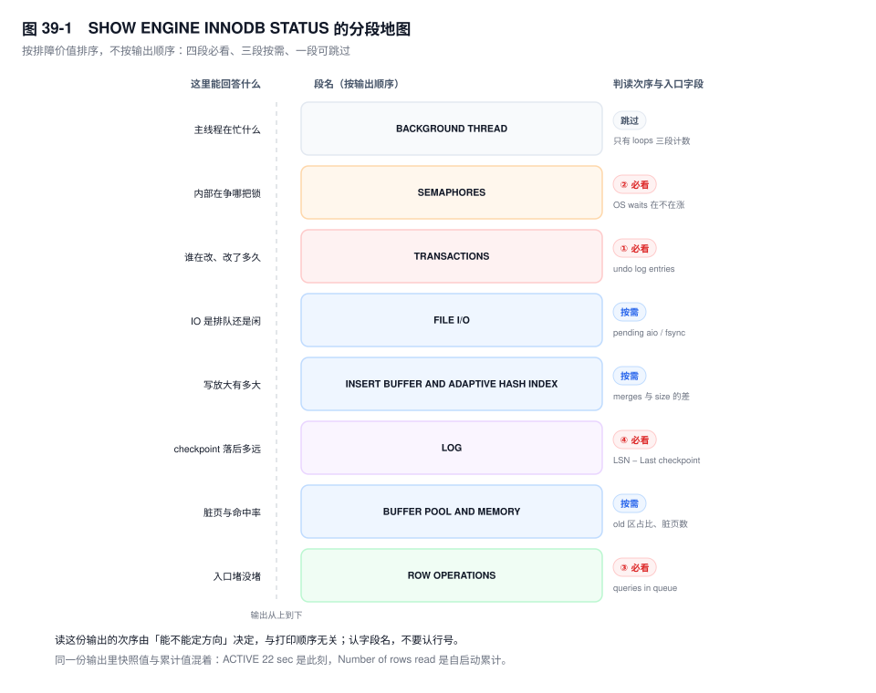

# 第 39 章　InnoDB 状态与等待事件解读

> **一句话结论**：`SHOW ENGINE INNODB STATUS` 里能定方向的只有四段——事务在改什么、内部在争什么、入口有没有排队、checkpoint 落后多远；其余段落是背景。

## 39.0 场景：CPU 30%，三条业务线一起超时

14:05，下单、账单、退款同时报超时，超时率 18%，QPS 与昨天同一分钟持平。

值班的人按第 36 章的顺序走了一遍，每一步都不给答案：

- `top`：`us` 31%，`wa` 4%；
- `Threads_running` 60，CPU 却闲着——线程没在算，也没在等锁；
- 三次 `PROCESSLIST`，没有一条 `Waiting for ... lock`，`State` 全是 `query`，看起来都在正常执行；
- 慢日志一条没有，`Innodb_row_lock_waits` 的增速是 0。

十分钟后 `Threads_running` 涨到 140。这时才想起拉 InnoDB 状态，`ROW OPERATIONS` 段第一行是：

```text
0 queries inside InnoDB, 87 queries in queue
```

`inside` 是 0，`queue` 是 87：**没有一条线程在 InnoDB 肚子里，87 条堵在门口**。根因是前任 DBA 为了"防雪崩"把 `innodb_thread_concurrency` 设成了 16——门只开 16 个缝，排队的线程在 `os_thread_sleep` 里睡着，不烧 CPU、不持锁、不产生慢查询，所以前面所有指标都是干净的。

瓶颈不在 SQL，在入口限流。

## 39.1 机制：先定次序，再逐段看

这份输出有八段，逐段读要二十分钟，而排障时你只有三分钟。所以第一件事不是读，是**决定读哪几段**。

先把一个前提钉死：**它是快照，不是统计**。`TRANSACTIONS` 段里的 `ACTIVE 22 sec` 是打印那一刻的事务年龄，不是累计值；`Number of rows read` 反过来是自实例启动的累计值。同一份输出里两种语义混着，唯一可靠的用法是隔 30 秒拉两次、看差。

另外，打印 `TRANSACTIONS` 段要先拿事务系统的锁，活动事务上千时这条命令本身会变慢，也会短暂加重争用——所以它是排障工具，不该进 10 秒一次的监控采集。



三档分法：

- **必看四段**：`TRANSACTIONS`（谁在改、改了多少、卡在哪一步）、`SEMAPHORES`（InnoDB 内部在争什么，不是行锁）、`ROW OPERATIONS`（入口堵没堵）、`LOG`（checkpoint 落后多远）。
- **按需三段**：`BUFFER POOL AND MEMORY`（脏页、命中、old 区占比）、`INSERT BUFFER AND ADAPTIVE HASH INDEX`（写放大与 AHI）、`FILE I/O`（IO 形态：pending aio、fsync 队列）。
- **可跳过**：`BACKGROUND THREAD`（只有 `srv_master_thread loops` 三个计数）、`LATEST FOREIGN KEY ERROR`（没有外键报错时为空）、`LATEST DETECTED DEADLOCK`（只留最近一次，读法见第 20 章）。

### `TRANSACTIONS`：三十一个事务拖着四千万条 undo

```text
------------
TRANSACTIONS
------------
Trx id counter 1284732
Purge done for trx's n:o < 1284701 undo n:o < 0 state: running but idle
History list length 41283902
---TRANSACTION 1284731, ACTIVE 22 sec starting index read
2 lock struct(s), heap size 1136, 3 row lock(s), undo log entries 1800000
MySQL thread id 88421, OS thread handle 140245378301696, query id 9988112 10.12.3.44 app_rw updating
UPDATE order_main SET status = 9 WHERE merchant_id = 3021
# 数值为示意，字段名与顺序按 8.0 实际输出
```

第一组数：`Trx id counter` 减 `Purge done for trx's n:o`，等于**还没被 purge 的事务数**（示意里是 31）。这是 `History list length` 的本源，但两者数的是不同东西：前者数事务，后者数记录（第 5 章）。31 个事务拖着四千万条 undo，说明其中一个改了几百万行还没提交，后面的全被它堵着。

`History list length` 别看绝对值，看两件事：**趋势**，以及 `Purge done` 那个 trx id 还在不在往前走。水位钉死在一个号上不动，说明有个更老的事务（常常是个只读快照）攥着它，加 `innodb_purge_threads` 没有用，因为同一个回滚段的 history list 只能由一个 worker 串行清（第 5、21 章）。

第二组数在活跃事务块里：

- `ACTIVE 22 sec` 是**事务年龄**，不是语句年龄。`BEGIN` 之后什么都不做，也能 `ACTIVE 7200 sec`。
- `undo log entries 1800000` 是**回滚成本的直接度量**：回滚要按 undo 反向执行 180 万次，每次还要改聚簇索引和全部二级索引，耗时与正向执行同一量级。KILL 之前必须先看这个数，否则你只是把 22 秒的故障换成 40 分钟的 `ROLLING BACK`。
- `trx state` 的枚举只有五个：`RUNNING`、`LOCK WAIT`、`ROLLING BACK`、`COMMITTING`、`PREPARED`。文本里它以 `ACTIVE 22 sec` 后面那个短语出现（`starting index read`、`updating`），要枚举全就用 `information_schema.innodb_trx.trx_state`。`PREPARED` 是写完 redo、等 binlog 落盘的那一瞬（第 6 章），正常一闪而过，长期停在这里说明 binlog 侧出事了。

这一段的**打印上限是 10 个活跃事务**。事务上千时你看到的是抽样，不是全量——这就是为什么拿着这份输出找不到阻塞者。全量查询用：

```sql
SELECT trx_id, trx_state, trx_started,
       TIMESTAMPDIFF(SECOND, trx_started, NOW()) AS age_s,
       trx_rows_locked, trx_rows_modified, trx_mysql_thread_id
FROM information_schema.innodb_trx
ORDER BY trx_started LIMIT 20;
```

最后两个容易混的形态：`---TRANSACTION ..., not started` 表示这个会话有事务对象但当前没有活跃事务，是占位，可以忽略；`ACTIVE 0 sec` 是事务刚开、还没干出名堂，要看它紧接着在等什么。

### `SEMAPHORES`：`os_waits` 不是行锁

```text
------------
SEMAPHORES
------------
OS WAIT ARRAY INFO: reservation count 2685797
OS WAIT ARRAY INFO: signal count 4432912
RW-shared spins 41, rounds 1230, OS waits 3
RW-excl spins 217, rounds 6510, OS waits 118
RW-sx spins 0, rounds 0, OS waits 0
Spin rounds per wait: 30.00 RW-shared, 30.00 RW-excl, 0.00 RW-sx
# 数值为示意
```

`reservation count` 是线程进入等待数组的次数，`signal count` 是被唤醒的次数。稳态下两者接近，差值放大说明有线程登记了却没被叫醒，但它更适合当分母而不是结论。

**这一段衡量的是 InnoDB 内部 mutex/rw_lock 的争用，不是行锁。** 行锁在 `TRANSACTIONS` 段，两件事的解法完全不同。当一个线程拿不到内部 latch，它先原地自旋（`spins`/`rounds`），自旋失败才把自己交给操作系统挂起（`OS waits`）——挂起期间不烧 CPU，但唤醒延迟是微秒到毫秒级，而且会把持锁者之外的整条链路一起拖慢。

判据就一句：**`spins` 高而 `OS waits` 低，说明自旋能解决，争用不严重；`OS waits` 在涨，说明自旋已经白转，线程进了内核等待。** 量化一点是看 `OS waits / (spins + OS waits)` 这个比例在不在升——比例低但绝对值大，只是访问量大；比例在升，才是真的抢不到。

具体是哪个 latch，看这一段里每个独立块：`--Thread ... has waited at btr0sea.cc line ... for N seconds the semaphore`，下面紧跟请求类型，`X-lock on RW-latch`（排他）或 `S-lock on RW-latch`（共享），再往下是 `number of readers`、`lock_word`。同一个 latch 上堆了多个 X 请求，就是这一段的典型现场。

常见来源三个：buffer pool 的 `buf_pool_mutex`（页分配与 LRU 维护都在这把锁下）、`log_sys` 一族（8.0 拆成 `log_flush_order_mutex` 等，redo 写盘的串行点）、自适应哈希的 `btr_search_latch`。

### `ROW OPERATIONS`：入口有没有堵

`Number of rows inserted/updated/deleted/read` 是自启动以来的累计值，单次看毫无意义；紧跟着的 `0.00 inserts/s` 才是上一次打印到现在的窗口速率。真正要看的是第一行：

- `queries inside InnoDB`：**此刻正在 InnoDB 内部执行的线程数**；
- `queries in queue`：**在 InnoDB 入口排队、还没拿到名额的线程数**。

`innodb_thread_concurrency` 是这两个数的闸门。取 0（8.0 默认）表示不限流，`queue` 应当恒为 0；取 N 表示最多 N 个线程同时进 InnoDB，其余的在入口 sleep 后重试。所以 **`queue` 持续大于 0，在默认配置下几乎只有一种解释：这个参数被人改过。**


四种组合的判读：`inside` 有值、`queue` 为 0，正常；`inside` 顶到上限、`queue` 持续大于 0，入口排队；两个都为 0 而业务在等，问题不在 InnoDB 内部（Server 层的 MDL、临时表、排序，或者网络，或者行锁——行锁的证据去 `TRANSACTIONS` 段找）；`inside` 高且 CPU 也高，那才是真在算，该看 SQL 与索引。

还要补一条区分：`queue` 高但 CPU 不高，线程是在等名额，不是算力不足；`inside` 高而 CPU 不高，是进了 InnoDB 却在等 IO 或 latch。这两种都别加 CPU。

### `LOG`：checkpoint 年龄怎么算

```text
---
LOG
---
Log sequence number          5821946317
Log buffer assigned up to    5821946317
Log buffer completed up to   5821946317
Log written up to            5821946317
Log flushed up to            5821946317
Added dirty pages up to      5821931802
Pages flushed up to          5821903315
Last checkpoint at           5821801140
# 数值为示意
```

四个关键 LSN 的关系是单调的：`Log sequence number` ≥ `Log flushed up to` ≥ `Pages flushed up to` ≥ `Last checkpoint at`。前两个差"已写进 log buffer 但没 fsync"的量，中间差"日志落了、页还没落"的量。

**checkpoint 年龄 = `Log sequence number` − `Last checkpoint at`。** 不是减 `Log flushed up to`——那个差是"还没落盘的 redo"，页落后多少跟它无关，用它会系统性低估，这是这一段最常见的算错点。

年龄逼近 redo 容量上限（5.7 与 8.0.30 之前是 `innodb_log_file_size × innodb_log_files_in_group`，默认 48MB×2；`[8.0.30+]` 由 `innodb_redo_log_capacity` 统管，默认 100MB）时，InnoDB 会从"后台慢慢刷"切成"跟着用户线程同步刷"：要分配新 redo 空间的线程被迫自己刷脏、等 LSN 前进。自适应刷脏（`innodb_max_dirty_pages_pct_lwm` 那条水位线）追不上 redo 生成速度时，走的就是这条兜底路径。表现是**周期性抖动**——隔一段时间一次 P99 尖刺，平均 RT 却几乎不动，慢日志也抓不到（慢的是等刷脏，不是执行）。

### `BUFFER POOL` 与 `INSERT BUFFER`

`Buffer pool hit rate 1000 / 1000` 是千分比，且是**上一次打印到现在的窗口采样**，抖动时会瞬间掉下来又弹回去。`Database pages` 与 `Old database pages` 的比值说明 LRU 分段健不健康：old 区默认占 37%（`innodb_old_blocks_pct`），明显高于这个比例，说明大量只用一次的页在占坑——全表扫、报表、大分页在污染池子（第 31 章的宽表代价、第 35 章的多租户共享池）。`Free buffers` 长期为 0 且 `Database pages` 不再增长，池已满，新页只能挤走旧页。

`Modified db pages`（脏页数）、`Pending writes: LRU 0, flush list 0, single page 0`、`Pages flushed up to` 三个一起读：脏页多、待写队列非 0、而 `Pages flushed up to` 不动，说明刷脏停了——IO 打满或 doublewrite 卡住，这时候改 SQL 救不了。

`Ibuf: size N, free list len M, seg size K, merges` 里，`size` 是 change buffer 树占用的**页数**（不是记录数），`merges` 是累计合并次数；紧跟着的 `merged operations: insert N, delete mark N, delete N` 才是合并掉的记录数。**`merges` 增速高但 `size` 不降**，说明合并跟不上插入，二级索引的随机插入太多（第 8 章）；`size` 持续膨胀，说明二级索引的插入顺序与主键顺序相反，UUID 主键的典型症状（第 30 章）。`Hash table size ... , 0.00 hash searches/s, 0.00 non-hash searches/s` 是自适应哈希的命中情况：`non-hash` 高说明 AHI 没起作用——分区表上它本就不生效，或者 `innodb_adaptive_hash_index` 被关了。

### 等待事件字典

| 事件 / latch | 谁在等 | 为什么会等 | 先试什么 |
|---|---|---|---|
| `buf_pool_mutex` | 要分配或淘汰页的线程 | 页分配与 LRU 维护在同一把锁下，大查询灌页时排队 | 找那几个扫大量页的查询，限流或加索引 |
| `log_sys` 一族 | 要写 redo 的线程 | redo 写入有串行点，高并发小事务时是天然瓶颈 | 增大组提交批量，合并小事务 |
| `dict_table_stats_latch` | 读/写表统计信息的线程 | `ANALYZE TABLE`、统计信息重算期间持锁 | 避开业务高峰执行，或调大采样页数容忍度 |
| `ibuf` 相关 mutex | 做 change buffer 合并的线程 | 二级索引随机插入过多，合并任务追不上 | 换递增主键，或减少二级索引数量 |
| `trx_sys` | 分配事务 ID、维护活跃事务链表的线程 | 极高并发短事务，或一次要打印上千事务 | 降低并发事务数，别频繁拉全量状态 |
| `row_lock` | 等行锁的事务 | 正常的写写冲突，不是内部争用 | 看 `data_lock_waits` 找阻塞者，见第 20 章 |

最后一行是特意放进去的：`row_lock` 不是 latch，它不会出现在 `wait/synch/*` 的榜上。反查真实争用用 `performance_schema.events_waits_summary_global_by_event_name`，事件名形如 `wait/synch/mutex/innodb/buf_pool_mutex`，按 `SUM_TIMER_WAIT` 排序取前几名（第 38 章）。

### 版本差异

`[8.0]` 的 `LOG` 段从四行 LSN 变成七行，多了 `Log buffer assigned up to`、`Log buffer completed up to`、`Log written up to`、`Added dirty pages up to`；`BUFFER POOL AND MEMORY` 多一行 `Buffer pool size, bytes`；`SEMAPHORES` 多出 `RW-sx` 一组（8.0 引入的共享排他锁），`os_waits` 的归类也跟着变了。`TRANSACTIONS` 段在 8.0 后期版本里会明显变空：只读 autocommit 事务被内部标记为 `trx_autocommit_non_locking` 之后不再进读写事务链表，也就不再打印——同一个业务在 5.7 上有几十个 `not started`，在 8.0 上可能一行都没有，这不代表负载变轻了。

`[8.0.30+]` 之后 redo 容量由 `innodb_redo_log_capacity` 统一管理，按 `innodb_log_file_size` 算 checkpoint 天花板会算错。

段落名和行数在小版本之间都会动，**认字段名，不要认行号**。

## 39.2 关键结论

1. **这份输出是快照，两次相减才有速率。** `ACTIVE 22 sec` 是那一刻的事务年龄，`Number of rows read` 是累计值，混着读必然错。
2. **`History list length` 不看绝对值，看趋势与 `Purge done for trx's n:o` 是否还在推进。** 水位钉死时加 purge 线程无效，要找那个最老的事务。
3. **`undo log entries` 是回滚成本的唯一直接读数。** KILL 之前不看它，等于用 22 秒的故障换 40 分钟的 `ROLLING BACK`。
4. **`os_waits` 是内部 latch 的内核等待，与行锁无关。** `spins` 高可以忍，`OS waits` 在涨才是要处理的争用。
5. **`queries in queue` 持续大于 0 是入口限流，不是算力不足。** 默认 `innodb_thread_concurrency=0`，出现排队先去查这个参数。
6. **checkpoint 年龄 = `Log sequence number` − `Last checkpoint at`。** 减 `Log flushed up to` 会低估，进而误判"刷脏很健康"。

## 39.3 实验验证

### 实验一：两次快照算 checkpoint 年龄

```bash
for i in 1 2; do
  mysql -e "SHOW ENGINE INNODB STATUS\G" \
    | grep -E "Log sequence number|Log flushed up to|Last checkpoint at"
  sleep 30
done
```

预期形态（未实跑）：两次的 `Log sequence number` 都在涨，涨幅除以 30 就是 redo 生成速率；年龄 = `Log sequence number` − `Last checkpoint at`，除以容量得到"距同步刷脏还有多远"。若年龄在两次之间几乎不变而 LSN 在涨，说明刷脏跟得上；年龄持续逼近容量，就等着看 P99 的周期尖刺。

### 实验二：造一个入口队列

```sql
-- 仅测试实例
SET GLOBAL innodb_thread_concurrency = 4;
-- 另开 8~16 个会话并发跑同一条范围扫描
SELECT COUNT(*) FROM order_main WHERE created_at >= '2026-01-01';
-- 观察完立刻复原
SET GLOBAL innodb_thread_concurrency = 0;
```

并发跑起来后拉状态，`ROW OPERATIONS` 会变成 `N queries inside InnoDB, M queries in queue`，`M` 随并发上升；同时 `Threads_running` 在涨而 CPU 不动。参数改成 0 后 `queue` 立刻归零——这个对照比任何解释都直观。生产上不要做这个实验。

### 实验三：看 change buffer 的反应

对一张有两个二级索引的表做随机主键插入，每 5000 行拉一次状态，记录 `Ibuf` 的 `size` 与 `merges`。预期形态：`merges` 单调上涨，`size` 在高位震荡；把主键换成自增后重跑，`size` 明显更低。差异就是二级索引随机插入的写放大（第 8、30 章）。

## 39.4 常见误区

⚠️ **"`os_waits` 高说明行锁争用严重"**
`SEMAPHORES` 统计的是 mutex/rw_lock，行锁在 `TRANSACTIONS` 段的 `row lock(s)` 与 `LOCK WAIT` 状态里。前者靠减少页访问、拆分热点解决，后者靠缩短事务、统一加锁顺序解决，方向相反。

⚠️ **"checkpoint 年龄用 `Log sequence number` 减 `Log flushed up to`"**
那个差是"还在 log buffer 里没落盘的 redo"，通常很小，永远看着很健康。页落后多少只能减 `Last checkpoint at`。

⚠️ **"`queries in queue` 高就该加 CPU"**
线程是在等 InnoDB 的入场名额，睡在 `os_thread_sleep` 里，给多少 CPU 都不会变成吞吐。先看 `innodb_thread_concurrency`，再看是不是内部 latch 把人堵在门口。

⚠️ **"`Number of rows read` 大就是读放大"**
这是自启动以来的累计值，运行三个月的实例必然很大。要看的是旁边那行每秒速率，或者两次采样的差。

## 39.5 生产 Checklist

- [ ] `SHOW ENGINE INNODB STATUS` 不进高频采集，排障时手工拉，且**连拉两次**
- [ ] `TRANSACTIONS`：算 `Trx id counter` − `Purge done for trx's n:o`，对照 `History list length` 的量级
- [ ] `History list length` 的巡检看趋势与 `Purge done` 是否推进，不看单点阈值
- [ ] 活跃事务看 `ACTIVE` 秒数 + `undo log entries`，KILL 前必须评估回滚量
- [ ] 事务超过 10 个时改用 `innodb_trx` 取全量，不依赖状态输出
- [ ] `SEMAPHORES`：`OS waits` 的增速 + 具体 latch 块的等待秒数
- [ ] `ROW OPERATIONS`：`queries in queue` 必须为 0；非 0 立刻查 `innodb_thread_concurrency`
- [ ] `LOG`：checkpoint 年龄 / redo 容量保持在 0.7 以下，并观察是否出现周期尖刺
- [ ] `BUFFER POOL`：`Free buffers`、old 区占比、`Modified db pages` 与 `Pages flushed up to` 是否同步
- [ ] 把 `innodb_thread_concurrency`（应为 0）、`innodb_old_blocks_pct` 纳入配置基线比对

## 39.6 延伸

- **下一章**：第 40 章讲 `innodb_thread_concurrency`、`innodb_io_capacity` 这些旋钮该取什么值、代价是什么。
- **关联章节**：第 36 章（`PROCESSLIST` 与三层定位）、第 20 章（死锁段的完整读法）、第 5 章与第 21 章（history list 与长事务）、第 7 章（checkpoint 与恢复时间）、第 8 章与第 30 章（change buffer 与主键选择）、第 31 章与第 35 章（谁在污染 buffer pool）、第 38 章（用 `performance_schema` 反查等待）。
- **面试追问**：
  - "拿到 `SHOW ENGINE INNODB STATUS`，你第一眼看哪段？" → 先看 `ROW OPERATIONS`，判断线程在不在 InnoDB 内部；再看 `TRANSACTIONS` 与 `SEMAPHORES`，区分行锁与内部争用。
  - "checkpoint 年龄怎么算，为什么不是减 `Log flushed up to`？" → 前者衡量页落后，后者衡量日志落盘。
- **官方文档**：`SHOW ENGINE INNODB STATUS`、`InnoDB Monitors`、`Performance Schema Wait Event Tables`。
