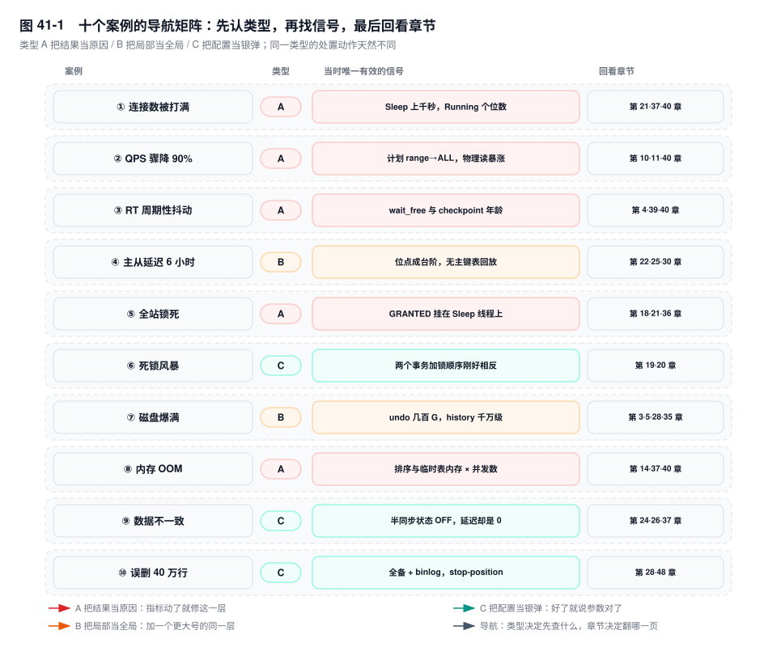
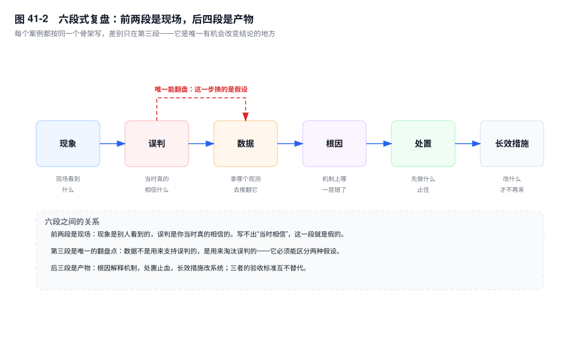
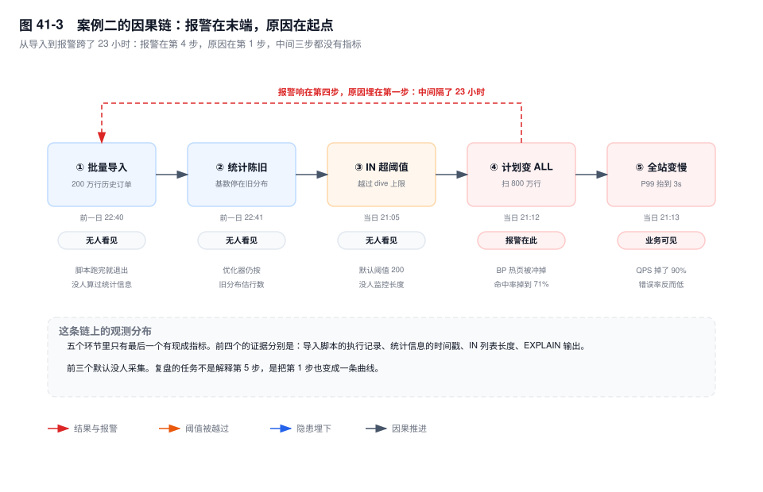

# 第 41 章　典型案例复盘集

> **一句话结论**：线上故障的第一版结论几乎总是错的，区别只在于老手知道自己在猜，并且立刻设计了一个能推翻自己的观测。

## 41.0 场景：一个夜班里的三次报警

23:04，连接数告警。值班的人看了一眼 `Threads_connected` 贴着上限，回了句"活动流量上来了，明早扩容"。

23:40，下单 QPS 从四万掉到四千。他盯着那条竖着掉下去的线，说"库被打挂了，先重启"。

00:20，P99 每隔几十秒尖一次。他翻了一眼云厂商状态页，说"云盘又抖了"。

三个报警之间看不出任何关联，他也确实是分开处理的：三件事、三个窗口、三次结案。每一次都只用了不到五分钟就"定位"了原因，每一次都有一张监控截图支持他。

天亮复盘，三个结论全错，错的方式一模一样：**他把最先看到的那个数字，当成了原因**。连接数满是因为连接池漏了，跟流量无关；QPS 掉是因为一条 SQL 换了执行计划，库一点都不忙；RT 尖刺是因为刷脏预算还停在机械盘时代。

三个报警、三份不同的监控、同一个动作：在同一层里换工具，而没有往上一层走一步。这章不讲新机制——前四十章已经讲完了。这章只讲一件事：当十个症状同时出现，按什么顺序做减法。

## 41.1 三类误判：为什么老手也会看错

十个案例可以归成三类。分类依据不是故障类型，是**误判的形状**。

**A 把结果当原因。** CPU 高、QPS 低、连接数满、RT 长、磁盘占用涨，这些都是结果，是别的层做完事之后留在这个层上的痕迹。这类误判的共同形状是：指标动了，就认定这一层坏了，于是修这一层。CPU 高就加 CPU，等于给排队的人多发椅子，队伍一点都不会短。判据很直接：**如果一个指标是"别人让它变成这样的"，修它没有意义。**

**B 把局部当全局。** 一条 SQL 慢就加机器，一个从库延迟就换更贵的硬件，一张表写入慢就换 NVMe。共同形状是：用一个更大号的同一层，去解一个来自另一层的问题。加资源只能解决"这一层确实缺资源"，解决不了"这一层在等别的层"。等锁、等刷脏、等 ACK 的连接，加完机器只是变成更多线程一起等。

**C 把配置当银弹。** 参数一改，症状消失了，结论就写成"参数调对了"；备份一建，就认定"数据丢不了"。共同形状是：只验证了"变好"，没有验证"因为这个变好"。连接数在改完 `wait_timeout` 之后降下来，也可能只是流量自己回落；死锁在降到 RC 之后变少，也可能只是那批 SKU 卖完了。判据是双向的：改之前有一个可复现的坏指标，改之后同一压力下它必须变好，并且没有别的指标变坏。

三类的解法是同一个，而且不是"更努力地看监控"。监控告诉你哪里疼，不告诉你哪一层病了。**先确定这一层是不是原因所在的那一层，再决定要不要在这一层动手。** 落到动作上只有一句：找到一个能把两种假设区分开的观测——A 类问"这个指标是谁产生的"，B 类问"被等的那个东西在哪一层"，C 类问"如果我没改，它会不会自己好"。



图 41-1 是这一章的目录，也是全书的索引：每一行给出案例、误判类型、当时唯一有效的那个信号，以及回看的章节。读完应该能说出一句"我遇到的那次属于 B 类"。

## 41.2 案例一：连接数被打满——池子漏了，却去扩容

**现象**　20:47 起，下单和支付回调大面积报 `ERROR 1040 (HY000): Too many connections`。`Threads_connected` 贴在 `max_connections = 2000` 上持续四十分钟，连监控采集账号都被挤在外面，只能靠本机 socket 登进去。

**误判**　当天有满减活动，第一反应是"量涨了"。结论是实例规格不够，处置是当晚把 `max_connections` 抬到 3000，撑了二十五分钟又满。"抬参数—再满"这个过程，反过来加固了"量太大"的判断。

**数据**　抢在采集连接上抓了一份 `SHOW PROCESSLIST`：九百多个连接 `Command` 是 `Sleep`，`Time` 从三千秒到一万二千秒不等；`Threads_running` 只有 6~9；`Aborted_clients` 增长很慢，每分钟个位数。

```sql
SELECT Command, COUNT(*) AS n, MAX(Time) AS max_idle
FROM information_schema.processlist GROUP BY Command;
-- 输出形态（未实跑，字段含义以此为准）
-- Sleep   971   12043
-- Query     8       0
```

三条读法：`Sleep` 上千秒，说明连接活着但没人在用；`Aborted_clients` 低，说明不是客户端崩溃后被服务端发现，是客户端压根没关；`Threads_running` 个位数，说明这台库一点都不忙。

**根因**　应用 12 个副本，连接池 `maxActive = 200`，乘起来 2400，本来就超过 2000 的上限，只是平时没跑满。真正的泄漏点是一个导出接口，异常分支里没归还连接，每次调用漏一个。`wait_timeout` 是默认的 28800 秒，漏掉的连接要挂八小时才回收，泄漏速度快过回收速度，八小时后必然满——这也解释了它为什么总在下午出现。

**处置**　`SET GLOBAL max_connections = 3000` 止血，同时把 `wait_timeout` 与 `interactive_timeout` 一起降到 600。这两个参数只对新连接生效，存量连接还按连接时的值算，所以要按 `Time > 3600` 把老的 `Sleep` 连接 `KILL` 掉，否则改完看不到变化。最后修 `finally`。

**长效措施**　池上限按 `max_connections × 0.8 ÷ 副本数` 反推（2000 × 0.8 ÷ 12 ≈ 133），写进连接池配置模板；监控加一条"`Sleep` 超过 60 秒的连接数"，而不是只看 `Threads_connected` 总量——后者要等到 100% 才报警，那时业务已经挂了；连接池打开泄漏检测（`leakDetectionThreshold`）。

→ 机制见第 21 章、第 37 章；参数见第 40 章。

## 41.3 案例二：QPS 骤降 90%——一条 SQL 把缓冲池冲干净了

**现象**　21:12 起，下单 QPS 从 4.2 万掉到 3800，八分钟后自行恢复。同一时段没有发布、没有 DDL、没有大促。所有接口 P99 从 60ms 抬到 3s，错误率不高，就是慢。

**误判**　"库被打挂了，或者被攻击了"。第一轮查连接数、查异常来源、数慢日志条数——连接数正常，没有攻击特征，慢日志里冒出来的却是自己业务的一条查询。到这一步本该转向，团队先做的是重启从库和加限流。

**数据**　`EXPLAIN` 那条 `WHERE order_no IN (...)`：`type` 从 `range` 变成 `ALL`，`key` 是 `NULL`，`rows` 约 800 万。同一分钟内 `Handler_read_rnd_next` 涨了几千万，`Innodb_buffer_pool_reads`（物理读）同步暴涨，`Innodb_buffer_pool_pages_free` 从三万多页见底到几百页。

**根因**　前一晚批量导入了 200 万行历史订单，脚本跑完就退出，没有 `ANALYZE TABLE`，优化器手里的基数还是旧分布。当天这条 SQL 的 `IN` 列表从三十几个值涨到两百多个，越过 `eq_range_index_dive_limit`（默认 200），优化器从"每个值做一次 index dive"退化成"按索引统计信息估算"，估出来的行数严重偏小，于是认为走索引再回表比全表扫更贵。八百万行顺序扫，把缓冲池里的订单热页整片换出，命中率从 99.6% 掉到 71%，全站跟着慢。

**处置**　`ANALYZE TABLE order_main` 让统计信息回到真实分布，计划立刻回到 `range`；同时给这条 SQL 加 `FORCE INDEX (idx_order_no)` 兜底，防止下一次统计信息抖动时再翻车。缓冲池的损伤不会随计划恢复一起消失，热页要靠真实流量重新预热，命中率爬回来花了十几分钟。

**长效措施**　批量导入脚本结束处强制 `ANALYZE`（改脚本，不改流程文档）；DAO 层给 `IN` 列表设上限，超过 100 个值拆批或改写成 JOIN 临时表；`Innodb_buffer_pool_pages_free` 与物理读速率进告警——这两个是"有人正在扫全表"的早期信号，比 QPS 曲线早几十秒。

→ 机制见第 10 章、第 11 章；参数见第 40 章。

## 41.4 案例三：RT 抖动——刷脏预算还停在 HDD 时代

**现象**　P99 每四十秒左右尖一次，从 30ms 尖到 800ms，尖刺宽度一两秒。业务侧表现为"偶发超时、重试就好"。实例 CPU 30%，慢日志里没有对应的慢 SQL，于是所有人的目光都落在了网络上。

**误判**　"网络抖动 / 云盘性能不稳"。理由很充分：周期性、无慢 SQL、跨机房调用也一起抖。团队提了工单，云厂商回复后端无异常，事情就卡在这里——因为下一步没有假设了。还有一个旁证被忽略了：尖刺期间写入吞吐没有掉，只有读延迟被拉长，网络抖动不会这样挑食。

**数据**　`SHOW ENGINE INNODB STATUS` 的 `LOG` 段：`Log sequence number` 减 `Last checkpoint at` 长期贴着 redo 容量（8G 里用掉 7G 以上）；`Innodb_buffer_pool_pages_dirty` 高位；`innodb_io_capacity` 还是默认 200；尖刺窗口内 `Innodb_buffer_pool_wait_free` 在涨，窗口之外几乎不动。

**根因**　刷脏预算按机械盘设的 200 IOPS，折算约 3MB/s。NVMe 上这个预算连一次写入突发的零头都不够，脏页越积越多，checkpoint 追不上，最后 free list 见底。此时用户线程要读一个新页，就得自己同步刷脏腾位置——`wait_free` 等的就是"别人把页刷出去"。四十秒的周期，正好对上 page cleaner 一轮的节奏。

**处置**　`innodb_io_capacity` 按设备实测 16K 随机写 IOPS 的 50~70% 设，`innodb_io_capacity_max` 同步抬；`innodb_redo_log_capacity` 从 8G 放大到 32G `[8.0.30+]`，给 checkpoint 留出缓冲。改完要盯两轮：第一轮看 checkpoint 年龄有没有回落到 20% 以下，第二轮看尖刺是否随写入突发一起消失——只观察一天不够，突发的周期未必每天都来。这个案例里 `wait_free` 在改完当天归零，业务侧再没人提"网络"。

**长效措施**　checkpoint 年龄（`LSN − Last checkpoint` ÷ redo 容量）与 `wait_free` 速率进告警：前者看趋势，后者看后果，两个一起看才知道离出事还有多远；新实例上线按设备能力预设这两个参数，不再从模板里抄 200 和 8G。

→ 机制见第 4 章、第 39 章；参数见第 40 章。

## 41.5 案例四：主从延迟 6 小时——曲线是台阶，不是斜坡

**现象**　报表从库的延迟从 0 跳到 7200 秒，然后停在那儿。曲线不是缓慢爬升，是几十分钟不动、突然跳一段的台阶。主库写入完全正常，业务侧只有报表和部分列表页读到了旧数据。

**误判**　"从库配置太低，回放算不过来"。从库 CPU 40%、iostat 也不高，但"回放不动"看着就像算力不足，第一版方案是给从库加 8 核 32G。

**数据**　`SHOW REPLICA STATUS` `[8.0.22+]`（5.7 叫 `SHOW SLAVE STATUS`）：`Seconds_Behind_Source` 七千多；`Exec_Source_Log_Pos` 长时间不动然后跳一段；`Replica_SQL_Running_State` 显示 `Waiting for dependent transaction to commit`；延迟的起点精确对上 `stock_flow` 表的批量更新。

**根因**　`stock_flow` 没有主键。并行回放要靠主键或唯一键算写集（`WRITESET`），无主键表算不出来，这批事务的依赖判定退化成按提交顺序串行；再叠一个几十万行的批量 `UPDATE` 单事务，回放线程只能一条一条来。加 CPU 对"串行等待"没有任何作用——这是 B 类误判最典型的样本：瓶颈在依赖关系，不在算力。另一个判据就在 CPU 曲线上：回放线程等待时是睡眠状态，加核只会让曲线更平，不会让等待变短。

**处置**　先排除第二个延迟源（DDL、从库上的长查询、大事务），再给 `stock_flow` 补自增主键（走 `pt-online-schema-change`，业务低峰）；把批量更新按 5000 行切批提交；`replica_parallel_workers` `[8.0.26+]`（5.7 叫 `slave_parallel_workers`）从 4 调到 16，`replica_preserve_commit_order` 保持 `ON`（业务要求提交顺序一致）。补主键这个动作要单独排期：DDL 期间从库本来就在追赶，别在同一个窗口叠第二个大动作。

**长效措施**　上线前扫"无主键表"（`information_schema.tables` 里 `ENGINE=InnoDB` 且无 `PRIMARY KEY` 的表）进审核规则，这一条能拦住后面一半的复制问题；`replica_parallel_workers` 与 `replica_preserve_commit_order` 按写入冲突度写进从库模板；"单事务不超过 N 行"进开发规范，和长事务清单共用一份文档。

→ 机制见第 22 章、第 25 章；表设计见第 30 章。

## 41.6 案例五：全站锁死——一个 Sleep 连接堵住了整张表

**现象**　14:05 起，所有涉及 `order_detail` 的查询全部卡住，接口全线超时。`SHOW PROCESSLIST` 里一片 `Waiting for table metadata lock`，几分钟内堆到几百个，新请求还在进。

**误判**　"DBA 在加索引，等它跑完就好"。十分钟前确实有人发了加索引的 DDL，因果看上去完整，于是大家等了二十分钟。队列只增不减，DDL 本身也一直没进展。

**数据**　`performance_schema.metadata_locks` 里能看到真相：一行 `LOCK_TYPE=SHARED_READ`、`LOCK_STATUS=GRANTED`，`OWNER_THREAD_ID` 指向一个 `Command=Sleep` 的连接；它后面排着一串 `LOCK_TYPE=EXCLUSIVE`、`LOCK_STATUS=PENDING` 的 DDL 请求。那个 `Sleep` 连接的 `Time` 是四小时。还有一个被跳过的细节：那二十分钟里，DDL 线程自己的 `State` 也是 `Waiting for table metadata lock`——它排在队列里，没有任何人在"跑"。

```sql
SELECT OBJECT_NAME, LOCK_TYPE, LOCK_STATUS, OWNER_THREAD_ID
FROM performance_schema.metadata_locks
WHERE OBJECT_SCHEMA = 'trade' AND OBJECT_NAME = 'order_detail';
-- 输出形态（未实跑，字段含义以此为准）
-- order_detail  SHARED_READ   GRANTED  48211
-- order_detail  EXCLUSIVE     PENDING  48390
```

**根因**　那个连接四小时前开过事务、读过 `order_detail`，事务没提交，MDL 就一直挂在它身上。DDL 的排它锁在队列里等它；而 MDL 队列是**写优先**的——后来的普通 `SELECT` 也必须排在 `PENDING` 的 `EXCLUSIVE` 后面。整张表被一个什么都没在干的连接堵死。

**处置**　找到那个 `PROCESSLIST_ID` 直接 `KILL`，队列瞬间疏通，DDL 自己会继续跑（失败就重试）。`KILL` 之前先确认它不在事务中间状态（`information_schema.innodb_trx` 里看 `trx_state` 与 `trx_rows_modified`），回滚代价大的要评估，第 21 章有判断方法。

**长效措施**　`lock_wait_timeout`（MDL 用的那个，默认一年）调到业务能接受的量级，比如 10 秒，让 DDL 自己失败，而不是拖死整张表；DDL 一律走 `gh-ost` 或 `pt-online-schema-change` 并设等待上限；`metadata_locks` 里 `PENDING` 的数量进监控，这是"有 DDL 在排队"的直接信号，比业务报障早得多。应用侧还有一条对账关系：连接池的 idle 超时必须小于 `wait_timeout`，否则池子以为连接还活着，服务端已经在准备回收它。

→ 机制见第 18 章、第 21 章；排查方法见第 36 章。

## 41.7 案例六：死锁风暴——两条 UPDATE 的加锁顺序反了

**现象**　一天六十多次 `ERROR 1213 (40001): Deadlock found when trying to get lock`，集中在 20:00~22:00 的库存扣减。每次只影响一两个订单，用户看到"下单失败，请重试"，很容易被当成偶发。

**误判**　"MySQL 的死锁是 bug，把隔离级别降到 RC 就好了"。RC 确实去掉了间隙锁，改完当天死锁数量明显下降，结论被"验证"了——没人注意到剩下那部分死锁跟间隙锁一点关系都没有。

**数据**　`SHOW ENGINE INNODB STATUS` 的 `LATEST DETECTED DEADLOCK` 段：事务 A 先更新 `sku_a` 再更新 `sku_b`，事务 B 先 `sku_b` 再 `sku_a`，两段的 `HOLDS` 与 `WAITING` 刚好对调；两个事务都是单行等值更新，锁模式都是 `X` 记录锁，没有任何间隙锁。`Innodb_deadlocks` 计数器在活动时段每分钟涨三到五。

**根因**　同一个购物车里的多个 SKU，不同入口遍历顺序不同：App 加购按点击顺序，后台改单按页面展示顺序，活动页批量下单按活动配置顺序。`UPDATE stock SET qty = qty - 1 WHERE sku_id = ?` 本身没错，错在调用它的顺序。只要两条路径的 SKU 顺序相反，就是标准的交叉等待，隔离级别降到 RC 照样死。

**处置**　应用层把待扣减的 SKU 按 `sku_id` 排序后再逐条更新，同一入口内保证全序；死锁重试保留，但重试必须走同一套排序逻辑，否则重试还在制造死锁。

**长效措施**　"多行加锁必须排序"写进 Code Review 检查项——是 MR 模板里的必勾项，不是规范文档里的一句话；重试要带退避和次数上限，避免死锁重试把局部失败放大成雪崩；`Innodb_deadlocks` 的增速进日报，读的是增速不是绝对值（它是自启动以来的累计值，重启归零）。

→ 机制见第 19 章、第 20 章。

## 41.8 案例七：磁盘爆满——undo 涨到几百 GB，binlog 没人清

**现象**　数据盘 100%，写入开始报 `ERROR 1114 (HY000): The table 'xxx' is full`，运维脚本随后把实例置为只读，全站写入失败。上一次扩容是一个月前，扩了 1T。

**误判**　"业务数据涨太快，该扩盘了"。第一次扩盘确实管用，两周后又满，于是准备再扩——但这次的曲线不对：业务数据一个月涨了不到 200G，盘却吃掉了 1T。

**数据**　`information_schema.files` 里 `undo_001`、`undo_002` 各几百 GB（初始 16MB 的 undo 表空间长成这样不正常）；`SHOW ENGINE INNODB STATUS` 的 `History list length` 千万级；`SHOW BINARY LOGS` 有四百多个文件。

**根因**　一个报表长事务开了九小时没提交，它持有的 ReadView 钉住了 purge 水位，比它更旧的 undo 一条都回收不了，undo 只增不减。另一头，`binlog_expire_logs_seconds` 从 `[5.7]` 的 `expire_logs_days = 0` 原样迁过来，等于永不删除，四百多个 binlog 又吃掉几百 GB。两个互不相关的原因，在同一个盘上会合。

**处置**　先扩盘争取窗口，不要上来就 `KILL`——回滚那个大事务本身要读 undo、写磁盘，可能把仅剩的空间吃光。然后 `KILL` 长事务，盯 `History list length` 的下降速率确认 purge 追上来；再用 `PURGE BINARY LOGS BEFORE '...'` 清历史 binlog（先确认没有订阅方依赖这些位点，也要确认从库已越过这些文件，否则从库直接断流）。`[8.0]` 的 undo 表空间可以在线 truncate，前提是 `innodb_undo_log_truncate` 开着且至少有 2 个 undo 表空间，purge 追上之后再缩。

**长效措施**　`History list length` 与 undo 表空间大小进告警：前者是原因，后者是结果，只看后者等于等它长到几百 G；binlog 过期策略写进建库模板，8.0 默认三十天，显式改成 0 的必须写理由；报表查询走从库，从库上设 `max_execution_time`，让九小时的事务在九秒时就被掐掉。

→ 机制见第 3 章、第 5 章；备份与归档见第 28 章、第 35 章。

## 41.9 案例八：内存 OOM——两个参数乘上并发数

**现象**　每周一次，总在周六凌晨两到四点，`mysqld` 从监控上消失。`dmesg` 里留着 `Out of memory: Killed process ... (mysqld)`。重启后一周无事，规律得像定时任务。

**误判**　"内存泄漏，升级版本"。版本是 8.0.28，社区里确实有内存相关的讨论，团队排了升级窗口。升级后第二周，同一个时间点，同一行 `dmesg`。一个被忽略的旁证是：那两小时里 QPS 曲线几乎是一条直线，唯独导出任务数从 20 涨到 160——负载没变，并发形状变了。

**数据**　静态看参数看不出问题，得在运行时把内存归因到线程和事件。按 `EVENT_NAME` 聚合 `performance_schema.memory_summary_by_thread_by_event_name`，`memory/sql/Filesort_buffer::sort_keys` 与 `memory/temptable/physical_ram` 两项随并发线性上涨；把单项峰值乘以当时的 `Threads_running`（导出高峰 160），数量级才和 RSS 对得上。

```sql
SELECT EVENT_NAME, ROUND(SUM(CURRENT_NUMBER_OF_BYTES_USED)/1024/1024) AS mb
FROM performance_schema.memory_summary_by_thread_by_event_name
GROUP BY EVENT_NAME ORDER BY mb DESC LIMIT 5;
-- 输出形态（未实跑，字段含义以此为准）
-- memory/innodb/buf_buf_pool            98304
-- memory/sql/Filesort_buffer::sort_keys 20480
-- memory/temptable/physical_ram          6144
```

**根因**　`sort_buffer_size` 被设成 256M（理由是"加速报表排序"），`temptable_max_ram` 设成 8G，两个都是"单个连接视角"的参数，没人乘过并发。160 个导出任务 × 256M ≈ 40G，再叠加同时被撑满的 8G 临时表内存；buffer pool 96G 一动不动，机器 128G，这笔账在导出时段必然破产。它不是泄漏，是预算超支。

**处置**　`sort_buffer_size` 降回 MB 级（OLTP 模板值 2M），导出任务单独限流到 20 并发；把导出迁到独立实例（同规格、只读角色），让它有自己的预算。改完看一周：导出高峰的 RSS 应该回落到"buffer pool 加固定开销"的量级，而不是继续贴着物理内存。

**长效措施**　所有 per-connection buffer 的参数评审必须附一行"× 峰值并发"的账，评审表里加一列，填不出数字就不批；导出类任务走独立实例或加并发闸门；把上面那两个事件名做成监控面板的固定两行，它们涨起来的时候 RSS 还没到 80%。

→ 机制见第 14 章、第 37 章；参数见第 40 章。

## 41.10 案例九：数据不一致——半同步悄悄降级成了异步

**现象**　业务方报"用户付了钱查不到单"，集中在 11:00~13:00 的订单。主库查得到，从库查不到，相差整整两小时。这两小时里主库重启过一次。

**误判**　"复制断了，重启一下从库"。从库缺数据，直觉上就是复制停了。但重启不会把已经丢掉的事务找回来，反而让位点状态更难还原。

**数据**　`SHOW REPLICA STATUS` 一切正常：`Seconds_Behind_Source = 0`，两个线程都是 `Yes`，位点也追平了。换一个族看：`SHOW GLOBAL STATUS LIKE 'Rpl_semi_sync%'` 里 `Rpl_semi_sync_source_status` 是 `OFF` `[8.0]`（5.7 叫 `Rpl_semi_sync_master_status`），`Rpl_semi_sync_source_no_tx` 在持续增长。

**根因**　半同步在某个时刻因 ACK 超时（`rpl_semi_sync_source_timeout`，默认 10 秒）自动降级为异步，而且不会自己恢复。降级期间主库提交不等从库确认；恰好这两小时主库宕机，最后一段没传到从库的事务随 redo 一起丢了。从库的位点看起来"追平"，是因为它追的是它收到的日志——丢的那一段，它根本不知道存在。**"复制正常"和"数据一致"是两件事。**

**处置**　以最近一次全备 + binlog 补齐缺失区间：按 GTID 在主库 binlog 里定位缺口区间，逐段重放，补完核对行数与金额。补齐期间把主库 binlog 的保留期临时拉长，别在修的过程中把证据清掉；动手之前先确认 `Rpl_semi_sync_source_status` 已回到 `ON`，否则补完还会再丢一次。

**长效措施**　`Rpl_semi_sync_source_status` 必须是独立告警项——它不属于"复制是否正常"这一族指标（延迟 0、两个线程 Yes，恰恰是"正常"的样子），混在一起必然漏；与业务书面明确"半同步降级期间 RPO 不再为 0"，并把 RPO 目标写进 SLA；降级本身要单独打一条日志告警，不能只在状态变量里躺着。

→ 机制见第 24 章、第 26 章；指标族见第 37 章。

## 41.11 案例十：误删 40 万行——不要回滚整个实例

**现象**　16:40，开发在线上执行了 `DELETE FROM order_main WHERE merchant_id = 10086;`，漏了后面的 `AND created_at < ...`，删掉 40 万行。发现时已经过去六分钟，业务侧还没感知——被删的是历史订单。

**误判**　"回滚整个实例到昨晚的全备，反正数据能补"。听着最稳，实际是把凌晨 2 点到现在的全部写入一起抹掉，那段时间有三万多笔新订单。这个方案会把一次数据删除，升级成一次全站数据回退。

**数据**　备份是凌晨 2:00 的全备，binlog 连续无缺口；`mysqlbinlog` 解析到那条 `DELETE` 所在的文件，能定位到事务的 `BEGIN` 事件位置。旁证在文件本身：最新 binlog 的体积在那一分钟跳了一截，行格式下删除量与增量对得上，说明这批行确实是以行镜像写进日志的。

**根因**　两层：SQL 没有 `WHERE` 边界校验，`merchant_id` 一个条件就删了整片；账号权限过大，开发持有生产库的 `DELETE`。两者缺一，这 40 万行都不会消失。

**处置**　不回滚生产。新建一个临时实例，用全备恢复，再用 `mysqlbinlog --stop-position` 重放到误操作前一刻——`stop-position` 取那条 `DELETE` 事务 `BEGIN` 事件的 `# at`（等于它前一条事件的 `end_log_pos`）。

```bash
mysqlbinlog --start-position=4 --stop-position=198342711 \
  mysql-bin.000887 | mysql -h 127.0.0.1 -P 3307
```

确认临时实例上 40 万行还在，按主键范围把这批行导回生产（`INSERT ... ON DUPLICATE KEY UPDATE` 或按主键区间导出再导入），核对行数与金额。

**长效措施**　生产账号收回 `DELETE` / `DROP`，应用账号只给 `SELECT` / `INSERT` / `UPDATE`，物理删除统一走归档任务；会话默认 `sql_safe_updates = ON`，没有 `WHERE` 或不走索引的 `UPDATE` / `DELETE` 直接报错；核心表挂一个延迟一小时的回放从库当"后悔药"，它比任何审批流程都快；这套流程每季度真跑一次，没演练过的 PITR 等于没有 PITR。

→ 机制见第 28 章；权限模型见第 48 章。

## 41.12 十个案例的共同形状

十个案例的误判，几乎都发生在同一个窗口：**证据不足，但压力很大**的头十分钟。这个窗口里，人会本能地抓住最容易看到的那个数——`Threads_connected`、QPS 曲线、`Seconds_Behind_Source`、`Sleep` 的数量。它们有个共同点：**测量的是严重程度，不是归属。** 严重程度决定要不要叫人，归属决定该叫谁；这两件事经常被合并成一件，于是叫来的人只能在错误的层里翻。

十个案例里真正决定成败的动作，其实是同一个：**找到一个能把两种假设区分开的观测。**

- 案例一：只看 `Threads_connected`，"流量涨了"和"池子漏了"都成立；加上 `Sleep` 上千秒、`Aborted_clients` 低、`Threads_running` 个位数，只有后者成立。
- 案例四：只看 `Seconds_Behind_Source`，"从库太弱"和"回放被卡"都成立；加上位点的台阶形状与 `Waiting for dependent transaction to commit`，只有后者成立。
- 案例五：只看 `Waiting for table metadata lock`，会以为"等 DDL 跑完"；看到 `GRANTED` 挂在 `Sleep` 线程上，才知道 DDL 也在等。



案例二的时间轴值得单独看一眼（图 41-3）：报警响在第四个环节，原因埋在第一个环节，中间隔着二十三个小时和三步没人观测的传递。



看到 P99 抬升的人会去查"谁在打库"，只有往回数到第一个环节的人才会去 `ANALYZE`。这类观测往往便宜得不像话：一条 `SHOW PROCESSLIST`、一个 `State` 字段、一行 `GRANTED` 状态。它们不解释现象，只负责排除假设。**复盘的全部技术含量，就在于把这条链从报警点倒着走完。**

## 41.13 关键结论

1. **误判不是知识不足，是观测顺序错了。** 先看的那个指标决定第一版假设，第一版假设决定后面二十分钟查什么。
2. **报警指标几乎总是结果。** CPU、QPS、连接数、RT 处在因果链末端，能定位"哪台机器"，不能定位"哪一层"。
3. **判断一层是不是原因，只需要一个能区分两种假设的观测。** 找不到这个观测时，任何处置都是在赌。
4. **加机器只能解决"这一层缺资源"。** 瓶颈若是等待（锁、刷脏、ACK、MDL），加资源等于让更多线程一起等。
5. **参数改动必须双向验证。** 改前有可复现的坏指标，改后同一压力下它变好，并且没有别的指标变坏。
6. **长效措施的颗粒度决定复盘的价值。** "加强巡检"不是措施，"把 `Sleep > 60s` 的连接数做成一条曲线"才是。

## 41.14 常见误区：关于"复盘"本身

⚠️ **"复盘就是写清楚谁操作错了"**
人是最容易替换的变量，机制不换，换个人照样犯。同一份报告里，"某人在生产执行了 `DELETE`"只能作为事实记录；有价值的是"为什么这个账号有 `DELETE` 权限、为什么没有 `WHERE` 校验"。复盘的对象是判断依据，不是手指。

⚠️ **"根因只有一个"**
事故几乎都是"一个触发条件 + 若干使它能造成损失的前提"：无主键表 + 大事务 + 并行度不足，缺一个都不会有六小时延迟。只写最后那一环，改完会以另一种方式复发。5 Why 的终点应该是一个能同时消掉几条前提的改动。

⚠️ **"加了监控就不会再犯"**
案例九是反例：`Rpl_semi_sync_source_status` 一直存在，只是被归进了"复制是否正常"那一族，而那一族显示的是"正常"。监控的价值取决于它有没有被放进有人会看的那块面板，不取决于有没有被采集。

⚠️ **"事故报告写得越长越有价值"**
长度通常来自时间线的细节堆砌，而下一个值班的人只会看前三十秒。真正被复用的是两样东西：一条三十秒能读完的判断路径，一条能被机器执行的检查项。

## 41.15 生产 Checklist：事故发生时的前 30 分钟

- [ ] 0~2 分钟：先确认影响面——读还是写、单库还是全站、有没有错误码。错误码记下来，它是唯一不会骗人的证据
- [ ] 2~5 分钟：止血优先于定位。限流、切从库、回滚发布，哪个最快做哪个，别在故障中做优化
- [ ] 5~8 分钟：动手之前抓一份现场快照（`PROCESSLIST`、`INNODB STATUS`、连接数、当前参数），`KILL` 之后这些就没了
- [ ] 8~12 分钟：对每个报警指标问一句"它是谁产生的"，往上走一层，不要在同一层里换工具
- [ ] 12~15 分钟：写出两种假设，并为每种假设指定一个能区分它们的观测
- [ ] 15~20 分钟：确认处置的作用域——`SET GLOBAL`、`SET SESSION` 还是重启生效，需要重启的方案不能用来止血
- [ ] 20~25 分钟：任何 `KILL` 之前确认事务状态与回滚代价，大事务的回滚可能比故障本身更久
- [ ] 25~30 分钟：写下时间线和当前假设。交接班时，假设比结论重要
- [ ] 全程：一次只做一个变更，否则事后无法归因
- [ ] 恢复后 24 小时内：把这次用的那个观测变成一条常驻曲线，否则下次还得现查

## 41.16 延伸

- **关联章节**：第 36 章（性能排查方法论）、第 37 章（指标与比值）、第 38 章（慢日志与 `performance_schema`）、第 39 章（`INNODB STATUS` 逐段读法）、第 52 章（应急 SOP 与处置卡片）。
- **面试追问**：
  - "连接数满了，先扩容还是先看 `PROCESSLIST`？" → 先看 `Sleep` 与 `Threads_running` 的比例。`Threads_running` 个位数说明不是负载问题，扩容只是把八小时后的同一场事故推迟。
  - "`Seconds_Behind_Source = 0` 能证明数据一致吗？" → 不能。它只说明回放追上了"收到的日志"，不说明日志本身没缺；半同步降级、跳过事务、误操作都能造出一致性缺口。
  - "半同步与异步的差距，怎么向业务表述？" → 半同步下 RPO 接近 0（前提是至少一个从库 ACK）；降级为异步后 RPO 变成"最后一次成功传输的位点"，丢失量取决于故障时机，不能承诺为 0。
- **官方文档**：`MySQL Server Error Reference`（1040 / 1114 / 1213）、`Performance Schema`（`metadata_locks`、`memory_summary_by_thread_by_event_name`）、`Replication`（semisynchronous replication、parallel replication）、`Point-in-Time Recovery`。
