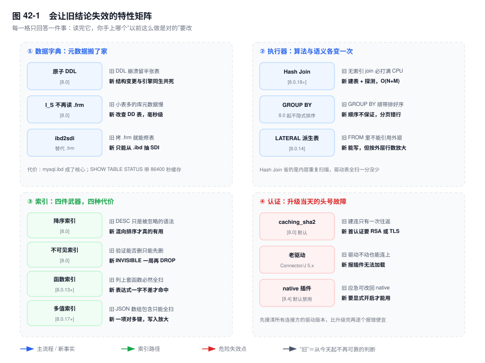
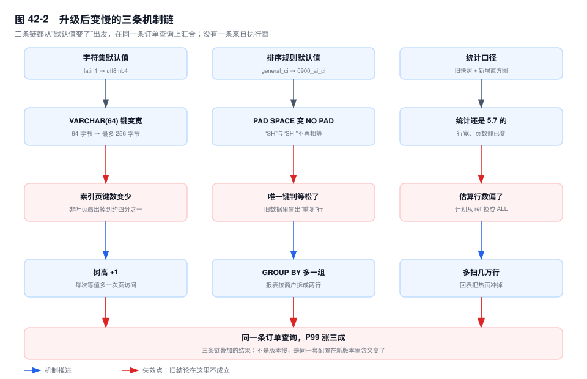

# 第 42 章　MySQL 8.0 / 8.4 关键特性

> **一句话结论**：8.0 值得读的不是"新增了什么"，而是"哪条你以为对的结论，从今天起不成立了"。

## 42.0 场景：升级到 8.0 之后，订单列表慢了 30%

大促后的第一个窗口期，订单库从 5.7 升到 8.0。`mysqlsh` 的升级检查没有报阻塞项，主从切换顺利，错误日志干净。第二天看监控：QPS 没掉，连接数没变，CPU 还低了两个点。

唯一的异常在商户后台的订单列表。同一条 SQL、同一批商户、同一个时间段，P99 从 120ms 变成 160ms。

产品说"8.0 就是比 5.7 慢"，运维说"回滚吧，5.7 又不是不能跑"。回滚没发生，因为有人先跑了 `EXPLAIN`：三张核心表上的计划全变了——`idx_merchant_status_ct` 不再被选中，`order_main` 从 `ref` 退成 `range`，`order_item` 的连接从 `eq_ref` 变成全表扫。

三个原因都跟"8.0 执行得更慢"无关：默认字符集从 `latin1` 变 `utf8mb4`，索引键变宽、树高了一层；默认排序规则换了，判等语义跟着变；统计信息还是 5.7 时期的快照，优化器按旧行宽算新表。这三条在 42.8 里逐条拆开。

本章只写能改变判断的特性，纯粹的"新增了什么"交给 release notes。



## 42.1 事务性数据字典：`.frm` 消失之后，什么变了

5.7 里表结构存放在独立的 `.frm` 里，它和 `.ibd` 不是同一个事务的产物。一次 DDL 要跨几步：写临时 `.frm`、改引擎内字典、rename，任何一步崩掉，重启后都可能"文件是新的、引擎里是旧的"。

8.0 把元数据搬进 InnoDB 自己的表（`mysql.ibd` 里的 DD 表），DDL 的元数据变更与存储引擎操作绑在同一个原子操作里，崩溃后要么全有要么全无——这就是**原子 DDL**。边界要说清：它解决的是"崩溃后不留中间态"，不是"DDL 不阻塞"。DDL 照样等 MDL，照样隐式提交当前事务。

第二件事体感更强：`information_schema` 不再逐个打开 `.frm` 拼结果。5.7 查一次 `SHOW TABLE STATUS`，几千张表就要 open 几千次、解析几千个文件，秒级；8.0 改查 DD 表，毫秒级。**管理后台"升级后变快"多半来自这里，与 SQL 执行无关。**

代价三条：`mysql.ibd` 成了核心，"拷 `.frm` 过去"的偏方没了，表结构只能用 `ibd2sdi` 从表空间里抽；`information_schema_stats_expiry` 默认 86400 秒，`SHOW TABLE STATUS` 读的是缓存，行数可能是一天前的（第 10 章），这条在 42.8 会变成陷阱；物理迁移必须带上 `mysql.ibd`。

## 42.2 执行器：Hash Join 与它不该被当成的东西

`[8.0.18+]` 的 Hash Join 在三个条件同时成立时接管：等值连接、被驱动表在连接列上没有可用索引、成本划算。`EXPLAIN` 里是 `Using join buffer (hash join)`，哈希表建在 `join_buffer_size` 里，装不下就分块落盘。机制见第 12 章 12.1.5，这里只算账：BNL 是"驱动表每读一块，被驱动表全扫一遍"，N×M 量级；Hash Join 是"扫一遍建表 + 扫一遍探测"，降到 N+M。

它让哪条结论失效：「无索引 join 会把 CPU 打满，必须立刻加索引」。现在它可能只是"略慢"，缺索引就被藏起来了。三条代价一分没少：驱动表全扫照旧；`join_buffer_size` 默认 256KB，几十万行的哈希表要落盘；非等值条件（`>`、`<>`、`LIKE '%x'`）根本走不到它。

CTE 与窗口函数改的是写法，不改判断。真正改变判断的是 `GROUP BY` 在 8.0 **不再隐式排序**：5.7 靠排序实现分组，输出天然有序，有人就拿它当 `ORDER BY` 用；8.0 换成哈希聚合，顺序不再保证，"分页翻到第三页出现重复行"就静默发生了。`LATERAL` `[8.0.14]` 同理：能写不等于该写，执行次数按外层行数放大。

## 42.3 索引的四件新武器，以及各自的代价

| 特性 | 版本 | 让哪条旧结论失效 | 代价 |
|---|---|---|---|
| 降序索引 | `[8.0]` | `[5.7]` 接受 `DESC` 但忽略，混向排序仍 `filesort` | 只服务一种方向组合 |
| 不可见索引 | `[8.0]` | "验证索引能不能删，只能删了看" | 写入照旧维护，写放大不减 |
| 函数索引 | `[8.0.13+]` | "列上套函数必然全扫" | 查询表达式必须与索引一致 |
| 多值索引 | `[8.0.17+]` | "JSON 数组包含只能全扫" | 一项对多键，写入按数组长度放大 |

**降序索引。** `[5.7]` 写 `KEY idx (a DESC, b ASC)` 不报错，但存下去仍是全升序，`ORDER BY a ASC, b DESC` 照样 `Using filesort`——"语法通过"被当成"功能生效"，是这一条最常见的误判。它的适用面很窄：全反向排序靠反向扫描就能做，只有升降混排才值得建，代价是索引只服务这一种组合。

**不可见索引。** `ALTER TABLE order_main ALTER INDEX idx_status INVISIBLE`。优化器直接跳过，`EXPLAIN` 的 `key` 变 `NULL`；写入仍然维护，它只省"读的时候被选中"，不省写成本。用途是下线前的灰度：观察一周，看 `performance_schema.table_io_waits_summary_by_index_usage` 里它的 `COUNT_STAR` 是否还涨，没人依赖再 `DROP`。直接删的风险在重建：几十 GB 的表是小时级。另一个坑：唯一索引设成 `INVISIBLE` 仍然判重。

**函数索引。** 本质是隐藏的虚拟生成列加一个普通索引：`KEY idx_month ((DATE_FORMAT(created_at, '%Y-%m')))`，注意双括号。代价很致命：表达式必须与索引一致，写成 `'%Y-%m-%d'` 或 `DATE(created_at)` 就不命中，全表扫，而且不报错。

**多值索引。** `CAST(attr->'$.tags' AS CHAR(20) ARRAY)`，解决"JSON 数组里有没有某个值"，对应 `MEMBER OF`、`JSON_CONTAINS`、`JSON_OVERLAPS`。代价在写：一行 5 个 tag 就是 5 个索引项；元素超过声明的 20 字符直接报错。

## 42.4 把 CPU 分给该给的人：资源组与语句超时

```sql
CREATE RESOURCE GROUP rg_report TYPE=USER VCPU=2-3 THREAD_PRIORITY=-10;
SET RESOURCE GROUP rg_report FOR 2317;
```

`VCPU` 是逻辑核编号，`2-3` 就是把线程钉在这两个核上；`THREAD_PRIORITY` 越小越优先。16 核的库上跑月末对账，一条查询把所有核吃满，下单接口的 P99 跟着抖；绑到 2 个核之后，报表慢一倍，另外 14 核干净了。**这是拿报表的时长换在线的稳定，不是让报表变快。** 代价是硬亲和：钉错核会更糟，报表再急也用不了剩下的核。

`max_execution_time` 只对只读 `SELECT` 生效，`UPDATE`、`DELETE`、`INSERT ... SELECT` 一律不管；按语句覆盖用 `/*+ MAX_EXECUTION_TIME(2000) */`。边界在第 35 章。

## 42.5 认证：`caching_sha2_password` 带来的连锁反应

8.0 把默认认证插件从 `mysql_native_password` 换成 `caching_sha2_password`。差别在第一次认证：`native` 是"给盐、回 SHA1"，一次往返；`caching_sha2` 在账号还没进缓存时，必须走 TLS，或者用 RSA 公钥加密密码再传。

老客户端没实现这套握手，报的错是 `Authentication plugin 'caching_sha2_password' cannot be loaded`——它说的不是密码错，是客户端不认识插件。三条路：升驱动（Connector/J 8.x 之后自带）；连接串加 `allowPublicKeyRetrieval=true`（公钥可能被中间人替换，只在可信内网用）；或者把账号和默认插件一起降回 `native`。前两条是正路，第三条是给"今晚必须上线"留的。

`[8.4]` 又推了一步：`mysql_native_password` 默认禁用，要显式 `--mysql-native-password=ON` 才能开。8.0 上"先降回 native 应急"的招，在 8.4 上不成立。

这一条是升级检查表里必须单列的一项：先把所有连接方的驱动版本摸一遍，比升级完再一个个报错便宜得多。

## 42.6 运维面的三件实事

**Clone 插件 `[8.0.17+]`。** `CLONE INSTANCE FROM 'repl'@'10.0.3.11':3306 IDENTIFIED BY '***';` 物理克隆，按页拷，比逻辑导入快一个量级，源库不用停：快照之后的写入靠 redo 追平。限制比想象中硬——版本兼容、目标目录为空、只能整实例克隆。

**`innodb_redo_log_capacity` `[8.0.30+]`。** 一个参数管总容量，`#innodb_redo` 目录下默认 32 个文件，可在线调。`innodb_log_file_size` × `innodb_log_files_in_group` 在 8.0.30 起废弃、8.4 已移除——配置里留着，8.4 启动直接失败，不是给个警告。

**`innodb_dedicated_server`。** 开着就按启动时的物理内存自动推 BP 与 redo 容量。两个坑：只在启动时推导一次，后来加内存、改容器 limit 都不会跟着变；只看内存总量，不看工作集，也不看这台机器上有没有别的服务。

## 42.7 8.4 LTS：变化不大，但有一条会让升级失败

8.4 是 LTS，语法、优化器、执行器几乎没动，从 8.0 升上来不会有"写法失效"的问题。风险集中在一处：被移除的旧东西。`mysql_native_password` 默认禁用（42.5），单这一条就能让升级当晚连不上；`innodb_log_file_size`、`innodb_log_files_in_group` 移除，配置里留着就起不来；`expire_logs_days` 早在 8.0 就没了，用 `binlog_expire_logs_seconds`。

判断：**从 8.0 升 8.4 的难点不在功能，在于你把哪些废弃项用了十年。** 检查方式不是读 release notes，是拿 `mysqld --validate-config` 把现网配置跑一遍。

## 42.8 为什么升级之后反而更慢

**① 字符集默认值变了。** `[5.7]` 的 `character_set_server` 默认 `latin1`；8.0 默认 `utf8mb4`，配 `utf8mb4_0900_ai_ci`。同一个 `VARCHAR(64)` 的索引键，从"最多 64 字节"变成"最多 256 字节"。索引页 16KB 不变，键长翻四倍，非叶子页的扇出掉到四分之一左右，同样的数据量下 B+ 树多一层——每次等值查询多一次页访问，多一次 latch。前缀索引上限也从 767 字节放到 3072 字节，老 DDL 里的 `KEY idx_url (url(191))` 就是 767÷4 的整数解，这个数字现在失去了存在理由。

**② 排序规则变了，语义也变了。** 升级不改列上的 collation，变的是新建的表（默认 `0900_ai_ci`）和你顺手 `CONVERT` 重建过的表。`general_ci` 是 PAD SPACE，`0900_ai_ci` 是 NO PAD：`'SH'` 与 `'SH '` 从相等变成不等。唯一键上原本被拒的第二条现在能插进去，`GROUP BY` 把一个商户分成两组——业务侧看到"升级后多了重复行"，其实一条没丢，是判等规则变了（机制见第 29 章）。

**③ 统计信息与直方图。** `mysql.innodb_table_stats` 里躺的是 5.7 时期的快照：行宽、页数、索引大小全变了，`n_rows` 还是旧的，而 `innodb_stats_auto_recalc` 要等变更行数超过约 10% 才动，一张只读的归档表可能一年都不触发。`[8.0]` 新增的直方图让没有索引的列也有分布信息，优化器有了更多选择，也就有了更多选错的机会。升级后**必须**对核心表重跑 `ANALYZE TABLE`。

三条叠在同一条 SQL 上：索引变大让每次定位多读一页，判等规则变化让某些条件多匹配几行，计划退化成 `range` 多扫几万行——30% 是这么来的，其中没有一分钱属于"8.0 执行得更慢"。

可执行的判断：**升级后的性能回归，先看 `EXPLAIN` 有没有变，再看索引大小有没有变，最后才怀疑版本。**



## 42.9 关键结论

1. **原子 DDL 解决的是"崩溃后不留半张表"，不是"DDL 不阻塞"。** MDL 照旧要等，隐式提交照旧发生。
2. **8.0 的"快"有很大一块来自元数据。** `information_schema` 不再逐个打开 `.frm`，与 SQL 执行无关。
3. **Hash Join 省的是内层重复扫描，不是驱动表全扫。** `rows` 上万还出现 hash join，说明缺的是索引。
4. **`GROUP BY` 不再隐式排序。** 依赖它输出顺序的分页会静默错位。
5. **四件索引武器各有边界：** 降序只服务混向排序，不可见不省写入，函数索引要求表达式一字不差，多值索引按数组长度放大写入。
6. **性能回归先看计划，再看索引大小，最后才看版本。**

## 42.10 实验验证

### 实验一：默认字符集与排序规则，逐层对齐

```sql
SELECT @@character_set_server, @@collation_server;

SELECT TABLE_NAME, TABLE_COLLATION
FROM information_schema.TABLES
WHERE TABLE_SCHEMA = 'order_db'
ORDER BY TABLE_NAME LIMIT 5;
```

预期形态（`# 输出形态（未实跑，字段含义以此为准）`）：

```text
@@character_set_server  @@collation_server
utf8mb4                 utf8mb4_0900_ai_ci

TABLE_NAME       TABLE_COLLATION
bill_detail      utf8mb4_general_ci
merchant         utf8mb4_general_ci
order_item       utf8mb4_0900_ai_ci
order_main       utf8mb4_general_ci
```

老表 `general_ci`、新表 `0900_ai_ci`，一 JOIN 要么 1267，要么某一侧被转换、索引失效。

### 实验二：降序索引到底有没有生效

```sql
CREATE TABLE order_settle_t (
  id BIGINT PRIMARY KEY,
  merchant_id BIGINT NOT NULL,
  settled_at DATETIME NOT NULL,
  amount DECIMAL(12,2) NOT NULL,
  KEY idx_asc  (merchant_id, settled_at),
  KEY idx_desc (merchant_id, settled_at DESC)
) ENGINE=InnoDB;

EXPLAIN SELECT id, settled_at, amount FROM order_settle_t
FORCE INDEX (idx_asc)
WHERE merchant_id = 8842 ORDER BY merchant_id ASC, settled_at DESC;

EXPLAIN SELECT id, settled_at, amount FROM order_settle_t
FORCE INDEX (idx_desc)
WHERE merchant_id = 8842 ORDER BY merchant_id ASC, settled_at DESC;
```

预期形态（`# 输出形态（未实跑，字段含义以此为准）`）：

```text
-- idx_asc ：key = idx_asc  Extra = Using where; Using filesort
-- idx_desc：key = idx_desc Extra = Using where
```

验证点只有一个：`Extra` 里还有没有 `Using filesort`。

### 实验三：把索引设成 INVISIBLE，看优化器怎么绕开

```sql
ALTER TABLE order_main ALTER INDEX idx_status INVISIBLE;

EXPLAIN SELECT id, status, created_at FROM order_main
WHERE status = 'PAID' ORDER BY created_at DESC LIMIT 20;

SELECT INDEX_NAME, COUNT_STAR, COUNT_READ
FROM performance_schema.table_io_waits_summary_by_index_usage
WHERE OBJECT_SCHEMA = 'order_db' AND OBJECT_NAME = 'order_main';
```

预期形态（`# 输出形态（未实跑，字段含义以此为准）`）：

```text
key = NULL   type = ALL   Extra = Using where; Using filesort

INDEX_NAME   COUNT_STAR   COUNT_READ
PRIMARY            1821         1821
idx_status            0            0   <- INVISIBLE 之后不再增长
```

`COUNT_STAR` 不动，就是没人依赖的证据。

### 实验四：直方图是显式建的，不是自动有的

```sql
ANALYZE TABLE order_main UPDATE HISTOGRAM ON status WITH 16 BUCKETS;

SELECT COLUMN_NAME, JSON_LENGTH(HISTOGRAM) AS buckets
FROM information_schema.COLUMN_STATISTICS
WHERE SCHEMA_NAME = 'order_db' AND TABLE_NAME = 'order_main';
```

预期形态（`# 输出形态（未实跑，字段含义以此为准）`）：

```text
COLUMN_NAME   buckets
status             16
```

`ANALYZE TABLE` 只更新索引统计，直方图要单独建，落在 `COLUMN_STATISTICS` 里。

## 42.11 常见误区

⚠️ **"8.0 有 Hash Join 了，所以不用建索引了"**
错在把算法优化当成结构替代：Hash Join 只是把内层 N 次重复扫描换成一张哈希表，驱动表该怎么扫还怎么扫。**它救的是"偶尔一条没索引的等值 join"，不是"长期不建索引的表"。** 判据是 `rows`：几百是净收益，上万就该加索引。

⚠️ **"降序索引就是建索引时写个 `DESC`"**
`[5.7]` 也接受 `DESC`，只是忽略它，所以这个理解从来没成立过。**正确理解：降序索引只对升降混排有用，全反向排序靠反向扫描就够；建了它，索引就只服务这一种方向组合。**

⚠️ **"不可见索引等于把索引删了"**
删了要重建，几十 GB 的表是小时级，期间写放大和主从延迟一起上来；不可见只是让优化器跳过它，写入仍然维护。**正确理解：它是"下线前的灰度开关"，价值在可逆，不在省资源。**

⚠️ **"升级到 8.0 一定更快"／"8.4 比 8.0 慢"**
两个说法都是拿别人的结论套自己的库。8.0 在元数据查询、DDL 上确实快；同时默认字符集、排序规则、统计口径都变了，**同一套配置在新版本里含义不同**。把升级当成一次结构变更来验证：前后各存一份 `EXPLAIN`，升级后重跑 `ANALYZE`，再比索引大小。

## 42.12 生产 Checklist

升级前：

- [ ] 所有连接方的驱动版本都支持 `caching_sha2_password` 吗？（8.4 还要确认没人用 native）
- [ ] 核心 SQL 的 `EXPLAIN` 存档了吗？这是唯一能证明"计划变了"的证据
- [ ] 配置跑过 `mysqld --validate-config` 了吗？`innodb_log_file_size` 清了吗
- [ ] 依赖 `GROUP BY` 输出顺序的分页、导出 SQL 补上 `ORDER BY` 了吗
- [ ] 5.7 时期写的 `(col(191))` 这类前缀长度还合适吗

升级后：

- [ ] 对核心表跑过 `ANALYZE TABLE` 吗？只读的归档表也在内吗
- [ ] 新建表的默认 collation 与老表一致吗？不一致的 JOIN 查过 1267 吗
- [ ] `SHOW TABLE STATUS` 的行数是缓存值吗？（必要时把 `information_schema_stats_expiry` 置 0）
- [ ] 要下线的索引先 `INVISIBLE` 观察够一周、覆盖到周报月报了吗
- [ ] 函数索引的表达式与索引定义逐字对齐了吗
- [ ] 报表类大查询绑了资源组或设了 `max_execution_time` 吗

## 42.13 延伸

- **关联章节**：第 10 章（统计信息）、第 12 章（Hash Join 与 BNL）、第 29 章（字符集判等）、第 35 章（`max_execution_time`）、第 43 章（升级路径与回滚）。
- **面试追问**：
  - "原子 DDL 能保证 DDL 不阻塞业务吗？" → 不能。原子性只约束崩溃后的状态。
  - "有了 Hash Join 是不是可以不建索引？" → 只对偶尔出现的等值 join 成立，`rows` 上万就是缺索引。
  - "5.7 升 8.0 同一条 SQL 变慢，先查什么？" → 先比 `EXPLAIN`，再比索引大小与树高，最后才怀疑版本。
- **官方文档**：`MySQL 8.0 Reference Manual` → `Data Dictionary`、`Hash Join Optimization`、`Invisible Indexes`、`Functional Key Parts`、`Multi-Valued Indexes`、`Caching SHA-2 Pluggable Authentication`、`Cloning Plugins`；`MySQL 8.4 Reference Manual` → `Features Removed in MySQL 8.4`。
