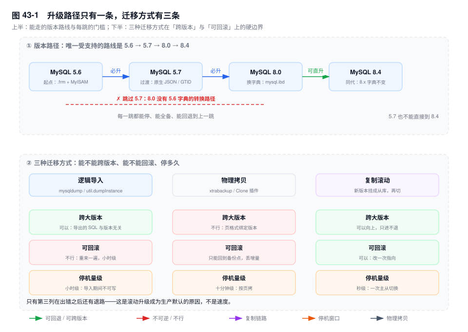
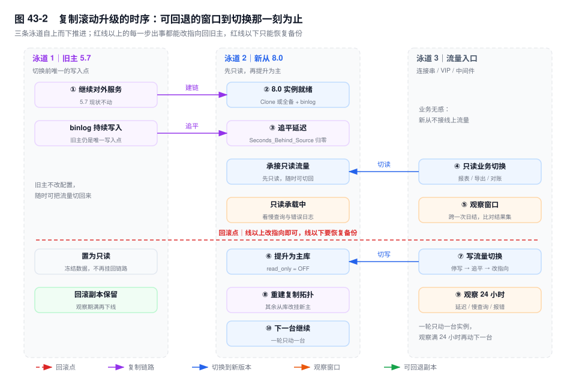

# 第 43 章　升级与迁移

> **一句话结论**：跨大版本升级不是一次发布，是一次不可逆的数据搬迁；验收标准只有一个——同一批查询在新旧实例上返回同一批行。

## 43.0 场景：升级报告上全是绿勾，第三天报表对不上

周五凌晨，订单库从 5.7 升到 8.0。`checkForServerUpgrade` 零 error；停机 11 分钟，比申请的两小时短得多；监控正常，压测两轮 P99 与旧库持平。报告归档，全员下班。

周一财务对账，商户结算金额比上月多了 0.3%。多出来的不是钱，是 `GROUP BY merchant_name` 的分组比上月多 17 行。

根因在排序规则。`merchant_name` 是 `VARCHAR(64)`，5.7 的 `utf8mb4_general_ci` 是 PAD SPACE 语义，`'张三便利店'` 与 `'张三便利店 '`（尾部一个空格）判等，`GROUP BY` 把它们合成一组；8.0 新建的分区表用了 `utf8mb4_0900_ai_ci`，NO PAD，两条记录分成两组，报表于是凭空多出 17 个"新商户"（机制见第 29 章）。

升级当天为什么没暴露：这 17 行依赖"数据里有尾空格"这个前提。压测库从生产脱敏导出，脚本顺手 `TRIM()` 了商户名——问题在压测数据集里根本不存在。

**能启动、能跑通、不报错，都不等于升对了。** 验收标准是同一批查询在旧库和新库上结果一致；绿勾只证明前半句。

## 43.1 为什么不能跳版本

8.0 的元数据住在 InnoDB 自己的表里（`mysql.ibd` 里的 DD 表）。5.7 的表结构是 `.frm` 加 `mysql` 库里的 MyISAM 系统表；5.6 又是另一套，`mysql.user` 的密码列在 5.7 期间被改写过。

服务端启动时的 `--upgrade` 逻辑只认**上一代**的字典布局。8.0 的代码里没有"从 `.frm` 直接构造 DD 表"的分支，因为它假定 5.7 那一步已经跑过。缺的不是数据，是转换代码。

能走的路径只有 5.6 → 5.7 → 8.0 → 8.4。每一跳之间都能停、能全备、能回退到上一跳——相邻两代的备份格式彼此认得。8.0 → 8.4 属于同一代（都是 8.x，DD 布局一致），可以直接就地升；5.7 直接到 8.4 不行，8.4 只接受 8.0 的字典。

代价是三次停机换一次。跳掉的那两次不会消失：5.6 的库直接砸进 8.0 起不来，你手上只有一堆 `.frm`，而 8.0 可能已经把 `mysql.ibd` 写了一半——升不上去，也打不开，只能整库恢复。

**跳版本省下的那次停机，会在出问题时以"无法定位、无法回滚"的形式还回来。**

## 43.2 `checkForServerUpgrade`：它查什么，以及它查不到什么

工具在 MySQL Shell 里，连的是**运行中的实例**：

```bash
mysqlsh -- util checkForServerUpgrade root@10.0.3.11:3306 \
  --target-version=8.0.36 --output-format=JSON \
  --config-path=/etc/my.cnf
```

`--target-version` 决定按哪个版本的规则判断（同一实例升 8.0 与升 8.4 结论不同）；`--config-path` 让它顺带检查配置文件——43.3 的坑有一半在那里。

输出分三级。**errors 必须清零**，对应"升不上去"或"对象不可用"；**warnings 逐条判断**，典型是"你用了将被移除的东西"；**notices 是提醒**。

查得到的典型项：

- 与 8.0 新增保留字冲突的库名/表名/列名：`RANK`、`ROW_NUMBER`、`DENSE_RANK`、`CUME_DIST`、`GROUPS`、`ROWS`、`WINDOW`、`LATERAL`、`SYSTEM`、`EMPTY`。5.7 里能裸写的 `rank` 列，8.0 起必须加反引号，应用里 `SELECT rank FROM ...` 直接 1064。
- `utf8mb3` 的使用（库、表、列、排序规则）
- 只差大小写的表名（迁到 `lower_case_table_names=1` 时冲突）
- 零日期、`ENUM`/`SET` 值超 255 字符、索引键超 3072 字节、无主键表（见第 30 章）
- `mysql_native_password` 账号（8.0 只提醒，8.4 直接禁用）

查不到的，恰是让 43.0 变成事故的那一类：

- **业务语义。** 它只看 collation 是不是 `utf8mb3`，不看 PAD SPACE 换成 NO PAD 之后判等变了。
- **执行计划。** 统计信息还是升级前那张表里的快照，直方图一条没有（第 42 章）。
- **性能回归。** 它读字典和配置，没跑过一条业务 SQL。
- **应用侧。** 驱动版本、连接串、依赖 `GROUP BY` 隐式排序的分页，都在视野之外。

**工具保证"能启动"，不保证"行为一致"。** 它是"会不会当场失败"的清单，不是"业务会不会算错"的清单。

## 43.3 就地升级的五个坑

| # | 坑 | 触发条件 | 症状 |
|---|---|---|---|
| ① | undo 表空间 | 从 5.7 升，原 `innodb_undo_tablespaces=0` | 升级时自动建两个，磁盘没预留就写满 |
| ② | 字符集与排序规则 | 老表 `general_ci`，新表 `0900_ai_ci` | JOIN 报 1267，或隐式转换后索引失效 |
| ③ | 已移除参数 | `my.cnf` 里留着 `query_cache_size` | 不是警告，是启动失败 |
| ④ | 保留字冲突 | 列名 `rank`、`groups`、`window` | 应用 SQL 报 1064 |
| ⑤ | `sql_mode` 默认值 | 5.6 时代显式关过 `ONLY_FULL_GROUP_BY` | 照抄配置带进 8.0，结果不对 |

**① undo 表空间。** 8.0 要求至少两个，升级时由服务端自动创建（初始 16MB，按需扩展）。它不检查 `innodb_undo_directory` 所在盘的余量。

**② 字符集。** 升级不改已有表，只改**新建表**的默认值。于是同库里两代 collation 并存；更隐蔽的是列级与表级不同——那张表在 5.7 期间被 `ALTER` 加过列，继承的是当时的会话默认值，`SHOW CREATE TABLE` 还不打印它。

**③ 已移除参数。** `query_cache_size`、`query_cache_type`（整个 query cache 在 8.0 移除）、`innodb_file_format`、`innodb_large_prefix`、`innodb_support_xa`、`innodb_undo_logs`，写进配置的后果是起不来。8.4 还有一批（第 42 章）。

**④ 保留字。** 表名可以 `RENAME`，列名只能 `ALTER TABLE ... CHANGE COLUMN`——大表上是一次重建（第 46 章）。库名冲突最麻烦，MySQL 没有原子的改库名命令。

**⑤ `sql_mode`。** 8.0 移除了 `NO_AUTO_CREATE_USER`，`GRANT ... IDENTIFIED BY 'pwd'` 直接语法错误，得先 `CREATE USER`。反过来，配置里写死的旧 `sql_mode` 会被原样带进 8.0。

**升级前把 `my.cnf` 在目标版本的空实例上启动一遍，比读文档快。** 一条 `mysqld --defaults-file=/tmp/new.cnf --validate-config` 就能把"起不来"这类问题提前一周清掉。

## 43.4 三种迁移方式：逻辑、物理、复制



**逻辑**：`mysqldump --single-transaction`，或 `mysqlsh util dumpInstance`（多线程、分块、可并行 load）。按行导出、按行插入、重建索引，速度由行数决定。换来三件事：可跨版本跨平台、可只搬部分库表、可顺手改字符集。小库和异构迁移用它。

**物理**：`xtrabackup` 或 Clone 插件。按页拷，字节级一致，连页内隐藏列和 undo 一起搬。代价是与版本、平台、页格式强绑定：8.0 的 `mysql.ibd` 5.7 读不了，Clone 还要求目标目录为空、只做整实例。它适合同版本重建从库。

**复制滚动**：把 8.0 挂成 5.7 的从库，追平延迟，切只读流量，再切写流量，最后提升。

关键差别不在速度，在退路。前两种一旦开工，新旧两库就是两份互不相干的东西，出错只能重来；滚动升级在切换之前，旧主完整可写可读，切回去只是改一次指向。切换之后旧主退化为冻结的回滚副本——MySQL 不支持新版本向旧版本复制，它挂不回链路，切回去等于放弃切换后的增量。

**生产首选复制滚动升级，不是因为它快，是因为它是唯一"切回去只要几分钟"的方案。**

## 43.5 异构迁移：类型映射错在哪一步

**Oracle 侧。**

`NUMBER(p,s)` → `DECIMAL(p,s)`，不是 `DOUBLE`。`DOUBLE` 是二进制浮点，`0.1 + 0.2` 不等于 `0.3`，十万笔账单求和差几分钱，对账时无法解释。`NUMBER` 不写精度时可能存小数，别映射成 `BIGINT`。

`DATE` → `DATETIME`。Oracle 的 `DATE` 含时分秒，映射成 MySQL 的 `DATE` 会截断时间，"当日截止"全错，而且不报错。

`VARCHAR2(n)` 的 n 是**字节**，MySQL 的 `VARCHAR(n)` 是**字符**。按 `utf8mb4` 建表容量放大四倍，截断风险变小，风险落到应用层：`if (strlen(name) > 64)` 在 Oracle 上按字节算，迁过来按字符算，边界变了。

Oracle 没有 `BOOLEAN`，习惯用 `NUMBER(1)`。迁成 `TINYINT(1)` 值域是 -128~127，写 `2` 也照收，`(1)` 在 8.0.19 起只是弃用的显示宽度。要守值域得用 `TINYINT UNSIGNED NOT NULL DEFAULT 0` 加 `CHECK (flag IN (0,1))`（8.0.16 起才强制）。索引也别指望：两个值的列选择性接近零，这条在 Oracle 上同样成立。

**PostgreSQL 侧。**

`serial` → `BIGINT AUTO_INCREMENT`，自增起点要单独设，否则新主键从 1 开始撞历史数据；`boolean` → `TINYINT(1)`；`jsonb` → `JSON`。

`timestamptz` → `TIMESTAMP` 最容易错。PG 的 `timestamptz` 是"时间点"，MySQL 的 `TIMESTAMP` 也做会话时区转换，语义对得上，但它只到 2038-01-19，超出直接报错；换 `DATETIME` 不报错，时区责任被推给应用。

表名折叠规则相反：PG 里没加引号的标识符折成小写，MySQL 在 Linux 上大小写敏感（`lower_case_table_names=0`），`Orders` 和 `orders` 是两张表。而 `lower_case_table_names` **只能在初始化时设定**——必须在迁移前定。

**异构迁移里最难的不是搬数据，是搬"默认行为"——排序、大小写、空串与 NULL、日期截断。** Oracle 里 `''` 就是 NULL，MySQL 里它是空串且能通过 `NOT NULL`；`ORDER BY` 时 NULL 位置相反；`'2026-02-30'` 在宽松模式下被悄悄截成 `0000-00-00`。

## 43.6 回滚：为什么 8.0 回 5.7 只能靠备份

8.0 的字典在 `mysql.ibd` 里，5.7 需要 `.frm` 加 MyISAM 的 `mysql` 库。这两套格式没有反向转换器，5.7 连 8.0 的数据目录都打不开。

`mysql_upgrade` 从来只能升不能降，而且已在 `[8.0.16]` 退役：这件事被服务端的 `--upgrade` 接管，取值 `AUTO`（默认）、`FORCE`、`MINIMAL`、`NONE`；`[8.4]` 里那个客户端被彻底移除。老脚本里那句 `mysql_upgrade -u root -p`，在 8.0.16+ 上只是触发一次服务端检查，在 8.4 上直接 command not found。**把它写进升级预案的人，等于没有预案。**

所以回滚只有两种形态：

1. **恢复升级前的全备，再用 binlog 补到故障点**（第 28 章）。前提苛刻：备份演练过恢复、binlog 从那一刻起没断、GTID 能对上。
2. **逻辑导出后重导回旧版本。** 慢，而且 schema 不一定回得去：`utf8mb4_0900_ai_ci` 的列在 5.7 建不出来，函数索引与降序索引不可用。

**"升级失败了就降回去"这句话，在跨大版本时是不成立的；能成立的只有"升级前留了一份能恢复的东西"。**

## 43.7 演练清单与灰度顺序

顺序固定：**先从库 → 再只读业务 → 最后主库**。每一步都要有观察窗口和回退动作，没有回退动作的那一步不许执行。

| 阶段 | 动作 | 观察窗口 | 回退动作 |
|---|---|---|---|
| 从库 | 升一台无流量的从库 | 24 小时：错误日志、延迟、慢查询 | 重建这台从库，线上无感 |
| 只读业务 | 报表、导出、离线对账切过去 | 跨一次日结：比对行数与汇总值 | 改指向，秒级 |
| 主库 | 滚动切换（43.4） | 24 小时：延迟、1267/1292 | 切换前改指向；切换后只能恢复备份 |

窗口为什么是"跨一次日结"？43.0 那类问题只在完整跑一次分组、且数据带着那个前提时才暴露。



图 43-2 那条红线是要点：线以上出错都能改指向切回旧主，线以下只能恢复备份。观察窗口都压在红线之上——把"还能退"的时间用足，再跨过去。

**升级当天最该克制的动作，是"顺手把这个也改了"。**

## 43.8 关键结论

1. **升级的验收标准是结果集一致，不是启动成功。** `checkForServerUpgrade` 全绿只证明"能起来"。
2. **跨大版本没有降级路径。** 8.0 回 5.7 只有"恢复升级前的备份"，`mysql_upgrade` 从来不管这件事。
3. **滚动升级是唯一可回滚的迁移方式。** 逻辑导入要重来一遍，物理备份版本对不上。
4. **升级不改已有表的字符集，只改新表的默认值。** 同库里两代 collation 并存，判等与 JOIN 一起变。
5. **被移除的参数不是警告，是启动失败。** `my.cnf` 要在目标版本的空实例上先跑一遍。
6. **异构迁移搬的不是数据，是默认行为。** 每一条都能让金额差 0.3%。

## 43.9 实验验证

### 实验一：升级检查的输出形态

```bash
mysqlsh -- util checkForServerUpgrade root@10.0.3.11:3306 \
  --target-version=8.0.36 --output-format=JSON
```

```text
# 输出形态（未实跑，字段含义以此为准）
{
  "serverVersion": "5.7.42-log",
  "targetVersion": "8.0.36",
  "errorCount": 2, "warningCount": 9, "noticeCount": 3,
  "checksPerformed": [
    {"id": "reservedKeywords", "status": "error",
     "detectedProblems": [{"level": "Error",
       "dbObject": "order_db.settle_batch",
       "description": "column `rank` uses a reserved word"}]},
    {"id": "utf8mb3", "status": "warning"},
    {"id": "innodbUndoTablespaceSize", "status": "ok"}
  ]
}
```

看三处：`errorCount` 是否为 0、报 error 的 check id、`--config-path` 是否真的传了。

### 实验二：找出会被新保留字打中的列

```sql
SELECT TABLE_SCHEMA, TABLE_NAME, COLUMN_NAME
FROM information_schema.COLUMNS
WHERE COLUMN_NAME IN ('rank','rows','groups','window','lateral',
                      'system','empty','cume_dist','percent_rank')
  AND TABLE_SCHEMA NOT IN ('mysql','sys','information_schema','performance_schema');
```

```text
# 输出形态（未实跑，字段含义以此为准）
TABLE_SCHEMA   TABLE_NAME      COLUMN_NAME
order_db       settle_batch    rank
order_db       merchant_tier   groups
billing_db     invoice_rule    window
```

表名与库名换 `information_schema.TABLES` 再查。清单要落到两处：DDL 的反引号、应用里拼的 SQL。

### 实验三：查同一张表里的 collation 混用

```sql
SELECT TABLE_NAME, COLUMN_NAME, COLLATION_NAME
FROM information_schema.COLUMNS
WHERE TABLE_SCHEMA = 'order_db'
  AND COLLATION_NAME = 'utf8mb4_general_ci'
  AND TABLE_NAME IN (
    SELECT TABLE_NAME FROM information_schema.TABLES
    WHERE TABLE_SCHEMA = 'order_db'
      AND TABLE_COLLATION = 'utf8mb4_0900_ai_ci');
```

```text
# 输出形态（未实跑，字段含义以此为准）
TABLE_NAME    COLUMN_NAME      COLLATION_NAME
order_main    merchant_name    utf8mb4_general_ci
order_main    remark           utf8mb4_general_ci
```

表级 0900、列级 general_ci 的表，就是 43.0 的候选者。

### 实验四：配置文件里的已移除参数

```bash
grep -nE 'query_cache|innodb_file_format|innodb_large_prefix|innodb_support_xa' /etc/my.cnf
```

```text
# 输出形态（未实跑，字段含义以此为准）
12:query_cache_size = 134217728
13:query_cache_type = 1
47:innodb_file_format = Barracuda
```

```bash
mysqld --defaults-file=/etc/my.cnf --validate-config
# 输出形态（未实跑，字段含义以此为准）
mysqld: [ERROR] unknown variable 'query_cache_size=134217728'
```

`--validate-config` 只校验参数、不启动实例，是升级前最便宜的探测。

## 43.10 常见误区

⚠️ **"升级前跑通压测就算验收通过"**
压测证明吞吐和延迟，不证明语义。压测数据集被脱敏脚本清洗过，43.0 那 17 行尾空格在压测库里不存在；压测 SQL 也只覆盖热点路径。**正确理解：压测验性能，结果集比对验语义，两份报告都要有。**

⚠️ **"`mysql_upgrade` 能降级"**
它从诞生起只能升级，`[8.0.16]` 起被服务端 `--upgrade` 接管，`[8.4]` 客户端被移除。**正确理解：跨大版本降级没有工具，只有备份。**

⚠️ **"物理备份可以跨大版本恢复"**
页格式、字典格式、redo 格式都与版本绑定，`xtrabackup` 8.0 读不了 5.7 的备份，Clone 要求版本一致。**正确理解：跨版本只有逻辑导出，代价是慢。**

⚠️ **"跳过 5.7 直接升 8.0 能省事"**
8.0 的升级逻辑只认 5.7 的字典布局，`.frm` 没有转换路径。省下的停机，会在"起不来也回不去"时以整库恢复还回来。**正确理解：版本路径是代码约束，不是流程偏好。**

## 43.11 生产 Checklist：升级前的 20 项

12 条，20 个动作：

- [ ] **备份**：全备后当场恢复到另一台机器验证（不是"备份成功"，是"能恢复"）
- [ ] **备份**：记录 binlog 位点/GTID，保留期覆盖整个回滚窗口
- [ ] **检查**：errors 清零，warnings 逐条留判断记录
- [ ] **检查**：`--validate-config` 在目标版本空实例上通过
- [ ] **检查**：保留字清单同时落到 DDL 与应用代码
- [ ] **检查**：collation 分布盘点过，`utf8mb3` 与列级混用有方案
- [ ] **检查**：驱动支持 `caching_sha2_password`（升 8.4 还要确认无人用 native）
- [ ] **演练**：核心 SQL 在新旧库上**逐行比对结果集**，不是"能跑通"
- [ ] **演练**：压测基线对齐，`EXPLAIN` 存档，升级后重跑 `ANALYZE TABLE`
- [ ] **灰度**：先升无流量从库，观察满 24 小时再进下一步
- [ ] **灰度**：只读业务跨一次日结比对汇总值，窗口与业务方书面确认
- [ ] **观察**：切换后 24 小时不做其他变更，按 1267/1292/1064 巡检日志

## 43.12 延伸

- **关联章节**：第 42 章（8.0 特性）、第 28 章（全备与 PITR）、第 26 章（切换细节）、第 29 章（判等）、第 30 章（无主键表）、第 46 章（改列名的成本）。
- **面试追问**：
  - "5.6 能直接升 8.0 吗？" → 不能。8.0 只处理 5.7 的字典布局，没有 `.frm` 转换路径。
  - "8.0 升坏了怎么降回 5.7？" → 没有降级工具，只能恢复升级前全备再接 binlog。
  - "为什么滚动升级更受生产青睐？" → 不是快，是切换前旧主完整可写可读，回退只改一次指向。
- **官方文档**：`MySQL 8.0 Reference Manual` → `Upgrading MySQL`、`Changes in MySQL 8.0`、`Server Options: --upgrade`、`checkForServerUpgrade`、`Clone Plugin`；`MySQL 8.4 Reference Manual` → `Features Removed in MySQL 8.4`。
