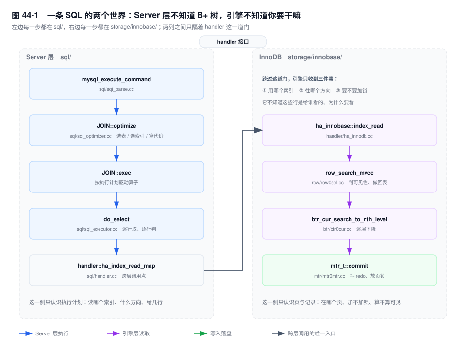
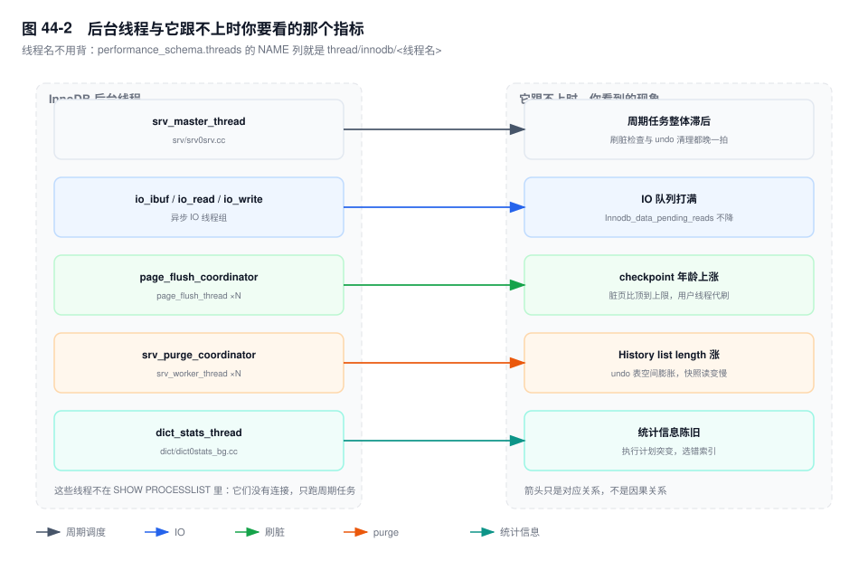

# 第 44 章　内核源码导读（选修）

> **一句话结论**：读源码不是"读完整个 MySQL"，而是"从一条你自己关心的 SQL 切进去，一路断到它真正停下来为止"。目录名是地图，函数名是路标，栈是脚印。

## 44.0 场景：`EXPLAIN` 说走了索引，但 `Handler_read_next` 几乎不动

大促次日的对账脚本，一条 SQL 谁都挑不出毛病：

```sql
FLUSH STATUS;
SELECT order_no, amount FROM order_bill
 WHERE merchant_id = 9021 AND bill_date = '2026-11-11';
SHOW SESSION STATUS WHERE Variable_name LIKE 'Handler_read%';
```

`EXPLAIN` 显示 `type=ref`、`key=idx_merchant`、`rows=12000`、`Extra: Using index condition`。计数器的结果是 `Handler_read_key = 1`、`Handler_read_next = 3`、`Handler_read_rnd_next = 48210`。

"走了索引"和"扫了四万八千行"同时成立。文档给的是三个互相独立的定义，博客给的是"ICP 能减少回表"，同事给的是"`rnd_next` 就是全表扫"。三句话都对，合起来解释不了这三个数为什么长在一起。

答案在 `sql/handler.cc`：`Handler_read_next` 数的是 **Server 层向引擎要"下一行"的次数**，不是索引上走过的记录数。ICP 把条件下推到引擎，引擎内部丢掉的行根本不计这一次；这条 SQL 真正交回 Server 层的确实只有 3 行——该商户当天就 3 张单。而那 4.8 万，是同一个连接上一条导数语句留下的残留：`FLUSH STATUS` 清的是会话，连接池把上一条语句的账留在了这里。

三个口径——Server 层调用次数、引擎内部扫过的记录数、会话累计——文档从不告诉你它们不是一回事。走到这一层，文档到头了，剩下的问题只有一种问法：**这个计数器在哪一行代码里加一**。

本章的路线图就是它：别管代码，先认清这两列。



## 44.1 目录：先认清六个地方

不用背全树，认六处就够用：

- `sql/` —— Server 层的全部：连接管理、解析、优化、执行、binlog。一条 SQL 在跨过 handler 之前的所有动作都在这里。
- `storage/innobase/` —— InnoDB。事务、锁、MVCC、B+ 树、redo、undo、Buffer Pool，全书讲过的机制九成在这棵子树里。
- `include/` —— 公共头文件，跨模块的类型与常量。找 `enum lock_mode` 这类枚举时先来这里。
- `mysys/` —— 跨平台基础库：文件、锁、内存、时间。它跟数据库语义无关，读业务逻辑时可以整块跳过。
- `libbinlogevents/` —— binlog 事件的编解码，主从与闪回工具的公共底座。
- `plugin/` —— 插件。复制、认证、Clone 这些"看起来像内核"的能力，实现其实挂在这里。

两个 8.0 才有的变化值得单独记：`sql/iterators/` 是新执行器（迭代器模型），老的 `do_select()` 那一套与它并存，同一张计划可能从两条路走进去；`storage/innobase/` 内部按 `btr/` `row/` `trx/` `lock/` `mtr/` `buf/` `dict/` `srv/` 分了目录，**目录名就是子系统名**，这比 5.x 时代把两百个 `*0*.cc` 平铺在一起友好太多。

方法只有一句：**先记目录名，再记函数名。目录名稳定十年，函数名一年改一次。**

真到"连目录都不知道进哪个"的时候别硬猜：doxygen 站点（`dev.mysql.com/doc/dev/mysql-server/`）按函数名反查所属文件；反过来，从 `performance_schema` 抄一个线程名去 `grep`，几乎总能落到一个具体的 `.cc`——**源码里的名字会原样出现在你日常用的视图里**。

## 44.2 线程模型：`SHOW PROCESSLIST` 里看不见的那群人

`SHOW PROCESSLIST` 只列用户连接。InnoDB 的后台线程一个都不在里面，但它们才是"没人在跑 SQL，实例却很忙"的原因。

| 线程 | 干什么 | 跟不上时你看到什么 |
|---|---|---|
| `srv_master_thread` | 周期任务：刷脏检查、undo 清理 | 后台循环整体滞后 |
| `io_ibuf_thread` / `io_read_thread` / `io_write_thread` | 异步 IO：读页、写页、合并 change buffer | IO 队列打满，`Innodb_data_pending_reads` 不降 |
| `page_flush_coordinator_thread` / `page_flush_thread` | 8.0 的 page cleaner | checkpoint 年龄上涨（见第 39 章） |
| `srv_purge_coordinator_thread` / `srv_worker_thread` | purge 旧版本 | `History list length` 只涨不跌（见第 5 章） |
| `dict_stats_thread` | 统计信息后台采样 | 统计信息陈旧，执行计划突变（见第 10 章） |

5.7 只有一个 `page_cleaner_thread`，8.0 拆成"一个协调者 + N 个工人"，因为单线程刷脏在 NVMe 上根本喂不饱设备。不是重构癖，是硬件变了。

有意思的是，这些名字你其实早就见过：`performance_schema.threads` 的 `NAME` 列里就是它们，形如 `thread/innodb/page_flush_coordinator_thread`。查一次就对上了：

```sql
SELECT NAME, THREAD_OS_ID FROM performance_schema.threads
 WHERE NAME LIKE 'thread/innodb/%';
```

**查 p_s 的时候，你已经在读源码里的线程名了**——所以从监控跳进代码，比从目录跳进去近得多。最后那句 `THREAD_OS_ID` 也不是摆设：`perf top -t <tid>` 和 `top -H -p <pid>` 用的是同一个号，监控、性能工具、源码三边靠它对齐。



## 44.3 `handler`：Server 层与引擎层唯一的门

`sql/handler.h` 定义一个纯虚接口。所有 `ha_` 前缀的方法都是"Server 层调引擎"的统一入口，`ha_index_read_map()` 是最常被走到的那个。

InnoDB 的实现分两段：`storage/innobase/handler/ha_innodb.cc` 里的 `ha_innobase::index_read()` 做参数翻译（把 Server 层的 `key`、`range` 翻成 InnoDB 的 `pcur` 与搜索模式），然后交给 `storage/innobase/row/row0sel.cc` 的 `row_search_mvcc()` 真正干活。

这一层的存在解释了一个常见困惑：**为什么有些优化器行为与引擎无关**。Server 层只知道"按这个索引、这个范围、这个方向读下一行"，它不知道 B+ 树怎么找，也不知道 MVCC 怎么判可见性；反过来，引擎不知道你为什么要这些行，更不知道上面还有 JOIN 和 ORDER BY。

两边各自负责一半，所以：**索引下推必须由 Server 层把条件下发**（引擎不会自己想到去过滤 `bill_date`），而**一致性读必须由引擎在 `row_search_mvcc()` 里自己判**（Server 层根本没有 ReadView 这个概念）。

解释命名：`ha_` 是 handler abstraction 的缩写。看到 `ha_` 就当作"这是 Server 层视角的动词"，看到 `ha_innobase::` 就是"这个动词在 InnoDB 里的实现"，前者是合同，后者是履约。

## 44.4 B+ 树：`btr_cur_search_to_nth_level` 与 `mtr`

所有 B+ 树定位，最终都落到 `storage/innobase/btr/btr0cur.cc` 的 `btr_cur_search_to_nth_level()`：从根页开始，逐层二分，带着一个 cursor 走到目标层；到了叶子层，页内定位交给 `page_cur_search_with_match()`。三层树就是三次函数调用，这就是第 8 章里"一次点查 = 3 次页访问"的代码形态。

比这更值得记住的是 **`mtr`（mini-transaction）**。`mtr_t`（`storage/innobase/mtr/mtr0mtr.cc`）把"修改若干页"打包成一个原子单位，`mtr_t::commit()` 时统一写 redo、统一释放页锁。

它解释了两件事。

一是**一次 B+ 树页分裂可能碰三四个页，但它对 redo 是一个原子单位**——崩溃恢复不会看到"父页已改、子页没改"的中间态。第 4 章讲的 physiological log，物理单位就是这个 mtr。

二是**页锁的持有范围就是 mtr 的生命周期**，比事务短几个数量级。所以页锁从来不需要做成事务级锁——如果做成事务级，两个事务各改一行、都在同一页上，就会互相等到事务结束，行锁的努力全部作废。

`mtr` 还有一条纪律，写扩展时天天要守：**commit 之前不能放锁，commit 之后不能再碰页**。前者保证锁保护的范围覆盖所有修改，后者保证 redo 里记的页和内存里最终落盘的页一致。读代码时看到这两个约束，就知道为什么每个分支都要先 `mtr_commit()` 再 `return`。

## 44.5 事务与锁：从 `trx_commit` 到 `lock_rec_lock`

`trx_commit()`（`storage/innobase/trx/trx0trx.cc`）做的事可以按顺序背下来：写 redo 提交标记、释放本事务持有的锁、清理 insert undo、把事务标记为不活跃。

"清理 insert undo"这几个字的限定很关键：**update undo 不在这里清**，它要留着给别的 ReadView 做版本链，真正的回收归 purge 线程（就是 44.2 里那个）。一条提交路径和一个后台线程，被一行注释连了起来——这种"读到这里才明白上一章为什么那么写"的时刻，是读源码唯一不可替代的收益。

注意它**不碰 binlog**。binlog 写在 Server 层，两者的对齐就是第 6 章那个两阶段提交，衔接点是 `storage/innobase/handler/ha_innodb.cc` 里的 `innobase_commit()`——它被 Server 层在"binlog 已落盘"之后调用，把引擎侧的事务真正提交掉。**读到这里，"为什么崩溃恢复要看 binlog 完整不完整"就不再是一句结论，而是一个调用顺序。**

行锁的入口是 `storage/innobase/lock/lock0lock.cc` 的 `lock_rec_lock()`：先查按页组织的锁哈希表（快路径，绝大多数加锁在这里就结束了），发现冲突才走 `lock_rec_lock_slow()` 建等待、进等待队列。

这两个函数的签名解释了第 18 章那句话——"锁是加在索引记录上的"。`lock_rec_lock()` 的入参是 `rec`（记录指针）和 `index`，**没有"表"这个参数**。一个不接受表名的加锁函数，怎么可能加表锁。

## 44.6 怎么读：编译、断点、火焰图

编译一个能调试的版本，只需要三个开关：

```bash
cmake -DWITH_DEBUG=ON -DWITH_INNODB_EXTRA_DEBUG=ON -DCMAKE_BUILD_TYPE=Debug ..
make -j$(nproc)
```

产物带 `-debug` 后缀（`mysqld-debug`），单独起在另一个端口，不碰生产。`-DWITH_INNODB_EXTRA_DEBUG=ON` 会打开大量 `ut_ad` 断言，能把"逻辑上不该发生"的路径当场打断——但断言本身有开销，**跑性能测试时一定关掉**。纠正一个误会：`innodb_print_all_deadlocks` 这类诊断开关正式版也有，调试版真正的价值是断言和更详细的 `ib::error()` 上下文，不是"多几个参数"。

gdb 最有用的一条命令不是单步，是全量栈：

```text
(gdb) thread apply all bt
```

它比任何监控都直接——实例卡住时，一百个线程停在哪，一眼就能看出是等锁、等 IO、还是等 MDL。定位到具体问题时再加条件断点：`b row_search_mvcc`，命中后 `p index->name` 就知道这次读的是哪个索引。

安全提醒：`attach` 会让进程停住。生产上用 `gdb -p <pid> -batch -ex "thread apply all bt"`，抓完立刻 detach，别留交互式会话挂在实例上；要下断点就去回放流量的小实例上做。

perf 用两行：

```bash
perf record -g -p $(pidof mysqld) -- sleep 30
perf report
```

看图前先确认一件事：**栈里的 `mysqld` 符号有没有被 `[unknown]` 代替**。没有符号表的火焰图只有一坨无法归因的方块，等于没采。

## 44.7 读源码的顺序：从一条 SQL 切进去

不要从目录开始读。从目录开始的人，三个月还在 `sql/` 里迷路；从一条自己关心的 SQL 开始的人，一周就能摸到 `btr0cur.cc`。

下面这条路径每一跳都有落点，照着断就行：

```text
mysql_execute_command()        sql/sql_parse.cc        命令分发
  → JOIN::optimize()           sql/sql_optimizer.cc    选表顺序 / 选索引 / 算代价
  → JOIN::exec()                                      按计划驱动算子
  → do_select()                sql/sql_executor.cc     逐行取、逐行判（8.0 也可能走 sql/iterators/）
  → handler::ha_index_read_map()   sql/handler.cc      跨层
  → ha_innobase::index_read()      handler/ha_innodb.cc
  → row_search_mvcc()              row/row0sel.cc      可见性判断、回表、加锁
  → btr_cur_search_to_nth_level()  btr/btr0cur.cc      逐层下降
```

前四跳在 Server 层，后三跳在引擎层，中间那一步就是图 44-1 里那道门。断点打在门两侧，一眼能看出"这次是谁在要数据、要了多少"。

断点位置有讲究：优先打在 `ha_index_read_map()` 上。它每秒的命中次数比 `mysql_execute_command()` 少几个数量级，参数又干净（索引号、范围、方向都在手上），适合配合条件断点收敛到"某个商户、某个索引"的那一次调用。把断点打在最外层，得到的只会是一场手动单步的灾难。

一个具体练习：拿第 19 章那条加了 `FOR UPDATE` 的 SQL，从 `mysql_execute_command` 一路断到 `lock_rec_lock`，在第 N 次命中时打印 `lock->type_mode`，看 `LOCK_GAP` 与 `LOCK_REC_NOT_GAP` 这两个位到底哪个被置上了。**你会亲眼看到"唯一索引等值命中退化为记录锁"这件事发生在哪一行判断里**——那一行之后，第 18、19 章的所有规则都只是它的推论。

## 44.8 常见误区：读源码的五种错误姿势

⚠️ **"应该从 `main()` 开始读"** → 错在把源码当小说。`mysqld_main()` 里是参数、信号、插件初始化的汪洋，读完也见不到一条 SQL。正确做法：从一次运行中的调用栈切进去，让栈决定你读哪一段。

⚠️ **"先把存储引擎读完，再读 SQL 层"** → 错在顺序反了。引擎的接口形状是 Server 层定义的，先读引擎会看到一堆不知道给谁用的函数。正确做法：先弄清 `handler` 要求什么，再看 InnoDB 怎么满足它。

⚠️ **"`mtr` 就是小事务"** → 错在把原子单位混为一谈。`mtr` 不判可见性、不持事务 id、不回滚逻辑数据；它只保证"这组页修改的 redo 连续且原子"。正确理解：`mtr` 是**物理层的原子单位**，事务是**逻辑层的原子单位**，两者嵌套而非同构。

⚠️ **"`handler` 是插件接口，所以引擎可以随便换"** → 错在接口能力不等于语义等价。接口只规定"怎么读一行"，没规定"怎么保证可重复读"。正确理解：换引擎换掉的是语义，MyISAM 上 `BEGIN` 不报错只是因为没人检查。

⚠️ **"README 里的架构图就是真实调用关系"** → 错在架构图画的是模块依赖，不是运行时路径。真实路径由虚函数表和条件分支决定，只有栈能告诉你。正确理解：架构图用来记名字，栈用来记顺序。

## 44.9 关键结论

1. **目录名稳定，函数名易变。** 先建立"子系统 → 目录"的映射，再往目录里填函数。
2. **`handler` 是唯一的层次边界。** 越过它，才从"处理 SQL"进入"存取数据"；事务、锁、MVCC 全在门内侧。
3. **`mtr` 是比事务更细的原子单位。** 它让页级修改对 redo 原子，也让页锁只需活到 mtr 结束。
4. **计数器统计的是调用次数，不是工作量。** `Handler_read_*` 看不见引擎内部扫过的行，别拿它当"实际扫描行数"。
5. **调试版加符号表，是唯一可验证的读法。** 只读不跑的结论，八成要返工。

## 44.10 生产 Checklist：什么时候值得读源码

- [ ] 官方文档、release notes、p_s 视图都查过了，仍然解释不了现象
- [ ] 监控能指出"哪里慢"，但指不出"为什么慢"
- [ ] 问题复现不稳定，靠参数和配置调不回来
- [ ] 争议点在优化器的选择上（同一 SQL、两个计划、说不清按什么选的）
- [ ] 涉及并发时序（死锁、purge 卡住、组提交排队），时序图推不出来
- [ ] 要判断某个"优化建议"是否成立，而它依赖引擎内部实现
- [ ] 只是配置问题（连接数、缓冲区大小、超时）——**不值得**，调参数就行
- [ ] 只是想"了解一下内核"——**不值得**，没有具体问题做锚，读三页就忘

## 44.11 延伸

- **关联章节**：第 1 章（同一件事的机制版，本章是它的文件版）、第 4 章（redo 与 mtr 的落盘单位）、第 8 章（B+ 树的物理形态）、第 18 章（锁对象为什么是索引记录）、第 39 章（page cleaner 与 checkpoint 年龄）。
- **面试追问**：
  - "一条 SQL 从接收到返回，你能说出几个真实函数名？"——考的是有没有真的断过点。
  - "`mtr` 和事务有什么区别？为什么页锁不需要事务级？"——考的是原子单位的层次。
  - "`Handler_read_next` 很小，就说明没扫多少行吗？"——考的是计数器口径。
- **源码与文档入口**：`github.com/mysql/mysql-server`（按 tag 拉 8.0 分支）、`dev.mysql.com/doc/dev/mysql-server/`（doxygen，按函数名反查文件最省时间）。
