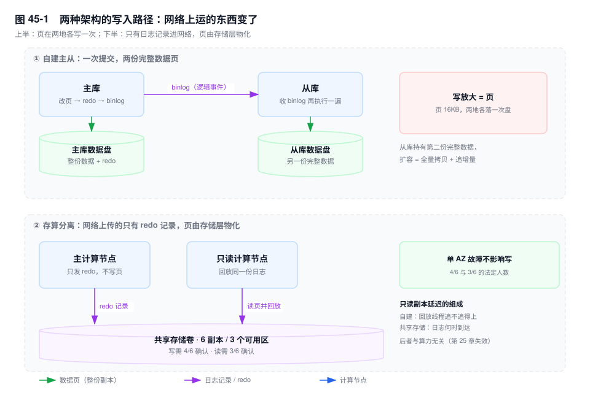
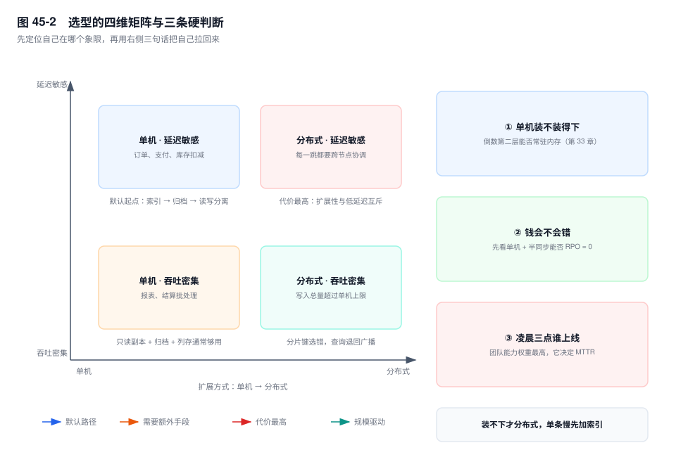

# 第 45 章　云原生 MySQL 与技术选型

> **一句话结论**：云数据库替你接管了机器、备份与复制链路，但没有接管判断；它改掉的是指标的语义和故障的归属，而你手上的判读经验还是按旧语义长出来的。

## 45.0 场景：连接数天天告警，库其实很闲

迁移那周很顺。两个库共 1.2TB，灌了三天，切流当晚 P99 与自建持平。

第二周起，告警每天响三次：连接数使用率超过 80%。

值班的人照第 41 章案例一走了一遍：`SHOW PROCESSLIST` 按 `Command` 分组、看 `Sleep` 的 `Time` 分布、查连接池 `maxActive`、用"副本数 × 池上限"反推该设多少。每一步都对，结论一条都落不下来——`Threads_connected` 八百多，`Threads_running` 常年 3~8；`Sleep` 的 `Time` 大多只有几十秒，不像泄漏；池上限从 100 降到 60，连接数一动不动。

线索在 `Host` 列：八百多个连接，来源只有四个内网地址，不是那 12 个应用 Pod 的 IP。

这四条来自数据库代理。应用连代理，代理再连库；代理自己维持连接池，把几千条客户端连接复用成几百条后端连接。`Threads_connected` 数的是**代理到数据库**这一段，`max_connections` 限制的也是这一段。用"副本数 × 池上限"推这个数，第一步就错了。

云把机器、备份、复制链路接过去了，也改掉了一批指标的语义。**判据只剩一个：这件事在云上归谁负责。**

## 45.1 存算分离：日志变成数据库之后，什么被改变了

自建主从的写入路径：改 Buffer Pool 里的页 → 写 redo → 发 binlog → 从库再执行一遍 → 写自己的页。**网络上运的是逻辑事件，盘上是两份完整的数据页。**

Aurora 只把 **redo 日志记录**发给存储层，不发数据页，由存储层物化成页。写放大从"页"降到"日志记录"——页是 16KB 整块，一条 redo 记录通常只有几十到几百字节，网络上运的东西小了一到两个数量级。

存储层是 6 副本跨 3 个可用区：写要 4 份确认，读只要 3 份。**任意一个可用区整体不可用，写仍拿得到 4 份，读仍拿得到 3 份**，单 AZ 故障既不阻塞写，也不必切换。PolarDB 是同一族思路：共享存储 + redo 卸载 + 只读节点回放日志，细节以厂商当前文档为准。



**第二件被改变的是只读副本的含义。** 自建从库各持一份完整数据，靠回放 binlog 改成一致；存算分离下，只读节点不持有独立副本，回放同一份日志流，页从共享存储读。差别在瓶颈：自建由"回放线程追不追得上"决定，第 25 章那套并行复制调优（`replica_parallel_workers`、`WRITESET`、提交顺序保持）因此有意义；共享存储下回放很轻，延迟花在"日志到达存储、再被只读节点看见"这一段。**瓶颈从算力挪到了传播，调线程数没有用。** 副本延迟从分钟级掉到毫秒级，原因在这里，不是"云上的机器更快"。

**第三件是代价：存储层的延迟不由你控制。** `innodb_io_capacity` 这类旋钮决定"你让本地设备做多少 IO"，页的物化在存储层，它管不到那一段。

"日志即数据库"还意味着职责搬家。原本由 Buffer Pool 刷脏与 doublewrite 承担的"页写到一半断电怎么办"，现在归存储层。第 7 章那套崩溃恢复——分析 redo、回滚未提交事务、补撕裂页——在计算节点上不成立：重启要做的是重连存储、确认日志位点。**拿自建的恢复手册去操作托管实例，第一步就找不到对应的东西。**

## 45.2 云 RDS 的能力边界：四件它替不了你的事

**① 连接语义变了，公式要重算。**

代理做连接复用与读写分离，前提是会话状态可以换后端。一旦开了事务、设了会话变量（`SET @merchant_id = ...`）、建了临时表、拿了 `LAST_INSERT_ID()`、用了 `LOCK TABLES`，代理就只能把它**钉在**同一个后端上。被钉住的连接不参与复用，池化率骤降：业务量没变、连接数忽然涨，而 `PROCESSLIST` 里找不到长事务——钉住它的可能只是一句 `SET @x`。`max_connections` 要按代理池算：后端连接总数 ≈ 代理节点数 × 每个代理的后端池上限，和应用侧连接数脱钩。

**② 只读实例的延迟不由你控制。**

复制链路由云管。自建时你能看 `SHOW REPLICA STATUS` `[8.0.22+]` 的 `Replica_SQL_Running_State`、看 `Exec_Source_Log_Pos` 有没有推进、看回放线程是不是卡在 `Waiting for dependent transaction to commit`；托管实例上这些字段可能被裁剪或为空。**"延迟 3 秒"背后是"日志没到"还是"回放卡住"，决定你该改业务还是提工单。**

**③ 备份恢复是"新建一个实例"。**

恢复出来的是**新实例**，不是"把某个库恢复到当前实例"。PITR 的粒度、保留窗口、最早可回时间点都由产品决定。第 28 章那套 `mysqlbinlog --stop-position` 逐段回放、按库过滤的自助操作，在托管产品上只剩一个"恢复到某时刻"的按钮。要问的是"恢复出来的东西在哪、怎么接回去、多久"。

**④ SQL 洞察只有 digest。**

`events_statements_summary_by_digest` 有 `SCHEMA_NAME`、有 `DIGEST_TEXT`，没有 user 和 host（第 38 章）。云上的洞察通常也是这个粒度，到不了"哪个业务方"。定责还得靠 SQL 注释打标或原始慢日志。

## 45.3 Serverless 与冷启动：什么时候它能省钱，什么时候它会咬你

Serverless 是"按用量计费 + 自动暂停 + 连接由代理收口"的组合，每条都带约束。

适合：低频后台任务（每日对账、报表预生成）、测试环境、昼夜峰谷比高的业务。

不适合的场景有机制原因：

- **长事务。** 暂停判定要等会话结束，一个挂两小时的空闲事务会让实例一直在计费。
- **大批量导入。** 算力按秒计费，一次八小时的导数会把平时省下的钱一次花掉。
- **首包延迟敏感的接口。** 从暂停恢复要拉起计算节点、挂上存储、预热 Buffer Pool。第一次查询的延迟不是稳态延迟，它含冷启动成本。

一句判断：**Serverless 优化的是成本曲线，不是延迟曲线。把它用在延迟敏感路径上，等于把成本问题换成了体验问题。**

## 45.4 K8s 上的 MySQL：Operator 解决编排，不解决 IO

Operator 是一组 CRD 加控制循环。能做的四件事：给实例稳定的网络标识（StatefulSet + headless Service，`mysql-0.mysql` 重启后不变）、按序启停（主库先起、从库后起）、把备份恢复排成 Job、Pod 挂了重新调度。

做不了的只有一件，但它是决定性的：**让网络盘的延迟接近本地盘。**

| | 本地盘 | 网络盘 |
|---|---|---|
| IOPS / 延迟 | 高、低 | 受网络与后端限制，P99 抖动 |
| Pod 漂移后 | 数据不在本机，实例起不来 | 卷跟着挂载走，实例能起来 |
| 恢复方式 | 重建实例 + 从副本追平，以小时计 | 重新挂载，分钟级 |
| 多副本写入 | 不放大 | 每次写多一跳网络，同步副本放大 |

判断标准一句话：**能不能接受"节点故障后这个实例要几小时才回来"。** 这不是 Pod 重启时间，是"重建空实例 + 全量拉一遍 + 追上增量"，第 26 章的 RTO 公式要多加一项。业务 RTO 是分钟级的话，两条路：主库不放进会被随意调度的 Pod（专用节点池 + 本地盘 + 反亲和），或者 Pod 里只放从库。

## 45.5 横向选型：只看机制差异，不看功能列表

功能列表会趋同。要挑的是"改一个决定就改一套运维手法"的差异。

**MySQL 与 PostgreSQL：旧版本存在哪，决定长事务怎么治。**

InnoDB 把旧版本写在 undo 表空间，行上留 `DB_ROLL_PTR` 指向版本链，由 purge 回收（第 5 章）。长事务的代价是 undo 只增不减、`History list length` 单调上涨，**表本身不膨胀**。PG 把旧版本留在表堆里，`UPDATE` 是插入新版本、把旧版本标成死元组，由 `VACUUM` 回收；长事务的代价是**表膨胀**，`autovacuum` 因为长事务持有的快照清不掉死元组。

治理手法因此不同：MySQL 侧是"找到长事务、`KILL`、看 history list 回落"（第 21 章）；PG 侧是"看 `n_dead_tup`、看 `autovacuum` 有没有被阻塞、必要时手工 `VACUUM`"。把"杀掉长事务就好了"搬到 PG 上，杀完了表还是那么大——膨胀不可逆。

其余差异点到为止：PG 没有聚簇索引，堆表加独立索引，主键范围扫描的局部性弱于 InnoDB；index-only scan 依赖 visibility map，而它由 `VACUUM` 维护；MySQL 优化器在复杂查询上弱于 PG，简单点查路径更短。

**MySQL 与 TiDB / OceanBase：买到扩展，付出每一跳。**

分布式买到水平扩展与跨节点强一致事务，代价落在每次事务上：单机点查是一次 B+ 树下降，分布式要先按分片键算出落在哪个节点，再走一次网络，跨分片事务还要一次协调（第 34 章）。

判断标准只有一个：**瓶颈是"单机装不下"还是"单条 SQL 太慢"。** 前者（第 33 章四道闸都过不去）才需要分布式；后者加索引、加只读副本更便宜。分布式不会让没走索引的 SQL 变快，只会让它在更多节点上慢。

## 45.6 选型决策矩阵：四个维度，一个权重最高



数据规模、一致性要求、团队能力决定"能不能选"，成本决定"选完心不心疼"。

**团队能力的权重最高**，因为它决定故障时谁在凌晨三点上线。一个团队 hold 不住的技术栈，MTTR 会比理论值大一个量级：region 调度、vacuum、卷挂载失败，都要有人能读懂它自己的日志。最容易犯的错，是拿别人的案例当自己的能力证明。

三条可执行判断：

1. **数据量在单机能力内，不要上分布式。** 判据是第 33 章那条：倒数第二层索引页装不装得进 Buffer Pool。装得进，点查就一次落盘。
2. **"钱不能错"时，先看单机加半同步能否满足**（第 24、26 章）。`AFTER_SYNC` 加合适副本数能把 RPO 压到 0，比分布式事务便宜。
3. **迁移成本按三年运维成本算，不按迁移工期算。** 工期是一次性投入，运维是每天发生的：多一套监控、一种备份、一类只有一个人会的故障。

## 45.7 关键结论

1. **云数据库改的不是功能，是指标的语义。** 连接数、复制延迟、备份恢复，名字没变，数的东西变了。
2. **存算分离把网络上传的东西从页换成 redo 记录**，代价是存储层延迟不再由你调。
3. **副本延迟的量级差来自架构，不来自参数。** 瓶颈从算力挪到日志传播。
4. **Operator 解决编排，不解决 IO。** 本地盘与网络盘是唯一实质取舍。
5. **Serverless 优化成本曲线，不优化延迟曲线。**
6. **选型第一权重是团队能力**，MTTR 由最懂它的那个人决定。

## 45.8 实验验证

托管产品的系统视图可能被裁剪，三组实验以实际可查为准。

### 实验一：连接是谁建的

```sql
SELECT @@max_connections AS max_conn, @@hostname AS node;
SELECT SUBSTRING_INDEX(HOST, ':', 1) AS peer, COUNT(*) AS n
FROM information_schema.processlist
GROUP BY peer ORDER BY n DESC;
SHOW GLOBAL STATUS WHERE Variable_name IN
  ('Threads_connected', 'Threads_running', 'Max_used_connections');
```

```text
# 输出形态（未实跑，字段含义以此为准）
max_conn  node
4000      rm-xxxx.mysql.rds.example.com

peer          n
10.12.3.41    412
10.12.3.42    398
172.16.8.9      3
```

`peer` 只有两三个内网地址、条数远多于应用副本数，就是代理；`n` 很小的是监控直连。

### 实验二：只读延迟的组成

```sql
SHOW REPLICA STATUS\G
```

取两次，间隔十秒，看 `Exec_Source_Log_Pos` 有没有推进。

```text
# 输出形态（未实跑，字段含义以此为准）
Replica_IO_Running: Yes
Replica_SQL_Running: Yes
Replica_SQL_Running_State: Waiting for dependent transaction to commit
Seconds_Behind_Source: 0          <- 可能为 NULL，或被产品改写
Exec_Source_Log_Pos: 812344       <- 十秒后仍是这个数，说明卡在回放
```

字段为 `NULL` 时，用"复制延迟"与"只读节点 CPU"对照：延迟涨、CPU 低是日志没到，反之是回放在追。

### 实验三：被钉住的连接长什么样

```sql
SELECT COMMAND, COUNT(*) AS n, MIN(TIME) AS min_t, MAX(TIME) AS max_t
FROM information_schema.processlist GROUP BY COMMAND;

SELECT trx_id, trx_state, trx_started,
       TIMESTAMPDIFF(SECOND, trx_started, NOW()) AS secs
FROM information_schema.innodb_trx ORDER BY secs DESC LIMIT 5;
```

```text
# 输出形态（未实跑，字段含义以此为准）
COMMAND   n     min_t   max_t
Sleep     612     31      47     <- 分布很窄：池里的空闲连接
Query       9      0       0

trx_id     trx_state  secs
4211337    RUNNING    1840     <- 一条开了半小时的事务，钉住了一条连接
```

`Sleep` 的 `Time` 分布很窄，说明是池子批量建立又没人用的连接；`innodb_trx` 里的长事务就是钉住其中一条的原因。该表在部分托管实例上只对高权限开放。

## 45.9 常见误区

⚠️ **"云 RDS 就不用管参数了"**
默认值只适合大多数人。刷脏预算、`max_connections`、`wait_timeout` 仍要按业务算，只是有些参数产品不开放。**能改的变少了，要判断的没变少。**

⚠️ **"共享存储，所以只读副本一定没延迟"**
共享存储消除"重新执行一遍"，不消除"日志到达"：只读节点仍要等日志写进存储、再读进缓存。小一个量级不等于 0。

⚠️ **"上 K8s 就是云原生"**
云原生是把生命周期交给声明式控制，K8s 只是一种实现。主库塞进会被调度的 Pod、用网络盘、不做反亲和，得到的是"能自动重启的 MySQL"，RTO 可能更差。**编排能力不等于数据可靠性。**

⚠️ **"分布式数据库能解决慢查询"**
分布式解决容量与写入总量，不解决单条 SQL 的路径。一条没走索引的 SQL 会被放大成"每个分片都扫一遍"，再加一次汇总。解法没变：先看执行计划。

## 45.10 生产 Checklist：选型评审要问的 10 个问题

- [ ] 瓶颈是"装不下"还是"单条慢"？有数据吗？
- [ ] 连接上限按副本算还是按代理池算？差多少？
- [ ] 有多少连接会被会话状态（`SET @x`、临时表）钉住？
- [ ] 只读延迟 SLO 是多少？能区分"日志没到"和"回放卡住"吗？
- [ ] 恢复演练做过吗？接到业务要几步、多久？
- [ ] PITR 窗口与最小粒度？能只恢复一张表吗？
- [ ] 故障时谁上线？他还在团队里吗？
- [ ] 节点故障后多久能恢复写入（第 26 章）？
- [ ] "钱不能错"时，单机加半同步够不够，为什么不够？
- [ ] 三年运维成本算过吗（含演练与稀缺技能）？

## 45.11 延伸

- **关联章节**：第 22、25、26、28、33 章（复制、并行复制失效、RTO、PITR、拆分），第 41 章案例一（连接数）。
- **面试追问**："只读副本延迟为什么低一个量级？"→ 只回放日志、页从共享存储读；"云上 `Threads_connected` 高先查什么？"→ 先看 `Host` 是否为代理地址；"什么时候不该上分布式？"→ 单机装得下、瓶颈是单条 SQL。
- **官方文档**：Aurora 存储与 quorum、PolarDB 共享存储架构、MySQL 8.0 `Replication` 与 `Performance Schema` 手册、Kubernetes `StatefulSet` 与 Operator 模式。产品细节以厂商当前文档为准。
